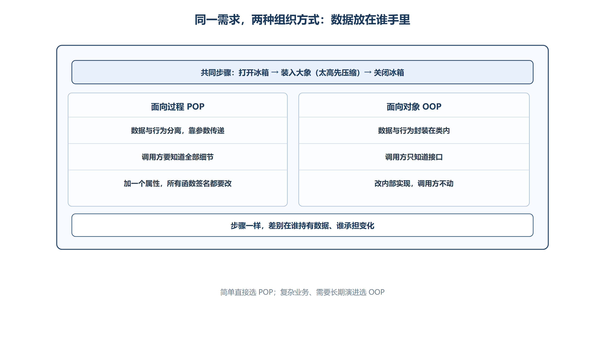

# 第二章 类与对象基础
## 2.1 类与对象（Class and Object）
### 2.1.1 核心定义
**类 (Class)**

```cpp
class 类名 {
    //成员函数
    
    //成员属性
};
```

类是对一类对象的**抽象描述**：它把状态（数据）与操作状态的行为（函数）组织在同一个类型中；对象则是该类型在运行时的具体实例。

**基本思想**：数据抽象 (Data Abstraction) 和 封装 (Encapsulation)

**结构**：

+ **数据成员 (Data Members)**
    - **数据成员**通常被称为**成员属性**、**成员变量**，是类类型对象组成部分的变量。它们定义了对象的**状态 (State)**，占据对象的内存，描述对象“是什么”
        * **非静态数据成员**：每个类对象（实例）都拥有自己独立的一份拷贝。
        * **静态数据成员**：属于类本身，所有对象共享同一份拷贝。
    - _存储布局_：非静态数据成员构成对象状态，成员之间可能因内存对齐插入填充字节。继承、虚函数、访问控制和 ABI 都可能影响具体布局，因此不能把“对象地址等于第一个成员地址”当作所有类型都成立的通用规则。
    - _注意：_
        1. **初始化规则**：没有类内初始化器且未在构造函数初始化列表中初始化的内置类型成员，其值可能不确定；类类型成员会按其构造规则初始化。应优先使用类内初始化器或构造函数初始化列表明确初值。
        2. 裸指针不会自动变成 `nullptr`，需要显式初始化，例如 `char* m_p = nullptr;`。
+ **成员函数 (Member Functions)**
    - **成员函数**通常被称为**成员方法**，是定义在类作用域内的函数。它们定义了对象的**行为 (Behavior)** 或对对象状态的操作，存在于代码区，通过 `this` 指针操作数据成员，描述对象“能做什么”
    - 成员函数的特性
        1. **隐式 `this` 指针**：**非静态成员函数**拥有一个指向当前对象的隐含指针。**静态成员函数**没有 `this`，因此不能直接访问非静态成员。
        2. **Const 成员函数**：在参数列表后加 `const`（如 `void show() const;`）。承诺不修改对象的任何非静态数据成员（除非成员被声明为 `mutable`）。`const` 对象只能调用 `const` 成员函数。
        3. **隐式 inline**：在类定义内部定义的成员函数具有 `inline` 语义，允许相同定义出现在多个翻译单元中；是否真正内联展开仍由编译器优化器决定。
        4. **特殊成员函数 (Special Member Functions)**：编译器可能隐式声明默认构造、析构、拷贝构造、拷贝赋值，以及 C++11 起的移动构造和移动赋值；它们是否生成、删除或被其他声明抑制，要结合类的成员和用户声明判断。

| 特性 | 数据成员 (Data Members) | 成员函数 (Member Functions) |
| :--- | :--- | :--- |
| **本质** | 变量 (存储状态) | 函数 (执行逻辑) |
| **内存归属** | 非静态成员占用对象内存空间 | 代码存储在代码区，不占用对象内存空间 |
| **This 指针** | 不适用 | 非静态函数有 `this`，静态函数无 `this` |
| **访问权限** | `public`/`private`/`protected` | `public`/`private`/`protected` |
| **初始化** | 构造函数初始化列表 / 类内初始化 | 无需初始化，直接定义实现 |
| **Const 修饰** | 可被 `mutable` 修饰 (在 const 函数中可变) | 函数本身可被 `const` 修饰 (承诺不修改对象) |
| **Static 修饰** | 属于类，共享内存 | 属于类，无 `this` 指针 |


**对象 (Object)**

对象是类的**具体实例**，是真正存在于内存中的实体。

**代码示例**

```cpp
class People {
public:
    //成员属性
    //类成员属性无默认初始化值
    string m_name;//姓名
    int m_age;//年龄
    bool m_sex;//性别
    char* m_p;//指针成员属性，默认值为nullptr

    //成员函数
    void walk() {
        cout << m_name << "正在走路" << endl;
    }

    void show() {
        cout << "name:" << m_name << ",age:" << m_age << ",sex:" << m_sex << endl;
    }
};

People peo;//实例化对象（栈区），自动调用构造函数
```

> **注意**：示例注释中的“指针成员默认值为 `nullptr`”不是语言规则。若构造函数没有为 `m_p` 赋值，它可能保存不确定值；可靠写法是类内初始化 `char* m_p = nullptr;`，或在每个构造函数的初始化列表中初始化它。

### 2.1.2 封装的优点
1. 确保不会无意间破坏封装对象的状态（通过 `private` 保护）。
2. 类的具体实现细节可以随时改变，无需调整使用者代码（接口不变，内部实现可变）。

---

## 2.2 类成员访问控制（Access Control）
### 2.2.1 类与结构体的区别
在 C++ 中，`class`（类）和 `struct`（结构体）非常相似，主要区别在于**默认的访问权限**。

+ **类（`class`）**：默认访问权限是 `private`。
+ **结构体（`struct`）**：默认访问权限是 `public`。

| 特性 | class (类) | struct (结构体) |
| :--- | :--- | :--- |
| **默认访问权限** | **private** (私有) | **public** (公有) |
| **用途倾向** | 常用于强调封装的数据与行为 | 常用于默认公开的数据结构；同样可以拥有构造、继承和虚函数，并不天然等于 POD |


### 2.2.2 三种访问权限
| 修饰符 | 权限范围 | **用途** |
| :--- | :--- | :--- |
| `private` | 成员只能在**类内部**使用 (私有)（_注：_`class`_ 默认即为 `private`。_） | 隐藏内部实现细节，保护数据不被外部随意修改 |
| `protected` | 成员只能在**类内部**和**子类**中使用 (受保护) | 用于继承体系，允许子类访问父类成员，但对外部隐藏 |
| `public` | 成员可以在**任何地方**使用 (类内、类外、子类) | 提供对外的接口（如成员函数） |


---

## 2.3 构造函数（Constructor）
### 2.3.1 作用
+ **给定初始化值**：在对象创建时，自动给成员属性赋初值。

```cpp
类名 对象名;//自动调用无参构造函数
```

### 2.3.2 语法规则
1. **函数名**：必须与**类名完全相同**。
2. **返回值**：**没有返回值**（连 `void` 都不能写）。
3. **调用时机**：定义对象时**自动调用**，无需手动调用。
4. **重载**：一个类中可以定义**多个**构造函数（参数列表不同），形成函数重载。

```cpp
类名()
{
    //函数体
}
```

### 2.3.3 编译器的默认行为
+ **隐式默认构造**：如果类没有声明任何构造函数，编译器会隐式声明默认构造函数；在真正需要时，它才会被定义。该函数仍需按规则构造基类和类类型成员，不应简单理解为“永远是空函数”。
+ **自定义后**：如果类中声明了任意构造函数，编译器就**不再隐式声明**无参默认构造函数。
    - _影响_：如果定义了有参构造，想使用无参构造，必须手动定义无参构造函数。
    - _代码体现_：代码中定义了 `People()` 和 `People(string, int)`，因此编译器不再生成额外的默认构造。

### 2.3.4 构造函数重载
一个类中可以定义**多个**构造函数，关系为**函数重载**。

+ _代码体现_：

```cpp
//无参构造
People() {
    m_name = "张三";
    m_age = 20;
    m_sex = true;//男

    m_p = new char[10] {"123"};
}
//有参构造
People(const string &name,const int age) {
    m_name = name;
    m_age = age;
    m_sex = true;//男

    m_p = new char[10] {"abc"};
}
```

---

## 2.4 析构函数（Destructor）
### 2.4.1 作用
+ **自动调用**：对象生命周期结束时，析构函数负责完成该对象拥有资源的清理。
+ **资源职责**：如果类直接拥有 `new` 得到的资源，就必须确保资源最终只释放一次；现代 C++ 更推荐用 `std::string`、`std::vector`、`std::unique_ptr` 等 RAII 类型，让成员自己的析构函数完成清理。
+ **销毁顺序**：先执行当前类析构函数体，再按构造的逆序销毁成员和基类子对象，最后释放对象自身的存储。对象不一定在栈上，也可能位于动态存储区、静态存储区或另一个对象内部。
    - _代码体现_：上述构造函数代码中的`m_p` 是 `new` 出来的堆区内存，必须在析构中 `delete[]`

### 2.4.2 语法规则
1. **函数名**：类名相同，前面加上 `~`
2. **参数**：**无参数**
3. **返回值**：没有返回类型，连 `void` 也不能写
4. **不能重载**，一个类中只有一个析构函数
5. **调用时机**：对象销毁前**自动调用**

```cpp
~类名(){
    //函数体
}
```

**代码例子：**

```cpp
~People() {
    if (m_p) {
        delete[] m_p;
        m_p = nullptr;
    }
}
```

### 2.4.3 编译器的默认行为
+ **未声明析构时**：编译器会隐式声明析构函数；即使函数体看起来为空，它仍会依次销毁基类和类类型成员。
+ **自定义后**：一旦用户声明析构函数，编译器不会再隐式生成另一份析构函数；同时还会影响移动操作的隐式生成规则。

### 2.4.4 析构顺序（重点）
**栈区对象**

在 `main` 函数中定义的对象（如 `People peo;`）通常分配在**栈区（Stack）**。

+ **创建**：执行到定义语句时，调用构造函数。
+ **销毁**：超出作用域（如 `main` 函数结束）时，自动调用析构函数。

**销毁顺序 (LIFO)**

栈区对象的销毁遵循 **后进先出 (Last In First Out)** 原则。

+ 后定义的对象位于栈顶，先被销毁。
+ 先定义的对象位于栈底，后被销毁。

_代码分析_：

```cpp
int main() {
    People peo;      // 1. 调用 peo 的无参构造 (栈底)
    // ... 使用 peo
    
    People peo2("李四", 25); // 2. 调用 peo2 的有参构造 (栈顶)
    // ... 使用 peo2
    
    return 0;        // 3. main 结束，开始销毁
                     // 3.1 先调用 peo2 的析构 (栈顶)
                     // 3.2 后调用 peo 的析构 (栈底)
}
```

从更完整的对象生命周期看，可以按以下步骤理解：

1. **准备存储**：为对象准备满足其大小和对齐要求的存储空间。
2. **构造对象**：依次构造基类和成员，再执行当前类的构造函数体；完成后对象进入可用期。
3. **使用对象**：在对象的有效生命周期内，通过成员函数等方式安全访问对象。
4. **析构并释放存储**：生命周期结束时，先执行当前类的析构函数体，再按构造的逆序析构成员和基类，最后释放对象占用的存储。

上面的真实 C++ 示例中，这些步骤由对象定义和作用域自动触发，不需要手动调用构造函数或析构函数。

### 2.4.5 全局回收
+ 全局区定义的对象在程序退出时回收对象（调用析构），发生在主函数返回之后

---

## 2.5 完整代码解析
以下是基于示例代码的语法结构总结：

```cpp
#include<iostream>
using namespace std;

// 1. 类定义
class 类名 {
    // 2. 访问控制
public: 
    // 3. 成员属性
    数据类型 属性名; 

    // 4. 构造函数 (初始化)
    类名 (参数列表) {
        // 初始化代码
        // 堆区内存分配：new
    }

    // 5. 析构函数 (清理)
    ~类名 () {
        // 清理代码
        // 堆区内存释放：delete
    }

    // 6. 成员函数 (行为)
    返回值类型 函数名 (参数) {
        // 功能实现
    }
};

// 7. 主函数
int main() {
    // 8. 对象实例化 (自动调用构造)
    类名 对象名;//调用无参构造
    类名 对象名(参数);//调用有参构造

    // 9. 成员访问
    对象名.属性 = 值;
    对象名.函数名();

    return 0; // 超出作用域，自动调用析构
}
```

---

## 2.6 注意事项
1. **内存配对**：`new` 必须对应 `delete`，`new[]` 必须对应 `delete[]`。示例中 `m_p = new char[10]` 对应 `delete[] m_p`。
2. **深拷贝问题**：示例代码中包含了裸指针 `char* m_p`。如果发生对象拷贝（如 `People p3 = p1;`），默认的拷贝构造函数会进行**浅拷贝**（只复制指针地址）。当两个对象析构时，会对同一块内存释放两次，导致程序崩溃。
    - _建议_：如果类管理了堆区资源，需要手动重写**拷贝构造函数**和**拷贝赋值运算符**（即 C++ 中的 "Rule of Three"）。
3. **初始化列表**：虽然示例中使用赋值初始化（`m_name = "张三"`），但在 C++ 中更推荐使用**成员初始化列表**，效率更高。
    - _优化写法_：`People() : m_name("张三"), m_age(20) {}`
4. **指针置空**：释放内存后，习惯将指针赋值为 `nullptr`，防止后续误用成为悬空指针。

---

## 2.7 面向过程与面向对象
### 2.7.1 面向过程编程（POP）
#### （1） 核心定义
**面向过程编程**：以过程为中心，强调功能和步骤，程序由一系列函数组成，每个函数完成特定的任务，函数之间通过参数传递数据，程序的执行流程由函数调用决定

+ **定义**：一种以**过程 (Process)** 为中心的编程模型
+ **思想**：将问题分解为一系列要执行的计算步骤（流程），用函数封装好形成一个一个的模块
+ **主体**：**函数 (模块)**。始终关注“怎么一步一步解决问题”，实现函数的顺序执行
+ **流程**：自上向下，顺序执行，逐步细化。在主流程中按照具体步骤调用相应的函数

#### （2） 代码实现分析
下面通过独立函数与全局/局部变量的分离，观察面向过程写法的组织方式。

+ **数据与行为分离**：
    - 数据（大象高度 `heightEle`、冰箱高度 `heightRefrig`）定义在 `main` 函数中。
    - 行为（打开、装象、关闭）定义为独立的 `void` 函数。
+ **数据传递**：
    - 函数之间通过**参数传递**数据。例如 `PushElephant` 需要接收冰箱高度、大象高度和指针。
+ **流程控制**：
    - `main` 函数像剧本一样，按顺序调用 `Open` -> `Push` -> `Close`。

**代码片段 (POP)：**

```cpp
// 数据定义在外部
int heightEle = 10;//大象的高度
int heightRefrig = 10;//冰箱的高度
int* pEle = nullptr;//冰箱装的东西

//打开冰箱
void OpenRefrigerator() {
    cout << "用手抓住冰箱门把手" << endl;
    cout << "缓慢打开门" << endl;
    cout << "拉到一定大的角度" << endl;
}

//装大象
//参数1： 指向大象的指针，参数2：冰箱的高度，参数3：大象的高度
void PushElephant(int* pEle, int& heightRefrig, int& heightEle) {
    cout << "找到冰箱的最大格子" << endl;
    if (heightRefrig < heightEle) {    //比较高度，如果冰箱高度小于大象高度，则压缩大象
        cout << "压缩一下大象" << endl;
        heightEle = 5;   //大象高度压缩到5
    }
    pEle = &heightEle;   //冰箱中指向大象的指针，指向了大象
    cout << "大象放到冰箱里" << endl;
}

//关冰箱
void CloseRefrigerator() {
    cout << "开始推动冰箱门" << endl;
    cout << "继续推动冰箱门" << endl;
    cout << "冰箱门严丝合缝" << endl;
}

int main() {
    // 主流程控制步骤
    
    //开始打开冰箱
    OpenRefrigerator();
    //结束打开冰箱
    
    //开始装大象
    PushElephant(pEle, heightRefrig, heightEle);
    //结束装大象
    
    //--开始关闭冰箱I
    CloseRefrigerator();
    //结束关闭冰箱
    
    return 0;
}
```

---

### 2.7.2 面向对象编程（OOP）
#### （1） 核心定义
+ **定义**：一种以**对象 (Object/数据)** 为中心的编程模型。
+ **思想**：将问题分解成各个**对象**（实体），而不是流程步骤。
+ **主体**：**对象**。每个事物都可以是一个独立的对象，其都有自己的属性和行为，专注于对象与对象之间（通过方法）的**交互**（而不是数据和方法、方法与方法）
+ **目的**：对象的目的不是为了完成一个步骤，而是为了描述某个对象在解决整个问题步骤中的属性和行为
+ **封装**：涉及到的属性（数据）和方法（行为）都被**封装**到一起包含在其内部。
+ **分析步骤**：
    1. 分析问题中有哪些**实体** (如：大象、冰箱)。
    2. 确定实体有什么**属性**和**方法**。
    3. 通过调用实体的方法解决问题。
    4. **核心理念**：实体是动作的支配者，没有实体就没有动作发生。

#### （2） 代码实现分析
下面通过 `class` 定义和对象间的消息传递，观察面向对象写法的组织方式。

+ **抽象类 (Class)**：
    - `class Ele`：抽象出“大象”实体，包含属性 `heightEle`。
    - `class Refrig`：抽象出“冰箱”实体，包含属性 `heightRefrig` 和行为 `Open`, `Push`, `Close`。
+ **封装 (Encapsulation)**：
    - 冰箱的高度 `heightRefrig` 和操作冰箱的方法 `OpenRefrigerator` 被封装在 `Refrig` 类内部。
+ **对象交互**：
    - `main` 函数不再关注具体步骤细节，而是指挥对象。
    - `ref.PushElephant(ele)`：冰箱对象接收大象对象，内部自行处理逻辑（如判断高度、压缩大象）。

**代码片段 (OOP)：**

```cpp
// 1. 抽象实体 (类)
class Ele{
public:
    int heightEle;

    Ele() {
        heightEle = 10;
    }
};
//抽离出来的冰箱类
class Refrig {
public:
    int heightRefrig;
    Ele * pEle;

    // 2. 封装行为 (方法)
    //打开冰箱
    void OpenRefrigerator() {
        cout << "用手抓住冰箱门把手" << endl;
        cout << "缓慢打开门" << endl;
        cout << "拉到一定大的角度" << endl;
    }

    //装大象
    //参数1： 指向大象的指针，参数2：冰箱的高度，参数3：大象的高度
    void PushElephant(Ele& ele) {
        cout << "找到冰箱的最大格子" << endl;
        if (heightRefrig < ele.heightEle) {    //比较高度，如果冰箱高度小于大象高度，则压缩大象
            cout << "压缩一下大象" << endl;
            ele.heightEle = 5;   //大象高度压缩到5
        }
        pEle = &ele;   //冰箱中指向大象的指针，指向了大象
        cout << "大象放到冰箱里" << endl;
    }

    //关冰箱
    void CloseRefrigerator() {
        cout << "开始推动冰箱门" << endl;
        cout << "继续推动冰箱门" << endl;
        cout << "冰箱门严丝合缝" << endl;
    }
};

int main() {
    //面向对象思想
    // 3. 实例化对象
    Ele ele;
    Refrig ref;

    // 4. 对象交互 (消息传递)
    ref.OpenRefrigerator();
    ref.PushElephant(ele); // 冰箱对象“吃进”大象对象
    ref.CloseRefrigerator();
    return 0;
}
```

---

### 2.7.3 面向过程与面向对象对比



*图：步骤相同，差别在数据归谁所有、变化由谁承担——POP 靠参数传递，OOP 把数据和行为封在一起。*

| 维度 | 面向过程 (POP) | 面向对象 (OOP) |
| :--- | :--- | :--- |
| **核心关注点** | **过程/步骤** (怎么做) | **对象/实体** (谁来做) |
| **基本单元** | 函数 (Function) | 类/对象 (Class/Object) |
| **数据与行为** | **分离**。数据作为参数传递给函数。 | **封装**。数据和方法绑定在类内部。 |
| **思维模式** | 线性思维，按步骤执行。 | 模拟现实世界，实体间交互。 |
| **代码耦合度** | **高**。函数依赖具体的数据结构，数据结构变化需修改所有相关函数。 | **低**。对象内部实现改变不影响外部调用 (只要接口不变)。 |
| **扩展性** | 较难。增加新功能可能需要修改多个函数。 | 较易。通过继承、多态或新增类来扩展。 |
| **适用场景** | 嵌入式、脚本、简单任务、性能极度敏感场景。 | 大型系统、复杂业务逻辑、GUI 开发、游戏开发。 |


---

### 2.7.4 案例：“把大象装进冰箱”
#### （1） 步骤分解
无论是 POP 还是 OOP，解决问题的逻辑步骤是一致的：

1. **打开冰箱**
2. **装大象** (涉及逻辑判断：如果大象太高，需要压缩)
3. **关闭冰箱**

#### （2） 实现差异
+ **POP 实现**：
    - `main` 函数知道所有细节。它知道要传 `heightEle` 给 `PushElephant` 函数。
    - 如果冰箱增加了“温度”属性，所有操作冰箱的函数签名都需要修改。
+ **OOP 实现**：
    - `main` 函数只知道 `ref` 是一个冰箱，可以 `Open` 和 `Push`。
    - `ref` 内部如何存储大象（指针 `pEle`），如何判断高度，对外部透明。
    - 如果冰箱增加“温度”属性，只需修改 `Refrig` 类内部，`main` 函数无需改动。

#### （3） 代码中的关键细节
+ **指针与引用**：
    - POP 中：`void PushElephant(int* pEle, int& heightRefrig, int& heightEle)`，参数列表长，容易出错。
    - OOP 中：`void PushElephant(Ele& ele)`，直接传递对象引用，语义清晰（把大象装进去）。
+ **状态维护**：
    - OOP 中 `Refrig` 类内部有 `Ele * pEle`，冰箱对象自己“记住”了里面装了什么。
    - POP 中 `pEle` 定义在 `main` 中，冰箱函数本身不保存状态，依赖外部变量。

---

