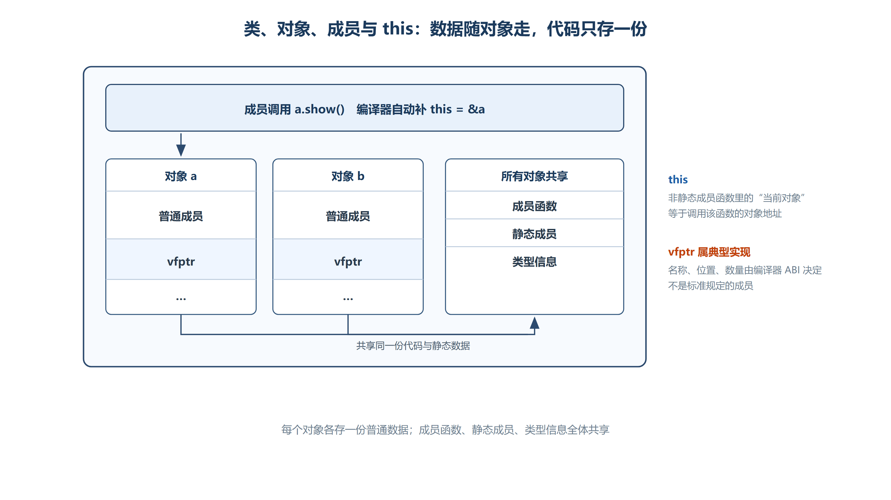
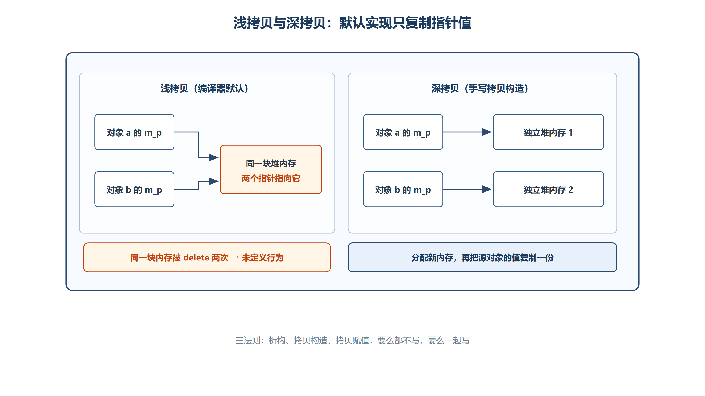

# 第三章 类成员进阶
## 3.1 类成员
### 3.1.1 成员变量（Member Variables）
+ **归属**：属于**对象 (Object)**。
+ **存在时机**：包含在对象之中，**定义对象时才会存在**。
+ **内存分布**：定义多个对象时，属性存在**多份**，彼此互不干扰。
+ **代码体现**：

```cpp
class A {
public:
    // 成员属性，每个 A 的对象都有独立的 m_a
    int m_a; 
};
```

### 3.1.2 成员函数（Member Functions）
+ **归属**：属于**类 (Class)**。
+ **存在时机**：在**编译期**函数代码就存在了，存在与否与是否定义对象无关。
+ **内存分布**：代码存储在代码区，**所有对象共享一份**函数代码，不占用对象的内存空间。
+ **代码体现**：

```cpp
class A {
public:
    // 成员函数，所有 A 的对象共用这段代码
    void fun() { 
        cout << "fun" << endl;
    }
};
```

---

### 3.1.3 对象的内存占用
计算类对象的大小时，只考虑成员属性，不考虑成员函数。

#### （1） `sizeof` 规则
+ **含义**：`sizeof(对象名)` 和 `sizeof(类名)` 含义一样，指用这个类型定义的变量所占用空间的大小。
+ **计算公式**：**对象大小 = 所有非静态成员属性大小之和**（需考虑内存对齐）。
+ **不包含函数**：成员函数不占用对象内存空间。

#### （2） 空类特殊情况
+ **规则**：当类为空类时（即类内无成员函数与成员变量），`sizeof()` 的结果是 **1**。
+ **原因**：
    1. **占位**：表明对象真实存在于内存空间。
    2. **区分标识**：为了区分各个不同的对象（每个对象必须有唯一的地址）。

#### （3） 代码示例分析
```cpp
class A {
public:
    int m_a; // 4 字节
    void fun(); // 不占空间
};

class B{
    
};

int main() {
    A a;
    // 输出 4，只需要计算成员属性的大小即可，计算对象大小，不包含函数
    cout << sizeof(A) << endl; 
    cout << sizeof(a) << endl; 
    
    cout << sizeof(B) << endl;//1 
    
    return 0;
}
```

---

### 3.1.4 成员函数地址
非静态成员函数的地址是**成员函数指针**，它不仅描述函数入口，还要配合具体对象调用，因此不同于普通函数指针。

+ **语法**：`&类名::函数名`
+ **调用方式**：`(对象.*成员函数指针)(参数...)` 或 `(对象指针->*成员函数指针)(参数...)`。
+ **实现边界**：成员函数指针的表示可能包含函数地址之外的信息，不能可移植地当作 `void*` 用 `%p` 打印。下面的打印语句只适合作为特定编译器环境中的观察代码。

**代码示例**

```cpp
// 取成员函数的地址
// &类名::函数名;
printf("%p\n", A::fun); // 打印函数在代码区的地址
```

---

### 3.1.5 完整代码解析
```cpp
#include<iostream>
using namespace std;

class A {
public:
    int m_a;      // [成员属性] 属于对象，占 4 字节
    void fun() {  // [成员函数] 属于类，不占对象空间
        // 概念模型：编译器隐式传入指向当前对象的 A* this_ptr
        // 访问 m_a 实际是访问 this->m_a
        cout << "fun" << endl;
    }
};

int main() {
    A a; 
    // [类空间占用] 只计算属性 int (4 字节)
    cout << sizeof(A) << endl; // 4
    cout << sizeof(a) << endl; // 4

    // [取成员函数地址] 函数代码在代码区，地址固定
    printf("%p\n", A::fun); 

    return 0;
}
```

`this` 指针是 C++ 面向对象编程的核心机制，用于区分同一个类的不同对象。

## 3.2 `this` 指针
### 3.2.1 `this` 指针的本质
**定义与类型**

+ **隐藏参数**：在**非静态成员函数**的参数列表中，隐藏着一个 `this` 指针，由编译器默认添加。
    - **特例**：**静态成员函数（`static`）没有隐藏的 `this` 指针**，因此静态函数不能直接访问非静态成员。
+ **概念模型**：可以把 `this` 理解为编译器传入且不能改指向的隐藏对象指针。
    - 在普通成员函数中，`this` 表达式指向当前 `A` 对象，类型为 `A*`；不能给关键字 `this` 重新赋值。
    - 在 `const` 成员函数中，`this` 指向常量对象，类型为 `const A*`，因此不能借它修改普通数据成员。

**存在范围**

+ **非静态成员函数**：包括构造函数、析构函数、普通成员函数，**都有** `this` 指针。
+ **静态成员函数（`static`）**：**没有**隐藏的 `this` 指针。
    - _原因_：静态函数属于类，不属于具体对象，无法区分是哪个对象调用的。
    - _限制_：静态函数不能直接访问非静态成员属性或函数。

**代码例子**

```cpp
class A {
public:
    // 普通成员函数，隐含 this
    void show(/* 概念参数：A* this_ptr */) { 
        cout << "show" << endl;
    }

    // 构造函数，隐含 this
    A(int m_a) {
        this; // this 指针存在，可作为表达式
    }
};
```

---

### 3.2.2 `this` 指针的作用
**指向当前对象**

```plain
**区分对象**：`this`指针指向的是**当前的对象**（即调用这个函数的对象），因此可以用于区分不同对象对函数的调用。当多个对象调用同一个成员函数代码时，编译器通过传入不同的 `this` 指针值，确保函数操作的是正确的对象数据。
```

**对象与成员的桥梁**

+ **隐式调用**：在类中使用成员（成员函数、成员变量）都是通过 `this` 指针隐式调用
+ **机制**：`this` 作为对象和成员之间的桥梁，通过它找到成员在内存中的位置

---

### 3.2.3 `this` 指针的隐式与显式使用
编译器会自动加上 `this` 指针，以下写法是等价的：

| 隐式写法 (编译器自动补全) | 显式写法 (等价) | 说明 |
| :--- | :--- | :--- |
| `m_a` | `this->m_a` | 访问成员属性 |
| `m_a` | `this->A::m_a` | 访问成员属性 (带类名) |
| `show()` | `this->show()` | 调用成员函数 |



*图：普通数据成员随对象分别保存；成员函数、类型信息与静态成员由对象共享。`vfptr` 仅表示常见多态实现，不是标准规定的成员名。*

**代码例子**

```cpp
class A
{
public:
    int m_a;

    void fun() {
    // 以下写法等价，编译器会自动加上 this
    m_a;            // 隐式：this->m_a
    this->m_a;      // 显式
    this->A::m_a;   // 显式带类名

    show();         // 隐式：this->show()
    this->show();   // 显式
    }

    void show(/* 概念参数：A* this_ptr */)
    {
        cout << "show" << endl;
    }
};
```

---

### 3.2.4 常见应用场景
多数情况下无需显式写出 `this` 指针，编译器会自动处理，以下为显示写出的场景

#### （1） 解决名称冲突（Name Collision）
当成员函数的**形参名**与**成员属性名**相同时，直接赋值会导致“形参自己给自己赋值”。此时必须使用 `this` 指针区分。

+ **错误写法**：`m_a = m_a;` （形参赋值给形参，成员未变）
+ **正确写法**：`this->m_a = m_a;` （形参赋值给成员属性）

```cpp
A(int m_a) {
    // m_a = m_a; // 形参自己给自己赋值，无意义
    this->m_a = m_a; // 形参给成员函数赋值，正确
}
```

#### （2） 返回当前对象（`*this`）
+ **用途**：支持**链式调用**（如 `cout << a << b` 或 `obj.setA(1).setB(2)`）。
+ **语法**：`return *this;`

```cpp
return *this; // 作为对象的角色补全语法，补全表达式
```

+ **含义**：`this` 是指针，`*this` 是解引用后的对象本身。

#### （3） 检查对象有效性
不要用 `if (this == nullptr)` 作为成员函数的自救逻辑。通过空指针调用非静态成员函数时，未定义行为在进入函数体之前就已经发生；即使某次运行恰好执行到这条判断，也不能据此认为调用安全。应在调用端验证对象指针，或改用引用、智能指针表达更明确的非空与所有权约束。

---

### 3.2.5 完整代码解析
```cpp
class A {
public:
    int m_a; // 成员属性

    // 1. 普通成员函数
    void fun() {
        // 编译器自动补充 this 指针
        // 等价于：this->m_a;
        m_a; 
        
        // 显式使用 this
        this->m_a;
        this->A::m_a; // 带类名限定，完全等价

        // 函数调用同理
        show();        // 等价于 this->show()
        this->show();  // 显式调用
    }

    // 2. 成员函数定义
    // 概念模型约为：void show(A* this_ptr)
    void show(/* 概念参数：A* this_ptr */) {
        cout << "show" << endl;
    }

    // 3. 构造函数
    // 概念模型约为：A(A* this_ptr, int m_a)
    A(int m_a) {
        this; // 语句合法，表示 this 指针存在，但无实际操作

        // 名称冲突场景
        m_a = m_a;          // 【错误逻辑】形参 shadowing 成员，成员 m_a 未初始化
        this->m_a = m_a;    // 【正确逻辑】通过 this 明确指定左侧为成员属性

        // this 作为表达式
        // 可用于返回 *this 实现链式调用，此处仅演示存在性
    }

    // 4. 析构函数
    // 也有 this 指针，用于清理当前对象资源
    ~A() {
        this; // 演示 this 在析构中依然存在
    }
};

int main() {
    // 实例化对象时，构造函数自动传入对象地址作为 this
    A a(10); 
    a.fun(); // 调用 fun 时，a 的地址作为 this 传入
    return 0;
}
```

---

### 3.2.6 特殊情况与注意事项
**静态成员函数 (Static Member Functions)**

+ **规则**：静态成员函数**没有**隐藏的 `this` 指针。
+ **后果**：
    - 不能访问非静态成员属性（因为没有 `this` 找不到对象）。
    - 不能调用非静态成员函数。
    - 不能被声明为 `const`。

**Const 成员函数 (Const Member Functions)**

+ **规则**：如果成员函数声明为 `void fun() const`。
+ **this 类型变化**：`this` 表达式指向 `const ClassName`，概念上可理解为 `const ClassName*`。
+ **限制**：不能通过 `this` 修改对象的任何非静态成员属性（除非属性被 `mutable` 修饰）。

**构造函数与析构函数**

+ **存在性**：都有 `this` 指针。
+ **显式使用**：多数情况下无需显式写出 `this` 指针，但在初始化列表或名称冲突时需要。
+ **注意**：在构造函数 body 执行前，对象尚未完全构建，此时调用虚函数等行为需谨慎（但 `this` 指针本身是有效的）。

---

### 3.2.7 总结
| 特性 | 说明 |
| :--- | :--- |
| **本质** | 指向当前对象的隐含指针；“隐藏参数”是便于理解的实现模型 |
| **指向** | 调用该成员函数的**当前对象** |
| **作用** | 区分不同对象，作为对象与成员之间的桥梁 |
| **隐式调用** | 成员访问默认通过 `this`，如 `m_a` 等价于 `this->m_a` |
| **显式调用** | 用于解决名称冲突 (`this->m_a = m_a`) 或链式调用 (`return *this`) |
| **静态函数** | **没有** `this` 指针 |
| **Const 函数** | `this` 变为指向常量的指针常量，不可修改成员 |
| **构造/析构** | 拥有 `this` 指针，用于初始化和清理当前对象 |


---

## 3.3 静态成员
### 3.3.1 静态变量
#### （1） 静态成员概述
静态成员（包括静态变量和静态函数）属于**类 (Class)** 本身，而不是属于某个具体的**对象 (Object)**。

+ **内存归属**：不包含在对象的内存空间中。
+ **存在时机**：在**编译期**就已经存在，程序运行前分配内存。
+ **内存区域**：分配在**静态全局区** (Static Global Area)。
+ **共享性**：一个类中只会有一份，所有对象**共享使用**该静态成员。

---

#### （2） 静态成员变量
**声明方式**

```cpp
static 类型 变量名; 
```

**核心特点**

1. **类属性质**：属于类，所有对象共享同一份数据。修改其中一个对象的静态变量，其他对象看到的也会改变。
2. **独立于对象**：即使没有定义任何对象，静态变量依然存在（只要程序运行）。
3. **访问权限**：
    - **类外访问**：可以通过**类名作用域**直接调用（`A::m_b`），无需对象。
    - **对象访问**：也可以通过对象调用（`a1.m_b`），但本质仍是访问同一块内存。
    - **对比**：非静态变量无法通过类直接调用，只能通过对象调用。

**初始化规则 (重要)**

+ **类内声明**：在类内部使用 `static` 关键字声明。
+ **传统类外定义**：非 `inline` 静态数据成员通常在类外提供一次定义，且定义处不再写 `static`。C++17 起可使用 `inline static` 在类内直接定义并初始化。
+ **构造函数限制**：静态属性**不能**在构造函数中初始化/定义。在构造函数中只能进行**赋值**操作。

**类内访问等价写法**

在类内部访问静态成员变量，以下写法等价：

```cpp
this->m_b;      // 通过 this 指针（虽然静态成员不依赖 this）
A::m_b;         // 通过类名作用域
m_b;            // 直接访问（编译器自动补全）
this->A::m_b;   // 完整写法
```

**代码示例**

```cpp
class A {
public:
    static int m_b; // 1. 类内声明
};

// 2. 类外定义、初始化 (无 static)
int A::m_b = 20; 

int main() {
    A a1, a2;
    a2.m_b = 100;      // 修改共享数据
    cout << a1.m_b;    // 输出 100 (共享性)
    cout << A::m_b;    // 输出 100 (类名直接访问)
    return 0;
}
```

---

### 3.3.2 静态成员函数
#### （1） 核心特点
1. **有范围的静态全局函数**：相当于限定在类作用域内的全局函数。
2. **无 `this` 指针**：静态函数没有隐藏的 `this` 指针参数。
    - 概念上可理解为编译器为非静态函数传入当前对象地址；这不是可在源码中写出的正式参数
    - 静态函数隐含参数：`void funStatic()`
3. **访问限制**：
    - **只能使用静态成员**（静态变量、静态函数）。
    - **无法使用非静态成员**（因为非静态成员需要 `this` 指针来区分属于哪个对象，而静态函数没有 `this`）。

#### （2） 调用方式
静态函数支持**两种**调用方式，而非静态函数只能通过对象调用。

1. **类名调用**：`A::funStatic();` (推荐，体现静态特性)
2. **对象调用**：`a1.funStatic();` (合法，但可能误导认为与对象有关)

#### （3） 代码示例
```cpp
class A {
public:
    static void funStatic() { 
        // this; // 错误！无隐藏 this 指针
        cout << "funStatic" << endl; 
    }
    
    void fun() { 
        // 非静态函数，有 this
    }
};

int main() {
    A::funStatic(); // 合法，类名调用
    a1.funStatic(); // 合法，对象调用
    
    // A::fun();    // 非法！非静态函数缺少 this 实参
    a1.fun();       // 合法，对象调用
    return 0;
}
```

---

### 3.3.3 代码解析
```cpp
#include<iostream>
using namespace std;

static int c; // 全局静态变量，仅限本文件可见

class A {
public:
    int m_a;          // 非静态成员，每个对象独立
    static int m_b;   // 静态成员声明，所有对象共享

    // 构造函数
    A() {
        m_a = 10;     
        // m_b = 20;  // 合法，但这是【赋值】不是【初始化】
                      // 静态变量必须在类外初始化，这里只是修改共享值
    }

    // 非静态成员函数
    void fun(/* 概念参数：A* this_ptr */) {
        // 类内调用静态成员，等价写法
        this->m_b;    // 虽然通过 this，但 m_b 不依赖 this 偏移
        A::m_b;       
        m_b;          
        this->A::m_b; 
    }

    // 静态成员函数
    static void funStatic(/*无隐藏的 this 指针*/) {
        // this;      // 错误！静态函数没有 this 指针
        cout << "funStatic" << endl;
    }
};

// 类外定义、初始化（无 static）
int A::m_b = 20; 

int main() {
    A a1;
    A a2;

    // 1. 共享性验证
    cout << a1.m_b << endl; // 输出 20
    a2.m_b = 100;           // 通过 a2 修改
    cout << a1.m_b << endl; // 输出 100 (a1 也变了)

    // 2. 访问权限验证
    cout << A::m_b << endl; // 合法：类名直接访问静态成员
    // cout << A::m_a << endl; // 非法：非静态成员必须通过对象访问

    // 3. 函数调用验证
    A::funStatic();   // 合法：静态函数可通过类名调用
    a1.funStatic();   // 合法：静态函数可通过对象调用
    
    // A::fun();       // 非法：非静态函数缺少 this 实参
    a1.fun();         // 合法：非静态函数通过对象调用（传入 this）

    // 4. 空指针调用风险 (危险操作)
    A* pa = nullptr;
    pa->fun();        
    // 解析：
    // 1. 语法上合法：函数代码存在，与对象无关。
    // 2. 运行时风险：this 指针为 nullptr。
    // 3. 后果：如果 fun 内部访问了非静态成员 (如 m_a)，相当于访问 nullptr->m_a，程序崩溃。
    //          如果只访问静态成员或局部变量，可能不会崩溃，但仍是不推荐的行为。

    return 0;
}
```

---

### 3.3.4 静态成员与非静态成员对比
| 特性 | 静态成员 (Static) | 非静态成员 (Non-Static) |
| :--- | :--- | :--- |
| **归属** | 属于**类** | 属于**对象** |
| **内存空间** | 静态全局区，**不占对象大小** | 包含在对象内存空间中 |
| **存在时机** | 编译期存在，程序结束销毁 | 对象创建时存在，对象销毁销毁 |
| **份数** | 全程序只有**一份**，共享 | 每个对象**独立一份** |
| **this 指针** | **无** | **有**（普通成员函数中指向当前 `ClassName` 对象） |
| **访问非静态** | **不能** (因为没有 this) | 可以 |
| **访问静态** | 可以 | 可以 |
| **类外访问** | `类名::成员` 或 `对象。成员` | 只能 `对象。成员` |
| **初始化** | 类外定义初始化 (无 static) | 构造函数初始化列表或类内初始化 |


---

### 3.3.5 特殊场景与风险
#### （1） 空指针调用成员函数
+ **现象**：`A* pa = nullptr; pa->fun();` 编译通过。
+ **原因**：非静态成员函数的机器代码通常存放在代码区，调用时会隐式传入 `this` 指针；在这个例子中，传入的 `this` 是空指针。但“函数代码独立存在”只解释了代码为什么可能成功编译，不能说明这次调用是合法的。
+ **风险**：
    - 即使函数体没有访问数据成员，某次运行看起来能够正常结束，通过空指针调用**非静态成员函数**仍属于未定义行为，不能依赖这种偶然表现。
    - 如果函数体通过 `this` 访问 `m_a` 等非静态成员，通常会因访问无效地址而触发段错误或访问冲突；未定义行为也不保证一定以崩溃的形式出现。
+ **规则补充**：成员函数是否实际使用 `this`，不会改变上述语言规则。编译通过、没有警告或某次运行没有崩溃，都不代表调用合法。
+ **建议**：严禁通过空指针调用非静态成员函数。静态成员函数没有 `this`、不依赖对象，应统一写成 `类名::静态函数()`，既清楚又避免制造“依赖对象”的错觉。

#### （2） 构造函数中的静态变量
+ **误区**：把构造函数体内的 `static int m_b = 20;` 理解成“初始化类的静态数据成员”。
+ **事实**：这条语句定义的是一个与同名类成员相互遮蔽的**函数局部静态变量**，不是赋值操作，也不是在初始化静态数据成员。它在程序生命周期内只有一份，并在第一次执行到该声明时初始化。
+ **静态数据成员**：类中的 `static int m_b;` 才是静态数据成员。传统写法需要在类外提供一次定义并初始化；C++17 起也可写成 `inline static int m_b = 20;`，直接在类内定义并初始化。
+ **普通赋值**：如果构造函数中没有同名局部变量，写 `m_b = 20;` 或 `A::m_b = 20;` 只是每次构造对象时重设共享值，通常不适合承担“一次初始化”的职责。

下面用接近类定义的语法示例区分三种写法：

```cpp
class A
{
public:
    A()
    {
        static int value = 20; // 函数局部静态变量：第一次执行到这里时初始化
        m_b = 20;              // 普通赋值：每次构造 A 对象时都会执行
    }

    static int m_b;            // 只在类内声明静态数据成员
};

int A::m_b = 20;               // 传统写法：在类外定义并初始化一次

// C++17 起也可在类内写：
// inline static int m_b = 20;
```

---

### 3.3.6 静态成员的使用场景
1. **统计对象数量**：
    - 定义一个静态变量 `static int count;`。
    - 在构造函数中 `count++`，析构函数中 `count--`。
    - 所有对象共享这个计数器。
2. **无需对象即可使用的工具函数**：
    - 定义静态成员函数返回计数器的值。
    - 可以在不创建任何对象的情况下查看类的使用情况（`A::getCount()`）。
3. **单例模式 (Singleton)**：
    - 利用静态成员保存唯一的实例指针，确保全局只有一个对象。

### 3.3.7 临时对象
**临时对象**是 C++ 中"即用即弃"的匿名对象，没有名字，在表达式求值过程中创建，在表达式结束时（或语句结束时）自动销毁。

**创建时机**

+ **函数值传递**：`void fun(A a)` 调用时，实参会拷贝构造一个临时对象作为形参
+ **函数值返回**：`A fun()` 返回局部对象时，会创建临时对象返回给调用者
+ **显式创建**：`A()` 或 `A(10)` 直接用类型名加括号创建临时对象
+ **类型转换**：某些隐式类型转换会创建临时对象

**生命周期**

+ **默认规则**：临时对象在创建它的**完整表达式结束时**销毁（通常是语句末尾的分号处）
+ **延长生命周期**：将临时对象绑定到 `const` 引用可以延长其生命周期至引用的作用域结束

```cpp
// 临时对象示例
A();                    // 即用即创建，下一行就销毁
A().fun();              // 调用方式：临时对象.成员
cout << A().getcount() << endl;  // 临时对象调用成员函数后销毁

// 通过类名直接访问静态成员（不涉及临时对象）
cout << A::getcount() << endl;   // 直接通过类名访问，无临时对象

// 延长临时对象生命周期
const A& ref = A(10);   // 临时对象生命周期延长到 ref 作用域结束
A& ref2 = A(10);        // 错误！非 const 引用不能绑定临时对象
```

**临时对象与拷贝构造**

+ 临时对象作为右值，可以触发**移动构造**（C++11）而非拷贝构造，提升性能
+ 函数传参时尽量使用 `const A&` 接收临时对象，避免不必要的拷贝

```cpp
void fun(const A& a);   // 推荐：可以接收临时对象，无拷贝
void fun(A a);          // 不推荐：会触发拷贝构造

fun(A(10));             // 调用 const A& 版本，高效
fun(A());               // 创建临时对象，通过引用传递
```

**注意事项**

+ 临时对象是**右值**，不能修改（除非使用 `mutable`）
+ 不要返回局部对象的引用，因为局部对象销毁后引用失效
+ 编译器可能会进行**返回值优化（RVO）**，省略临时对象的创建

---

### 3.3.8 总结
1. **内存模型**：静态成员存储在静态全局区，不占用对象内存 (`sizeof` 不计算静态成员)。
2. **生命周期**：静态成员生命周期贯穿整个程序运行期，早于对象创建，晚于对象销毁。
3. **this 指针**：静态函数没有 `this` 指针，因此不能访问非静态成员。这是区分静态与非静态的关键。
4. **访问方式**：静态成员推荐使用 `类名::成员` 方式访问，以体现其类属性质。
5. **初始化**：静态成员变量必须在类外定义并初始化（C++17 内联变量除外）。
6. **安全性**：避免通过空指针调用成员函数，即使编译通过，运行时也可能崩溃。

## 3.4 常量成员
### 3.4.1 `const` 数据成员
+ **定义**：类中被 `const` 修饰的成员变量。
+ **特性**：一旦初始化，**不可修改**（包括在普通成员函数中也不可赋值）。
+ **初始化要求**：必须通过**构造函数的初始化列表**进行初始化，不能在函数体内赋值。

```cpp
class A {
public:
    const int m_b;        // 常量成员
    //常量成员只能在初始化列表中初始化
};
```

+ **错误示范**（函数体内赋值是“赋值”，不是“初始化”）：

```cpp
A() {
    m_b = 20;   //错误！const 成员不能被赋值
}
```

+ **正确做法**：

```cpp
A() : m_b(20) { }   //在初始化列表中初始化
```

---

### 3.4.2 成员初始化列表
#### （1） 成员初始化列表的作用
+ 初始化参数列表是构造函数的一部分，**写在函数头与函数体之间**，以冒号 `:` 开始。
+ 它是**真正初始化成员的地方**，执行顺序**早于构造函数体内的代码**。

```cpp
A() : m_b(20), m_a{10}  // 等价写法 m_a(10) 或 m_a{10}
{
    // 此时成员已经初始化完毕
}
```

#### （2） 初始化顺序
+ **初始化顺序取决于成员在类中声明的先后顺序，而不是初始化列表中的书写顺序**。

```cpp
class A {
public:
    const int m_b;   // 声明顺序：1
    mutable int m_a; // 声明顺序：2
};
```

因此，即使在初始化列表中写成 `: m_a(10), m_b(20)`，`m_b` 依然先于 `m_a` 初始化。

#### （3） 成员初始化顺序与依赖风险
+ 在初始化一个成员时，尽量避免使用**另一个成员的值**（初始化顺序可能导致未定义行为）。

```cpp
A(int val) : m_b(val), m_a(m_b)  // m_b 先初始化，这条可以工作
{ }
```

虽然此处 `m_b` 先于 `m_a` 初始化，看不出错误，但**依赖初始化顺序的代码非常脆弱**，建议直接用构造函数参数：

```cpp
A(int val) : m_b(val), m_a(val) { }
```

---

### 3.4.3 `const` 成员函数
#### （1） `this` 指针的类型变化
+ 普通成员函数中的 `this` 表达式类型为 `类名*`；关键字 `this` 不能被重新赋值。
+ 常成员函数中的 `this` 表达式指向 `const 类名`，可理解为 `const 类名*`：不能通过它修改普通非静态数据成员。

```cpp
void funConst(/* 概念参数：const A* this_ptr */) const
{ }
```

#### （2） `const` 成员函数的特性
1. **不能修改对象状态**  
常函数内，不允许修改对象中任何非 `mutable` 成员变量。

```cpp
void funConst() const {
    // m_a = 12;       // 错误，m_a 非 mutable
    // this->m_a = 12; // 同样是错误
}
```

2. **每个对象共享同一份常函数代码**  
常函数属于类，在编译期就已存在，与是否创建对象无关。

#### （3） 在 `const` 成员函数中修改数据
+ **方法一（不推荐）**：通过强制类型转换绕过 `const`。

```cpp
int* p = (int*)&this->m_a;
*p = 12;   // 可以修改，但破坏了 const 语义，危险！
```

+ **方法二（推荐）**：使用 `mutable` 关键字。

```cpp
mutable int m_a;

void funConst() const {
    this->m_a = 13;   // mutable 变量可在常函数中修改
}
```

---

### 3.4.4 `mutable` 关键字
+ **作用**：允许该成员在 `const` 成员函数中被修改；即使当前对象是 `const`，`mutable` 成员也不参与这部分逻辑常量性约束。
+ **典型应用场景**：缓存、引用计数、互斥锁等逻辑上不影响对象“语义状态”的变量。

```cpp
mutable int m_a;
```

---

### 3.4.5 `const` 成员函数与普通成员函数的调用关系
#### （1） 普通成员函数调用 `const` 成员函数
**原因**：this: A* const → const A* const 是安全的（增加 const 限定）

```cpp
void f() {
    fConst();   // 普通函数可以调用常函数
}
```

#### （2） `const` 成员函数不能调用普通成员函数
**原因**：this指针需要传递，const A* const → A* const 丢弃了 const 限定，不安全

```cpp
void fConst() const {
    // f();     // 常函数不能调用普通函数
}
```

---

### 3.4.6 静态成员与 `const` 成员函数
+ **静态成员函数**没有 `this` 指针，因此可以在常函数或普通函数中**直接调用**。
+ 静态成员变量不属于某个对象，因此不受 `const` 成员函数对当前对象状态的限制。

```cpp
void fConst() const {
    fStatic();   // 直接调用静态函数，无需 this
    m_c = 456;   // 修改静态成员变量，const 无法约束
}
```

+ 构造函数和析构函数**不能是常函数，也不能是静态成员函数**。
    - 构造/析构的本职工作就是修改对象状态（或释放资源），`const` 禁止修改，二者矛盾。
    - `static` 成员函数不属于任何对象，而构造/析构必须与具体对象绑定。

---

### 3.4.7 `const` 成员函数重载
+ 一个类中可以同时存在**同名的普通成员函数与常成员函数**，它们构成函数重载（类比：int _const和int __不能够成重载，const int__和int_ 可以）
+ 编译器根据对象的 `const` 属性决定调用哪一个：
    - 非 `const` 对象 → 优先调用普通成员函数。
    - `const` 对象 → 只能调用常成员函数。

```cpp
void ff() { 
    cout << "ff" << endl; 
}
void ff() const { 
    cout << "ff const" << endl; 
}

A a4;
a4.ff();          // 调用普通版本
const A a5;
a5.ff();          // 调用 const 版本
```

> **注意**：如果只有 `const` 版本，非 `const` 对象也能调用它（`A*` 可转换为 `const A*`）；但仅有普通版本时，`const` 对象无法调用。
>

+ **静态与非静态成员函数不能形成重载**（即使参数类型列表不同，编译器无法区分调用方式）。

#### （1） 同名同参成员函数的区分方式
在 C++ 中，**同一作用域内**不能存在两个签名完全相同的函数（函数名和参数列表都相同）。但可以通过以下方式区分同名同参函数：

**方法一：利用 const 修饰符（成员函数重载）**

+ 普通成员函数和 const 成员函数可以构成重载，因为它们的 `this` 指针类型不同
+ 普通成员函数：`this` 指向可修改的 `A` 对象
+ `const` 成员函数：`this` 指向 `const A` 对象

```cpp
class A {
public:
    void fun() { 
        cout << "普通版本" << endl; 
    }
    void fun() const { 
        cout << "const版本" << endl; 
    }
};

A a1;
a1.fun();           // 调用普通版本
const A a2;
a2.fun();           // 调用 const 版本
```

**方法二：利用作用域隔离**

+ 不同作用域内的同名同参函数不会冲突，通过**作用域解析运算符** `::` 可以指定调用哪个版本
+ 全局函数和类成员函数即使签名相同也不会冲突，因为作用域不同

```cpp
// 全局函数
void fun(A a4) { 
    cout << "全局 fun(A)" << endl; 
}

class A {
public:
    // 类成员函数
    void fun(A& a5) { 
        cout << "成员 fun(A&)" << endl; 
    }
};

int main() {
    A a1;
    
    // 调用全局函数
    ::fun(a1);      // 显式指定全局作用域
    
    // 调用成员函数
    a1.fun(a1);     // 通过对象调用
    
    return 0;
}
```

**方法三：利用命名空间**

+ 不同命名空间中的同名同参函数不会冲突
+ 通过**命名空间限定符**可以指定调用哪个版本

```cpp
namespace NS1 {
    void fun(A a) { 
        cout << "NS1::fun" << endl; 
    }
}

namespace NS2 {
    void fun(A a) { 
        cout << "NS2::fun" << endl; 
    }
}

int main() {
    A a1;
    NS1::fun(a1);   // 调用 NS1 中的版本
    NS2::fun(a1);   // 调用 NS2 中的版本
    return 0;
}
```

**方法四：利用默认参数（不构成重载）**

+ 注意：默认参数**不能**用于区分重载函数，因为调用时会产生二义性

```cpp
// 错误示例：不能通过默认参数区分重载
void fun(int a);
void fun(int a = 10);  // 错误！调用 fun() 时编译器无法确定调用哪个版本

// 正确做法：使用不同的参数类型或数量
void fun(int a);
void fun(double a);     // 合法：参数类型不同
void fun(int a, int b); // 合法：参数数量不同
```

**总结**

+ **同一作用域内**：只能通过 `const` 修饰符区分（成员函数的 `this` 指针类型不同）
+ **不同作用域**：通过作用域解析运算符 `::` 或命名空间限定符区分
+ **函数签名**：函数名 + 参数列表（不包括返回类型）必须不同才能构成重载

---

### 3.4.8 完整示例
```cpp
#include<iostream>
using namespace std;

class A {
public:
    const int m_b;        // 常量成员
    mutable int m_a;      // mutable 成员，常函数可改
    static int m_c;       // 静态成员

    A() : m_b(20), m_a{10} {}
    A(int val) : m_b(val), m_a(m_b) {}  // 谨慎：利用 m_b 初始化 m_a

    void fun() {
        m_a = 11;
    }

    void funConst() const {
        int* p = (int*)&this->m_a; 
        *p = 12;  // 强制修改（不推荐）
        
        this->m_a = 13; // mutable 修改（推荐）
    }

    static void fStatic() {}

    void f() { 
        // 普通 → const/static
        fConst(); 
        fStatic(); 
    }         
    void fConst() const { 
         // const 可调 static、改 static 变量
        fStatic(); 
        m_c = 456; 
    }

    void ff() { 
        cout << "ff" << endl; 
    }
    void ff() const { 
        cout << "ff const" << endl; 
    }
};

int A::m_c = 0;  // 静态成员类外定义

int main() {
    A a1;
    A a2(3);
    a1.fun();
    a1.funConst();
    a4.ff();      // 普通版本
    const A a5;
    a5.ff();      // const 版本
    
    return 0;
}
```

## 3.5 拷贝构造函数与赋值运算符



*图：默认拷贝只复制指针值，两个对象共用一块堆内存，析构时会被 `delete` 两次；深拷贝必须为新对象分配新内存并复制值。*

### 3.5.1 拷贝构造函数
#### （1） 作用与调用时机
+ **作用**：用同一个类的另一个对象来**初始化**当前正在创建的对象。
+ **调用时机**：
    - 用一个对象去初始化另一个对象时（如 `A b(a);` 或 `A b = a;`）
    - 函数按值传递对象参数时
    - 函数按值返回对象时

```cpp
A a(10);
A b(a);    // 调用拷贝构造函数
A c = a;   // 也调用拷贝构造函数（注意：这是初始化，不是赋值）
```

#### （2） 默认拷贝构造函数（浅拷贝）
函数体代码：用形参对象中的成员依次给this对象中的成员初始化

```cpp
类名(const 类名& 对象名) :成员变量1(对象名.成员变量1), 成员变量2(对象名.成员变量2)…… {}
```

如果我们没有手动提供拷贝构造函数，编译器会自动生成一个**默认的拷贝构造函数**（手动重构了拷贝构造函数，编译器就不会提供默认的拷贝构造函数）。其行为是：

+ 将源对象的所有成员**逐一复制**给新对象的对应成员（即所谓的“成员逐个初始化”）。
+ 对于指针成员，只复制指针本身的值（地址），而**不复制指针所指向的数据**。

```cpp
class A {
public:
    int m_a;
    int* m_p;
    A(int a) :m_a(a), m_p(new int(a + 10)) {}
    // 编译器生成的默认拷贝构造函数相当于：
    // A(const A& aa) : m_a(aa.m_a), m_p(aa.m_p) {}
};
```

#### （3） 浅拷贝的问题
当类中包含**指向动态分配内存的指针**时，默认的浅拷贝会直接复制地址，导致两个对象的指针指向同一块内存：

```cpp
A a(10);     // a.m_p 指向 new int(20)
A b(a);      // b.m_p 指向和 a.m_p 完全相同的内存
```

+ 当 `a` 和 `b` 销毁时，它们的析构函数都会执行 `delete m_p`，同一块内存被**释放两次**，引发未定义行为（通常是析构时报错即运行时崩溃）。
+ 一个对象修改指针指向的内容，会影响另一个对象，这通常不是我们想要的独立状态。

**示例代码中的浅拷贝构造函数**：

```cpp
// 浅拷贝 —— 不推荐
A(const A& aa) : m_a(aa.m_a), m_p(aa.m_p) {
    cout << "A(const A&)" << endl;
}
```

#### （4） 深拷贝的实现
要解决浅拷贝问题，必须**手动重构拷贝构造函数**，为指针成员**分配新的内存**，并复制源对象指针所指向的值。

```cpp
// 深拷贝 —— 推荐
A(const A& aa) : m_a(aa.m_a), m_p(nullptr) {
    // 直接为新对象分配新内存，并拷贝源对象的值
    m_p = new int(*aa.m_p);   
}
```

---

### 3.5.2 赋值运算符重载（`operator=`）
#### （1） 作用与调用时机
+ **作用**：用同一个类的另一个对象，对**已经存在**的对象进行赋值。
+ **调用时机**：两个对象都已经构造完成，出现 `对象1 = 对象2;` 的表达式时。

```cpp
A a(10);
A b(20);
a = b;   // 调用 operator=，而不是拷贝构造函数
```

#### （2） 默认的 `operator=`
如果未手动定义，编译器也会自动生成一个**默认的赋值运算符重载**，其行为同样是**浅拷贝**——直接逐个成员赋值。对于指针成员，仍然只复制地址，造成与默认拷贝构造函数完全相同的问题。

**语法模板（用于说明格式，不是完整实现）：**

```cpp
类名& operator=(const 类名& other) {
    成员变量1 = other.成员变量1;
    成员变量2 = other.成员变量2;  
    return *this;
}
```

#### （3） 深拷贝版本的 `operator=`
手动实现赋值运算符时需要考虑以下几点：

1. **自赋值安全**：判断是否为自己给自己赋值（`if (this == &other) return *this;`）
2. **先准备新资源**：根据源对象的状态创建独立副本；分配失败时，目标对象应保持原状
3. **成功后再替换旧资源**：新资源准备完成后，才释放目标对象原有资源并更新成员
4. **返回当前对象的引用**：`return *this;`，以支持连续赋值（如 `a = b = c;`）

下面给出一个同时处理自赋值、空指针状态和分配失败的深拷贝赋值运算符：

```cpp
A& operator=(const A& bb)
{
    // 1. 判断自赋值
    if (this == &bb)
    {
        return *this;
    }

    // 2. 先根据源对象准备新资源
    // 如果 new 抛出异常，当前对象的 m_a 和 m_p 都还没有改变
    int* new_p = nullptr;
    if (bb.m_p)
    {
        new_p = new int(*bb.m_p);
    }

    // 3. 新资源准备成功后，再释放旧资源并更新状态
    delete this->m_p;
    this->m_p = new_p;       // bb.m_p 为空时，new_p 也为 nullptr
    this->m_a = bb.m_a;

    // 4. 返回当前对象引用
    return *this;
}
```

**参数说明**：

+ 形参类型 `const A& bb`：避免修改源对象，且用引用防止不必要的拷贝构造。
+ 顺序对应运算符用法：`a = b;` 中 `a` 对应 `this`，`b` 对应形参 `bb`。
+ 赋值操作采用“先准备、后替换”的执行顺序：

1. **检查自赋值**：如果 `this == &bb`，直接返回 `*this`。
2. **准备新资源**：根据 `bb.m_p` 创建独立副本；如果分配失败，异常会向上传递，目标对象仍保持原状态。
3. **替换旧状态**：新资源准备成功后，释放目标对象原有资源，再更新 `m_p` 和普通成员 `m_a`。
4. **返回当前对象**：返回 `*this`，以支持 `a = b = c;` 这样的连续赋值。

---

### 3.5.3 空类中的默认成员函数
一个空类（如 `class A {};`）没有数据成员，但编译器仍会根据语言规则隐式声明特殊成员函数。传统上重点介绍以下四个函数：

1. **默认无参构造函数**：类中没有用户声明的构造函数时，编译器才会隐式声明。
2. **析构函数**：负责对象销毁；即使空类没有数据成员，对象生命周期结束时仍有析构过程。
3. **拷贝构造函数**：执行逐基类、逐成员的复制。空类没有数据成员可复制；对含裸指针成员的类，编译器生成的逐成员复制会表现为“浅拷贝”。
4. **拷贝赋值运算符 `operator=`**：执行逐基类、逐成员的赋值；对裸指针成员同样只复制指针值。

C++11 起还需要考虑另外两个函数：

5. **移动构造函数**。
6. **移动赋值运算符 `operator=`**。

可以用下面的类定义形式记忆这些函数的签名：

```cpp
class A
{
public:
    A();                         // 默认构造
    ~A();                        // 析构
    A(const A& other);           // 拷贝构造
    A& operator=(const A& other);// 拷贝赋值
    A(A&& other);                // 移动构造（C++11 起）
    A& operator=(A&& other);     // 移动赋值（C++11 起）
};
```

这些签名只是帮助理解的语法模板，并不表示编译器会无条件生成六个始终可调用的函数。隐式声明的特殊成员函数通常是 `public inline` 成员，但是否会被声明、是否被定义为删除函数，以及是否在使用时生成定义，仍受用户声明、基类和成员类型的可构造、可析构、可复制及可移动条件影响。

---

### 3.5.4 函数传参与返回的优化
**值传递**会调用拷贝构造函数，生成实参的**局部副本（即形参）**。对于包含大量数据或动态分配资源的复杂对象，这会引发不必要的深拷贝与内存分配，导致效率低下。

因此，在函数传参时，应根据语义选择引用或指针。特别是对于较大的只读对象，使用常量引用 `const T&` 可以避免不必要的拷贝开销；需要修改实参时可使用 `T&`，需要表达“可空”时可使用指针，需要表达所有权时再选择合适的智能指针。

函数返回值需要单独判断，不能简单套用“尽量返回引用或指针”的规则。**按值返回局部对象通常是正确且高效的写法**：C++17 的某些场景保证复制消除，其他场景中编译器通常可进行 RVO/NRVO；不能消除时还可使用移动语义。因此，无需刻意把局部对象改成引用返回，更不能返回局部变量的引用或指针，否则对象销毁后会形成悬垂引用或悬垂指针。

```cpp
// 值传递：调用拷贝构造，生成实参的局部副本（形参），开销大
void fun(A a) { ... }

// 非常量引用传递：零拷贝，高效，且允许修改实参
void fun(A& a) { ... }

// 常量引用传递：零拷贝，高效，且保护实参不被修改（最推荐的传参方式）
void func(const A& a){ ... }  

// 返回引用：避免返回时产生副本拷贝（注意：切勿返回局部变量的引用，会导致悬垂引用）
A& fun(A& a) { return a; }
```

---

### 3.5.5 三法则与五法则（Rule of Three and Rule of Five）
+ **三法则**：如果一个类需要自定义**析构函数**、**拷贝构造函数**或**拷贝赋值运算符**中的几乎任何一个，那么它多半需要三者全部自定义。
+ **五法则（C++11 起）**：在三法则基础上增加**移动构造函数**和**移动赋值运算符**，以实现资源移动，避免不必要的深拷贝。

### 3.5.6 移动语义
当源对象是**即将销毁的右值（如无名临时对象）** 时，我们无需进行深拷贝，而是可以直接“窃取”（转移）其底层资源，并将源对象置于有效但安全可析构的状态（例如将指针置空）。

**移动构造函数代码示例：**

```cpp
A(A&& other) noexcept : m_a(other.m_a), m_p(other.m_p) {
    other.m_p = nullptr;   // 剥夺 other 对资源的管理权，防止其析构时释放资源
}
```

**移动赋值运算符代码示例：**

```cpp
A& operator=(A&& other) noexcept {
    if (this == &other) return *this;
    delete m_p;            // 1. 释放自己旧的资源
    m_a = other.m_a;       // 2. 拷贝基础数据
    m_p = other.m_p;       // 3. 窃取对方的堆内存资源
    other.m_p = nullptr;   // 4. 将对方置为空，使其安全析构
    return *this;
}
```

**总结**：有了移动操作，在处理大型容器传递，或显式使用 `std::move` 将左值强制转换为右值引用时，可大幅避免深拷贝，极大提升程序效率。

### 3.5.7 使用 `= default` 和 `= delete`
C++11 允许显式要求编译器生成默认版本，或禁止某个函数。

```cpp
class A {
public:
    A() = default;                        // 强制使用编译器生成的无参构造
    A(const A&) = default;                // 使用默认拷贝构造（浅拷贝）
    A& operator=(const A&) = delete;      // 禁止拷贝赋值
};
```

如果你不希望对象被拷贝，可以直接 `= delete` 拷贝构造和拷贝赋值，这样从语法层面避免了浅/深拷贝问题。

### 3.5.8 `explicit` 与隐式转换
单参数构造函数以及所有其余参数都有默认值的构造函数，可能被用于隐式类型转换。使用 `explicit` 可禁止这种隐式转换，要求调用者明确构造目标类型；它限制的是**转换构造**，不是“拷贝构造”。

```cpp
explicit A(int a);   // 禁止隐式转换：A a = 10; 将报错，必须显式使用 A a(10);
```

这能提高代码安全性，尤其在容器和函数重载的场景下。

### 3.5.9 完整代码示例
#### （1） 拷贝构造函数示例（含深拷贝）
```cpp
#include<iostream>
using namespace std;

class A {
public:
    int m_a;
    int* m_p;

    A(int a) : m_a(a), m_p(new int(a + 10)) {
        cout << "A(int)" << endl;
    }

    ~A() {
        if (m_p) {
            delete m_p;
            m_p = nullptr;
        }
    }

    // 深拷贝构造
    A(const A& aa) : m_a(aa.m_a), m_p(nullptr) {
        cout << "A(const A&)" << endl;
        m_p = new int(*aa.m_p);   // 开辟新空间并拷贝内容
    }
};

A& fun(A& a) {
    cout << a.m_a << " " << *a.m_p << endl;
    return a;
}

int main() {
    A a(10);
    A b(a);           // 拷贝构造
    A c(10);
    fun(c);           // 引用传递，无拷贝
    return 0;
}
```

#### （2） 赋值运算符重载示例（深拷贝）
```cpp
#include<iostream>
using namespace std;

class A {
public:
    int m_a;
    int* m_p;

    A(int a) : m_a(a), m_p(new int(a + 20)) {}
    ~A() {
        if (m_p) { delete m_p; m_p = nullptr; }
    }

    // 深拷贝赋值运算符
    A& operator=(const A& bb) {
        if (this == &bb) return *this;
        m_a = bb.m_a;
        if (bb.m_p) {
            if (m_p) *m_p = *bb.m_p;
            else m_p = new int(*bb.m_p);
        } else {
            if (m_p) { delete m_p; m_p = nullptr; }
        }
        return *this;
    }
};

int main() {
    A a(10);
    A b(20);
    a = b;   // 调用 operator=
    cout << a.m_a << " " << *a.m_p << endl;
    return 0;
}
```

---

### 3.5.10 总结
+ 当类中包含**动态资源**（如用 `new` 分配的堆内存）时，必须注意**深拷贝**（拷贝构造函数和赋值运算符都要实现深拷贝），否则会导致**双重释放**或对象间意外共享数据。
+ **拷贝构造函数**用于初始化新对象，`operator=` 用于已存在对象的赋值。两者虽相似但职责不同，实现细节也略有区别（赋值需处理已有资源）。
+ 遵循 **Rule of Three**：如果一个类需要自定义析构函数、拷贝构造函数或赋值运算符中的任意一个，那么通常三者都需要自定义。
+ 函数传参和返回时尽量用**引用**，能提高效率并避免不必要的拷贝。

---

