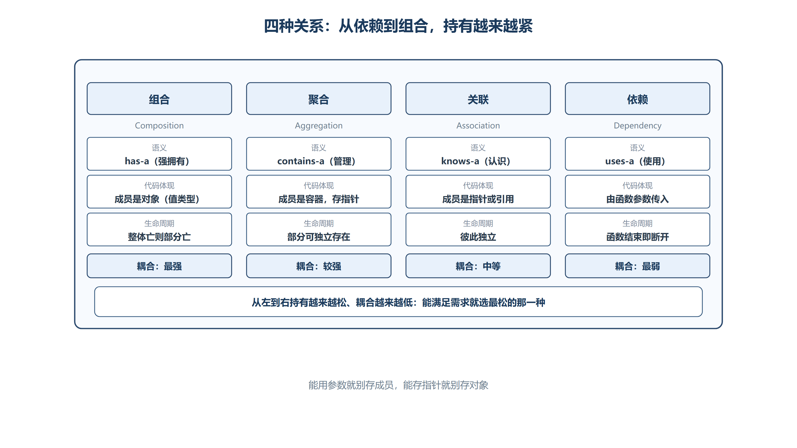
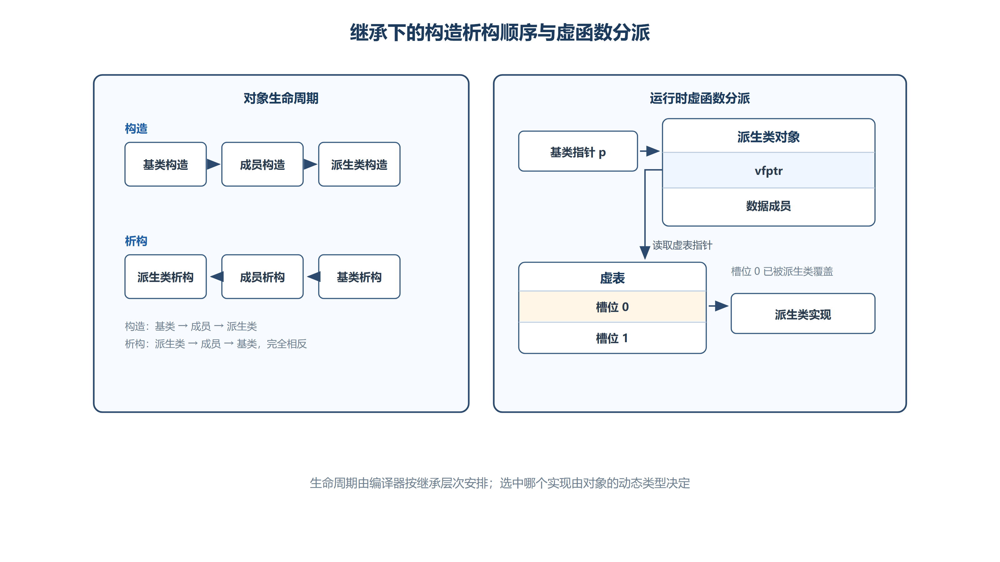

# 第四章 类之间的关系
类与类之间并不是孤立存在的，它们可以通过不同的方式建立联系。根据耦合程度由强到弱，常见的横向关系有：**组合**、**聚合**、**关联**、**依赖**。

## 4.1 组合、依赖、关联与聚合
### 4.1.1 组合（Composition）
#### （1） 核心定义
+ **定义**：一个类中包含另一个类的**对象**（而非指针或引用），称为组合关系。
+ **特点**：组合是一种**强拥有**关系（"has-a"），整体负责部分的生命周期。当整体销毁时，部分也随之销毁。
+ **代码体现**：成员属性是另一个类的**对象**（值类型），而非指针。

```cpp
class Hand {
public:
    void move() {
        cout << "我的大手正在挥舞移动" << endl;
    }
};

class People {
public:
    Hand m_hand;  // 组合关系：People "拥有" Hand 对象
    // People 创建时，m_hand 自动构造
    // People 销毁时，m_hand 自动析构
};
```

#### （2） 内存布局
+ 组合的对象**嵌入**在外部对象的内存空间中（占据对象的一部分内存）。
+ `sizeof(People)` 包含了 `Hand` 对象的大小。

---

### 4.1.2 依赖（Dependency）
#### （1） 核心定义
+ **定义**：一个对象的某种行为（成员函数）**依赖于**另一个类的对象，但这种关系是**临时的、局部的**。
+ **特点**：依赖是一种**弱关系**（"uses-a"），通常表现为函数参数中传入另一个类的对象（指针或引用）。不存在从属关系，只在某个函数调用期间产生联系。
+ **代码体现**：另一个类的对象作为**函数参数**传入。

```cpp
class Computer {
public:
    void compile() {
        cout << "编译代码……生成可执行程序" << endl;
    }
};

class People {
public:
    // 依赖关系：writecode 这个行为依赖 Computer 对象
    void writecode(Computer* pcomp) {
        if (pcomp == nullptr) {
            cout << "电脑为空，没法写代码" << endl;
            return;
        }
        cout << "写出了一行行代码" << endl;
        pcomp->compile();
    }
};

int main() {
    People peo;
    peo.writecode(nullptr);    // 没有电脑，无法写代码

    Computer comp;
    peo.writecode(&comp);      // 依赖 comp 对象完成行为
    return 0;
}
```

---

### 4.1.3 关联（Association）
#### （1） 核心定义
+ **定义**：关联不是从属关系，而是**平等关系**。一个类持有另一个类对象的**指针或引用**，可以拥有对方，但**不可占有**对方（不负责对方的生命周期）。
+ **特点**：关联是一种"knows-a"关系，比依赖更持久（成员级别的指针），但比组合更松散（不负责对方的生死）。
+ **代码体现**：成员属性是另一个类的**指针或引用**。

```cpp
class Friend {
public:
    void play() {
        cout << "我的朋友正在玩" << endl;
    }
};

class People {
public:
    Friend* m_pfri;  // 关联关系：People "认识" Friend，但不负责其生命周期

    void playGame() {
        if (m_pfri) {
            m_pfri->play();
            cout << "我和朋友一起玩" << endl;
        } else {
            cout << "我自己一个人也能玩" << endl;
        }
    }
};

int main() {
    People peo;
    peo.playGame();          // m_pfri 为空，自己玩

    Friend fri;
    peo.m_pfri = &fri;      // 建立关联
    peo.playGame();          // 和朋友一起玩
    return 0;
}
```

---

### 4.1.4 聚合（Aggregation）
#### （1） 核心定义
+ **定义**：多个被聚合的对象**聚集**起来形成一个大的整体。聚合的目的是为了**统一管理**同类型的对象。
+ **特点**：聚合是一种"contains-a"关系，整体由多个部分组成，但部分可以独立于整体存在。整体负责管理（如统一遍历、统一操作），但不负责部分的生命周期（虽然实践中常常在析构中清理）。
+ **代码体现**：用**数组或容器**存储多个同类对象的指针。

```cpp
class Family {
public:
    People* arr[10];  // 聚合关系：Family "包含" 多个 People

    Family() : arr{nullptr} {
        arr[0] = new People;
        arr[1] = new People;
        arr[2] = new People;
    }

    ~Family() {
        // 统一管理：逐个释放
        for (People* p : arr) {
            if (p) {
                delete p;
                // p = nullptr;  // 注意：此处 p 是局部变量，赋值无意义
            }
        }
    }

    void jucan() {
        for (People*& p : arr) {
            if (p) {
                p->eat();
            }
        }
    }
};
```

---

### 4.1.5 四种关系对比表



*图：从依赖到组合持有越来越紧、耦合越来越高；能满足需求时应选最松的那一种。*

| 关系 | 英文 | 语义 | 代码体现 | 生命周期 | 耦合度 |
| :--- | :--- | :--- | :--- | :--- | :--- |
| **组合** | Composition | has-a（强拥有） | 成员为**对象**（值类型） | 整体销毁 → 部分销毁 | 最强 |
| **聚合** | Aggregation | contains-a（管理） | 成员为**容器/数组**（存储指针） | 部分可独立存在 | 较强 |
| **关联** | Association | knows-a（认识） | 成员为**指针/引用** | 彼此独立 | 中等 |
| **依赖** | Dependency | uses-a（使用） | **函数参数**传入 | 临时，函数结束即断开 | 最弱 |


---

## 4.2 继承关系
### 4.2.1 继承的概念与基本用法
#### （1） 核心定义
+ **继承 (Inheritance)**：某个类通过某种手段能使用另一个类的成员，子类是父类的延续或派生，子类也会包含父类（从内存的角度看）。
+ **目的**：实现**代码复用**和**层次化设计**。子类自动拥有父类的所有非私有成员，并可在此基础上扩展新功能。
+ **术语**：
    - **父类 / 基类 (Base Class)**：被继承的类。
    - **子类 / 派生类 (Derived Class)**：继承别人的类。

```cpp
// 父类 / 基类
class Father {
public:
    int m_fa;
    void funFather() {
        cout << "funFather" << endl;
    }
};

// 子类 / 派生类
class Son : public Father {
public:
    int m_son;

    Son() {
        m_son = 10;
        m_fa = 20;    // 可以直接调用父类的公有成员
    }

    void funSon() {
        cout << "funSon" << endl;
    }
};
```

#### （2） 对象大小与内存布局
+ **对象大小**：派生类对象包含其基类子对象与派生类自己的非静态数据成员，还可能包含对齐填充、虚函数相关指针等实现数据，不能只做成员字节数的简单相加。
+ **内存布局**：常见 ABI 会把主要基类子对象放在派生类成员之前，但具体偏移取决于编译器、ABI、继承方式和虚函数布局。下面的地址关系是当前简单示例中的观察结果，不是所有继承体系的标准保证。

```cpp
Son son;
cout << son.m_fa << " " << son.m_son << endl;  // 20 10
sizeof(Son);  // 8（int 4 + int 4）

// 内存布局验证：
cout << &son << endl;         // 对象首地址 == 父类成员地址
cout << &son.m_fa << endl;    // 父类成员在前，地址与对象首地址相同
cout << &son.m_son << endl;   // 子类成员在后，地址 = 对象首地址 + 4
```

---

### 4.2.2 继承中的构造与析构
#### （1） 构造函数调用顺序
+ **顺序**：**先父类，后子类**。
+ **机制**：创建派生类对象时，先按规则构造基类子对象，再按**成员声明顺序**构造成员，最后执行派生类构造函数体。初始化列表中的书写顺序不会改变实际构造顺序。
+ **无参构造**：如果调用的是父类的**无参构造**，编译器默认执行（无需在子类初始化列表中写出）。
+ **有参构造**：如果调用父类**带参数的构造函数**，**必须**手动在子类初始化列表中显式指定。

```cpp
class Father {
public:
    int m_fa;
    // 构造函数的函数体是赋值，初始化列表才是真正的初始化
    Father(int fa) : m_fa(fa) {
        cout << "Father(int)" << endl;
    }
    ~Father() {
        cout << "~Father()" << endl;
    }
};

class Son : public Father {
public:
    int m_son;

    // 显式调用父类有参构造
    Son() : m_son(10), Father(20) {
        cout << "Son()" << endl;
    }

    ~Son() {
        cout << "~Son()" << endl;
        // 编译器在此处自动安插 ~Father() 的调用
    }
};
```

+ **初始化原则**：一个类中属性的初始化由自己类的构造函数完成。父类的属性**只能**在父类的构造函数中初始化（通过初始化列表），子类构造函数中只能对父类属性**赋值**，不能**初始化**。

#### （2） 析构函数调用顺序
+ **顺序**：**先子类，后父类**（与构造相反）。
+ **机制**：子类析构函数执行完毕后，编译器在子类析构的结尾**自动安插**父类析构函数的调用。

```plain
执行流程：
Son son;
→ Father(int)     // 1. 先执行父类构造
→ Son()           // 2. 再执行子类构造

son.~Son();
→ ~Son()          // 3. 先执行子类析构
→ ~Father()       // 4. 后执行父类析构（编译器自动安插）
```



*图：构造顺序由“基类 → 成员 → 派生类”推进，析构顺序完全相反；右侧虚表仅表示常见 ABI 的动态分派模型。*

---

### 4.2.3 继承访问方式
继承方式描述了**父类成员在子类中的访问属性**。规则：**子类中的访问权限不会比继承方式更高**。

| 父类成员 | public 公有继承 | protected 保护继承 | private 私有继承 |
| :--- | :--- | :--- | :--- |
| `public` | `public` | `protected` | `private` |
| `protected` | `protected` | `protected` | `private` |
| `private` | **无法访问** | **无法访问** | **无法访问** |


#### （1） `public` 公有继承（最常用）
+ **语义**：遵循父类的意愿，父类的 `public` 还是 `public`，`protected` 还是 `protected`。
+ **口诀**："public 公有继承：遵循父类的意愿"

#### （2） `protected` 保护继承
+ **语义**：家族之内，代代相传。父类的 `public` 和 `protected` 都变成 `protected`。
+ **效果**：外部无法直接访问父类的任何成员，但子类及其后代可以。

#### （3） `private` 私有继承
+ **语义**：家族之内，一代传递。父类的 `public` 和 `protected` 都变成 `private`。
+ **效果**：只有直接子类可以访问，子类的子类无法访问。

#### （4） 代码示例
```cpp
class father {
public:
    int pub;
protected:
    int pro;
private:
    int pri;    // 私有成员只能在类内使用
public:
    father() : pub(1), pro(2), pri(3) {}
    // 访问父类私有成员的方式：
    // 1. 通过接口（函数）间接访问（推荐）
    // 2. 父类公共指针
    // 3. 友元 friend
    int getpri() { return pri; }
};

class son : public father {
public:
    void funpublic() {
        cout << pub << endl;         // 可访问 public
        cout << pro << endl;         // 可访问 protected
        // cout << pri << endl;      // 无法直接调用 private
        cout << getpri() << endl;    // 通过接口间接访问
    }
};

int main() {
    son s;
    s.funpublic();
    cout << s.pub << endl;    // 类外可访问 public 继承的 public 成员
    // cout << s.pro << endl; // 类外无法访问 protected 成员
    return 0;
}
```

---

### 4.2.4 名称隐藏（Hiding）
#### （1） 核心定义
+ **定义**：子类和父类中允许存在**同名成员**（包括属性和函数），它们之间是**隐藏关系**。子类成员默认会隐藏父类的同名成员。
+ **与重载的区别**：继承构成不了函数重载，因为作用域不同。重载要求在同一作用域内。

#### （2） 访问被隐藏的基类成员
通过**指定父类的类名作用域**可以使用父类的同名成员：`对象.父类名::成员`

```cpp
class A {
public:
    int m_a;
    A() : m_a(1) {}
    void fun() { cout << "A::fun()" << endl; }
};

class B : public A {
public:
    int m_a;  // 隐藏了父类的 m_a
    B() : m_a(2) {}

    void fun(int num) {  // 隐藏了父类的 fun()（即使参数不同）
        cout << "B::fun() " << num << endl;
    }
};

int main() {
    B b;

    // 同名成员，默认使用子类中的
    b.fun(10);            // B::fun() 10
    cout << b.m_a << endl; // 2

    // 通过类名作用域访问父类被隐藏的成员
    b.A::fun();           // A::fun()
    cout << b.A::m_a << endl; // 1
    b.B::fun(10);         // B::fun() 10
    cout << b.B::m_a << endl; // 2

    // b.fun();  // 报错！父类的 fun() 被隐藏，即使参数列表不同
    return 0;
}
```

+ **注意**：只要子类定义了与父类同名的成员（无论参数是否相同），父类的同名成员就会被隐藏。这不是重载！

---

### 4.2.5 基类指针指向派生类对象
#### （1） 核心规则
+ **父类指针**可以指向任何继承于该类的子类对象（无需强制类型转换）。
+ **子类指针不能**指向父类对象。

```cpp
class A {
public:
    void fun(/* const A* this */) {
        cout << "A::fun()" << " " << this << endl;
    }
};

class B : public A {};

int main() {
    B b;
    b.fun();
    cout << "&b: " << &b << endl;

    // 父类指针直接指向子类对象（无需强制转换）
    A* pthis = &b;  // 合法

    // 子类指针不能指向父类对象
    A a;
    // B* pb = &a;  // 非法！
    return 0;
}
```

#### （2） 作用与意义
+ **统一接口**：父类指针可以**统一管理**所有子类对象，是多态的基础。
+ **参数传递**：函数参数使用父类指针，可以接收任何子类对象，避免为每个子类写一个重载函数。

```cpp
class People {
public:
    int m_money;
    People() : m_money(100) {}
    void cost(int n) { m_money -= n; cout << "花钱买衣服" << endl; }
    void run() { cout << "狂飙10km" << endl; }
};

class White : public People {
public:
    void eat() { cout << "吃黑巧克力" << endl; }
};

class Yellow : public People {
public:
    void eat() { cout << "吃大巧克力" << endl; }
};

class Black : public People {
public:
    void eat() { cout << "吃白巧克力" << endl; }
};

// 一个函数即可处理所有子类
void fun(People* p) {
    p->cost(10);
    p->run();
}

int main() {
    fun(new White);   // 父类指针接收 White 对象
    fun(new Yellow);  // 父类指针接收 Yellow 对象
    fun(new Black);   // 父类指针接收 Black 对象
    return 0;
}
```

+ **限制**：通过父类指针只能调用父类的成员，无法直接调用子类独有的成员（如 `eat()`）。要实现根据对象类型调用对应函数，需要借助**多态（虚函数）或类成员函数指针**。

---

### 4.2.6 成员函数指针
#### （1） 与普通函数指针的区别
+ **作用域不同**：类成员函数在类作用域内。
+ **隐藏 `this` 指针**：非静态成员函数存在指向当前对象的隐含指针，普通函数没有。
+ **调用约定不同**：因此不能用普通函数指针接收类成员函数地址。

```cpp
void fun() { cout << "fun()" << endl; }

// 普通函数指针
void (*pfun)() = &fun;   // 定义
(*pfun)();                // 调用（间接调用）
```

#### （2） 定义语法
```cpp
// 返回类型 (类名::*指针名)(参数类型) = &类名::函数名;
void (A::*pfun2)() = &A::fun;
```

+ `::*` 是 C++ 中**不可分割的操作符**，专门用来定义类成员函数指针。

#### （3） 调用语法
```cpp
// 通过对象调用：  (对象.*指针名)(参数)
// 通过对象指针调用：(对象指针->*指针名)(参数)

A a;
(a.*pfun2)();       // 通过对象调用

A* p = &a;
(p->*pfun2)();      // 通过对象指针调用
```

+ `.*` 和 `->*` 也是 C++ 中**不可分割的操作符**。

#### （4） 在构造函数中使用
```cpp
class A {
public:
    void fun(/* const A* this */) {
        cout << "A::fun()" << endl;
    }
    A() {
        void (A::*pfun3)() = &A::fun;
        (this->*pfun3)();  // 在构造函数中通过 this 调用
    }
};
```

#### （5） 使用成员函数指针实现多态
通过父类指针 + 类成员函数指针（强制类型转换），可以调用子类独有的成员：

```cpp
using P_FUN = void (People::*)();

void fun(People* p, P_FUN pfun) {
    (p->*pfun)();    // 调用子类特有的行为
    p->cost(10);     // 调用父类通用行为
    p->run();
}

int main() {
    fun(new White, (P_FUN)&White::eat);
    fun(new Yellow, (P_FUN)&Yellow::eat);
    fun(new Black, (P_FUN)&Black::eat);
    return 0;
}
```

+ **注意**：需要**强制类型转换** `(P_FUN)&子类::函数`，因为子类成员函数指针类型与父类不同。这种方式虽然可行，但不够优雅——C++ 提供了更标准的多态机制：**虚函数**。

---

