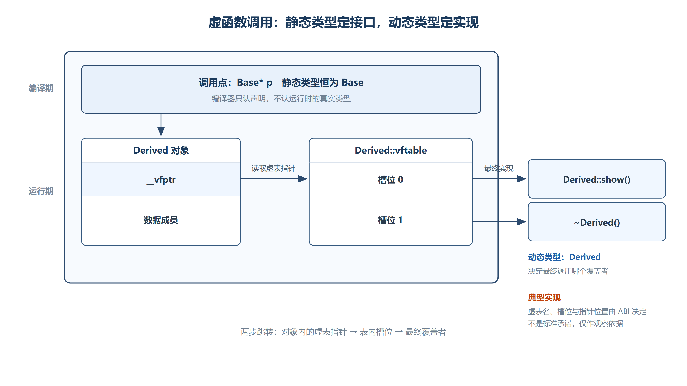

# 第五章 多态
## 5.1 多态的概念与实现条件
### 5.1.1 核心定义
+ **多态 (Polymorphism)**：相同的行为方式导致不同的行为结果，同一行语句展现出不同的表现形态，称之为多态。
+ **C++ 多态**：在继承的条件下，父类的指针可以指向任何继承于该类的子类对象，具有多个子类（不同的子类具有不同的形态），由父类的指针进行统一管理。通过父类指针调用虚函数时，运行时根据对象的**实际类型**决定调用哪个版本的函数。

### 5.1.2 多态发生的条件（缺一不可）
1. **继承**：存在父类与子类的继承关系。
2. **父类指针（或引用）指向子类对象**。
3. **通过基类指针或引用调用虚函数**。如果派生类提供了覆盖版本，就分派到该版本；即使没有覆盖，调用仍是虚调用，只是最终落到继承来的实现。
+ **重写 (Override)**：派生类重新定义基类虚函数。函数名和参数列表必须匹配，`const`、引用限定符等也属于签名约束；返回类型通常相同，类类型的指针或引用还允许满足规则的协变返回。建议显式写 `override` 让编译器检查。

```cpp
class father {
public:
    // virtual 关键字：声明虚函数
    virtual void fun() {
        cout << "father::fun()" << endl;
    }
};

class son : public father {
public:
    // 重写父类的虚函数（一旦重写了父类的虚函数，也会被认为是虚函数，即使没有 virtual 关键字）
    void fun() {
        cout << "son::fun()" << endl;
    }
};

int main() {
    father* pfa = new son;
    pfa->fun();   // 输出 son::fun() —— 多态！运行时根据对象类型调用

    son* p = new son;
    p->fun();     // 输出 son::fun()

    father& fa = *p;
    fa.fun();     // 输出 son::fun() —— 引用也能实现多态

    return 0;
}
```

---

## 5.2 虚函数（Virtual Function）
### 5.2.1 虚函数的定义
+ **虚函数**是在基类中使用 `virtual` 关键字声明的成员函数。它允许在派生类中被"重写"，从而在运行时根据对象的实际类型决定调用哪个函数版本。

```cpp
class A {
public:
    virtual void virtualFun1() {
        cout << "virtualFun1()" << endl;
    }
    virtual void virtualFun2() {
        cout << "virtualFun2()" << endl;
    }
    void fun() {  // 非虚函数
        cout << "fun()" << endl;
    }
};
```

### 5.2.2 虚函数指针（`__vfptr`）
+ **典型实现**：主流编译器通常在多态对象中保存一个虚表指针，MSVC 的调试视图常显示为 `__vfptr`。该名称、类型、数量与位置均由编译器 ABI 决定，不是标准 C++ 的显式成员。
+ **对象与类的关系**：同一动态类型的多个对象通常各自保存虚表指针，并指向该类型共享的虚表；多重继承或虚继承时可能出现多个相关指针和更复杂的布局。
+ **构造阶段**：编译器会在构造和析构过程中维护分派所需状态，因此构造/析构期间的虚调用只按当前正在构造或析构的类分派，不会越级调用尚未构造或已经销毁的派生部分。

```plain
对象内存布局（含虚函数的类 A）：
┌──────────────┐  低地址（对象首地址）
│ __vfptr      │ ──→ 指向 vftable
├──────────────┤
│ m_a (int)    │
└──────────────┘  高地址

典型 64 位 ABI：8 字节虚表指针 + 4 字节 int + 对齐填充，sizeof(A) 常为 16
典型 32 位 ABI：4 字节虚表指针 + 4 字节 int，sizeof(A) 常为 8
// 实际结果必须以目标编译器、ABI 和编译选项为准
```

### 5.2.3 虚函数表（`vftable`）
1. **概念作用**：虚表把虚函数槽位映射到最终实现，调用点通过对象的动态类型选择相应条目。
2. **典型共享方式**：同一类型的对象通常共享相应表结构，但一个类在多重继承等场景中不一定只有一张简单的表。
3. **实现边界**：表项布局、辅助元数据和存储区都由 ABI 决定，不能把“声明顺序数组”或“固定放在常量区”当作标准承诺。

```plain
vftable（类 A 的虚函数表）：
┌──────────────────┐
│ vftable[0]       │ ──→ &A::virtualFun1
├──────────────────┤
│ vftable[1]       │ ──→ &A::virtualFun2
└──────────────────┘
```


> **实现边界**：`virtual`、重写和运行时多态属于标准 C++；`__vfptr` 的名称、对象中的具体位置、虚表存储区域和表项排列则取决于编译器及 ABI。把对象地址强转后直接读取或调用虚表条目，只适合作为当前编译环境下的观察实验。在 64 位环境中把指针读取为 `int` 还可能发生地址截断。

### 5.2.4 虚函数调用流程



*图：对象里存虚表指针，表里存槽位，调用点经两次跳转找到最终覆盖者；`__vfptr` / `vftable` 属常见 ABI 实现，不是标准承诺。*

从语言层面看，虚调用只需要理解为“根据对象的动态类型选择最终覆盖者”。在常见 ABI 中，调用点读取对象的虚表指针，通过固定槽位取得函数入口再跳转；具体指令、是否去虚拟化以及最终开销由编译器优化决定，不能保证所有虚函数调用耗时完全相同。

```cpp
// 手动演示虚函数调用流程
void (**vfptr)() = (void (**)())*(int*)&a;
// vfptr[0] == virtualFun1 的地址
// vfptr[1] == virtualFun2 的地址

vfptr[0]();  // 调用 virtualFun1()
vfptr[1]();  // 调用 virtualFun2()
```

上面的强制转换代码依赖具体编译器并存在地址截断风险，只用于理解实验。实际业务代码应通过基类接口调用虚函数：

```cpp
#include <iostream>

class Base
{
public:
    virtual void show()
    {
        std::cout << "Base::show()" << std::endl;
    }

    virtual ~Base() = default;
};

class Derived : public Base
{
public:
    void show() override
    {
        std::cout << "Derived::show()" << std::endl;
    }
};

int main()
{
    Derived object;

    Base* basePtr = &object;
    basePtr->show();   // 通过基类指针调用，运行时选择 Derived::show()

    Base& baseRef = object;
    baseRef.show();    // 通过基类引用调用，同样发生动态绑定

    return 0;
}
```

### 5.2.5 动态绑定与静态绑定对比
+ **动态绑定**：程序**运行时**根据上下文环境去调用函数。通过**指针**和**引用**调用虚函数时是动态绑定（实现多态）。
+ **静态绑定**：**编译期**就确定了调用的具体函数。通过**一般对象**调用时是静态绑定。

| 调用方式 | 绑定类型 | 说明 |
| :--- | :--- | :--- |
| `对象.虚函数()` | 静态绑定 | 编译期确定，看对象类型 |
| `指针->虚函数()` | 动态绑定 | 运行期确定，看对象实际类型 |
| `引用.虚函数()` | 动态绑定 | 运行期确定，看对象实际类型 |
| `指针->类名::虚函数()` | 静态绑定 | 显式指定，解除多态 |


+ **构造函数和析构函数中的虚函数**：即使在构造/析构中通过 `this` 调用虚函数，也是**静态绑定**（因为此时子类部分尚未构建或已经销毁）。

### 5.2.6 虚函数与普通函数的区别
| 维度 | 虚函数 | 一般函数 |
| :--- | :--- | :--- |
| **绑定方式** | 动态绑定（指针/引用调用时） | 静态绑定 |
| **调用机制** | 通过 `__vfptr` → `vftable` 查表 | 直接通过函数地址调用 |
| **效率** | 较低（多一次间接寻址） | 较高 |
| **目的** | 实现多态 | 普通功能 |


---

## 5.3 继承中的虚函数
### 5.3.1 虚函数表的继承与重写规则
继承下父类和子类都有虚函数，因此各有一个 `__vfptr` 和虚表。

+ **继承**：子类不但继承了父类的成员，还**继承了父类的虚表**。
+ **检查重写**：如果子类重写了父类的虚函数，编译器会检查子类的虚函数是否正确重写了父类的虚函数（函数名、参数列表、返回值类型必须完全一致），然后**原地替换/覆盖**。对于子类没有重写的，**原地保留**。
+ **结尾追加**：对于子类中**独有**的虚函数，按照声明的顺序在虚表**结尾添加**。

```plain
父类虚表 (father):
┌──────────────────┐
│ vftable[0]       │ ──→ &father::fun()
├──────────────────┤
│ vftable[1]       │ ──→ &father::fun2()
└──────────────────┘

子类虚表 (son, 重写了 fun, 新增 fun3):
┌──────────────────┐
│ vftable[0]       │ ──→ &son::fun()        ← 原地替换
├──────────────────┤
│ vftable[1]       │ ──→ &father::fun2()    ← 原地保留
├──────────────────┤
│ vftable[2]       │ ──→ &son::fun3()       ← 结尾追加
└──────────────────┘
```

+ 用父类指针接子类对象时，父类的 `__vfptr` **指向子类的虚表**，所以调用虚函数时，调用的是子类的虚函数实现。`__vfptr` 指向**子类的虚表**——看定义的**真实对象类型**，和指针类型无关。

### 5.3.2 静态多态与动态多态
+ **静态多态**：编译期多态，如**函数重载**。
+ **动态多态**：运行时多态，通过**虚函数动态绑定**实现的多态。

---

## 5.4 多态练习与注意事项
### 5.4.1 虚函数与默认参数
+ 函数参数**默认值是编译期的概念**，在编译阶段就确定了默认值（编译器只看指针的声明类型）。
+ **虚函数的调用是"动态绑定"（看对象），而默认参数是"静态绑定"（看指针类型）**。

```cpp
class A {
public:
    virtual void fun1(char a = 1) {
        cout << "A::fun1 " << (int)a << endl;
    }
};

class B : public A {
public:
    virtual void fun1(char a = 2) {
        cout << "B::fun1 " << (int)a << endl;
    }
};

int main() {
    A* pa = new B;
    pa->fun1();  // 输出 B::fun1 1 —— 函数体是 B 的（动态绑定），但默认参数是 A 的（静态绑定）
    return 0;
}
```

+ **最佳实践**：重写虚函数时，默认参数应保持与父类一致，避免混淆。

### 5.4.2 `const` 成员函数与虚函数
+ 常函数和虚函数可以同时存在：一个常函数可以为虚函数，一个虚函数可以为常函数。
+ **重写要求**：父类子类同名同参的**常函数和一般虚函数不构成重写**（`const` 修饰了 `this` 指针类型，参数列表实际不同）。

### 5.4.3 不能声明为虚函数的函数
+ **静态函数**：不可以为虚函数。静态函数不具有多态特征，不能被重写（多态的前提是通过对象调用，而静态函数属于类）。
+ **构造函数**：不可以为虚函数（虚函数指针就在构造函数里产生，如果构造函数可以是虚函数，调用父类构造就会变成调用子类构造函数，逻辑矛盾）。
+ **析构函数**：可以为虚函数（而且多态场景下**必须**为虚函数，见下节）。

---

## 5.5 虚析构函数
### 5.5.1 问题：多态下的内存泄漏
在用父类指针指向子类对象、实现多态时，`delete` 调用析构时是按照**指针类型**来匹配对应的析构函数。如果父类析构不是虚函数，则**只执行父类的析构函数**，子类的析构函数没有被调用，有**内存泄漏**的风险。

```cpp
class A {
public:
    A() { cout << "A" << endl; }
    ~A() { cout << "~A" << endl; }  // 非虚析构
};

class B : public A {
public:
    B() { cout << "B" << endl; }
    ~B() { cout << "~B" << endl; }
};

int main() {
    A* pa = new B;
    delete pa;  // 只调用 ~A()，~B() 没有被调用！资源泄漏！
    return 0;
}
```

### 5.5.2 解决方案：虚析构
将父类的析构函数声明为**虚析构函数**。虚函数在运行期绑定，调用时根据**对象类型**调用析构函数，子类的析构就会默认重写父类的析构，发生多态，最终调用子类的析构。

```cpp
class A {
public:
    A() { cout << "A" << endl; }
    virtual ~A() { cout << "~A" << endl; }  // 虚析构
};

class B : public A {
public:
    B() { cout << "B" << endl; }
    // 子类析构会默认重写父类的虚析构（即使不写 virtual）
    /* virtual */ ~B() {
        cout << "~B" << endl;
        // 编译器在此处自动安插 A::~A()
    }
};

int main() {
    A* pa = new B;
    delete pa;
    // 输出：~B → ~A（资源正确释放）
    pa = nullptr;
    return 0;
}
```

+ **铁律**：一旦继承使用多态，父类的析构**一定**变成虚析构。

### 5.5.3 `= default` 用于虚析构
如果不想在虚析构函数中写具体内容，可以加上 `= default`，表示使用编译器默认生成的析构函数体。

---

## 5.6 纯虚函数、抽象类与具体类
### 5.6.1 纯虚函数
+ **定义**：在某些情况下，无法实际实现父类的虚函数，作为抽象的接口而存在。将虚函数声明为纯虚函数：**没有函数体**，用 `= 0` 表示。
+ **语法**：`virtual 返回类型 函数名(参数列表) = 0;`
+ **要求**：纯虚函数**必须被子类重写**，否则子类也会成为抽象类，无法实例化对象。

### 5.6.2 抽象类与具体类
+ **抽象类 (Abstract Class)**：包含纯虚函数的类，**无法实例化对象**，作为**接口**存在，提供给子类重写实现。
+ **具体类 (Concrete Class)**：重写了所有纯虚函数的子类，可以实例化对象。

```cpp
// 抽象类（基类）
class Animal {
public:
    virtual void eat() = 0;    // 纯虚函数，没有函数体
    virtual void fun1() = 0;   // 纯虚函数
};

// 类外实现纯虚函数（可选，提供一种默认实现）
void Animal::fun1() {
    cout << "Animal::fun1" << endl;
}

// 具体类（派生类）
class Dog : public Animal {
public:
    // 必须重写纯虚函数，否则 Dog 也会成为抽象类
    virtual void eat() {
        cout << "狗吃骨头" << endl;
    }

    // override 关键字：表明该函数是重写父类的虚函数
    // 如果没有正确重写，编译器会报错，增加安全性和可读性
    virtual void fun1() override {
        cout << "Dog::fun1" << endl;
    }
};

int main() {
    Animal* pa = new Dog;
    pa->eat();    // 输出：狗吃骨头

    // Animal ani;  // 非法！抽象类无法实例化对象

    pa->Animal::fun1();  // 静态绑定调用父类纯虚函数的实现

    return 0;
}
```

### 5.6.3 `override` 关键字
+ 子类重写父类的虚函数时，可以在函数前加上 `override` 关键字，表示该函数是重写父类的虚函数。
+ 如果**没有正确重写**父类的虚函数（函数名/参数不匹配），编译器会**报错**，增加代码的安全性和可读性。

---

## 5.7 多态的局限性
1. **性能开销**：虚函数通过查表调用（间接寻址），比直接调用普通函数多一次内存访问，速度稍慢。
2. **空间开销**：每个含虚函数的对象多一个 `__vfptr`（8 字节/64 位），每个含虚函数的类多一张虚函数表。
3. **构造/析构限制**：构造函数和析构函数中的虚函数调用是静态绑定，无法展现多态特性。
4. **默认参数陷阱**：虚函数的默认参数是静态绑定的，容易导致混淆。

---

