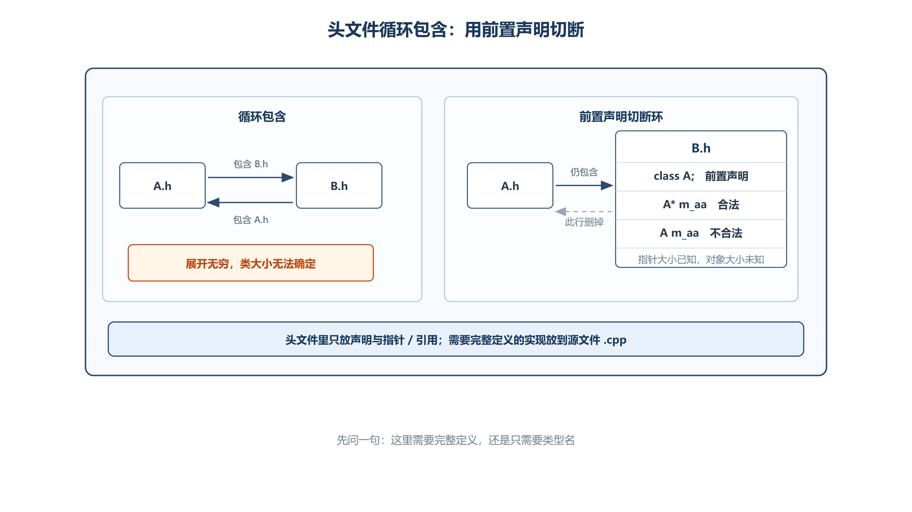
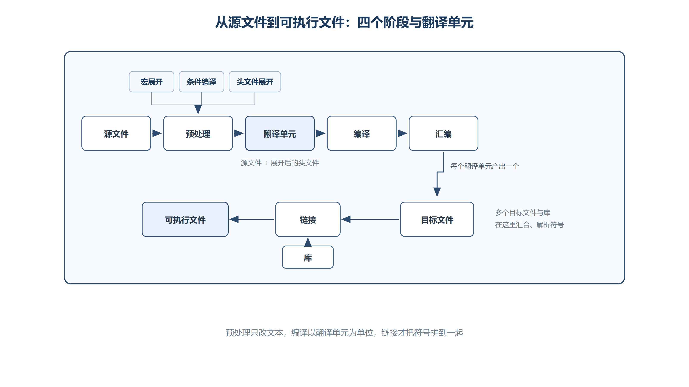

# 第六章 程序组织与编译机制
## 6.1 头文件与源文件
### 6.1.1 核心概念
+ **头文件 (.h)**：放**声明**——函数的声明、变量的声明、类的声明。头文件不需要单独编译。
+ **源文件 (.cpp)**：放**定义**——函数的定义、变量的定义、类成员的定义（实现）。源文件需要单独编译。

### 6.1.2 基本原则
| 内容 | 头文件 (.h) | 源文件 (.cpp) |
| :--- | :--- | :--- |
| **函数声明** | ✅ `void fun(int a);` | ✅，但通常放头文件供多个源文件共享 |
| **函数定义** | 可放 `inline`、模板或类内定义；需遵守 ODR | ✅，普通非内联定义通常放源文件 |
| **变量声明** | ✅ `extern int a;`（不能给初始值） | ✅ `int a = 2;` |
| **变量定义** | 传统全局变量定义通常不放头文件；C++17 `inline` 变量除外 | ✅ |
| **类定义** | ✅，通常放头文件 | ✅，若只在当前源文件内部使用也可以 |
| **类成员实现** | 类内、模板和 `inline` 实现可放头文件 | ✅ `void A::fun() {...}` |


### 6.1.3 `extern` 关键字
+ 在头文件中用 `extern` 声明全局变量，表示"这个变量在别的文件中定义"。
+ `extern` 声明**不能给初始值**（给了初始值就变成定义了）。

```cpp
// A.h
extern int a;   // 声明（不给初始值）

// A.cpp
int a = 2;      // 定义（给出初始值）
```

### 6.1.4 静态全局变量
+ 用 `static` 修饰的全局变量**作用范围仅限当前源文件**，不能被其他文件访问。
+ 不同源文件中可以各自定义同名的 `static` 全局变量，互不干扰。

```cpp
// A.cpp
static int d = 5;   // 只在 A.cpp 中可见

// main.cpp
static int d = 6;   // 只在 main.cpp 中可见，与 A.cpp 的 d 互不干扰
```

### 6.1.5 在头文件中定义类
+ 类定义放在头文件中是标准做法（类的定义可以重复出现，只要内容完全一致）。
+ 类成员变量需要**类的限定名**在源文件中实现。
+ 静态成员变量需要在源文件中**类外定义并初始化**（去掉 `static` 关键字）。

```cpp
// A.h
class A {
public:
    int m_a;
    static int m_b;
    const int m_c;
    A();
    ~A();
    static void funStatic();
    void funConst() const;
    virtual void funVirtual();
};

// A.cpp
A::A() : m_a(1), m_c(3) { cout << "A()" << endl; }
A::~A() { cout << "~A()" << endl; }
int A::m_b = 2;             // 静态成员类外定义（去掉 static）
void A::funStatic() { ... } // 成员函数类外实现（去掉 static）
void A::funConst() const { ... }  // const 关键字保留
```


#### （1） 单一定义规则（ODR）

类定义可以通过同一头文件出现在多个翻译单元中，但各处定义必须等价。下面两个类如果分别手写在不同的 `.cpp` 中，虽然单个源文件可能都能编译，整个程序仍会因为函数体不同而违反 ODR：

```cpp
class B {
public:
	void fun()
	{
		cout << "A.cpp B::fun()" << endl;
	}
};
```

```cpp
class B {
public:
	void fun()
	{
		cout << "main.cpp B::fun()" << endl;
	}
};
```

链接器不一定能诊断这类冲突，程序行为也不可靠。类的完整定义应集中放在头文件中，再由各个源文件共同包含。

---

## 6.2 头文件的重复包含
### 6.2.1 问题描述
当某个头文件被同一个源文件**直接或间接多次包含**时，可能导致类或函数的**重复定义**错误。

```plain
main.cpp → #include "B.h" → #include "A.h" (第一次包含 A)
main.cpp → #include "C.h" → #include "A.h" (第二次包含 A)
// 结果：class A 被定义了两次 → 编译错误
```

### 6.2.2 解决方案
**方法一：** `#pragma once`

```cpp
#pragma once
// 头文件内容...
```

+ **优点**：编写速度快，逻辑简单，编译速度快。
+ **缺点**：不是 C++ 标准指令，不能保证所有编译器都支持。

**方法二：宏定义实现条件编译（推荐，C++ 标准）**

```cpp
#ifndef __A_H__       // 如果没有定义 __A_H__
#define __A_H__       // 定义 __A_H__

// 头文件内容（只在第一次包含时有效）
class A {
public:
    int m_a;
    A();
};

#endif // __A_H__     // 与 #ifndef 对应
```

+ **优点**：是 C++ 标准，所有编译器都支持，使用范围广。
+ **缺点**：需要维护唯一宏名，写法比 `#pragma once` 稍长。不要使用 `__A_H__` 这类包含双下划线的保留标识符；工程代码可改用 `PROJECT_A_H_INCLUDED`。两种方案的实际编译速度差异通常不是选型重点。

---

## 6.3 头文件循环依赖



*图：互相包含会让预处理无休止展开；把其中一条改成 `class A;` 前置声明即切断环，但此时只能用 `A*` 或 `A&`。*

### 6.3.1 问题描述
当 A.h 包含 B.h，B.h 又包含 A.h 时，形成**循环包含**，导致编译器无法确定类的大小，无法分配内存空间。

```plain
A.h → #include "B.h" → #include "A.h" → ... 无限循环
```

### 6.3.2 解决方案：前置声明
+ 注释掉其中一条头文件包含指令，使用另一个类的**前置声明**代替包含。
+ **前置声明**：`class A;` — 告诉编译器"A 是一个类"，但不知道具体定义。

```cpp
// B.h
#pragma once
// #include "A.h"  // 注释掉，避免循环包含

class A;  // 前置声明

class B {
public:
    // A m_aa;     // 错误！前置声明的类不能定义对象（不知道大小）
    A* m_aa;       // 合法！指针大小由目标平台决定，但不需要知道 A 的完整定义

    B();
    void creatA(A a);  // 函数参数声明只需要类的声明
};
```

+ **关键规则**：
    - 前置声明的类只能用于定义**指针或引用**，不能定义对象（编译器不知道大小）。
    - 函数参数中使用类的**指针或引用**只需要前置声明；使用**值类型**参数也只需要声明（编译时只需要知道类型名）。
    - 在源文件 (.cpp) 中**需要包含完整的头文件**，因为实现代码需要知道类的完整定义。

```cpp
// B.cpp
#include "B.h"
#include "A.h"    // 源文件中包含完整定义，才能使用 A 的成员

B::B() : m_aa(nullptr) { cout << "B::B()" << endl; }
void B::creatA(A a) { m_aa = &a; }  // 需要 A 的完整定义
```


> **生命周期补充**：`creatA(A a)` 的形参是按值传递的局部副本。函数返回后该对象已经析构，`m_aa` 将成为悬空指针。前置声明只能解决类型依赖，不能延长对象生命周期；保存外部对象地址时必须明确对象的所有权和存活时间。

---

## 6.4 编译期与运行期
### 6.4.1 编译期（Compile Time）
+ **定义**：编译器将源代码翻译成机器码的阶段。在这个阶段确定的值和行为称为"编译期确定"。
+ **编译期确定的内容**：
    - **宏定义**的值（预处理阶段替换）
    - 满足常量表达式规则的 `const` / `constexpr` 值
    - **数组声明的大小**（`[]` 中的大小必须是编译期可确定的常量）
    - **函数重载**的匹配（根据参数类型在编译期确定调用哪个函数）
    - **静态绑定**的函数调用

```cpp
// 编译期确定
const int d = 100;
cout << d << endl;   // 编译器优化为 cout << 100 << endl;

int arr1[d];          // 合法：d 是编译期常量

// const 常量的"假修改"
int* p = (int*)&d;
*p = 200;
cout << d << endl;    // 仍输出 100（编译器直接替换了常量值）
cout << *p << endl;   // 输出 200（通过指针修改了内存中的值）
```

> **未定义行为警告**：如果对象最初被定义为 `const`，通过强制转换去掉 `const` 后写入它属于未定义行为。示例中两个输出并不是可依赖的结果；优化器可以基于“`d` 不会被修改”作任意合法优化。需要运行期可修改的数据时，应从一开始就使用非 `const` 对象。

### 6.4.2 运行期（Runtime）
+ **定义**：程序真正执行（运行）的阶段。在这个阶段确定的值和行为称为"运行期确定"。
+ **运行期确定的内容**：
    - **变量的值**（程序执行的结果）
    - **动态绑定**的虚函数调用（根据对象实际类型决定调用哪个函数）
    - `new` 动态分配的元素数量（可以在运行期确定）

```cpp
// 运行期确定
int a = 123;
int c = 0;
if (a > 100) {
    c = 456;       // c 的值在运行时才确定
} else {
    c = 789;
}

int e = 20;
// int arr2[e];    // 不合法：e 不是编译期常量（MSVC 严格模式下）
int* pp = new int[e];  // 合法：new 的大小在运行期确定
```

---

## 6.5 程序生成流程
C++ 源文件从代码到可执行程序，通常可以理解为预处理、编译、汇编和链接四个阶段。一个源文件连同它递归包含的头文件，经预处理后形成一个**翻译单元**；不同翻译单元分别编译，最后再由链接器合并。

```plain
源代码 (.cpp) → [预处理] → 预处理文件 (.i) → [编译] → 汇编文件 (.s) → [汇编] → 目标文件 (.obj) → [链接] → 可执行文件 (.exe)
```

| 阶段 | 工具 | 输入 → 输出 | 核心操作 |
| :--- | :--- | :--- | :--- |
| **预处理** | 预处理器 | `.cpp` → `.i` | 处理 `#include`（展开头文件）、`#define`（宏替换）、`#ifdef/#endif`（条件编译）、删除注释 |
| **编译** | 编译器 | `.i` → `.s` | 语法检查、语义分析、生成汇编代码 |
| **汇编** | 汇编器 | `.s` → `.obj` | 将汇编代码翻译为机器码（目标文件） |
| **链接** | 链接器 | `.obj` + 库文件 → `.exe` | 将多个目标文件和库文件合并，解析符号引用（函数调用、变量引用），生成最终可执行文件 |



*图：头文件并不独立编译，而是在预处理时进入包含它的翻译单元；链接阶段才汇合多个目标文件和库。*

实际构建时，每个源文件会分别完成以下过程：

1. 展开头文件、宏和条件编译，形成一个翻译单元。
2. 对翻译单元进行语法和语义检查，生成汇编代码。
3. 将汇编代码转换为目标文件。
4. 链接所有目标文件和库，解析跨文件符号并检查重复定义，最终生成可执行文件或共享库。

+ **常见链接错误**：
    - `LNK2001`（无法解析的外部符号）：变量或函数声明了但没有定义。
    - `LNK2005`（重复定义）：同一个符号在多个文件中被定义。

---

## 6.6 宏（Macro）
### 6.6.1 宏的基本作用
+ `#define` 定义宏，预处理器在**预处理阶段**进行**纯文本替换**，不进行任何类型检查。

```cpp
#define A 10    // 定义常量宏

cout << A << endl;  // 预处理后变为 cout << 10 << endl;
```

### 6.6.2 多行宏（续行符 `\`）
+ 在宏中可以使用 `\` 连接当前行和下一行。
+ **注意**：行尾不能加任何字符（包括空格、Tab 和注释）。

```cpp
#define B for (int i = 0; i < A; i++)\
{\
    cout << i << " ";\
}\
    cout << endl;
```

### 6.6.3 带参数的宏
+ 参数可以被替换使用，一个宏可以有多个参数。

```cpp
#define C(COUNT) for (int i = 0; i < COUNT; i++)\
{\
    cout << i << " ";\
}\
    cout << endl;

// 使用
C(3)   // 展开为 for (int i=0; i<3; i++) { cout << i << " "; } cout << endl;
C(5)   // 展开为 for (int i=0; i<5; i++) { cout << i << " "; } cout << endl;
```

### 6.6.4 宏的缺点与陷阱
1. **不检查类型**：函数式宏仍然只是预处理记号替换；替换得到的 C++ 表达式随后才由编译器检查和求值。
2. **调试困难**：调试器通常不能像进入普通函数那样逐步进入宏，但可以查看预处理输出或使用编译器的宏展开工具。
3. **运算符优先级问题**：

```cpp
#define MUL(AA, BB) AA*BB         // 危险！

cout << MUL(3, 2+3) << endl;      // 展开为 3*2+3 = 9（不是 15！）
cout << mul(3, 2+3) << endl;      // 函数调用：3*(2+3) = 15

// 正确写法：给参数和整体都加括号
#define MUL2(AA, BB) ((AA)*(BB))
cout << MUL2(3, 2+3) << endl;     // 展开为 ((3)*(2+3)) = 15
```

### 6.6.5 宏的特殊用法
```cpp
// # 运算符：将参数转换为字符串（相当于加了双引号）
#define E(AA) #AA
cout << E(abc) << endl;    // 输出 "abc"

// #@ 运算符：将参数转换为字符（相当于加了单引号）
#define F(AA) #@AA
cout << F(x) << endl;      // 输出 'x'

// ## 运算符：拼接（将两个标识符合并为一个）
#define G(AA) int a##AA = 123456;
G(xyz)  // 展开为 int axyz = 123456;
```


> **可移植性补充**：`#参数`（字符串化）和 `##`（记号拼接）是标准预处理操作；`#@参数` 不是标准 C++，属于特定编译器扩展。跨平台代码不应依赖 `#@`。

`#/*include<iostream>` 和 `#include<iostream>W` 都是拼写错误，不是新的预处理语法，编译前应改成有效的 `#include` 指令。

### 6.6.6 取消宏定义
```cpp
#define D 123
// ... 使用 D ...
#undef D          // 取消宏定义
int D = 456;      // 现在 D 可以作为变量名使用
cout << D << endl; // 输出 456
```

### 6.6.7 宏与函数同名的处理
+ 如果宏名和函数名相同，宏会在预处理阶段**替换掉函数名**，导致函数无法被调用。
+ 解决方法：定义函数时用**括号包裹函数名**，阻止宏替换。

```cpp
#define mul(AA, BB) ((AA)*(BB))     // 宏定义

// 用括号包裹函数名，防止被宏替换
int (mul)(int a, int b) {
    return a * b;
}

int main() {
    cout << MUL(3, 5) << endl;     // 宏替换：((3)*(5)) = 15
    cout << (mul)(3, 5) << endl;   // 函数调用：15
    return 0;
}
```

### 6.6.8 宏、普通函数与内联函数对比
| 维度 | 宏 | 函数 | 内联函数 |
| :--- | :--- | :--- | :--- |
| **处理阶段** | 预处理阶段（记号替换） | 由编译器生成调用或优化 | 具有普通函数语义，编译器可选择内联展开 |
| **类型检查** | ❌ 无 | ✅ 有 | ✅ 有 |
| **调试** | 较困难 | 通常可单步进入 | 是否可单步取决于优化与调试信息 |
| **执行速度** | 取决于展开后的表达式 | 调用开销通常很小且可被优化 | 是否展开及性能收益由优化器决定 |
| **代码膨胀** | 可能（替换多次） | 不会 | 可能（展开多次） |
| **复杂逻辑** | 不适合 | 适合 | 仅适合简单逻辑 |


---

## 6.7 内联函数（Inline Function）
### 6.7.1 核心定义
+ `inline` 首先是一项 **ODR 语义**：它允许同一个函数的等价定义出现在多个翻译单元中，因此常用于头文件中的小函数。
+ 编译器可以把函数调用展开到调用点来消除调用开销，但它既可以不展开 `inline` 函数，也可以展开没有写 `inline` 的函数。

```cpp
inline int Add(int a, int b) {
    return a + b;
}

// 编译后，cout << Add(1, 2) << endl; 可能被替换为 cout << 3 << endl;
```

### 6.7.2 使用场景
+ **函数体小**，逻辑简单，无复杂的循环和递归。
+ 内联函数在编译的情况下，函数的定义**对编译器是可见的**才可以进行替换。

### 6.7.3 注意事项
1. **递归函数**仍可声明为 `inline`，只是递归调用通常无法无限展开。
2. **虚函数**在编译器能够确定动态类型时可以去虚拟化并内联；不能确定时通常保留间接调用。
3. 类中成员函数定义在类内部时具有**隐式 `inline` 语义**，但不保证机器码层面展开。
4. 定义在类**外部**的成员函数默认**不是** `inline`。

---

