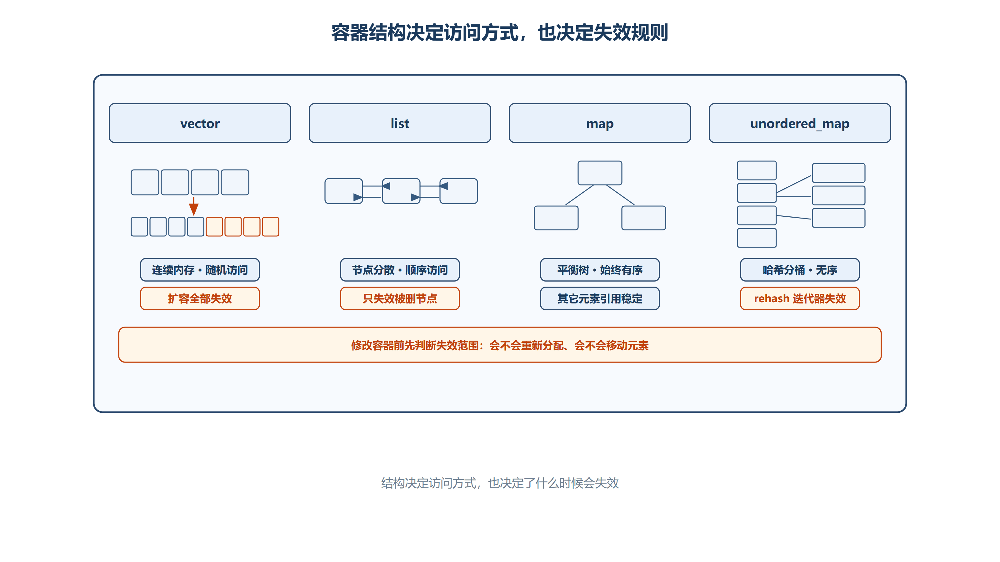
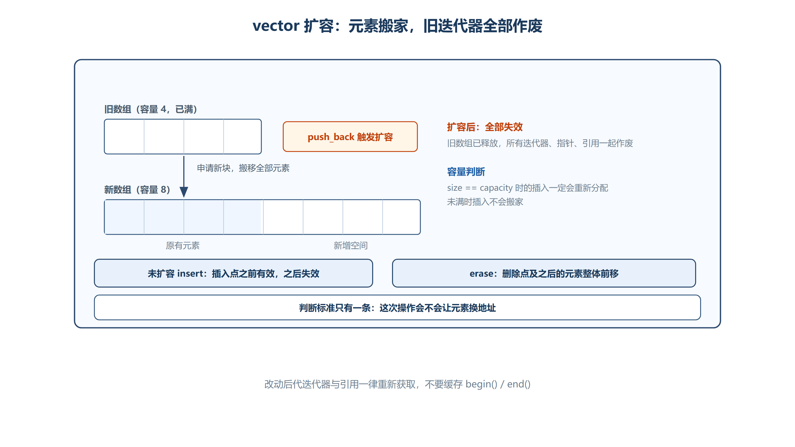

# 第七章 STL 容器与算法
## 7.1 STL 概述
### 7.1.1 容器的分类
STL（Standard Template Library）不仅是代码库，更是一套高度抽象的**泛型编程框架**。它由六大组件构成：**容器（Containers）、算法（Algorithms）、迭代器（Iterators）、仿函数（Functors）、配接器（Adapters）和空间配置器（Allocators）**。

STL 容器负责管理内存与数据结构，主要分为两大类：

| 类别 | 特点 | 代表容器 | 后端工程选型建议 |
| --- | --- | --- | --- |
| **序列容器** | 每个元素都有固定的位置，位置取决于插入的时间和地点。 | `vector`（动态数组）、`deque`（双端队列）、`list`（双向链表）、`array`、`forward_list` | 追求极致的遍历性能和CPU缓存命中率时，首选连续内存的 `vector`。 |
| **关联容器** | 元素的位置取决于它的特定属性（如键值），自动排序或哈希。 | `map`（映射）、`set`（集合）、`unordered_map`（哈希映射）、`unordered_set` | 需要范围查询（如查找某个IP段）用 `map`；追求O(1)极致查询性能用 `unordered_map`。 |



*图：容器结构用于建立直觉；红黑树、分桶链等属于常见库实现。真正编程时应以标准规定的复杂度与失效规则为准。*

---

## 7.2 `list`：双向链表
### 7.2.1 基本概念与底层结构
`list` 在语义上是双向链表；主流实现常使用哨兵节点组成双向循环链表，但哨兵的具体形式并非标准接口的一部分。

+ **内存分布**：每个节点在堆区独立分配，包含数据域、前驱指针（`prev`）和后继指针（`next`）。因此节点在内存中是**离散分布**的。
+ **Cache 不友好**：由于内存不连续，CPU 无法利用空间局部性原理进行 Cache 预取，导致遍历 `list` 的速度远慢于 `vector`。
+ **不支持随机访问**：不能使用 `[]` 或 `+n` 跳转，访问第 N 个元素的时间复杂度为 O(N)。
+ **插入/删除效率高**：已经持有目标位置迭代器时，单个元素的插入/删除通常为 O(1)；若要先线性查找位置，总成本仍是 O(N)。插入不使现有迭代器失效，删除只使被删元素的迭代器和引用失效。

### 7.2.2 创建与初始化
```cpp
#include<list>

list<int> lst;              // 空列表
list<int> lst2(5);          // 5 个元素，默认值 0
list<int> lst3(5, 2);       // 5 个元素，初始值 2
list<int> lst4{2,5,4,6,1,8}; // 列表初始化
```

### 7.2.3 基本操作
```cpp
// 尾部插入/删除
lst.push_back(i);
lst.pop_back();

// 获取首/尾元素
lst.front();               // 头节点的值
lst.back();                // 尾节点的值

// 遍历（范围 for 循环，底层使用迭代器）
for (int num : lst) {
    cout << num << " ";
}

// 删除指定值的所有元素
lst.remove(3);

// 去重（只合并相邻的相同元素，通常配合 sort 使用）
lst.unique();

// 排序（底层并非使用快排，而是归并排序，因为链表不支持随机访问）
lst.sort();
lst.sort(greater<int>());  // 指定降序

// 反转
lst.reverse();

// 交换（通常为 O(1)，交换容器内部的链表锚点等状态）
lst.swap(lst2);
```

### 7.2.4 迭代器（Iterator）
迭代器是一种对象，能够访问容器中的元素，而不必暴露容器的底层实现细节。就像使用指针或下标一样遍历元素。`list` 的迭代器属于**双向迭代器（Bidirectional Iterator）**，只支持 `++` 和 `--`，不支持 `+n`。

```cpp
// 获取迭代器
list<int>::iterator it = lst.begin();  // 指向第一个节点
// .end() 返回最后一个节点的下一个位置（哨兵节点，不可访问）

// 迭代器操作
++it;      // 向后移动（重载了 ++ 运算符，相当于 node = node->next）
*it;       // 解引用获取元素值

// 遍历
it = lst.begin();
while (it != lst.end()) {
    cout << *it << " ";
    ++it;
}
```

### 7.2.5 插入与删除
```cpp
// .insert() 在指定位置之前插入元素
it = lst.begin();
++it;
lst.insert(it, 4);  // 在第二个位置之前插入 4

// .erase() 删除指定位置的元素，返回下一个元素的迭代器
it = ++ ++lst.begin();
it = lst.erase(it);  // 删除后返回下一个迭代器

// 删除指定值的元素（注意迭代器失效问题）
it = lst.begin();
while (it != lst.end()) {
    if (*it == 4) {
        it = lst.erase(it);  // erase 返回下一个迭代器
        continue;             // 跳过后面的 ++it
    }
    ++it;
}
```

**深度剖析：迭代器失效**  
对于 `list` 而言，**插入操作不会导致任何现有迭代器失效**（因为原有节点的内存地址没有改变）；**删除操作仅导致被删除元素本身的迭代器失效**，其他元素的迭代器依然有效。这与 `vector` 有本质区别。

### 7.2.6 高级操作
```cpp
// 列表拼接：将 lst2 中的部分元素移动到 it 之前
lst.splice(it, lst2, lst2.begin(), --lst2.end());

// 线性合并（要求两个列表均为有序，O(N)复杂度）
lst.merge(lst2);

// 迭代器移动（全局函数，兼容所有迭代器）
advance(it, 3);    // 向前移动 3 个位置（-3 为后退）

// 自定义排序规则
bool salaryAsc(Person p1, Person p2) {
    return p1.salary < p2.salary;
}
lst.sort(&salaryAsc);

// 条件删除
bool Del(Person p1) {
    return p1.age > 30 && p1.salary < 4000;
}
lst.remove_if(&Del);
```

**工程亮点：`splice` 的 O(1) 转移**  
`splice` 通过重连节点把元素从一个 `list` 转移到另一个 `list`，不拷贝元素，也不会为被转移节点重新分配内存。整表转移和单元素转移是常数复杂度；跨不同容器转移一个范围时，标准库可能需要线性统计范围长度。它适合需要稳定节点地址并频繁转移节点的场景，但是否优于其他容器仍应结合访问模式实测。

---

## 7.3 `vector`：动态数组
### 7.3.1 基本概念与底层优势
`vector` 使用一段**连续存储**保存元素，分配器默认通常从自由存储区取得这段空间。连续性是标准保证，“一定在某个名为堆区的区域”则属于具体运行时模型。

+ **CPU Cache 友好**：连续存储通常具有良好的空间局部性，遍历性能往往优于节点式容器；实际差异仍取决于元素类型、访问模式和硬件。
+ **随机访问**：支持 `[]` 和 `+n` 跳转，时间复杂度 O(1)。
+ **尾部操作高效**：`pop_back` 为 O(1)，`push_back` 为**摊销 O(1)**；发生扩容时单次操作需要移动或拷贝已有元素。中间插入/删除通常为 O(N)。

### 7.3.2 创建与初始化
```cpp
#include<vector>

vector<int> vec(4);                  // 4 个元素，默认值 0
vector<int> vec2{1,2,3,4};           // 列表初始化
int arr[] = {1,2,3,4,5,6,7,8};
vector<int> vec3(arr+1, arr+5);      // 根据数组范围初始化：{2,3,4,5}
```

### 7.3.3 基本操作
```cpp
// 尾部插入/删除
vec.push_back(10);
vec.pop_back();

// 随机访问
vec[i];              // 下标访问

// 按迭代器位置插入
auto it = vec.insert(vec.begin(), 12);  // 在头部插入，返回新元素的迭代器

// 按迭代器删除
it = vec.begin() + 4;
it = vec.erase(it);   // 删除后返回下一个元素的迭代器
```

### 7.3.4 容量管理与扩容机制
```cpp
vec.size();         // 当前元素个数（已使用的空间）
vec.capacity();     // 当前容量（已分配空间可容纳的元素个数）

vec.clear();        // 清空元素（size 设为 0，capacity 不变，不释放内存）
vec.resize(7);      // 改变 size（不足补默认值 0，超出则截断），可能引发扩容
vec.shrink_to_fit();// 请求缩减多余容量（C++11，非强制保证）

// 缩容方式：swap（交换内容和容量，经典技巧）
vector<int>{10,20,30}.swap(vec);  // 临时对象交换后空间缩减，临时对象随即析构释放内存
```

**深度剖析：`reserve` vs `resize`**

+ `reserve(n)`：保证 `capacity()` 至少达到 `n`，**不改变 `size()`**，也不创建新元素。它适合提前预留容量，减少扩容次数。
+ `resize(n)`：改变 `size()`，如果 `n` 大于当前 `size`，会调用构造函数创建新对象；如果 `n` 小于当前 `size`，会调用析构函数销毁多余对象。

**深度剖析：扩容系数**  
当插入后的元素数量将超过 `capacity()` 时，`vector` 需要增长容量。C++ 标准没有规定增长倍率；1.5 倍、2 倍或其他策略都可能随标准库版本、元素数量和实现改变。工程代码只能依赖“容量足够前不会因增长而重新分配”等标准规则，不能把某个倍率写入业务逻辑。

### 7.3.5 迭代器失效



*图：扩容会把元素搬到新地址，所有迭代器、指针、引用一起失效；未扩容的 `insert` 与 `erase` 只影响改动点及之后。*

以下常见操作会导致 `vector` 迭代器失效：

1. **扩容导致底层数据迁移**：当 `push_back` 或 `insert` 触发扩容时，整个底层数组被搬到了新的内存地址，**所有迭代器、指针、引用全部失效**。
2. **未扩容的插入**：插入点之前的迭代器、指针和引用仍有效，插入点及之后的元素因移动而失效。
3. **删除操作导致元素位置改变**：使用 `erase` 删除中间元素时，被删除位置及之后的元素都会向前搬移，导致该位置及之后的迭代器、指针和引用失效。

```cpp
#include <cstddef>
#include <vector>

void insertValue(std::vector<int>& v, std::size_t index, int value)
{
    if (index > v.size())
    {
        return; // index 必须位于 [0, v.size()] 范围内
    }

    auto pos = v.begin()
             + static_cast<std::vector<int>::difference_type>(index);

    if (v.size() == v.capacity())
    {
        // 当前容量已满，本次 insert 一定需要重新分配连续存储
        v.insert(pos, value);

        // 扩容后，插入前取得的全部迭代器、指针和引用都已失效
    }
    else
    {
        // 当前容量足够，不会因为本次插入而重新分配存储
        v.insert(pos, value);

        // index 之前的迭代器、指针和引用仍有效
        // index 及之后（包含旧 pos）的迭代器、指针和引用失效
    }
}
```

---

## 7.4 `deque`：双端队列
### 7.4.1 基本概念与底层结构
`deque`（Double-ended Queue）支持头部和尾部的高效 O(1) 插入/删除。

+ **底层并非单一连续数组**：它由一段段固定大小的连续内存块（Buffer）组成，通过一个中央控制器（`map`，一个指针数组）来管理这些内存块。
+ **伪随机访问**：它支持 `[]` 和 `+n`，但底层需要通过中央控制器进行两次偏移计算（先找到对应的 Buffer，再找到 Buffer 内的偏移），因此随机访问速度比 `vector` 慢。
+ **适用场景**：后端开发中的**滑动窗口算法**、或者需要频繁在头部和尾部同时操作的场景。

```cpp
#include<deque>

deque<int> de = {1,2,3,4,5};

de.push_front(0);   // 头部插入 O(1)
de.push_back(6);    // 尾部插入 O(1)
de.pop_front();     // 头部删除 O(1)
de.pop_back();      // 尾部删除 O(1)

// 随机访问迭代器
auto it = de.begin() + 4;  // 支持随机访问类型迭代器
it = de.insert(it, 10);    // 在指定位置插入（中间插入依然慢，需搬移）
it = de.erase(it);         // 删除指定位置

// 通过引用修改容器元素：
for (int &v : de) {    // 注意引用 &
    if (v == 10) v = 20;   // 直接修改容器中的元素
}
```

---

## 7.5 `map`：有序映射
### 7.5.1 基本概念与底层原理
`map` 是关联容器，由键值 (key) 和实值 (value) 组成，每个元素是一个 `pair<const Key, T>`。

+ **典型实现**：主流标准库通常用红黑树等自平衡搜索树实现，但标准只规定有序语义和复杂度，不指定必须采用哪一种树。
+ **自动排序**：根据键值自动排序（默认升序，可通过模板参数传入 `greater<Key>` 改为降序）。
+ **时间复杂度**：插入、删除、查找的时间复杂度严格稳定在 **O(log N)**。
+ **键值唯一且不可变**：不能重复。元素类型中的 Key 为 `const`，不能通过迭代器修改；如需更换键，应删除旧元素后重新插入。

```cpp
#include<map>

map<char, int> m{ {'a',1}, {'f',3}, {'d',7} };

// 遍历（自动按键值排序输出）
for (pair<char,int> pr : m) {
    cout << pr.first << "," << pr.second << "  ";
    // 输出：a,1  d,7  f,3
}
```

### 7.5.2 插入与访问
```cpp
// 方式一：下标访问（键值不存在时自动插入，并调用 Value 的默认构造函数）
m['c'] = 9;       // 键值不存在 → 插入 {'c', 9}
m['f'] = 10;      // 键值已存在 → 修改/更新为 10

// 方式二：insert（返回 pair<迭代器, bool>，不覆盖已有值）
pair<map<char,int>::iterator, bool> pr1 = m.insert(pair<char,int>('d', 2));
if (!pr1.second) cout << "插入失败" << endl;  // 键值已存在，插入失败
```

**工程避坑**：在后端高并发统计词频时，慎用 `m[key]++`，因为如果 `key` 不存在，它会先默认构造一个 `0` 再插入，带来不必要的开销。推荐使用 `insert` 或 C++17 的 `try_emplace`。

### 7.5.3 查找与删除
```cpp
// 查找：返回对应键值的迭代器，效率 O(logN)
auto it = m.find('d');
if (it != m.end())
    m.erase(it);

// 统计元素是否存在
m.count('f');     // 存在返回 1，不存在返回 0

// 范围查找（红黑树特有优势，哈希表无法做到）
m.upper_bound('c');  // 返回第一个大于该键值的迭代器
m.lower_bound('c');  // 返回第一个大于等于该键值的迭代器
```

---

## 7.6 `set`：有序集合
`set` 是有序关联容器，主流标准库同样常用红黑树实现。与 `map` 的区别在于，`set` 的元素本身就是键，没有独立的映射值。

+ **特性**：自动排序，元素唯一。
+ **用途**：常用于**海量数据的去重与排序**，或者维护一个动态的有序序列。

```cpp
#include<set>

set<int> st{6, 2, 9, 0};  // 自动排序：0 2 6 9

st.insert(5);   // 成功插入
st.insert(6);   // 失败（6 已存在）

// 查找与删除
auto it = st.find(6);
it = st.erase(it);  // 删除并返回下一个迭代器
```

---

## 7.7 `unordered_map`：哈希映射
### 7.7.1 基本概念与底层原理
`unordered_map` 提供基于哈希与分桶的无序关联语义；桶内冲突如何组织由标准库实现决定，拉链法只是常见方案。

+ **无序性**：不按键排序，迭代顺序是**未指定的**，并可能在插入、删除或 rehash 后改变；“未指定”不等于真正随机。
+ **平均性能**：哈希分布良好时，查找、插入、删除平均为 O(1)；最坏情况可退化为 O(N)。
+ **Rehash（重新哈希）机制**：当装载因子超过实现所允许的阈值时，容器可能增加桶数并重新组织元素。该过程通常为 O(N)，并使所有迭代器失效，但元素引用和指针仍保持有效。
+ **不支持范围查找**：不支持 `upper_bound` / `lower_bound`。

```cpp
#include<unordered_map>

unordered_map<int, string> m{ {6,"aa"}, {3,"bb"}, {0,"cc"}, {9,"dd"} };

m.insert(pair<int,string>(10, "ee"));   // 插入
m.find(0);                              // 查找
m.erase(it);                            // 删除
```

**优化建议**：已知预计元素数量时，可以调用 `reserve(n)`，让容器为至少 `n` 个元素调整桶数，从而减少增长阶段的 rehash。是否值得预留以及预留多少，应结合内存占用和实测结果决定。

---

## 7.8 反向迭代器（Reverse Iterator）
反向迭代器本质上是一个**适配器**，它封装了正向迭代器。当你对反向迭代器执行 `++` 时，它底层实际调用的是正向迭代器的 `--`。

```cpp
#include<list>

list<int> lst{1, 2, 3, 4};

// 反向遍历
list<int>::reverse_iterator itrev = lst.rbegin();  // 反向头（对应正向 end）
while (itrev != lst.rend()) {                       // 反向尾（对应正向 begin）
    cout << *itrev << " ";   // 输出：4 3 2 1
    itrev++;
}

// 反向迭代器转正向迭代器
auto it = itrev.base();  // 注意偏移：*it 指向反向迭代器下一个位置
```

**原理解析：`base()` 的偏移关系**  
`rbegin()` 指向逻辑上的最后一个元素，但物理上它封装的是 `end()`。因此，当调用 `base()` 转换回正向迭代器时，得到的地址会比当前反向迭代器解引用的地址**向后偏移一个位置**。这在配合 `erase` 删除元素时需要特别小心。

---

## 7.9 STL 算法
STL 算法是全局函数（在 `<algorithm>` 头文件中），**算法本身不直接操作容器，而是通过迭代器操作容器**。这种设计实现了“数据结构”与“算法”的完美解耦。

```cpp
#include<algorithm>

// 遍历
for_each(lst.begin(), lst.end(), &show);

// 计数
count(lst.begin(), lst.end(), 2);   // 统计值为 2 的元素个数

// 比较
equal(v1.begin(), v1.end(), v2.begin());  // 判断两个范围是否相同

// 查找
find(v2.begin(), v2.end(), 2);  // 返回目标值的迭代器

// 排序（底层通常是 introsort：快排+堆排+插入排序的混合体，不能对链表使用）
sort(v1.begin(), v1.end());                // 默认升序
sort(v1.begin(), v1.end(), greater<int>()); // 降序

// 比较大小（按元素逐位比较，不同则比较元素个数）
max(v1, v2);   // 返回较大的容器
min(m1, m2);   // 返回较小的容器
```

**经典技巧：Erase-Remove Idiom**  
`std::remove` 并不会真正删除元素，它只是把不需要删除的元素移动到容器前端，并返回新的逻辑边界迭代器。必须配合容器的 `erase` 才能真正释放空间：  
`vec.erase(std::remove(vec.begin(), vec.end(), 2), vec.end());`

---

## 7.10 容器适配器：`stack` 与 `queue`
适配器（Adapter）不是真正的容器，它们**没有自己的底层内存管理机制**，而是通过封装其他序列容器（默认是 `deque`）来实现特定的访问规则。

### 7.10.1 `stack`：后进先出（LIFO）
```cpp
#include<stack>

stack<int> st;
st.push(1);       // 入栈
st.push(2);
st.top();         // 查看栈顶元素
st.pop();         // 出栈（不返回值）
st.size();        // 元素数量
st.empty();       // 是否为空
```

### 7.10.2 `queue`：先进先出（FIFO）
```cpp
#include<queue>

queue<int> que;
que.push(1);      // 入队（尾部插入）
que.push(2);
que.front();      // 查看队头元素
que.back();       // 查看队尾元素
que.pop();        // 出队（不返回值）
que.size();
que.empty();
```

**补充：优先队列 `priority_queue`**

优先队列常用于任务调度和按优先级取出元素。默认底层容器是 `vector`，并用堆算法维护顺序；`top()` 为 O(1)，插入和弹出为 O(log N)。

---

## 7.11 函数对象（Functor）
### 7.11.1 核心概念与本质
**仿函数（Functor）** 又称**函数对象（Function Object）**，本质是一个重载了函数调用运算符 `operator()` 的类对象。  
从语法表现上看，它可以像普通函数一样被调用（通过 `()`）；但从底层机制上看，它是一个拥有独立内存空间、可以携带成员变量的**对象**。

```cpp
class MyFunctor {
public:
    // 重载函数调用运算符
    void operator()() const {
        cout << "Functor called!" << endl;
    }
};

MyFunctor f;
f(); // 看起来像函数调用，实际底层执行的是 f.operator()()
```

### 7.11.2 函数对象的核心优势
在后端开发与泛型编程中，仿函数相比普通函数和函数指针具有压倒性的优势：

1. **状态保持 (Stateful)**  
函数对象可以通过**成员变量**自然地携带配置或累计状态，不必把状态放入全局变量；普通函数也能通过参数或外部对象管理状态，只是表达方式不同。
2. **极致的性能 (内联优化 Inline)**  
函数对象的具体类型作为模板参数时，编译器通常更容易看到 `operator()` 的实现并进行内联。函数指针调用也可能在全程序优化等条件下被去间接化，因此不能把两者写成绝对的“必然内联”与“绝不内联”；应以优化报告和性能测试为准。
3. **更高的类型安全与灵活性**  
仿函数是一个类，可以拥有多个重载版本的 `operator()`，也可以拥有构造函数来初始化其内部状态，比单一的函数签名灵活得多。

### 7.11.3 代码示例：有状态的累加器
以下代码展示了仿函数如何利用成员变量保存状态，这是普通函数难以优雅实现的：

```cpp
// 普通函数：无法保存状态，必须依赖外部全局变量（线程不安全）
int add(int a, int b) {
    return a + b;
}

// 仿函数：有状态的函数对象
class Add {
public:
    int sum = 0;   // 成员变量：记录历史累加和
    
    // 重载 operator()
    int operator()(int a, int b) {
        sum += a + b;
        return a + b;
    }
};

int main() {
    Add a; // 实例化仿函数对象
    cout << a(5, 6) << endl;    // 11，内部 sum = 11
    cout << a(7, 8) << endl;    // 15，内部 sum = 26
    cout << a(9, 10) << endl;   // 19，内部 sum = 45
    cout << a.sum << endl;      // 45（获取累计和）
    return 0;
}
```

### 7.11.4 STL 内置函数对象
STL 在 `<functional>` 头文件中提供了一套丰富的内置仿函数，主要用于为 STL 算法和容器提供**自定义的比较或计算规则**。

| 类别 | 代表仿函数 | 等价运算符 | 典型应用场景 |
| :--- | :--- | :---: | :--- |
| **算术类** | `plus<T>`, `minus<T>`, `multiplies<T>` | `+`, `-`, `*` | `transform` 算法中的元素运算 |
| **关系类** | `greater<T>`, `less<T>`, `equal_to<T>` | `>`, `<`, `==` | `std::sort` 降序排列、`priority_queue` 优先级控制、`map/set` 自定义排序 |
| **逻辑类** | `logical_and<T>`, `logical_not<T>` | `&&`, `!` | 逻辑条件判断 |


**实战案例：控制 `std::sort` 与 `priority_queue`**

```cpp
#include <iostream>
#include <vector>
#include <algorithm>
#include <queue>
#include <functional> // 必须包含此头文件以使用内置仿函数

using namespace std;

int main() {
    vector<int> v = {3, 1, 4, 1, 5, 9};
    
    // 1. 使用内置仿函数 greater<int> 实现降序排序
    // 底层原理：sort 模板实例化时，编译器将 greater<int>::operator() 内联展开，零开销
    sort(v.begin(), v.end(), greater<int>()); 
    
    // 2. 控制优先队列（大顶堆 vs 小顶堆）
    // 默认 priority_queue 是大顶堆（底层使用 less），改为小顶堆需传入 greater
    priority_queue<int, vector<int>, greater<int>> min_heap;
    min_heap.push(5); min_heap.push(1); min_heap.push(9);
    cout << min_heap.top(); // 输出 1
    return 0;
}
```

### 7.11.5 函数对象、函数指针与 Lambda 表达式对比
| 维度 | 普通函数 / 函数指针 | 仿函数 (Functor) | Lambda 表达式 (C++11) |
| :--- | :--- | :--- | :--- |
| **本质** | 代码区的一段机器码地址 | 重载了 `operator()` 的**类对象** | 编译器自动生成的**匿名仿函数类对象**（闭包） |
| **状态保持** | ❌ 否（除非用 static/全局） | ✅ 是（通过成员变量） | ✅ 是（通过捕获列表 Capture List） |
| **内联优化** | ❌ 极难（间接寻址导致无法内联） | ✅ 极易（类型确定，编译器直接内联） | ✅ 极易（本质是仿函数，完美内联） |
| **代码简洁度** | 中（需单独定义函数） | 低（需定义完整的类结构） | **极高**（就地定义，语法糖） |
| **后端选型建议** | 仅用于 C 风格 API 回调（如 pthread、epoll） | 适合复杂状态机、需要复用且逻辑较重的策略类 | **日常开发首选**，配合 STL 算法极其优雅 |


> **底层揭秘：Lambda 的仿函数本质**  
当你在代码中写下一个 Lambda 表达式 `auto cmp = [](int a, int b){ return a > b; };` 时，编译器在底层实际生成了类似如下的仿函数类（闭包类）：
>
> 因此，**Lambda 表达式就是现代 C++ 中编写仿函数的最简语法糖**。理解了仿函数，就彻底看透了 Lambda 与 STL 算法结合的底层逻辑。
>

```cpp
class __Anonymous_Lambda_1 {
public:
    bool operator()(int a, int b) const { return a > b; }
};
__Anonymous_Lambda_1 cmp;
```

### 7.11.6 迭代器的仿指针特性
与“像函数一样调用”的函数对象类似，迭代器提供“像指针一样访问和移动”的抽象。具体迭代器类型会按其类别支持 `*`、`->`、`++`、`--`、比较等操作，让算法以统一方式遍历不同容器，而无需暴露底层结构。

```cpp
//仿指针
//容器::iterator it;

#include <iostream>
#include <vector>

using namespace std;

int main() {
    vector<int> v = {10, 20, 30, 40, 50};

    // 声明迭代器：容器名::iterator 变量名
    vector<int>::iterator it;

    // 像指针一样使用：*it 取值，it++ 移动，it != v.end() 判边界
    for (it = v.begin(); it != v.end(); it++) {
        cout << *it << " ";  // *it 等价于指针的解引用 *p
    }
    // 输出：10 20 30 40 50
    cout << endl;

    // 反向迭代器：从尾到头遍历
    vector<int>::reverse_iterator rit;
    for (rit = v.rbegin(); rit != v.rend(); rit++) {
        cout << *rit << " ";
    }
    // 输出：50 40 30 20 10
    cout << endl;

    return 0;
}
```

> **仿函数 vs 仿指针——STL 的对称美学**  
>
> + **仿函数（Functor）**：对象像函数一样被 `()` 调用 → 重载 `operator()`  
> + **仿指针（Iterator）**：对象像指针一样被 `*` `++` 操作 → 重载 `operator*` `operator++`  
两者都是 STL "泛型抽象"的核心思想：**用统一的接口屏蔽底层差异**。算法通过迭代器访问容器元素，通过仿函数定义操作策略，从而实现容器与算法的彻底解耦。
>

---

---

## 7.12 动态数组的实现原理（`vector`）
以下是一个简化的动态数组实现，展示了 `vector` 的核心机制：扩容。  
_注：真实的 STL `vector` 并非直接使用 `new/delete`，而是通过*__空间配置器（Allocator）_ 进行内存池管理，以减少内存碎片并提升分配效率。*

```cpp
class DynamicArray {
public:
    int* m_pArr;    // 指向底层数据的指针
    int m_len;      // 当前元素个数（size）
    int m_capacity; // 当前容量

    DynamicArray(int len = 0) : m_pArr(nullptr), m_len(len), m_capacity(len) {
        if (len > 0) m_pArr = new int[len]();
    }

    void pushBack(int val) {
        if (m_len == m_capacity) {
            // 扩容：新容量 = max(旧容量+1, 旧容量*3/2)
            m_capacity = (m_capacity + 1) > (m_capacity * 3 / 2)
                         ? (m_capacity + 1) : (m_capacity * 3 / 2);
            int* ptemp = new int[m_capacity]();
            for (int i = 0; i < m_len; i++) ptemp[i] = m_pArr[i];
            delete[] m_pArr;
            m_pArr = ptemp;
        }
        m_pArr[m_len++] = val;
    }

    // 支持范围 for 循环（提供 begin/end）
    int* begin() { return m_pArr; }
    int* end() { return m_pArr + m_len; }
};
```

**细节剖析**：`new int[len]()` 中的 `()` 表示**值初始化**，对 `int` 数组会得到全 0。若写成 `new int[len]`，元素为默认初始化的 `int`，其值不确定；读取这些未初始化值会导致未定义行为，与 Debug/Release 构建模式无关。

## 7.13 总结
### 7.13.1 STL 容器结构与特性对比
此表是面试中“手撕底层原理”和“性能分析”的基石，请务必熟记各容器的**时间复杂度**与**内存模型**。

| 容器名称 | 底层数据结构 | 内存连续性 | 随机访问 (`[]`) | 头部插/删 | 尾部插/删 | 中间插/删 | 迭代器类型 | CPU Cache 友好度 |
| :--- | :--- | :--- | :---: | :---: | :---: | :---: | :--- | :---: |
| `vector` | 动态数组 | 连续 | ✅ $O(1)$ | ❌ $O(N)$ | ✅ $O(1)$* | ❌ $O(N)$ | 随机访问迭代器 | ⭐⭐⭐⭐⭐ (极高) |
| `deque` | 双端队列 (分段数组+中央控制器) | 伪连续 | ✅ $O(1)$ | ✅ $O(1)$ | ✅ $O(1)$ | ❌ $O(N)$ | 随机访问迭代器 | ⭐⭐⭐ (中等) |
| `list` | 双向链表 | 离散 | ❌ $O(N)$ | ✅ $O(1)$ | ✅ $O(1)$ | ✅ $O(1)$<sup>2</sup> | 双向迭代器 | ⭐ (极低) |
| `forward_list` | 单向链表 | 离散 | ❌ $O(N)$ | ✅ $O(1)$ | ❌ 不支持 | ✅ $O(1)$<sup>2</sup> | 单向迭代器 | ⭐ (极低) |
| `array` | 静态数组 | 连续 | ✅ $O(1)$ | ❌ 不支持 | ❌ 不支持 | ❌ 不支持 | 随机访问迭代器 | ⭐⭐⭐⭐⭐ (极高) |
| `map` / `set` | 典型实现为平衡搜索树 | 离散 | ❌ 不支持 | ❌ $O(\log N)$ | ❌ $O(\log N)$ | ❌ $O(\log N)$ | 双向迭代器 | ⭐⭐ (较低) |
| `unordered_map` | 哈希分桶（组织方式由实现决定） | 非连续 | ❌ 不支持 | ❌ 平均 $O(1)$ | ❌ 平均 $O(1)$ | ❌ 平均 $O(1)$ | 前向迭代器 | ⭐⭐ (较低) |


> **注**：
>
> + `*` `vector` 尾部插入平均 $O(1)$，但触发扩容时为 $O(N)$。
> + <sup>2</sup> `list` / `forward_list` 在已持有合适迭代器时插入或删除为 $O(1)$；若需先遍历寻找位置，总成本仍为 $O(N)$。
>

---

### 7.13.2 序列容器常用 API
序列容器关注元素的排列顺序和位置操作。

| 操作分类 | API 函数 | `vector` | `deque` | `list` | `forward_list` | `array` |
| :--- | :--- | :---: | :---: | :---: | :---: | :---: |
| **容量与大小** | `size()` / `empty()` | ✅ | ✅ | ✅ | ✅ | ✅ |
|  | `capacity()` / `reserve()` | ✅ | ❌ | ❌ | ❌ | ❌ |
|  | `resize()` / `shrink_to_fit()` | ✅ | ✅ | ✅ | ❌ | ❌ |
| **元素访问** | `operator[]` / `at()` | ✅ | ✅ | ❌ | ❌ | ✅ |
|  | `front()` / `back()` | ✅ | ✅ | ✅ | 仅 `front()` | ✅ |
| **尾部操作** | `push_back()` / `pop_back()` | ✅ | ✅ | ✅ | ❌ | ❌ |
|  | `emplace_back()` (C++11) | ✅ | ✅ | ✅ | ❌ | ❌ |
| **头部操作** | `push_front()` / `pop_front()` | ❌ | ✅ | ✅ | ✅ | ❌ |
|  | `emplace_front()` (C++11) | ❌ | ✅ | ✅ | ✅ | ❌ |
| **中间操作** | `insert()` / `erase()` | ✅ | ✅ | ✅ | `insert_after` | ❌ |
|  | `emplace()` (C++11) | ✅ | ✅ | ✅ | `emplace_after` | ❌ |
| **特殊操作** | `sort()` / `reverse()` | 用 `<algorithm>` | 用 `<algorithm>` | ✅ (成员函数) | ✅ (成员函数) | 用 `<algorithm>` |
|  | `splice()` (链表拼接) | ❌ | ❌ | ✅ | ✅ | ❌ |
|  | `remove()` / `unique()` | 用 `<algorithm>` | 用 `<algorithm>` | ✅ (成员函数) | ✅ (成员函数) | ❌ |


> **后端工程避坑指南**：
>
> 1. 优先使用 `emplace_back()` 代替 `push_back()`。前者直接在容器尾部**原地构造**对象，省去了一次临时对象的拷贝/移动构造开销。
> 2. `list` 和 `forward_list` 必须使用**成员函数** `sort()`，不能使用 `<algorithm>` 中的 `std::sort()`，因为 `std::sort` 要求随机访问迭代器，而链表只提供双向/单向迭代器。
>

---

### 7.13.3 关联容器常用 API
关联容器关注键值（Key）的查找、排序与去重。

| 操作分类 | API 函数 | `map` / `set` (红黑树) | `unordered_map` / `unordered_set` (哈希表) |
| :--- | :--- | :--- | :--- |
| **容量管理** | `size()` / `empty()` | ✅ | ✅ |
|  | `max_size()` | ✅ | ✅ |
|  | `bucket_count()` / `load_factor()` | ❌ | ✅ (哈希表特有，用于监控负载因子) |
|  | `reserve()` | ❌ | ✅ (提前分配桶，**防止 Rehash 导致 CPU 飙升**) |
| **插入与构造** | `insert()` | ✅ $O(\log N)$ | ✅ 平均 $O(1)$ |
|  | `emplace()` (C++11) | ✅ | ✅ |
|  | `try_emplace()` (C++17) | ✅ (避免覆盖已有值) | ✅ |
| **访问与修改** | `operator[]` | ✅ (`map` 特有，不存在则默认构造) | ✅ (`unordered_map` 特有) |
|  | `at()` | ✅ (不存在抛 `out_of_range` 异常) | ✅ |
| **查找与统计** | `find(key)` | ✅ 返回迭代器 | ✅ 返回迭代器 |
|  | `count(key)` | ✅ 返回 0 或 1 | ✅ 返回 0 或 1 |
|  | `contains(key)` (C++20) | ✅ 返回 `bool` (推荐替代 `count`) | ✅ 返回 `bool` |
| **范围查找** | `lower_bound(key)` | ✅ 第一个 $\ge$ key 的迭代器 | ❌ (哈希表无序，不支持) |
|  | `upper_bound(key)` | ✅ 第一个 $>$ key 的迭代器 | ❌ |
|  | `equal_range(key)` | ✅ 返回 `pair<迭代器, 迭代器>` | ❌ |
| **删除操作** | `erase(key)` / `erase(iter)` | ✅ | ✅ |
|  | `clear()` | ✅ | ✅ |


> **后端工程避坑指南**：
>
> 1. **慎用 `operator[]` 进行纯查找**：`m[key]` 如果 `key` 不存在，会**自动插入**一个默认值（如 `int` 为 0，`string` 为空串），这不仅污染数据，还会引发不必要的内存分配。纯查找优先使用 `find()` 或 C++20 的 `contains()`。
> 2. **控制哈希表 Rehash**：若已知要加载约 100 万条配置，可提前调用 `m.reserve(1000000)`，减少插入过程中的重复 Rehash。是否预留以及预留量应结合内存与性能测试决定。
>

---

### 7.13.4 迭代器失效条件
这是 C++ 面试中**出现频率最高**的 STL 考点，主要考察对底层内存搬移和节点指针变化的理解。

| 容器类型 | 插入操作 (Insert / Push) 导致的失效 | 删除操作 (Erase / Pop) 导致的失效 |
| :--- | :--- | :--- |
| `vector` | **1. 触发扩容**：所有迭代器、指针、引用**全部失效**。   **2. 未扩容**：插入点**之后**的迭代器失效（因元素内存搬移）。 | 被删除元素**及其之后**的所有迭代器失效（因后续元素前移填补空缺）。 |
| `deque` | **1. 头/尾插入**：所有**迭代器失效**，但**指针和引用不失效**（底层分段内存特性）。   **2. 中间插入**：所有迭代器、指针、引用**全部失效**。 | **1. 头/尾删除**：仅**被删除元素**的迭代器失效。   **2. 中间删除**：所有迭代器、指针、引用**全部失效**。 |
| `list`   `forward_list` | **不失效**。   （链表节点在内存中独立，插入新节点不影响旧节点的地址）。 | **仅被删除元素**的迭代器失效。   （其他节点的 `prev/next` 指针虽被修改，但节点自身内存地址未变）。 |
| `map` / `set`（有序关联容器） | **不失效**。节点式组织使插入不改变旧元素地址。 | **仅被删除元素**的迭代器失效。 |
| `unordered_map`   (哈希表) | **1. 触发 Rehash**：所有迭代器**全部失效**。   **2. 未 Rehash**：插入操作**不失效**（拉链法新节点挂载在链表头部）。 | **仅被删除元素**的迭代器失效。 |


> **代码实战：如何安全地遍历并删除 `vector` 中的特定元素？**
>

```cpp
// ❌ 错误写法：erase 后 it 失效，++it 会导致未定义行为（崩溃）
for (auto it = vec.begin(); it != vec.end(); ++it) {
    if (*it == target) vec.erase(it); 
}

// ✅ 正确写法 1：利用 erase 的返回值（下一个有效迭代器）
for (auto it = vec.begin(); it != vec.end(); ) {
    if (*it == target) it = vec.erase(it);
    else ++it;
}

// ✅ 正确写法 2：C++20 标准库提供的 std::erase (推荐)
std::erase(vec, target);
```

---

### 7.13.5 容器选型
在实际编写网络库、RPC 框架或业务逻辑时，请按照以下逻辑树选择容器：

| 业务场景需求 | 推荐容器 | 核心理由 (后端视角) |
| :--- | :--- | :--- |
| **默认情况 / 需要高频遍历 / 缓存行友好** | `vector` | 内存连续，完美契合 CPU L1/L2 Cache 预取机制，遍历速度碾压链表。 |
| **需要频繁在头部和尾部同时操作 (如滑动窗口)** | `deque` | 头尾 $O(1)$ 操作，且支持随机访问。 |
| **需要频繁在中间插入/删除，且需保持元素原有顺序** | `list` | 节点独立，无内存搬移开销。配合 `splice()` 可实现跨队列 $O(1)$ 转移对象（如 Reactor 线程模型中的连接转移）。 |
| **需要元素自动排序，或需要进行范围查询 (如 IP 段匹配)** | `map` / `set` | 红黑树保证严格有序，支持 `lower_bound` 范围查找，时间复杂度稳定 $O(\log N)$。 |
| **海量数据的高频查找/去重，不关心顺序 (如 Session 缓存)** | `unordered_map` | 平均 $O(1)$ 查找；已知元素规模时可考虑提前 `reserve`。 |
| **只需要追加元素，且大小固定 (如网络协议包头解析)** | `array` / `std::span` | 零额外堆内存分配开销，栈上分配，极致性能。 |


---

