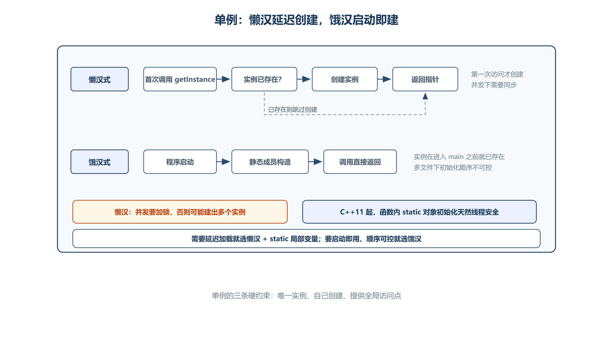

# 第八章 设计模式
设计模式是经过验证的、解决特定软件设计问题的通用方案。以下是 C++ 中常见的创建型和行为型设计模式。

## 8.1 单例模式（Singleton Pattern）



*图：懒汉在首次调用时创建，并发下需要同步；饿汉在程序启动时创建，天然线程安全但多文件初始化顺序不可控。*

### 8.1.1 核心约束
单例模式是一种创建型模式，确保：

1. 当前类**只能存在一个实例**。
2. 类必须**自己创建**这个实例，然后向调用者提供，不能由调用者传递进来。
3. 类必须自己向整个系统提供**全局访问点**，获取该实例。

### 8.1.2 懒汉式（延迟创建）
+ **特点**：第一次调用获取单例的接口时，才会创建单例的唯一实例。

**写法一：堆区分配（需要手动管理释放）**

```cpp
class Singleton {
public:
    // 应返回指针而不是对象（防止值拷贝），否则会导致多次使用为空的构函
    static Singleton* creatSingleton() {
        if (!m_psin) {
            m_psin = new Singleton;
        }
        return m_psin;
    }

    static void delSingleton() {
        if (m_psin) {
            delete m_psin;
            m_psin = nullptr;
        }
    }

private:
    static Singleton* m_psin;

    // 利用程序结束时静态对象自动析构来释放资源
    static struct DelSingleton {
        ~DelSingleton() {
            Singleton::delSingleton();
        }
    } del;

    Singleton() = default;
    Singleton(const Singleton& p) = delete;  // 删除拷贝构造函数
    ~Singleton() { cout << "~Singleton()" << endl; }
};

Singleton* Singleton::m_psin = nullptr;
Singleton::DelSingleton Singleton::del;
```

**写法二：静态局部变量（推荐，更简洁）**

```cpp
class Singleton {
public:
    static Singleton* creatSingleton() {
        // 利用静态局部变量只会初始化一次的特点，只会有一块内存空间
        static Singleton sin;
        return &sin;
    }

private:
    Singleton() { cout << "Singleton()" << endl; }
    Singleton(const Singleton& p) = delete;
    ~Singleton() { cout << "~Singleton()" << endl; }
};
```

+ **注意**：上面的裸指针懒汉式在多线程下可能创建多个实例，需要正确同步；C++11 起，函数局部静态对象的首次初始化由标准保证线程安全，后文的 Magic Static 写法不需要自行实现这段加锁。

### 8.1.3 饿汉式（提前创建）
+ **特点**：在单例创建的时候（程序启动时），唯一的单例就已经存在了。

```cpp
class Singleton {
public:
    static Singleton* creatSingleton() {
        return &sin;  // 直接返回已存在的实例
    }

private:
    static Singleton sin;  // 静态成员，程序启动时就创建

    Singleton() : m_a(123) { cout << "Singleton()" << endl; }
    Singleton(const Singleton& p) = delete;
    ~Singleton() { cout << "~Singleton()" << endl; }

    int m_a;
};

Singleton Singleton::sin;  // 类外定义
```

+ **饿汉式的注意**：多文件场景下，静态成员的初始化顺序不可控（不同文件间可能无法保证初始化次序），可能导致访问未初始化的单例成员。

### 8.1.4 懒汉式与饿汉式对比
| 特性 | 懒汉式 | 饿汉式 |
| :--- | :--- | :--- |
| **创建时机** | 第一次调用时 | 程序启动时 |
| **资源利用** | 延迟加载，不浪费 | 启动即创建 |
| **线程安全** | 需要额外处理 | 天然安全 |
| **初始化顺序** | 可控 | 多文件下不可控 |


---

## 8.2 简单工厂模式（Simple Factory）
+ **目的**：使用时只需要工厂类，不需要每类对象。将对象创建的逻辑集中管理。

```cpp
// 抽象产品
class Engine {
public:
    virtual void working() = 0;
};

// 具体产品
class Engine2L : public Engine {
public:
    void working() override { cout << "2.0L自然吸气发动机在工作" << endl; }
};

class Engine2T : public Engine {
public:
    void working() override { cout << "2.0L微型增压发动机在工作" << endl; }
};

// 简单工厂
class FacEngine {
public:
    Engine* creatEngine(const string& type) {
        if (type == "2L") return new Engine2L;
        else if (type == "2T") return new Engine2T;
        return nullptr;
    }
};

// 使用方
class Car {
public:
    Engine* m_pEngine;
    Car(FacEngine* pFac, const string& type)
        : m_pEngine(pFac ? pFac->creatEngine(type) : nullptr) {}
    ~Car() { if (m_pEngine) { delete m_pEngine; m_pEngine = nullptr; } }

    void drive() {
        if (m_pEngine) {
            m_pEngine->working();
            cout << "小汽车开动" << endl;
        }
    }
};
```

---

## 8.3 工厂方法模式（Factory Method）
+ **目的**：将工厂也抽象化，每种产品对应一个工厂类。遵循**开闭原则**（新增产品无需修改已有代码）。

```cpp
// 抽象工厂
class FacEngine {
public:
    virtual Engine* creatEngine() = 0;  // 散列模式
};

// 具体工厂
class FacEngine2L : public FacEngine {
public:
    Engine* creatEngine() override { return new Engine2L; }
};

class FacEngine2T : public FacEngine {
public:
    Engine* creatEngine() override { return new Engine2T; }
};

// 使用
FacEngine* pfac2L = new FacEngine2L;
Car BYD(pfac2L);
BYD.drive();
```

---

## 8.4 抽象工厂模式（Abstract Factory）
+ **目的**：创建**一系列相关的产品**（如发动机 + 变速箱），而不指定具体的类。

```cpp
// 抽象工厂：可以生产多个系列产品
class Factory {
public:
    virtual Engine* creatEngine() = 0;
    virtual Gerbox* creatGerbox() = 0;
};

// 具体工厂：Engine2L + GerboxManual 配置
class Fac2LManual : public Factory {
public:
    Engine* creatEngine() override { return new Engine2L; }
    Gerbox* creatGerbox() override { return new GerboxManual; }
};

// 使用
Factory* pfac = new Fac2LManual;
Car AUDI(pfac);
AUDI.drive();
```

### 8.4.1 三种工厂模式对比
| 模式 | 工厂数量 | 产品维度 | 扩展性 |
| :--- | :--- | :--- | :--- |
| **简单工厂** | 1 个工厂类 | 单类产品 | 新增产品需修改工厂 |
| **工厂方法** | 每种产品 1 个工厂 | 单类产品 | 新增产品+工厂即可 |
| **抽象工厂** | 产品族 1 个工厂 | 多类产品 | 新增产品族即可 |


---

## 8.5 观察者模式（Observer Pattern）
+ **目的**：定义对象间的一种一对多的依赖关系，当一个对象的状态发生改变时，所有依赖于它的对象都得到通知并自动更新。

```cpp
// 抽象观察者
class Observer {
public:
    virtual void notify(string text) = 0;
};

// 具体观察者
class Student : public Observer {
public:
    void notify(string text) {
        cout << "请问学生亲，你收到了公众号的内容: " << text << endl;
    }
};

class Teacher : public Observer {
public:
    void notify(string text) {
        cout << "请问老师，你收到了公众号的内容: " << text << endl;
    }
};

// 被观察者（主题）
class OfficialAccount {
public:
    list<Observer*> m_lstObserver;

    void pushObserver(Observer* pob) {
        m_lstObserver.push_back(pob);
    }

    void popObserver(Observer* pob) {
        auto it = m_lstObserver.begin();
        while (it != m_lstObserver.end()) {
            if (*it == pob) {
                it = m_lstObserver.erase(it);
                break;
            }
            it++;
        }
    }

    void publishText() {
        string text;
        cin >> text;
        for (Observer* pob : m_lstObserver) {
            if (pob) pob->notify(text);
        }
    }
};
```

---

