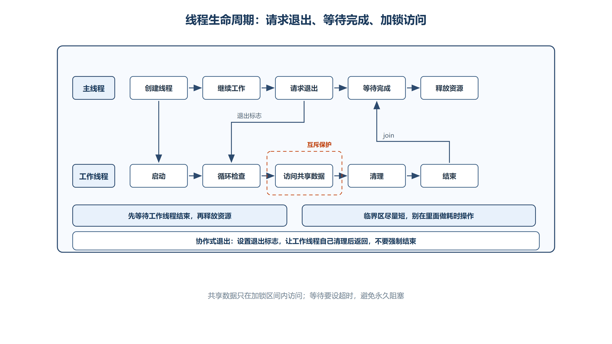

# 第九章 进程、线程与并发
## 9.1 进程（Process）
**进程**：程序的一次执行过程，是操作系统进行资源分配的基本单位

### 9.1.1 计算机功能分层
计算机系统的功能可以分为四层，从上到下依次为：

```plain
┌─────────────────────────┐
│       应用程序           │  ← 用户编写的程序
├─────────────────────────┤
│       启动进程           │  ← 程序运行时被加载为进程
├─────────────────────────┤
│       操作系统 (OS)      │  ← 管理所有进程和资源
├─────────────────────────┤
│   计算资源 (内存 + CPU)   │  ← 物理硬件层
└─────────────────────────┘
```

_底层机制_：当你双击一个 `.exe` 文件时，OS 将该程序加载到内存中，分配 **进程控制块 (PCB)**，此时程序从静态文件变成了动态的进程。

### 9.1.2 进程的组成
一个进程由三部分组成：

+ **程序**：可执行的指令代码（存储在代码段中）
    - 数据集合：全局变量、常量等静态数据
        * 包括程序运行时需要的所有数据
    - **进程控制块 (PCB)**：操作系统用来管理进程的数据结构
        * 包含 PID、程序计数器、寄存器值、内存映射等信息

### 9.1.3 进程的四大特性
| 特性 | 说明 | 举例 |
| :--- | :--- | :--- |
| **动态性** | 进程是程序的一次执行，有创建和消亡的过程 | 双击打开记事本，进程产生；关闭后进程消亡 |
| **并发性** | 多个进程可以同时存在于内存中并发执行 | 浏览器播放音乐的同时编辑器在编译代码 |
| **独立性** | 进程是系统分配资源的独立单位，互不干扰 | 一个进程崩溃不会直接导致其他进程崩溃 |
| **结构性** | 进程由程序段、数据段和PCB三部分组成 | 任何进程都具备这三部分 |


### 9.1.4 PID（进程标识符）
**PID**：Process ID，操作系统为每个进程分配的唯一整数标识符

在 Windows 任务管理器中可以看到三类进程：

+ **应用 (Apps)**：用户正在使用的前台程序
    - 如 Qt Creator、Chrome、微信等
+ **后台进程 (Background processes)**：没有用户界面的后台服务
    - 如杀毒软件、自动更新服务等
+ **Windows 进程 (Windows processes)**：操作系统自身的核心进程
    - 如 `csrss.exe`、`svchost.exe`、`explorer.exe`

### 9.1.5 进程与线程对比
| 对比项 | 进程 | 线程 |
| :--- | :--- | :--- |
| 资源拥有 | 拥有独立的地址空间和资源 | 不拥有资源，共享所属进程的资源 |
| 调度单位 | 资源分配的基本单位 | CPU 调度的最小单位 |
| 切换开销 | 大（需要切换地址空间） | 小（共享地址空间） |
| 通信方式 | 需要 IPC（管道、共享内存等） | 直接读写共享内存 |
| 隔离性 | 进程间互相隔离 | 线程间共享数据，一个崩溃可能影响整个进程 |


---

## 9.2 线程（Thread）
**线程**：程序执行的最小单位，也称为轻量级进程 (Lightweight Process)

### 9.2.1 工厂比喻
_底层机制_：用一个经典的比喻来理解进程和线程的关系：

+ **进程 = 工厂**
    - 工厂拥有资源：厂房（内存空间）、原材料（数据）、设备（文件句柄等）
    - 工厂可以有一个或多个工人
+ **线程 = 工人**
    - 工人是实际干活的人（执行指令）
    - 工人共享工厂的资源（共享内存、文件等）
    - 每个工人有自己独立的工作台（栈空间、寄存器、程序计数器）

### 9.2.2 线程共享与私有资源
**线程共享的资源**（同属一个进程的所有线程可见）：

+ **代码段** (Code Segment)
    - 所有线程执行同一份程序代码
+ **数据段** (Data Segment)
    - 全局变量、静态变量
+ **堆** (Heap)
    - 动态分配的内存（`new` / `malloc`）

**线程私有的资源**（每个线程独立拥有）：

+ **栈** (Stack)
    - 局部变量、函数参数、返回地址
+ **寄存器** (Registers)
    - 包括程序计数器 (PC/EIP/RIP)
+ **线程局部存储** (TLS)
    - `thread_local` 或 `__declspec(thread)` 声明的变量

### 9.2.3 三种执行模型
| 模型 | 说明 | 特点 |
| :--- | :--- | :--- |
| **串行 (Sequential)** | 多个任务依次执行，一个完成后才开始下一个 | 简单但效率低，CPU 在等待IO时空闲 |
| **并行 (Parallel)** | 多个任务在多核CPU上同时执行 | 真正的同时性，需要多核/多处理器 |
| **并发 (Concurrent)** | 多个任务交替执行，通过**时间片轮换**共享CPU | 单核也能实现，宏观上"同时"运行 |


### 9.2.4 时间片轮换机制
_底层机制_：在单核CPU上，操作系统通过**时间片轮换 (Time Slicing)** 实现并发：

```plain
时间线：
|--t1--|--t2--|--t3--|--t4--|--t5--|--t6--|-->
 线程A  线程B  线程C  线程A  线程B  线程C
```

+ OS 将 CPU 时间切分成很小的**时间片**（通常 1~10 毫秒）
    - 每个线程轮流获得一个时间片执行
    - 时间片用完后，OS 保存当前线程状态（上下文切换），切换到下一个线程
        * _原因_：时间片足够小，用户感觉不到切换，认为程序在"同时"运行

---

## 9.3 线程状态与转换
线程状态模型用于解释线程从创建到结束的大致生命周期。

> **模型边界**：下面的五态图是便于学习的抽象，不等同于 Windows 调度器公开的唯一、精确状态集合。`CREATE_SUSPENDED`、等待、I/O 和调度细节可能对应更细的内核状态。

### 9.3.1 五种状态
| 状态 | 英文 | 说明 |
| :--- | :--- | :--- |
| **新生态** | New | 线程刚被创建，尚未被调度 |
| **就绪态** | Ready | 等待CPU时间片，随时可以运行 |
| **运行态** | Running | 正在CPU上执行指令 |
| **阻塞态** | Blocked/Waiting | 因等待某个事件而暂停执行 |
| **销亡态** | Terminated | 线程执行完毕或被终止 |


### 9.3.2 状态转换图
```plain
                    ┌──────────┐
                    │  新生态   │  ← CreateThread 创建
                    │  (New)   │
                    └────┬─────┘
                         │ 创建完成，进入就绪队列
                         ▼
    ┌────────────────────────────────────┐
    │              就绪态                │◄─────────────────┐
    │            (Ready)                │                   │
    └────────────────┬───────────────────┘                   │
                     │ 被调度器选中，获得CPU                  │ 时间片用完
                     │ (dispatch)                           │ (time-out)
                     ▼                                      │
    ┌────────────────────────────────────┐                   │
    │              运行态                │───────────────────┘
    │           (Running)               │
    └────────────────┬───────────────────┘
                     │ 等待事件：sleep / wait /
                     │ suspend / IO请求
                     ▼
    ┌────────────────────────────────────┐
    │              阻塞态                │──── 阻塞原因消除 ──→ 就绪态
    │          (Blocked)                │
    └────────────────────────────────────┘

    ┌────────────────────────────────────┐
    │  销亡态 (Terminated)               │  ← 任何状态均可通过
    │  线程结束或被终止                   │    terminate 进入此状态
    └────────────────────────────────────┘
```

### 9.3.3 线程状态说明
**新生态 (New)**：

+ 调用 `CreateThread` 后线程内核对象被创建
    - 线程尚未开始执行
        * 若使用 `CREATE_SUSPENDED` 标志创建，线程会直接进入阻塞态而非就绪态

**就绪态 (Ready)**：

+ 线程已准备好运行，在就绪队列中等待
    - 等待 OS 调度器分配 CPU 时间片
        * 一旦获得时间片，立即进入运行态

**运行态 (Running)**：

+ 线程正在 CPU 上执行代码
    - 可能转换到：
        * **就绪态**：时间片用完，被调度器切下
        * **阻塞态**：主动调用 `Sleep()` / `WaitForSingleObject()` / 等待 IO

**阻塞态 (Blocked)**：

+ 线程因等待某个条件而暂停执行，常见阻塞原因：
    - `Sleep()`：主动休眠一段时间
    - `WaitForSingleObject()` / `WaitForMultipleObjects()`：等待内核对象
    - `SuspendThread()`：被其他线程挂起
    - IO 请求：等待文件读写、网络数据等

**销亡态 (Terminated)**：

+ 线程函数 `return` 正常退出
    - 调用 `ExitThread()` 退出
        * 被 `TerminateThread()` 强制终止

---

## 9.4 线程操作
### 9.4.1 `CreateThread` 与 `_beginthreadex`
**CreateThread**：Windows API 创建线程的核心函数

#### （1） `CreateThread` 函数签名
```cpp
HANDLE CreateThread(
    LPSECURITY_ATTRIBUTES lpThreadAttributes,  // 安全属性
    SIZE_T                dwStackSize,         // 栈大小
    LPTHREAD_START_ROUTINE lpStartAddress,     // 线程函数地址
    LPVOID                lpParameter,         // 线程函数参数
    DWORD                 dwCreationFlags,     // 创建标识
    LPDWORD               lpThreadId           // 输出：线程ID
);
```

#### （2） `CreateThread` 调用格式
下面的语法模板使用注释说明六个实参的位置；它用于认识参数，不是完整程序：

```cpp
HANDLE handle = CreateThread(
    /* lpThreadAttributes：安全属性，通常为 nullptr */,
    /* dwStackSize：初始栈大小，0 表示使用可执行文件的默认值 */,
    /* lpStartAddress：线程入口函数 */,
    /* lpParameter：传给线程函数的参数 */,
    /* dwCreationFlags：创建标志 */,
    /* lpThreadId：接收线程 ID 的地址，不需要时为 nullptr */
);
```

#### （3） `CreateThread` 的六个参数
以下示例逐一展示六个参数：

```cpp
#include <iostream>
#include <windows.h>
using namespace std;

// 线程函数签名：必须遵循 WINAPI 调用约定
DWORD WINAPI ThreadProc(LPVOID p)
{
    int n = *static_cast<int*>(p); // 从 void* 参数中取出传入的值
    cout << "线程参数 n = " << n << endl;
    return 0;
}

int main()
{
    int n = 10;
    DWORD threadId = 0;

    HANDLE handle = CreateThread(
        nullptr,      // 参数1：安全属性，nullptr 使用默认安全属性
        0,            // 参数2：栈大小，0 表示使用可执行文件的默认值
        &ThreadProc,  // 参数3：线程入口函数地址
        &n,           // 参数4：传给线程函数的参数（void* 类型）
        0,            // 参数5：创建标志，0 表示创建后即可参与调度
        &threadId     // 参数6：接收线程 ID 的地址
    );

    if (handle == nullptr)
    {
        cerr << "CreateThread 创建失败，错误码：" << GetLastError() << endl;
        return 1;
    }

    // 等待子线程使用完 n，再关闭当前进程持有的线程句柄
    WaitForSingleObject(handle, INFINITE);
    CloseHandle(handle);
    handle = nullptr;

    return 0;
}
```

| 参数 | 类型 | 作用 | 常用值 |
| :--- | :--- | :--- | :--- |
| lpThreadAttributes | `LPSECURITY_ATTRIBUTES` | 安全描述符，控制子进程能否继承句柄 | `nullptr`（默认安全属性） |
| dwStackSize | `SIZE_T` | 线程栈的初始大小（字节） | `0`（使用可执行文件的默认值） |
| lpStartAddress | `LPTHREAD_START_ROUTINE` | 线程入口函数指针 | 你的线程函数地址 |
| lpParameter | `LPVOID` | 传给线程函数的唯一参数 | 任意 `void*` 指针 |
| dwCreationFlags | `DWORD` | 线程创建后的初始状态 | `0`（立即执行）或 `CREATE_SUSPENDED`（挂起） |
| lpThreadId | `LPDWORD` | 输出参数，接收新线程的 ID | `nullptr` 表示不需要 |


#### （4） `CREATE_SUSPENDED` 与挂起计数器
_底层机制_：`CREATE_SUSPENDED` 不会让线程立即运行，而是将线程置于挂起状态。Windows 为每个线程维护一个**挂起计数器 (Suspend Count)**：

```cpp
// 挂起计数器机制：
DWORD n1 = ::SuspendThread(handle);  // 计数器：0→1，返回挂起之前的值（0）
DWORD n2 = ::SuspendThread(handle);  // 计数器：1→2
DWORD n3 = ::ResumeThread(handle);   // 计数器：2→1
DWORD n4 = ::ResumeThread(handle);   // 计数器：1→0，线程开始运行
```

+ `SuspendThread(handle)`：将挂起计数器 **+1**，返回加1之前的值
    - `ResumeThread(handle)`：将挂起计数器 **-1**，返回减1之前的值
        * **只有当计数器为 0 时，线程才真正进入就绪态**

_注意_：连续调用 `SuspendThread` 多次，必须调用相同次数的 `ResumeThread` 才能恢复执行。

#### （5） `_beginthreadex` 与 CRT 线程局部存储
`_beginthreadex` 是 Microsoft C 运行时库提供的线程创建函数；在需要使用 CRT 的传统 MSVC 程序中，通常优先选择它。

_原因_：`_beginthreadex` 会按当前 Microsoft CRT 的约定初始化和回收线程所需的运行时状态。直接调用 `CreateThread` 时，这部分责任不由 CRT 包装层承担；具体风险与所用 CRT 版本和函数有关，因此不要把下面的历史问题机械套用到所有平台和运行库版本。

+ `errno` 获取到其他线程的错误码
    - `strtok` 等函数的静态缓冲区被多个线程共享
        * 程序崩溃或数据错乱

```cpp
#include <iostream>
#include <windows.h>
#include <process.h>   // _beginthreadex 需要此头文件
using namespace std;

// _beginthreadex 的线程函数签名（与 CreateThread 略有不同）
unsigned int WINAPI ThreadFunc(void* pParam)
{
    int n = *(int*)pParam;
    cout << "线程参数 n = " << n << endl;
    return 0;
}

int main()
{
    int n = 10;

    // _beginthreadex 返回值需要强转为 HANDLE
    HANDLE handle = (HANDLE)_beginthreadex(
        nullptr,         // 安全属性
        0,               // 栈大小
        ThreadFunc,      // 线程函数
        &n,              // 参数
        0,               // 创建标识（0 = 立即执行）
        nullptr          // 线程ID
    );

    if (handle)
    {
        WaitForSingleObject(handle, INFINITE);
        CloseHandle(handle);
    }

    return 0;
}
```

#### （6） `CreateThread` 与 `_beginthreadex` 对比
| 对比项 | CreateThread | _beginthreadex |
| :--- | :--- | :--- |
| 所属库 | Windows API (`kernel32.dll`) | C 运行时库 (`msvcrt`) |
| 头文件 | `<windows.h>` | `<process.h>` |
| 线程函数返回值 | `DWORD WINAPI` | `unsigned int WINAPI` |
| CRT TLS 初始化 | 不初始化（不安全） | 自动初始化（安全） |
| 适用场景 | 纯 Windows API 编程 | C/C++ 项目（推荐） |
| 底层实现 | 直接调用 `NtCreateThread` | 内部先初始化 CRT TLS，再调用 `CreateThread` |


### 9.4.2 等待线程
**WaitForSingleObject**：等待指定内核对象变为已信号状态

#### （1） 等待线程实例
```cpp
#include <iostream>
#include <windows.h>
using namespace std;

// 通过标记通知线程退出
isQuit = true;
qDebug() << "通知子线程退出";

// 等待子线程一段时间（最多1500毫秒）
DWORD flag = WaitForSingleObject(handle, 1500);
if (flag == WAIT_OBJECT_0)
{
    qDebug() << "在规定时间之内正常退出";
}
else if (flag == WAIT_TIMEOUT)
{
    qDebug() << "强制杀死线程";
    ::TerminateThread(handle, -1);
}
```

> **安全提示**：示例保留了超时后调用 `TerminateThread` 的旧式处理流程，但这不应作为常规恢复策略。超时只说明线程尚未结束，可靠做法是记录超时、继续协作式取消或进入受控故障处理；强制终止可能破坏锁、堆和对象不变量。

#### （2） `WaitForSingleObject` 用法
```cpp
DWORD WaitForSingleObject(
    HANDLE hHandle,      // 要等待的内核对象句柄
    DWORD  dwMilliseconds // 超时时间（毫秒）
);
```

| 返回值 | 含义 |
| :--- | :--- |
| `WAIT_OBJECT_0` | 等待的对象在超时时间内变为已信号状态（线程已结束） |
| `WAIT_TIMEOUT` | 超时，等待的对象仍未变为已信号状态 |
| `WAIT_FAILED` | 函数调用失败，可通过 `GetLastError()` 获取错误码 |


| 超时参数 | 含义 |
| :--- | :--- |
| `0` | 不等待，立即返回对象当前状态 |
| `INFINITE` | 无限等待，直到对象变为已信号状态 |
| 具体数值 | 最多等待指定毫秒数 |


_注意_：线程对象的信号状态——线程正在运行时为**未信号** (nonsignaled)，线程退出时变为**已信号** (signaled)。

#### （3） `WaitForMultipleObjects` 简介
当需要同时等待多个对象时，使用 `WaitForMultipleObjects`：

```cpp
#include <iostream>
#include <windows.h>
using namespace std;

DWORD WaitForMultipleObjects(
    DWORD        nCount,      // 对象数量
    const HANDLE *lpHandles,  // 对象句柄数组
    BOOL         bWaitAll,    // TRUE=等待全部，FALSE=等待任意一个
    DWORD        dwMilliseconds // 超时时间
);
```

+ `bWaitAll = TRUE`：所有对象都变为已信号状态才返回
    - `bWaitAll = FALSE`：任意一个对象变为已信号状态就返回
        * 返回值减去 `WAIT_OBJECT_0` 即为触发信号的对象在数组中的索引

### 9.4.3 线程退出
**线程退出**：线程结束执行的三种方式及其安全性对比

#### （1） 标记退出模式
```cpp
#include <iostream>
#include <windows.h>
using namespace std;

bool isQuit = false;   // 全局标记，用于通知线程退出

DWORD (WINAPI ThreadProc)(void *p)
{
    while (!isQuit)    // 线程持续检查标记
    {
        qDebug() << "子线程执行";
        Sleep(1000);
    }
    qDebug() << "程序正常退出";
    return 0;          // 方式1：线程函数 return（推荐）
}

// 主线程中：
isQuit = true;         // 通知子线程退出
WaitForSingleObject(handle, 1500);  // 等待子线程响应
```

`isQuit` 同时被多个线程读写，普通 `bool` 会形成数据竞争。现代 C++ 应使用 `std::atomic<bool>`，或在同一把锁下访问该状态；原子变量只解决标志本身的可见性，其他共享数据仍需独立同步。

#### （2） 三种退出方式对比
| 方式 | 机制 | 安全性 | 说明 |
| :--- | :--- | :--- | :--- |
| **return** | 线程函数正常返回 | 安全 | C++ 析构函数正常调用，栈空间正常释放 |
| **ExitThread** | 调用 API 退出当前线程 | 中等 | 释放栈，但可能不调用 C++ 对象析构函数 |
| **TerminateThread** | 强制杀死目标线程 | **危险** | 不释放任何资源，可能导致内存泄漏和死锁 |


#### （3） 强制终止线程的风险（`TerminateThread`）
`TerminateThread` 无法让目标线程沿正常控制流清理资源，应视为会破坏进程内部状态的紧急手段。即使等待超时，也不意味着立刻强制终止是安全的；常规设计应采用退出标志、事件或停止令牌让线程自行结束。

```cpp
// 1. 先用标记通知线程自行退出
isQuit = true;

// 2. 等待线程响应（给1500ms时间）
DWORD flag = WaitForSingleObject(handle, 1500);

// 3. 超时才强制杀死（最后手段）
if (flag == WAIT_TIMEOUT)
{
    qDebug() << "强制杀死线程";
    ::TerminateThread(handle, -1);   // 参数2为线程退出码
}
```

`TerminateThread` 不执行以下清理操作：

+ **不释放关键段 (Critical Section)**
    - 如果被终止的线程正持有锁，其他线程永远无法获取该锁 → **死锁**
+ **不释放堆内存**
    - 线程中 `new` 分配的对象不会被 `delete` → **内存泄漏**
+ **不释放 DLL 通知**
    - 不会调用 `DllMain` 的 `DLL_THREAD_DETACH`
+ **不执行 C++ 析构函数**
    - 栈上的 C++ 对象不会被正确析构

#### （4） `CloseHandle` 与内核对象回收
```cpp
// 无论线程如何退出，都必须关闭句柄回收内核对象
if (handle)
{
    ::CloseHandle(handle);
}
```

_底层机制_：`CreateThread` 成功后会返回一个引用线程内核对象的句柄。线程退出并不会自动关闭调用方持有的句柄；`CloseHandle` 释放当前句柄引用，待系统中的相关引用全部释放后，内核对象才会被最终回收。


> **资源管理补充**：
> - `CloseHandle` 只释放当前进程持有的内核对象句柄，不会请求线程退出。应先通知线程结束并等待其真正退出，再关闭句柄。
> - `handle == nullptr;` 只是比较表达式，不会清空变量；需要更新变量时应使用赋值运算符。
> - 连续调用 `CreateThread` 却不保存返回句柄，会导致后续无法等待和关闭这些句柄，造成内核资源泄漏。



*图：主线程负责发出退出请求并等待完成；工作线程在安全点检查请求、清理并返回。共享数据只在尽量短的临界区内访问。*

```cpp
#include <atomic>
#include <mutex>
#include <windows.h>

std::atomic<bool> stopRequested{false}; // 原子退出标志
std::mutex sharedMutex;                // 保护共享数据
int sharedData = 0;

DWORD WINAPI WorkerProc(LPVOID)
{
    while (!stopRequested.load(std::memory_order_acquire))
    {
        int localResult = 1; // 先计算不依赖共享状态的局部结果

        // lock_guard 离开作用域时自动解锁，避免遗漏 unlock
        std::lock_guard<std::mutex> lock(sharedMutex);
        sharedData += localResult;
    }

    // 在线程函数返回前清理线程私有资源
    return 0;
}

int main()
{
    HANDLE handle = CreateThread(
        nullptr, 0, WorkerProc, nullptr, 0, nullptr);

    if (handle == nullptr)
    {
        return 1; // 创建失败，不能继续等待无效句柄
    }

    // ...主线程完成自己的工作...

    stopRequested.store(true, std::memory_order_release); // 请求协作退出
    WaitForSingleObject(handle, INFINITE);                // 等待线程真正结束
    CloseHandle(handle);                                  // 回收句柄
    handle = nullptr;                                     // 避免保留失效句柄值

    return 0;
}
```

---

## 9.5 并发问题
### 9.5.1 并发问题
**并发问题**：多个线程同时操作同一共享资源，导致结果不可预测

#### （1） 丢失更新问题
_底层机制_：考虑两个线程同时执行 `a += 1` 的场景，编译器会将其拆分为三条指令：

```plain
线程A                          线程B
──────────                     ──────────
1. get a  (从内存读取a=0)
                               2. get a  (从内存读取a=0)
3. a += 1 (寄存器中a=1)
                               4. a += 1 (寄存器中a=1)
5. set a  (写回内存，a=1)
                               6. set a  (写回内存，a=1)
──────────                     ──────────
期望结果：a = 2
实际结果：a = 1  ← 丢失了一次更新！
```

两个线程各自完成了 `+1`，但由于交错执行，最终只有一次写回生效。

#### （2） 代码复现
```cpp
#include <iostream>
#include <windows.h>
using namespace std;

int sharedCounter = 0;   // 共享资源

DWORD (WINAPI IncrementThread)(void *p)
{
    for (int i = 0; i < 10000; i++)
    {
        sharedCounter++;   // 非原子操作：读→加→写
    }
    return 0;
}

int main()
{
    HANDLE h1 = CreateThread(nullptr, 0, &IncrementThread, nullptr, 0, nullptr);
    HANDLE h2 = CreateThread(nullptr, 0, &IncrementThread, nullptr, 0, nullptr);

    WaitForSingleObject(h1, INFINITE);
    WaitForSingleObject(h2, INFINITE);

    cout << "期望值：20000，实际值：" << sharedCounter << endl;
    // 多次运行，结果经常不等于 20000

    CloseHandle(h1);
    CloseHandle(h2);
    return 0;
}
```

### 9.5.2 单例模式中的问题
**单例并发问题**：多线程环境下，经典单例模式可能创建多个实例

#### （1） 多线程下单例的问题
下面通过单例类分析该问题：

```cpp
#include <iostream>
#include <windows.h>
using namespace std;

class Singleton
{
public:
    static Singleton* creatSingleton()
    {
        // 问题：多个线程可能同时通过 if 判断
        if (!m_psin)          // ← 线程A和B同时判断 m_psin == nullptr
        {
            m_psin = new Singleton;  // ← 两个线程各自 new 一个对象
        }
        return m_psin;
    }

    static void delSingleton()
    {
        if (m_psin)
        {
            delete m_psin;
        }
    }

private:
    static Singleton* m_psin;
    Singleton() = default;
    Singleton(const Singleton& p) = delete;  // 禁止拷贝
    ~Singleton() { cout << "~Singleton()" << endl; }
};

Singleton* Singleton::m_psin = nullptr;
```

**问题场景**：

```plain
线程A                            线程B
──────────                       ──────────
if(!m_psin) → true
                                 if(!m_psin) → true  ← 也通过了！
m_psin = new Singleton           ← 创建了第一个实例
                                 m_psin = new Singleton  ← 又创建了一个！
──────────                       ──────────
结果：两个不同的 Singleton 对象，第一个还被内存泄漏了
```

#### （2） 双重检查锁定（Double-Checked Locking）
下面的代码展示了传统“双重检查”思路，但其中 `m_psin` 是普通裸指针：第一次无锁读取与另一线程的写入并发发生，会形成数据竞争，因此**这份具体实现并不满足标准 C++ 的线程安全要求**。只有使用正确的原子发布与内存序，或让所有访问都受同一把锁保护，双重检查才可能成立。

```cpp
#include <iostream>
#include <windows.h>
using namespace std;

// 关键段封装（后面第6节详细讲解）
class myLock
{
private:
    CRITICAL_SECTION cs;
public:
    myLock()  { ::InitializeCriticalSection(&cs); }
    ~myLock() { ::DeleteCriticalSection(&cs); }
    void Enter() { ::EnterCriticalSection(&cs); }
    void Leave() { ::LeaveCriticalSection(&cs); }
};

class Singleton
{
public:
    static Singleton* creatSingleton()
    {
        static myLock lock;   // 局部静态变量，线程安全初始化

        // 第一次检查：无锁，快速路径
        if (!m_psin)
        {
            lock.Enter();       // 加锁
            ++countt;           // 统计加锁次数
            // 第二次检查：持锁后再检查
            if (!m_psin)
            {
                qDebug() << "new Singleton";
                m_psin = new Singleton;
            }
            lock.Leave();       // 解锁
        }
        return m_psin;
    }

    // ...（省略 delSingleton 和私有成员，与前面相同）

private:
    static Singleton* m_psin;
    // ... 析构清理结构
    Singleton() = default;
    Singleton(const Singleton& p) = delete;
};

Singleton* Singleton::m_psin = nullptr;

// 创建10个线程同时获取单例
DWORD (WINAPI getSingleton)(void *p) {
    Singleton::creatSingleton();
    return 0;
}

int main()
{
    for (int i = 0; i < 10; ++i)
    {
        CreateThread(nullptr, 0, &getSingleton, nullptr, 0, nullptr);
    }

    Sleep(3000);
    qDebug() << countt;  // 输出加锁次数，验证优化效果
    return 0;
}
```

**双重检查锁定的工作原理**：

+ **第一次 `if (!m_psin)`**：无锁快速判断
    - 单例已创建时直接返回，避免每次都加锁（性能优化）
+ **加锁 `lock.Enter()`**：只有单例尚未创建时才进入
    - 保证同一时刻只有一个线程执行 `new Singleton`
+ **第二次 `if (!m_psin)`**：持锁后再次检查
    - 防止两个线程同时通过第一次检查后重复创建

_观察说明_：最终只有一个线程会通过第二次检查执行 `new`，但多个已经通过第一次检查的线程仍可能依次获取锁，所以加锁次数不保证为 1。若 `countt` 本身也被多个线程修改，还必须使用原子操作或锁保护。

#### （3） 单例方案对比
| 方案 | 线程安全 | 性能 | 说明 |
| :--- | :--- | :--- | :--- |
| 懒汉式（无锁） | 不安全 | 高 | 多线程下会创建多个实例 |
| 饿汉式 | 安全 | 中 | 程序启动就创建，可能浪费资源 |
| 双重检查锁定 | 条件安全 | 高 | 普通指针版本有数据竞争；必须使用正确原子内存序或其他严格同步 |
| C++11 Magic Static | 安全 | 高 | `static` 局部变量由标准保证线程安全 |


#### （4） C++11 局部静态变量方案（Magic Static）
```cpp
#include <iostream>
#include <windows.h>
using namespace std;

class Singleton
{
public:
    static Singleton& getInstance()
    {
        // C++11 标准保证 static 局部变量的初始化是线程安全的
        static Singleton instance;
        return instance;
    }

    Singleton(const Singleton&) = delete;
    Singleton& operator=(const Singleton&) = delete;

private:
    Singleton() = default;
};
```

_底层机制_：C++11 标准（§6.7）规定，局部 `static` 变量在首次执行到声明处时初始化，编译器会自动插入同步机制确保线程安全。这是最简洁且安全的单例实现。

#### （5） 单例的自动回收：嵌套析构结构
还可以通过**嵌套静态结构**，利用 C++ 静态成员在程序退出时自动析构的特性，自动回收 `new` 出来的单例对象：

```cpp
class Singleton
{
public:
    static Singleton* creatSingleton()
    {
        static myLock lock;
        if (!m_psin)
        {
            lock.Enter();
            if (!m_psin)
            {
                m_psin = new Singleton;
            }
            lock.Leave();
        }
        return m_psin;
    }

    static void delSingleton()
    {
        if (m_psin)
        {
            delete m_psin;
            m_psin = nullptr;
        }
    }

private:
    static Singleton* m_psin;

    // 嵌套析构辅助结构 —— 关键设计
    static struct DelSingleton
    {
        ~DelSingleton()
        {
            cout << "~DelSingleton()" << endl;
            Singleton::delSingleton();  // 程序退出时自动回收单例
        }
    } del;  // 静态实例，程序退出时自动析构

    Singleton() = default;
    Singleton(const Singleton& p) = delete;  // 删除类的拷贝构造
    ~Singleton() { cout << "~Singleton()" << endl; }
};

Singleton* Singleton::m_psin = nullptr;
```

+ **设计思路**：
    - `del` 是 `DelSingleton` 类型的**静态成员**，在 `main()` 结束后由系统自动析构
    - `DelSingleton` 的析构函数中调用 `Singleton::delSingleton()`，自动执行 `delete m_psin`
    - 这样就不需要在 `main()` 中手动调用 `delSingleton()`，避免忘记释放导致内存泄漏
+ **注意**：`Singleton(const Singleton& p) = delete;` 使用了 C++11 的 `= delete` 语法删除拷贝构造函数，防止单例对象被复制。如果允许拷贝，就可能出现多个"单例"对象，违背单例的设计初衷

---

## 9.6 线程同步
**线程同步**：通过特定机制协调多个线程对共享资源的访问，保证数据一致性

Windows 下的线程同步方法按复杂度排列：

| 方法 | 开销 | 跨进程 | 说明 |
| :--- | :--- | :--- | :--- |
| **原子访问** | 最低 | 否 | CPU 硬件指令保证操作的原子性 |
| **关键段 (Critical Section)** | 低 | 否 | 同进程锁；无竞争时通常走用户态快速路径，竞争时可能进入内核等待 |
| **事件 (Event)** | 中 | 是 | 通知机制，可跨进程 |
| **互斥量 (Mutex)** | 中 | 是 | 类似关键段但可跨进程 |
| **条件变量 (Condition Variable)** | 中 | 否 | 配合关键段使用，等待条件成立 |
| **信号量 (Semaphore)** | 中 | 是 | 控制同时访问资源的线程数量 |


### 9.6.1 原子操作
**原子访问**：不可被中断的最小操作单元，由 CPU 硬件指令保证

#### （1） 原子操作示例
```cpp
#include <iostream>
#include <windows.h>
using namespace std;

int n = 0;   // 共享计数器

DWORD (WINAPI AtomicThreadProc)(void *p)
{
    for (int i = 0; i < 100; i++)
    {
        // 原子递增：CPU 硬件保证此操作不可被中断
        ::_InterlockedIncrement((long*)&n);
        //::_InterlockedDecrement();  // 原子递减

        qDebug() << "n: " << n;
        Sleep(20);
    }
    return 0;
}

int main()
{
    // 创建多个线程同时递增
    for (int i = 0; i < 5; i++)
    {
        CreateThread(nullptr, 0, &AtomicThreadProc, nullptr, 0, nullptr);
    }

    Sleep(5000);
    cout << "最终值 n = " << n << endl;
    // 5个线程 × 100次 = 500，结果始终正确
    return 0;
}
```

#### （2） `Interlocked*` 系列函数
| 函数 | 作用 | 说明 |
| :--- | :--- | :--- |
| `_InterlockedIncrement` | 原子递增（+1） | 等价于 `++n`，但不可被中断 |
| `_InterlockedDecrement` | 原子递减（-1） | 等价于 `--n`，但不可被中断 |
| `_InterlockedExchangeAdd` | 原子加任意值 | 等价于 `n += value` |
| `_InterlockedExchange` | 原子交换 | 交换两个值 |
| `_InterlockedCompareExchange` | 原子比较并交换 (CAS) | 无锁编程的核心操作 |


#### （3） 原子操作的局限性
原子访问高效，但适用范围有限：

+ **只能操作简单的整型变量**
    - 无法保护复合操作（如 `if (n > 0) n--;`）
+ **无法保护多个变量的一致性**
    - 如果需要同时更新 `a` 和 `b`，两个原子操作之间仍可能被中断
+ **不适用于复杂数据结构**
    - 链表、树等结构的操作无法用原子指令完成

> **类型提示**：Windows `Interlocked` API 对参数类型、宽度和对齐有明确要求。把任意 `int*` 强制转换为 `long*` 可能掩盖类型或别名问题；现代 C++ 代码优先使用与数据类型匹配的 `std::atomic<T>`。

### 9.6.2 临界区（关键段）
**关键段 (Critical Section)**：也称临界区，用于保护共享代码段的互斥访问

#### （1） 临界区的四步操作
关键段包含以下四个基本操作：

```cpp
#include <iostream>
#include <windows.h>
using namespace std;

// 1. 声明关键段对象
CRITICAL_SECTION cs;

// 2. 初始化
::InitializeCriticalSection(&cs);

// 3. 进入（加锁）和离开（解锁）
::EnterCriticalSection(&cs);   // 加锁：获取锁
// ... 操作共享资源 ...
::LeaveCriticalSection(&cs);   // 解锁：释放锁

// 4. 销毁（程序退出前）
::DeleteCriticalSection(&cs);
```

#### （2） 临界区流程图
```plain
           ┌─────────┐
           │ waiting  │  线程等待进入关键段
           │(等待队列) │
           └────┬─────┘
                │ 被调度器选中
                ▼
           ┌─────────┐
           │  Enter   │
           │ 加锁     │
           └────┬─────┘
                │ EnterCriticalSection
                ▼
       ┌─────────────────┐
       │   共享资源操作    │  ← 同一时刻只有一个线程能进入
       │  (Critical Code) │
       └────────┬────────┘
                │ LeaveCriticalSection
                ▼
           ┌─────────┐
           │  Leave   │
           │  解锁     │
           └────┬─────┘
                │ 唤醒等待队列中的下一个线程
                ▼
           ┌─────────┐
           │ 就绪态   │  释放锁后回到就绪队列
           └─────────┘
```

#### （3） `myLock` 的 RAII 封装
```cpp
#include <iostream>
#include <windows.h>
using namespace std;

class myLock
{
private:
    CRITICAL_SECTION cs;

public:
    // 构造时初始化（RAII：资源获取即初始化）
    myLock() {
        ::InitializeCriticalSection(&cs);
    }

    // 析构时销毁（RAII：资源释放即销毁）
    ~myLock() {
        ::DeleteCriticalSection(&cs);
    }

    void Enter() {
        ::EnterCriticalSection(&cs);   // 加锁
    }

    void Leave() {
        ::LeaveCriticalSection(&cs);   // 解锁
    }
};
```

**RAII 封装的优势**：

+ **自动管理生命周期**
    - 构造函数中 `InitializeCriticalSection`，析构函数中 `DeleteCriticalSection`
        * 不会忘记初始化和销毁
+ **封装生命周期**
    - 当前 `myLock` 只自动管理 `CRITICAL_SECTION` 本体的初始化与销毁；`Enter()` / `Leave()` 仍需手动成对调用，异常或提前返回时仍可能漏解锁。
    - 要获得真正的作用域级异常安全，应再使用一个 guard 对象，在构造时 `Enter()`、析构时 `Leave()`，其职责类似 `std::lock_guard`。

#### （4） 临界区在单例中的应用
```cpp
#include <iostream>
#include <windows.h>
using namespace std;

static Singleton* creatSingleton()
{
    static myLock lock;     // 线程安全的局部静态变量

    if (!m_psin)            // 第一次检查：快速路径（无锁）
    {
        lock.Enter();       // 加锁
        if (!m_psin)        // 第二次检查：防止重复创建
        {
            m_psin = new Singleton;
        }
        lock.Leave();       // 解锁
    }
    return m_psin;
}
```

#### （5） 临界区与互斥量对比
| 对比项 | 关键段 (Critical Section) | 互斥量 (Mutex) |
| :--- | :--- | :--- |
| 作用范围 | 同一进程内的线程 | 可跨进程 |
| 实现层 | 无竞争时通常走用户态快速路径；竞争时可进入内核等待 | 内核对象 |
| 创建方式 | `InitializeCriticalSection` | `CreateMutex` |
| 等待超时 | 不支持超时 | `WaitForSingleObject` 支持超时 |
| 性能 | 同进程、低竞争时通常较高 | 通常开销更高，但支持跨进程与等待语义 |
| 适用场景 | 简单的同进程线程同步 | 需要跨进程或需要超时的场景 |


_注意_：关键段不支持超时等待，如果持锁线程被 `TerminateThread` 强杀而未释放锁，等待的线程将永远阻塞。这也是前面强调 _不要使用 _`TerminateThread` 的原因之一。

#### （6） 临界区使用注意事项
+ **同一线程可以递归进入**
    - Windows `CRITICAL_SECTION` 允许持有者再次 `Enter` 同一关键段；每次成功进入都必须对应一次 `Leave`。虽然不会因此直接死锁，但依赖递归特性可能掩盖职责不清和锁层次问题。
+ **必须成对使用 Enter/Leave**
    - 忘记 `Leave` 会导致其他线程永久等待
+ **临界区代码应尽量短**
    - 持锁时间越长，其他线程等待时间越长，整体性能越差
+ **避免在临界区内调用可能阻塞的函数**
    - 如 `Sleep()`、`WaitForSingleObject()` 等

---

