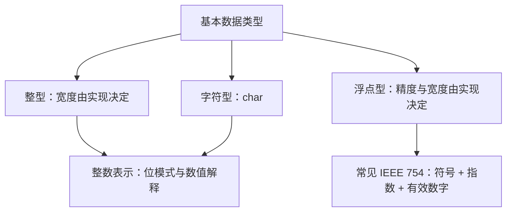
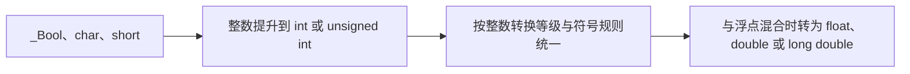

# 第 2 章 数据类型与运算符

> 本章目标：建立"存储思维"——弄清每种数据类型在内存中占几个字节、以什么形式存放（原码/反码/补码、IEEE 浮点格式），再系统掌握 C 的各类运算符（算术、赋值、关系、逻辑、三目、位运算、逗号）及其优先级与结合性。

## 本章知识地图

- 面向过程编程的三种思维：**控制思维**（流程结构）、**存储思维**（数据类型 + 变量）、**运算思维**（运算符）
- 计算机存储基础：位 bit、字节 Byte、$2^{10}=1024$ 换算链
- 基本数据类型三大类：**整型**、**字符型**（二者同属定点存储：符号位 + 原码→反码→补码）、**浮点型**（浮点存储：符号位 + 指数区 + 尾数区）
- 每种类型的四要素：**类型分类、字节数、存储原理、字面值常量**（0 八进制 / 0x 十六进制 / 0b 二进制前缀）
- 打印格式 = **长度**（hh、h、无、l、ll）×**角度**（d/i 有符号、u/o/x 无符号、f/e/g 浮点、c 字符）
- 运算符：优先级 15 级、结合性；表达式必有计算结果；`&&`、`||`、`?:`、`=` 结构优先、结果后算

数据类型可以看成编译器与程序员之间的解释契约：同一串比特按不同类型读取，可能得到完全不同的数值和允许操作。选择类型时不应只问“占几个字节”，还要问它能表达什么范围、精度如何、参与运算时怎样转换，以及应使用哪个输入输出格式。

本章同时讨论“抽象数值”和“内存表示”。写 `int value = 10` 时，日常计算首先关心数值 10；只有分析溢出、序列化、位运算或对象字节时，才需要下钻到具体比特。不要把某台机器的常见表示误当成所有 C 实现都必须遵守的源代码语义。

---

## 2.1 计算机存储的基本概念

计算机是**二进制计算机**：内部只有 0 和 1。

- **位（bit）**：最小信息单位，一个 0 或 1
- **字节（Byte，B）**：最小存储单位，$8\ \text{bit} = 1\ \text{Byte}$
- 换算链（以 $2^{10} = 1024$ 为进位）：

$$1024\,\text{B} = 1\,\text{KB},\quad 1024\,\text{KB} = 1\,\text{MB},\quad 1024\,\text{MB} = 1\,\text{GB},\quad 1024\,\text{GB} = 1\,\text{TB},\quad 1024\,\text{TB} = 1\,\text{PB}$$

严格地说，C 以“字节”作为 `sizeof` 的计量单位，一个字节含 `CHAR_BIT` 位，标准保证不少于 8 位；现代通用平台几乎都是 8 位字节。二进制前缀 KiB、MiB、GiB 分别按 1024 进位，十进制前缀 kB、MB、GB 按 1000 进位；课程资料常把 KB 写成 1024 B，阅读规格书时则应确认采用哪套单位。

### 进制转换

**十进制 → 二/八/十六进制**：整数部分**除基取余、倒序排列**，小数部分**乘基取整**。

以 185 为例：

| 目标进制 | 过程 | 结果 |
|---|---|---|
| 二进制 | 185÷2 余 1,0,0,1,1,1,0,1（倒序读） | 10111001 |
| 八进制 | 185÷8 余 1,7,2（倒序读） | 271 |
| 十六进制 | 185÷16 余 9, 商 11(B)（倒序读） | B9 |

各进制可用数字：十进制 0~9；八进制 0~7；十六进制 0~9 与 aA bB cC dD eE fF。

**二进制与八/十六进制的快速互转**：

- 1 个八进制位 对应 3 个二进制位（如 7 ↔ 111）
- 1 个十六进制位 对应 4 个二进制位（如 F ↔ 1111）
- **2 个十六进制位恰好表示 1 个字节**（8 个二进制位），所以调试器的内存窗口都用十六进制展示内存内容

---

## 2.2 基本数据类型总览

基本数据类型分三类，存储方式分两派：

类型宽度由实现决定，不能仅凭名字断言 `int` 永远 4 字节或 `long` 永远 8 字节。可移植程序使用 `sizeof`、`limits.h`、`stdint.h` 和 `float.h` 查询能力，再根据问题选择类型。字符类型属于整数类型，只是额外承担存放字符编码单元的用途。



下面给出 Windows 上 MSVC 常见的 LLP64 数据模型。x86 与 x64 的指针宽度不同，但这里列出的基本整数宽度通常相同；其它系统可能不同：

| # | 类型关键字 | 类型名称 | 字节数 | 数据范围 | 字面值后缀 | 打印格式 |
|---|---|---|---|---|---|---|
| 1 | signed char | 有符号字符型 | 1 | -128~127 | — | %hhd（数值）/%c（字符） |
| 2 | unsigned char | 无符号字符型 | 1 | 0~255 | — | %hhu |
| 3 | signed short int | 有符号短整型 | 2 | -32768~32767 | — | %hd |
| 4 | unsigned short int | 无符号短整型 | 2 | 0~65535 | — | %hu |
| 5 | signed int | 有符号整型 | 4 | -2147483648~2147483647 | — | %d 或 %i |
| 6 | unsigned int | 无符号整型 | 4 | 0~4294967295 | U 或 u | %u |
| 7 | signed long int | 有符号长整型 | 4 | -2147483648~2147483647 | L 或 l | %ld |
| 8 | unsigned long int | 无符号长整型 | 4 | 0~4294967295 | UL 或 ul | %lu |
| 9 | signed long long int | 有符号长长整型 | 8 | -9223372036854775808~9223372036854775807 | LL 或 ll | %lld |
| 10 | unsigned long long int | 无符号长长整型 | 8 | 0~18446744073709551615 | ULL 或 ull | %llu |
| 11 | float | 单精度浮点型 | 4 | 约 1.175e-38~3.403e38（正正规值） | F 或 f | %f 或 %e |
| 12 | double | 双精度浮点型 | 8 | 约 2.225e-308~1.798e308（正正规值） | — | %f 或 %e |
| 13 | long double | 长双精度类型 | 8 | MSVC 中通常同 `double` | L 或 l | %Lf 或 %Le |

> `signed` 可省略；上表只是代表值。浮点表中的下界是最小正正规值，不是“最负数”，0 与次正规值另计。标准只规定最低能力和类型关系，例如很多 64 位 Unix 实现的 `long` 为 8 字节，GCC 的 `long double` 也可能比 `double` 更宽。应使用 `sizeof`、`limits.h`、`stdint.h` 和 `float.h` 查询当前实现。

### `printf` 与 `scanf`：相似外观，不同参数契约

格式说明由“`%` + 标志 + 宽度 + 精度 + 长度修饰符 + 转换字符”组成。长度修饰符不是可以随意添加的装饰，它决定可变参数中应出现什么类型，或 `scanf` 应写入什么类型的对象。

#### `printf` 输出格式

| 格式 | 必须匹配的实参 | 作用 |
|---|---|---|
| `%d`、`%i` | `int` | 有符号十进制；输出时二者等价。 |
| `%u`、`%o`、`%x`、`%X` | `unsigned int` | 无符号十、八、十六进制。 |
| `%hhd`、`%hhu` | 经整数提升后的整数 | 取提升后值并按 `signed char`/`unsigned char` 转换后输出；不是从可变参数区“只读 1 字节”。 |
| `%hd`、`%hu` | 经整数提升后的整数 | 按 `short`/`unsigned short` 转换后输出。 |
| `%ld`、`%lu` | `long`、`unsigned long` | 长整型。 |
| `%lld`、`%llu` | `long long`、`unsigned long long` | 长长整型。 |
| `%zu` | `size_t` | `sizeof`、`strlen` 等返回的大小。 |
| `%td` | `ptrdiff_t` | 两个同数组指针相减得到的元素距离。 |
| `%jd`、`%ju` | `intmax_t`、`uintmax_t` | 最大宽度标准整数类型。 |
| `%f`、`%e`、`%g` | `double` | `float` 实参会默认提升为 `double`。 |
| `%Lf`、`%Le`、`%Lg` | `long double` | `L` 必须大写。 |
| `%c` | `int` | 输出一个字符，原 `char` 已整数提升。 |
| `%s` | `char *` 或 `const char *` | 输出到 `\0`；指针必须有效。 |
| `%p` | `void *` | 输出对象指针的实现定义表示。 |

`printf` 的常用标志有：`-` 左对齐、`+` 强制显示正负号、空格为正数预留符号位、`#` 显示进制前缀或保留小数点、`0` 在允许时补零。宽度是最小总字符数；对 `%f`，精度是小数点后的位数。例如 `%8.2f` 的整个结果至少 8 字符，小数部分 2 位。

#### `scanf` 输入格式

| 格式 | 必须匹配的目标地址 | 作用 |
|---|---|---|
| `%d` | `int *` | 十进制有符号整数。 |
| `%i` | `int *` | 按前缀识别十、八、十六进制。 |
| `%u`、`%o`、`%x` | `unsigned int *` | 无符号整数。 |
| `%hhd`、`%hhu` | `signed char *`、`unsigned char *` | 直接写入字符宽度的整数对象；与 `printf` 的默认提升不同。 |
| `%hd`、`%hu` | `short *`、`unsigned short *` | 写入短整型。 |
| `%ld`、`%lld` | `long *`、`long long *` | 写入对应长度的有符号整数。 |
| `%zu` | `size_t *` | 写入 `size_t`。 |
| `%f`、`%lf`、`%Lf` | `float *`、`double *`、`long double *` | 三种浮点目标必须严格区分。 |
| `%c` | `char *` | 默认读取包括空白在内的一个字符；`" %c"` 会先跳过空白。 |
| `%Ns` | `char *` | 最多读取 `N` 个非空白字符并补 `\0`，因此数组容量至少为 `N+1`。 |
| `%p` | `void **` | 读取实现定义的指针文本表示到一个 `void *` 对象。 |

`scanf` 的 `*` 表示赋值抑制，例如 `%*d` 读取并丢弃一个整数；返回值不计被抑制的项目。任何输入都应检查返回值，且 `%s`、`%[` 应设置宽度防止越界。

---

## 2.3 整型：字节数、字面值与打印格式

### sizeof 长度运算符

`sizeof(表达式)` 计算内存字节数——注意它是**运算符**而不是函数，属于第 2 级优先级的单目运算符。

多数情况下，`sizeof` 的操作数不会被真正求值，所以 `sizeof(i++)` 通常不会让 `i` 增加；涉及变长数组类型时存在例外。`sizeof` 的结果类型是 `size_t`，用 `printf` 输出时应使用 `%zu`，而不是假定它与 `int` 同宽。

```c
#include <stdio.h>

int main(void)
{
	signed int iValue = 9;
	unsigned int uiValue = 9u;      //u 类型后缀
	printf("signed int 字节数：%zu %zu %zu\n", sizeof(int), sizeof(iValue), sizeof(9));
	printf("unsigned int 字节数：%zu %zu %zu\n", sizeof(unsigned), sizeof(uiValue), sizeof(9u));

	signed long int lValue = 9l;
	unsigned long int ulValue = 95ul;
	printf("signed long int 字节数：%zu %zu %zu\n", sizeof(long), sizeof(lValue), sizeof(9L));
	printf("unsigned long int 字节数：%zu %zu %zu\n", sizeof(unsigned long), sizeof(ulValue), sizeof(95UL));

	signed long long int llValue = 95ll;
	unsigned long long int ullValue = 95ull;
	printf("signed long long int字节数：%zu %zu %zu\n", sizeof(long long), sizeof(llValue), sizeof(9LL));
	printf("unsigned long long int字节数：%zu %zu %zu\n", sizeof(unsigned long long), sizeof(ullValue), sizeof(95ULL));

	signed short int sValue = 9;    //小于 int 的字面值按 int 处理
	unsigned short int usValue = 9u;
	printf("signed short int 字节数：%zu %zu %zu\n", sizeof(short), sizeof(sValue), sizeof(9));
	printf("unsigned short int 字节数：%zu %zu\n", sizeof(unsigned short), sizeof(usValue));

	signed char cValue = 'A';
	unsigned char ucValue = 48u;
	printf("signed char 字节数：%zu %zu %zu\n", sizeof(char), sizeof(cValue), sizeof('A'));
	printf("unsigned char 字节数：%zu %zu\n", sizeof(unsigned char), sizeof(ucValue));

	return 0;
}
```

**输出结果**

```text
signed int 字节数：4 4 4
unsigned int 字节数：4 4 4
signed long int 字节数：4 4 4
unsigned long int 字节数：4 4 4
signed long long int字节数：8 8 8
unsigned long long int字节数：8 8 8
signed short int 字节数：2 2 4
unsigned short int 字节数：2 2
signed char 字节数：1 1 4
unsigned char 字节数：1 1
```

> 两处"意外"值得深究：`sizeof(9)` 在 short 行仍是 4——**整型字面值最小按 int 处理**；`sizeof('A')` 也是 4——**C 语言中字符常量的类型是 int**（C++ 中才是 char）。

### 整型字面值：进制前缀 + 数值 + 类型后缀

```c
#include <stdio.h>

int main()
{
	int decimal = 1234; //十进制：无前缀
	int octal = 012;    //0 开头：八进制
	int hex = 0x12;     //0x 或 0X：十六进制
	#if defined(__STDC_VERSION__) && __STDC_VERSION__ >= 202311L
	int binary = 0b10;  //0b 或 0B：C23 标准
	#else
	int binary = 2;     //可移植 C11 写法；部分 C11 编译器也把 0b10 当扩展
	#endif
	(void)decimal; (void)octal; (void)hex; (void)binary;

	int age = 19;   //计算机内部都是二进制
	//打印的呈现方式
	printf("%d %o %x\n", age, age, age);
	printf("%d %#o %#x\n", age, age, age);    //#：为八/十六进制添加前缀

	return 0;
}
```

**输出结果**

```text
19 23 13
19 023 0x13
```

> $19 = (23)_8 = (13)_{16}$。`#` 标志让八进制带上 `0` 前缀、十六进制带上 `0x` 前缀；对 `%d` 无效果。

---

## 2.4 整型存储原理：原码、反码、补码

本节位图按“32 位、二进制补码”模型推导，这是现代平台的主流表示，也是 C23 对标准有符号整数表示的要求。阅读较早标准或特殊实现时，负数对象表示可能不同；程序不应通过有符号溢出来依赖某个比特结果。

补码解决的是负整数怎样编码以及硬件怎样复用加法电路，并不意味着源代码可以随意越界。只要有符号运算的数学结果超出类型范围，在 C11 等标准口径下就属于未定义行为；优化器可以假定这种情况不会发生。


### 三个码的定义

以 `int a = 5, b = -5;`（5 的二进制为 101）为例：

- **原码**：符号位（第 1 位，0 正 1 负）加上真值的绝对值

```text
+5 原码：00000000 00000000 00000000 00000101
-5 原码：10000000 00000000 00000000 00000101
```

- **反码**：正数的反码是其本身；负数的反码在原码基础上**符号位不变、其余各位取反**

```text
-5 反码：11111111 11111111 11111111 11111010
```

- **补码**：正数的补码就是其本身；负数的补码在**反码的基础上 +1**——补码才是**最终被存储**的形式

```text
-5 补码：11111111 11111111 11111111 11111011
```

三码对比（-5）：

| 码 | 32 位形式 |
|---|---|
| 原码 | `10000000 00000000 00000000 00000101` |
| 反码 | `11111111 11111111 11111111 11111010` |
| 补码 | `11111111 11111111 11111111 11111011` |

### `-1` 的全 1 补码与无符号最大值

`int b = -1;` 的补码推导：原码 `1000...0001` → 反码 `1111...1110` → 补码 `1111...1111`（全 1）。

在调试器内存窗口中看到的正是 `ff ff ff ff`——**-1 的补码是全 1**，这一特性后面会被反复利用（比如用 `-1` 赋给无符号类型得到该类型的最大值）。

### 用补码统一理解加减法

补码使加法与减法能够由同一套模算术规则统一解释。实际处理器可以有专门的减法指令和硬件电路；这里用 8 位补码模型计算 `16 + (-5)`：

```text
  16 补码： 0001 0000
  -5 补码： 1111 1011
 ─────────────────────
 和：    1 0000 1011   →  最高位进位溢出丢弃 → 0000 1011 = 11 ✓
```

再算 `-16 + (-5)`：

```text
 -16 补码： 1111 0000
  -5 补码： 1111 1011
 ─────────────────────
 和：    1 1110 1011   →  丢弃进位 → 1110 1011（补码）
```

`1110 1011` 符号位为 1，是负数补码，转十进制的步骤：**①翻译符号位（负）②按位取反 ③转十进制 ④再 +1** → $-(0001\,0100_2 + 1) = -21$ ✓

对应验证代码：

```c
#include <stdio.h>

int main(void)
{
	signed char aa = -16;
	signed char bb = -5;
	signed char cc = (signed char)((int)aa + (int)bb);
	printf("%d %u\n", (int)cc, (unsigned)(int)cc);
	printf("%hhd %hhu\n", cc, (unsigned char)cc);
	return 0;
}
```

**输出结果**

```text
-21 4294967275
-21 235
```

> 解读：这里明确使用 `signed char`；在 8 位字节的常见实现中，cc 在内存中是 1 字节 `1110 1011`（0xEB）。相加结果 -21 位于 `signed char` 的表示范围内，显式转换不会改变数值。
> - 第一行显式把 `cc` 转换为 `int` 或 `unsigned int`，因此分别得到 -21 和当前 32 位 `unsigned int` 下的 4294967275；
> - 调用 `printf` 时，`char` 仍会先发生整数提升。`hh` 告诉转换函数把该值再按 `signed char` 或 `unsigned char` 取值，所以得到 -21 和 235；它不表示从可变参数列表中只读取 1 字节。
> **长度修饰符规定转换规则和参数契约**，不能简单理解为“打印函数读取几字节”。

### `char` 运算与整数提升

```c
#include <stdio.h>

int main(void)
{
	signed char num1 = -5, num2 = -7;
	signed char sum = (signed char)((int)num1 + (int)num2);
	printf("%d %u\n", (int)sum, (unsigned)(int)sum);
	//负数补码转十进制（1.翻译符号位 2.取反 3.转10进制 4.+1）
	printf("%hhd %hhu\n", sum, (unsigned char)sum);
	return 0;
}
```

**输出结果**

```text
-12 4294967284
-12 244
```

> sum = -12，1 字节补码为 `1111 0100`（0xF4 = 244）；按 4 字节无符号解读为 $2^{32}-12 = 4294967284$。

---

## 2.5 溢出现象与数据范围

判断运算是否安全要看**完成整数提升和通常算术转换后的实际运算类型**，而不只看最终赋值变量。例如两个 `int` 先相乘，再赋给 `long long`，乘法仍可能已经在 `int` 中溢出；应先把至少一个操作数转换为 `long long`。

无符号回绕是明确的模运算，适合哈希、环形计数等确实需要模语义的场景，但不能用来掩盖输入范围检查。若业务逻辑不允许回绕，就应在运算前比较边界。

### 无符号回绕与有符号溢出

若无符号类型有 \(N\) 个值位，其运算按模 \(2^N\) 进行，所以最大值加 1 会确定地回到 0。**有符号整数溢出属于未定义行为**，不能把某台补码机器上观察到的“从最大值回到最小值”当作 C 语言保证。

### 查询各整型的数据范围

把 `-1` 转换为无符号类型会按模运算得到该类型最大值，这是标准规定的。把超出范围的无符号值再用有符号格式解释，或转换为对应有符号类型，结果可能是未定义行为或实现定义结果。安全版本直接使用 `limits.h`：

```c
#include <limits.h>
#include <stdio.h>

int main(void)
{
	unsigned char a = (unsigned char)-1;
	unsigned short b = (unsigned short)-1;
	unsigned long long c = (unsigned long long)-1;

	printf("%u %d %d\n", (unsigned)a, SCHAR_MAX, SCHAR_MIN);
	printf("%u %d %d\n", (unsigned)b, SHRT_MAX, SHRT_MIN);
	printf("%llu %lld %lld\n", c, LLONG_MAX, LLONG_MIN);

	return 0;
}
```

**输出结果**

```text
255 127 -128
65535 32767 -32768
18446744073709551615 9223372036854775807 -9223372036854775808
```

> 在 8、16、64 位宽且采用常见范围的一种实现上，三行分别显示无符号最大值、有符号最大值和有符号最小值。`(unsigned char)-1` 的结果为 `UCHAR_MAX`；负数的具体对象表示应以当前标准版本和实现为准。

配套作业——四种宽度一网打尽：

```c
#include <limits.h>
#include <stdio.h>

int main(void)
{
	printf("%d %d\n", SCHAR_MAX, SCHAR_MIN);
	printf("%d %d\n", SHRT_MAX, SHRT_MIN);
	printf("%d %d\n", INT_MAX, INT_MIN);
	printf("%lld %lld\n", LLONG_MAX, LLONG_MIN);

	return 0;
}
```

**输出结果**

```text
127 -128
32767 -32768
2147483647 -2147483648
9223372036854775807 -9223372036854775808
```

> 每一行都是当前实现中相应有符号类型的最大值与最小值，不依赖溢出或错误格式串。

另一份作业复刻了 3.3 节的字节数实验（输出同前，从略）：`signed int 4 4 4`、`unsigned int 4 4 4`、`long 4 4 4`、`long long 8 8 8`、`short 2 2 4`、`char 1 1 4`。

### 更规范的做法：limits.h

数据范围不必死记，`limits.h` 头文件中定义好了每个类型的最大/最小值宏：

```c
#include <stdio.h>
#include <limits.h>

int main(void)
{
	printf("char 最大值：%hhd 最小值：%hhd\n", CHAR_MAX, CHAR_MIN);
	printf("unsigned char 最大值：%hhu 最小值：%hhu\n", UCHAR_MAX, 0);
	printf("short 最大值：%hd 最小值：%hd\n", SHRT_MAX, SHRT_MIN);
	printf("int 最大值：%d 最小值：%d\n", INT_MAX, INT_MIN);
	printf("long long 最大值：%lld 最小值：%lld\n", LLONG_MAX, LLONG_MIN);
	return 0;
}
```

**输出结果**

```text
char 最大值：127 最小值：-128
unsigned char 最大值：255 最小值：0
short 最大值：32767 最小值：-32768
int 最大值：2147483647 最小值：-2147483648
long long 最大值：9223372036854775807 最小值：-9223372036854775808
```

---

## 2.6 浮点型：IEEE 浮点存储

浮点数用有限位数近似表示大量实数，许多十进制小数（如 0.1）在二进制中无法有限展开。因此存储和运算会产生舍入误差，`0.1 + 0.2 == 0.3` 不应被当作普遍可靠的相等判断。比较计算结果时通常根据问题规模选取允许误差，而金额等要求十进制精确的数据可改用最小货币单位的整数表示。

### 类型、字面值与打印格式

```c
#include <stdio.h>

int main(void)
{
	float fValue = .25f;
	double dValue = .25;
	long double ldValue = .25l;   //IEEE 标准定义，未来可能升级精度

	//1.内存字节数
	printf("%zu %zu %zu\n", sizeof(fValue), sizeof(dValue), sizeof(ldValue));
	//2.浮点数字面值
	//小数方式
	float pi = 3.1415926f;
	double e = 2.71828;
	//科学计数法——指数方式
	float m = 3.7e8f;    //en：10 的 n 次方
	double n = 3.4e-3;
	//3.打印格式
	printf("小数方式：%f %f %f\n", pi, e, n);
	printf("指数方式：%e %e %e\n", pi, m, n);
	printf("最短方式：%g %g\n", pi, n);

	return 0;
}
```

在 MSVC 的一种实现上：

```text
4 8 8
小数方式：3.141593 2.718280 0.003400
指数方式：3.141593e+00 3.700000e+08 3.400000e-03
最短方式：3.14159 0.0034
```

> `%f` 默认保留 6 位小数（注意 3.1415926 被舍入为 3.141593）；`%e` 用科学计数法；`%g` 自动选择两者中较短的形式并去掉无效零。其他 ABI 的 `long double` 可能是 10、12 或 16 字节。

### 浮点数的存储结构

浮点数不用补码，而是把二进制数写成**科学计数法**再分段存储：

$$x = (-1)^S \times M \times 2^E$$

| 精度 | 总位数 | 符号位 S | 指数区 E | 尾数区 M |
|---|---|---|---|---|
| float（单精度） | 32 | 1 位 | 8 位 | 23 位 |
| double（双精度） | 64 | 1 位 | 11 位 | 52 位 |

以 `float a = 10.127f;` 为例走一遍存储过程：

1. **二进制化**：$10.127 \approx 1010.0010000010000011\dots_2$
2. **指数化（规格化）**：$1.0100010000010000011\dots \times 2^3$（小数点左移到只剩一位 1）
3. **指数加偏移量**：单精度偏移量为 127，$E = 3 + 127 = 130 = 1000\,0010_2$
4. 按"符号位 | 指数区 | 尾数区"拼装入 4 字节（尾数隐藏了整数位的 1，只存小数部分）

$$\text{偏移量} = 2^{k-1}-1 \quad (\text{单精度 } k=8 \Rightarrow 127,\ \text{双精度 } k=11 \Rightarrow 1023)$$


### 浮点与整型的存储对比

- **浮点型**：存储结构复杂，可表达**更大范围**（包括小数）；但受尾数长度限制，存在**有效数字**问题（float 约 6~7 位，double 约 15~16 位），**并不绝对准确**——例如 `3.1415926f` 实际存为 `3.141592503`，`2.71828` 存为 `2.71828000000000003`
- **整型**：范围内的值与运算可以精确表示；无符号运算按模回绕，有符号溢出则未定义

> 因此：金额等要求精确的数据不要直接用 float 判断相等；需要小数就优先用 double。

---

## 2.7 字符型：ASCII 与字符算法

### 字符在屏幕上的显示原理

字符变量存的不是"图案"而是**字符编码号**；显卡根据编码号查出字模图案，显示器再把图案点亮。核心结论：

$$\texttt{'A'} == 65 == \texttt{'\textbackslash101'} == \texttt{'\textbackslash x41'}$$

- **ASCII**（char，单字节表达式字符集）：常用编码 `'0'`~`'9'` 为 48~57，`'A'`~`'Z'` 为 65~90，`'a'`~`'z'` 为 97~122
- **宽字符**：`wchar_t zz = L'课';` 中的 `L` 产生宽字符常量。`wchar_t` 的宽度、符号性和编码由实现与区域设置决定；Windows 常见为 2 字节，许多 Unix 系统常见为 4 字节，不能笼统等同于 Unicode 码点

ASCII 范围内的数字和英文字母具有连续编码，因此可以做 `'7' - '0'` 得到数值 7，或在确认字符为小写字母后计算 `ch - 'a' + 'A'`。这种算术只对已知连续的字符范围成立；处理中文或完整 Unicode 文本不能套用单字节 `char` 的 ASCII 规律。

```c
#include <stdio.h>

int main()
{
	//字符的原理
	char ch1 = 'A';
	char ch2 = 97;
	printf("影像方式%c 字符编码：%hhd\n", ch1, ch1);
	printf("影像方式%c 字符编码：%hhd\n", ch2, ch2);

	//字符型字面值——编码号的三种设置方式
	char zi = 'B';     //推荐：所见即所得
	zi = '\102';       //八进制转义
	zi = '\x42';       //十六进制转义
	printf("%c\n", zi);
	printf("ABCD\101\102\103\104\x41\x42\x43\x44\n");

	return 0;
}
```

**输出结果**

```text
影像方式A 字符编码：65
影像方式a 字符编码：97
B
ABCDABCDABCD
```

> `\101 \102 \103 \104` 是八进制的 65~68（ABCD），`\x41`~`\x44` 是十六进制的 65~68（ABCD），所以连成 `ABCDABCDABCD`。

### 转义字符

转义字符解决两类问题：**需要显示但无法输入的控制字符**、**被源代码"征用"的符号**。

| 转义 | 含义 | ASCII |
|---|---|---|
| `\n` | 换行（LF） | 10 |
| `\b` | 退格（BS） | 8 |
| `\t` | 水平制表 | 9 |
| `\r` | 回车——回到行首 | 13 |
| `\"` `\'` `\\` | 双引号、单引号、反斜杠本身 | — |
| `\ddd` | 八进制编码的字符 | — |
| `\xhh` | 十六进制编码的字符 | — |
| `%%` | printf 里转义出一个 % | — |

```c
#include <stdio.h>

int main()
{
	//1：需要显示 但无法输入
	printf("he%cllo\nwo\xarl\12d.\n", 10);   // \12（八进制）与 \xa（十六进制）都等价于 \n
	printf("abcd\b123\n");    //退格后 123 覆盖 d
	printf("math\ten\tch\n");
	printf("90\t66\t78\n");
	printf("100\t99\t98\n");
	printf("abcd\r123\n");    //回到行首后 123 覆盖 abc

	//2.被源代码征用的符号
	printf("\" \' \\ \n");

	//3.printf 里的转义
	printf("%%d\n");

	return 0;
}
```

**输出结果**

```text
he
llo
wo
rl
d.
abc123
math	en	ch
90	66	78
100	99	98
123d
" ' \ 
%d
```

> `abcd\b123`：光标退回到 d 上，123 依次覆盖 → 屏幕上是 `abc123`；`abcd\r123`：光标回到行首，123 覆盖 abc → 屏幕上是 `123d`。制表符 `\t` 让成绩单自动按 8 列对齐。

### 基于编码规律的典型字符算法

字符编码连续排列带来三条黄金算法：**区间判断**、**大小写 ±32**、**数字字符 ±'0'**。

```c
#include <stdio.h>

int main()
{
	//1.字符种类判断
	char ch4 = 'A';
	printf("数字字符：%d\n", ch4 >= '0' && ch4 <= '9');
	printf("小写字母字符：%d\n", ch4 >= 'a' && ch4 <= 'z');
	printf("大写字母字符：%d\n", ch4 >= 'A' && ch4 <= 'Z');
	printf("字母字符：%d\n", (ch4 >= 'A' && ch4 <= 'Z')
		|| (ch4 >= 'a' && ch4 <= 'z'));

	//2.字符转换
	//大小写字母 ±32
	printf("%c %c\n", 'A' + 32, 'm' - 32);
	//数字与数字字符 ±'0'
	int num = '9';
	num -= '0';
	printf("%d\n", num);

	return 0;
}
```

**输出结果**

```text
数字字符：0
小写字母字符：0
大写字母字符：1
字母字符：1
a M
9
```

> 'A' 是大写字母 → 前两项为 0、后两项为 1；`'A'+32='a'`，`'m'-32='M'`，`'9'-'0'=57-48=9`。

### 键盘缓冲区与 %c 回显

`%c` 会读取**一切字符**（包括空格和回车）。键盘输入先暂存进**键盘缓冲区**，`scanf` 再从缓冲区一个个读取：

```c
#include <stdio.h>

int main()
{
	char ch5 = '0';
	do
	{
		scanf("%c", &ch5);   //从键盘缓冲区逐个读取
		printf("%c", ch5);
	} while (ch5 != '\n');

	return 0;
}
```

**运行示例**（输入 `abc` 并回车）

```text
abc
abc
```

> 第一行是键盘回显，第二行是程序把缓冲区里的 `a`、`b`、`c`、`\n` 逐个读出并打印的结果（`\n` 也被读到，打印出换行并结束循环）。

安全函数版本 `scanf_s("%c", &ch, 1)` 需要额外传入**可用字节数**；读取多个字符时每个变量都要跟一个长度参数：`scanf_s("%c%c", &m, 1, &n, 1);`——漏传会引发内存访问冲突异常。

### 作业：小写转大写

```c
#include <stdio.h>

int main()
{
	char ch = '0';
	do
	{
		scanf("%c", &ch);
		if (ch >= 'a' && ch <= 'z')
		{
			ch = (char)(ch - 32);
		}
		printf("%c", ch);
	} while (ch != '\n');

	return 0;
}
```

**运行示例**（输入 `Hello123` 并回车）

```text
Hello123
HELLO123
```

> 逐字符处理：小写字母减 32 变大写，其他字符原样输出，读到 `\n` 结束。

### 作业：10 个字符分类统计占比

```c
#include <stdio.h>

int main()
{
	char ch;
	int num_sum = 0, ch_sum = 0, sum = 0;
	for (int i = 1; i <= 10; i++)
	{
		scanf("%c", &ch);
		if (ch >= '0' && ch <= '9')
		{
			num_sum++;
		}
		else if ((ch >= 'A' && ch <= 'Z') || (ch >= 'a' && ch <= 'z'))
		{
			ch_sum++;
		}
		else
		{
			sum++;
		}
	}
	printf("数字字符占比:%.2f,字母字符占比:%.2f,其它字符占比%.2f\n", num_sum / 10.0, ch_sum / 10.0, sum / 10.0);

	return 0;
}
```

**运行示例**（输入 `a1b2c3d4!?`）

```text
a1b2c3d4!?
数字字符占比:0.40,字母字符占比:0.40,其它字符占比0.20
```

> 注意 `num_sum / 10.0`——除以 10.0 而不是 10，让整数先转成 double 再除，避免整除截断成 0。

---

## 2.8 类型转换

### 自动类型转换

两条规则：**存储时以变量类型为准；混合运算时向"更宽"的类型看齐**。转换方向：

“向更宽类型看齐”只是入门记忆法，真实规则还同时考虑整数转换等级和有无符号。特别是有符号数与同等级无符号数混合时，有符号操作数可能转换为无符号，负数于是变成很大的正数。遇到比较结果反直觉时，应先写出每个操作数经过提升后的类型。



```c
#include <stdio.h>

int main(void)
{
	printf("%d %g\n", 7 / 2, 7.0 / 2);   //整除与浮点除

	//存储时：以变量类型为准。显式转换用于表明“允许丢弃小数部分”
	double source = 2.16565;
	int n = (int)source; //截断为 2；直接写 int n = 2.16565 通常会触发转换警告
	float m = 31;       //转为 31.0f

	//算术混合运算：结果类型逐步升级
	printf("%zu\n", sizeof(1 + 3LL + 'A'));
	printf("%zu\n", sizeof(1 + 3LL + 'A' + 0.1f));
	printf("%zu\n", sizeof(1 + 3LL + 'A' + 0.1f + 0.0));
	printf("%d %.1f\n", n, (double)m);

	return 0;
}
```

**输出结果**

```text
3 3.5
8
4
8
2 31.0
```

> 推导：`1+3LL+'A'` 中最宽是 long long → 8 字节；再加 `0.1f` 升级为 float → 4 字节；再加 `0.0`（double）→ 8 字节。**float 虽然只有 4 字节，但在"升级链"上位于 long long 之后**——宽度看表达能力而非字节数。

**signed → unsigned 的陷阱**：

```c
#include <stdio.h>

int main(void)
{
	unsigned a = 200;
	int b = -1;
	//b > a 会先把 b 隐式转为 unsigned；显式写出转换能让规则和风险一眼可见
	printf("%d\n", (unsigned)b > a);
	return 0;
}
```

**输出结果**

```text
1
```

> -1 与无符号数比较时被转换成 unsigned（全 1 补码 = 4294967295），于是 "-1 > 200" 竟然成立！**有符号与无符号混合比较是经典 bug 源**。

### 强制类型转换

```c
#include <stdio.h>

int main(void)
{
	printf("%zu\n", sizeof(1 + (short)3LL + 'A' + (char)0.1f));
	//整型算术运算结果最小按 int 处理
	printf("%zu\n", sizeof((char)1 + (char)3LL));

	return 0;
}
```

**输出结果**

```text
4
4
```

> 第一行：把 3LL 强转 short、0.1f 强转 char 后，参与运算的最宽类型只剩 int → 4。第二行：两个 char 相加，**整型算术结果最小按 int 处理** → 仍是 4。

---

## 2.9 运算符总览：优先级与结合性

运算表达式的五个基本概念：**运算符、操作数、表达式、结合性、优先级**。一条铁律贯穿全章：

> **只要是表达式，就有一个计算结果。**

优先级和结合性只决定表达式怎样分组，不等于操作数一定按某个时间顺序求值。例如函数实参的求值顺序通常没有固定保证。若两个子表达式之间存在必须遵守的先后关系，就把它们拆成两条语句，不要试图靠运算符表猜执行顺序。

优先级速查表（由高到低共 15 级）：

| 优先级 | 运算符 | 结合方向 | 说明 |
|---|---|---|---|
| 1 | `[]` `()` `.` `->` | 左到右 | 下标、括号、成员选择 |
| 2 | `-`(负号) `~` `++` `--` `*`(取值) `&`(取地址) `!` `(类型)` `sizeof` | **右到左** | 单目运算符 |
| 3 | `*` `/` `%` | 左到右 | 双目 |
| 4 | `+` `-` | 左到右 | 双目 |
| 5 | `<<` `>>` | 左到右 | 移位 |
| 6 | `>` `>=` `<` `<=` | 左到右 | 关系 |
| 7 | `==` `!=` | 左到右 | 相等性 |
| 8~10 | `&` → `^` → `\|` | 左到右 | 位运算（与、异或、或） |
| 11~12 | `&&` → `\|\|` | 左到右 | 逻辑 |
| 13 | `?:` | **右到左** | 三目（条件）运算符 |
| 14 | `=` `+=` `-=` `*=` `/=` `%=` `<<=` `>>=` `&=` `^=` `\|=` | **右到左** | 赋值类 |
| 15 | `,` | 左到右 | 逗号 |

分析表达式的流程：**先看优先级 → 优先级相同再看结合性**；遇到 `&&`、`||`、`?:`、`=` 这四类，**结构优先、结果后算**（先划分结构再求值，还可能短路）。

以 `a = 1 + 3 * 5 / 2 % 8 - 7;` 为例：先算 `3*5=15`，同级左结合 `15/2=7`、`7%8=7`，再 `1+7-7=1`，最后赋值 → a = 1。

---

## 2.10 算术与赋值类运算符

算术表达式先根据操作数类型决定运算规则。整数除法会截去小数部分，余数 `%` 只用于整数；只要至少一个除法操作数是浮点类型，才会进行浮点除法。赋值表达式先算右边，再把结果转换成左侧对象的类型，窄化时可能丢失范围或精度。

### 算术运算符：+ - * / % 与负号

```c
#include <stdio.h>

int main()
{
	int a;
	a = 1 + 3 * 5 / 2 % 8 - 7;    //按优先级与结合性求值 → 1
	(void)a;

	//printf("%d %d\n", 8 / 0, 8 % 0);   //错误：被零除或对零求模（编译错误 C2124）
	printf("%d\n", 9 % 2);      //9 = 4×2...1
	//负数的求余：符号跟随被除数
	printf("%d\n", -9 % 2);     //-9 = -4×2...-1
	//相反数运算符
	int zi = 1;     //1 黑子  -1 白子
	zi = -zi;       //-1
	zi = -zi;       //1
	printf("%d\n", --zi);       //自减后打印

	return 0;
}
```

**输出结果**

```text
1
-1
0
```

> `%` 只能用于整型；`-9 % 2 = -1`（余数符号跟随被除数）。`--zi` 是自减运算符：zi 从 1 减到 0 再打印。常量 0 作除数通常会触发编译诊断；运行时除数为 0 的整数除法或取余属于未定义行为，不能依赖崩溃或某个固定结果。

### 赋值类运算符：= 与复合赋值

**赋值表达式的返回值是成功赋的值**（scanf 的返回值则是成功读取变量的数量），所以可以连环赋值：

```c
#include <stdio.h>

int main()
{
	//基本赋值：右到左结合
	int a, b, c, d;
	a = b = c = d = 5;     //变量的最终值作为赋值表达式的结果，四个都是 5

	//复合赋值：+= -= *= /= %=
	a = 5;
	a += 5;
	a *= 10;               // 多步修改拆开，最终 a 为 100

	//自增减赋值运算符：++ --
	a = b = 10;
	c = a++;    //先给·后加：c=10，a 变 11
	d = ++b;    //先加·后给：b 变 11，d=11
	printf("%d %d\n", c, d);

	return 0;
}
```

**输出结果**

```text
10 11
```

> - `a++` 与 `++a` 单独成句时**没有区别**，都让 a 自增 1；
> - 作为**表达式**参与运算时："谁在前，谁代表"——`c = a++` 表达式值是**旧值**（先给后加），`d = ++b` 表达式值是**新值**（先加后给）；
> - **错误示例：**`a *= a += a = 5;` 在同一完整表达式中多次修改并读取 `a`，不能用“右结合”推出固定执行过程，行为未定义。需要确定顺序时必须像正文那样拆成独立语句。

---

## 2.11 关系与逻辑运算符

关系运算和逻辑运算的结果都是 `int` 类型的 0 或 1。`&&` 与 `||` 从左侧开始判断，并具有短路行为：左侧已经能决定结果时，右侧不会执行。可以利用它先检查指针非空再解引用，但不应把大量状态修改藏在短路表达式里。

### 关系运算：结果只有 1 和 0

```c
#include <stdio.h>

int main()
{
	//大于 >  大于等于 >=  小于 <  小于等于 <=
	printf("表达式值：%d %d\n", 5 > 8, 5 <= 8);
	//printf("是少年吗 %d\n", 12 <= 83 <= 16);   //数据区间 bug！
	printf("是少年吗 %d\n", 12 <= 13 && 13 <= 16);

	//等于 ==  不等于 !=
	printf("%d\n", (3 > 6) == (7 < 8));

	return 0;
}
```

**输出结果**

```text
表达式值：0 1
是少年吗 1
0
```

> - 关系表达式的返回值只有 1（真）和 0（假）；
> - **数学区间不能直接照搬**：`12 <= 83 <= 16` 会先算 `12<=83` 得 1，再算 `1<=16` 得 1——恒真！正确写法是用 `&&` 连接两个条件；
> - `3>6 == 7<8`：关系优先级高于相等性 → `0 == 1` → 0。

### 逻辑运算：! && || 与真值表

```c
#include <stdio.h>

int main()
{
	//逻辑非：相反逻辑
	printf("%d\n", !!8);

	//逻辑与 &&：全真则真 有假就假
	printf("%d %d %d %d\n", 8 && 9, 0 && 9, 8 && 0, 0 && 0);

	//逻辑或 ||：全假则假 有真就真
	printf("%d %d %d %d\n", 8 || 9, 0 || 9, 8 || 0, 0 || 0);

	return 0;
}
```

**输出结果**

```text
1
1 0 0 0
1 1 1 0
```

> C 语言中非 0 即"真"，但逻辑运算的**结果**规范为 1/0：`!8=0`，再取反 `!!8=1`。

### 短路问题：结构优先，结果后算

- `&&`：左侧为**假**时，右侧**不再计算**（结果已定为假）
- `||`：左侧为**真**时，右侧**不再计算**（结果已定为真）

若右侧确实需要求值，`&&`、`||` 都保证先完成左侧，再求右侧；这使它们可以建立安全保护条件：

```c
if (p != NULL && *p > 0) {       /* 先判空，再解引用 */
    puts("positive");
}

if (denominator == 0 || numerator / denominator > 10) {
    puts("除数为 0，或者商大于 10");
}
```

第一段中若 `p == NULL`，`*p` 不执行；第二段中若除数为 0，除法不执行。条件顺序不能任意互换。

| 运算符 | 是否短路 | 主要用途 |
|---|---|---|
| `&&`、`||` | 是 | 逻辑条件，结果为 `int` 类型的 0 或 1 |
| `&`、`|` | 否，两侧都会计算 | 整数逐位运算；用于逻辑表达式通常既不清晰，也失去保护作用 |

不建议把 `++`、赋值、I/O 等大量副作用藏进短路表达式。若程序正确性依赖“右侧到底执行没有”，先拆成 `if` 往往更易读。

```c
#include <stdio.h>

int main()
{
	int m, n;
	m = n = 10;
	printf("%d\n", m++ > 10 && n++ > 10);   //短路与
	printf("m=%d n=%d\n", m, n);

	return 0;
}
```

**输出结果**

```text
0
m=11 n=10
```

> `m++ > 10`：m 先取旧值 10 比较，`10 > 10` 为假，然后 m 变 11；`&&` 左侧已假 → **右侧 `n++ > 10` 被短路跳过**，n 保持 10。

短路或的对照实验：

```c
#include <stdio.h>

int main()
{
	int m = 10, n = 10;
	printf("%d\n", !(m++ > 10) || ++n > 10);   //短路或
	printf("m=%d n=%d\n", m, n);

	return 0;
}
```

**输出结果**

```text
1
m=11 n=10
```

> `!(10>10) = !0 = 1` 为真，`||` 左侧已真 → 右侧 `++n` 被短路，n 仍是 10，m 自增为 11。

---

## 2.12 三目（条件）运算符

`(逻辑判断) ? (真传值) : (假传值)`——一个简化版的 if...else，优先级 13、右到左结合：

条件运算符本身会产生一个值，适合在两个简单候选值之间选择；若分支包含多条语句、资源操作或嵌套条件，普通 `if...else` 通常更清晰。只有被选中的那一个分支会求值。

```c
#include <stdio.h>

int main()
{
	int a = 10;
	char r;
	/* 等价的 if...else 写法：
	if (a % 2 == 0) { r = 'T'; }
	else            { r = 'F'; }
	*/
	r = a % 2 ? 'T' : 'F';
	printf("%c\n", r);

	return 0;
}
```

**输出结果**

```text
F
```

> a=10，`a % 2` 结果为 0（假）→ 取假传值 `'F'`。注意此处判断条件是 `a % 2`（非 0 即真），与注释里的 `a % 2 == 0` 逻辑相反，所以偶数反而得 'F'。

三目运算符可以嵌套表达"二级分流"（在 C 语言中非 0 的数字代表逻辑真、0 代表逻辑假）：

```c
int age = 21;
int sex = 0;    //本例中：1 代表男，0 代表女
printf("%d\n", sex ? age >= 22 : age >= 20);   //男看 22 岁，女看 20 岁 → 输出 1
```

---

## 2.13 位运算：对二进制 0/1 的运算

位运算共 6 个：`&`（按位与）、`|`（按位或）、`~`（按位取反）、`^`（按位异或）、`<<`（左移）、`>>`（右移）。以 `a = 10 (0000 1010)`、`b = 5 (0000 0101)` 为例：

位运算优先使用无符号类型，因为无符号移位和回绕规则更清楚。左移位数不能为负，也必须小于提升后类型的位宽；右移负的有符号数具有实现相关语义。掩码通常用于提取、设置、清除或翻转某些位，写完后应标明每一位代表的业务含义。

| 运算 | 口诀 | 演算 | 结果 |
|---|---|---|---|
| `a & b` | 全 1 则 1，有 0 就 0 | 1010 & 0101 | 0000 0000 = 0 |
| `a \| b` | 全 0 则 0，有 1 就 1 | 1010 \| 0101 | 0000 1111 = 15 |
| `~a` | 0 变 1，1 变 0 | ~0000 1010 | 1111 0101 |
| `a ^ b` | 相同则 0，不同就 1 | 1010 ^ 0101 | 0000 1111 = 15 |
| `a << 2` | 左移右侧补 0，等价 ×4 | 101000 | 40 |
| `a >> 2` | 对非负数左侧补 0；负数结果由实现定义 | 10 | 2 |

```c
#include <stdio.h>

int main(void)
{
	//按位 与 &（有0则0，全1则1）
	printf("%hhx\n", 0x0Au & 0x05u);   //0000 1010 & 0000 0101
	//按位 或 |（有1则1，全0则0）
	printf("%hhx\n", 0x0Au | 0x05u);
	//按位 取反 ~（1变0，0变1）——相反数是 - ，相反逻辑是 !
	printf("%hhx\n", ~0x0Au);
	//按位 异或 ^（相同则0，不同则1）
	printf("%hhx\n", 0x0Au ^ 0x05u);

	//按位 左移 <<（右侧补0）
	printf("%d %d\n", 10 * 4, 10 << 2);
	//按位右移：非负数左侧补 0
	printf("%d %d\n", 10 / 4, 10 >> 2);
	printf("%d %d\n", -1 >> 3, 1 >> 3);

	return 0;
}
```

**输出结果**

```text
0
f
f5
f
40 40
2 2
-1 0
```

> - `~0000 1010 = ...1111 0101`，`%hhx` 截取低 8 位 → f5；
> - `10<<2 = 40`、`10>>2 = 2`。对非负且不溢出的值，左移 \(k\) 位对应乘 \(2^k\)，右移对应除 \(2^k\)；现代编译器通常会自行选择合适指令；
> - `-1 >> 3` 的结果由实现定义。常见补码平台采用算术右移，得到 -1；也存在其他合法实现。因此上面的最后一行是带条件的代表性输出，`1 >> 3` 则确定为 0。
> - 正文采用 `0x0A`、`0x05` 以便在 C11 下严格编译；写成 `0b00001010`、`0b00000101` 更直观，但二进制整数字面量直到 C23 才进入标准，更早编译器只可能把它作为扩展支持。

### 位运算综合题

如下代码的执行结果是____？

```c
#include <stdio.h>

int main()
{
	char a = '\n', b = '0';
	printf("%d\n", (b ^ (a & -1)) | 0);
	return 0;
}
```

**输出结果**

```text
58
```

> 解题两步：**①统一二进制 ②区分位运算的优先级**（`&` 8 级 > `^` 9 级 > `|` 10 级）。
> a = `\n` = 10 = `0000 1010`；b = '0' = 48 = `0011 0000`；-1 = 全 1。
> 先 `a & -1` = `0000 1010`；再 `b ^` 它 = `0011 0000 ^ 0000 1010 = 0011 1010`；最后 `| 0` 不变 → `0011 1010` = 58。

---

## 2.14 其它运算符：逗号、sizeof、取地址

逗号可能是语法分隔符，也可能是逗号运算符。函数实参列表和初始化器中的逗号通常负责分隔项目，不自动提供从左到右的实参求值保证；真正的逗号运算符才会先求左侧、丢弃其值，再求右侧并把右侧作为整个表达式结果。

### 逗号运算符：取最右侧的值

```c
#include <stdio.h>

int main()
{
	int a;
	a = 1, (void)2, (void)3, (void)4, (void)5; //赋值优先级高于逗号 → a=1
	printf("%d\n", a);
	a = ((void)1, (void)2, (void)3, (void)4, 5); //结果是最右侧的值 → a=5
	printf("%d\n", a);

	//逗号的推荐用法：for 中并列管理多个循环变量
	for (int i = 1, j = 10, k = 100; i < 10; i++, j--, k /= 2)
	{
	}

	return 0;
}
```

**输出结果**

```text
1
5
```

> `a = 1, 2, 3, 4, 5;`：赋值（14 级）比逗号（15 级）优先，先执行 `a=1`，后面的 2,3,4,5 只被求值后丢弃；加括号后整体是逗号表达式，取最右值 5。

### sizeof、& 与 *

- `sizeof(表达式)`：长度运算符，见 3.3 节；
- `&变量名`：取地址运算符——scanf 的老朋友；
- `*指针变量`：取地址的值运算符——它们是第 3 章指针的主角，此处先混个脸熟。

---

## 2.15 本章小结与易错点

### 核心公式回顾

$$8\ \text{bit} = 1\ \text{Byte},\qquad 2^{10} = 1024$$

$$\text{负数补码} = \text{原码符号位不变、其余取反、再}+1$$

$$x = (-1)^S \times M \times 2^E \quad (\text{float: } 1+8+23,\ \text{double: } 1+11+52,\ \text{偏移量 } 2^{k-1}-1)$$

### 易错点清单

| # | 易错点 | 正解 |
|---|---|---|
| 1 | `sizeof('A')` 是 1？ | 是 **4**——C 中字符常量类型为 int |
| 2 | 整型字面值 9 的 sizeof | 4——整型字面值/算术结果**最小按 int** 处理 |
| 3 | `12 <= x <= 16` 判断区间 | 恒真 bug，必须写 `12<=x && x<=16` |
| 4 | 用无符号格式直接打印负 `char` | 先按规则提升，再显式转换为匹配格式的 `unsigned`；窄宽度展示可用 `%hhu` |
| 5 | 有符号 vs 无符号比较 | signed 被转 unsigned，`-1 > 200u` 为真 |
| 6 | float 绝对精确？ | 只有 6~7 位有效数字，`3.1415926f` 存的是 3.141592503 |
| 7 | `m++ > 10 && n++ > 10` | 短路：左侧假则右侧**不执行**，n 不变 |
| 8 | `c = a++` 与 `d = ++b` | 先给后加 vs 先加后给："谁在前，谁代表" |
| 9 | `a = 1, 2, 3;` | 赋值优先于逗号，a 得 1；`a=(1,2,3)` 才得 3 |
| 10 | `-9 % 2` | 结果 -1，余数符号跟随被除数 |
| 11 | 假定 `-1 >> 3` 必为 -1 | 负数右移结果由实现定义；常见算术右移才会得到 -1 |
| 12 | `8 / 0` | 编译错误（被零除或对零求模），不是运行期才炸 |
| 13 | 连环复合赋值 `a *= a += a = 5` | 编译器差异，禁止书写 |

### 学习建议

1. 遇到"打印结果为什么不对"，先问三件事：**变量几个字节？内存里补码是什么？打印格式的长度和角度是什么？**
2. 用 VS 调试器的**内存窗口**（十六进制）验证本章每一个存储结论，比背书有效十倍；
3. 位运算口诀背熟后，用"程序员计算器"出题自测：随机两个字节做 `& | ^ ~`，先笔算再验证。

---

## 2.16 综合题库（含答案与解析）

### 2.16.1 存储单位、整数与字符

| 题目 | 答案 | 解析 |
|---|---|---|
| 计算机的最小信息单位和 C 中最小可寻址单位分别是什么？ | 位（bit）是最小信息单位；字节（byte）是 C 对象大小和寻址的基本单位。 | 一个字节含 `CHAR_BIT` 位，通常为 8，但标准只保证不少于 8。原题把“1 个字节由 1 位组成”混在了一起。 |
| $2$ 的多少次方等于 1024？1024 B 是多少？ | $2^{10}=1024$；1024 B = 1 KiB。 | 严格区分二进制前缀 KiB、MiB 与十进制前缀 kB、MB；课程语境常把 KB 用作 1024 B。 |
| 更大的二进制存储单位有哪些？ | KiB、MiB、GiB、TiB，相邻单位相差 1024。 | 十进制 SI 前缀 kB、MB、GB 则相差 1000。 |
| 基本数值类型的存储形态可怎样分？ | 整数类型和浮点类型。 | `char` 属于整数类型，不是与“整型、浮点型”并列的第三种底层数值表示。 |
| Windows 常见整数类型字节数是多少？ | `char` 1、`short` 2、`int` 4、`long` 4、`long long` 8。 | 这是 LLP64/Windows 常见实现，不是 C 标准对所有平台的固定要求；应以 `sizeof` 为准。 |
| `-8`、`047L`、`0xabcULL` 分别是什么？ | 十进制 `int` 经一元负号得到的值；八进制 `long int`；十六进制 `unsigned long long int`。 | 负号不是整数字面量的一部分；前导 `0` 表示八进制，`0x` 表示十六进制，后缀决定候选类型。 |
| `4 = 3;` 会发生什么？ | 必须产生编译诊断。 | 赋值左侧必须是可修改左值，字面量 `4` 不能被赋值。 |
| 十进制整数和小数怎样手算为二进制？ | 整数反复除 2 取余并逆序；小数反复乘 2 取整数部分并顺序排列。 | 某些十进制小数的二进制展开无限循环，因此浮点表示只能近似。 |
| 有符号整数最高位怎样理解？ | 在常见二进制补码中，最高位权重为 $-2^{N-1}$；最高位为 1 时数值为负。 | “单独的符号位”是便于入门的说法，不能把补码简单当作“符号位 + 绝对值”。 |
| 正整数的原码、反码、补码是否相同？ | 在给定宽度内相同。 | 对正数都等于普通二进制表示；负数才需要进行取反加一等转换。 |
| 表达式 `-1` 通常占几字节、怎样存储？ | 它的类型通常为 `int`，常见为 4 字节；二进制补码表示为所有位均为 1。 | “占 1 字节、存为 `10000001`”是错误答案；具体 `int` 宽度仍以实现为准。 |
| `short a=32767; a++;` 的结果是否固定？ | 不可移植地固定。常见 16 位 `short` 实现得到 `-32768`。 | 自增先经整数提升算出 32768，再转换回 `short`；超出范围的有符号整数转换结果由实现定义。 |
| `unsigned` 与有符号整数有什么区别？ | 无符号类型只表示非负值，最小值为 0，并按模 $2^N$ 运算。 | 同宽度下它把原本用于负数的编码也用于非负数，因此最大值更大。 |
| `sizeof` 是函数吗？ | 不是，是运算符。 | 除变长数组等特殊情况外，`sizeof` 的普通表达式操作数不会被求值。 |
| 单字节字符类型关键字是什么？ | `char`。 | `char`、`signed char`、`unsigned char` 是三种不同类型，均属于整数类型。 |
| 字符在内存中保存什么？ | 字符编码对应的整数值。 | 字节本身没有“字符影像”；输出函数按编码解释数值。 |
| ASCII 与 Unicode 的关系是什么？ | ASCII 是 7 位字符编码；Unicode 是字符集及编码方案体系，不等于固定“双字节码”。 | UTF-8 每个码点占 1～4 字节；Windows 的 `wchar_t` 常为 2 字节，Unix 常为 4 字节。 |
| `'0'`、`'a'`、`'A'`、空格、回车、换行的 ASCII 十进制值是什么？ | 48、97、65、32、13、10。 | C 中 `'\r'` 表示回车，`'\n'` 表示换行；不同文本系统对行结束的外部表示可能不同。 |
| 换行字符可怎样写？ | `10`、`'\012'`、`'\x0A'` 或 `'\n'`。 | 八进制和十六进制转义最终都产生同一字符值；`'\x'` 后必须有至少一个十六进制数字。 |
| `'a'-'A'` 与 `'B'+32` 的结果是什么？ | 32 与字符 `'b'`（ASCII 环境）。 | 大小写相差 32 是 ASCII 规律；可移植字符转换优先使用 `<ctype.h>` 的 `toupper`/`tolower`。 |
| `char` 与 `wchar_t` 有什么区别？ | `char` 的大小定义为 1 字节；`wchar_t` 是实现定义的宽字符整数类型。 | 不能笼统断言二者必为 1 字节和 2 字节；应检查 `sizeof(wchar_t)` 和所用编码接口。 |

### 2.16.2 整数与字符编程题

**题 1：打印常用整数类型的大小和数据范围。**

**答案：**

```c
#include <limits.h>
#include <stdio.h>

int main(void)
{
    printf("char: %zu, %d..%d\n", sizeof(char), CHAR_MIN, CHAR_MAX);
    printf("short: %zu, %d..%d\n", sizeof(short), SHRT_MIN, SHRT_MAX);
    printf("int: %zu, %d..%d\n", sizeof(int), INT_MIN, INT_MAX);
    printf("long: %zu, %ld..%ld\n", sizeof(long), LONG_MIN, LONG_MAX);
    printf("long long: %zu, %lld..%lld\n",
           sizeof(long long), LLONG_MIN, LLONG_MAX);
    return 0;
}
```

**解析：**类型宽度和范围由实现决定，`<limits.h>` 比手工假定 2/4/8 字节更可靠；`sizeof` 的结果类型是 `size_t`，应使用 `%zu`。

**题 2：输入 10 个字符，统计字母、数字和其它字符的占比。**

**答案：**

```c
#include <ctype.h>
#include <stdio.h>

int main(void)
{
    int letters = 0, digits = 0, others = 0;
    for (int i = 0; i < 10; ++i) {
        int ch = getchar();
        if (ch == EOF) return 1;
        if (isalpha((unsigned char)ch))
            ++letters;
        else if (isdigit((unsigned char)ch))
            ++digits;
        else
            ++others;
    }
    printf("字母 %.0f%%，数字 %.0f%%，其它 %.0f%%\n",
           letters * 10.0, digits * 10.0, others * 10.0);
    return 0;
}
```

**解析：**`ctype` 函数的参数必须是 `EOF` 或可表示为 `unsigned char` 的值，所以这里显式转换；固定输入 10 个字符时，每个计数乘 10 即为百分比。

**题 3：读到换行为止，把小写字母转换为大写，其它字符原样输出。**

**答案：**

```c
#include <ctype.h>
#include <stdio.h>

int main(void)
{
    int ch;
    while ((ch = getchar()) != '\n' && ch != EOF) {
        putchar(toupper((unsigned char)ch));
    }
    putchar('\n');
    return 0;
}
```

**解析：**与直接减 32 相比，`toupper` 更清楚地表达意图，也不依赖 ASCII 的数值间隔。

**题 4：以 8 位补码手算 `21-9` 和 `-1-9`。**

**答案：**

```text
 21 = 00010101
 -9 = 11110111
和  = 00001100 = 12

 -1 = 11111111
 -9 = 11110111
和  = 11110110 = -10
```

**解析：**负数补码由绝对值按位取反再加 1 得到；固定宽度加法丢弃最高位进位。

**题 5：`char a=127; ++a;` 的内存怎样变化？**

**答案：**在 8 位、二进制补码且实现采用回绕式窄化的常见环境中，`01111111` 变为 `10000000`，读作 `-128`。

**解析：**标准层面，计算在 `int` 中得到 128，再转回有符号 `char`；若 128 不可表示，结果由实现定义，不能把 `-128` 当作所有平台保证。

### 2.16.3 浮点、转换与表达式

| 题目 | 答案 | 解析 |
|---|---|---|
| IEEE 754 浮点存储分哪三部分？ | 符号、指数、有效数（尾数/小数）字段。 | 普通规格化数还隐含一个最高有效位；特殊指数编码表示零、无穷和 NaN。 |
| `float` 与 `double` 的典型精度是多少？ | 二进制32的 `float` 含 23 位显式小数字段，`FLT_DIG` 通常为 6；二进制64的 `double` 的 `DBL_DIG` 通常为 15。 | “6～7/15～16 位”是直观近似；需要标准保证时读取 `<float.h>`。 |
| 常见浮点类型大小是多少？ | 常见 `float` 4、`double` 8；`long double` 由实现决定，MSVC 常为 8，部分 GCC 平台为 16。 | 不应把 `long double` 固定写成 8 字节。 |
| `78.69` 与 `35.4e8f` 是什么类型？ | 十进制形式的 `double`；科学计数形式的 `float`。 | 无后缀浮点字面量默认 `double`，`f/F` 后缀指定 `float`。 |
| 类型转换分哪两类？ | 隐式转换和显式强制转换。 | 强制转换只改变该表达式的求值类型，不会永久改变源对象的声明类型。 |
| `3 + 3.F / 3ULL` 的结果类型是什么？ | `float`。 | 除法时整数转成 `float`，随后左侧整数 3 也转为 `float`。 |
| `(float)3/4 + 5.6/9LL - 'A'` 的结果类型是什么？ | `double`。 | 第一项是 `float`，第二项因 `5.6` 为 `double` 而得到 `double`，后续按通常算术转换统一为 `double`。 |
| `sizeof(9u + 8ull + 0176 - 1578)` 通常是多少？ | 表达式类型为 `unsigned long long`，常见结果为 8。 | 精确字节数由实现决定，应写成 `sizeof(unsigned long long)` 而不是把 8 当作语言常量。 |
| 在 `UCHAR_MAX==255` 时，`(unsigned char)-1 - 100` 是多少？ | `155`，结果类型为 `int`。 | 转成 `unsigned char` 得 255，随后整数提升为 `int` 再减 100。 |
| `-9 % -4` 是多少？ | `-1`。 | C99 起整数除法向零截断，余数满足 `(a/b)*b + a%b == a`，符号跟随被除数。 |
| `int a=5,b=5; a*=b+=5;` 最终值是什么？ | `a=50, b=10`。 | 复合赋值从右结合，先执行 `b += 5`，再执行 `a *= 10`。 |
| `int a=5,b=5; a += a++ + ++b;` 的结果是什么？ | 未定义行为，没有可靠固定答案。 | `a` 在一个完整表达式中被多个未排序的副作用修改；批注版给出的 `17` 不能作为标准答案。 |
| `3>8>7<10` 的结果是什么？ | `1`。 | 从左结合：`3>8` 为 0，`0>7` 为 0，`0<10` 为 1。 |
| `!(3!=5)` 的结果是什么？ | `0`。 | `3!=5` 为 1，再逻辑非得到 0。 |
| `!a++ > 0 && ++b >= 10`（初值 `a=6,b=10`）的结果和副作用是什么？ | 表达式为 0；随后 `a=7,b=10`。 | `!a++` 得 0 且使 `a` 递增；左侧比较为假，`&&` 短路，不执行 `++b`。 |
| `b = a % 21 ? a-- : --a`（初值 `a=6,b=10`）后怎样？ | `a=5,b=6`。 | 条件非零，选择 `a--`：先产生旧值 6 赋给 `b`，再把 `a` 减为 5。 |
| `char a='\n', b='0'; b ^ a & -1 \| 0` 的值是什么？ | ASCII 环境中为 `58`。 | `&` 高于 `^`，`^` 高于 `\|`：`48 ^ (10 & -1) = 48 ^ 10 = 58`。 |
| `unsigned char a=-1; a >>= 6;` 的常见结果是什么？ | `3`（假定 `UCHAR_MAX==255`）。 | `a` 先为 255，整数提升后右移 6 位得到 3，再存回。 |
| `c=(a+=5,b*=3,c<<=2,b=10)`（初值 1,2,3）最终怎样？ | `a=6,b=10,c=10`。 | 逗号表达式从左到右求值并取最后一项的值；最后的 `b=10` 又赋给 `c`。 |

### 2.16.4 阶段笔试：位运算与对象表示

**题 1：下列程序分别在 `data=0x3` 和 `data=0x12345678` 时统计到多少个 1？**

```c
int mask = 1;
int count = 0;
for (int i = 0; i < sizeof(data) * 8; ++i) {
    if (data & mask) ++count;
    mask <<= 1;
}
```

**答案：**按预期算法分别为 `2` 和 `13`。

**解析：**原代码对有符号 `int mask` 不断左移，移入符号位时可能产生未定义行为。安全写法使用无符号类型：

```c
#include <limits.h>
#include <stddef.h>

unsigned int mask = 1u;
unsigned int data = 0x12345678u;
for (size_t i = 0; i < sizeof data * CHAR_BIT; ++i) {
    if ((data & mask) != 0u) ++count;
    mask <<= 1;
}
```

**题 2：`int countx=0, x=5858;` 反复执行 `x &= x-1`，函数返回多少？**

**答案：**`7`。

**解析：**5858 的十六进制为 `0x16E2`，四个十六进制位分别含 `1+2+3+1=7` 个二进制 1。

**题 3：`int a=1; a += +a++;` 后 `a` 是多少？**

**答案：**未定义行为，无固定答案。

**解析：**一元 `+` 不会建立求值顺序；`a++` 与复合赋值都修改 `a`，不能把某次编译器运行结果当作语言规则。

**题 4：`a=0xf0; b=0xf1; c=1<<((a&b)^(a|b));` 中 `c` 是多少？**

**答案：**`2`。

**解析：**`a&b=0xf0`，`a|b=0xf1`，异或得到 1，所以 `1<<1` 为 2。

**题 5：C 代码中 `-1` 的原码、反码、补码及常见十六进制表示是什么？**

**答案：**以 32 位为例，原码为 `1000...0001`，反码为 `1111...1110`，补码为 `1111...1111`，常见内存十六进制字节均为 `FF`。

**解析：**“原码、反码”是推导工具，现代机器实际对象表示通常为补码；对象宽度变化时 `FF` 字节数量也变化。

**题 6：`sizeof(7.8f + 256LL + 'A')` 通常是多少？**

**答案：**表达式类型为 `float`，常见结果为 `4`。

**解析：**`long long` 与字符常量都转换为 `float` 参与运算；最终 `sizeof` 等于 `sizeof(float)`。

**题 7：以下代码打印什么？**

```c
int a = 6, b = 10;
printf("%d ", !a++ > 0 && ++b >= 10);
printf("%d %d\n", a, b);
```

**答案：**

```text
0 7 10
```

**解析：**左侧为假后 `&&` 短路，`++b` 没有执行。该题与前面的短路填空合并采用同一结论。

**题 8：字面量 `0xAABBULL` 的类型是什么？**

**答案：**`unsigned long long int`。

**解析：**`0x` 指定十六进制写法，`ULL` 后缀指定无符号长长整型；字母大小写不改变含义。

**题 9：`char ch=127; ch++; printf("%hhd",ch);` 的结果是什么？**

**答案：**若 `char` 为 8 位有符号类型且窄化采用常见二进制补码结果，内存为 `10000000`，打印 `-128`；标准层面结果由实现定义。

**解析：**`ch++` 经整数提升得到 128，再转换回 `char`。该题与 2.16.2 的字符溢出推导合并采用同一口径，不能把 `-128` 写成所有平台保证。
