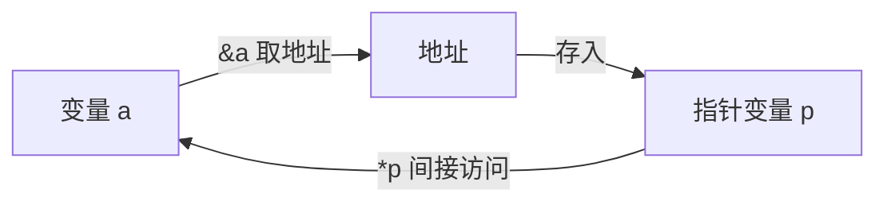
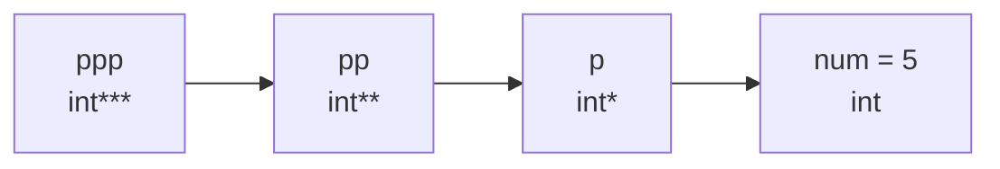

> 本章目标：从"内存地址"这一物理概念出发，理解指针变量的本质（存地址的变量）、指向类型的两大作用（决定间接访问的空间大小、决定指针移动的步伐），掌握 void 指针、空指针 NULL、多级指针，并通过大端/小端面试题体会"地址 + 指向类型"的威力。

# 本章知识地图

- 指针值用于定位对象或函数；教学中常简称为“地址”，但它还带有类型与有效范围等语义
- 内存好比小区：**字节**是最小存储单位（户/套），**地址**是门牌号——**唯一、连续、从小到大编号**，每个字节都有地址
- 两种访问方式：**直接访问**（变量名）与**间接访问**（`*地址`）
- `&` 取地址、`*` 取值：一对**互逆运算**，可以抵消（`*&a == a`）
- 指针变量的字节数由实现决定；常见 x86 数据模型为 4 字节，常见 x64 数据模型为 8 字节
- 指向类型的两大作用：**① 间接访问时得到多大的空间**；**② 指针 ±1 移动多少个字节**
- `void *` 可保存对象指针；`NULL` 表示不指向有效对象的空指针常量
- 多级指针：指向指针的指针
- 大端存储（高位字节放低地址，网络协议常用）与小端存储（低位字节放低地址，x86 采用）

学习指针时，不要只背“`&` 取地址、`*` 取值”。更可靠的方法是每遇到一个指针表达式都回答四个问题：

1. **它的类型是什么**：例如 `int *`、`int **`，还是 `int (*)[4]`？
2. **它当前指向谁**：某个对象、数组元素、尾后位置，还是根本没有有效目标？
3. **目标还活着吗**：目标对象的生命周期是否已经结束？
4. **这次操作合法吗**：形成地址、移动指针和解引用是三件不同的事，合法范围也不同。

后面所有例子都会沿着“类型—目标—生命周期—操作”这条线分析。只要四个问题中有一个答不上来，就不应急着写 `*p`。



---

# 3.1 内存地址：内存是带门牌号的小区

把内存想象成一个住人的小区：

| 小区概念 | 内存概念 |
|---|---|
| 户/套（住人） | **字节**——最小存储单位（住数据） |
| 门牌号 | **地址**——特征：唯一的、连续的、从小到大编号 |
| 按门牌号找人 | **间接访问** |
| 直接敲门找人 | **直接访问** |

**每个字节都有地址**。一个 `int a = 5;` 占 4 个字节，`&a` 取到的是这 4 个字节中**最左侧（编号最小）字节的地址**，即"首地址"。

从 C 语言的角度说，`a` 是一个对象，`&a` 的结果是一个能够定位该对象的指针值。教学中常把指针值简称为“地址”，但不要把它简单理解成普通整数：指针还受到所指类型、对象生命周期、有效范围和对齐要求约束。两个数值看起来相同的地址，若类型不同，解引用大小和 `+1` 的跨度也可能完全不同。

两个地址相关运算符（同属第 2 级优先级的单目运算符）：

- `&`：取变量所占字节的**首地址**（取地址运算符）
- `*`：根据地址取值（取值/间接访问运算符）

```c
#include <stdio.h>

int main(void)
{
	// num 是实际保存数据的对象；&num 产生指向它的 int * 指针值。
	int gbr = 5;
	printf("地址方式：%p\n", (void *)&gbr);

	// 左边通过变量名直接读取；右边先取地址，再沿地址读取同一个对象。
	printf("%d %d\n", gbr, *&gbr);   // *& 作用于同一对象时可以抵消

	return 0;
}
```

**输出结果**（地址由系统分配，每次运行可能不同，下面是一次典型运行）

```text
地址方式：0x00cff934
5 5
```

> - `%p` 接收 `void *`，因此先把对象指针转换为 `(void *)`。把指针交给 `%d` 与格式要求不匹配，属于未定义行为，不存在可移植的确定输出；
> - `*&gbr`：先 `&gbr` 取地址，再 `*` 根据地址取值，一来一回**相互抵消**，等价于 `gbr` 本身，所以两个都输出 5。

## 在调试器中亲眼看到地址

VS 调试期间（调试状态下）可打开两个关键窗口交叉验证：

- **监视窗口**：调试 → 窗口 → 监视 → 监视 1（Ctrl+Alt+W, 1），添加 `gbr` 与 `&gbr`，能看到 `&gbr` 的值形如 `0x00cff934 {5}`，类型是 `int *`；
- **内存窗口**：调试 → 窗口 → 内存 → 内存 1（Ctrl+Alt+M, 1），在地址栏输入 `&gbr`，看到从首地址开始的字节序列：`05 00 00 00 ...`。

> 内存窗口用**十六进制**展示：2 个十六进制位恰好是 1 个字节。`int gbr = 5` 显示为 `05 00 00 00`——低位字节在前，这正是 4.7 节要讲的**小端存储**。

---

# 3.2 指针变量：存储地址的变量

## 声明与初始化

**存储内存地址的变量就是指针变量。**

**语法伪代码：**

```text
目标类型 *指针名 = &目标对象;
通过 *指针名 读取或修改目标对象;
```

| 符号出现位置 | 含义 | 例子 |
|---|---|---|
| 声明中的 `*` | 声明该名字是指针 | `int *p;` |
| 表达式中的 `&` | 取得对象地址 | `p = &a;` |
| 表达式中的 `*` | 解引用：访问所指对象 | `value = *p;`、`*p = 9;` |

```c
int a = 5;
int *p;       // p 的类型是 int *，目前尚未初始化，不能使用
p = &a;       // 从这一行开始，p 明确指向 a
```

结果说明：这段代码只完成声明和赋值，没有打印语句，因此没有运行输出。

解读 `int* p` 的三个组成部分：

- `*` 是**指针类型标记**（徽章），表明 p 是指针，**不能独立使用**；
- `int` 是**指向类型**的特征：p 指向的那段空间按 int 解读；
- 合起来：p 是一个"指向 int 的指针"，类型记作 `int *`。

声明符建议从变量名向外读：`p` 先与 `*` 结合，所以“`p` 是一个指针”；再看左侧的 `int`，得到“`p` 指向 `int`”。星号靠近类型还是靠近变量名只是排版风格，`int* p` 与 `int *p` 完全等价。为了避免 `int *p, q;` 被误读成两个指针，本书后续更偏向写成 `int *p`，并让每个指针名字都带自己的 `*`。

## 直接访问与间接访问

```c
#include <stdio.h>

int main(void)
{
	int num = 5;
	int *p = &num;      // p 保存 num 的地址，因此 *p 访问的就是 num

	printf("直接访问%d 间接访问%d\n", num, *p);

	return 0;
}
```

**输出结果**

```text
直接访问5 间接访问5
```

> 调试观察：局部变量窗口里 `p` 的值是 `0x00effb58` 这样的地址，展开后能看到 `*p` 就是 num 的值。**直接访问**走变量名，**间接访问**走"地址 → 空间"，殊途同归。

## 找到 vs 得到：间接访问的两步内涵

`*p` 这一操作可以拆成两层理解：

1. **找到·地址**：p 里保留的地址把我们带到那扇"门"前；
2. **得到·一段内存空间**：`*` 运算**结合指向类型**，获得从该地址开始、指向类型字节数大小的空间的《使用权》——既能读也能写。

所以同一个地址，`*(int*)` 得到 4 字节空间，`*(short*)` 得到 2 字节空间，`*(char*)` 只得到 1 字节空间。这就是**指向类型的作用（一）**。

这里的“读多少字节”只是第一层。一次合法的解引用还必须同时满足：地址指向一个仍在生命周期内的对象、访问没有越过对象边界、地址满足目标类型的对齐要求，并且该访问没有违反 C 的对象表示规则。强制类型转换只能改变编译器如何解释指针，不能把无效地址变成有效对象。

---

# 3.3 指针变量的字节数：由实现的数据模型决定

指针变量保存指针值，其大小由编译器、ABI 和目标平台共同决定，与所指对象大小没有必然关系。C 标准不要求所有种类的指针都一样大，也不能只看操作系统名称下结论。在当前课程常见的 Windows/MSVC 数据模型中通常是：

- x86（32 位）：地址 32 位 → 任何指针变量都是 **4 字节**
- x64（64 位）：地址 64 位 → 任何指针变量都是 **8 字节**

```c
#include <stdio.h>

int main(void)
{
	int num = 5;
	char ch = 'A';
	long long wide = 8;
	short small = 2;
	int* p = &num;
	char* pc = &ch;
	long long* pll = &wide;
	short* ps = &small;

	// 常见 Windows ABI：x86 对象指针 4 字节，x64 对象指针 8 字节。
	//sizeof(*p)：访问地址得到的空间大小 = 指向类型的字节数
	printf("%zu %zu %zu\n", sizeof(int*), sizeof(p), sizeof(*p));
	printf("%zu %zu %zu\n", sizeof(char*), sizeof(pc), sizeof(*pc));
	printf("%zu %zu %zu\n", sizeof(long long*), sizeof(pll), sizeof(*pll));
	printf("%zu %zu %zu\n", sizeof(short*), sizeof(ps), sizeof(*ps));

	return 0;
}
```

**输出结果**（x86 平台）

```text
4 4 4
4 4 1
4 4 8
4 4 2
```

> 在这组常见 Windows 实现中，每行前两列是**对象指针本身**的大小——x86 为 4、x64 为 8；第三列 `sizeof(*p)` 是目标类型的大小。换用其它 ABI 时必须以实际 `sizeof` 为准，不能把这组观察当成语言保证。

---

# 3.4 指向类型的作用（二）：指针的移动

在同一数组对象范围内，地址加整数可以实现连续访问。指针 `+1` 不是加 1 个字节，而是前进一个所指元素；换算为字节，通常就是 `sizeof(所指类型)`：


```c
#include <stddef.h>
#include <stdio.h>

int main(void)
{
	int ai[3] = {0};
	char ac[3] = {0};
	long long all[3] = {0};
	short as[3] = {0};

	// 先转成 unsigned char *，再相减，差值就以“字节”为单位。
	printf("%td\n", (unsigned char *)(ai + 1) - (unsigned char *)ai);
	printf("%td\n", (unsigned char *)(ac + 1) - (unsigned char *)ac);
	printf("%td\n", (unsigned char *)(all + 1) - (unsigned char *)all);
	printf("%td\n", (unsigned char *)(as + 1) - (unsigned char *)as);

	return 0;
}
```

在 `int`、`long long`、`short` 分别为 4、8、2 字节的一种常见实现上：

```text
4
1
8
2
```

> 这正是后面数组遍历 `*(arr + i)` 的底层原理。除同一数组的元素及尾后位置外，随意构造越界指针本身就不受标准保证；不能等到解引用时才判断是否合法。

以 `int ai[3]` 为例，可以把合法位置画成：

```text
ai         ai + 1     ai + 2     ai + 3
↓          ↓          ↓          ↓
[ ai[0] ]  [ ai[1] ]  [ ai[2] ]  [ 尾后位置 ]
 可解引用    可解引用    可解引用      不可解引用
```

`ai + 3` 可以作为循环终点参与比较，但那里没有数组元素，不能写 `*(ai + 3)`。指针相减也只应发生在同一数组对象（含尾后位置）内，结果表示相隔多少个元素，而不是相隔多少个字节。

---

# 3.5 void 指针：只保留地址的"无类型"指针

不明确指向类型时，可用 `void` 占位——无类型符号（不确定类型）：

```c
int num = 5;
void *pn = &num;       // 只保存对象地址，不携带可解引用的完整对象类型
// *pn = 1;            // 错误：编译器不知道一次应访问多少字节
// pn + 1;             // 标准 C 不允许：void 没有可用于计算步长的大小
*(int *)pn = 1;        // 恢复为原来的 int * 后，才能合法写回 num
```

编译结果：前两条被注释的语句若启用，在标准 C 中都无法通过类型检查；其余声明没有运行输出。

void 指针"两不能"的根源都是**没有指向类型**：

| 操作 | 依赖 | void* 能否执行 |
|---|---|---|
| `*pn` 间接访问 | 指向类型决定取多大空间 | ✗ 不能 |
| `pn + 1` 指针移动 | 指向类型决定步伐大小 | ✗ 不能 |
| 保留地址 | 只需地址本身 | ✓ 可以 |

使用前必须恢复正确的指向类型：`*(int *)pn = 1;`。在 C 中，对象指针与 `void *` 之间的赋值转换可以隐式完成，例如 `int *p = pn;`；这里显式转换是为了把教学意图写清楚。关键不是“随便转成某个类型”，而是必须恢复成与真实对象相容的类型。

`void *` 常见于通用接口，例如动态内存分配函数返回一块尚未绑定具体用途的存储。调用方决定把它用于什么对象，并负责保证容量、对齐和生命周期都正确。

---

# 3.6 用指针做算术运算与 `*p++` 优先级陷阱

**直接访问能做的，间接访问也能做**：

```c
int num = 5;
int *p = &num;

// 每一行都先通过 *p 找到 num，再修改 num 中保存的值。
*p = 4;         // num: 5 -> 4
*p += 3;        // num: 4 -> 7
*p *= 2;        // num: 7 -> 14
```

逐步跟踪结果：`num` 的值由 5 → 4 → 7 → 14；片段本身没有打印语句。

但下面三行是经典陷阱：

```c
(void)*p++; //等价于 (void)*(p++)，p 变成尾后指针
p = &num;
(*p)++;     //num 加 1
p = &num;
++*p;       //num 再加 1
```

状态结果：第一行不修改 `num`，只让 `p` 移到 `num` 的尾后位置；重置 `p` 后，后两行把 `num` 从 14 依次改为 15、16。

| 表达式 | 结合过程 | 实际效果 |
|---|---|---|
| `*p++` | `*(p++)`：先取 `*p`（值被丢弃），然后 **p 自身 +1（移走了）** | 指针前进一个 `int`，典型跨度为 `sizeof(int)`；num 不变 |
| `(*p)++` | 括号强制先间接访问，再对**存储值** +1 | 空间里的值 +1 |
| `++*p` | 右结合：先 `*p` 再 `++` | 存储值 +1 |

读复杂表达式时先按优先级加括号，再分析副作用发生在谁身上：后缀 `++` 的优先级高于一元 `*`，所以 `*p++` 必须先改写成 `*(p++)`。实际工程中即使熟悉优先级，也建议主动写出 `(*p)++`，让“修改对象值”一眼可见。

> ⚠️ 执行 `*p++` 后，`p` 已移到 `num` 的尾后位置。正文示例在继续使用前先写 `p = &num` 重置；如果省略重置再解引用，就会越界。想给存储值自增，应直接写 `(*p)++` 或 `++*p`。

---

# 3.7 面试题：大端与小端

## 什么是大端、什么是小端

以 `0x123456` 在内存中的存储为例（以字节为单位）：


```text
大端模式：低地址 ──→ 高地址
          0x12 | 0x34 | 0x56      （左高位·右低位，符合直观）

小端模式：低地址 ──→ 高地址
          0x56 | 0x34 | 0x12      （低位字节放低地址）
```

再看 `int age = 9;` 的 4 字节布局：

| 模式 | 低地址 → 高地址 | 特点与用途 |
|---|---|---|
| 大端存储 | `00 00 00 09` | 高位字节放低地址；网络协议常规定采用大端字节序 |
| 小端存储 | `09 00 00 00` | 以字节为单位，"处理一个字节、分配存储一个"；x86 CPU 采用 |

## 为什么会有大小端之分

1. 起初是不同架构 CPU 处理多字节数据的顺序不同：x86 是小端，KEIL C51 是大端。互联网流行后，TCP/IP 协议规定**网络字节序为大端**，为跨平台通信专门提供了转换接口（`ntohs`、`htons`、`ntohl`、`htonl`）。
2. 大小端只描述**一个多字节对象在内存或字节流中的排列顺序**。源代码里的整数值、加减乘除和 `printf("%x", value)` 都作用于抽象数值，不因主机字节序改变结果。只有逐字节检查内存、读写二进制文件、访问硬件寄存器或跨网络交换字节时，字节序才直接影响解释方式。

## 怎样判断大小端

核心思路：让 `char*` 只看 int 的**第一个字节**（最低地址字节）：

```c
#include <stdio.h>

int main(void)
{
	int num = 1;    //大端 00 00 00 01   小端 01 00 00 00
	// unsigned char * 可以逐字节查看任意对象的对象表示。
	unsigned char *p = (unsigned char *)&num;
	if (*p == 1)
	{
		printf("小端\n");
	}
	else
	{
		printf("大端\n");
	}

	long long data = 0x1234567890LL;
	unsigned char *p2 = (unsigned char *)&data;
	p2 += 4;        // 指向下标 4，即从低地址起的第 5 个字节
	printf("%02x\n", *p2);

	return 0;
}
```

**输出结果**（x86/x64 Windows 平台）

```text
小端
12
```

> 第二问推导：`long long data = 0x1234567890;` 共 8 字节，小端布局（低地址 → 高地址）为
> `90 78 56 34 12 00 00 00`
> `p2 += 4` 后指向第 5 个字节（下标 4），即 `0x12` → `%x` 打印 `12`。
>
> `unsigned char *` 可以检查任意对象的字节表示。把 `int *` 直接赋给 `char *` 在 C 中也违反指针类型约束，编译器必须给出诊断；C++ 同样不允许。这里显式转换为 `(unsigned char *)`。

---

# 3.8 指针使用的三个注意事项

判断一个指针能否使用，可以先过三道门：

| 检查 | 要问的问题 | 常见错误 |
|---|---|---|
| 已初始化 | 指针里是否已经放入明确的有效指针值？ | 未初始化的野指针 |
| 生命周期 | 所指对象是否仍然存在？ | 返回局部变量地址、释放后继续使用形成悬空指针 |
| 范围与权限 | 是否仍在目标对象的合法范围内，操作是否允许读写？ | 越界、解引用尾后指针、修改字符串字面量 |

`NULL` 只能清楚表达“目前不指向对象”，并不能替代使用前检查；`*NULL` 仍然是非法操作。

```c
#include <stdio.h>

int main(void)
{
	/*
	注意1: 指针不要位移到不属于本程序的内存空间
	也不要利用指针改变不属于本程序的内存空间的数据
	*/
	int num = 5;
	int *p = &num;

	/*
	注意2: 声明多个指针变量时，* 不能省略
	*/
	int a, b, c;        //三个 int 变量
	int *a1, b1, c1;     // 陷阱：只有 a1 是指针，b1、c1 是普通 int
	int *a2, *b2, *c2;  // 正确：每个名字都带 *，三者都是 int *
	(void)a; (void)b; (void)c;
	(void)a1; (void)b1; (void)c1;
	(void)a2; (void)b2; (void)c2;

	/*
	注意3: 指针变量的初始值如果没有明确指向目标用 NULL 赋值
	*/
	double *pd = NULL;
	long long *pll = NULL;
	char *pc = NULL;
	p = NULL;
	printf("%zu %zu\n", sizeof(p), sizeof(*p));
	printf("%zu %zu\n", sizeof(pd), sizeof(*pd));
	printf("%zu %zu\n", sizeof(pll), sizeof(*pll));
	printf("%zu %zu\n", sizeof(pc), sizeof(*pc));

	return 0;
}
```

**输出结果**（x86 平台）

```text
4 4
4 8
4 8
4 1
```

在常见 x86 Windows 实现上，这四种对象指针本身都是 4 字节，所指类型分别是 4、8、8、1 字节；常见 x64 Windows 实现的第一列通常改为 8。其它实现可能采用不同指针表示。对空指针做 `p + 1` 没有标准定义，不能用它推导“地址步长”。

三个注意事项展开：

**① 内存的非法访问**。指针算术只在同一数组对象及其尾后位置范围内有定义，越界构造和越界访问都不能依赖：

```c
//正常的指针操作：1 先合法申请内存空间 2 再用指针间接访问它
int a = 9;
int* p = &a;
*p = 100;       //正常
//不正常
p += 3000;
*p = 1;         //引发异常：写入访问权限冲突
```

结果说明：`p += 3000` 已超出该标量对象及其尾后位置，行为未定义；后续写入同样没有可移植的确定结果。某些 Windows 运行中可能报告 `0xC0000005` 访问冲突，但也可能悄悄破坏数据。

**② 声明时 `*` 是类型标志，不是间接访问运算**：

```c
int* p, *q = &a, *m;    //每个指针名前都要写 *
//int* p, q, m;         //q、m 只是 int！
```

结果说明：这只是声明，没有运行输出；第一行的三个变量类型都是 `int *`。

**③ NULL 空指针**。某些 C 实现可能采用：

```c
#define NULL ((void *)0)    //vcruntime.h
```

结果说明：宏定义在预处理期展开，没有运行输出。标准要求 `NULL` 是空指针常量，但不要求它一定采用上述宏定义，也不要求空指针的底层所有位都是零。应把它理解为“不指向任何有效对象”，常用于“暂无指向”和失败返回。

还要区分两类经常都被叫作“野指针”的问题：

```c
int *uninitialized;       // 未初始化：保存的值不确定，连比较都不应依赖

int *dangling;
{
    int local = 7;
    dangling = &local;    // 这里暂时有效
}                         // local 生命周期结束，dangling 从此悬空
// printf("%d", *dangling); // 错误：目标对象已经不存在
```

更稳妥的习惯是让指针在声明时立即指向有效对象或置为 `NULL`，并在目标生命周期结束后不再使用。动态内存释放后可把仍由当前代码负责的那个指针置为 `NULL`，但这不能自动修复其他指向同一内存的别名指针。

---

# 3.9 多级指针：指向指针的指针

指针变量本身也是变量，也有自己的地址——存放"指针的地址"的变量就是**多级指针**：

```c
#include <stdio.h>

int main(void)
{
	/*
	多级指针又称为：指向指针的指针。
	*/
	int num = 5;

	int *p = &num;      // 一级：p 保存 num 的地址
	int **pp = &p;      // 二级：pp 保存指针变量 p 自己的地址
	int ***ppp = &pp;   // 三级：ppp 保存指针变量 pp 的地址
	printf("%d", ***ppp);

	return 0;
}
```

**输出结果**

```text
5
```

> 拆解 `***ppp`：`*ppp` 得到 pp（即 &p）→ `**ppp` 得到 p（即 &num）→ `***ppp` 得到 num = 5。
> 每加一层 `*`，就顺着"钥匙开门 → 屋里还有一把钥匙"的链条走一步；有几级指针，就要用几个 `*` 才能取到最终数据。
> 调试监视窗口能直观展开这条链：`&p` 的类型是 `int **`，其值展开是 `int *`，再展开就是 `int` 的 5。



---

# 3.10 本章小结与易错点

## 核心链条

```text
变量 → &取首地址 → 存入指针变量 → *结合指向类型 → 找到地址、得到空间（使用权）
```

## 易错点清单

| # | 易错点 | 正解 |
|---|---|---|
| 1 | 以为 `&a` 是变量的"整体地址" | `&` 取的是所占字节中**首地址**（最左/最小编号字节） |
| 2 | 以为指针大小随指向类型变化 | 指针字节数只看平台：x86 全 4 字节，x64 全 8 字节 |
| 3 | 以为 `p + 1` 前进 1 字节 | 前进 **1 × sizeof(指向类型)** 字节 |
| 4 | 对 `void*` 做 `*pn` 或 `pn+1` | void 无指向类型，两者都编译报错；先强转再用 |
| 5 | 想给存储值自增写成 `*p++` | `*p++` 等价 `*(p++)`，移动的是指针；应写 `(*p)++` 或 `++*p` |
| 6 | `int* a, b, c;` 声明三个指针 | 只有 a 是指针；应写 `int *a, *b, *c;` |
| 7 | 野指针偏移后直接 `*p = 1` | 行为未定义；无明确指向时先赋 `NULL`，使用前再验证 |
| 8 | 写 `char* p = &num;`（`num` 为 `int`） | C 与 C++ 都不允许直接混用不兼容对象指针；观察字节应显式转为 `unsigned char *` |
| 9 | 分不清大小端 | 小端 = 低位字节在低地址（x86）；网络字节序为大端 |
| 10 | 多级指针少写/多写 `*` | 几级指针就配几个 `*` 才能取到最终值 |

---

# 3.11 综合题库（含答案与解析）

## 3.11.1 地址与指针填空

| 题目 | 答案 | 解析 |
|---|---|---|
| x86 32 位系统用多宽的指针，理论虚拟地址空间多大？ | 常见指针为 4 字节，地址宽度 32 位，理论地址空间 $2^{32}$ B，即 4 GiB。 | 实际可用地址空间还受操作系统、进程布局和硬件限制。 |
| x64 系统的指针是否通常为 8 字节？ | 是，常见数据模型中为 8 字节。 | 处理器不一定实现全部 64 位虚拟地址，但 C 指针对象通常仍占 8 字节。 |
| `int age=10;` 怎样取得首地址？ | `&age`。 | 表达式类型是 `int *`，指向 `age` 对象。 |
| x86 下 `sizeof(&age)` 通常是多少？ | 4。 | `&age` 是指针；在 x64 下通常是 8。可移植代码不要把该值写死。 |
| 定义空的基本类型指针怎样写？ | 例如 `int *p = NULL;`。 | `NULL` 只表示空指针常量；解引用或对其做指针算术都没有合法对象语义。 |
| `int *p, q, m;` 三个变量分别是什么类型？ | `p` 是 `int *`，`q`、`m` 是 `int`。 | 声明符中的 `*` 只与紧邻的名字结合；多个指针建议分行声明。 |
| 多级指针又叫什么？ | 指向指针的指针。 | `int **pp` 保存 `int *` 对象的地址；`**pp` 才访问最终 `int`。 |

## 3.11.2 间接访问与字节顺序

**题 1：执行下列代码会依次打印什么？**

```c
int a = 10;
int *p = &a;
*p = 100;
printf("%d\n", *p);
*p += 55;
printf("%d\n", a);
(*p)++;
printf("%d\n", a);
```

二级指针不只是语法练习。若函数需要改变调用方的指针变量本身，就必须接收该指针变量的地址：

```c
void point_to_value(int **output, int *target)
{
    if (output == NULL) {
        return;                 // 没有可写回的指针变量
    }
    *output = target;           // 修改调用方的 int * 变量
}

int value = 42;
int *result = NULL;
point_to_value(&result, &value); // 调用后 result 指向 value
```

这里 `result` 是 `int *`，所以 `&result` 自然是 `int **`。先确定“函数要修改谁”，再对那个变量取地址，多级指针就不会只剩下数星号。

**答案：**

```text
100
155
156
```

**解析：**`p` 与变量名 `a` 访问的是同一个对象；`(*p)++` 的括号保证递增的是所指整数，而不是指针。

**题 2：以下多级指针程序打印什么？**

```c
int a = 10;
int *p = &a;
int **pp = &p;
a++;
*p *= 5;
printf("%d\n", **pp);
```

**答案：**`55`。

**解析：**`a++` 得 11，`*p *= 5` 把同一对象改为 55，`**pp` 沿两级地址链取得该值。

**题 3：在小端且 `long long` 为 8 字节的机器上，下列代码的预期输出是什么？**

```c
long long data = 0x1234567890LL;
unsigned char *p = (unsigned char *)&data;
p += 4;
printf("%x\n", (unsigned)*p);
```

**答案：**`12`。

**解析：**对象从低地址到高地址的字节为 `90 78 56 34 12 00 00 00`，偏移 4 指向 `0x12`。使用 `unsigned char *` 检查对象表示是标准允许的做法。

**题 4：`unsigned color=0xff09aa;` 在常见小端 32 位 `unsigned` 中按字节打印 B、G、R，结果是什么？**

```c
unsigned char *p = (unsigned char *)&color;
printf("Blue:%hhu %02hhx\n", p[0], p[0]);
printf("GREEN:%hhu %02hhx\n", p[1], p[1]);
printf("RED:%hhu %02hhx\n", p[2], p[2]);
```

**答案：**

```text
Blue:170 aa
GREEN:9 09
RED:255 ff
```

**解析：**小端把最低有效字节 `0xaa` 放在最低地址，随后是 `0x09`、`0xff`。若协议固定 RGB 顺序，应显式移位掩码，不依赖主机字节序。

## 3.11.3 指针大小、步长与错误代码辨析

**题 5：原题把不同类型指针都设为 `NULL`，然后用 `%d` 打印 `sizeof(p)` 和 `p+1`。能否写出固定输出？**

**答案：**不能。原代码同时包含不兼容指针链式赋值、`%d` 与 `size_t`/指针类型不匹配、对空指针做指针算术等问题，没有符合标准的固定输出。

**解析：**可安全观察的是类型大小和真实数组内的步长：

```c
#include <stdio.h>

int main(void)
{
    int ai[2] = {0};
    double ad[2] = {0};
    long long all[2] = {0};
    char ac[2] = {0};

    printf("%zu %zu %td\n", sizeof &ai[0], sizeof ai[0], &ai[1] - &ai[0]);
    printf("%zu %zu %td\n", sizeof &ad[0], sizeof ad[0], &ad[1] - &ad[0]);
    printf("%zu %zu %td\n", sizeof &all[0], sizeof all[0], &all[1] - &all[0]);
    printf("%zu %zu %td\n", sizeof &ac[0], sizeof ac[0], &ac[1] - &ac[0]);
    return 0;
}
```

所有相邻元素的指针差都是 1，但实际地址前进的字节数分别为 `sizeof(int)`、`sizeof(double)`、`sizeof(long long)`、`sizeof(char)`。

**题 6：下列代码中的 `x` 在小端机器上是否保证为 1？**

```c
unsigned char endian[2] = {1, 0};
short x = *(short *)endian;
```

**答案：**不保证；原表达式可能违反对齐要求和有效类型/严格别名规则。

**解析：**课程环境中常观察到小端为 1，但可移植判断应检查一个已声明整数对象的字节：

```c
unsigned int value = 1;
int little = *(const unsigned char *)&value == 1;
```

原题的另一段 `*(char *)&i == 0 ? 'Y' : 'N'` 在 `i=1` 时，小端打印 `N`，大端打印 `Y`；用字符类型查看对象表示是允许的。

**题 7：`char *p1=(char *)a; char *p2=(char *)&a[3]; printf("%td",p2-p1);`，其中 `int a[]={2,8,16,24};`，常见输出是什么？**

**答案：**若 `sizeof(int)==4`，输出 `12`。

**解析：**两个字符指针相距 3 个 `int`，差值以字节为单位。可移植表达为 `3 * sizeof(int)`，打印指针差使用 `%td`。

**题 8：下列代码第二个值是否有固定答案？**

```c
int a[4] = {1,2,3,4};
int *ptr1 = (int *)(&a + 1);
int *ptr2 = (int *)((char *)a + 1);
printf("%x, %x\n", (unsigned)ptr1[-1], (unsigned)*ptr2);
```

**答案：**第一个值为 `4`；第二个解引用可能未对齐，且并不指向一个合法的 `int` 对象，因此行为未定义。

**解析：**在特定 32 位小端机器上偶然可能看到 `02000000`，但不能写成标准答案。原题还把指针先转成 `int`，在 64 位下会截断地址；这里改用 `char *` 只是为了准确展示“偏移 1 字节”这一错误意图。

**题 9：怎样把 `0x9LL` 写到数值地址 `0x12ff7c`？**

**答案：**只有该地址确实映射为可写、满足对齐和对象生命周期要求时，语法才可写成：

```c
#include <stdint.h>
long long *target = (long long *)(uintptr_t)0x12ff7c;
*target = 0x9LL;
```

**解析：**普通用户程序不能假定任意数值地址有效；直接运行通常会触发访问冲突或未定义行为。实际硬件寄存器访问还需平台提供的映射接口和 `volatile` 语义。
