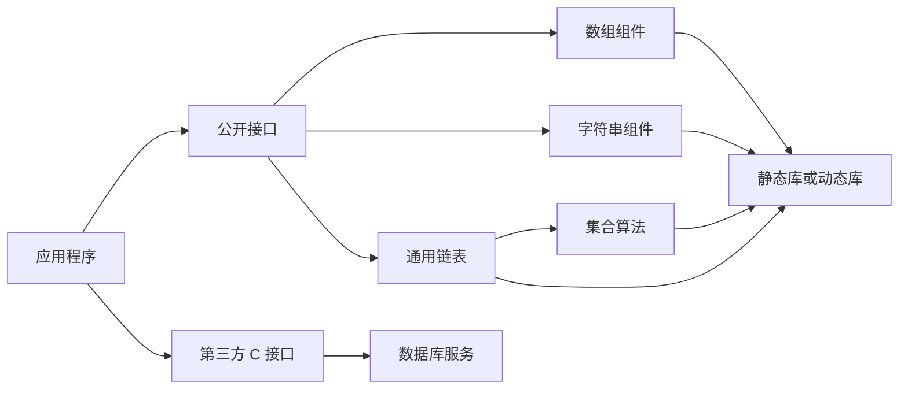

# 第 11 章 多文件工程、库与组件化开发

> 本章目标：把已经学过的数组、指针、函数、结构体、链表和字符串组织成可复用组件；理解声明、定义、链接、静态库、动态库与第三方 C 接口；能够用测试程序形成“接口—实现—调用—结果”的闭环。

## 本章知识地图

- 头文件回答“可以怎样调用”，实现文件回答“具体怎样完成”。
- 头文件保护、`extern`、内部链接、命名约定共同决定模块边界。
- 一个组件至少应具备：稳定接口、参数约定、错误策略、实现和测试。
- `void *` 与比较回调能让链表和算法服务于不同数据类型，但类型安全需要调用者与组件共同保证。
- 静态库在链接时并入程序；动态库在装载或运行时被解析。
- 使用第三方库仍遵循相同思路：取得头文件与库、配置编译链接、初始化、调用、检查错误、释放资源。



## 11.1 从一段程序到一个组件

排序和查找最初常直接写在 `main` 中。组件化的第一步，是把变化较小的算法提取成函数，把输入、输出和失败方式写清楚。

一个可实现、可测试的接口说明至少回答：

| 项目 | 必须写清的内容 |
|---|---|
| 输入 | 每个参数的类型、单位、合法范围以及是否允许 `NULL` |
| 输出 | 返回值和输出参数分别表达什么，失败时是否仍会写入 |
| 长度/容量 | 是元素数还是字节数，采用闭区间还是半开区间 |
| 修改范围 | 哪些对象会被原地改变，哪些参数只读 |
| 所有权 | 谁分配、谁释放，返回指针是借用还是转移所有权 |
| 失败策略 | 返回状态、错误码、`NULL` 或其它约定，调用者怎样恢复 |

后文每个组件都沿用这套契约；只给出函数名和参数类型还不算完整接口。

```c
#include <stdio.h>

static void sort_ints(int a[], int n)
{
    for (int i = 0; i < n - 1; ++i) {
        for (int j = i + 1; j < n; ++j) {
            if (a[i] > a[j]) {
                int t = a[i];
                a[i] = a[j];
                a[j] = t;
            }
        }
    }
}

static int binary_search(const int a[], int n, int key)
{
    int left = 0;
    int right = n - 1;
    while (left <= right) {
        int mid = left + (right - left) / 2;
        if (a[mid] == key) {
            return mid;
        }
        if (a[mid] < key) {
            left = mid + 1;
        } else {
            right = mid - 1;
        }
    }
    return -1;
}

int main(void)
{
    int a[] = {23, 5, 44, 1, 12, 8};
    int n = (int)(sizeof a / sizeof a[0]);
    sort_ints(a, n);
    for (int i = 0; i < n; ++i) {
        printf("%d%c", a[i], i + 1 == n ? '\n' : ' ');
    }
    printf("44 的下标：%d\n", binary_search(a, n, 44));
    return 0;
}
```

运行结果：

```text
1 5 8 12 23 44
44 的下标：5
```

二分查找的循环不变量是：如果目标存在，它只可能位于闭区间 \([left,right]\)。因此初值必须是 `right = n - 1`，而不是 `n`。

## 11.2 声明、定义与链接

函数在工程中通常经历三种状态：

1. 声明：告诉编译器函数的名称、参数和返回类型。
2. 调用：按接口传入实参并使用返回值。
3. 定义：提供真正执行的函数体。

下面是最小的多文件闭环。接口中的声明本身不会产生运行输出。

```c
/* calc_api.h */
#ifndef CALC_API_H
#define CALC_API_H

int add_int(int a, int b);

#endif
```

结果说明：

```text
头文件只提供声明，没有独立运行输出；输出由下面的调用程序产生。
```

```c
/* calc_api.c */
#include "calc_api.h"

int add_int(int a, int b)
{
    return a + b;
}
```

结果说明：

```text
实现文件只定义函数，没有独立运行输出；输出由下面的调用程序产生。
```

```c
/* app.c */
#include <stdio.h>
#include "calc_api.h"

int main(void)
{
    printf("%d\n", add_int(7, 8));
    return 0;
}
```

运行结果：

```text
15
```

常见诊断可按阶段定位：

| 阶段 | 典型问题 | 现象 |
|---|---|---|
| 预处理 | 头文件找不到、宏展开错误 | 编译前即失败 |
| 编译 | 类型不匹配、语法错误、函数未声明 | 某个翻译单元不能生成目标文件 |
| 链接 | 只有声明没有定义、重复定义、缺少库 | “未解析的外部符号”或“重复符号” |
| 运行 | 空指针、越界、库文件缺失 | 崩溃、错误结果或装载失败 |

头文件保护使同一翻译单元多次包含接口时只保留一次声明。`#pragma once` 很方便，但不是 ISO C 标准的一部分；宏保护的可移植性更好。

## 11.3 `extern`、内部链接与模块状态

一个全局对象只能在整个程序中定义一次，其他翻译单元用 `extern` 声明。仅在当前实现内部使用的函数或全局对象应加 `static`，避免污染全局符号表。

```c
/* state_api.h */
#ifndef STATE_API_H
#define STATE_API_H

extern int request_count;
void record_request(void);

#endif
```

结果说明：

```text
这里只声明共享状态与函数，没有独立运行输出。
```

```c
/* state_api.c */
#include "state_api.h"

int request_count = 0;
static int step = 1;

void record_request(void)
{
    request_count += step;
}
```

结果说明：

```text
这里给出唯一的全局定义；内部对象 step 对其他翻译单元不可见。
```

```c
#include <stdio.h>
#include "state_api.h"

int main(void)
{
    record_request();
    record_request();
    printf("%d\n", request_count);
    return 0;
}
```

运行结果：

```text
2
```

全局状态会形成隐式依赖。实际项目优先把状态放入结构体，再通过参数显式传递；确需共享时才使用 `extern`。

## 11.4 整数数组组件

### 11.4.1 完整接口

数组退化为指针后，函数无法通过 `sizeof(arr)` 得到调用者数组长度，所以每个接口都显式接收 `length`。`reverse` 是“反转”的常用拼写；兼容旧调用时可以保留一个拼写别名。

```c
/* int_array.h */
#ifndef INT_ARRAY_H
#define INT_ARRAY_H

#include <stddef.h>

void array_swap(int a[], size_t i, size_t j);
void array_sort(int a[], size_t length, int ascending);
int  array_binary_search(const int a[], size_t length, int key);
int  array_max(const int a[], size_t length, int *out);
int  array_min(const int a[], size_t length, int *out);
long long array_sum(const int a[], size_t length);
double array_average(const int a[], size_t length);
void array_reverse(int a[], size_t length);
void array_shuffle(int a[], size_t length);
void array_fill(int a[], size_t length, int value);
int  array_copy(const int from[], size_t from_pos,
                int to[], size_t to_pos, size_t count);

#endif
```

结果说明：

```text
接口声明没有独立输出；各函数的行为由后面的测试统一验证。
```

### 11.4.2 参考实现

```c
/* int_array.c */
#include "int_array.h"
#include <stdlib.h>

void array_swap(int a[], size_t i, size_t j)
{
    int t = a[i];
    a[i] = a[j];
    a[j] = t;
}

void array_sort(int a[], size_t n, int ascending)
{
    for (size_t i = 0; i < n; ++i) {
        for (size_t j = i + 1; j < n; ++j) {
            if ((ascending && a[i] > a[j]) ||
                (!ascending && a[i] < a[j])) {
                array_swap(a, i, j);
            }
        }
    }
}

int array_binary_search(const int a[], size_t n, int key)
{
    size_t left = 0, right = n;
    while (left < right) {
        size_t mid = left + (right - left) / 2;
        if (a[mid] < key) {
            left = mid + 1;
        } else {
            right = mid;
        }
    }
    return left < n && a[left] == key ? (int)left : -1;
}

int array_max(const int a[], size_t n, int *out)
{
    if (n == 0 || out == NULL) return 0;
    *out = a[0];
    for (size_t i = 1; i < n; ++i)
        if (a[i] > *out) *out = a[i];
    return 1;
}

int array_min(const int a[], size_t n, int *out)
{
    if (n == 0 || out == NULL) return 0;
    *out = a[0];
    for (size_t i = 1; i < n; ++i)
        if (a[i] < *out) *out = a[i];
    return 1;
}

long long array_sum(const int a[], size_t n)
{
    long long total = 0;
    for (size_t i = 0; i < n; ++i) total += a[i];
    return total;
}

double array_average(const int a[], size_t n)
{
    return n == 0 ? 0.0 : (double)array_sum(a, n) / n;
}

void array_reverse(int a[], size_t n)
{
    for (size_t i = 0; i < n / 2; ++i)
        array_swap(a, i, n - 1 - i);
}

void array_shuffle(int a[], size_t n)
{
    if (n < 2) return;
    for (size_t i = n - 1; i > 0; --i) {
        size_t j = (size_t)rand() % (i + 1);
        array_swap(a, i, j);
    }
}

void array_fill(int a[], size_t n, int value)
{
    for (size_t i = 0; i < n; ++i) a[i] = value;
}

int array_copy(const int from[], size_t from_pos,
               int to[], size_t to_pos, size_t count)
{
    if (from == NULL || to == NULL) return 0;
    if (from == to && to_pos > from_pos && to_pos < from_pos + count) {
        for (size_t i = count; i > 0; --i)
            to[to_pos + i - 1] = from[from_pos + i - 1];
    } else {
        for (size_t i = 0; i < count; ++i)
            to[to_pos + i] = from[from_pos + i];
    }
    return 1;
}
```

结果说明：

```text
实现文件没有独立输出；调用者必须保证数组区间有效，测试结果见下一节。
```

生产级接口还应接收源、目标容量并验证区间。这里保留课堂阶段的简洁签名，重点展示重叠复制时为什么要选择复制方向。

### 11.4.3 冒烟测试

```c
#include <stdio.h>
#include <stdlib.h>
#include "int_array.h"

static void print_array(const int a[], size_t n)
{
    for (size_t i = 0; i < n; ++i)
        printf("%d%c", a[i], i + 1 == n ? '\n' : ' ');
}

int main(void)
{
    int a[] = {7, 2, 9, 4, 1};
    size_t n = sizeof a / sizeof a[0];
    int lo, hi;

    array_sort(a, n, 1);
    print_array(a, n);
    printf("index(4)=%d\n", array_binary_search(a, n, 4));
    array_min(a, n, &lo);
    array_max(a, n, &hi);
    printf("min=%d max=%d sum=%lld avg=%.1f\n",
           lo, hi, array_sum(a, n), array_average(a, n));

    array_reverse(a, n);
    print_array(a, n);
    array_fill(a, n, 6);
    print_array(a, n);

    srand(1);
    array_shuffle(a, n);
    puts("shuffle 完成");
    return 0;
}
```

确定部分的运行结果：

```text
1 2 4 7 9
index(4)=2
min=1 max=9 sum=23 avg=4.6
9 7 4 2 1
6 6 6 6 6
shuffle 完成
```

洗牌后的具体顺序依赖随机数实现；示例只验证长度不变且元素多重集合不变。对全为 `6` 的数组，视觉顺序本来就不会变化。

### 11.4.4 综合任务：评分、分班与指定成员

去掉一名评委的最高分和最低分后，若共有 \(n\) 个评分，则最终得分为

$$
\bar{x}=\frac{\sum_{i=1}^{n}x_i-\max(x)-\min(x)}{n-2}.
$$

分班先用 Fisher–Yates 算法打乱 1～90，再依次放入三个班。为了让文档输出可复算，示例使用固定初始状态的 32 位线性同余发生器；若把初始状态改为外部随机种子，座位顺序会随运行改变。

```c
#include <stdio.h>
#include <stdint.h>

static double final_score(const int score[], int n)
{
    int sum = score[0], lo = score[0], hi = score[0];
    for (int i = 1; i < n; ++i) {
        sum += score[i];
        if (score[i] < lo) lo = score[i];
        if (score[i] > hi) hi = score[i];
    }
    return (double)(sum - lo - hi) / (n - 2);
}

static void swap_student(int *a, int *b)
{
    int t = *a; *a = *b; *b = t;
}

static uint32_t next_random(void)
{
    static uint32_t state = 1;
    state = state * UINT32_C(1664525) + UINT32_C(1013904223);
    return state;
}

static void shuffle_students(int a[], int n)
{
    for (int i = n - 1; i > 0; --i) {
        int j = (int)(next_random() % (uint32_t)(i + 1));
        swap_student(&a[i], &a[j]);
    }
}

static int is_monitor(int number)
{
    return number == 22 || number == 33 || number == 59;
}

static void ensure_class_two(int classes[3][30], int number)
{
    int source_class = -1, source_index = -1;
    for (int c = 0; c < 3; ++c)
        for (int i = 0; i < 30; ++i)
            if (classes[c][i] == number) {
                source_class = c;
                source_index = i;
            }

    if (source_class == 1) return;
    for (int i = 0; i < 30; ++i) {
        if (!is_monitor(classes[1][i])) {
            swap_student(&classes[source_class][source_index], &classes[1][i]);
            return;
        }
    }
}

int main(void)
{
    int score[4][7] = {
        {5, 6, 8, 10, 9, 8, 6},
        {7, 10, 8, 10, 9, 8, 6},
        {8, 6, 8, 8, 9, 8, 6},
        {6, 6, 8, 10, 9, 8, 6}
    };
    for (int i = 0; i < 4; ++i)
        printf("选手%d：%.1f\n", i + 1, final_score(score[i], 7));

    int students[90];
    int classes[3][30];
    for (int i = 0; i < 90; ++i) students[i] = i + 1;
    shuffle_students(students, 90);
    for (int c = 0; c < 3; ++c)
        for (int i = 0; i < 30; ++i)
            classes[c][i] = students[c * 30 + i];

    ensure_class_two(classes, 22);
    ensure_class_two(classes, 33);
    ensure_class_two(classes, 59);

    puts("2班座位：");
    for (int i = 0; i < 30; ++i)
        printf("%2d%c", classes[1][i], (i + 1) % 6 == 0 ? '\n' : ' ');
    return 0;
}
```

运行结果：

```text
选手1：7.4
选手2：8.4
选手3：7.6
选手4：7.4
2班座位：
22 59  4 15 67 11
89 85 41 52 82 33
12 54  1 68 79 51
60 66 50 57 40 74
30 72 58 39  6 35
```

## 11.5 泛型双向链表组件

### 11.5.1 数据模型与接口

节点保存 `void *`，因此链表只管理“指针”，默认不拥有指针所指对象。谁分配数据，谁负责决定何时释放数据。`Compare` 返回负数、零、正数，分别表示“小于、等于、大于”。

| 参数/返回值 | 契约 |
|---|---|
| `LinkedList *list` | 借用并可能修改链表状态；除明确说明外不得为 `NULL`。 |
| `const LinkedList *list` | 只读借用链表状态。 |
| `size_t index` | 从 0 开始；插入允许 `index == size`，读取/删除要求 `index < size`。 |
| `void *data` | 链表保存原指针但不接管其所指对象；调用者保证对象生命周期足够长。 |
| `Compare cmp` | 比较回调，不得为 `NULL`；只读使用两个数据指针。 |
| `list_get/list_next` 返回值 | 借用数据指针，不应由链表之外随意释放。 |
| `list_remove_at/list_pop` 返回值 | 节点已被释放，数据指针交还调用者；空或失败返回 `NULL`。 |
| `list_clear/list_destroy` | 只释放节点和链表对象，不释放各 `data` 指向的数据。 |

```cpp
/* generic_list.h */
#ifndef GENERIC_LIST_H
#define GENERIC_LIST_H

#include <stddef.h>

typedef struct Node {
    struct Node *prev;
    void *data;
    struct Node *next;
} Node;

typedef struct {
    Node *head;
    Node *tail;
    size_t size;
    Node *cursor;
} LinkedList;

typedef int (*Compare)(const void *, const void *);

LinkedList *list_create(void);
int list_add(LinkedList *list, void *data);
int list_insert(LinkedList *list, size_t index, void *data);
void *list_remove_at(LinkedList *list, size_t index);
int list_remove_data(LinkedList *list, const void *data, Compare cmp);
void *list_get(const LinkedList *list, size_t index);
int list_set(LinkedList *list, size_t index, void *data);
int list_index_of(const LinkedList *list, const void *data, Compare cmp);
size_t list_size(const LinkedList *list);
void list_clear(LinkedList *list);
void list_destroy(LinkedList *list);

void list_iterator(LinkedList *list);
int list_has_next(const LinkedList *list);
void *list_next(LinkedList *list);

int list_push(LinkedList *list, void *data);
void *list_pop(LinkedList *list);
int list_add_first(LinkedList *list, void *data);
int list_add_last(LinkedList *list, void *data);
void *list_remove_first(LinkedList *list);
void *list_remove_last(LinkedList *list);

#endif
```

结果说明：

```text
接口声明和类型定义不直接产生输出；后面的调用程序验证全部操作族。
```

### 11.5.2 维护链表不变量

对一个非空双向链表，始终应满足：

$$
head\rightarrow prev=NULL,\qquad
tail\rightarrow next=NULL,
$$

并且相邻节点 `p`、`q` 满足

$$
p\rightarrow next=q
\Longleftrightarrow
q\rightarrow prev=p.
$$

安全实现还要特别注意：

- 创建链表时把迭代游标初始化为 `NULL`。
- 非法下标立即失败，不能把它误当作头节点。
- 中间插入要同时补齐前向、后向两条链，并且只增加一次 `size`。
- 删除后要更新首尾节点；清空后四个状态字段都恢复为空或零。

```cpp
/* generic_list.cpp：核心实现 */
#include "generic_list.h"
#include <stdlib.h>

static Node *node_create(void *data)
{
    Node *node = (Node *)malloc(sizeof *node);
    if (node == NULL) return NULL;
    node->prev = node->next = NULL;
    node->data = data;
    return node;
}

static Node *find_node(const LinkedList *list, size_t index)
{
    if (list == NULL || index >= list->size) return NULL;
    if (index < list->size / 2) {
        Node *p = list->head;
        for (size_t i = 0; i < index; ++i) p = p->next;
        return p;
    }
    Node *p = list->tail;
    for (size_t i = list->size - 1; i > index; --i) p = p->prev;
    return p;
}

LinkedList *list_create(void)
{
    LinkedList *list = (LinkedList *)malloc(sizeof *list);
    if (list == NULL) return NULL;
    list->head = list->tail = list->cursor = NULL;
    list->size = 0;
    return list;
}

int list_insert(LinkedList *list, size_t index, void *data)
{
    if (list == NULL || index > list->size) return 0;
    Node *node = node_create(data);
    if (node == NULL) return 0;

    if (list->size == 0) {
        list->head = list->tail = node;
    } else if (index == 0) {
        node->next = list->head;
        list->head->prev = node;
        list->head = node;
    } else if (index == list->size) {
        node->prev = list->tail;
        list->tail->next = node;
        list->tail = node;
    } else {
        Node *right = find_node(list, index);
        Node *left = right->prev;
        node->prev = left;
        node->next = right;
        left->next = node;
        right->prev = node;
    }
    ++list->size;
    return 1;
}

int list_add(LinkedList *list, void *data)
{
    return list != NULL && list_insert(list, list->size, data);
}

void *list_remove_at(LinkedList *list, size_t index)
{
    Node *p = find_node(list, index);
    if (p == NULL) return NULL;
    int reset_cursor = list->cursor == p;
    if (p->prev != NULL) p->prev->next = p->next;
    else list->head = p->next;
    if (p->next != NULL) p->next->prev = p->prev;
    else list->tail = p->prev;
    void *data = p->data;
    free(p);
    --list->size;
    if (reset_cursor) list->cursor = NULL;
    return data;
}

void *list_get(const LinkedList *list, size_t index)
{
    Node *p = find_node(list, index);
    return p == NULL ? NULL : p->data;
}

int list_set(LinkedList *list, size_t index, void *data)
{
    Node *p = find_node(list, index);
    if (p == NULL) return 0;
    p->data = data;
    return 1;
}

int list_index_of(const LinkedList *list, const void *data, Compare cmp)
{
    if (list == NULL || cmp == NULL) return -1;
    int index = 0;
    for (Node *p = list->head; p != NULL; p = p->next, ++index)
        if (cmp(p->data, data) == 0) return index;
    return -1;
}

int list_remove_data(LinkedList *list, const void *data, Compare cmp)
{
    int index = list_index_of(list, data, cmp);
    if (index < 0) return 0;
    (void)list_remove_at(list, (size_t)index);
    return 1;
}

size_t list_size(const LinkedList *list)
{
    return list == NULL ? 0 : list->size;
}

void list_clear(LinkedList *list)
{
    if (list == NULL) return;
    Node *p = list->head;
    while (p != NULL) {
        Node *next = p->next;
        free(p);
        p = next;
    }
    list->head = list->tail = list->cursor = NULL;
    list->size = 0;
}

void list_destroy(LinkedList *list)
{
    if (list == NULL) return;
    list_clear(list);
    free(list);
}

void list_iterator(LinkedList *list)
{
    if (list != NULL) list->cursor = list->head;
}

int list_has_next(const LinkedList *list)
{
    return list != NULL && list->cursor != NULL;
}

void *list_next(LinkedList *list)
{
    if (!list_has_next(list)) return NULL;
    void *data = list->cursor->data;
    list->cursor = list->cursor->next;
    return data;
}

int list_push(LinkedList *list, void *data)
{
    return list_insert(list, 0, data);
}

void *list_pop(LinkedList *list)
{
    return list_remove_at(list, 0);
}

int list_add_first(LinkedList *list, void *data)
{
    return list_insert(list, 0, data);
}

int list_add_last(LinkedList *list, void *data)
{
    return list_add(list, data);
}

void *list_remove_first(LinkedList *list)
{
    return list_remove_at(list, 0);
}

void *list_remove_last(LinkedList *list)
{
    return list == NULL || list->size == 0
         ? NULL : list_remove_at(list, list->size - 1);
}
```

结果说明：

```text
组件实现不直接输出；它用返回值报告成功、失败或被移除的数据。
```

注意：`list_remove_at` 在释放节点前先记录迭代游标是否指向该节点，避免释放后再使用失效指针。

### 11.5.3 基本调用与两种遍历

```cpp
#include <stdio.h>
#include <string.h>
#include "generic_list.h"

static int text_compare(const void *a, const void *b)
{
    return strcmp((const char *)a, (const char *)b);
}

int main(void)
{
    LinkedList *list = list_create();
    list_add(list, (void *)"apple");
    list_add(list, (void *)"banana");
    list_add(list, (void *)"grape");
    list_add(list, (void *)"orange");
    list_set(list, 1, (void *)"BANANA");

    for (size_t i = 0; i < list_size(list); ++i)
        puts((const char *)list_get(list, i));

    list_iterator(list);
    while (list_has_next(list))
        puts((const char *)list_next(list));

    printf("grape 的下标：%d\n",
           list_index_of(list, "grape", text_compare));
    list_destroy(list);
    return 0;
}
```

运行结果：

```text
apple
BANANA
grape
orange
apple
BANANA
grape
orange
grape 的下标：2
```

### 11.5.4 栈、队列和空容器

同一双向链表可以通过不同端点操作得到：

- 栈：后进先出，复杂度为 \(O(1)\)。
- 队列：尾部入队、头部出队，复杂度也为 \(O(1)\)。
- 双端队列：两端都可插入和删除。

```cpp
#include <stdio.h>
#include "generic_list.h"

static void print_nullable(const char *s)
{
    puts(s == NULL ? "(empty)" : s);
}

int main(void)
{
    LinkedList *stack = list_create();
    list_push(stack, (void *)"车");
    list_push(stack, (void *)"马");
    list_push(stack, (void *)"炮");
    print_nullable((const char *)list_pop(stack));
    print_nullable((const char *)list_pop(stack));
    print_nullable((const char *)list_pop(stack));
    print_nullable((const char *)list_pop(stack));

    LinkedList *queue = list_create();
    list_add_last(queue, (void *)"aa");
    list_add_last(queue, (void *)"bb");
    list_add_last(queue, (void *)"cc");
    print_nullable((const char *)list_remove_first(queue));
    print_nullable((const char *)list_remove_first(queue));
    print_nullable((const char *)list_remove_first(queue));
    print_nullable((const char *)list_remove_first(queue));

    list_destroy(stack);
    list_destroy(queue);
    return 0;
}
```

运行结果：

```text
炮
马
车
(empty)
aa
bb
cc
(empty)
```

把空容器返回的 `NULL` 直接交给 `printf("%s", p)` 属于未定义行为，不存在可移植的确定输出。上面的修正版先判断空指针。

## 11.6 链表上的集合算法

比较回调把“如何比较”从“如何遍历”中分离出来。排序算法只要求 `cmp(a,b)` 的符号正确，不需要知道元素是字符串、整数还是结构体。

```cpp
/* list_algorithms.h */
#ifndef LIST_ALGORITHMS_H
#define LIST_ALGORITHMS_H

#include "generic_list.h"

int list_add_all(LinkedList *to, const LinkedList *from);
void *list_max(const LinkedList *list, Compare cmp);
void *list_min(const LinkedList *list, Compare cmp);
int list_swap(LinkedList *list, size_t i, size_t j);
void list_sort(LinkedList *list, Compare cmp);
int list_binary_search(const LinkedList *list,
                       const void *key, Compare cmp);
void list_shuffle(LinkedList *list);
void list_reverse(LinkedList *list);
size_t list_replace_all(LinkedList *list,
                        const void *old_value, void *new_value,
                        Compare cmp);

#endif
```

结果说明：

```text
集合算法接口没有独立输出；调用结果见本节末尾。
```

核心实现如下。二分查找仍要求链表已经按同一个比较器排序；由于链表随机访问是 \(O(n)\)，它的总复杂度并不优于线性查找，接口主要用于理解算法抽象。

```cpp
/* list_algorithms.cpp */
#include "list_algorithms.h"
#include <stdlib.h>

int list_add_all(LinkedList *to, const LinkedList *from)
{
    if (to == NULL || from == NULL) return 0;
    for (Node *p = from->head; p != NULL; p = p->next)
        if (!list_add(to, p->data)) return 0;
    return 1;
}

void *list_max(const LinkedList *list, Compare cmp)
{
    if (list == NULL || list->size == 0 || cmp == NULL) return NULL;
    void *best = list->head->data;
    for (Node *p = list->head->next; p != NULL; p = p->next)
        if (cmp(best, p->data) < 0) best = p->data;
    return best;
}

void *list_min(const LinkedList *list, Compare cmp)
{
    if (list == NULL || list->size == 0 || cmp == NULL) return NULL;
    void *best = list->head->data;
    for (Node *p = list->head->next; p != NULL; p = p->next)
        if (cmp(best, p->data) > 0) best = p->data;
    return best;
}

int list_swap(LinkedList *list, size_t i, size_t j)
{
    Node *a = NULL, *b = NULL;
    if (list == NULL || i >= list->size || j >= list->size) return 0;
    size_t index = 0;
    for (Node *p = list->head; p != NULL; p = p->next, ++index) {
        if (index == i) a = p;
        if (index == j) b = p;
    }
    void *t = a->data; a->data = b->data; b->data = t;
    return 1;
}

void list_sort(LinkedList *list, Compare cmp)
{
    if (list == NULL || cmp == NULL) return;
    for (Node *a = list->head; a != NULL; a = a->next)
        for (Node *b = a->next; b != NULL; b = b->next)
            if (cmp(a->data, b->data) > 0) {
                void *t = a->data; a->data = b->data; b->data = t;
            }
}

int list_binary_search(const LinkedList *list,
                       const void *key, Compare cmp)
{
    if (list == NULL || cmp == NULL) return -1;
    size_t left = 0, right = list->size;
    while (left < right) {
        size_t mid = left + (right - left) / 2;
        const void *value = list_get(list, mid);
        int judge = cmp(value, key);
        if (judge < 0) left = mid + 1;
        else right = mid;
    }
    return left < list->size && cmp(list_get(list, left), key) == 0
         ? (int)left : -1;
}

void list_shuffle(LinkedList *list)
{
    if (list == NULL || list->size < 2) return;
    for (size_t i = list->size - 1; i > 0; --i)
        list_swap(list, i, (size_t)rand() % (i + 1));
}

void list_reverse(LinkedList *list)
{
    if (list == NULL) return;
    Node *left = list->head;
    Node *right = list->tail;
    for (size_t i = 0; i < list->size / 2; ++i) {
        void *t = left->data;
        left->data = right->data;
        right->data = t;
        left = left->next;
        right = right->prev;
    }
}

size_t list_replace_all(LinkedList *list,
                        const void *old_value, void *new_value,
                        Compare cmp)
{
    if (list == NULL || cmp == NULL) return 0;
    size_t count = 0;
    for (Node *p = list->head; p != NULL; p = p->next) {
        if (cmp(p->data, old_value) == 0) {
            p->data = new_value;
            ++count;
        }
    }
    return count;
}
```

结果说明：

```text
算法实现不自行打印；空链表的最大值、最小值返回 NULL，查找失败返回 -1。
```

```cpp
#include <stdio.h>
#include <string.h>
#include "generic_list.h"
#include "list_algorithms.h"

static int word_compare(const void *a, const void *b)
{
    return strcmp((const char *)a, (const char *)b);
}

static int word_length_compare(const void *a, const void *b)
{
    size_t x = strlen((const char *)a);
    size_t y = strlen((const char *)b);
    return x == y ? word_compare(a, b) : (x > y) - (x < y);
}

int main(void)
{
    LinkedList *words = list_create();
    const char *input[] = {"one", "two", "three", "java", "c++", "python"};
    for (size_t i = 0; i < 6; ++i) list_add(words, (void *)input[i]);

    list_sort(words, word_compare);
    list_iterator(words);
    while (list_has_next(words)) puts((const char *)list_next(words));
    printf("one 的下标：%d\n",
           list_binary_search(words, "one", word_compare));
    printf("字典序最大：%s\n", (const char *)list_max(words, word_compare));
    printf("最长：%s\n", (const char *)list_max(words, word_length_compare));

    list_destroy(words);
    return 0;
}
```

运行结果：

```text
c++
java
one
python
three
two
one 的下标：2
字典序最大：two
最长：python
```

`list_add_all` 是浅复制：两个链表节点会指向相同的数据对象。若元素需要独立生命周期，应传入“复制元素”和“释放元素”的回调。

## 11.7 字符串工具组件

字符串组件必须把容量写进接口约定。只接收 `char *` 而不接收容量的插入、替换、重复函数，无法防止目标缓冲区溢出。下面统一使用 `capacity`，并规定成功返回 `1`、失败返回 `0`；查询函数找不到时返回 `-1`。

### 11.7.1 接口行为表

| 操作 | 作用 | 关键边界 |
|---|---|---|
| `contains` | 是否包含子串 | 空子串按标准库语义视为存在 |
| `starts_with` / `ends_with` | 前缀、后缀判断 | 后缀长度不能大于原串 |
| `str_index_of` / `str_last_index_of` | 子串首次、末次下标 | 找不到返回 `-1` |
| `char_index_of` / `char_last_index_of` | 字符首次、末次下标 | 下标从 `0` 开始 |
| `is_empty` | 是否为空串 | `NULL` 不等于合法空串 |
| `trim_all` | 删除全部空格 | 原地压缩 |
| `left_trim` / `right_trim` | 删除两端一侧空格 | 保留中间空格 |
| `to_upper_case` / `to_lower_case` | ASCII 字母大小写 | 非 ASCII 应使用本地化方案 |
| `compare_ignore_case` | 忽略 ASCII 大小写比较 | 返回值只看符号 |
| `reverse_string` | 原地反转 | 不移动终止符 |
| `repeat_string` | 重复拼接 | 检查目标容量 |
| `substring` | 提取半开区间 \([from,to)\) | `from <= to <= length` |
| `insert_string` | 在下标处插入 | 移动尾部含 `'\0'` |
| `delete_char_at` / `delete_substring` | 删除字符或区间 | 区间采用半开形式 |
| `replace_range` | 用新串替换区间 | 新长度不能越过容量 |
| `replace_all_text` | 替换所有非重叠子串 | 空旧串应拒绝 |

完整公开接口：

```c
#ifndef TEXT_UTIL_H
#define TEXT_UTIL_H

#include <stddef.h>

int contains(const char *s, const char *sub);
int starts_with(const char *s, const char *sub);
int ends_with(const char *s, const char *sub);
int str_index_of(const char *s, const char *sub);
int char_index_of(const char *s, char c);
int str_last_index_of(const char *s, const char *sub);
int char_last_index_of(const char *s, char c);
int is_empty(const char *s);
char *trim_all(char *s);
char *left_trim(char *s);
char *right_trim(char *s);
char *to_upper_case(char *s);
char *to_lower_case(char *s);
int compare_ignore_case(const char *a, const char *b);
char *reverse_string(char *s);
int repeat_string(char *dest, size_t capacity,
                  const char *s, size_t count);
int substring(const char *s, size_t from, size_t to,
              char *dest, size_t capacity);
int insert_string(char *s, size_t capacity,
                  const char *sub, size_t index);
int delete_char_at(char *s, size_t index);
int delete_substring(char *s, size_t from, size_t to);
int replace_range(char *s, size_t capacity,
                  size_t from, size_t to, const char *sub);
int replace_all_text(char *s, size_t capacity,
                     const char *old_sub, const char *new_sub);

#endif
```

结果说明：

```text
接口没有独立输出；下一节用一个调用程序覆盖全部操作族。
```

### 11.7.2 核心实现方法

```c
#include "text_util.h"
#include <ctype.h>
#include <string.h>

int contains(const char *s, const char *sub)
{ return s != NULL && sub != NULL && strstr(s, sub) != NULL; }

int starts_with(const char *s, const char *sub)
{ return s != NULL && sub != NULL && strncmp(s, sub, strlen(sub)) == 0; }

int ends_with(const char *s, const char *sub)
{
    if (s == NULL || sub == NULL) return 0;
    size_t n = strlen(s), m = strlen(sub);
    return m <= n && strcmp(s + n - m, sub) == 0;
}

int str_index_of(const char *s, const char *sub)
{
    const char *p = s && sub ? strstr(s, sub) : NULL;
    return p == NULL ? -1 : (int)(p - s);
}

int char_index_of(const char *s, char c)
{
    const char *p = s ? strchr(s, c) : NULL;
    return p == NULL ? -1 : (int)(p - s);
}

int str_last_index_of(const char *s, const char *sub)
{
    if (s == NULL || sub == NULL || *sub == '\0') return -1;
    const char *last = NULL;
    for (const char *p = s; (p = strstr(p, sub)) != NULL; ++p) last = p;
    return last == NULL ? -1 : (int)(last - s);
}

int char_last_index_of(const char *s, char c)
{
    const char *p = s ? strrchr(s, c) : NULL;
    return p == NULL ? -1 : (int)(p - s);
}

int is_empty(const char *s)
{ return s != NULL && *s == '\0'; }

char *trim_all(char *s)
{
    char *read = s, *write = s;
    while (*read != '\0') {
        if (*read != ' ') *write++ = *read;
        ++read;
    }
    *write = '\0';
    return s;
}

char *left_trim(char *s)
{
    char *p = s;
    while (*p == ' ') ++p;
    memmove(s, p, strlen(p) + 1);
    return s;
}

char *right_trim(char *s)
{
    size_t n = strlen(s);
    while (n > 0 && s[n - 1] == ' ') --n;
    s[n] = '\0';
    return s;
}

char *to_upper_case(char *s)
{
    for (unsigned char *p = (unsigned char *)s; *p != '\0'; ++p)
        *p = (unsigned char)toupper(*p);
    return s;
}

char *to_lower_case(char *s)
{
    for (unsigned char *p = (unsigned char *)s; *p != '\0'; ++p)
        *p = (unsigned char)tolower(*p);
    return s;
}

int compare_ignore_case(const char *a, const char *b)
{
    while (*a && *b) {
        int x = tolower((unsigned char)*a++);
        int y = tolower((unsigned char)*b++);
        if (x != y) return (x > y) - (x < y);
    }
    return (*a != '\0') - (*b != '\0');
}

char *reverse_string(char *s)
{
    size_t n = strlen(s);
    for (size_t i = 0; i < n / 2; ++i) {
        char t = s[i]; s[i] = s[n - 1 - i]; s[n - 1 - i] = t;
    }
    return s;
}

int substring(const char *s, size_t from, size_t to,
              char *dest, size_t capacity)
{
    size_t n = strlen(s);
    if (from > to || to > n || to - from + 1 > capacity) return 0;
    memcpy(dest, s + from, to - from);
    dest[to - from] = '\0';
    return 1;
}

int insert_string(char *s, size_t capacity,
                  const char *sub, size_t index)
{
    size_t n = strlen(s), m = strlen(sub);
    if (index > n || n + m + 1 > capacity) return 0;
    memmove(s + index + m, s + index, n - index + 1);
    memcpy(s + index, sub, m);
    return 1;
}

int delete_substring(char *s, size_t from, size_t to)
{
    size_t n = strlen(s);
    if (from > to || to > n) return 0;
    memmove(s + from, s + to, n - to + 1);
    return 1;
}

int delete_char_at(char *s, size_t index)
{ return delete_substring(s, index, index + 1); }

int replace_range(char *s, size_t capacity,
                  size_t from, size_t to, const char *sub)
{
    size_t n = strlen(s), m = strlen(sub);
    if (from > to || to > n || n - (to - from) + m + 1 > capacity)
        return 0;
    memmove(s + from + m, s + to, n - to + 1);
    memcpy(s + from, sub, m);
    return 1;
}

int repeat_string(char *dest, size_t capacity,
                  const char *s, size_t count)
{
    size_t n = strlen(s);
    if (capacity == 0) return 0;
    if (n != 0 && count > (capacity - 1) / n) return 0;
    char *p = dest;
    for (size_t i = 0; i < count; ++i) {
        memcpy(p, s, n);
        p += n;
    }
    *p = '\0';
    return 1;
}

int replace_all_text(char *s, size_t capacity,
                     const char *old_sub, const char *new_sub)
{
    size_t old_n = strlen(old_sub);
    if (old_n == 0) return 0;
    size_t pos = 0;
    while (s[pos] != '\0') {
        char *hit = strstr(s + pos, old_sub);
        if (hit == NULL) break;
        size_t index = (size_t)(hit - s);
        if (!replace_range(s, capacity, index, index + old_n, new_sub))
            return 0;
        pos = index + strlen(new_sub);
    }
    return 1;
}
```

结果说明：

```text
实现函数通过返回值报告容量或区间错误，不自行打印。
```

### 11.7.3 综合测试

```c
#include <stdio.h>
#include "text_util.h"

int main(void)
{
    char sentence[64] = "how you";
    insert_string(sentence, sizeof sentence, "are ", 4);
    puts(sentence);

    printf("%d %d %d\n",
           contains(sentence, "are"),
           starts_with(sentence, "how"),
           ends_with(sentence, "you"));
    printf("are=%d, o=%d, last-o=%d, last-do=%d\n",
           str_index_of(sentence, "are"),
           char_index_of(sentence, 'o'),
           char_last_index_of(sentence, 'o'),
           str_last_index_of("how do you do", "do"));

    char spaced[64] = "  how are you  ";
    left_trim(spaced);
    right_trim(spaced);
    puts(spaced);
    trim_all(spaced);
    puts(spaced);
    to_upper_case(spaced);
    puts(spaced);
    to_lower_case(spaced);
    reverse_string(spaced);
    puts(spaced);

    char part[16], repeated[32];
    substring("hello world", 2, 5, part, sizeof part);
    repeat_string(repeated, sizeof repeated, "sorry!", 3);
    puts(part);
    puts(repeated);

    char edit[64] = "how is you";
    replace_range(edit, sizeof edit, 4, 6, "are");
    puts(edit);
    delete_char_at(edit, 1);
    puts(edit);
    delete_substring(edit, 0, 3);
    puts(edit);

    char all[64] = "how did you did";
    replace_all_text(all, sizeof all, "did", "do");
    puts(all);
    printf("empty=%d equal-ignore-case=%d\n",
           is_empty(""), compare_ignore_case("Are", "are"));
    return 0;
}
```

运行结果：

```text
how are you
1 1 1
are=4, o=1, last-o=9, last-do=11
how are you
howareyou
HOWAREYOU
uoyerawoh
llo
sorry!sorry!sorry!
how are you
hw are you
are you
how do you do
empty=1 equal-ignore-case=0
```

## 11.8 静态库与动态库

### 11.8.1 两类库的区别

| 特性 | 静态库 | 动态库 |
|---|---|---|
| 进入程序的时机 | 链接时 | 装载或运行时 |
| 发布物 | 可执行文件通常已含所需代码 | 通常还要部署动态库 |
| 文件体积 | 往往较大 | 多个程序可共享一份实现 |
| 更新实现 | 一般要重新链接应用 | 接口兼容时可只替换库 |
| 常见故障 | 链接符号找不到 | 启动时提示动态库缺失 |

静态链接可以抽象为

$$
Executable = Objects + StaticLibrary + RuntimeSupport.
$$

动态链接则让可执行文件保存导入信息，系统装载器在运行前解析实际地址。

### 11.8.2 导出与导入

Windows 上常用宏统一导出、导入语法；其他平台可把它定义为空。

```c
#ifndef MATH_BOX_H
#define MATH_BOX_H

#if defined(_WIN32)
#  if defined(MATH_BOX_BUILD)
#    define MATH_BOX_API __declspec(dllexport)
#  else
#    define MATH_BOX_API __declspec(dllimport)
#  endif
#else
#  define MATH_BOX_API
#endif

MATH_BOX_API int multiply(int a, int b);

#endif
```

结果说明：

```text
导出头文件不直接运行；构建动态库时定义 MATH_BOX_BUILD，使用库时不定义。
```

```c
#include "math_box.h"

int multiply(int a, int b)
{
    return a * b;
}
```

结果说明：

```text
库实现不直接输出。
```

```c
#include <stdio.h>
#include "math_box.h"

int main(void)
{
    printf("%d\n", multiply(6, 7));
    return 0;
}
```

运行结果：

```text
42
```

在常见 IDE 中，构建和使用库可归纳为：

1. 库项目公开头文件，把实现编译为静态库或动态库。
2. 应用项目添加头文件搜索路径。
3. 链接静态库或动态库配套的导入库；MSVC 也可用 `#pragma comment(lib, "name.lib")`，但构建系统配置更通用。
4. 动态库放在可执行程序可搜索的位置。
5. 重新构建并运行测试程序。

若动态库缺失，程序通常在进入 `main` 之前就装载失败，因此没有业务输出。

## 11.9 第三方 C 接口：连接 MySQL

数据库客户端同样是一个组件。使用前需要安装服务器与客户端开发包，明确主机、端口、数据库、用户和字符集，并把头文件、导入库和运行时动态库配置到工程中。密码不应硬编码到仓库，可从环境变量或受控配置读取。

本节是第三方扩展示例，不属于 ISO C 标准库。核心接口参数如下：

| 接口 | 参数作用 | 返回/释放责任 |
|---|---|---|
| `mysql_init(NULL)` | 创建并初始化连接句柄 | 成功返回 `MYSQL *`，失败 `NULL`；成功句柄最终交给 `mysql_close` |
| `mysql_options(db, option, value)` | 在连接前设置句柄选项 | 返回状态应检查；`value` 的类型由 `option` 决定 |
| `mysql_real_connect(db, host, user, password, database, port, socket, flags)` | 提供服务器、账号、数据库和连接选项 | 成功返回连接句柄，失败返回 `NULL`，用 `mysql_error(db)` 取诊断 |
| `mysql_query(db, sql)` | 在连接上执行以 `\0` 结尾的 SQL | 成功 0，失败非 0；外部输入应使用参数化接口，不能拼接防注入 |
| `mysql_store_result(db)` | 缓冲当前查询结果 | 返回 `MYSQL_RES *` 或 `NULL`；成功结果必须 `mysql_free_result` |
| `mysql_fetch_row(result)` | 取得下一行 | 返回列字符串数组，结束时 `NULL`；列本身可能为 SQL `NULL` |
| `mysql_close(db)` | 关闭连接并释放句柄 | 调用后不得继续使用该句柄 |

### 11.9.1 连接、执行与释放

```c
#include <mysql/mysql.h>
#include <stdio.h>
#include <stdlib.h>

int main(void)
{
    const char *password = getenv("APP_DB_PASSWORD");
    if (password == NULL) {
        fputs("缺少 APP_DB_PASSWORD\n", stderr);
        return 1;
    }

    MYSQL *db = mysql_init(NULL);
    if (db == NULL) {
        fputs("mysql_init 失败\n", stderr);
        return 1;
    }

    mysql_options(db, MYSQL_SET_CHARSET_NAME, "utf8mb4");
    if (mysql_real_connect(db, "127.0.0.1", "study_user", password,
                           "study_db", 3306, NULL, 0) == NULL) {
        fprintf(stderr, "连接失败：%s\n", mysql_error(db));
        mysql_close(db);
        return 1;
    }

    if (mysql_query(db,
        "SELECT id, name, score FROM student ORDER BY id") != 0) {
        fprintf(stderr, "查询失败：%s\n", mysql_error(db));
        mysql_close(db);
        return 1;
    }

    MYSQL_RES *result = mysql_store_result(db);
    if (result == NULL) {
        fprintf(stderr, "结果集失败：%s\n", mysql_error(db));
        mysql_close(db);
        return 1;
    }

    unsigned int fields = mysql_num_fields(result);
    my_ulonglong rows = mysql_num_rows(result);
    MYSQL_FIELD *meta = mysql_fetch_fields(result);
    for (unsigned int i = 0; i < fields; ++i)
        printf("%s%c", meta[i].name, i + 1 == fields ? '\n' : '\t');

    MYSQL_ROW row;
    while ((row = mysql_fetch_row(result)) != NULL) {
        for (unsigned int i = 0; i < fields; ++i)
            printf("%s%c", row[i] == NULL ? "NULL" : row[i],
                   i + 1 == fields ? '\n' : '\t');
    }
    printf("共 %llu 行\n", (unsigned long long)rows);

    mysql_free_result(result);
    mysql_close(db);
    return 0;
}
```

假设表中已有两行测试数据，一次代表性输出为：

```text
id	name	score
1	Alice	92
2	Bob	85
共 2 行
```

真实输出依赖服务器版本、连接配置、表结构和当前数据。连接地址、账户、密码、端口或动态库部署错误时，不存在上述正常输出，应读取 `mysql_error` 给出的诊断。

### 11.9.2 增、改、删、查

```sql
INSERT INTO student(name, score) VALUES ('Carol', 88);
UPDATE student SET score = 90 WHERE name = 'Carol';
DELETE FROM student WHERE name = 'Carol';
SELECT id, name, score FROM student ORDER BY id;
```

结果说明：

```text
前三条语句分别插入、更新、删除满足条件的行；最后一条返回当前学生记录。
具体受影响行数和查询结果取决于执行前的数据。
```

应用程序中不要用字符串拼接接收外部输入，应使用预处理语句和参数绑定，避免 SQL 注入。无结果集的语句可检查返回码和受影响行数；有结果集的查询要配对调用 `mysql_store_result` 与 `mysql_free_result`。

## 11.10 组件测试与工程约定

一个可维护组件至少测试以下路径：

- 正常输入：接口按约定返回正确结果。
- 边界输入：空数组、空串、空链表、单元素和最大合法下标。
- 错误输入：`NULL`、容量不足、越界、分配失败、连接失败。
- 状态变化：插入删除后首尾、长度和相邻链接仍满足不变量。
- 资源闭环：每次成功分配、打开、初始化都存在对应释放。
- 平台差异：整数宽度、路径、动态库搜索、编译器扩展不被误当作标准保证。

建议打开编译器警告，并让警告尽量接近错误处理。例如 GCC/Clang 可使用：

```text
-std=c11 -Wall -Wextra -Wpedantic
```

MSVC 可使用较高警告等级，并结合静态分析。警告选项本身不产生程序输出。

## 11.11 本章小结与易错点

| 易错点 | 后果 | 修正 |
|---|---|---|
| 头文件中直接定义普通全局变量 | 多重定义 | 头文件 `extern` 声明，只在一个实现中定义 |
| 只有函数声明，没有实现参与链接 | 未解析符号 | 把实现或对应库加入链接 |
| 在函数中用 `sizeof` 推断形参数组长度 | 得到指针大小 | 显式传长度 |
| 二分查找令右边界等于长度却按闭区间使用 | 越界访问 | 统一闭区间或半开区间不变量 |
| 中间插入只改一侧链接 | 双向链表断链 | 同时维护四个相邻指针 |
| 空容器返回 `NULL` 后用 `%s` 打印 | 未定义行为 | 先判空 |
| `void *` 指向栈上已失效对象 | 悬空指针 | 明确元素所有权与生命周期 |
| 字符串修改接口没有容量 | 缓冲区溢出 | 把容量纳入接口并检查 |
| 随机函数每次操作都重新播种 | 随机性变差 | 程序启动时播种一次 |
| 更新动态库却破坏公开接口 | 装载或调用失败 | 保持 ABI 兼容或同步升级调用方 |
| 数据库密码写进代码 | 凭据泄漏 | 使用环境变量或安全配置 |
| 查询成功后不释放结果集 | 资源泄漏 | `mysql_free_result`，最后 `mysql_close` |

组件化不是简单地“把代码拆成更多文件”，而是建立清晰契约。接口越稳定、状态越显式、失败路径越可检查，代码就越容易复用、测试和替换。
