> 篇目：进阶篇 · 原《Linux 高阶》04 分册，第 1—10 章 + 附录 ｜ 返回 [索引](linux.md)

> 本篇覆盖 Socket 网络编程基础与服务器开发，共 10 章 + 附录：第 1 章 socket 核心函数与 TCP 实战，第 2 章服务器职责与访问方式，第 3 章云服务器部署，第 4~5 章单进程阻塞/非阻塞服务器，第 6 章多进程与多线程服务器，第 7 章 IO 多路复用（select/poll/epoll），第 8 章生产者消费者与线程池，第 9 章 epoll + 线程池服务器项目，第 10 章服务器模型演进与选型。

# 第 1 章 Socket 网络编程基础

服务器建立在 socket 之上：**socket** 是所有网络程序的基石——无论用什么语言、什么系统，底层都是同一套 socket 流程。本章覆盖 socket 核心函数、TCP 服务端/客户端实战、服务器模型概览与联网配置；服务器职责、部署与具体模型实现见后续章节。

## 1.1 服务器概述

**服务器**是经典的后台服务软件：不与用户交互，与客户端完成通信后为其提供**持久化支持、数据中转**等服务。

**两种服务器架构**：

| 架构 | 含义 | 特点 |
|---|---|---|
| BS 架构 | web 服务器（网站服务器） | 网络开源服务器几乎全是 web 服务器，下载安装配置即可使用；网站技术高度重合，**一套服务器可服务多个网站** |
| CS 架构 | 软件服务器（如游戏、即时通讯） | 无法开源、开源也无法直接用——要适配客户端，每个软件协议不同、需求不同，**服务器没有通用性** |

两套架构的技术栈是分开的，这正是通用性差异的来源：

- **软件服务器一侧**：客户端多是 **Qt 一类图形框架**做出来的桌面/移动程序，服务器用 **C/C++** 从零实现，协议自行约定；同一个功能换个团队实现，内部结构可以完全不同，所以**同类型的软件服务器之间也不通用**；
- **web 服务器一侧**：客户端就是浏览器，技术栈固定为 **HTML + CSS + JavaScript + HTTP 协议**，服务器只负责处理 HTTP 请求并返回响应；因为技术高度重合，**装完配好就能用**，开源产品几乎全部集中在这一侧。

**常见开源服务器**：

| 服务器 | 特点 |
|---|---|
| Apache | 开源软件基金会维护的老牌 web 服务器 |
| Nginx | 多线程模型，高并发场景常用 |
| Tomcat | Java 服务器（Servlet 容器） |

**服务器的六大基本特征**：多连接（支持高并发连接）、高并发处理、安全性、HA 高可用、负载均衡、性能指标。

**服务器的两大类形态**：按部署形态分，一类是**硬件服务器**（机房里的处理机、GPU、存储设备与网络设备，卖的是算力、带宽与存储），另一类是跑在硬件上的**软件服务器**（提供业务能力的后台程序）；按使用者分，又可分为面向公网用户的 **web 服务器**（网站类需求高度重合、通用性强，所以开源产品几乎都集中在这一类）与面向自家客户端的**软件服务器**（协议与业务自定，同类软件之间也无法通用，因此几乎不开源）。

**两类并发形态**（决定后续技术选型）：

| 形态 | 特征 | 典型场景 | 开发侧重 |
|---|---|---|---|
| 高并发高活跃 | 连接基数大，请求频繁、交互密集 | 在线游戏、实时对战、直播互动 | 连接数与处理能力都要强，通常直接上 IO 复用 + 线程池/进程池 |
| 高并发低活跃 | 连接基数大，但单个用户请求稀疏 | 新闻、微博类资讯推送，单聊为主的 IM | 优先保证连接规模，处理能力可适当放宽，基础的多进程/多线程即可支撑 |

- 判断依据是“连接数 × 请求频率”：连接基数足够大时，即使活跃比例很低，总请求量依然可观（几亿用户里上千万人同时发消息，压力远高于一个中型资讯站）；
- 分类会连带改变一批衍生技术：高活跃场景的心跳按秒级探测、断线后几十秒内必须重连；低活跃场景把探测间隔放宽到几十分钟也不影响体验。线程池规模、超时与重连策略都要随形态调整。

## 1.2 socket 与网络信息结构体

**socket 本质是文件**：Linux 下所有设备都可以以文件形式访问，socket 也一样——返回的是一个文件描述符。

```c
int sockfd = socket(AF_INET, SOCK_STREAM, 0);
```

| 参数 | 含义 | 取值 |
|---|---|---|
| 参数1 | 协议族 | `AF_INET`（IPv4）、`AF_INET6`（IPv6） |
| 参数2 | 传输方式 | `SOCK_STREAM`（TCP，面向连接）、`SOCK_DGRAM`（UDP） |
| 参数3 | 协议号 | 一般传 0，由前两个参数决定默认协议 |

返回值：成功返回 socket 描述符，失败返回 -1。**新创建的 socket 自带地址：IP 0.0.0.0、端口随机**。

**网络信息结构体 `struct sockaddr_in`**（IPv4）：

| 成员 | 含义 |
|---|---|
| `sin_family` | 协议族，填 `AF_INET` |
| `sin_port` | 端口，必须用 `htons()` 转网络序 |
| `sin_addr.s_addr` | IP 地址（32 位网络序），可由 `inet_pton` / `htonl` 赋值 |

整个结构体大小固定为 **16 字节**，也是 `bind`/`connect` 第三个参数要传的大小。

**两类 socket（贯穿整个网络编程）**：

- **server socket（监听 socket）**：只负责“等连接”，不参与收发数据；
- **client socket（通信 socket）**：`accept` 返回的新 socket，专门用于与该客户端收发数据。

> 服务器同时有 100 个客户端连接时，进程里的 socket 数量是 **101**：1 个 server socket + 每个连接 1 个 client socket。

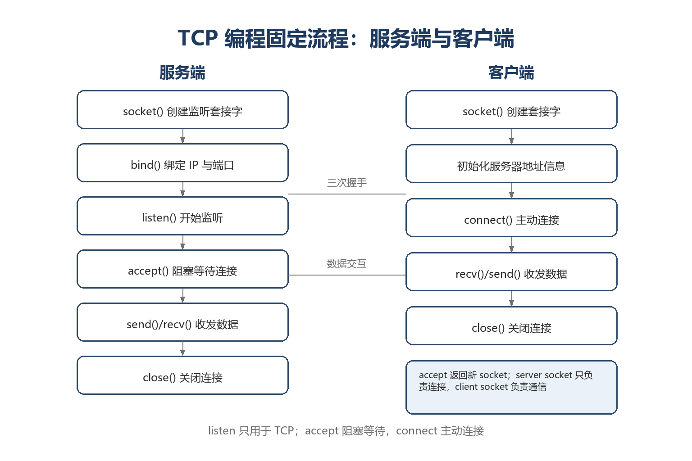

## 1.3 sockfd 的本质

> **一句话**：sockfd 是**进程文件描述符表的一个下标**（一个 `int`），通过它间接指向内核里的 socket 对象；用户态只拿到这个整数句柄，连接的四元组、收发缓冲区、TCP 状态机全在内核。

### 1.3.1 从 int 到内核对象：四层结构

调用 `socket()` 之后，内核侧可以抽象成这条链：

```text
用户态   int sockfd = 3;            ← 只是一个下标，本身不携带任何连接信息
            │
内核     task_struct
           └─ files_struct
                └─ fdtable ──► struct file *fd_array[3]
                                     │
                                     ▼
                               struct file        ← VFS 通用"已打开文件"抽象
                               （f_op = socket_file_ops，f_flags 记录 O_NONBLOCK）
                                     │
                                     ▼
                               struct socket      ← 套接字抽象（类型/状态/等待队列）
                                     │
                                     ▼
                               struct sock        ← TCP 控制块：四元组、状态机、
                                                     sk_receive_queue / sk_write_queue
```

需要记住的四点：

- **fd 只是下标**：`fget(fd)` 的动作就是"边界检查 + 数组取值"，O(1)；
- **`struct file` 是"一切皆文件"的接缝**：socket 的 file 指向 `socket_file_ops`，`read`/`write`/`poll`/`close` 都由它分发——`select`/`epoll` 能同时监听 socket、管道、终端，靠的就是这层统一抽象；
- **socket 也有 inode**：`ls -l /proc/<pid>/fd/` 会看到 `socket:[12345]`，方括号里的数字是 sockfs 上的 inode 号，`lsof`、`ss -p`、eBPF 都靠它把"连接"和"进程"对上；
- **fd 从 0 编号、取最小可用值**：进程天生占着 0/1/2（stdin/stdout/stderr），所以第一个 socket 通常拿到 3。

> 由此推出一个实战结论：**fd 号会被复用**。关掉 fd 3 之后再 `socket()`/`accept()` 很可能又拿到 3。任何"跨线程/跨任务只保存 fd 号码"的设计，都埋着"写错连接"的雷。

### 1.3.2 为什么 sockfd 是 int

| 原因 | 说明 |
|---|---|
| 返回值约定 | 有效 fd 是**非负整数**，失败统一返回 **-1** 并置 `errno`。一个 int 同时表达"句柄 + 成败"，调用方写法统一：`if ((fd = socket(...)) < 0)` |
| 一切皆文件 | UNIX 传统：设备、管道、socket 都收敛成 fd。同一套 `read/write/close/poll/select` 通吃，学习成本和代码复用最低 |
| 范围足够 | fd 上限由 `RLIMIT_NOFILE`（`ulimit -n`，常见 1024 / 65535）决定；32 位 int 上限约 21 亿，远超单进程可能打开的 fd 数 |
| 内核就是下标 | 内核用 int 直接索引 `fd_array[]`，不需要哈希或句柄表查找；同时天然适合位图运算（`fd_set` 的第 fd 位） |
| 便于传递 | fd 是标量，可放进数组、队列、`fd_set`、结构体；`fork`/`exec` 的继承语义也简单 |

反面对照：Windows 的 `SOCKET` 是**句柄**（指针宽度），不能当下标，所以 Windows 程序里没有"fd 数组 + 下标遍历"这种写法，只有句柄数组 + 查找。

### 1.3.3 与普通文件描述符：共性 vs 差异

**共性**：

- 同一套分配规则（最小可用非负整数）、同一个 `close`、同一套 `errno`；
- 都能放进 `select`/`poll`/`epoll` 被统一监听；
- `fork` 后父子进程共享同一个 `struct file`（引用计数 +1），能读写同一条连接；
- `dup`/`dup2` 复制的是 fd，两个 fd 指向同一个内核对象。

**差异**：

| 维度 | 普通文件 fd | sockfd |
|---|---|---|
| 创建 | `open()` | `socket()`（监听侧另需 `bind/listen/accept`） |
| 读到结尾 | 返回 0（文件尾） | 返回 0 表示**对端关闭（FIN）**，语义是"连接结束"，必须 `close` 清理 |
| 定位 | `lseek()` 有效 | `lseek()` 失败，`errno = ESPIPE`（流没有偏移） |
| 阻塞行为 | 常规文件几乎不阻塞 | 默认阻塞，可 `O_NONBLOCK` / `MSG_DONTWAIT` |
| 收发接口 | `read`/`write` | `send`/`recv`（可带 flags）；`read`/`write` 也能用，等价于 flags = 0 的版本 |
| 写失败 | 无特殊信号 | 对端已关闭时 `write` 会触发 **SIGPIPE**（默认杀进程）；`send(..., MSG_NOSIGNAL)` 只返回 `EPIPE` |
| 半关闭 | 没有 | `shutdown(fd, SHUT_WR/SHUT_RD/SHUT_RDWR)` 可只关一个方向 |
| 权限 | 文件权限位 | 无文件权限；靠端口/防火墙、`SO_PEERCRED`、应用层鉴权 |
| 容量语义 | 大小固定 | 两个内核缓冲区（`sk_receive_queue` / `sk_write_queue`），可用 `SO_RCVBUF`/`SO_SNDBUF` 调整 |
| 典型错误 | `EACCES`、`ENOENT` | `ECONNRESET`、`EPIPE`、`ETIMEDOUT`、`EAGAIN` |

> 一句话记忆：**sockfd 是"文件"，但它是"有对端、有方向、有超时、会断"的文件**。

### 1.3.4 Linux sockfd 与 Windows SOCKET 对比

| 维度 | Linux `sockfd` | Windows `SOCKET` |
|---|---|---|
| 类型定义 | `int`（文件描述符） | `SOCKET` = `UINT_PTR`（64 位下 8 字节无符号整数，句柄） |
| 无效值 / 错误码 | `-1` + `errno`（`EAGAIN`、`ECONNRESET`…） | `INVALID_SOCKET`（`(SOCKET)(~0)`，全 1）+ `WSAGetLastError()` 的 `WSAExxx` |
| 设计理念 | socket 是**文件**，走 VFS 统一抽象 | socket 是**独立内核对象**（`\Device\Afd`，afd.sys），与文件 `HANDLE` 体系分离 |
| 初始化 | 无需初始化 | 必须 `WSAStartup(MAKEWORD(2,2), &wsa)`，退出前 `WSACleanup()` |
| 创建 | `socket()` | `socket()`（同名同参） |
| 关闭 | `close(fd)` | `closesocket(s)`（对 fd 调 `close` 无效） |
| 半关闭 | `shutdown(fd, SHUT_WR)` | `shutdown(s, SD_SEND)` |
| 收发函数 | `send`/`recv`，也可 `read`/`write`（后者会触发 SIGPIPE） | 只有 `send`/`recv`，**不能用 `read`/`write`**（Winsock 不提供该语义） |
| 常用标志 | `MSG_NOSIGNAL`、`MSG_DONTWAIT`、`MSG_PEEK` | `MSG_PEEK`、`MSG_OOB` 等；**没有 `MSG_NOSIGNAL`**（Windows 无 SIGPIPE，失败靠返回 `SOCKET_ERROR`） |
| 非阻塞设置 | `fcntl(fd, F_GETFL/F_SETFL, O_NONBLOCK)` | `ioctlsocket(s, FIONBIO, &ul)` |
| 头文件 | `<sys/socket.h>` `<netinet/in.h>` `<arpa/inet.h>` `<unistd.h>` | `<winsock2.h>` `<ws2tcpip.h>`（须在 `windows.h` 之前包含，或用 `WIN32_LEAN_AND_MEAN`） |
| 链接库 | 无（glibc / libc 内置） | `ws2_32.lib`（`#pragma comment(lib,"ws2_32.lib")` 或 `-lws2_32`） |
| 事件模型 | `select` / `poll` / `epoll` | `select` / `WSAEventSelect` / IOCP（完成端口） |
| select 的上限 | `FD_SETSIZE = 1024`，位图 | `FD_SETSIZE = 64`，但 `fd_set` 是**数组**，可在包含头文件前改大 |
| select 首参含义 | `nfds` = 最大 fd + 1，**内核真的用它**限定扫描范围 | `nfds` **被忽略**，只为兼容 BSD 保留 |
| 端口复用 | `SO_REUSEADDR` | `SO_REUSEADDR`，另有 `SO_EXCLUSIVEADDRUSE` |
| 句柄继承 | `fork` 自动继承，可重定向 | 默认不可被子进程继承（需设可继承属性） |

**设计理念总结**：Linux 把 socket 变成"另一种文件"，于是 **epoll/select 能监听一切**、`read/write` 能用在网络上、shell 重定向和 `/proc/<pid>/fd` 都能观察它；Windows 把 socket 做成独立内核对象，接口、错误码、初始化、关闭函数、事件模型都自成一套，所以跨平台网络库第一件事就是写一层 `#ifdef` 适配层。

一个最小的可移植封装（生产库的做法）：

```c
#ifdef _WIN32
  #include <winsock2.h>
  #include <ws2tcpip.h>
  #pragma comment(lib, "ws2_32.lib")
  typedef SOCKET  sock_t;
  #define BAD_SOCK(s)   ((s) == INVALID_SOCKET)
  #define CLOSE_SOCK(s) closesocket(s)
  #define SOCK_ERR      WSAGetLastError()
#else
  #include <sys/socket.h>
  #include <unistd.h>
  #include <errno.h>
  typedef int     sock_t;
  #define BAD_SOCK(s)   ((s) < 0)
  #define CLOSE_SOCK(s) close(s)
  #define SOCK_ERR      errno
#endif
```

> 注意 `BAD_SOCK` 的判定：Linux 判 `< 0`，Windows 判 `== INVALID_SOCKET`。把 Windows 的 `SOCKET` 当 int 判 `< 0`，在 64 位下会漏判，是跨平台代码的经典 bug。

## 1.4 字节序与 IP 地址转换

**字节序问题**：网络信息结构体中存储的数据均为**大端序**，而主机（x86）使用**小端序**。如果直接把主机序数据塞进结构体，当结构体被网络设备按大端解读时，字节顺序会被颠倒，**原始数据被破坏**。

以端口 8080（十六进制 `0x1F90`）为例：小端存储为 `90 1F`，按大端解读就变成了另一个数。因此端口、IP 写入结构体前必须转换。

**四个经典转换函数**：

| 函数 | 作用 |
|---|---|
| `htons()` | host → network，16 位（**端口**） |
| `htonl()` | host → network，32 位（**IP**） |
| `ntohs()` | network → host，16 位 |
| `ntohl()` | network → host，32 位 |

> 记忆：H = host（主机/小端），N = network（网络/大端），S = short（16 位），L = long（32 位）；端口用 S、IP 用 L。

**IP 地址的两类表示**：点分十进制字符串（如 `192.168.7.221`，方便人看）与 32 位二进制网络序（机器使用）。就像域名是为了方便记 IP，点分十进制也只是 IP 的“表现层”。两者之间的转换函数：

| 函数 | 作用 |
|---|---|
| `inet_addr("192.168.7.221")` | 字符串 → 32 位网络序（旧接口） |
| `inet_pton(AF_INET, "192.168.7.221", &addr.sin_addr.s_addr)` | 字符串 → 32 位网络序（推荐） |
| `inet_ntop(AF_INET, &addr.sin_addr.s_addr, ipbuf, 16)` | 32 位网络序 → 字符串 |

常用组合：

```c
serveraddr.sin_family = AF_INET;
serveraddr.sin_port = htons(8080);                 // 端口转换
inet_pton(AF_INET, "192.168.7.221", &serveraddr.sin_addr.s_addr);
// 或绑定本地任意 IP：
serveraddr.sin_addr.s_addr = htonl(INADDR_ANY);
```

`INADDR_ANY` 表示**本地任意 IP**：服务器有多个网卡时，不必指定具体 IP，所有本地地址的该端口都可接受连接。

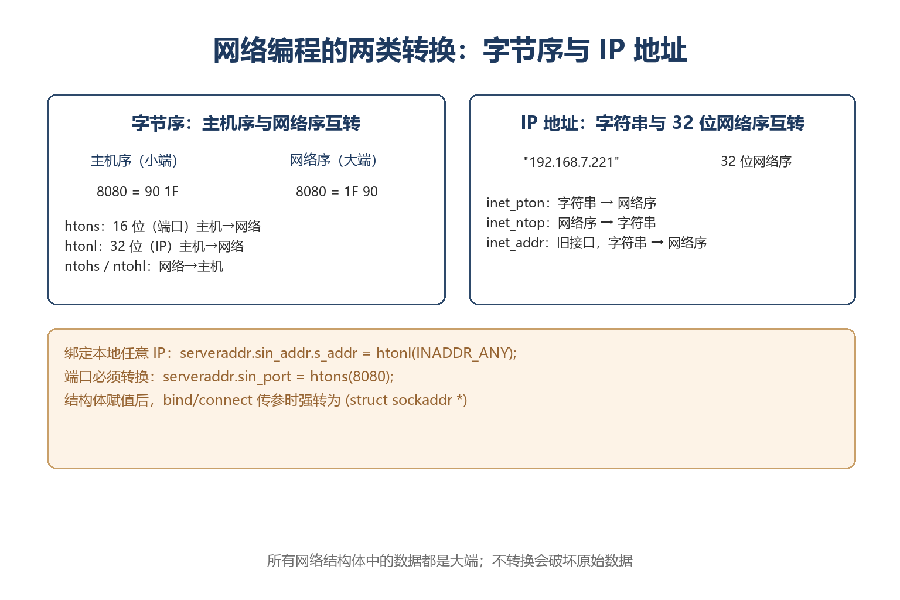

## 1.5 服务器端核心函数与连接队列

**bind：绑定 IP 与端口**

```c
int bind(int sockfd, struct sockaddr *addr, socklen_t addrlen);
```

- 参数：目标 socket、网络信息结构体、结构体大小；
- 成功返回 0、失败返回 -1；
- **传参时必须强转**：`bind(sockfd, (struct sockaddr *)&serveraddr, sizeof(serveraddr))`——函数签名用的是旧版 `sockaddr`，实际填的是新版 `sockaddr_in`，两者类型不匹配；
- 旧接口不改是**向前兼容**：大量老网络程序仍在用旧结构体，改接口会导致老代码全部重编；
- **绑定失败的两种经典原因**：① socket 异常（创建失败拿到 -1 去 bind）；② 端口被占用——程序异常退出后端口会进入 **2MSL** 等待期（不同系统约 1~3 分钟），期间重新绑定会失败。

**listen：开始监听**

```c
int listen(int sockfd, int backlog);
```

- 仅 **TCP** 需要（UDP 无连接）；成功返回 0、失败 -1；
- `backlog` 是**半连接队列与全连接队列的共享大小**（不是各一份）：
  - 半连接队列（等待握手队列）：收到 SYN 后、三次握手未完成的连接；
  - 全连接队列（握手成功队列）：三次握手完成、等待 accept 取走的连接；
  - 一个连接从入队到被 accept 取出，占用的是同一份额度；
- **过小的风险**：队列满后新的连接请求会被服务器回 **RST** 重置，客户端需要重试；
- **过大的风险**：空闲时浪费内存；
- 本阶段统一用 **128**，可应对千级并发连接。

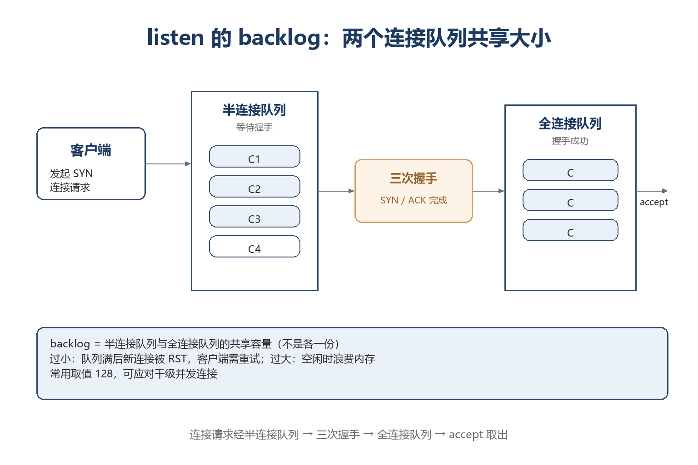

**accept：被动接受连接**

```c
int client_sockfd = accept(server_sockfd, (struct sockaddr *)&clientaddr, &addrlen);
```

- 第一个参数必须是 **server socket**（监听 socket）；
- 第二个参数是**传出参数**：连接成功后写入客户端的 IP 与端口（相当于“来电显示”）；
- 第三个参数是**传入传出参数**：传入“我能存多大的结构体”，传出“实际用了多大”——类比拿一个能装 100 个苹果的盒子去买苹果，实际只装了 20 个；
- **传入的大小必须不小于实际结构体大小**，否则信息可能被截断导致失败；
- 返回值：成功返回**新的 client socket**（后续 send/recv 用它），失败返回 -1；
- 默认**阻塞等待**，没有新连接就一直卡在 accept。

**connect：客户端主动连接**

```c
int connect(client_sockfd, (struct sockaddr *)&serveraddr, sizeof(serveraddr));
```

- 参数：客户端自己的 socket、**目标服务器**的网络信息（IP + 端口）、结构体大小；
- 成功返回 0、失败 -1；网络异常或拥堵时**可能阻塞**；
- 客户端不需要 bind、不需要 listen。

**send / recv：收发数据**

```c
ssize_t send(sockfd, buf, len, MSG_NOSIGNAL);      // 发送
ssize_t recv(sockfd, buf, sizeof(buf), 0);          // 接收（或 MSG_DONTWAIT 非阻塞）
```

- 发送时建议加 **`MSG_NOSIGNAL`**：对端关闭后仍写入会触发 SIGPIPE（第 7、10 章），该标志让系统不发信号、只返回错误；
- 接收可用 0（阻塞）或 `MSG_DONTWAIT`（非阻塞）。

## 1.6 TCP 服务器与客户端实战

`tcp_server.c`——单进程 TCP 服务器：初始化后循环 accept，向每个连接发送一条反馈后立即断开：

```c
#include <sys/socket.h>
#include <arpa/inet.h>
#include <unistd.h>
#include <string.h>
#include <stdio.h>
#include <stdlib.h>
#include <string.h>

#define _SERVER_IP "110.40.166.111"
#define _SERVER_PORT 8080
#define _BACKLOG 128
#define _IPSIZE 16
#define _BUFSIZE 4096

/*net initializer */
int net_initializer(void)
{
    int server_sock;
    /*sock create*/
    if((server_sock = socket(AF_INET,SOCK_STREAM,0))==-1) perror("socket call failed");
    /*init sockaddr*/
    struct sockaddr_in serveraddr;
    bzero(&serveraddr,sizeof(serveraddr));
    serveraddr.sin_family = AF_INET;
    serveraddr.sin_port = htons(_SERVER_PORT);
    serveraddr.sin_addr.s_addr = htonl(INADDR_ANY);
    //inet_pton(AF_INET,_SERVER_IP,&serveraddr.sin_addr.s_addr);//字符串ip转大端
    /*bind sock*/
    if((bind(server_sock,(struct sockaddr *)&serveraddr,sizeof(serveraddr)))==-1) perror("bind call failed");
    /*start listen*/
    if((listen(server_sock,_BACKLOG))==-1) perror("listen call failed");
    return server_sock;
}
//服务器主接口
int main(void)
{
    int server_sockfd;
    struct sockaddr_in clientaddr;//接收客户端信息
    int client_sockfd;
    char response[_BUFSIZE];
    char cip[_IPSIZE];
    socklen_t addrlen; //传入传出客户端信息大小
    server_sockfd = net_initializer();
    printf("TCP Test Server (110.40.166.111) Accepting....\n");
    while(1){
        addrlen = sizeof(clientaddr);
        if((client_sockfd = accept(server_sockfd,(struct sockaddr *)&clientaddr,&addrlen))==-1){
            perror("server error, accept call failed");
            exit(0);
        }
        //获取客户端ip
        bzero(cip,_IPSIZE);
        inet_ntop(AF_INET,&clientaddr.sin_addr.s_addr,cip,_IPSIZE);
        printf("client connect succee , client ip [%s] client port [%d]\n",cip,ntohs(clientaddr.sin_port));
        //与客户端交互，向连接的客户端发送一条反馈信息后立即断开
        bzero(response,sizeof(response));
        sprintf(response,"hi , (%s) connect 110.40.166.111 successly..\n",cip);
        send(client_sockfd,response,strlen(response),MSG_NOSIGNAL);
        close(client_sockfd);
    }
}
```

解读：

- `net_initializer` 完成“socket → 初始化地址 → bind → listen”四步，返回监听 fd；
- 地址绑定用 `htonl(INADDR_ANY)`，表示监听本机所有地址；`_SERVER_IP` 宏实际未参与绑定（仅用于提示/打印）。`inet_pton` 那行被注释：部分环境/发行版上该调用可能失败，用 INADDR_ANY 最直接；
- `bind` 的第二个参数强转为 `(struct sockaddr *)`，第三个参数为结构体大小；
- 主循环每次先把 `addrlen` 重置为 `sizeof(clientaddr)`（它是传入传出参数，上轮可能被改小）；
- `inet_ntop` 把客户端 32 位 IP 转回字符串；`ntohs` 把端口转回主机序才能正确打印；
- `send` 带 `MSG_NOSIGNAL`：客户端提前断开时不会因 SIGPIPE 杀掉服务器；
- 发送完毕立即 `close(client_sockfd)`，这是“单进程一次处理一个连接”的简化模型，无法同时服务多个客户端。

`tcp_client.c`——客户端：socket → 填服务器地址 → connect → close：

```c
#include<sys/socket.h>
#include<arpa/inet.h>
#include<unistd.h>
#include<string.h>
#include<stdio.h>
#include<stdlib.h>

int main(void)
{
    int client_sockfd;
    if((client_sockfd = socket(AF_INET,SOCK_STREAM,0)) < 0)
    {
        perror("socket called failed");
        exit(1);
    }

    struct sockaddr_in serveraddr;
    serveraddr.sin_family = AF_INET;
    serveraddr.sin_port = htons(8080);
    serveraddr.sin_addr.s_addr = inet_addr("110.40.166.111");

    if(connect(client_sockfd,(struct sockaddr*)&serveraddr,sizeof(serveraddr)) < 0)
    {
        perror("connect called failed");
        exit(1);
    }

    printf("connect success\n");
    
    close(client_sockfd);

    return 0;
}
```

解读：

- 客户端流程只有三步：创建 socket、填目标服务器地址、connect；**不需要 bind、不需要 listen**；
- 本示例仅验证“能连上”，所以 connect 成功后就 close；实际客户端应在 connect 后 `recv` 接收服务器消息并打印；
- 若连不上：先确认服务器已启动、IP/端口正确、防火墙/安全组已放行；本地联调可把地址改为 `127.0.0.1`。

编译与运行：

```bash
gcc tcp_server.c -o server
gcc tcp_client.c -o client
# 两个终端：先运行 ./server，再运行 ./client
```

## 1.7 经典服务器模型概览

同样的 socket 流程，可以用不同方式组织“如何同时服务多个客户端”，形成几种经典模型。

这套分类沿自 **APUE（Advanced Programming in the UNIX Environment）** 的经典服务器版本：单进程循环 → 多进程 → 预创建进程池 → 多线程 → IO 复用。本文按“先能跑 → 再加执行单元 → 最后事件驱动”的顺序展开，与它的对应关系是：

| APUE 的经典版本 | 本文对应 | 说明 |
|---|---|---|
| 单进程循环服务器 | 第 4、5 章 | 阻塞版一次一个连接；非阻塞版靠轮询 |
| 多进程服务器（accept 后 fork） | 6.2 | 一连接一进程，连接与读写分离 |
| 预创建进程池（多进程竞争 accept，用文件锁串行化） | 未实现 | 只解决“进程创建慢”，没有解决 IO 处理能力；第 8 章的线程池是同一思想在线程维度的落地 |
| 多线程服务器 | 6.3 | 一连接一线程，分离态自动回收 |
| IO 复用 | 第 7 章 | select / poll / epoll，单进程管理大量连接 |

**① 单进程循环模型**

- 流程：accept → recv → send → close，回到 accept；
- 阻塞版：accept 或 recv 阻塞时，服务器无法接受新连接，只能一次服务一个客户端；
- 非阻塞版：把 socket 设为非阻塞，accept/recv 无数据时立即返回（EAGAIN），通过轮询依次处理多个连接；
- 优点：实现简单、无并发开销；缺点：阻塞时无法并发，非阻塞轮询浪费 CPU。

**② 多进程模型**

- 每 accept 一个连接就 `fork` 一个子进程，由子进程处理该客户端；监听 socket 留给父进程；
- 父进程需要处理 **SIGCHLD** 并 `waitpid` 回收子进程（否则僵尸堆积，见《03-Linux进程编程》第 4 章与 10.10）；
- 优点：进程间隔离性好，一个子进程崩溃不影响父进程；缺点：进程创建/切换开销大，并发高时内存压力大。

**③ 多线程模型**

- 每 accept 一个连接就 `pthread_create` 一个线程处理，可设分离态自动回收；
- 资源开销小于进程，但共享数据（全局变量、连接表等）必须加锁；
- 优点：并发能力比多进程好、开销小；缺点：一个线程崩溃可能拖垮整个进程，需要处理线程安全。

**④ IO 复用模型**

- 使用 `select` / `poll` / `epoll` 同时监听多个 socket，哪一个有事件就处理哪一个；
- 单进程（或少量线程）即可管理大量连接，事件驱动；
- 优点：高并发下资源占用低；缺点：编程模型更复杂。

**⑤ 线程池 / 反应堆（Reactor）模型**

- `epoll` 负责事件分发，线程池负责处理具体业务（类似 Reactor 模式）；
- 高并发服务器的主流方案；实现最复杂，需要自己管理任务队列、线程同步。

| 模型 | 并发能力 | 资源开销 | 实现复杂度 | 适用场景 |
|---|---|---|---|---|
| 单进程循环 | 低 | 最低 | 简单 | 学习、低频服务 |
| 多进程 | 中 | 高 | 中等 | 稳定性优先、连接数不多 |
| 多线程 | 较高 | 中 | 中等（需加锁） | 中小型并发服务 |
| IO 复用 | 高 | 低 | 较高 | 高并发网络服务 |
| 线程池/反应堆 | 最高 | 较低 | 最高 | 大型高并发服务器 |

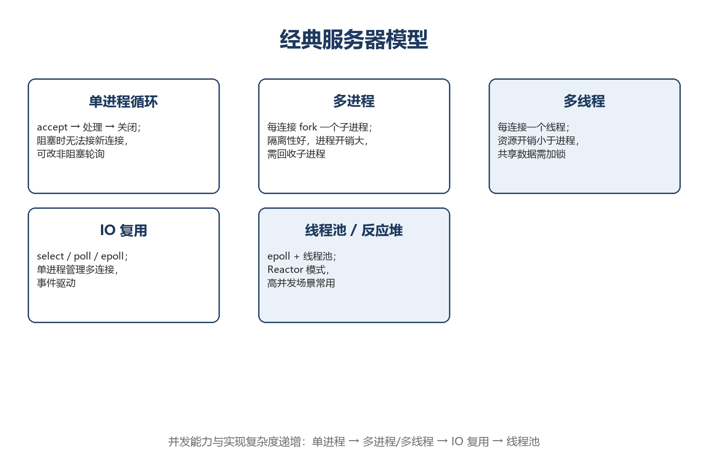

> 学习路线也是按这个顺序递进：先单进程，再多进程/多线程，然后 IO 复用，最后线程池与反应堆模型。各模型的具体实现见本篇第 4、5 章。

## 1.8 内网、外网与虚拟机联网

**内网与外网**：

- **内网**：局域网，只能在局部范围互相访问；
- **外网**：互联网，平时访问的网站都属于外网；
- 许多校园网是“内网 + 出口代理”：校内设备只能访问内网，由学校指定的设备代理访问外网再回传，目的是保护内网数据。

**虚拟机联网（NAT 模式）**：

1. 虚拟机设置 → 网络适配器 → 选择 **NAT 模式**（共享主机 IP，主机能上网虚拟机才能上网）；
2. 虚拟机右上角网络图标 → 连接有线网络（没有现成连接时新建一个“以太网”连接）；
3. 若仍连不上：在 Windows 的“服务”中找到 VMware 相关服务（如 VMware NAT Service），确认已启动；
4. 用浏览器打开网页验证连通。

> NAT 与桥接的区别：NAT 让虚拟机“借用”主机网络，配置简单；桥接会让虚拟机像局域网内一台独立主机，需要所在网络允许分配地址。

## 1.9 本章小结

| 角色 | 固定流程 | 关键函数 |
|---|---|---|
| 服务端 | socket → bind → listen → accept → send/recv → close | `socket` / `bind` / `listen` / `accept` |
| 客户端 | socket → 填服务器地址 → connect → recv/send → close | `socket` / `connect` |

需要记牢的几个点：

- **字节序**：端口用 `htons`、IP 用 `htonl`，接收方向用 `ntohs/ntohl`；
- **backlog**：半连接队列与全连接队列的共享大小，常用 128；
- **两类 socket**：server socket 只管连接，accept 返回的 client socket 才负责通信；
- **send 加 `MSG_NOSIGNAL`**：避免对端断开后触发 SIGPIPE 杀死进程；
- **客户端不需要 bind/listen**：流程比服务端少很多；
- **sockfd 是一个 int 下标**：指向内核 socket 对象，而非连接本体（1.3）；Linux 当文件管、Windows 当独立句柄管，接口/错误码/初始化全部不同。

后续将在本章基础上依次展开：单进程服务器 → 多进程服务器 → 多线程服务器 → IO 复用 → 线程池/反应堆模型；本篇先实现单进程阻塞与非阻塞版本（第 4、5 章）。

# 第 2 章 服务器职责与访问方式

## 2.1 从 socket 到服务器

服务器是**后台服务软件**：不与用户直接交互，与客户端完成通信后为其提供服务——数据存储（持久化）、数据中转、协议解析与处理。

服务器与客户端的标准交互是**请求-响应模型**：客户端发送 request，服务器处理请求后返回 response。把 socket 函数串起来，服务器的核心就是四步：

1. `accept`：等待并接受连接；
2. `recv`：读取客户端请求；
3. 协议解析与业务处理；
4. `send`：返回响应。

**服务器承担的职责**

“四步流程”只是骨架，真正撑起一个服务器的是下面八项职责：

| # | 职责 | 含义 | 落到代码里是什么 |
|---|---|---|---|
| 1 | 与客户端交互支持 | 按约定协议应答，并维持连接可用（心跳、超时、重连） | `recv` / `send` + 协议解析 |
| 2 | 存储与持久化 | 把数据落到文件或数据库，进程重启后数据还在 | 写库、写日志、刷盘 |
| 3 | 数据支持 | 校验、组织、检索数据，让业务层拿到“能直接用”的数据 | 参数校验、缓存、查询 |
| 4 | 数据中转 | 在多个客户端之间转发，或把内容分发给多端 | 查表找到对端再转发（2.2） |
| 5 | 请求处理 | 业务逻辑本身：算、查、改、落 | 业务函数 |
| 6 | 并发连接 | 能同时“挂着”多少条连接 | fd 上限、内存、IO 复用 |
| 7 | 并发处理 | 大量请求能多快处理完 | 进程 / 线程 / 线程池规模 |
| 8 | 安全层 | 鉴权、传输加密、限流、防攻击 | 横切在前面七项之外的一层 |

四点要分清：

- **中转是地基**：没有“地址固定、长期在线的第三方”，客户端之间根本连不上（2.2）；
- **持久化与数据支持是附加能力**：不中转也能跑，只是数据留不下、用不了；
- **并发连接 ≠ 并发处理**：前者是“能挂多少”（由 fd 上限与内核结构决定），后者是“能算多快”（由执行单元数量与单次耗时决定）。第 7 章解决前者，第 8 章解决后者；
- **安全层是横切关注点**：它不实现任何一项业务，但每一项业务都要经过它——对应 1.1 说的“安全性”，工程上常做成反向代理 + 鉴权/限流中间层（2.5），而不是散落在每个业务函数里。


架构与职责回答的是“服务器是什么”；落到代码上，它们最终收敛成同一条请求-响应主线：

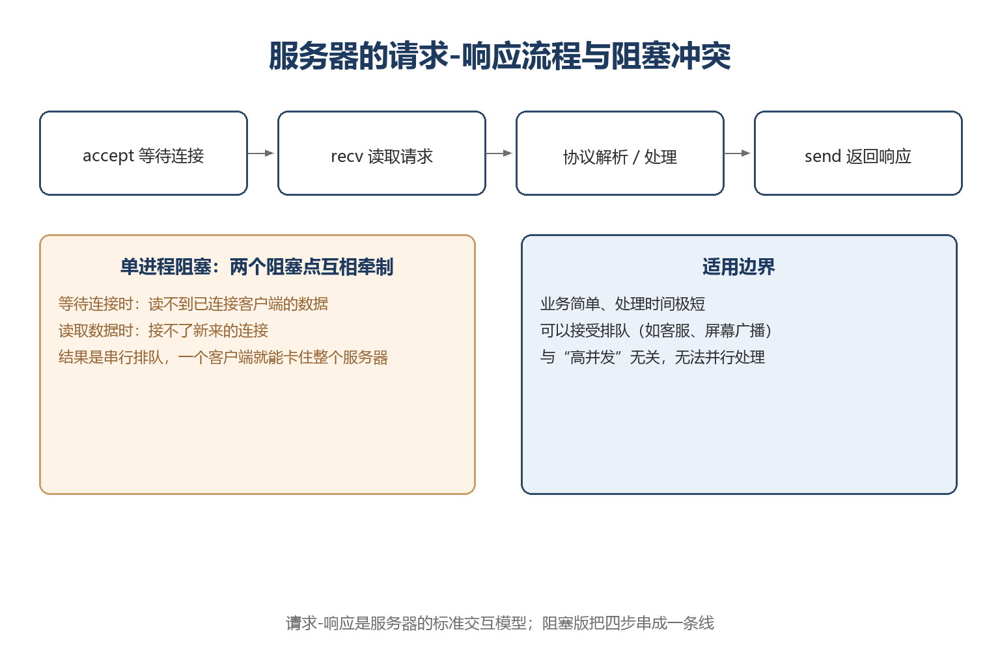

> socket 的创建、地址结构、字节序、bind/listen/accept/connect 等基础见本篇第 1 章，本篇不再重复。

## 2.2 网络穿透：服务器为什么不可替代

从技术上说，两台客户端只要知道对方的 IP 和端口，就可以直接通信（UDP 甚至不需要连接）。但直连有两个硬伤：

- **地址要存一堆**：聊天软件有几百个好友，就要保存几百个地址；
- **地址会变**：手机在 5G、校园网、家里 Wi-Fi 之间切换，IP 一变，对方就找不到它。

服务器的价值就在于：**服务器地址固定、稳定在线**，每个客户端登录时把地址登记到服务器；发消息时先发给服务器，由服务器查表转发。地址变更后，客户端重连时更新一次登记即可，其他人无需关心。

- 聊天软件：点对点消息中转；
- 抖音一类：上传的视频由服务器分发、推荐，也是中转的一种；
- 这种"在多个客户端之间建立可存储、可中转的第三方"的能力，就是**网络穿透**。

> 服务器的第一职责是转发与中转；持久化、协议处理等都是在它之上附加的能力。

## 2.3 域名与 DNS：不要把服务器 IP 写死

服务器 IP 通常是**租用**的，可能到期、变更、迁移。如果把 IP 写死在客户端：

- IP 一变，所有客户端全部失联；
- 为了一个小变更让用户更新客户端，不现实。

正确做法是**客户端只写域名**：

1. 域名绑定多个公网 IP；
2. 客户端访问域名时先问 **DNS 域名解析服务器**；
3. DNS 返回当前可用的 IP；
4. 某个 IP 失效时，修改解析记录即可，客户端无感知。

域名分级（口语说法）：`www.example.com` 为三级，`example.com` 为二级，`.com` 为顶级域名；层级越少通常越贵。

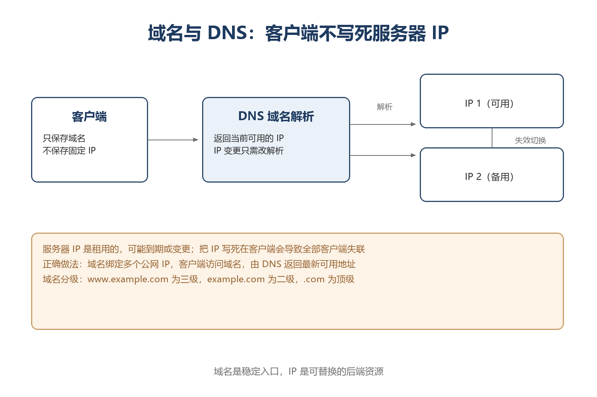

## 2.4 远程登录与服务器集群

真实机房里，服务器不是一台电脑，而是一组设备：

| 设备 | 作用 |
|---|---|
| 处理机 | 高核数 CPU（几十到上百核），负责计算 |
| 图形处理器 | 多块高性能 GPU，负责图形/并行计算 |
| 数据库服务器 | 承载 MySQL、SQL Server 等数据库，兼容多种数据库 |
| 文件服务器 | 存储海量文件与缓存，支持 NTFS、ext4 等文件系统 |
| 代理服务器 | 反向代理、转发请求 |

- **横向扩展**：主机算力不够就加处理机，显存不够就加 GPU，存储不够就加数据库/文件服务器；
- **分布式架构**：多台设备不是简单堆硬件，而是通过统一的资源管理与调度，形成一台"逻辑上的大电脑"；
- **远程登录**：机房温度高、噪音大，日常运维都通过远程完成——文件传输用 FTP，远程登录用 **SSH**（最常用）。

## 2.5 代理层、负载均衡与高可用

客户端通常不直连处理机，而是先连一台**代理服务器**（反向代理）：代理与客户端之间走**公网**，代理与后端处理机之间走**内网**，代理本身只做转发、不做业务。

**为什么不让客户端直连处理机**：

- 处理机一旦暴露在公网，等于把攻击面交给任意客户端（DDoS、洪水攻击、被入侵后窃取数据）；
- 安全策略（防火墙、限流、鉴权）若部署在处理机上，每台都要装一遍，成本随机器数量线性上升；集中在一层代理上只需维护一份。

**负载均衡**：代理层把请求分发给后端多台处理机，目标是避免“忙的忙死、闲的闲死”，同时避免单台长期满载而加速老化。

| 策略 | 做法 | 适用 |
|---|---|---|
| 简单轮询 | 按顺序一人一次（A→B→C→A） | 各机配置相同、请求无状态 |
| 简单随机 | 每次随机选一台 | 各机配置相同、请求无状态 |
| 加权轮询 | 按权重决定被选频率（权重 8:5:3，则高档机被选中次数更多） | 机器性能有差异 |
| 加权随机 | 权重越高被随机命中概率越大 | 机器性能有差异、请求无状态 |
| 哈希 | 按客户端 IP 或连接做哈希取模，同一来源固定落到同一台 | 需要会话保持 |

- **权重周期性回归**：加权策略里权重不能一劳永逸——每分配一次任务就把该机权重调低，降到最低后再回到初始高权重，如此循环，长期才真正均匀；否则权重高的那台会被一直压着用；
- 工程上不必自己实现：Nginx、Apache 等开源服务器都能通过配置文件选择上述策略。

**HA 高可用（请求重定向）**：代理转发的目标机宕机时，若靠“回退到代理再重发”，数据包要在链路上白跑一圈。支持重定向的链路会在请求中携带**地址列表（含 IP 与 MAC）**，一旦目标不可达，直接在**链路层**改投到健康节点——只需发一次，不必回退重发。这依赖网卡与链路的硬件能力，属于硬件层方案；软件层只能做到回退重发。

# 第 3 章 云服务器部署

**上线部署的两条路**：一是本节讲的**租云服务器**（按年付费、几分钟开通、防火墙在控制台点点鼠标就能配），二是**自建/托管机房（私服）**——需要自己买硬件、拉专线、做冗余与运维，成本高、周期长，只适合长期大规模或有数据合规要求的场景。学习与小团队先从云服务器起步即可，两者的程序写法完全一致，差的只是机器在谁手里。

## 3.1 选购云服务器

常见平台：腾讯云、阿里云、华为云、百度云。基本流程：

1. 注册账号并完成**实名认证**；
2. 进入云服务器页面，新建实例；
3. 选择镜像：学习阶段用 **Ubuntu 22.04 / 24.04**（服务器系统通常无图形界面，资源全部用于业务）；
4. 选择地域：离自己近的机房（如北京、上海、广州）；
5. 选择规格：轻量型 2 核 1G、40G 系统盘即可满足练习；
6. 按年计费，创建完成后会分配一个**公网 IP**。

> 租云服务器本质是租一台有公网 IP 的主机；web 服务器可以装 Apache/Nginx，**软件服务器需要自己上传程序并运行**。

## 3.2 防火墙与端口

云服务器默认只放行少量端口（如 80、443、22）。业务端口（如 8080）必须在控制台的**防火墙/安全组**中手动添加规则：

- 指定端口（如 8080）；
- 指定来源 IP（练习可先放开，生产环境要收紧）；
- 协议选择 TCP。

端口没放行时，客户端会表现为 connect 超时/失败。

## 3.3 SSH 登录、上传与运行

```bash
ssh 用户名@公网IP          # 远程登录
scp 本地文件 用户名@公网IP:/home/用户名/   # 上传文件
```

部署步骤：

1. 登录服务器；
2. 上传源码（或直接在服务器上写）；
3. 在服务器上编译：`gcc tcp_server.c -o server`；
4. 运行：`./server`；
5. 客户端连接"公网 IP + 端口"验证。

> 注意平台一致性：Windows 下编译的可执行文件不能直接在 Linux 服务器上运行，要在 Linux 环境编译或上传源码后重新编译。

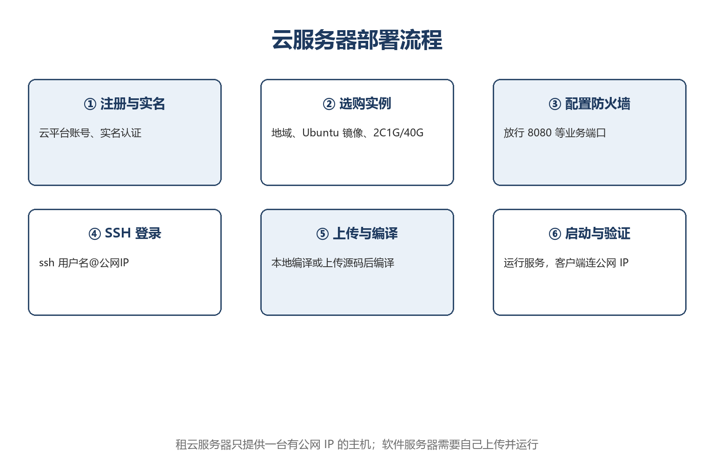

## 3.4 云服务扩展

云平台还提供短信、OCR 文字识别、语音识别等能力，通常以 SDK/接口形式提供：

- 调用接口的函数库本身可能免费；
- 实际资源（短信条数、识别算力）按量收费。

# 第 4 章 单进程阻塞服务器

## 4.1 业务约定

为了聚焦服务器模型，本篇所有版本共用同一个极简业务：

- 客户端发送 `localtime` → 服务器返回当前系统时间；
- 客户端发送其他内容 → 服务器返回 `Please Try again!`。

时间用 `time()` 取时间戳，再用 `ctime()` 转成可读字符串。

## 4.2 阻塞冲突

单进程阻塞版把四步串成一条线，`accept` 和 `recv` 都是阻塞调用，于是出现互相牵制：

- 阻塞在 `accept` 等新连接时，已经连上的客户端发来数据也读不到；
- 阻塞在 `recv` 等某个客户端的数据时，新客户端连不进来；
- 只要有一个客户端连上后不发数据，整个服务器就卡住。

这就是单进程阻塞模型只能"排队处理"的原因：一次只能服务一个客户端。它适合业务简单、处理极短、可以接受排队的场景（如客服排队、机房屏幕广播），**与高并发无关**。

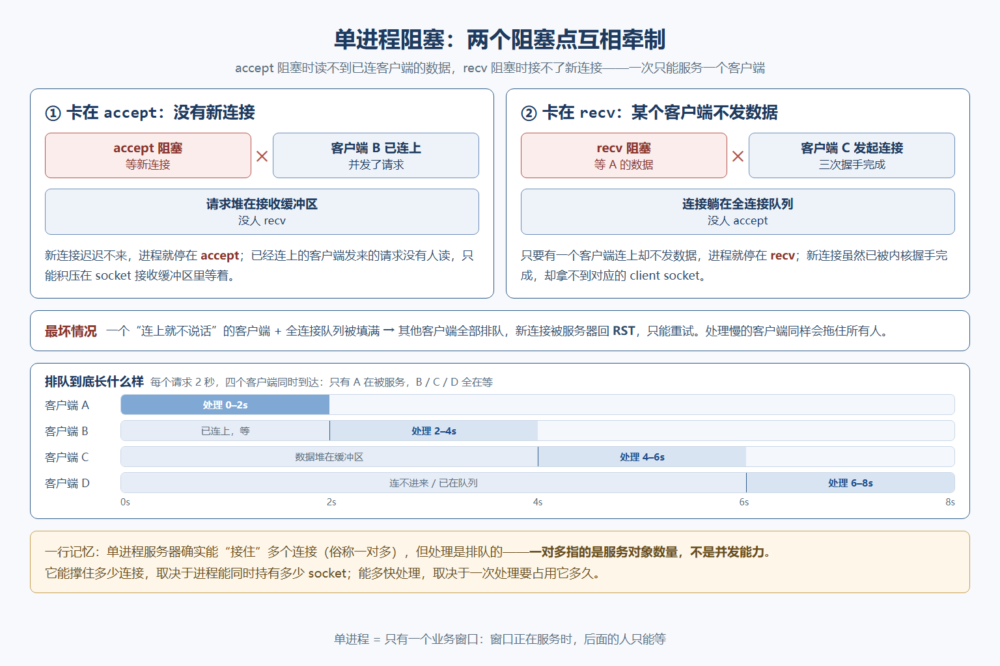

## 4.3 通用骨架

服务器代码通常拆成两个函数：

```c
int net_initializer(const char *ip, int port);   // socket / bind / listen
int server_start(int server_sockfd);              // accept / recv / 处理 / send
```

- `net_initializer`：创建 socket、填地址、bind、listen，返回监听 fd；
- `server_start`：循环 accept，读取请求，按业务返回响应；
- 缓冲区常用 1500 字节（接近以太网 MTU），客户端 IP 字符串缓冲区 16 字节。

完整的单连接示例（accept 后发一条消息就关闭）见本篇 1.6 的 `tcp_server.c`；本章的 `unlock_server.c` 则在其基础上改为"保存多个连接 + 轮询处理"。

## 4.4 适用边界

单进程阻塞服务器实现最简单、资源占用最小，但：

- 无法同时处理多个连接；
- 一个慢客户端会拖住所有人；
- 只适合短任务、可排队的业务。

需要澄清一个容易混淆的说法：单进程服务器确实能“接住”多个连接（俗称**一对多**），但处理仍是排队——这里的“一对多”指的是服务对象数量，不是并发能力。它能撑住多少连接，取决于进程能同时持有多少个 socket，而不是能同时处理多少个请求。

# 第 5 章 单进程非阻塞服务器

## 5.1 为什么要改成非阻塞

阻塞版的问题在于"卡住"：`accept` 没连接就等，`recv` 没数据就等。非阻塞改造后：

- `accept`：有连接就建立，没有连接立即返回（`errno == EAGAIN`）；
- `recv`：有数据就读，没有数据立即返回（`errno == EAGAIN`）。

这样主循环可以快速轮转：**看有没有新连接 → 遍历所有已连接 socket 读数据 → 处理 → 回复 → 回到开头**。

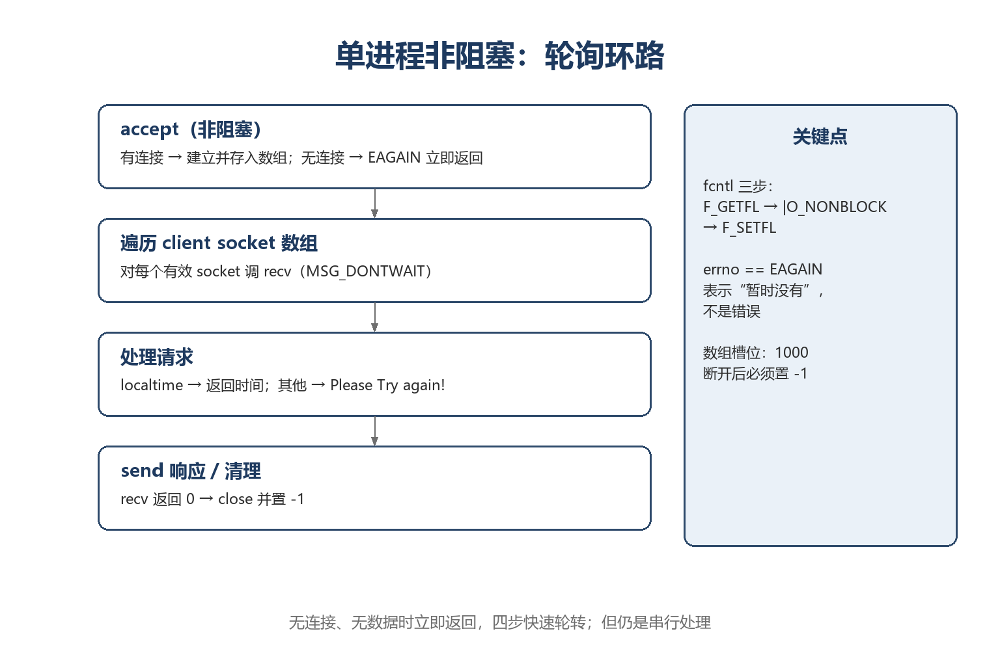

> 非阻塞只是"不卡住"，仍然是单进程串行处理：读写、解析都要时间，长任务依然会拖住其他客户端。它缓解了阻塞，但没有真正并发。

## 5.2 非阻塞设置与错误判断

把监听 socket 设为非阻塞的标准三步：

```c
int flag = fcntl(server_sockfd, F_GETFL);        // 取现有标志
flag |= O_NONBLOCK;                              // 追加非阻塞
fcntl(server_sockfd, F_SETFL, flag);             // 写回
```

`recv` 的返回值要分三种情况：

| 返回值 | 含义 | 处理 |
|---|---|---|
| > 0 | 读到的字节数 | 正常处理请求 |
| 0 | 对端关闭连接 | `close` 并从数组中移除 |
| -1 且 errno==EAGAIN | 暂时没有数据 | 跳过，继续下一个 |
| -1 且其他 errno | 真正的错误 | `perror` 记录 |

`errno` 需要 `#include <errno.h>`；多线程程序中 errno 是线程私有的，单进程服务器无需担心。

## 5.3 连接管理

服务器要同时保存多个客户端 socket，用数组管理：

- 定义 `int client_sockfd_array[1000]`，初始化为 -1（表示空位）；
- `accept` 成功后，从数组中找到第一个 -1 的位置存入；
- 每轮遍历数组，对不等于 -1 的 socket 调 `recv`；
- `recv` 返回 0 时，`close` 该 socket 并把槽位重置为 -1。

数组的**初始化范围、遍历范围必须一致**；漏掉清理会让数组逐渐被失效描述符占满，后续连接无法登记。

## 5.4 unlock_server.c 完整代码

`unlock_server.c`——单进程非阻塞轮询服务器：

```c
/*单进程非阻塞服务器，支持轮询执行如何基本请求处理*/
#include<stdio.h>
#include<unistd.h>
#include<stdlib.h>
#include<string.h>
#include<sys/socket.h>
#include<arpa/inet.h>
#include<time.h>
#include<errno.h>
#include<fcntl.h>

int net_initializer(const char * ip,int port)
{
    struct sockaddr_in serveraddr;
    bzero(&serveraddr,sizeof(serveraddr));
    serveraddr.sin_family = AF_INET;
    serveraddr.sin_port = htons(port);
    serveraddr.sin_addr.s_addr = htonl(INADDR_ANY);//使用inet_addr or inet_pton 转换ip
    int sockfd;
    if((sockfd = socket(AF_INET,SOCK_STREAM,0)) == -1)
        perror("net_initializer call socket failed");
    if((bind(sockfd,(struct sockaddr *)&serveraddr,sizeof(serveraddr))) == -1)
        perror("net_initializer call bind failed");
    listen(sockfd,128);

    return sockfd;
}

int server_start(int server_sockfd)
{
    //服务器主要工作流程
    struct sockaddr_in clientaddr;
    int client_sockfd;
    socklen_t addrlen;
    int client_sockfd_array[1000];//存储client_sock
    int recvlen;
    char buf[1500];//sock用户缓冲区
    time_t tp;//时间种子
    char time_buf[512];//存储字符串时间
    char cip[16];//存储客户端ip
    char *echo_str = "Please Try again!\n";
    for(int i=0;i<1000;i++)
        client_sockfd_array[i] = -1;
    //设置serversock unblock
    int flag;
    flag = fcntl(server_sockfd,F_GETFL);
    flag |= O_NONBLOCK;
    flag = fcntl(server_sockfd,flag);
    printf("unlock tcp server accepting...\n");
    while(1)
    {
        //链路处理
        addrlen = sizeof(clientaddr);
        if((client_sockfd = accept(server_sockfd,(struct sockaddr *)&clientaddr,&addrlen)) > 0)
        {
            //connect success
            //first response
            bzero(buf,sizeof(buf));
            bzero(cip,16);
            inet_ntop(AF_INET,&clientaddr.sin_addr.s_addr,cip,16);//将ip地址转换为字符串
            sprintf(buf,"hi (%s) connection server 81.370.22.31 success\n",cip);
            send(client_sockfd,buf,strlen(buf),MSG_NOSIGNAL);
            //save client_sock
            for(int i=0;i<1000;i++)
            {
                if(client_sockfd_array[i] == -1)
                {
                    client_sockfd_array[i] = client_sockfd;//保存client_sock
                    break;
                }
            }
        }
        else
        {
            if(errno == EAGAIN)//表示没有客户端连接
            {}
            else 
                perror("server_start call accept failed");
        }
        //请求处理
        //循环读取client_sock_array数组中所有client_sock
        //中断测试无法模拟并行请求
        for(int i=0;i<1000;i++)
        {
            if(client_sockfd_array[i] != -1)
            {
                bzero(buf,sizeof(buf));
                recvlen = recv(client_sockfd_array[i],buf,sizeof(buf),MSG_DONTWAIT);
                if(recvlen == -1)
                {
                    if(errno == EAGAIN)//表示没有数据可读
                    {}
                    else 
                    {
                        perror("server_start call recv failed");
                        exit(0);
                    }
                }
                else if(recvlen == 0)
                {
                    //客户端退出，如果读取client_sock 返回 0，表示客户端退出，close关闭client_sock，列表中对应sock设置-1
                    printf("client exit,sockfd %d close\n",client_sockfd_array[i]);
                    close(client_sockfd_array[i]);
                    client_sockfd_array[i] = -1;
                }
                else
                {
                    //读取数据判断是否是localtime，处理换行buf[strlen(buf)-1] = '\0';如果用户发送的并不是localtime，直接返回字符串 Please Tryagain!
                    if(buf[strlen(buf)-1] == '\n')
                        buf[strlen(buf)-1] = '\0';
                    if(strcmp(buf,"localtime") == 0)
                    {
                        //获取时间种子，计算当前时间，写回即可
                        tp = time(NULL);
                        bzero(time_buf,sizeof(buf));
                        ctime_r(&tp,time_buf);
                        send(client_sockfd_array[i],time_buf,strlen(time_buf),MSG_NOSIGNAL);
                    }
                    else
                    {
                        send(client_sockfd_array[i],echo_str,strlen(echo_str),MSG_NOSIGNAL);
                    }
                }
            }
        }
    }
}

int main(void)
{
    //net initializer()
    int sockfd;
    sockfd = net_initializer(NULL,8080);

    //server_start()
    server_start(sockfd);

    return 0;
}
```

## 5.5 逐段解读

- `net_initializer`：`ip` 参数当前未使用，地址用 `htonl(INADDR_ANY)` 绑定本机所有地址；`listen(...,128)` 的 backlog 含义见本篇第 1 章；
- 数组初始化：1000 个槽位全部设为 -1，表示都没有被占用；
- `fcntl` 处：先用 `F_GETFL` 取标志、追加 `O_NONBLOCK`，再把结果写回（第三步写法仍有误，见 5.6）；
- `echo_str` 常量：非 `localtime` 请求统一回复 `Please Try again!`；
- `accept`：返回 > 0 表示有新连接，先发一条欢迎消息，再把新 socket 存入数组的空位；
- `accept` 返回 -1 时判断 `errno`：`EAGAIN` 表示暂时没有新连接，属正常情况；其他错误才打印；
- 遍历读取：对数组中每个有效 socket 调 `recv(..., MSG_DONTWAIT)`，没有数据时返回 -1/EAGAIN，跳过即可；
- `recv` 返回 0：说明客户端关闭了连接，打印提示，`close` 并把槽位置 -1；
- 收到数据：先判断末尾是否为换行，是则去掉，再与 `localtime` 比较；匹配则用 `time()` + `ctime_r()` 生成时间串（`ctime_r` 可重入，适合并发环境）写入 `time_buf` 后发送；
- 所有发送都带 `MSG_NOSIGNAL`，避免客户端提前断开时触发 SIGPIPE。

## 5.6 代码中的问题与修正

当前示例代码已经处理了数组遍历、返回 0 清理、去换行判断、时间串生成等细节；但仍有两处会直接影响运行，需要修正：

**① `fcntl` 第三步写错，非阻塞没有真正生效**

```c
int flag;
flag = fcntl(server_sockfd,F_GETFL);
flag |= O_NONBLOCK;
flag = fcntl(server_sockfd,flag);   // 错误：第二个参数应是命令，不是标志值
```

`fcntl` 的第二个参数是命令号；这里把 `flag`（标志值）当成命令传入，调用不会设置 `O_NONBLOCK`，`accept` 仍然阻塞，轮询模型会退化成“一次只能服务一个连接”。正确写法：

```c
int flag = fcntl(server_sockfd, F_GETFL);
flag |= O_NONBLOCK;
fcntl(server_sockfd, F_SETFL, flag);
```

**② `bzero` 长度用错，造成栈越界**

```c
bzero(time_buf,sizeof(buf));   // time_buf 只有 512 字节，却按 buf（1500）清零
```

`sizeof(buf)` 是 1500，而 `time_buf` 只有 512 字节，这一行会越界写坏栈。应改为：

```c
bzero(time_buf,sizeof(time_buf));
```

**两处健壮性建议（可选）**

- `recv` 返回真正的错误时直接 `exit(0)`：一个客户端异常就会结束整个服务器；建议 `close` 当前 socket、槽位置 -1 后 `continue`；
- `accept` 判断 `> 0`：文件描述符 0 理论上也是有效值，通常写 `>= 0`，并处理被信号打断（`EINTR`）后重试。

## 5.7 优缺点与适用场景

**优点**：单进程、无进程/线程创建开销，内存占用小，代码结构简单，易维护。

**缺点**：

- 没有真正的并发，仍然是一个请求处理完再处理下一个；
- 轮询持续占用 CPU（没有连接时也在空转）；
- 单个请求处理时间过长，会阻塞其他所有客户端。

**适用**：业务简单、单次处理极短、可以接受排队的场景，例如机房屏幕广播、简单查询服务、客服排队系统；也常用于**内网服务接口**——内部工具与查询服务连接数少、请求又短，用一个循环就能应付，没必要上多线程或 epoll。

> **验证方式的局限**：多开几个终端、甚至用 `nc` 起多个“客户端”，测出来的仍然是“一次一个请求”——手工操作是串行的，无法模拟真实网络中多个客户端同时发请求的场面。要观察真实的并发行为，需要用脚本或多个进程同时发起连接。

## 5.8 与后续模型的关系

单进程的非阻塞轮询只是"缓解阻塞"，要真正并发必须引入多执行流或事件驱动：

| 模型 | 核心手段 | 特点 |
|---|---|---|
| 单进程阻塞 | 一次一个连接 | 最简单，无法并发 |
| 单进程非阻塞 | 轮询 + 非阻塞 socket | 缓解阻塞，仍串行 |
| 多进程 | 每连接 fork 子进程 | 隔离性好，开销大 |
| 多线程 | 每连接一个线程 | 开销较小，共享数据需加锁 |
| IO 复用 | select/poll/epoll | 单进程管理大量连接 |
| 线程池/反应堆 | epoll + 线程池 | 高并发主流方案 |

> Apache 以多进程模型稳定著称，Nginx 以多线程/事件驱动见长。各模型的详细对比见第 10 章。

# 第 6 章 多进程与多线程服务器

单进程模型无论阻塞还是非阻塞，本质都是“一个执行单元排队处理”。要同时服务多个客户端，需要让**连接**与**读写**由不同执行单元承担：多进程用子进程，多线程用工作线程。

## 6.1 并发模型总览

单进程的两个阻塞点互相牵制：`accept` 等待连接时读不了数据，`recv` 等待数据时接不了新连接。并发模型的思路是拆开这两件事：

- **父进程/主线程**：只负责 `accept`，拿到 client socket；
- **子进程/工作线程**：只负责与客户端 `recv/send`；
- 连接与读写互不阻塞，多个客户端可以同时被服务。

> 银行类比：单进程是只有一个业务窗口；并发模型增加一个“接待员”专门发号，每个客户由独立的业务员一对一处理。

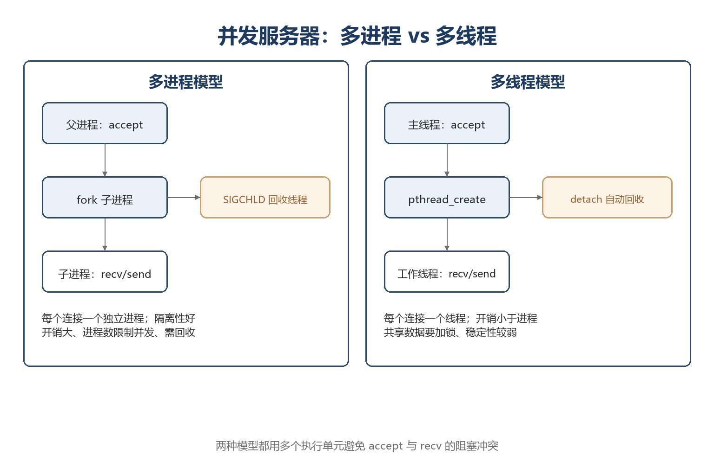

两种模型的差别首先是**资源视角**：`fork` 之后父子进程各有一份地址空间与 fd 表副本，同一个 socket 靠 `struct file` 的引用计数共享；线程则共享同一份地址空间、堆与 fd 表，只有栈与寄存器是各自的。其次是**连接归属**：父进程/主线程只负责 `accept`，读写交给子进程/工作线程。

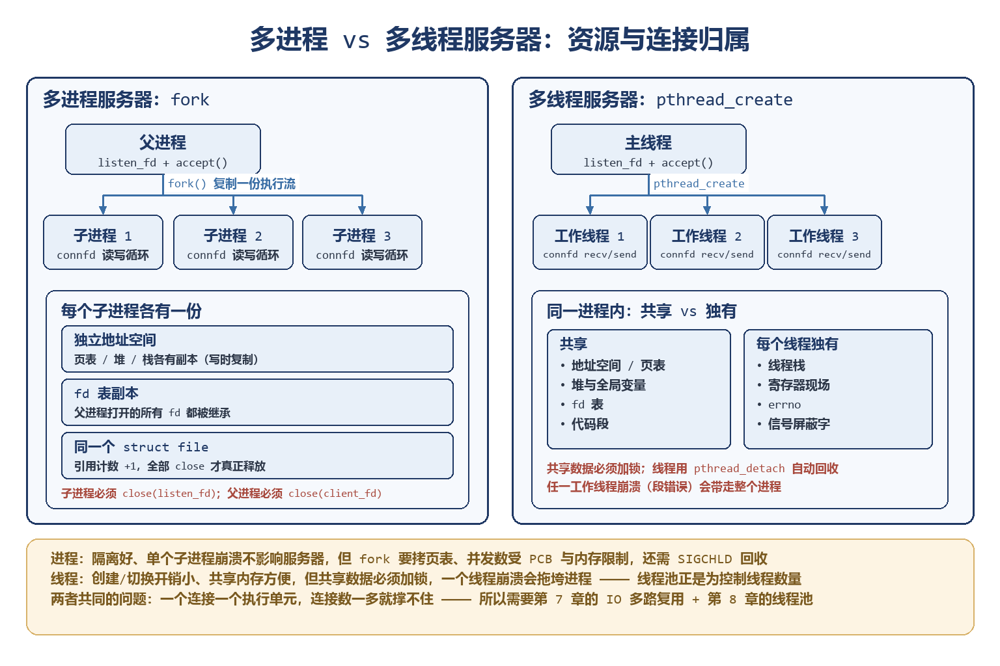

> 关闭顺序是这类程序最常见的资源泄漏点：子进程要 `close(listen_fd)`，父进程要 `close(client_fd)`，两边都关掉后引用计数归零，连接才真正释放。

## 6.2 多进程服务器

`process_server.c`——父进程 accept，子进程处理读写：

```c
/*多进程服务器*/
#include<stdio.h>
#include<unistd.h>
#include<stdlib.h>
#include<string.h>
#include<sys/socket.h>
#include<arpa/inet.h>
#include<time.h>
#include<errno.h>
#include<fcntl.h>
#include<stdbool.h>
#include<sys/wait.h>
#include<signal.h>
#include<pthread.h>

void sig_wait(int n)
{
    //循环回收
    pid_t zpid;
    while((zpid = waitpid(-1,NULL,WNOHANG)) != -1)
    {
        if(zpid > 0)
            printf("parent %d wait zpid %d\n", getpid(),zpid);
    }
}

void *thread_wait(void *arg)
{
    //绑定信号处理函数，处理SIGCHLD信号（子进程退出，避免僵尸进程）
    struct sigaction act, oact;
    act.sa_handler = sig_wait;
    act.sa_flags = 0;
    sigemptyset(&act.sa_mask);
    sigaction(SIGCHLD,&act,&oact);
    //解除屏蔽
    sigprocmask(SIG_UNBLOCK,&act.sa_mask,NULL);
    printf("wait thread 0x%x , waiting...\n",(unsigned int)pthread_self());
    while(1)
        sleep(1);

    pthread_exit(NULL);
}

int net_initializer(const char * ip,int port)
{
    struct sockaddr_in serveraddr;
    bzero(&serveraddr,sizeof(serveraddr));
    serveraddr.sin_family = AF_INET;
    serveraddr.sin_port = htons(port);
    serveraddr.sin_addr.s_addr = htonl(INADDR_ANY);//使用inet_addr or inet_pton 转换ip
    int sockfd;
    if((sockfd = socket(AF_INET,SOCK_STREAM,0)) == -1)
        perror("net_initializer call socket failed");
    if((bind(sockfd,(struct sockaddr *)&serveraddr,sizeof(serveraddr))) == -1)
        perror("net_initializer call bind failed");
    listen(sockfd,128);

    return sockfd;
}

int server_start(int server_sockfd)
{
    //服务器主要工作流程
    struct sockaddr_in clientaddr;
    int client_sockfd;
    socklen_t addrlen;
    int recvlen;
    char buf[1500];//sock用户缓冲区
    time_t tp;//时间种子
    char time_buf[512];//存储字符串时间
    char cip[16];//存储客户端ip
    pid_t pid;
    char *echo_str = "Please Try again!\n";
    printf("process tcp server accepting...\n");
    while(true)
    {
        //链路处理
        addrlen = sizeof(clientaddr);
        if((client_sockfd = accept(server_sockfd,(struct sockaddr *)&clientaddr,&addrlen)) > 0)
        {
            //connect success
            //first response
            pid = fork();
            if(pid > 0)
            {
                bzero(buf,sizeof(buf));
                bzero(cip,16);
                inet_ntop(AF_INET,&clientaddr.sin_addr.s_addr,cip,16);//将ip地址转换为字符串
                sprintf(buf,"hi (%s) connection server 110.40.166.111 success\n",cip);
                printf("send to client successly..\n");
                send(client_sockfd,buf,strlen(buf),MSG_NOSIGNAL);
            }
            else if(pid == 0)
            {
                //请求处理
                //循环读取client_sock_array数组中所有client_sock
                //中断测试无法模拟并行请求
                bzero(buf,sizeof(buf));
                while((recvlen = recv(client_sockfd,buf,sizeof(buf),0)) > 0)
                {
                    //读取数据判断是否是localtime，处理换行buf[strlen(buf)-1] = '\0';如果用户发送的并不是localtime，直接返回字符串 Please Tryagain!
                    if(buf[strlen(buf)-1] == '\n')
                        buf[strlen(buf)-1] = '\0';
                    if(strcmp(buf,"localtime") == 0)
                    {
                        //获取时间种子，计算当前时间，写回即可
                        tp = time(NULL);
                        bzero(time_buf,sizeof(time_buf));
                        ctime_r(&tp,time_buf);
                        send(client_sockfd,time_buf,strlen(time_buf),MSG_NOSIGNAL);
                    }
                    else
                    {
                        send(client_sockfd,echo_str,strlen(echo_str),MSG_NOSIGNAL);
                    }
                }
                if(recvlen == 0)
                {
                    //客户端退出，如果读取client_sock 返回 0，表示客户端退出，close关闭client_sock，列表中对应sock设置-1
                    printf("client exit,sockfd %d close\n",client_sockfd);
                    close(client_sockfd);
                    printf("child pid %d exit\n",getpid());
                    exit(0);
                    
                }
                else 
                {
                    perror("server_start call recv failed");
                }
            }
            else 
            {
                perror("fork call failed");
                exit(0);
            }
        }
        else
        {
            perror("server_start call accept failed");
            exit(0);
        }
    }
}

int main(void)
{
    //net initializer()
    int sockfd;
    sockfd = net_initializer(NULL,8080);

    //屏蔽SIGCHLD
    sigset_t set,oset;
    sigemptyset(&set);
    sigaddset(&set,SIGCHLD);
    sigprocmask(SIG_BLOCK,&set,&oset);
    //创建回收线程
    pthread_t tid;
    pthread_create(&tid,NULL,thread_wait,NULL);

    //server_start()
    server_start(sockfd);

    return 0;
}
```

解读：

- `accept` 在父进程，成功后立即 `fork`；子进程继承 client socket，直接进入读写循环；
- 父进程发送欢迎消息后继续 accept；子进程在客户端退出（`recv == 0`）时关闭 socket 并 `exit(0)`；
- SIGCHLD 在创建回收线程前先屏蔽，回收线程内 `sigaction` 注册处理函数后再 `sigprocmask` 解除屏蔽——避免信号在处理器就绪前到达而丢失；
- `sig_wait` 用 `waitpid(-1, NULL, WNOHANG)` 循环回收所有已退出子进程，防止僵尸堆积。

**优缺点**：

- 优点：每个客户端独享一个进程，处理及时；连接与读写分离，避免阻塞冲突；进程隔离性好，单个子进程崩溃不影响服务器；
- 缺点：进程创建/切换开销大；进程数受 PCB 与内存限制，直接限制并发量；子进程不可重用，频繁连接/断开时开销更明显；需要额外处理 SIGCHLD 回收与孤儿进程；没有进程管理策略；也没有**预创建机制**——“来一个客户端才 fork 一个”，创建本身是系统调用，请求要等进程就绪后才能处理，连接越多、资源越紧张，等待越久，实际是延迟处理而非即时响应。

把这套代价拆开逐条看，一共七项（后两项最容易被忽略）：

| # | 代价 | 具体表现 |
|---|---|---|
| 1 | 系统开销大 | 每个连接一份独立地址空间、页表与 PCB，内存随连接数线性增长 |
| 2 | 频繁占用 CPU | 大量进程在就绪/阻塞之间切换，调度与上下文切换抢走本该用于数据处理的 CPU |
| 3 | 并发量＝进程数 | 上限由 PCB 与内存决定；几千连接就意味着几千个进程，不现实 |
| 4 | 处理单元不可重用 | 进程与客户端绑定，连接断开即销毁，下个连接又要重新创建 |
| 5 | 先建执行单元再处理 | 客户端连上后必须先 fork 才能读，请求要等进程就绪，属于“延迟处理”而非即时响应 |
| 6 | 没有执行单元管理 | 没有按任务量动态扩缩的机制：空闲时无法收敛，繁忙时也无法提前扩容 |
| 7 | 网络 IO 处理能力弱 | 每连接一个阻塞读进程，靠内核调度更多进程去覆盖等待，切换开销随连接数线性上涨；同等连接规模下，事件驱动模型的 IO 处理能力高一个量级 |

⑥ 关乎资源利用率，⑦ 关乎 IO 吞吐——后面要引入 IO 复用与线程池，根本原因就在这两条，而不是“多进程写得麻烦”。

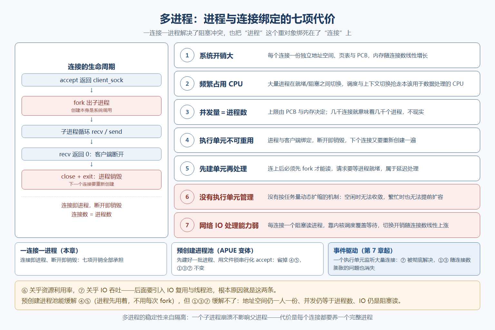

实现时有三个容易踩的点：

- **先 accept 再 fork**：client socket 必须由父进程 accept 返回，子进程才能靠继承拿到它；顺序反了，子进程手里没有可通信的 fd；
- **子进程可以直接阻塞读**：子进程与客户端一一对应，`recv` 阻塞不会影响其他连接，不需要设成非阻塞——非阻塞是“一个执行单元要轮多个连接”时才需要的；
- **读必须循环**：`while ((recvlen = recv(...)) > 0)` 才能把同一连接上的多条请求读完，只读一次就返回，客户端后续请求会被忽略；而“客户端是否退出”的判断（`recvlen == 0`）必须放在循环**之后**，写在循环体内永远走不到。

> 父进程发送欢迎消息后也应 `close(client_sockfd)`，否则父进程会一直持有该连接的引用；子进程退出后连接才真正释放。

**补充：回收为什么必须放进单独一个线程**

`fork` 之后父进程只剩一件正事：继续阻塞在 `accept` 等下一个连接。子进程退出时内核发出 `SIGCHLD`，而进程定向信号最终会递给**某个**线程，由此带来三个必须先弄清的事实：

| 事实 | 含义 | 处理不好会怎样 |
|---|---|---|
| `accept` 会被信号打断 | 信号递达到正在 `accept` 的线程时，`accept` 返回 -1、`errno == EINTR` | 主线程自己装处理函数，就会频繁看到 accept 失败；正确做法是判 `EINTR` 后重试，而不是 `exit` |
| 线程的屏蔽字彼此独立 | 信号屏蔽字是**线程私有**的，不共享；但创建子进程/线程时会**继承**当时的屏蔽字 | 主线程屏蔽 `SIGCHLD`，信号就只会落到未屏蔽的回收线程；若谁都没屏蔽，信号可能递给主线程而打断 accept |
| `SIGCHLD` 默认动作是忽略 | 它是少数默认动作就是 IGN 的信号，不装处理函数也不会杀进程 | “什么都不做也不会崩”，但子进程全变僵尸——不报错，只会越积越多 |

所以 6.2 代码的顺序是 **先屏蔽 → 起回收线程 → 线程里装处理函数 → 解除屏蔽**，而不是“直接装处理函数”。两种写法的差别就在信号会不会丢：

| 写法 | 时序风险 | 结果 |
|---|---|---|
| 直接 `sigaction` 装捕捉，不屏蔽 | 装好之前就有子进程退出：信号已产生，但没有处理函数接，等于丢弃 | 那个子进程永远没人 `waitpid`，僵尸残留 |
| 先屏蔽、装好后再解除 | 屏蔽期间信号不会丢，而是变成**未决**；解除时补投递，此时处理函数已就位 | 一个都不漏 |

一个容易混的点：子进程也会继承这份屏蔽字，所以子进程内部默认也是屏蔽 `SIGCHLD` 的——它自己退出时由父进程回收，与它自己的屏蔽字无关。

最后落到数据上：每个子进程 `fork` 出来的那一刻，手里是**各自不同的** `client_sockfd`（父进程每轮 accept 得到新 fd，子进程继承的是自己那一个），所以“一个子进程负责一条连接的网络 IO”在 fd 层面天然成立。

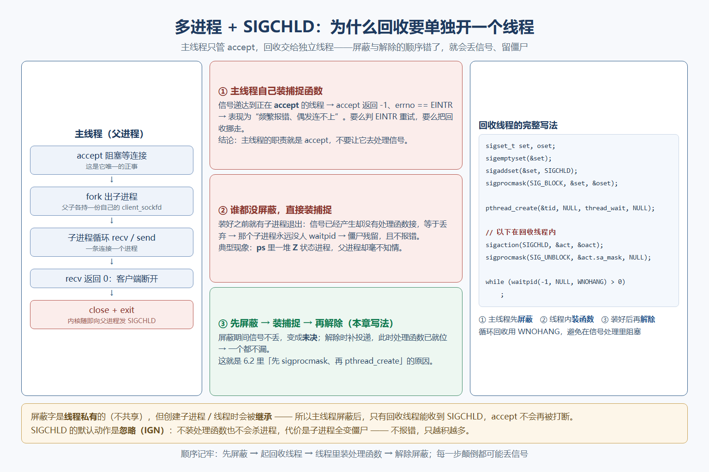

## 6.3 多线程服务器

`thread_server.c`——主线程 accept，每个连接创建一个分离态工作线程：

```c
/*多线程服务器*/
#include<stdio.h>
#include<unistd.h>
#include<stdlib.h>
#include<string.h>
#include<sys/socket.h>
#include<arpa/inet.h>
#include<time.h>
#include<errno.h>
#include<fcntl.h>
#include<stdbool.h>
#include<sys/wait.h>
#include<signal.h>
#include<pthread.h>

void *thread_jobs(void *arg)
{
    //服务器主要工作流程
    int client_sockfd = *(int*)arg;
    int recvlen;
    char buf[1500];//sock用户缓冲区
    time_t tp;//时间种子
    char time_buf[512];//存储字符串时间
    char *echo_str = "Please Try again!\n";
    pthread_detach(pthread_self());//设置线程分离
    bzero(buf,sizeof(buf));
    while((recvlen = recv(client_sockfd,buf,sizeof(buf),0)) > 0)
    {
        //读取数据判断是否是localtime，处理换行buf[strlen(buf)-1] = '\0';如果用户发送的并不是localtime，直接返回字符串 Please Tryagain!
        if(buf[strlen(buf)-1] == '\n')
            buf[strlen(buf)-1] = '\0';
        if(strcmp(buf,"localtime") == 0)
        {
            //获取时间种子，计算当前时间，写回即可
            tp = time(NULL);
            bzero(time_buf,sizeof(time_buf));
            ctime_r(&tp,time_buf);
            send(client_sockfd,time_buf,strlen(time_buf),MSG_NOSIGNAL);
        }
        else
        {
            send(client_sockfd,echo_str,strlen(echo_str),MSG_NOSIGNAL);
        }
    }
    if(recvlen == 0)
    {
        //客户端退出，如果读取client_sock 返回 0，表示客户端退出，close关闭client_sock，列表中对应sock设置-1
        printf("client exit,sockfd %d close\n",client_sockfd);
        close(client_sockfd);
        printf("thread 0x%x, exit\n",(unsigned int)pthread_self());
        pthread_exit(NULL);
    }
    else 
    {
        perror("server_start call recv failed");
    }
}

int net_initializer(const char * ip,int port)
{
    struct sockaddr_in serveraddr;
    bzero(&serveraddr,sizeof(serveraddr));
    serveraddr.sin_family = AF_INET;
    serveraddr.sin_port = htons(port);
    serveraddr.sin_addr.s_addr = htonl(INADDR_ANY);//使用inet_addr or inet_pton 转换ip
    int sockfd;
    if((sockfd = socket(AF_INET,SOCK_STREAM,0)) == -1)
        perror("net_initializer call socket failed");
    if((bind(sockfd,(struct sockaddr *)&serveraddr,sizeof(serveraddr))) == -1)
        perror("net_initializer call bind failed");
    listen(sockfd,128);

    return sockfd;
}

int server_start(int server_sockfd)
{
    //服务器主要工作流程
    struct sockaddr_in clientaddr;
    int client_sockfd;
    socklen_t addrlen;
    int recvlen;
    char buf[1500];//sock用户缓冲区
    time_t tp;//时间种子
    char time_buf[512];//存储字符串时间
    char cip[16];//存储客户端ip
    char *echo_str = "Please Try again!\n";
    printf("thread tcp server accepting...\n");
    int err;
    pthread_t tid;
    while(true)
    {
        //主线程链路处理
        addrlen = sizeof(clientaddr);
        if((client_sockfd = accept(server_sockfd,(struct sockaddr *)&clientaddr,&addrlen)) > 0)
        {
            //connect success
            //first response
            bzero(buf,sizeof(buf));
            bzero(cip,16);
            inet_ntop(AF_INET,&clientaddr.sin_addr.s_addr,cip,16);//将ip地址转换为字符串
            sprintf(buf,"hi (%s) connection server 110.40.166.111 success\n",cip);
            printf("send to client successly..\n");
            send(client_sockfd,buf,strlen(buf),MSG_NOSIGNAL);
            //创建线程并传参
            if((err = pthread_create(&tid,NULL,thread_jobs,&client_sockfd)) > 0)
                printf("create thread failed:%s\n",strerror(err));
        }
        else
        {
            perror("server_start call accept failed");
            exit(0);
        }
    }
}

int main(void)
{
    //net initializer()
    int sockfd;
    sockfd = net_initializer(NULL,8080);

    //server_start()
    server_start(sockfd);

    return 0;
}
```

与多进程的差异：

- 线程创建开销远小于进程，调度也更轻；
- 线程内 `pthread_detach(pthread_self())` 设置分离态，结束后由系统自动回收，无需 join；
- 线程间共享进程资源，通信方便，但共享数据必须加锁，否则会出现第 12 章的竞争问题；一个线程异常退出可能拖垮整个进程。

| 维度 | 多进程 | 多线程 |
|---|---|---|
| 资源开销 | 大（独立地址空间） | 小（共享地址空间） |
| 隔离性/稳定性 | 强，单个进程崩溃不影响其他 | 弱，线程崩溃可能终止进程 |
| 通信 | 需 IPC（管道、共享内存等） | 直接共享全局变量，需加锁 |
| 并发上限 | PCB/内存限制，通常较少 | 线程数受栈空间限制（32 位约 381） |
| 回收 | 必须处理 SIGCHLD，防僵尸 | 分离态自动回收 |

## 6.4 代码风险与修正

- **线程传参竞态**：`pthread_create(..., &client_sockfd)` 传的是主循环中**复用变量**的地址，下一轮 accept 会改写它，工作线程可能拿到错误的 fd。应传值：
  ```c
  pthread_create(&tid, NULL, thread_jobs, (void *)(intptr_t)client_sockfd);
  // 线程内：int client_sockfd = (int)(intptr_t)arg;
  ```
  或为每个连接 `malloc` 一个 int 传入、线程内释放。
- **线程异常路径未清理**：`recv` 返回 -1 且非 EAGAIN 时只打印错误，没有 `close` 与 `pthread_exit`，线程会落到函数末尾；应补齐关闭与退出。
- **父进程未关闭 client socket**：多进程版本中父进程发完欢迎消息应 `close(client_sockfd)`，否则引用计数一直不减，连接资源释放延迟。
- **线程里用 `exit` 结束自己**：`exit` 终止的是整个进程，一个客户端断开就会带走服务器；工作线程应调用 `pthread_exit(NULL)`，客户端退出时先 `close` 再退出线程。
- **误以为线程能继承 socket**：线程之间没有 fd 继承关系，`accept` 返回的 client socket 必须作为参数传给 `pthread_create`；这也是多线程版比多进程版唯一要多做的一步“交接”。

# 第 7 章 IO 多路复用：select / poll / epoll

多进程/多线程靠“增加执行单元”解决并发，但每个连接一个执行单元的开销很大。**IO 多路复用**换一个思路：一个线程同时监听大量 fd，哪个就绪就处理哪个。

**先明确它的职责**：IO 多路复用只负责**监听**，不负责**处理**。监听对象只有 **socket 的网络 IO**——磁盘文件读写、数据库访问这类 IO 不在它的管辖范围。真正的握手与数据拷贝仍要由 `accept` / `recv` 完成；区别在于调用之前就绪状态已经确认，因此不会再出现“无谓的阻塞等待”，也就省掉了阻塞期间占住的内存与执行单元。

**socket 上的三种事件**：

| 事件 | 触发条件 | 谁在等它 |
|---|---|---|
| 读事件 | 接收缓冲区非空。三次握手的 `SYN` 也占 1 字节，所以“有新连接”同样表现为可读 | `accept`（等连接）、`recv`（等数据） |
| 写事件 | 发送缓冲区非空、数据尚未发完 | 需要判断“能否继续写”时 |
| 异常事件 | socket 出错、读写失败 | 兜底处理 |

`accept` 与 `recv` 做的事不同，等待的状态其实是同一个：都在等**读事件就绪**。

**标准流程（所有复用模型共用，且要反复循环）**：

1. 监听准备：组织监听集合（`fd_set` / `pollfd` 数组 / epoll 事件表）；
2. 开始监听：调用 `select` / `poll` / `epoll_wait`；
3. 等待就绪：可阻塞、可设超时，也可非阻塞；
4. 就绪返回：拿到就绪 fd 的数量与集合；
5. 处理就绪：对监听 socket 调 `accept` 完成握手，对通信 socket 调 `recv` 拷贝数据；
6. 处理完毕 → 回到第 1 步进入下一轮。服务器不下线，这个循环就不停。

**与其它 IO 模型的关系**：本篇三个接口都属于**同步**模型（就绪后由应用自己拷贝数据）；此外还有**信号驱动 IO**，以及 Windows 的**完成端口（IOCP）**、FreeBSD 的 **Kqueue** 等**异步**模型（数据由内核准备好并通知，应用不参与等待），不在本篇范围。

**与“两大核心”的配合**：服务器只有“能同时监听很多连接”还不够，还要“能把就绪的连接快速处理完”。监听靠本章的复用接口，处理靠多线程/线程池——只有 10 万订单却只有 1 个厨师，门面再大也留不住客人。

## 7.1 select

select 把要监听的 fd 放进 `fd_set` 位图，交给内核；内核扫描后返回就绪集合，应用再遍历处理。

在讨论它的限制之前，先明确它为什么能活到今天——**select 的优点**：

| 优点 | 说明 |
|---|---|
| 兼容性最好 | POSIX 标准接口，Linux、Unix、Windows 都有，同一份监听代码几乎不用改就能跨平台 |
| 接口简单 | 一个函数 + 四个宏（`FD_ZERO`/`FD_SET`/`FD_ISSET`/`FD_CLR`）就能完成监听，学习成本最低 |
| 轻量 | 不需要预先创建额外的内核对象（不像 epoll 要先 `epoll_create`）；内核里自始至终只有一张位图，没有红黑树、双向链表这类常驻结构 |
| 定时精度高 | `timeout` 是 `struct timeval`，可精确到**微秒**；poll/epoll 是毫秒 |

对应的**七项代价**：

| # | 代价 | 为什么要命 |
|---|---|---|
| 1 | 监听上限 1024 | 上万连接的服务器根本放不下；`FD_SETSIZE` 是编译期常量，改它要重新编译 libc |
| 2 | 内核轮询 O(n) | 每轮从头扫到尾，只就绪 1 个也要扫完 `nfds` 个；连接越多，CPU 被轮询吃掉越多，能留给读写的越少 |
| 3 | 事件种类少且不细分 | 只有读/写/异常三类。读里还分普通数据、带外数据、高优先级数据，TCP 的 `SYN` 也表现为“可读”——select 一律当成同一件事 |
| 4 | 以集合为单位，不灵活 | 想让 A 只监听读、B 只监听写，就得准备两套 `fd_set`、调两次 `select`；无法按 fd 单独设置 |
| 5 | 每轮两次全量拷贝 + 重复挂载 | 开销只与集合大小有关，与“就绪了几个”无关；连接多、就绪少时浪费最明显 |
| 6 | 传入传出未分离 | `fd_set` 既是入参又是出参，用户只能自己维护 `oset` 每轮重建；“我关心的”和“你告诉我的”挤在同一个参数里，属接口设计缺陷 |
| 7 | 只报数量不报是谁 | 返回值只有 `readynum`，要知道是哪几个 fd 就绪，还得把 `[0, maxfd]` 全部 `FD_ISSET` 再扫一遍，等于一轮里做两次 O(n)；`FD_CLR` 漏一次，`readynum` 就与真实数不符而卡死（见附录 C） |

所以 select 的合理位置是：**连接数不大、需要跨平台、或者只是想给少量 socket 加一个超时**；连接上千时就该换 poll/epoll。

**一轮 select 固定四步**：组包（`FD_ZERO`/`FD_SET`）→ 把整块位图拷进内核 → 内核按 `[0, nfds)` 逐位扫描 → 把改写过的位图拷回用户态。这四个动作正是「1024 上限」「两次拷贝」「O(n) 扫描」三项代价的由来：

- **上限 1024**：fd 就是位号，`FD_SETSIZE` 之外的 fd 无处可置；
- **两次全量拷贝**：位图送进内核、改完再送回来，代价与“就绪了几个”无关；
- **O(n) 线性扫描**：`nfds = maxfd + 1`，中间被关闭的空洞也要扫一遍。

### 7.1.1 内核里到底发生了什么

`select` 本身并不监听，它只是“代办”：真正干活的是内核里那张 **IO 设备等待队列**。一次调用要经过四步：

1. **拷贝**：把用户态的 `fd_set` 整块拷进内核（1024 位 = 128 字节）。位图是用户态变量，内核要用就得先拿一份副本。
2. **挂载**：内核按置 1 的位置查到 fd 对应的 `struct file`、再找到 `socket`，把当前进程挂到这些 socket 的等待队列上。**这一步每轮都重做**：哪怕某个 fd 上一轮已经挂过，这一轮仍会再挂一次，只是覆盖原有登记。
3. **轮询**：从 0 到 `nfds - 1` 逐位检查，谁的接收队列非空就保留这一位，其余清 0。判断方式是“逐个问”，没有任何人主动通知内核。
4. **回写并拷回**：位图在内核里被改写，再整块拷回用户态；用户拿到的是就绪子集，靠 `FD_ISSET` 反查是谁。

> 第 2 步的挂载就是“重复开销”的来源：集合里有 900 个连接，其中 899 个早就挂着，这一轮仍要按集合重新挂 900 次。集合越大，重复率越高。

**为什么偏偏是 1024**：轮询要逐个检查，检查本身就是 CPU 开销。连接越多，轮询占用的 CPU 越多，能留给真正读写（磁盘、数据库、网络收发）的 CPU 就越少——表现出来就是“连接一多，服务器反而更慢”。1024 是给轮询兜底的上限：限制住监听规模，就限制住了轮询开销。换句话说，**1024 不是拍脑袋定的数，而是轮询这套算法的必然结果**；算法不换（select / poll），上限就只能靠“限制规模”来控制。


上面这张动图把内核四步逐帧演了一遍（组包 → 拷贝 → 挂载 → 轮询 → 回写 → 反查），下面这张换成“消息先后”的视角，按步骤逐条播放——对照着看，`oset = set`、`FD_ISSET`、`FD_CLR` 各自的位置就清楚了。

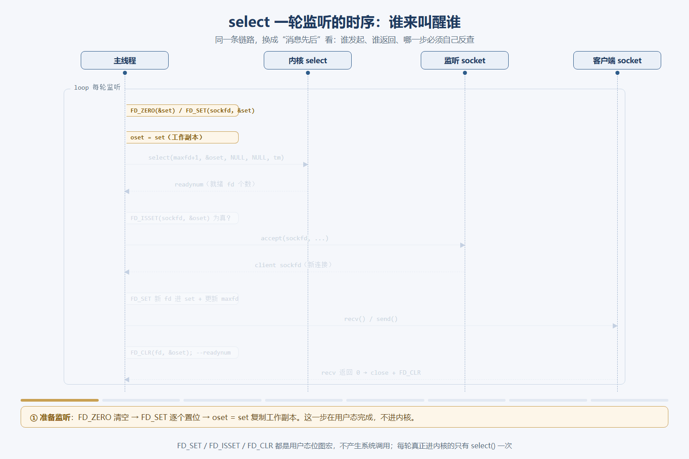

```c
#include<stdio.h>
#include<unistd.h>
#include<stdlib.h>
#include<string.h>
#include<sys/types.h>
#include<sys/fcntl.h>
#include<sys/socket.h>
#include<arpa/inet.h>
#include<time.h>

int main(void)
{
    //网络初始化
    int sockfd;
    sockfd = socket(AF_INET,SOCK_STREAM,0);
    struct sockaddr_in serveraddr,clientaddr;
    serveraddr.sin_family = AF_INET;
    serveraddr.sin_port = htons(8080);
    serveraddr.sin_addr.s_addr = htonl(INADDR_ANY);
    bind(sockfd,(struct sockaddr *)&serveraddr,sizeof(serveraddr));
    listen(sockfd,128);
    //业务处理
    char buffer[1500];
    char first_response[1024];
    char time_buf[1024];
    time_t tp;
    char cip[16];
    char *echo_str = "Please Try again!\n";
    int len;
    int client_sockfd;
    socklen_t addrlen;
    //监听准备
    int readynum;//就绪描述符数量
    fd_set set,oset;//监听的描述符集合    
    FD_ZERO(&set);//清空集合
    FD_SET(sockfd,&set);//设置监听
    int maxfd = sockfd;//最大描述符，初始为sockfd
    int client_sock_array[1020];//客户端套接字数组
    for(int i=0;i<1020;i++)
    {
        client_sock_array[i] = -1;
    }
    printf("select server start...\n");
    //使用select模块开始多轮监听
    int flag = 0;
    while(1)
    {
        oset = set;//复制集合
        printf("select 开始第%d轮监听\n",++flag);
        if((readynum = select(maxfd+1,&oset,NULL,NULL,NULL)) == -1)//选择就绪描述符
            perror("select call failed");
        printf("监听到%d个就绪socket\n",readynum);
        while(readynum > 0)
        {
            //根据就绪数量处理sockfd，查找判断就绪 处理就绪
            if(FD_ISSET(sockfd,&oset))//server_sock ready...
            {
                addrlen = sizeof(clientaddr);
                if((client_sockfd = accept(sockfd,(struct sockaddr *)&clientaddr,&addrlen)) == -1)
                {
                    perror("accept failed");
                    exit(0);
                }
                //存储数组
                for(int i=0;i<1020;i++)
                {
                    if(client_sock_array[i] == -1)
                    {
                        client_sock_array[i] = client_sockfd;
                        break;
                    }
                }
                //最大描述符，初始为sockfd
                if(maxfd < client_sockfd)
                    maxfd = client_sockfd;
                //设置监听
                FD_SET(client_sockfd,&set);
                //首次响应
                bzero(cip,16);
                inet_ntop(AF_INET,&clientaddr.sin_addr.s_addr,cip,16);
                bzero(first_response,sizeof(first_response));
                sprintf(first_response,"hi (%s) connect succesly...\n",cip);
                send(client_sockfd,first_response,strlen(first_response),MSG_NOSIGNAL);
                //处理完对应的sock，就绪集合对应位设置0
                FD_CLR(sockfd,&oset);
            }
            else 
            {
                //遍历查找就绪的sock
                for(int i=0;i<1020;i++)
                {
                    if(client_sock_array[i] != -1)
                    {
                        if(FD_ISSET(client_sock_array[i],&oset))
                        {
                            //找到就绪client_sockfd
                            if((len = recv(client_sock_array[i],buffer,sizeof(buffer),0)) > 0)
                            {
                                buffer[strlen(buffer) - 1] = '\0';
                                if(strcmp(buffer,"localtime") == 0)
                                {
                                    tp = time(NULL);
                                    bzero(time_buf,sizeof(time_buf));
                                    ctime_r(&tp,time_buf);
                                    send(client_sock_array[i],time_buf,sizeof(time_buf),MSG_NOSIGNAL);
                                }
                                else
                                    send(client_sock_array[i],echo_str,strlen(echo_str),MSG_NOSIGNAL);
                                FD_CLR(client_sock_array[i],&oset);//处理完对应的sock，就绪集合对应位设置0
                            }
                        }
                        if(len == 0)
                        {
                            FD_CLR(client_sock_array[i],&oset);//取消监听
                            close(client_sock_array[i]);
                            client_sock_array[i] = -1;
                            printf("client exit...\n");
                        }
                        break;
                    }
                }
            }
            --readynum;
        }
    }
}
```

解读与要点：

- 两个集合：`set` 是长期监听集合（server + 所有 client），`oset` 是每轮副本（传入传出）；每轮必须 `oset = set` 重新准备；
- `select(maxfd + 1, &oset, NULL, NULL, NULL)`：第一个参数是**最大 fd + 1**，不是连接数；后三个集合分别监听读/写/异常，这里只关心读；NULL 表示永久阻塞；
- 返回值 `readynum` 是就绪 fd 总数，必须按数量遍历，每处理一个就 `--readynum`；
- **核心坑：处理完一个 fd 必须 `FD_CLR`**。否则下一轮 `FD_ISSET` 仍为真、`readynum` 与真实就绪数不符，会在 accept/recv 上阻塞，整个服务器卡死；
- `maxfd` 要随新连接更新；只增不减，直至重启；
- 上限 1024（`FD_SETSIZE`）：fd 位图只有 1024 位，连接数受限；
- 每次调用都要把集合从用户态拷贝到内核、返回后再拷贝回来，且内核线性扫描，连接多时开销大；
- select 只区分读/写/异常，不能细分具体事件；同一个集合传入传出合一，容易误用。

**代码风险**：`int len` 未初始化，若本轮没有匹配到就绪 client，`len == 0` 分支会使用上一轮的旧值；`buffer` 未清零且直接 `buffer[strlen(buffer)-1] = 0`，客户端不发送换行时会删掉有效字符；发送时间用 `sizeof(time_buf)`，会把 1024 字节（含大量 0）一起发出，应改用 `strlen`。

**补充一：为什么客户端数组开 1020**

`client_sock_array` 只是一张**连接登记表**：槽位里存的是 client fd 的值，用来“记住我手上有哪些连接”，方便每轮遍历。1020 是这么算出来的：

| 项 | 数量 | 说明 |
|---|---|---|
| `fd_set` 位图总位数 | 1024 | `FD_SETSIZE`，合法 fd 只能是 0~1023 |
| 标准流 0/1/2 | 3 | stdin/stdout/stderr，进程启动就占着 |
| 监听 socket | 1 | `sockfd` 自己也要占一位 |
| 剩下的客户端 | **1020** | 1024 − 3 − 1 = 1020 |

两点必须清楚：

- 1020 是**按默认占用推导出的经验上限**，不是内核常量。如果 0/1/2 被关闭，这三个号也可能分给客户端，1020 个槽位反而不够；如果 `ulimit -n` 小于 1024，实际连接数会比 1020 更少。
- 数组大小决定的是“最多能**记住**多少个连接”，不是“能监听多少个 fd”。工程写法直接开 `FD_SETSIZE`（1024），并在 `accept` 后判 `if (cfd >= FD_SETSIZE) { close(cfd); continue; }`——比手算 1020 更稳；要突破 1024 只能换 `poll`/`epoll`。

> 注意区分两种“用 fd 做下标”的写法：本例是“把 fd 当**值**存进数组”，长度可以小于 1024；如果写成 `conn[fd]`（用 fd 当**下标**），数组长度就必须是 1024，否则 `fd = 1023` 时直接越界——这正是 `FD_SETSIZE` 那个数字的由来。

**补充二：sockfd 在 select 代码里的三重身份**

`sockfd` 的本质是进程 fd 表的下标（见 1.3），但在 select 服务器里它同时扮演三个角色：

| 角色 | 用法 | 前提 |
|---|---|---|
| I/O 句柄 | `recv(sockfd, ...)` / `send(sockfd, ...)` | 内核按 fd 找到对应的 socket 对象 |
| 位图位号 | `FD_SET(sockfd, &set)` / `FD_ISSET(sockfd, &set)` | fd 必须是连续的小整数，才能当位号 |
| 登记表元素值 | `client_sock_array[i] = sockfd` | 只是把号码抄一份，方便遍历 |

Windows 的 `SOCKET` 是句柄（指针宽度），后两种用法都做不到——这就是“fd 数组 + 位号”是 Linux 专有写法的原因。

**补充三：`maxfd + 1` 到底是什么（纠正“最大就绪队列长度”的说法）**

准确说法：**`nfds` = 所有被监听 fd 中最大 fd 值 + 1**，它界定内核要扫描的区间 `[0, nfds)`。

为什么必须 +1：位图和数组的长度都是“最大下标 + 1”。fd 从 0 开始编号，要覆盖 `fd == maxfd` 这一位，长度就得是 `maxfd + 1`，区间写成左闭右开 `[0, nfds)`。

它为什么常被误说成“最大就绪队列长度”——因为**数值上经常恰好等于当前打开的 fd 个数**：fd 是“最小可用”分配，运行中基本连续，于是 `maxfd + 1` 看起来就像“连接数”。但这个等式不成立，三个概念必须分开：

| 概念 | 谁表达 | 含义 |
|---|---|---|
| 扫描范围 | 入参 `maxfd + 1` | 内核只看 `[0, maxfd]` 这些位 |
| 本轮就绪数量 | `select` 的**返回值** `readynum` | 有几个 fd 就绪，与 `nfds` 无关 |
| 连接数/队列长度 | backlog、就绪链表等 | 与 `nfds` 无关 |

只要中间有 fd 被关闭又没被复用（出现“空洞”），`maxfd + 1` 就会明显大于打开数。传错的后果也很直接：

- 少传 1（传 `maxfd`）：最大那个 fd 永远不被扫描 →“最后一个客户端没反应”；
- 传 0：一位都不扫，`timeout` 为 NULL 时等于 `sleep`；
- 传大：不出错，只是多扫空位、白花时间。

> epoll 里没有 `maxfd` 这个概念，也不靠 fd 当“节点索引”，见 7.3 末尾的补充。

**补充四：一轮 select 的完整闭环**

第 7 章导语已经列过通用的六步，这里把它落到 select 的具体写法上：每一步对应哪句代码、哪一步最容易漏。**一轮走完才能进下一轮**：

| 步 | 名字 | 做什么 | 关键点 |
|---|---|---|---|
| ① | 准备监听 | `FD_ZERO` 清空 `set`，`FD_SET` 把 server socket 与每个 client 逐个置位；`oset = set` | 每轮都要重建：`set` 是“我关心的全集”，`oset` 是本轮工作副本 |
| ② | 开始监听 | `select(maxfd + 1, &oset, NULL, NULL, tm)` | `maxfd` 必须随新连接更新，否则新 fd 不被扫描 |
| ③ | 等待就绪 | 阻塞 / 定时 / 非阻塞 | `tm` 三态：`NULL`、`{0,0}`、`{3,0}` |
| ④ | 就绪 | 返回 `readynum`，`oset` 里只剩就绪位 | 只给数量，不给“是谁” |
| ⑤ | 处理就绪 | 遍历 `[0, maxfd]` 用 `FD_ISSET` 反查；server 就绪走 `accept`，client 就绪走 `recv` / `send` | 每处理一个 `--readynum`，处理完必须 `FD_CLR` |
| ⑥ | 处理完毕 | 回到 ① | **“完毕”由应用判定，不是内核说的** |

**⑥ 的判定标准**（最容易漏）：

- **连接类**：`accept` 返回、握手真正完成才算完毕；“监听 socket 可读”只说明握手已由内核完成、连接躺在全连接队列里，还没取出来；
- **读写类**：必须把本次缓冲区读空——`recv` 返回 `EAGAIN`（非阻塞）或 `0`（对端关闭）才算；只读一次就回 ①，同一个 fd 会立刻被再次返回，看起来就是“服务器卡在某个连接上”。

一句话：**“就绪”是内核说的，“处理完毕”是应用自己判定的**。LT 下两者不一致，循环就会空转在同一个 fd 上。

**⑤ 的标准顺序**：

| 就绪对象 | 顺序 | 漏一步会怎样 |
|---|---|---|
| server socket | `accept` → 新 fd `FD_SET` 进 `set` → 存入 `client_sockfd_array` → 更新 `maxfd` → 发首次响应 | 漏 `FD_SET`：新连接永远不被监听；漏更新 `maxfd`：新 fd 不被扫描 |
| client socket | `recv > 0` 处理并回包；`recv == 0` → `close` → `FD_CLR` → 槽位置 -1 | 漏 `FD_CLR`：`readynum` 与真实就绪数不符，下一轮卡死（附录 C 第一条） |

就绪判断三条件可以压成一行：server 可读＝有新连接，client 可读＝请求到达，`recv` 返回 0＝对端关闭。


## 7.2 poll

poll 把监听集合换成 `struct pollfd` 数组，每个元素记录 fd、关心的事件与返回的事件：

| 成员 | 含义 |
|---|---|
| `fd` | 要监听的描述符，-1 表示空位 |
| `events` | 关心的事件，如 `POLLIN` |
| `revents` | 内核返回的就绪事件，处理完要清零 |

换掉位图之后，fd 不再当位号，数组有多长就能监听多少个 fd，1024 的天花板就没了；但结构换了、算法没换——内核仍然要**逐个元素检查**，也仍然要把整块数组拷进拷出。

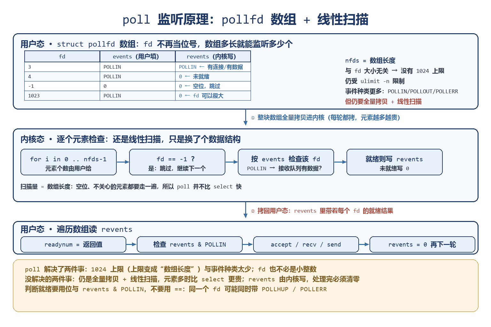

- `nfds` 是**数组长度**，与 fd 的数值大小无关（对比 select 的 `maxfd + 1`）；
- `events` 由用户填、`revents` 由内核写，所以每轮处理完要自己清零，判断就绪用位与 `revents & POLLIN`。

```c
#include<stdio.h>
#include<unistd.h>
#include<stdlib.h>
#include<string.h>
#include<sys/types.h>
#include<sys/fcntl.h>
#include<sys/socket.h>
#include<arpa/inet.h>
#include<time.h>
#include<poll.h>

int main(void)
{
    //网络初始化
    int sockfd;
    sockfd = socket(AF_INET,SOCK_STREAM,0);
    struct sockaddr_in serveraddr,clientaddr;
    serveraddr.sin_family = AF_INET;
    serveraddr.sin_port = htons(8080);
    serveraddr.sin_addr.s_addr = htonl(INADDR_ANY);
    bind(sockfd,(struct sockaddr *)&serveraddr,sizeof(serveraddr));
    listen(sockfd,128);
    //业务处理
    char buffer[1500];
    char first_response[1024];
    char time_buf[1024];
    time_t tp;
    char cip[16];
    char *echo_str = "Please Try again!\n";
    int len;
    int client_sockfd;
    socklen_t addrlen;
    //监听准备
    int readynum;//就绪描述符数量
    struct pollfd client_sock_array[1020];//客户端套接字数组
    for(int i=0;i<1020;i++)
    {
        client_sock_array[i].fd = -1;
        client_sock_array[i].events = POLLIN;
    }
    client_sock_array[0].fd = sockfd;
    printf("poll server start...\n");
    //使用poll模块开始多轮监听
    int flag = 0;
    while(1)
    {
        printf("poll 开始第%d轮监听\n",++flag);
        if((readynum = poll(client_sock_array,1020,-1)) == -1)//选择就绪描述符
            perror("poll call failed");
        printf("监听到%d个就绪socket\n",readynum);
        while(readynum > 0)
        {
            //根据就绪数量处理sockfd，查找判断就绪 处理就绪
            if(client_sock_array[0].revents == POLLIN)//server_sock ready...
            {
                addrlen = sizeof(clientaddr);
                if((client_sockfd = accept(sockfd,(struct sockaddr *)&clientaddr,&addrlen)) == -1)
                {
                    perror("accept failed");
                    exit(0);
                }
                //存储数组
                for(int i=0;i<1020;i++)
                {
                    if(client_sock_array[i].fd == -1)
                    {
                        client_sock_array[i].fd = client_sockfd;   
                        break;
                    }
                }
                //首次响应
                bzero(cip,16);
                inet_ntop(AF_INET,&clientaddr.sin_addr.s_addr,cip,16);
                bzero(first_response,sizeof(first_response));
                sprintf(first_response,"hi (%s) connect succesly...\n",cip);
                send(client_sockfd,first_response,strlen(first_response),MSG_NOSIGNAL);
                //处理完对应的sock，就绪集合对应位设置0
                client_sock_array[0].revents = 0;
            }
            else 
            {
                //遍历查找就绪的sock
                for(int i=0;i<1020;i++)
                {
                    if(client_sock_array[i].fd != -1)
                    {
                        if(client_sock_array[i].revents == POLLIN)
                        {
                            //找到就绪client_sockfd
                            if((len = recv(client_sock_array[i].fd,buffer,sizeof(buffer),0)) > 0)
                            {
                                buffer[strlen(buffer) - 1] = '\0';
                                if(strcmp(buffer,"localtime") == 0)
                                {
                                    tp = time(NULL);
                                    bzero(time_buf,sizeof(time_buf));
                                    ctime_r(&tp,time_buf);
                                    send(client_sock_array[i].fd,time_buf,sizeof(time_buf),MSG_NOSIGNAL);
                                }
                                else
                                    send(client_sock_array[i].fd,echo_str,strlen(echo_str),MSG_NOSIGNAL);
                                client_sock_array[i].revents = 0;//处理完对应的sock，就绪集合对应位设置0
                            }
                        }
                        if(len == 0)
                        {
                            close(client_sock_array[i].fd);
                            client_sock_array[i].fd = -1;
                            printf("client exit...\n");
                        }
                        break;
                    }
                }
            }
            --readynum;
        }
    }
}
```

要点：

- 突破 select 的 1024 上限：数组长度可自定义（例中 1020），但 fd 总数仍受 `ulimit -n` 限制；
- 仍是**轮询**：内核线性扫描整个数组，且每轮全量拷贝，连接多时开销比 select 更大；
- `revents` 由内核写，处理完要清零；判断就绪建议用位与 `revents & POLLIN`，而不是相等，因为可能同时带 `POLLHUP` 等；
- `poll` 的 `nfds` 是数组长度，不是最大 fd；不需要维护 maxfd。

**poll 的优点**（相对 select 的进步）：

| 优点 | 说明 |
|---|---|
| 兼容性同样好 | POSIX 标准接口，Linux / Unix 都能用；相比 epoll，更是“到处都有” |
| 接口简单 | 一个 `poll` + 一个数组，没有 `FD_*` 四个宏，也不用维护 `maxfd` |
| 设置粒度细 | 每个元素单独写 `events`：A 只关心读、B 只关心写，一个数组就能表达，不必像 select 那样备多套位图 |
| 事件种类多 | `POLLIN` / `POLLOUT` / `POLLERR` / `POLLHUP` / `POLLRDHUP`，读、写、异常分开表达 |
| 没有 1024 硬上限 | 上限变成“数组长度”，由使用者决定 |

**poll 的三条遗留**：

1. **仍然轮询**：内核线性扫描整个数组，`nfds` 个元素一个不落，空位也要过一遍。
2. **数量仍受进程 fd 上限约束**：`nfds` 只是数组长度，真正的天花板是 `ulimit -n`。上限仍是 1024 时，把数组长度写成 5000 会直接失败（`poll` 返回 -1），并不是“支持 5000 个连接”。要调：
   - 临时：`ulimit -n 40000`（只对当前终端有效，关掉即失效）；
   - 永久：`/etc/security/limits.conf` 给用户加 `nofile` 的软限制与硬限制，重新登录后生效；
   - 硬限制不能超过 `cat /proc/sys/fs/file-max` 的值，否则设置不上去。
3. **拷贝与挂载更贵**：以 socket 为单位整块拷贝，一个 `pollfd` 是 8 字节，而 select 里一个 fd 只占 1 bit；同样连接数下，poll 的全量拷贝反而更贵。

> 所以 poll 只换了“数据结构”这一层，没换“算法”这一层：它适合连接数中等、事件类型多的场合；上万连接仍然要 epoll。

## 7.3 epoll

epoll 把“注册”和“等待”拆开：fd 只需注册一次，内核用红黑树管理，就绪 fd 由回调放进就绪链表，`epoll_wait` 直接取链表。

先用一张动图把整个过程走一遍，再看它背后的三个结构：


动图里被反复用到的那三样东西——红黑树、就绪链表、等待队列——就是下面要拆开讲的结构。

**三个结构 + 一条回调链**是理解 epoll 的全部：

- **红黑树 interest list**：每个被监听的 fd 对应一个 `epitem`，`epoll_ctl` 的 ADD/MOD/DEL 就是在这棵树上按 fd 查找、插入、删除，代价 O(log n)；
- **就绪链表 rdllist**：只有真正就绪的 `epitem` 才会被挂进来，`epoll_wait` 从表头摘走，代价只与就绪个数 k 有关；
- **等待队列 wait queue**：调用 `epoll_wait` 且暂无事件时，线程在这里睡眠；
- **回调 `ep_poll_callback`**：socket 收到数据时由协议栈触发，把对应的 `epitem` 挂进 `rdllist` 并唤醒等待队列。

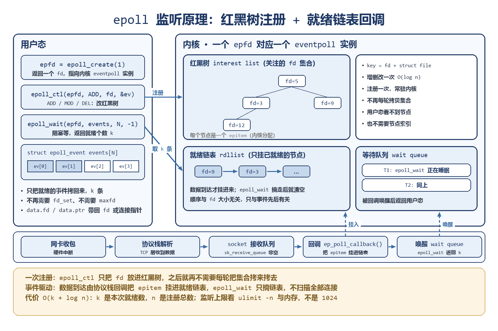

> `epitem` 由内核分配，用户态既看不到也用不着；用户态只通过 `epoll_event.data` 把 fd 或连接指针带回来。这也是本节末尾“fd 是查找键、不是节点索引”那句话的由来。

三个函数先列在这里，下面的链路再逐个展开：

| 函数 | 作用 |
|---|---|
| `epoll_create(size)` | 创建 epoll 实例，返回 epfd |
| `epoll_ctl(epfd, op, fd, &event)` | `ADD`/`MOD`/`DEL` 注册、修改、删除监听 |
| `epoll_wait(epfd, events, max, timeout)` | 等待就绪事件，返回就绪数量 |

### 7.3.1 注册、就绪、取回：一条完整链路

epoll 把“等”和“挑”拆给了不同角色，四步就能走完：

| 步骤 | 用户态做什么 | 内核侧发生什么 | 谁触发 |
|---|---|---|---|
| 1 建实例 | `epoll_create(1)` 拿到 `epfd` | 创建 `eventpoll` 对象，里面挂着红黑树、就绪链表、等待队列 | 应用主动调用 |
| 2 注册 | `epoll_ctl(ADD, fd, &ev)` | 申请 `epitem`，与 fd 的 `struct file` 绑定，插入红黑树 | 应用主动调用，只此一次 |
| 3 就绪 | 什么都不用做 | 数据到达 → 协议栈把 socket 标为可读 → 回调 `ep_poll_callback` → `epitem` 挂进 `rdllist`、唤醒等待队列 | 内核回调 |
| 4 取回 | `epoll_wait(epfd, events, maxevents, -1)` | 看 `rdllist`：空则睡眠，非空则摘出前 k 个，拷进 `events[]` | 应用主动调用 |

关键差异在第 2 步：select / poll 每轮都要把整张集合交给内核，epoll 只在注册时拷一个 `epoll_event`（几十字节），之后树的增删改都在内核里完成，用户态不再参与。第 3 步也是另外两个模型没有的——**不是应用去问内核，而是内核来通知**。

> `epoll_create(size)` 的 `size` 在新内核里已经不再影响容量（早期内核确实按它预分配），写 1 还是 10000 没有区别；真正的上限是 `ulimit -n` 与内存。习惯上仍填“预计监听的最大数量”（很多示例直接写最大连接数），那只是让参数自解释，内核并不据此分配。

三块结构的关系见上文结构图，下面这张换成函数视角：三个函数各管哪一段、`events` 怎么按位组合、一轮闭环长什么样。

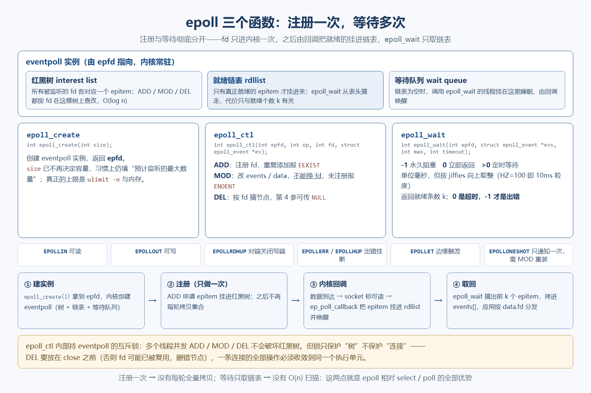

**补充：`epoll_ctl` 三个 op 的语义与失败返回**

| op | 作用 | 做不到什么 | 失败 errno |
|---|---|---|---|
| `EPOLL_CTL_ADD` | 申请 `epitem`、与 fd 的 `struct file` 绑定、插入红黑树 | 同一个 fd 重复 ADD 不会“覆盖”，而是直接失败 | `EEXIST` |
| `EPOLL_CTL_MOD` | 改 `events` / `data` | **不能换 fd**（fd 就是查找键）；要换只能先 DEL 再 ADD | `ENOENT`（fd 未注册） |
| `EPOLL_CTL_DEL` | 按 fd 查树并摘除节点 | 第四个参数可以直接传 `NULL`，内核不读它 | `ENOENT` |

两个顺序必须记牢：

- **DEL 要放在 `close` 之前**：先 `close` 再 `DEL`，这个 fd 号可能已被新连接复用，`DEL` 删掉的就是别人了（9.4 的代码就是这个写法，要点里已改回“先 DEL 再 close”）；
- **ADD 与 MOD 不能混用**：连接对象复用时先 `MOD` 改事件，报 `ENOENT` 再 `ADD`，比“先 DEL 再 ADD”少一次树操作。

**补充：`epoll_ctl` 是线程安全的，但不等于业务安全**

`epoll_ctl` 内部持 `eventpoll` 的互斥锁，多线程并发 ADD / MOD / DEL 不会把红黑树搞坏——这也是第 9 章敢把 `ADD` 下发到工作线程（`business_connect`）里做的前提。但锁只保护“树”，不保护“连接”：

- 两个线程同时 `recv` 同一条连接，会拿到被切碎、乱序的数据；
- A 线程 `DEL` 与 B 线程 `recv` 撞上时，B 可能操作到已被关闭的 fd；
- `data.ptr` 里的对象由使用者自己管生命周期，`DEL` 之后内核不会帮你释放它。

所以工程口径是：**一条连接的全部操作（注册、读写、注销）必须收敛到同一个执行单元**，跨线程只交接“要注册 / 要注销”这个事实，不交接操作本身。

**补充：`epoll_wait` 的 timeout 三态与真实精度**

| timeout | 行为 | 典型用法 |
|---|---|---|
| `-1` | 永久阻塞，直到有事件或被信号打断 | 纯事件驱动的主循环（第 9 章） |
| `0` | 立即返回：有就绪就返回数量，没有就返回 0 | 主循环里还要干别的活（非阻塞轮询） |
| `> 0` | 最多等这么久，超时返回 0 | 需要兜底定时（心跳扫描、超时连接清理） |

单位是**毫秒**，但内核按 jiffies 向上取整：`HZ=100` 时粒度就是 10ms，传 1 实际按 10ms 走——所谓“毫秒级定时”在多数内核上只是 10ms 级。要更细的粒度，用 `timerfd` 把定时刻进同一个 epoll，或换 `epoll_pwait2`（timespec 纳秒接口）。另外，返回值 0 表示“这轮超时、没有就绪”，**返回 -1 才是出错**。

### 7.3.2 就绪队列 rdllist 到底存什么

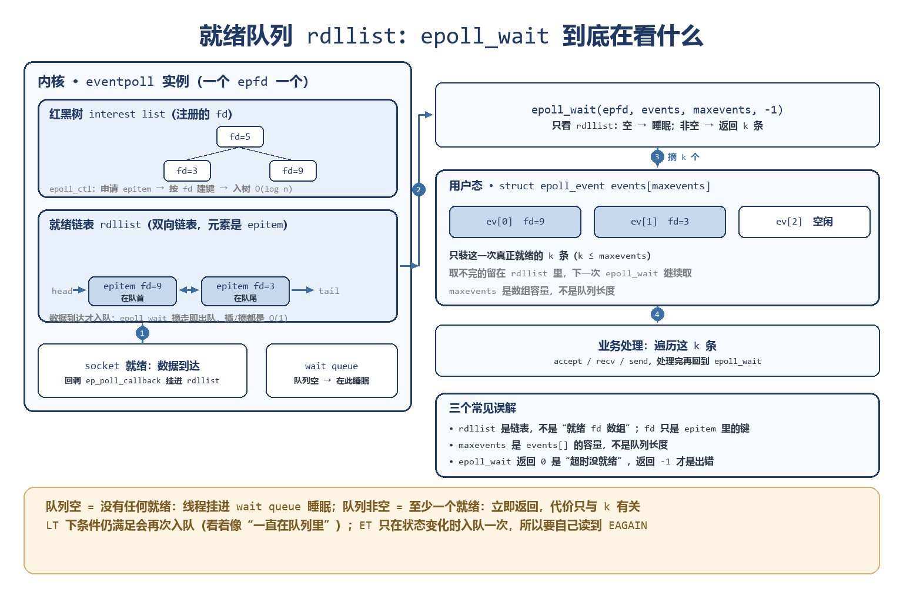

- **存的是 `epitem`**，不是 fd，也不是 socket；`epitem` 里既有红黑树节点也有链表节点，所以同一个 `epitem` 可以同时“在树里、又在链表里”；
- **双向链表**，插入与摘除都是 O(1)，没有顺序含义——谁先就绪谁先入队，与 fd 大小无关；
- **空 = 没有就绪**：队列为空时 `epoll_wait` 把线程挂进 `wait queue` 睡觉；队列非空时立即返回，返回条数就是这次摘出来的个数；
- **判定就绪不在这里**：回调只负责“把谁挂进来”，“能不能读”是协议栈在触发回调之前就判断好的；
- **与 `events[]` 的关系**：`rdllist` 是内核侧缓存，`events[]` 是用户侧快照；`maxevents` 是“这次最多拿几个”，不是队列长度，拿不完就留在队列里下次继续；
- **与 LT / ET 的关系**：LT 下只要条件仍满足，下一轮 `epoll_wait` 还会把它取回来（表现得像“一直在队列里”）；ET 只在状态变化时入队一次，所以要自己读到 `EAGAIN`（见 7.4 与 9.6）。

三个常见误解：

| 误解 | 实际 |
|---|---|
| `rdllist` 是“就绪 fd 的数组” | 它是链表，元素是 `epitem`；fd 只是 `epitem` 里记录的一个键 |
| `EPOLL_LISTEN_MAX` 是队列长度 | 它是 `events[]` 的容量（`maxevents`），队列长度由内核按需增长 |
| `epoll_wait` 返回 0 表示出错 | 返回 0 表示这次超时、没有就绪；返回 -1 才是出错 |

**epoll 的代价与边界**：

- **少量连接是杀鸡用牛刀**：十几个、几十个连接，select / poll 一轮扫完就完事；epoll 要先建实例、常驻三套结构，一次 `epoll_wait` 仍是一次系统调用加事件拷贝，反而更重；
- **红黑树的成本会投射到 epoll**：每个注册的 fd 都要一个 `epitem`（树节点 + 链表节点），频繁 ADD / DEL（短连接）时树的调整与内存分配最贵，O(log n) 虽好，常数不小；
- **绑定 Linux**：epoll 是 Linux 专有接口，跨平台只能退回 select / poll，或在上面套一层 libevent / libuv；
- **编程复杂度更高**：`data` 里的指针要自己管生命周期；ET 必须读干净；`EPOLL_CTL_DEL` 要放在 `close` 之前。

一句话选型：**几十个连接用 select，几百到几千或要跨平台用 poll，上千到十万级用 epoll**。

理论讲完，把它写成代码：先看主循环骨架，再看实现。注册只发生在两处（启动时把监听 fd 注册一次、每个新连接 `accept` 后注册一次），循环体里只做“取就绪 → 分发 → 处理”，从不遍历全部连接。

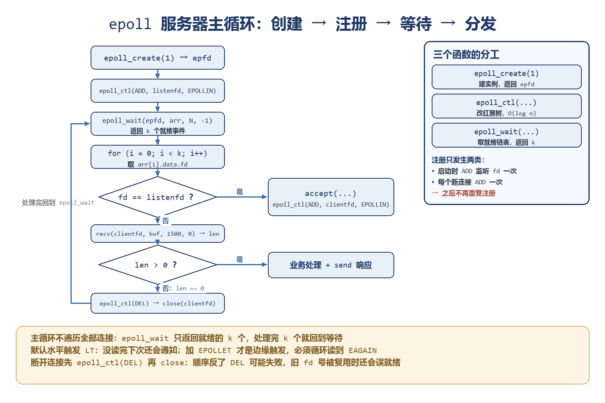

```c
#include<stdio.h>
#include<unistd.h>
#include<stdlib.h>
#include<string.h>
#include<sys/types.h>
#include<sys/fcntl.h>
#include<sys/socket.h>
#include<arpa/inet.h>
#include<time.h>
#include<sys/epoll.h>

#define EPOLL_LISTEN_MAX 10000

int main(void)
{
    //网络初始化
    int sockfd;
    sockfd = socket(AF_INET,SOCK_STREAM,0);
    struct sockaddr_in serveraddr,clientaddr;
    serveraddr.sin_family = AF_INET;
    serveraddr.sin_port = htons(8080);
    serveraddr.sin_addr.s_addr = htonl(INADDR_ANY);
    bind(sockfd,(struct sockaddr *)&serveraddr,sizeof(serveraddr));
    listen(sockfd,128);
    //业务处理
    char buffer[1500];
    char first_response[1024];
    char time_buf[1024];
    time_t tp;
    char cip[16];
    char *echo_str = "Please Try again!\n";
    char *first_res ="hi connect 110.40.166.111 successfully\n";
    int len;
    int client_sockfd;
    socklen_t addrlen;
    //监听准备
    int eflag;
    int epfd;
    int readynum;
    struct epoll_event node;//监听事件
    struct epoll_event ready_array[EPOLL_LISTEN_MAX];//就绪数组
    //创建监听树
    if((epfd = epoll_create(EPOLL_LISTEN_MAX)) == -1)
        perror("epoll_create failed");
    node.data.fd = sockfd;
    node.events = EPOLLIN;
    if(epoll_ctl(epfd,EPOLL_CTL_ADD,sockfd,&node) == -1)//设置server_sockfd监听
        perror("epoll_ctl failed");
    while(1)
    {
        if((readynum = epoll_wait(epfd,ready_array,EPOLL_LISTEN_MAX,-1)) == -1)//选择就绪描述符
        {
            perror("epoll_wait failed");
            exit(0);
        }
        eflag = 0;
        while(readynum > 0)
        {
            //根据就绪数量处理sockfd，查找判断就绪 处理就绪
            if(ready_array[eflag].data.fd == sockfd)//server_sock ready...
            {
                addrlen = sizeof(clientaddr);
                if((client_sockfd = accept(ready_array[eflag].data.fd,(struct sockaddr *)&clientaddr,&addrlen)) == -1)
                {
                    perror("accept failed");
                    exit(0);
                }
                //设置监听
                node.data.fd = client_sockfd;
                node.events = EPOLLIN;
                epoll_ctl(epfd,EPOLL_CTL_ADD,client_sockfd,&node);
                send(client_sockfd,first_res,strlen(first_res),MSG_NOSIGNAL);
            }
            else 
            {
                bzero(buffer,sizeof(buffer));
                //找到就绪client_sockfd
                if((len = recv(ready_array[eflag].data.fd,buffer,sizeof(buffer),0)) > 0)
                {
                    buffer[strlen(buffer) - 1] = '\0';
                    if(strcmp(buffer,"localtime") == 0)
                    {
                        tp = time(NULL);
                        bzero(time_buf,sizeof(time_buf));
                        ctime_r(&tp,time_buf);
                        send(ready_array[eflag].data.fd,time_buf,sizeof(time_buf),MSG_NOSIGNAL);
                    }
                    else
                    {
                        send(ready_array[eflag].data.fd,echo_str,strlen(echo_str),MSG_NOSIGNAL);
                    }
                }
                if(len == 0)
                {
                    close(ready_array[eflag].data.fd);
                        epoll_ctl(epfd,EPOLL_CTL_DEL,ready_array[eflag].data.fd,NULL);
                        printf("client exit...\n");
                }
            }
            --readynum;
            ++eflag;
        }
    }
}
```

要点：

- 监听 fd 只注册一次，不需要每轮重建集合，也没有全量拷贝；
- `epoll_wait` 只返回就绪的 fd，不需要遍历全部连接；
- 断开时应先 `EPOLL_CTL_DEL` 再 `close`（示例顺序相反，`DEL` 可能失败）；
- 默认是水平触发（LT）；要边缘触发需在 `events` 中加 `EPOLLET`；
- 同样注意 `buffer` 清零、`strlen - 1` 判断、发送时间用 `strlen` 而非 `sizeof`。

**epoll 里 fd 是“查找键”，不是“节点索引”**

epoll 内部是两块结构：

| 结构 | 内容 | 作用 |
|---|---|---|
| 红黑树（interest list） | 每个被监听的 fd 对应一个 `epitem` | 注册/删除/修改时**按 fd 查找** |
| 就绪链表（rdllist） | 已就绪的 `epitem` 挂进来 | `epoll_wait` 直接摘链表，不用扫描 |

所以 `sockfd` 在 epoll 里的角色是：

- `epoll_ctl(epfd, ADD, sockfd, &node)` 把 fd 当作**红黑树的查找键**：内核 `fget(fd)` 取出 `struct file`，键实际是“fd + file 的组合”，之后同一个 fd 号被复用也能靠 file 区分；
- 它**不是数组下标、也不是节点索引**：树节点是内核自己分配的 `epitem`，用户态看不到也用不着；
- 用户态靠 `epoll_event.data` 把信息带回来：`data.fd` 是常见写法（本例就是），`data.ptr` 可以直接存连接对象指针，这样连“fd 反查连接表”都不需要；
- `epoll_wait(epfd, ready_array, EPOLL_LISTEN_MAX, -1)` 里的 `EPOLL_LISTEN_MAX` 是**一次最多取回多少个事件**（数组长度 = `maxevents`），与 `maxfd + 1`、与总连接数都无关。

这也解释了为什么 epoll 版不再需要 `[1020]` 那样的登记表：没有 `fd_set` 的 1024 位限制，也不用每轮遍历全部连接，监听上限只取决于 `ulimit -n` 和内存。

**epoll 如何逐条消解 select 与 poll 的缺点**：

| 原缺点 | select / poll 的处境 | epoll 的做法 |
|---|---|---|
| 监听上限 | 1024 位 / 数组长度，受限于结构 | 只受 `ulimit -n` 与内存限制，十万级连接是常态 |
| 轮询扫描 | 每轮遍历全部 fd，O(n) | 回调把就绪 `epitem` 挂进链表，`epoll_wait` 只取链表，代价与就绪个数 k 相关 |
| 重复拷贝 / 重复挂载 | 每轮把集合整块拷进内核再拷回 | 注册一次长期有效，`epoll_wait` 只回传就绪事件 |
| 事件不细分 | 只有读/写/异常三类 | `EPOLLIN`/`EPOLLOUT`/`EPOLLRDHUP`/`EPOLLET` 等可按需组合 |
| 设置不灵活 | 每轮都要重新 `FD_SET` 或重填数组 | 监听关系存在内核的红黑树里，`ADD`/`MOD`/`DEL` 按需修改 |

代价也要讲清楚：红黑树的插入/删除/查找是 O(log n)；`epoll_event.data` 里的信息由使用者自己保管、错误回收会拿到已失效的 fd；边缘触发下必须自己保证“读干净”，否则数据不会再次通知。

**补充：LT 下“没读完就再来一轮”会发生什么**

- **节点状态就是“在不在就绪队列里”**：`ep_item` 不额外维护就绪标记位——在 `rdllist` 里即就绪，被 `epoll_wait` 摘走就回到未就绪。select 靠“位图每轮重建”表达状态，epoll 靠“节点在不在链表里”，这是三套接口写法差异的根源；
- **没读空就再来一轮，会立刻返回**：水平触发下只要缓冲区还有数据，`epoll_wait` 不阻塞，返回值就是上次没处理完的 sock 个数——既不是 0，也不是“新事件到了”。所以 LT 的“重复通知”不是缺陷，而是“你还没处理完毕”的直接反馈（与 7.4 的重复投递同一个道理）；
- **`events` 是位或**：`EPOLLIN | EPOLLOUT | EPOLLERR` 可一次关心多类事件，再或上 `EPOLLET` 就切到边缘触发；一个节点只描述一个 sock，所以不同 sock 可以各配各的事件。

开头那张动图讲的是连接从注册到注销的一生，这张只讲一轮：从数据到达到数据被读走。

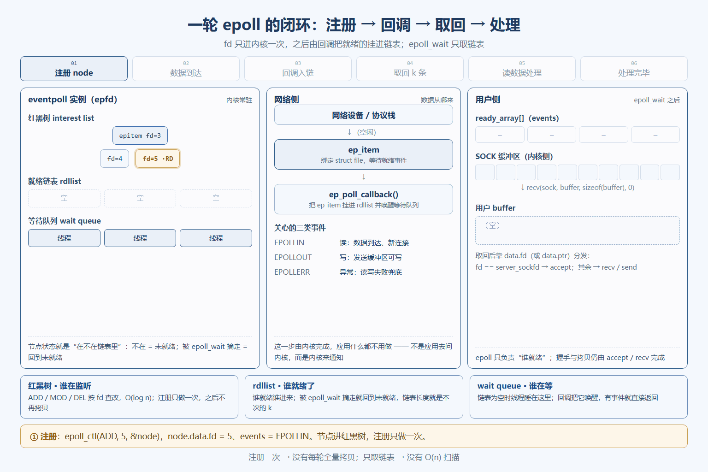

## 7.4 LT 与 ET

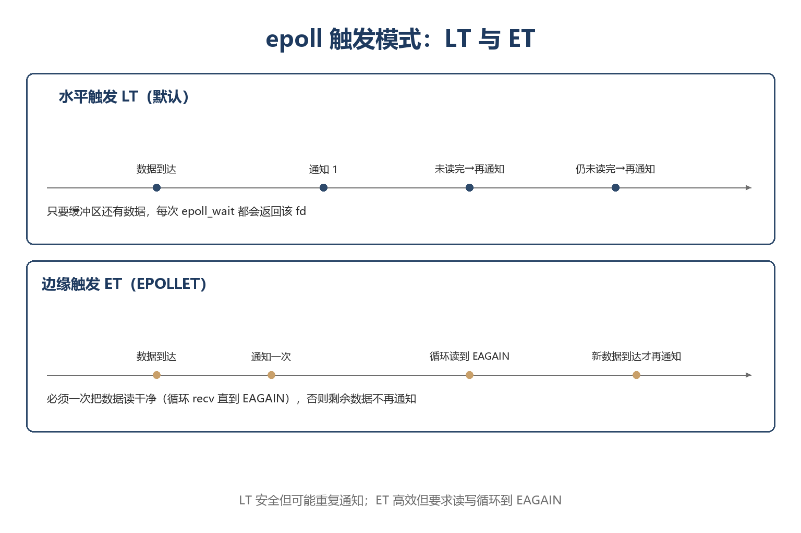

- **水平触发 LT（默认）**：只要缓冲区还有数据，每次 `epoll_wait` 都会返回该 fd。编程简单，但处理不及时会反复通知；
- **边缘触发 ET（EPOLLET）**：只在状态变化（新数据到达、连接建立）时通知一次。必须一次把数据读干净——**循环 recv 直到返回 -1 且 errno == EAGAIN**，否则剩余数据可能永远不再通知；
- ET 适合高并发、事件驱动场景；LT 适合逻辑简单、不想处理读循环的场景。

**两种触发模式的取舍**：

| 维度 | 水平触发 LT（默认） | 边缘触发 ET（`EPOLLET`） |
|---|---|---|
| 通知时机 | 只要缓冲区还有数据，每轮 `epoll_wait` 都返回 | 只在状态变化时通知一次 |
| 通知次数 | 可能很多次（处理慢就反复通知） | 一次状态变化只一次 |
| 编程要求 | 可以只读一部分，下次再读 | 必须循环读到 `EAGAIN`，否则剩余数据可能永不通知 |
| 丢数据风险 | 低 | 读不干净就丢 |
| 典型用法 | 逻辑简单、单线程、可分批处理 | 高并发、事件驱动、任务投递 |

有一条容易忽略的因果关系：**LT 在“监听与处理分离”的模型里会重复投递**——主线程把连接任务交给线程池后立即返回，而连接还没被 `accept`、监听 socket 依然可读，LT 会再次返回同一个 fd。这就是 9.6 那个 bug 的根因，也是项目里监听 socket 与客户端 socket 都改用 ET 的原因。ET 把“重复投递”变成了“自己必须读完”，把责任从内核转给了业务代码。

## 7.5 三模型对比

| 维度 | select | poll | epoll |
|---|---|---|---|
| 监听上限 | 1024（FD_SETSIZE） | 数组长度，受 ulimit 限制 | 受内存与 ulimit 限制，十万级 |
| 数据结构 | fd_set 位图 | pollfd 数组 | 红黑树 + 就绪链表 |
| 每轮拷贝 | 全量 | 全量 | 无（注册一次） |
| 就绪查找 | O(n) 扫描 | O(n) 扫描 | 只取就绪链表 |
| 事件细分 | 读/写/异常 | 多种 POLLIN/POLLOUT 等 | 多种 EPOLLIN/EPOLLOUT/EPOLLET 等 |
| 定时精度 | 支持微秒级 timeout | 毫秒级 | 毫秒级 |
| 单次调用开销 | 两次全量拷贝 + O(n) 扫描 | 全量拷贝（单位更大）+ O(n) 扫描 | 一次系统调用，只拷回 k 条 |
| 内核常驻对象 | 无（只用共享的等待队列） | 无 | eventpoll + 红黑树 + 双向链表 |
| 少量连接表现 | 好（够用且最轻） | 好 | 偏差（杀鸡用牛刀） |
| 平台可移植性 | 最好（POSIX，Windows 也有） | 好（POSIX） | 仅 Linux |
| 编程复杂度 | 低（四个宏） | 低（一个数组） | 中高（实例 / 注册 / ET） |
| 触发模式 | 天然水平触发 | 天然水平触发 | LT / ET 可选 |
| 适用场景 | 连接少、跨平台 | 连接中等、事件较多 | 大量连接、高并发 |

> 监听能力强不等于处理能力强：读写与业务处理仍由进程/线程完成；epoll 的优势在于“大量连接中只挑就绪的”。

**三套接口的事件写法对照**（同一种“读事件”的不同表达）：

| 语义 | select | poll | epoll |
|---|---|---|---|
| 可读 | 读集合 `FD_ISSET` | `POLLIN` | `EPOLLIN` |
| 可写 | 写集合 `FD_ISSET` | `POLLOUT` | `EPOLLOUT` |
| 出错 | 异常集合 `FD_ISSET` | `POLLERR` | `EPOLLERR` |
| 对端关闭 | 只能靠 `read` 返回 0 发现 | `POLLHUP` / `POLLRDHUP` | `EPOLLHUP` / `EPOLLRDHUP` |
| 触发方式 | 无（天然水平触发） | 无（天然水平触发） | `EPOLLET` 切换为边缘触发 |

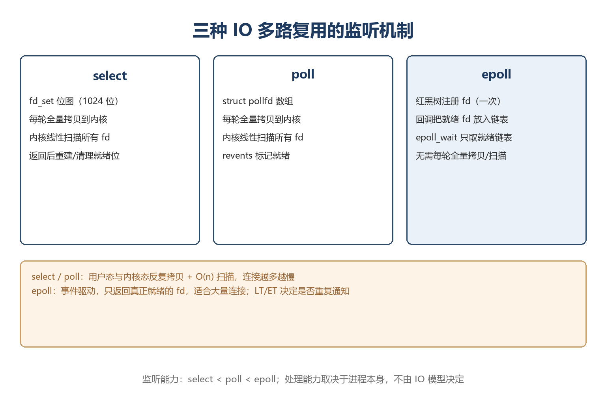

**三模型优缺点总表**（每条都能在前文找到出处）：

| | select | poll | epoll |
|---|---|---|---|
| 优点 | 兼容性最好；接口最简单（四个宏）；轻量、无内核常驻结构；超时支持微秒（7.1） | 没有 1024 硬上限；按 fd 单独设置事件；事件种类多；接口同样简单（7.2） | 监听数只受 `ulimit -n` 与内存；无轮询，只取就绪；事件最丰富；注册一次不再拷贝；可按 fd 修改（7.3） |
| 缺点 | 1024 上限；O(n) 轮询拖累 IO；事件不细分；集合粒度不灵活；两次拷贝 + 重复挂载；传入传出未分离；只报数量不报是谁、需再遍历反查（7.1） | 仍是轮询；仍受 `ulimit -n` 约束；拷贝单位更大、更贵（7.2） | 少量连接开销偏大；红黑树成本；仅 Linux；编程复杂（7.3） |
| 一句话选型 | 几十个连接、要跨平台 | 几百到几千、事件类型杂 | 上千到十万级、只看监听效率 |

# 第 8 章 生产者消费者与线程池

每连接一线程的服务器无法控制线程数量：连接突增时线程暴涨，空闲时线程又闲置。**线程池**把“创建线程”与“处理任务”解耦：固定一批消费者线程，从任务队列取任务执行，由管理者线程按负载扩容/缩减。

## 8.1 生产者消费者模型

- **生产者**：接收请求的一方（服务器中通常是监听线程），把任务放进容器；
- **消费者**：工作线程，从容器取任务并执行；
- **任务容器**：缓存任务的队列；
- **任务传递**：传递的不是数据，而是“函数指针 + 参数”，即 `task_t`。

这里要把**数据传递**与**任务传递**分开：数据传递交出去的是“要处理的数据”，接收方必须先知道这些数据该怎么处理；任务传递交出去的是“做什么”——函数指针指向业务函数，参指针指向业务自己的数据。线程池采用后者，因为调度层本来就不认得业务：它只负责把任务交给空闲线程，不需要为每种业务写一套分发逻辑；业务的增减只改函数，不改线程池。

任务容器选择**队列**而不是普通数组：队列天然只在一头进、另一头出，符合任务“先到先处理”的顺序；容量固定后可以配条件变量做**背压**（队列满则生产者等，队列空则消费者等），把“生产太快”与“消费太慢”都变成可控的阻塞，而不是内存无限膨胀。

```c
typedef struct
{
    void *(*business)(void *arg);   // 业务处理函数
    void *arg;                       // 业务参数
} task_t;
```

三个角色连起来是一条单向流水线：生产者把 `task_t` 塞进环形队列，消费者取出来调用 `ts.business(ts.arg)`，队列满或空时才用条件变量停下来等。

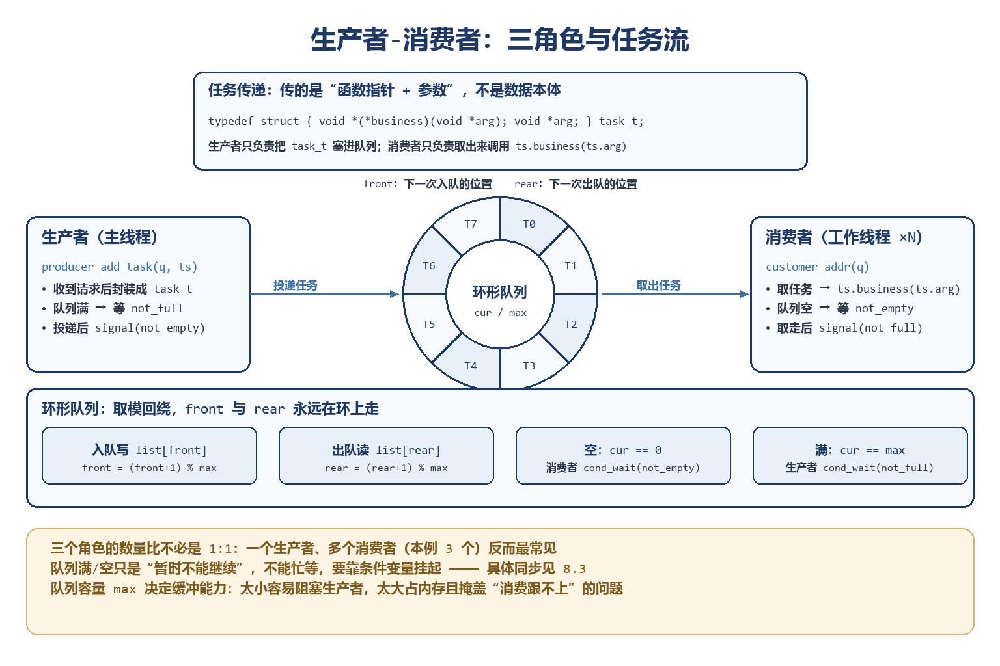

三个角色的数量比不必是 1:1，这正是线程池能按负载伸缩的余地。

`producer_and_customer.c`——三个消费者 + 主线程生产 20 个任务：

```c
#include<stdio.h>
#include<pthread.h>
#include<stdlib.h>
#include<unistd.h>
#include<string.h>

pthread_mutex_t lock;
pthread_cond_t not_empty;
pthread_cond_t not_full;

//任务类型
typedef struct
{
    void *(*business)(void *arg);//业务处理函数，类型：函数指针
    void *arg;//业务处理函数的参数
}task_t;//任务类型

//队列类型
typedef struct{
    task_t *list;//队列
    int front;//队头
    int rear;//队尾
    int max;
    int cur;
}queue_t;//队列类型

//返回值为队列类型首地址
queue_t *queue_initializer(int max)
{
    queue_t *q = NULL;
    if((q = (queue_t *)malloc(sizeof(queue_t))) == NULL)
    {
        perror("queue_init malloc queue failed");
        exit(0);
    }
    if((q->list = (task_t*)malloc(max * sizeof(task_t))) == NULL)
    {
        perror("queue_init,malloc list,failed");
        exit(0);
    }
    q->front = 0;
    q->rear = 0;
    q->max = max;
    q->cur = 0;
    return q;
}

//生产者执行，添加一次任务
int producer_add_task(queue_t *ptr,task_t ts)
{
    pthread_mutex_lock(&lock);
    while(ptr->cur == ptr->max)
    {
        //挂起
        pthread_cond_wait(&not_full,&lock);//等待not_full条件变量
    }
    //添加任务
    ptr->list[ptr->front].business = ts.business;
    ptr->list[ptr->front].arg = ts.arg;
    printf("producer 0x%x,add busines_addr %p\n",(unsigned int)pthread_self(),ts.business);
    ++(ptr->cur);
    ptr->front = (ptr->front + 1) % ptr->max;
    pthread_mutex_unlock(&lock);
    pthread_cond_signal(&not_empty);//唤醒消费者，not_empty条件变量

    return 0;
}

//消费者线程代码
void *customer_addr(void *arg)
{
    queue_t *ptr = (queue_t*)arg;
    task_t ts;
    printf("cusomter 0x%x,waiting business...\n",(unsigned int)pthread_self());
    //持续尝试获取任务
    while(1)
    {
        pthread_mutex_lock(&lock);
        while(ptr->cur == 0)
        {
            //挂起
            pthread_cond_wait(&not_empty,&lock);
        }
        //获取任务并执行
        ts.business = ptr->list[ptr->rear].business;
        ts.arg = ptr->list[ptr->rear].arg;
        --(ptr->cur);
        ptr->rear = (ptr->rear + 1) % ptr->max;
        pthread_mutex_unlock(&lock);
        pthread_cond_signal(&not_full);//唤醒生产者，not_full条件变量
        ts.business(ts.arg);//执行任务
    }
    pthread_exit(NULL);
}

//测试业务处理函数
void *test_business(void *arg)
{
    printf("消费者0x%x执行测试任务...\n",(unsigned int)pthread_self());
    return NULL;
}

//主线程，生产者任务代码
int main(void)
{
    pthread_mutex_init(&lock,NULL);
    pthread_cond_init(&not_empty,NULL);
    pthread_cond_init(&not_full,NULL);
    queue_t *ptr = NULL;
    ptr = queue_initializer(1000);
    //创建消费者
    pthread_t tid[3];
    for(int i=0;i<3;i++)
    {
        pthread_create(&tid[i],NULL,customer_addr,(void*)ptr);
    }
    sleep(5);
    task_t ts;
    ts.business = test_business;
    ts.arg = NULL;
    for(int i=0;i<20;i++)
    {
        producer_add_task(ptr,ts);
    }
    while(1)
    {
        sleep(1);
    }

    return 0;
}
```

运行效果：三个消费者交替取出任务并打印自己的 tid，验证“多个消费者共同消费同一队列”。

## 8.2 环形队列

任务容器选择**环形队列**：线性队列遍历到末尾会越界，环形队列通过回绕重复利用已分配内存。

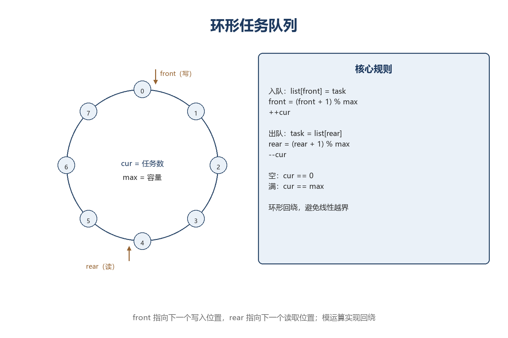

关键规则：

- 入队：写 `list[front]`，`front = (front + 1) % max`，`++cur`；
- 出队：读 `list[rear]`，`rear = (rear + 1) % max`，`--cur`；
- 空：`cur == 0`；满：`cur == max`；
- 环形队列必须用取模回绕，不能直接 `front++`。

## 8.3 同步机制

- 队列是共享资源，所有入队/出队都要在互斥锁保护下进行；
- 两个条件变量：`not_empty`（队列空时消费者挂起）、`not_full`（队列满时生产者挂起）；
- 等待必须写在 `while` 循环里，被唤醒后重新判断条件（防误唤醒）；
- 生产者入队后 `signal(not_empty)`，消费者出队后 `signal(not_full)`。

为什么必须是**两个**条件变量：根因是“被唤醒的线程应该能继续干活”。如果只用一个条件变量，生产者满队挂起、消费者空队挂起，两者睡在同一队列上；生产者入队后 `signal` 可能唤醒的是另一个生产者，而它依然面对满队，只能再次挂起，真正该干活的消费者却还在睡。两个条件变量把“哪些线程在等什么”分开，才能定向唤醒。

`wait` 必须包在 `while` 里重判条件，原因有二：一是 `pthread_cond_signal` 唤醒的线程数并不保证正好是 1（多核下可能唤醒多个），二是等待期间可能有其他线程先一步拿走了任务；醒后不重判就会在队空时继续出队、队满时继续入队。

锁保护的是数据结构，条件变量表达的是“能不能继续”——两者缺一不可：只有锁，消费者会抱着锁空转；只有条件变量，判断条件与挂起之间存在竞态。

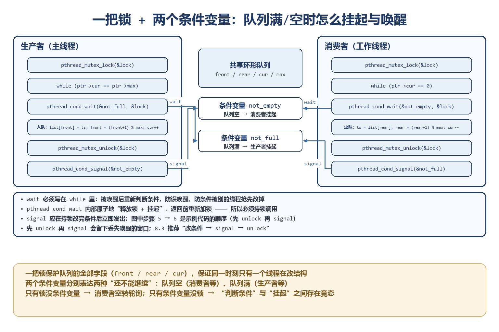

> 条件变量 `wait` 返回时已重新持有锁；信号建议在持锁修改条件后立即发出，避免“先解锁再 signal”的丢失唤醒窗口。

## 8.4 线程池核心结构（UML 类图）

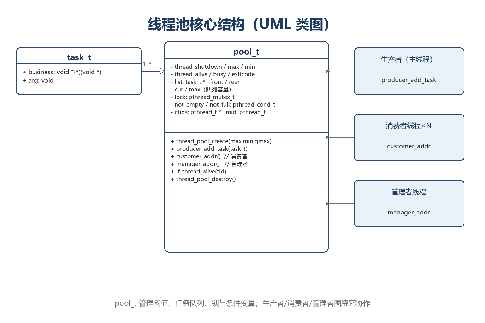

| 组成 | 职责 |
|---|---|
| 生产者（主线程） | 调用 `producer_add_task` 投递任务 |
| 消费者线程 `customer_addr` | 循环取任务、执行、维护 busy |
| 管理者线程 `manager_addr` | 周期扫描阈值，扩容/缩减 |
| 任务队列 `task_t *list` | 环形缓存，`front/rear/cur/max` |
| 同步 | `lock` + `not_empty` + `not_full` |

## 8.5 线程池设计五原则

1. **消费者不与任务绑定**：消费者只负责“取任务 → 执行”，不关心具体业务，业务通过函数指针传入；
2. **线程管理机制**：单独的管理者线程负责统计与扩缩容，不让业务线程兼任；
3. **预创建机制**：启动时先创建最小数量线程，任务到达立即处理，避免“来任务再创建”的延迟；
4. **线程数量弹性伸缩**：按负载在 min~max 之间扩容/缩减；
5. **拒绝策略**：队列满时如何处理新任务，常见三种——
   - 调用者自己处理（主线程执行该任务）；
   - 丢弃任务（可按时间丢弃旧任务、保留新任务）；
   - 本地缓存/排队（先存到别处，空闲后再补入队列）。

> 丢弃请求对用户最不友好，应优先考虑调用者处理或缓存；线程池课程示例未实现拒绝策略，但需要理解这三种思路。

## 8.6 结构与阈值

| 阈值 | 含义 |
|---|---|
| `thread_max` | 最大线程数 |
| `thread_min` | 最小线程数（预创建数量） |
| `thread_alive` | 当前存活线程数 |
| `thread_busy` | 正在执行任务的线程数（空闲 = alive - busy） |
| `thread_shutdown` | 线程池开关，true 表示运行 |
| `thread_exitcode` | 缩减时的“退出名额”，消费者自查后退出 |
| `front / rear / cur / max` | 环形队列写位置/读位置/当前任务数/容量 |

## 8.7 扩容、缩减与线程探活

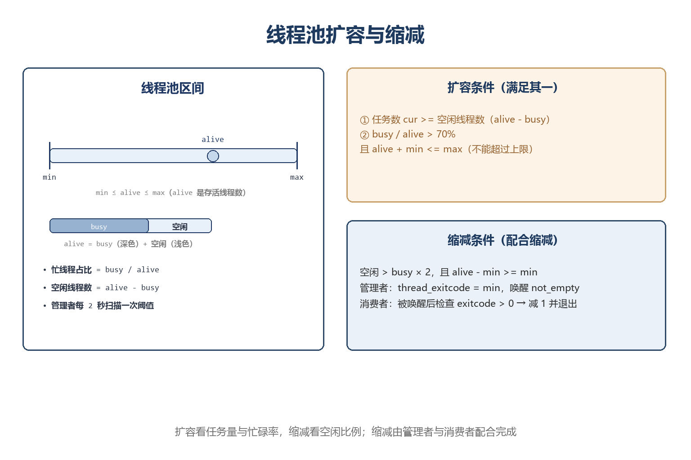

**扩容条件**（满足其一，且 `alive + min <= max`）：

- 任务数 `cur >= alive - busy`（任务比空闲线程多，快不够用）；
- 忙线程占比 `busy / alive > 70%`（预留缓冲，避免卡在边界）。

**缩减条件**（同时满足）：

- 空闲线程 `alive - busy > busy * 2`（空闲超过忙碌的两倍）；
- `alive - min >= min`（缩减后不低于最小值）。

**配合缩减（方案 B）**：

1. 管理者设置 `thread_exitcode = thread_min`；
2. 管理者对 `not_empty` 发 `thread_min` 次 `signal`，唤醒一批空闲消费者；
3. 消费者在“队列为空而挂起”的位置被唤醒后检查 `thread_exitcode > 0`：减 1、`thread_alive` 减 1、自行 `pthread_exit`。

这样管理者只负责“定名额 + 唤醒”，具体退出由消费者自己完成，避免管理者遍历数组、逐个取消线程的高压力操作。

**两种缩减方案的取舍**：

| 方案 | 做法 | 问题 |
|---|---|---|
| A：管理者直接杀 | 管理者遍历 `ctids`，对多余线程 `pthread_cancel` | 必须自己维护数组槽位有效性（线程已退出时取消会失败）；取消是异步的，线程可能死在临界区里，锁与计数都得额外善后；压力全集中在管理者身上 |
| B：名额 + 自查（选定） | 管理者设 `thread_exitcode` 名额并唤醒，消费者自己决定退出 | 退出时机由线程自己掌控（只在安全位置退出），锁竞争少；代价是缩减不是即时的，队列一直有任务时会推迟 |

**管理者线程的工作方式**：它是一个周期线程（循环 `sleep(2)`），每个周期先加锁把 `alive`/`busy`/`cur` 读成一份快照再解锁判断——快照只是“近似值”，阈值判断不必精确到毫秒，但千万不能抱着锁去创建线程（创建、取消、join 都耗时，持锁会阻塞所有消费者）。扩容时批量创建并把新线程 tid 写回数组、同时累加 `alive`；缩减时只设名额并唤醒，实际减计数由退出的消费者自己完成。

**线程探活**：`pthread_kill(tid, 0)` 不发送真实信号，只做存在性检查；返回 `ESRCH` 说明线程已不存在。管理者用它判断 `ctids` 数组中的槽位是否可复用。

## 8.8 线程池代码

先把主干流程立起来，再读具体函数。

**创建流程**：初始化互斥锁与两个条件变量 → 构造环形队列（分配 `max` 个 `task_t`）→ 预创建 `thread_min` 个消费者线程（满足“任务到即有线程”）→ 创建 1 个管理者线程 → 把每个线程的 tid 存入 `ctids` 数组供后续探活与回收。

**销毁流程**：把 `thread_shutdown` 置为假（告诉所有线程“不要再接任务”）→ 对两个条件变量都 `broadcast`（否则挂起的线程永远等不到唤醒）→ 逐个 `join`（消费者与管理者）→ 销毁锁/条件变量 → 释放队列、tid 数组与池结构体。顺序不能反：先销毁锁再去 join，线程可能跑在一个已失效的锁上。

公共头文件 `pool_server.h`：

```c
#include<stdio.h>
#include<stdlib.h>
#include<string.h>
#include<unistd.h>
#include<sys/types.h>
#include<sys/stat.h>
#include<sys/fcntl.h>
#include<sys/socket.h>
#include<arpa/inet.h>
#include<time.h>
#include<pthread.h>
#include<sys/epoll.h>
#include<errno.h>
#include<signal.h>
#include<stdbool.h>
#include<errno.h>

extern int epfd;

typedef struct
{
    void *(*business)(void *arg);//业务处理函数
    void *arg;//业务处理函数的参数
}task_t;

typedef struct
{
    //线程基础阈值
    int thread_shutdown;
    int thread_max;
    int thread_min;
    int thread_busy;
    int thread_alive;
    int thread_exitcode;
    //任务缓存
    task_t *list;//任务缓存队列
    int front;
    int rear;
    int cur;
    int max;
    //线程安全
    pthread_mutex_t lock;
    pthread_cond_t not_empty;
    pthread_cond_t not_full;
    pthread_t *ctids;//线程ID数组
    pthread_t mid;//管理者线程ID
}pool_t;

pool_t* thread_pool_create(int,int,int);//线程池创建初始化
int thread_pool_destroy(pool_t *);//释放线程池资源
int producer_add_task(pool_t *,task_t);//添加任务
void* customer_addr(void *);//消费者任务
void* manager_addr(void *);//管理者任务
//void* test_business(void *);//测试业务处理函数
int if_thread_alive(pthread_t);//测试线程是否有效
int server_netinitializer(void);//服务器网络初始化
int epoll_initializer(int sockfd);//epoll初始化
int epoll_listen(pool_t *ptr,int server_sockfd);//监听并投递任务
void *business_connect(void *arg);//serversocket就绪，连接任务
void *business_response(void *arg);//clientsock就绪，处理任务
void server_start(int shutdown);//服务器启动接口
```

`thread_pool_create.c`——分配空间、初始化阈值、预创建 min 个消费者 + 1 个管理者：

它一次性把锁、两个条件变量、环形队列与线程数组全部准备好，之后整个运行期不再重新分配；消费者创建后立即进入取任务循环，管理者创建后进入周期扫描。关键点是“预创建”——把创建线程的开销提前到启动阶段，请求到来时不再等线程。

```c
#include "../include/pool_server.h"

pool_t* thread_pool_create(int tmax,int tmin,int qmax)
{
    pool_t *ptr = NULL;
    if((ptr = (pool_t *)malloc(sizeof(pool_t))) == NULL)//分配线程池空间
    {
        perror("thread_pool_create malloc queue failed");
        exit(0);
    }
    if((ptr->list = (task_t*)malloc(qmax * sizeof(task_t))) == NULL)//分配任务队列空间
    {
        perror("thread_pool_create malloc list failed");
        exit(0);
    }
    if((ptr->ctids = (pthread_t*)malloc(tmax * sizeof(pthread_t))) == NULL)//分配线程ID空间
    {
        perror("thread_pool_create malloc ctids failed");
        exit(0);
    }
    ptr->thread_shutdown = true;//线程池销毁标志
    ptr->thread_max = tmax;//线程池最大线程数
    ptr->thread_min = tmin;//线程池最小线程数
    ptr->thread_alive = 0;//线程池当前线程数
    ptr->thread_busy = 0;//线程池忙线程数
    ptr->thread_exitcode = 0;//线程池退出码

    ptr->front = 0;
    ptr->rear = 0;
    ptr->max = qmax;
    ptr->cur = 0;

    //creating
    //创建最小数量的线程
    int err;
    for(int i=0;i<ptr->thread_min;i++)
    {
        if((err = pthread_create(&ptr->ctids[i],NULL,customer_addr,(void*)ptr)) > 0)
        {
            printf("thread_pool_create pthread_create failed:%s\n",strerror(err));
            exit(0);
        }
        ++(ptr->thread_alive);//线程池当前线程数加一
    }
    //创建管理者线程
    if((err = pthread_create(&ptr->mid,NULL,manager_addr,(void*)ptr)) > 0)
    {
        printf("thread_pool_create manager failed:%s\n",strerror(err));
        exit(0);
    }

    return ptr;    
}
```

要点：

- 三块内存（池结构体、任务队列、tid 数组）分配失败一律 `exit`：初始化阶段没有可回滚的状态，带着半初始化对象继续运行只会崩在更难定位的地方；
- `shutdown`、`max/min/alive/busy/exitcode` 与 `front/rear/cur/max` 在这里一次性定值，运行期只允许在锁内修改；
- 预创建循环里的 `alive++` 放在创建成功之后：线程还没起来就加计数，会让管理者误以为池里有人；
- 消费者先建、管理者后建，因为管理者要读 `ctids` 数组判断槽位。

`producer_add_task.c`——队列满则等待，入队后唤醒消费者：

它是主线程（监听循环）与线程池之间唯一的接口：拿锁 → 判满则挂起 → 写入 `front` 位置 → `front = (front+1) % max`、`cur++` → 解锁 → 唤醒 `not_empty`。入队的是 `task_t` 两个字段，不拷贝业务数据。

```c
#include "../include/pool_server.h"

int producer_add_task(pool_t *ptr,task_t ts)
{
    if(ptr->thread_shutdown)
    {
        pthread_mutex_lock(&ptr->lock);
        while(ptr->cur == ptr->max)
        {
            pthread_cond_wait(&ptr->not_full,&ptr->lock);
            if(!ptr->thread_shutdown)
            {
                pthread_mutex_unlock(&ptr->lock);
                printf("shutdown close,producer exiting...\n");
                return -1;
            }
        }
        //添加任务
        ptr->list[ptr->front].business = ts.business;
        ptr->list[ptr->front].arg = ts.arg;
        ++(ptr->cur);
        ptr->front = (ptr->front + 1) % ptr->max;
        pthread_mutex_unlock(&ptr->lock);
        pthread_cond_signal(&ptr->not_empty);//唤醒消费者，not_empty条件变量

        return 0;
    }
    return -1;//线程池已关闭
}
```

要点：

- 入队在 `front`、出队在 `rear`，两头都取模回绕，`cur` 是唯一的判空/判满依据；
- 判满用 `while` 而不是 `if`：被唤醒后可能已被其他生产者插队，必须重新判；
- 解锁之后再 `signal(not_empty)`：若在锁内唤醒，被唤醒的消费者会立即在锁上阻塞，白白多一次切换；
- 投递的是两个指针，不拷贝业务数据，参数生命周期由业务方保证。

`customer_addr.c`——消费者循环取任务，维护 busy，并响应退出码：

每个消费者都重复“拿锁 → 空队则挂起 → 取任务、维护 `rear/cur` → `busy++` → 解锁 → 执行 → 拿锁 `busy--`”这一套动作；执行任务时**必须把锁释放**，否则整个线程池会退化成串行。挂起醒来后还要先看 `thread_exitcode` 是否大于 0，是则减名额并自行退出。

```c
#include "../include/pool_server.h"

void* customer_addr(void* arg)
{
    pool_t *ptr = (pool_t*)arg;
    task_t ts;
    printf("cusomter 0x%x,waiting business...\n",(unsigned int)pthread_self());
    //持续尝试获取任务
    while(ptr->thread_shutdown)
    {
        pthread_mutex_lock(&ptr->lock);
        //持续尝试获取任务
        while(ptr->cur == 0)
        {
            //挂起
            pthread_cond_wait(&ptr->not_empty,&ptr->lock);
            if(!ptr->thread_shutdown)
            {
                pthread_mutex_unlock(&ptr->lock);
                printf("shutdown close,customer exiting...\n");
                pthread_exit(NULL);
            }
            if(ptr->thread_exitcode > 0)
            {
                --(ptr->thread_exitcode);
                --(ptr->thread_alive);
                pthread_mutex_unlock(&ptr->lock);
                printf("customer exitcode exiting...\n");
                pthread_exit(NULL);
            }
        }
        ts.business = ptr->list[ptr->rear].business;
        ts.arg = ptr->list[ptr->rear].arg;
        --(ptr->cur);
        ptr->rear = (ptr->rear + 1) % ptr->max;
        ++(ptr->thread_busy);
        pthread_mutex_unlock(&ptr->lock);
        pthread_cond_signal(&ptr->not_full);//唤醒生产者，not_full条件变量
        (ts.business)(ts.arg);//执行任务
        pthread_mutex_lock(&ptr->lock);
        --(ptr->thread_busy);
        pthread_mutex_unlock(&ptr->lock);
    }
    printf("shutdown close,customer exiting...\n");
    pthread_exit(NULL);
}
```

要点：

- `busy++` 必须在取到任务、释放锁之前完成，`busy--` 在执行完之后——`busy` 是管理者判断扩缩容的唯一依据；
- 真正执行 `ts.business(ts.arg)` 时锁已释放，否则整个线程池会退化成串行；
- 挂起醒来先看 `shutdown`、再看 `exitcode`，且两个判断都在锁内；退出前必须先解锁（`pthread_exit` 不会替你释放互斥锁）；
- 退出用 `pthread_exit` 而不是 `exit`，后者会带走整个进程。

`manager_addr.c`——每 2 秒扫描阈值，执行扩容/缩减：

每个周期只在“拿锁取快照”时持锁，判断与线程创建都在锁外完成：释放锁后再去 `pthread_create` 或设 `thread_exitcode`，避免长时间占锁阻塞生产者与消费者。扩容后要把新 tid 写回 `ctids` 并累加 `alive`；缩减只设名额与 signal，不直接杀线程。

```c
#include "../include/pool_server.h"

void* manager_addr(void* arg)
{
    pool_t *ptr = (pool_t*)arg;
    int alive,busy,cur;
    int add;//累计线程
    int flag;//遍历下标，遍历ctids
    int err;
    printf("manager thread 0x%x,Runing...\n",(unsigned int)pthread_self());
    while(ptr->thread_shutdown)
    {
        //上锁获取阈值
        pthread_mutex_lock(&ptr->lock);
        alive = ptr->thread_alive;
        busy = ptr->thread_busy;
        cur = ptr->cur;
        pthread_mutex_unlock(&ptr->lock);
        printf("info [alive %d] [busy %d] [cur %d] [B/A %.2f%%] [A/M %.2f%%]\n",alive,busy,alive - busy,(double)busy/alive * 100,(float)alive/ptr->thread_max * 100);
        if((cur >= alive - busy||(double)busy/alive * 100 > 70)&&alive +ptr->thread_min <= ptr->thread_max)
        {
            for(flag=0,add=0;flag < ptr->thread_max&& add < ptr->thread_min;flag++)
            {
                if(ptr->ctids[flag] == 0||!if_thread_alive(ptr->ctids[flag]))
                {
                    if((err = pthread_create(&ptr->ctids[flag],NULL,customer_addr,(void*)ptr)) > 0)
                    {
                        printf("manager_addr pthread_create failed:%s\n",strerror(err));
                        exit(0);
                    }
                    add++;
                    pthread_mutex_lock(&ptr->lock);
                    ++(ptr->thread_alive);
                    pthread_mutex_unlock(&ptr->lock);
                }
            }
        }
        if(busy * 2 <= alive - busy && alive - ptr->thread_min >= ptr->thread_min)
        {
            pthread_mutex_lock(&ptr->lock);
            ptr->thread_exitcode = ptr->thread_min;
            pthread_mutex_unlock(&ptr->lock);
            for(int i=0;i<ptr->thread_min;i++)
                pthread_cond_signal(&ptr->not_empty);
        }
        sleep(2);
    }
    return NULL;
}
```

要点：

- 只在取快照时持锁，判断与 `pthread_create` 都在锁外；创建成功后单独拿一次锁把 `alive` 加一；
- 扩容条件：`cur >= alive - busy` 或 `busy/alive > 70%`，且 `alive + min <= max`；新线程优先复用 `ctids` 里的空槽或已退出槽位；
- 缩减条件：`busy*2 <= alive - busy` 且 `alive - min >= min`；设 `exitcode = min` 后连发 `min` 次 `signal`，让空闲消费者自己退；
- 每轮 `sleep(2)` 控制扫描频率：太快白烧 CPU，太慢对负载变化反应迟钝。

`if_thread_alive.c`——`pthread_kill(tid, 0)` 探活：

信号 0 不递达任何处理器，只走一遍“目标线程是否存在”的内核检查：返回 0 说明存活，返回 `ESRCH` 说明线程已退出、数组槽位可复用。用它而不维护额外的存活标志，是因为后者需要自己保证读写同步，而且线程异常退出时无法自动更新。

```c
#include "../include/pool_server.h"

int if_thread_alive(pthread_t tid)
{
    int err;
    err = pthread_kill(tid,0);//试探线程是否存活
    if(err == ESRCH)
        return 0;
    return 1;
}
```

要点：

- 只把 `ESRCH` 当“已退出”，其它返回值一律当存活——误判会导致槽位被重复占用；
- 探活与复用之间存在时间窗，复用槽位时要立刻写入新 tid；
- 它只回答“线程存不存在”，不回答“是否在干活”，后者要看 `busy`。

`thread_pool_destroy.c` 在工程中为空文件，需补全销毁逻辑（参考实现）：

```c
#include "../include/pool_server.h"

int thread_pool_destroy(pool_t *ptr)
{
    if(ptr == NULL)
        return -1;
    //关闭开关，唤醒所有挂起线程
    pthread_mutex_lock(&ptr->lock);
    ptr->thread_shutdown = false;
    pthread_cond_broadcast(&ptr->not_empty);
    pthread_cond_broadcast(&ptr->not_full);
    pthread_mutex_unlock(&ptr->lock);
    //等待消费者退出
    for(int i=0;i<ptr->thread_max;i++)
    {
        if(ptr->ctids[i] != 0)
            pthread_join(ptr->ctids[i],NULL);
    }
    pthread_join(ptr->mid,NULL);
    //释放同步资源与内存
    pthread_mutex_destroy(&ptr->lock);
    pthread_cond_destroy(&ptr->not_empty);
    pthread_cond_destroy(&ptr->not_full);
    free(ptr->list);
    free(ptr->ctids);
    free(ptr);
    return 0;
}
```

要点：

- 先改开关与广播唤醒，再 join：不广播的话挂在 `not_full` 上的生产者永远醒不来；
- 只 join `ctids[i] != 0` 的槽位，未创建的槽位不能 join；
- 顺序：关开关 → 两个 `broadcast` → join 全部线程 → 销毁锁/条件变量 → 释放内存；
- 销毁期间若仍有生产者投递，会与 join 竞态；实际用法是先让监听循环退出，再调销毁。

## 8.9 代码风险与修正

- **alive 计数必须统一加锁**：创建线程时 `thread_alive` 自增在锁外（初始化阶段可接受），运行期扩容/缩减必须在锁内修改，否则管理者统计会漂移；
- **exitcode 只在队列为空时检查**：消费者只在 `cur == 0` 的挂起循环里检查退出码；队列一直有任务时缩减不会生效，这是“先处理完手头任务再缩减”的折中；
- **signal 在 unlock 之后**：存在理论上的丢失唤醒窗口；更稳妥的写法是在持锁修改条件后立即 signal，再 unlock；
- **销毁顺序**：必须先置 `shutdown=false`、广播唤醒、join 全部线程，再销毁锁/条件变量并释放内存；空文件的 `thread_pool_destroy` 不补全会导致资源泄漏；
- **任务参数所有权**：`task_t.arg` 若指向栈变量，生产者返回后即失效；线程池不负责释放参数，投递前应确保生命周期或由业务自行释放。

**如何验证扩容与缩减真的生效**：用一个带 `sleep(1)` 的耗时任务制造积压，持续投递后观察 `pthread_create` 日志与 `thread_alive` 是否增长——增长说明扩容条件被命中；停止投递并等待队列排空，`busy` 归零后应看到空闲比超过两倍，`thread_exitcode` 被置位、`alive` 回落，说明缩减生效。

`alive` 计数不准是最常见的“看起来能用但数字不对”的问题：一是自增自减分散在多处，只要有一处落在锁外就会与他线程的写入互相覆盖；二是消费者走 `pthread_exit` 或异常返回时漏减；三是缩减时“减计数”放在管理者侧、而线程实际尚未退出，导致短时间内外数不一致。统一规则是：**谁改变自身状态，谁在锁内改计数**。

# 第 9 章 epoll + 线程池服务器项目

把第 7 章的 epoll 与第 8 章的线程池拼起来，就是一个可用的高并发服务器骨架：**主线程只监听、投递任务，消费者线程执行连接与读写业务**。

## 9.1 项目结构

```text
epoll_threadpoll_server/
├── include/pool_server.h        // 结构体、全局 epfd、函数声明
├── source/
│   ├── main.c                   // 入口
│   ├── server_start.c           // 启动：网络初始化 + epoll 初始化 + 创建线程池 + 监听
│   ├── server_netinitializer.c  // socket / bind / listen
│   ├── epoll_initializer.c      // epoll_create + 注册监听 fd
│   ├── epoll_listen.c           // epoll_wait + 投递任务
│   ├── business_connect.c       // 连接任务
│   ├── business_response.c      // 处理任务
│   ├── thread_pool_create.c     // 线程池创建
│   ├── producer_add_task.c      // 生产者投递
│   ├── customer_addr.c          // 消费者
│   ├── manager_addr.c           // 管理者
│   ├── if_thread_alive.c        // 线程探活
│   └── thread_pool_destroy.c    // 销毁（待实现）
├── producer_and_customer.c      // 生产者消费者最小演示
└── demo.c                       // pthread_kill 探活演示
```

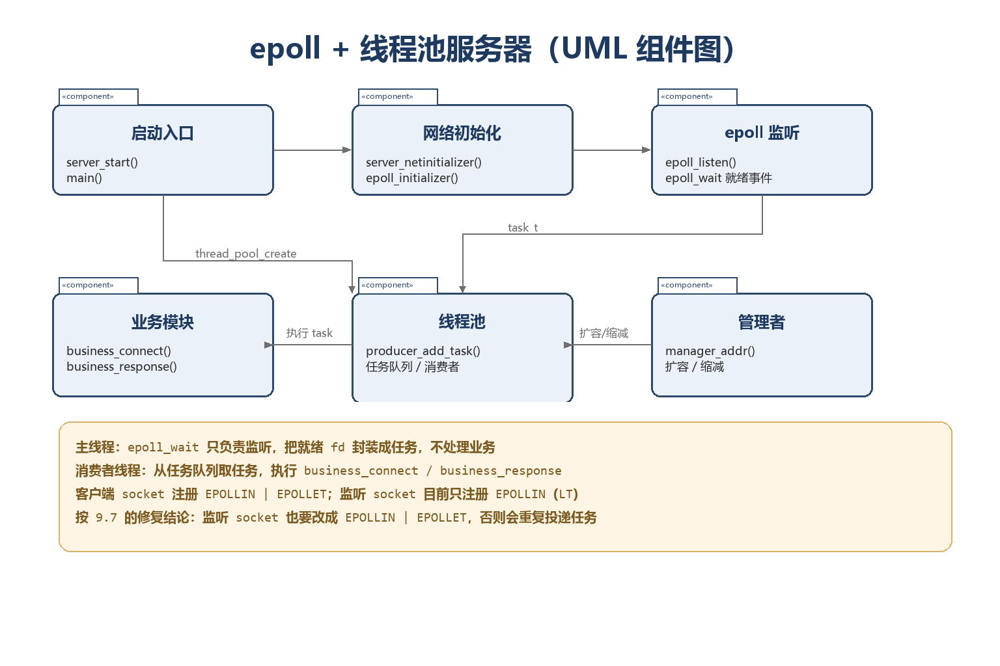

## 9.2 请求处理流程

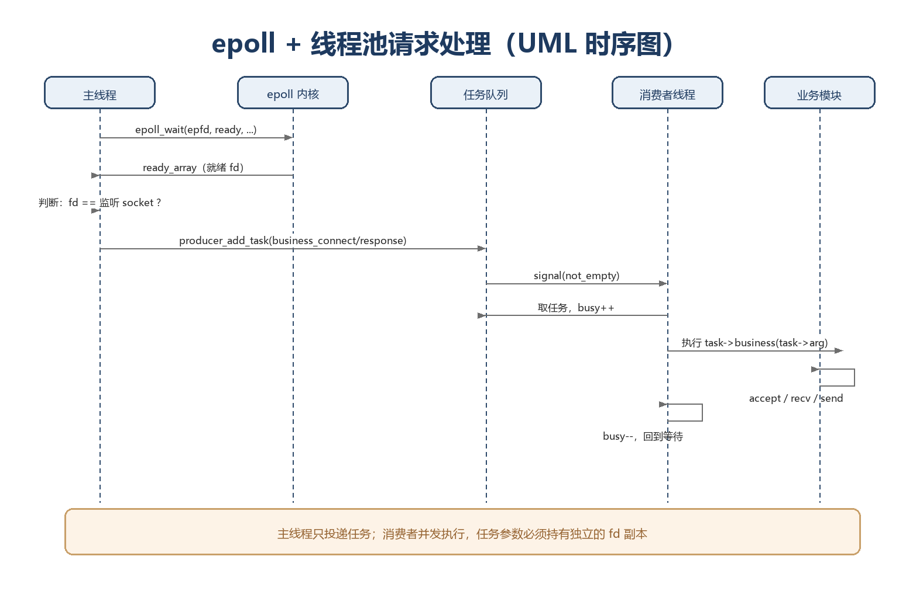

1. 主线程 `epoll_wait` 拿到就绪 fd；
2. 判断 fd 是否为监听 socket：是则投递 `business_connect`，否则投递 `business_response`；
3. `producer_add_task` 把 `task_t` 放入环形队列，唤醒消费者；
4. 消费者取任务，执行 `business(task->arg)`；
5. 连接任务 `accept` 并把新 client socket 注册进 epoll；处理任务循环 `recv`/`send`，断开时清理。

**主线程为什么不自己处理**：这是整个架构的分水岭。如果在 `epoll_wait` 的循环里直接 `accept` 或 `recv`，一个慢请求就会把监听卡住——只有把“监听”与“处理”拆开，主线程才能一直回到 `epoll_wait` 拿下一批就绪事件。代价是任务变成异步：投递出去后主线程不再知道它何时完成，因此连接与断开的资源清理必须由业务函数自己负责。

**两类任务的职责边界**：

| 任务 | 触发条件 | 职责 | 失败时的表现 |
|---|---|---|---|
| `business_connect` | 就绪 fd 等于监听 socket | `accept` 拿到新连接、取对端 IP、以 `EPOLLIN` + `EPOLLET`（按位或）注册进 epoll、回一条欢迎消息 | 连接直接丢失，客户端看到连接被重置 |
| `business_response` | 就绪 fd 是通信 socket | 循环 `recv` 读净数据、按内容生成响应、对端关闭时 `DEL` 并 `close` | 读写报错则连接悬挂，直到超时或客户端重连 |

两个任务都是“一次性”的：执行完就返回，不常驻、不阻塞等待——这是从“每连接一线程”转向“任务化”的核心变化。

## 9.3 网络模块

网络模块负责三件事：把监听 socket 建好、把它注册进 epoll、在循环里把就绪事件变成任务。三个函数串成一条启动链，任一环节失败都没必要继续往下走。

`server_netinitializer.c`：

```c
#include "../include/pool_server.h"

int server_netinitializer(void)
{
    //网络初始化
    printf("server net initializer..\n");
    struct sockaddr_in server_addr;
    bzero(&server_addr,sizeof(server_addr));
    int sockfd;
    if((sockfd = socket(AF_INET,SOCK_STREAM,0)) == -1)
        perror("server_netinitializer socket call failed");
    printf("socket create successly sockfd %d...\n",sockfd);
    server_addr.sin_family = AF_INET;
    server_addr.sin_port = htons(8080);
    server_addr.sin_addr.s_addr = htonl(INADDR_ANY);
    if((bind(sockfd,(struct sockaddr *)&server_addr,sizeof(server_addr))) == -1)
        perror("server_netinitializer bind call failed");
    printf("bind successly...\n");
    listen(sockfd,128);
    printf("server listening...\nnet_initializer success,return sockfd %d\n",sockfd);
    return sockfd;
}
```

要点：失败只打印不返回错误码——上层拿到 -1 当 fd 用会更难排查；`INADDR_ANY` 表示绑定本机所有网卡；`listen` 的 128 是半连接/全连接队列共享大小。

`epoll_initializer.c`：

```c
#include "../include/pool_server.h"

int epfd;

int epoll_initializer(int sockfd)
{
    if((epfd = epoll_create(100000)) == -1)//创建epoll实例
    {    
        perror("epoll_initializer epoll_create1 error");
        return -1;
    }
    struct epoll_event node;
    node.data.fd = sockfd;
    node.events = EPOLLIN;
    if((epoll_ctl(epfd,EPOLL_CTL_ADD,sockfd,&node)) == -1)//将server_sockfd添加到epoll实例中
    {
        perror("epoll_initializer epoll_ctl , first server_sockfd add error");
        return -1;
    }
    return epfd;
}
```

要点：`epfd` 是全局变量，因为业务线程（`business_connect`）也要往同一实例里注册新连接；监听 fd 注册时只写了 `EPOLLIN`，即水平触发——与 9.6 的修复结论不一致，应写成 `EPOLLIN | EPOLLET`；`epoll_create` 的参数在新内核里已不再影响容量，容量只看 `ulimit -n` 与内存。

`epoll_listen.c`：

它是整个服务器的心脏：唯一一个长期运行的循环。退出条件绑在线程池的 `thread_shutdown` 上，所以“关服务器”只需要把开关置假并让 `epoll_wait` 返回一次。

```c
#include"../include/pool_server.h"

int epoll_listen(pool_t *ptr,int sockfd)
{
    task_t ts;
    int readynum;
    struct epoll_event ready_array[100000];
    int flag;
    printf("epoll_listen, call epoll_wait...\n");
    while(ptr->thread_shutdown)
    {
        while((readynum = epoll_wait(epfd,ready_array,100000,-1)) == -1)
        {
            perror("epoll_listen,epoll_wait call failed");
            return -1;
        }
        flag = 0;
        while(readynum)
        {
            if(ready_array[flag].data.fd == sockfd)
            {
                ts.business = business_connect;
                ts.arg = (void*)&ready_array[flag].data.fd;
                producer_add_task(ptr,ts);
            }
            else
            {
                ts.business = business_response;
                ts.arg = (void*)&ready_array[flag].data.fd;
                producer_add_task(ptr,ts);
            }
            printf("producer thread 0x%x,add task addr=%p\n",(unsigned int)pthread_self(),ts.business);
            --readynum;
            ++flag;
        }
    }
}
```

要点：`ready_array` 是栈上的大数组（10 万个 `epoll_event`，约 1.2MB），而线程默认栈只有 8MB，写更大就容易栈溢出；`epoll_wait` 返回 -1 时直接 `return`，遇到 `EINTR` 应该重试；`ts.arg = &ready_array[flag].data.fd` 传的是栈内存地址，下一轮 `epoll_wait` 会覆盖它（详见 9.7）；退出条件挂在线程池的 `thread_shutdown` 上，所以关闭服务器需要有人能唤醒这个循环。

## 9.4 业务模块

业务模块里的两个函数就是线程池真正执行的东西：它们由**消费者线程**调用，而不是主线程。参数是 `void *`，里面装的是连接 fd（按值还是按地址传入，直接决定会不会出现 9.7 里“参数被覆盖”的严重 bug）。

`business_connect.c`：

```c
#include"../include/pool_server.h"

void *business_connect(void *arg)
{
    //接收参数
    int sockfd;
    sockfd = *(int*)arg;
    struct sockaddr_in client_addr;
    int client_sockfd;
    struct epoll_event node;
    socklen_t addrlen;
    char response[1500];
    char cip[16];

    addrlen = sizeof(client_addr);

    if((client_sockfd = accept(sockfd,(struct sockaddr *)&client_addr,&addrlen)) == -1)
    {
        perror("business_connect accept call failed");
        return NULL;
    }
    //获取cip
    bzero(cip,16);
    inet_ntop(AF_INET,&client_addr.sin_addr.s_addr,cip,16);
    //设置监听
    node.data.fd = client_sockfd;
    node.events = EPOLLIN|EPOLLET;//边缘触发
    if((epoll_ctl(epfd,EPOLL_CTL_ADD,client_sockfd,&node)) == -1)
        perror("business_connect epoll_ctl add client_sockfd error");
    
    bzero(response,sizeof(response));
    sprintf(response,"Hi (%s) connection 110.40.166.111 success...\n",cip);
    send(client_sockfd,response,strlen(response),MSG_NOSIGNAL);
    return NULL;
}
```

要点：`accept` 成功后立即把新连接以 `EPOLLIN` + `EPOLLET` 注册进 epoll，注册与后续读写才属于同一个事件循环；`accept` 失败直接 `return NULL`，但这个任务已经被消费，连接就丢失了，应区分 `EAGAIN`（本轮无连接）与真错误；欢迎消息用 `MSG_NOSIGNAL` 发送，避免对端已关闭时被 `SIGPIPE` 杀掉进程。

`business_response.c`：

它必须在一次通知里把数据读干净（ET 的前提）：循环 `recv` 直到返回 0（对端关闭）或 -1 且 `errno == EAGAIN`（本轮读完）。退出时的清理顺序是**先 `close` 再 `EPOLL_CTL_DEL`**（与 7.3 的要点相反，两者都可行的前提是 DEL 不会因 fd 已关闭而误删其他连接）；更稳妥的做法是先 `DEL` 再 `close`。

```c
#include"../include/pool_server.h"
#include <unistd.h>

void *business_response(void *arg)
{
    int sockfd;
    sockfd = *(int*)arg;
    time_t tp;
    char time_buf[1024];
    char buffer[1500];
    int recvlen;
    char *echo_str = "please try again\n";
    while((recvlen = recv(sockfd, buffer, sizeof(buffer), MSG_NOSIGNAL)) > 0)
    {
        //读取成响应处理
        buffer[strlen(buffer) - 1] = '\0';
        if(strcmp(buffer,"localtime") == 0)
        {
            tp = time(NULL);
            ctime_r(&tp, time_buf);
            send(sockfd, time_buf, strlen(time_buf), MSG_NOSIGNAL);
        }
        else
            send(sockfd, echo_str, strlen(echo_str), MSG_NOSIGNAL);
    }

    if(recvlen == 0)
    {
        //客户端退出，取消监听
        printf("client exit unset epoll node\n");
        close(sockfd);
        epoll_ctl(epfd,EPOLL_CTL_DEL,sockfd,NULL);
    }
    else 
    {
        if(errno == EAGAIN)
        {
            //unblock return
        }
        else
            perror("business_response recv call failed");
    }
    return NULL;
}
```

要点：ET 要求一次读干净，循环 `recv` 直到 0 或 `EAGAIN`；`recv` 的第四个参数传的是 `MSG_NOSIGNAL`，那是 `send` 的标志，`recv` 应传 `0` 或 `MSG_DONTWAIT`；`buffer[strlen(buffer)-1]` 在收到空包时会越界；清理时先 `close` 再 `EPOLL_CTL_DEL`，更稳的顺序是先 `DEL` 再 `close`。

## 9.5 启动与主函数

启动顺序不能颠倒，因为它们有数据依赖：网络初始化产出监听 fd → epoll 初始化需要这个 fd 才能注册 → 线程池必须先建好，否则一有连接就投递会投到空指针 → 最后才进入监听循环。

`server_start.c`：

```c
#include"../include/pool_server.h"

void server_start(int shutdown)
{
    pool_t *ptr = NULL;
    int server_sockfd;
    server_sockfd = server_netinitializer();//网络初始化
    epfd = epoll_initializer(server_sockfd);
    ptr = thread_pool_create(100,10,1000);
    epoll_listen(ptr,server_sockfd);
}
```

要点：四行就是四步启动链；`thread_pool_create(100,10,1000)` 的含义是“最大 100 线程、预创建 10 个、队列容量 1000”，三个数字直接决定并发与内存上限；形参 `shutdown` 并未使用（真正的开关在池结构体里），是一个接口遗留。

`main.c`：

入口只有一句 `server_start(1)`：参数是“关闭标志”的初值，为真表示服务器运行中；把它改成假并让监听循环退出，就是优雅停止的思路（配套的销毁流程见 8.8）。

```c
#include "../include/pool_server.h"

int main(void)
{
    server_start(1);
}
```

要点：入口只负责启动，所有资源都由 `server_start` 内部创建；函数缺少返回值，C99 之后允许隐式 `return 0`，显式写更清楚。

## 9.6 LT 重复投递 Bug

多线程下，若监听 socket 使用水平触发（LT）：

1. `epoll_wait` 返回监听 fd 就绪；
2. 主线程把 `business_connect` 作为任务投递，立即返回继续 `epoll_wait`；
3. 如果 `accept` 还没来得及执行，监听 fd 仍处于可读状态，LT 会**再次返回同一个 fd**；
4. 队列里出现多个针对同一 fd 的连接任务，造成重复 accept/任务堆积。

修复：监听 socket 与客户端 socket 都使用**边缘触发**：

```c
node.events = EPOLLIN | EPOLLET;
```

ET 只在状态变化时通知一次，不会因任务尚未处理而重复投递。代价是：处理任务必须循环 `recv` 直到 `EAGAIN`，否则未读完的数据可能不再触发通知。

## 9.7 代码风险与修正

1. **任务参数指向会被覆盖的栈内存**（最严重）：
   ```c
   ts.arg = (void*)&ready_array[flag].data.fd;
   ```
   `ready_array` 是 `epoll_listen` 的栈数组，下一轮 `epoll_wait` 会覆盖它；消费者异步执行时读到的 fd 可能已变成其他值。应把 fd 复制成独立对象：
   ```c
   int *pfd = malloc(sizeof(int));
   *pfd = ready_array[flag].data.fd;
   ts.arg = pfd;          // 业务函数执行完后 free
   ```
   或按值传递：`ts.arg = (void*)(intptr_t)fd;`，业务函数内 `int fd = (int)(intptr_t)arg;`。
2. **监听 socket 仍是 LT**：`epoll_initializer` 中只写了 `EPOLLIN`，与修复结论不一致；应改为 `EPOLLIN | EPOLLET`，否则 9.6 的重复投递仍会出现。
3. **读写缓冲区未清零**：`business_response` 每轮 `recv` 前没有 `bzero(buffer, sizeof(buffer))`，`strlen(buffer)-1` 可能基于旧数据；应先清零，并判断末字节是否为 `\n`。
4. **`recv` 的 flags 用错**：`MSG_NOSIGNAL` 是 `send` 的标志，`recv` 应传 `0`（阻塞）或 `MSG_DONTWAIT`（非阻塞）；当前写法虽能编译，但语义错误。
5. **`epoll_wait` 被信号打断**：返回 -1 且 `errno == EINTR` 时应重试，而不是直接 `return -1` 结束监听。

## 9.8 线程数设计与性能指标

**线程数参考**：

- IO 密集型（大量 socket/数据库/文件读写，服务器多属此类）：**CPU 核数 × 2**；
- CPU 密集型（大量计算）：**CPU 核数 + 1**；
- 线程过多会加剧 CPU 竞争与上下文切换，过少则无法覆盖 IO 等待。

**常见性能指标**：

| 指标 | 含义 |
|---|---|
| TPS | 每秒事务数（一个完整业务处理算一个事务） |
| QPS | 每秒查询/请求数 |
| 平均响应时间 | 请求发出到收到响应的平均耗时 |
| 最大并发连接数 | 同时保持的连接数量上限 |

四个指标里有两个容易被混：**TPS 以“业务事务”为单位**，一个事务可能包含多次查询（例如“下单”要先查库存、再写订单、再扣库存，算 1 个 TPS、3 个 QPS）；**QPS 以“请求/查询”为单位**，只管数量不看完成度。所以同一个服务的 QPS 通常大于或等于 TPS，对不上口径的对比没有意义。

“最大并发连接数”与“处理能力”是两件事：前者由 fd 上限、内存与 epoll 决定，后者由线程池规模与单次业务耗时决定。两者之间的经验关系是：**并发 ≈ 吞吐 × 平均响应时间**（单位对齐时成立）——响应时间变长时，即使吞吐不变，需要的并发连接数也会变大，这也是“压测时连接数不掉但延迟飙升”的原因。

**两类测试的目的不同**：

| 测试 | 加压方式 | 看什么 | 结论用途 |
|---|---|---|---|
| 负载测试 | 逐步加到**预期业务量**，稳定跑一段时间 | 响应时间、吞吐、错误率是否达标 | 验证容量规划是否够用 |
| 压力测试 | 一直加到**超过预期**，直到性能崩堆或报错 | 瓶颈在哪里（CPU、内存、fd、锁）、崩溃点 | 找出扩容阈值与降级方案 |

# 第 10 章 服务器模型演进与选型

七种模型不是并列的选项，而是一条有因果的演进线：每一级都在消掉上一级的某个阻塞点，同时把代价转移到新的地方。


| 模型 | 并发能力 | 资源开销 | 稳定性 | 实现复杂度 | 典型场景 |
|---|---|---|---|---|---|
| 单进程阻塞 | 低 | 最低 | 一般（易被一个连接卡死） | 最低 | 学习、极低频服务 |
| 单进程非阻塞 | 低（仍串行） | 低 | 一般（轮询占 CPU） | 低 | 简单排队业务 |
| 多进程 | 中 | 高 | 强（进程隔离） | 中 | 稳定性优先、连接数不多 |
| 多线程 | 中高 | 中 | 较弱（线程崩溃影响进程） | 中 | 中小型并发 |
| select/poll | 高（受限于 fd 上限与扫描） | 低 | 一般 | 中 | 连接中等、事件简单 |
| epoll | 很高 | 低 | 一般 | 中高 | 大量连接、高低活跃混合 |
| epoll + 线程池 | 最高 | 较低 | 较高（需处理线程安全） | 最高 | 高并发后台服务（Reactor） |

选型思路：

1. 先看**连接规模**：几十个连接用多线程即可；上万连接必须 IO 复用；
2. 再看**活跃比例**：大量空闲连接选 epoll；连接少且一直活跃，多线程反而简单；
3. 再看**任务类型**：IO 密集用线程池 + epoll；CPU 密集要控制线程数（CPU+1）；
4. 最后看**稳定性与维护成本**：需要强隔离选多进程；追求吞吐选 epoll + 线程池。

把两类并发形态带进来，选型会更具体：

| 并发形态 | 首要想保的 | 选型建议 | 需要注意 |
|---|---|---|---|
| 高并发高活跃（游戏、实时对战） | 连接数 + 处理能力 | epoll + 线程池，线程池按 IO 密集型建（CPU×2），必要时拆多进程分担 | 心跳探测要密（秒级），超时与重连策略要短，关注平均响应时间 |
| 高并发低活跃（资讯推送、单聊 IM） | 连接规模 | epoll 负责撑连接，线程池可收敛到较小规模 | 心跳可放宽到分钟级；重点是 fd 上限与内存占用 |
| 中低并发、业务复杂 | 开发与维护成本 | 多线程或每连接一线程 | 注意线程数量失控与锁竞争 |
| 连接极少、业务简单 | 实现简单 | 单进程阻塞/非阻塞 | 不要指望它能撑并发 |

最后要记住一句：**同样的 epoll + 线程池，处理能力不是固定的**——线程池规模、单次业务耗时、是否在业务里做阻塞操作，都会直接改变 TPS。模型只决定“能不能撑住连接”，业务代码决定“能处理多快”。

# 附录

## A. 网络函数速查

| 函数 | 原型（要点） | 说明 |
|---|---|---|
| `socket` | `int socket(int domain, int type, int protocol);` | 创建套接字；`AF_INET` + `SOCK_STREAM`（TCP）；成功返回 fd、失败 -1 |
| `bind` | `int bind(int sockfd, const struct sockaddr *addr, socklen_t len);` | 绑定 IP + 端口；`sockaddr_in` 需强转为 `struct sockaddr *` |
| `listen` | `int listen(int sockfd, int backlog);` | 开始监听；backlog 为半连接/全连接队列共享大小 |
| `accept` | `int accept(int sockfd, struct sockaddr *addr, socklen_t *len);` | 被动阻塞接受连接；返回新的通信 socket |
| `connect` | `int connect(int sockfd, const struct sockaddr *addr, socklen_t len);` | 客户端主动连接服务器；可能因网络异常阻塞 |
| `send` / `recv` | `ssize_t send(int fd, const void *buf, size_t len, int flags);` | 发送 / 接收数据；发送建议加 `MSG_NOSIGNAL` |
| `setsockopt` | `int setsockopt(int fd, int level, int optname, const void *optval, socklen_t optlen);` | 设置套接字选项：`SO_REUSEADDR` 端口复用（重启服务器时避免 bind 因 2MSL 失败）、`SO_RCVBUF` / `SO_SNDBUF` 收发缓冲区 |
| `getsockopt` | `int getsockopt(int fd, int level, int optname, void *optval, socklen_t *optlen);` | 读取套接字选项当前值，参数与 `setsockopt` 对称（`optlen` 为传入传出参数） |
| `htons` / `htonl` | `uint16_t htons(uint16_t); uint32_t htonl(uint32_t);` | 主机序 → 网络序（端口 16 位 / IP 32 位） |
| `ntohs` / `ntohl` | `uint16_t ntohs(uint16_t); uint32_t ntohl(uint32_t);` | 网络序 → 主机序 |
| `inet_addr` | `in_addr_t inet_addr(const char *ip);` | 点分十进制字符串 → 32 位网络序（旧接口） |
| `inet_pton` | `int inet_pton(int af, const char *src, void *dst);` | 字符串 IP → 32 位网络序（推荐） |
| `inet_ntop` | `const char *inet_ntop(int af, const void *src, char *dst, socklen_t size);` | 32 位网络序 IP → 字符串 |
| `select` | `int select(int nfds, fd_set *r, fd_set *w, fd_set *e, struct timeval *t);` | IO 多路复用；nfds = 最大 fd + 1 |
| `FD_ZERO / FD_SET / FD_ISSET / FD_CLR` | 宏 | 清空集合 / 加入 fd / 判断就绪 / 移除 fd |
| `poll` | `int poll(struct pollfd *fds, nfds_t nfds, int timeout);` | 数组式监听；events 关心事件，revents 返回事件 |
| `epoll_create` | `int epoll_create(int size);` | 创建 epoll 实例，返回 epfd |
| `epoll_ctl` | `int epoll_ctl(int epfd, int op, int fd, struct epoll_event *ev);` | `ADD` / `MOD` / `DEL` 注册、修改、删除监听 |
| `epoll_wait` | `int epoll_wait(int epfd, struct epoll_event *evs, int max, int timeout);` | 等待就绪事件；只返回就绪 fd |
| `pthread_kill` | `int pthread_kill(pthread_t tid, int sig);` | 向线程发信号；`sig=0` 仅探活，返回 `ESRCH` 表示线程不存在 |

## B. 常用命令速查

| 命令 | 作用 |
|---|---|
| `ssh 用户名@IP` | 远程登录服务器 |
| `scp 文件 用户名@IP:/路径` | 上传文件到服务器 |
| `ss -lntp` / `netstat -anp` | 查看监听端口与对应进程 |
| `ping IP` | 测试网络连通性 |
| `ip addr` / `ifconfig` | 查看本机 IP |
| `ufw allow 8080/tcp` | Ubuntu 放行端口 |
| `firewall-cmd --add-port=8080/tcp --permanent` | CentOS 放行端口 |
| `gcc server.c -o server` | 编译服务器程序 |
| `nc IP 端口` | 用 netcat 模拟客户端连接服务器 |
| `ulimit -n` | 查看/修改进程可打开的最大 fd 数 |

## C. 常见问题排查

- **accept 一直不返回**：未设置非阻塞，或客户端根本没连上——先确认监听 socket 已设置 `O_NONBLOCK`，再用 `ss -lntp` 确认端口在监听；
- **recv 一直返回 0**：客户端已关闭；应及时 `close` 并把数组槽位置 -1，否则后续反复对已关闭描述符操作；
- **CPU 占用接近 100%**：非阻塞轮询空转——可在循环末尾加极短 `usleep`，或改用 IO 复用；
- **connect 失败/阻塞**：服务器未启动、IP/端口错误、防火墙未放行；网络异常时 connect 可能长时间阻塞；
- **bind 失败**：端口被占用或处于 2MSL 等待期（约 1~3 分钟），换端口或等待；
- **send 导致进程退出**：对端已关闭时触发 SIGPIPE——发送加 `MSG_NOSIGNAL`；
- **虚拟机 NAT 无法联网**：确认网络适配器为 NAT、已连接有线网络、Windows 中 VMware 相关服务已启动。
- **select 处理一轮后卡死**：处理完 fd 没有 `FD_CLR`，`readynum` 与真实就绪数不符，下一轮在 accept/recv 上阻塞；
- **poll 一直重复处理同一 fd**：`revents` 未清零，或判断用了 `== POLLIN` 而非 `& POLLIN`；
- **epoll 同一连接被重复投递任务**：监听 socket 使用了 LT；改为 `EPOLLIN | EPOLLET`，并确保业务读到 EAGAIN；
- **ET 模式丢数据**：只 recv 一次就返回，剩余数据不再触发通知；必须循环读到 `EAGAIN`；
- **线程池 alive 数越用越少/越多**：增减计数未统一加锁，或消费者退出时漏减；
- **任务参数变成随机 fd**：把栈上 `ready_array` 元素地址作为任务参数，下一轮被覆盖；应传值或堆分配副本。

## D. 示例代码索引

| 代码文件 | 文档位置 | 说明 |
|---|---|---|
| `fork使用.c` | 03 · 2.3 | fork 父子进程标准模板 |
| `区分父子进程模板.c` | 03 · 2.3 | 父子进程区分模板 |
| `execl使用.c` | 03 · 3.5 | execl 重载自定义程序 |
| `while.c` | 03 · 3.5 | 被 execl 重载的循环程序 |
| `mod.c` | 03 · 3.6 | 组件热更新（V2.0） |
| `translate热更新演示.c` | 03 · 3.6 | 热更新演示 |
| `zombie.c` | 03 · 4.1 | 僵尸进程观察 |
| `waitpid使用方法.c` | 03 · 4.3 | 非阻塞回收与自定义任务 |
| `status.c` | 03 · 4.4 | 退出状态解码 |
| `main.c`（Process_copy） | 03 · 5.2 | 主程序入口 |
| `process_copy.h` | 03 · 5.2 | 公共头文件与模块声明 |
| `README.md`（Process_copy） | 03 · 5.1 | 工程结构与处理流程说明 |
| `check_pram.c` | 03 · 5.3 | 参数校验 |
| `block_cur.c` | 03 · 5.4 | 分块计算 |
| `process_create.c` | 03 · 5.5 | 创建子进程并分配任务 |
| `copy.c`（MOD） | 03 · 5.6 | 拷贝子程序 |
| `process_wait.c` | 03 · 5.7 | 父进程循环回收 |
| `source/makefile` | 03 · 6.2 | 编译型 makefile（通配符、模式规则、头文件路径） |
| `makefile`（根目录） | 03 · 6.3 | 调度型 makefile（`make -C ./source`） |
| `pipe.c` | 03 · 7.4 | 匿名管道 |
| `write.c`（命名管道） | 03 · 7.9 | 命名管道写端 |
| `read.c`（命名管道） | 03 · 7.9 | 命名管道读端 |
| `mmap.c` | 03 · 8.4 | 共享映射验证 |
| `mmap_wr.c` | 03 · 8.6 | mmap 通信写端 |
| `mmap_rd.c` | 03 · 8.6 | mmap 通信读端 |
| `orphan.c` | 03 · 9.5 | 孤儿进程与管道方案 |
| `alarm.c` | 03 · 10.3 | alarm 定时器 |
| `signal.c` | 03 · 10.5 | sigaction 修改信号行为 |
| `sigset.c` | 03 · 10.7 | 信号集与 sigprocmask |
| `sigpending.c` | 03 · 10.8 | 查看未决信号 |
| `ipc_signal.c` | 03 · 10.11 | 信号实现进程间通信 |
| `thread_create.c` | 03 · 11.8 | 线程创建 |
| `pthread_self.c` | 03 · 11.9 | 获取线程 ID |
| `cancel.c` | 03 · 11.10 | 线程取消与取消点 |
| `join.c` | 03 · 11.11 | 线程回收 |
| `detach.c` | 03 · 11.12 | 线程分离 |
| `max_threads.c` | 03 · 11.15 | 线程数量与栈大小 |
| `getdetachstate.c` | 03 · 11.15 | 线程属性与分离态 |
| `mutex.c` | 03 · 12.2 | 互斥锁 |
| `rwlock.c` | 03 · 12.3 | 读写锁 |
| `process_lock.c` | 03 · 12.4 | 进程间互斥锁 |
| `flock.c` | 03 · 12.5 | 文件读写锁 |
| `cas.c` | 03 · 12.7 | CAS 原子操作 |
| `cond.c` | 03 · 12.8 | 条件变量 |
| `tcp_server.c` | 04 · 1.5 | TCP 服务器 |
| `tcp_client.c` | 04 · 1.5 | TCP 客户端 |
| `unlock_server.c` | 04 · 5.4 | 单进程非阻塞服务器 |
| `process_server.c` | 04 · 6.2 | 多进程服务器 |
| `thread_server.c` | 04 · 6.3 | 多线程服务器 |
| `select.c` | 04 · 7.1 | select 服务器 |
| `poll.c` | 04 · 7.2 | poll 服务器 |
| `epoll.c` | 04 · 7.3 | epoll 服务器 |
| `producer_and_customer.c` | 04 · 8.1 | 生产者消费者演示 |
| `demo.c` | 04 · 8.7 | pthread_kill 探活演示 |
| `pool_server.h` | 04 · 8.8 | 线程池公共头文件 |
| `thread_pool_create.c` | 04 · 8.8 | 线程池创建 |
| `producer_add_task.c` | 04 · 8.8 | 生产者投递任务 |
| `customer_addr.c` | 04 · 8.8 | 消费者线程 |
| `manager_addr.c` | 04 · 8.8 | 管理者线程（扩缩容） |
| `if_thread_alive.c` | 04 · 8.7 | 线程探活 |
| `thread_pool_destroy.c` | 04 · 8.8 | 销毁（空文件，文档补全） |
| `test_business.c` | 04 · 8.1 | 测试任务函数 |
| `server_netinitializer.c` | 04 · 9.3 | 网络初始化 |
| `epoll_initializer.c` | 04 · 9.3 | epoll 初始化 |
| `epoll_listen.c` | 04 · 9.3 | epoll 监听与投递 |
| `business_connect.c` | 04 · 9.4 | 连接任务 |
| `business_response.c` | 04 · 9.4 | 处理任务 |
| `server_start.c` | 04 · 9.5 | 服务器启动流程 |
| `main.c`（工程） | 04 · 9.5 | 工程入口 |
| `urlRegex.c` | 02 · 5.3 | 正则提取网页链接 |
| `url.html` | 02 · 5.3 | 链接提取的数据源（a 标签样本） |
