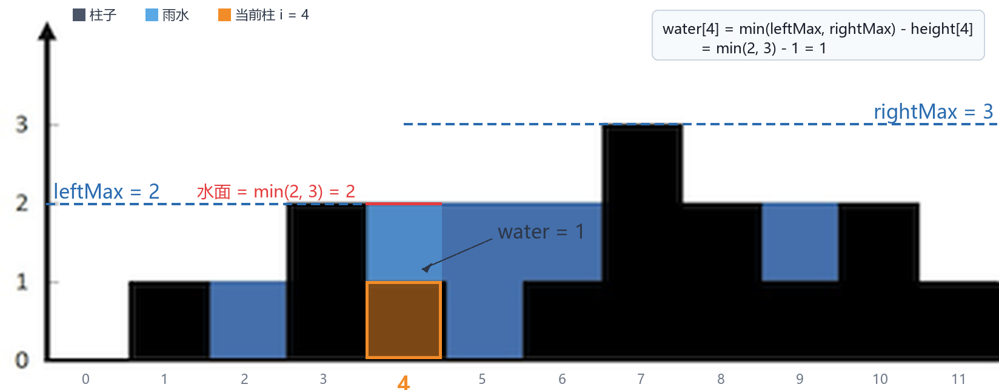

# 第二章 数组、查找与排序算法
本章从连续存储的数组出发，学习顺序查找、二分查找与常见排序算法。重点是理解访问、查找、插入和删除的成本，而不是只记住函数模板。

**线性结构概览**

线性结构可记为 $L=(a_1,a_2,\ldots,a_i,\ldots,a_n)$：

+ $a_1$ 有唯一后继、无前驱
+ $a_n$ 有唯一前驱、无后继
+ 其余元素有唯一前驱和唯一后继

## 2.1 数组
**特点**：

+ 类型相同
+ 原生数组长度固定，扩容通常需要重新分配并复制元素
+ 按下标访问和修改是 $O(1)$；在中间插入或删除通常需要移动元素，时间复杂度为 $O(n)$
+ 空间连续，支持高效的随机访问
    - 有序：二分查找 O(log n)
    - 无序：遍历 O(n)

### 2.1.1 查找算法
#### （1）查找重复元素问题（n 个元素，范围 0～n-1）
例题：[LeetCode 287. 寻找重复数](https://leetcode.cn/problems/find-the-duplicate-number/)

给定一个包含 `n + 1` 个整数的数组 `nums` ，其数字都在 `[1, n]` 范围内（包括 `1` 和 `n`），可知至少存在一个重复的整数。

假设 `nums` 只有 **一个重复的整数** ，返回 **这个重复的数** 。

**示例 1：**

```plain
输入：nums = [1,3,4,2,2]
输出：2
```

**示例 2：**

```plain
输入：nums = [3,1,3,4,2]
输出：3
```

**示例 3 :**

```plain
输入：nums = [3,3,3,3,3]
输出：3
```

_方法1：哈希_

+ 时间复杂度$O(n)$，空间复杂度$O(n)$

```cpp
bool search(vector<int>& nums) {
    unordered_set<int> set;
    for (int num : nums) {
        if (set.count(num)) return true;
        set.insert(num);
    }
    return false;
}
```

方法2：暴力

+ 时间复杂度 $O(n^2)$，空间复杂度 $O(1)$

方法3：先排序 sort，再比较相邻元素

+ 时间复杂度 $O(n \log n)$，空间复杂度 $O(\log n)$

方法4：先排序 sort，再比较元素与下标是否匹配

+ 时间复杂度 $O(n \log n)$，空间复杂度 $O(\log n)$

_方法5：计数法_

+ 时间复杂度$O(n)$，空间复杂度$O(n)$

```cpp
bool search(vector<int>& nums) {
    vector<int> sum(nums.size(), 0);
    for (int i = 0; i < nums.size(); i++) {
        sum[nums[i]] += 1;
        if (sum[nums[i]] >= 2) {
            return true;
        }
    }
    return false;
}
```

_方法6：原地交换法_

+ 时间复杂度$O(n)$，空间复杂度$O(1)$

```cpp
bool search6(vector<int>& nums) {
    for (int i = 0; i < nums.size(); ) 
    {
        if (nums[i] == i)  // 下标与值匹配
        { 
            i++;
            continue;
        } 
        else if (nums[nums[i]] == nums[i]) // 发现重复
        {  
            return true;
        } 
        else // 交换到对应位置
        {  
            swap(nums[i], nums[nums[i]]);
        }
    }
    return false;
}
```

_方法7：快慢指针（Floyd判圈算法）_

 **不修改** 数组 `nums` 且只用常量级 `O(1)` 的额外空间。

**思路**

**步骤一：判断是否有环**  

+ 快指针（fast）一次相当于慢指针（slow）两次，因此有环的情况下二者一定会相遇  
+ **环形追击问题类比证明**：  

> 在环形跑道中，当快者速度是慢者 2 倍时，快者必然会在一圈内追上慢者。设环长为 $L$，慢者速度 $v$，快者速度 $2v$，相对速度 $v$，追及时间 $t = \frac{L}{v}$。此时慢者位移 $vt = L$（恰跑完一圈），快者位移 $2vt = 2L$（恰跑完两圈），二者在起点相遇。
>

**步骤二：找到进环点**  

+ 从起点到成环点（重复数字）与从快慢指针相遇点到成环点距离（中间隔的元素个数）相同  
+ **环形追击问题类比证明**：  

> 设起点到环入口距离为 $a$，环入口到相遇点距离为 $b$，环剩余长度为 $c$（$L = b + c$）。  
慢指针路程：$a + b$  
快指针路程：$a + b + kL$（$k$ 为整数圈）  
由 $2(a + b) = a + b + kL$ 得 $a = kL - b$  
当 $k=1$ 时，$a = c$（即起点到环入口 = 相遇点到环入口）
>

**代码实现**

```cpp
class Solution 
{
public:
    int findDuplicate(vector<int>& nums) 
    {
        // 步骤一：判断是否有环
        int fast = 0, slow = 0;
        while (true) 
        {
            slow = nums[slow];
            fast = nums[nums[fast]];
            if (slow == fast) break;
        }
        // 步骤二：找到进环点（重复数字）
        int head = 0;
        while (head != slow) 
        {
            head = nums[head];
            slow = nums[slow];
        }
        return head;
    }
};
```


#### （2）二分查找（Binary Search）
_核心思想_：分治，将原问题**分解为规模更小的子问题**（每次将搜索范围缩小至一半）  
_前提条件_：数组必须为**升序/降序**（否则无法通过中间值缩小范围）  
_时间复杂度_：O(log n)（每次将搜索范围减半）

**步骤**

+ 找中间值
+ 中间值与target比较
    - 中间值=target：找到目标值
    - 中间值大于 `target`：继续查找左半区。因为数组升序，右侧元素不会是目标值。
    - 中间值小于 `target`：继续查找右半区。因为数组升序，左侧元素不会是目标值。
+ 终止条件：left>right

**代码**

_递归实现_：

```cpp
int BinarySearch(vector<int>& nums, int target, int left, int right) 
{
    if (left > right) return -1;
    int mid = left + (right - left) / 2;  // 防止溢出
    
    if (nums[mid] > target) 
    {
        return BinarySearch(nums, target, left, mid - 1);
    } 
    else if (nums[mid] < target) 
    {
        return BinarySearch(nums, target, mid + 1, right);
    }
    else 
    {
        return mid;
    }
}
```

_循环实现_：

```cpp
int BinarySearch(vector<int>& nums, int target) 
{
    int left = 0, right = nums.size() - 1;
    while (left <= right) 
    {
        int mid = left + (right - left) / 2;
        if (nums[mid] > target) 
        {
            right = mid - 1;
        } 
        else if (nums[mid] < target) 
        {
            left = mid + 1;
        } 
        else 
        {
            return mid;
        }
    }
    return -1;
}
```

**典型变种场景**：

[LeetCode 34 在排序数组中查找元素的第一个和最后一个位置](https://leetcode.cn/problems/find-first-and-last-position-of-element-in-sorted-array/)

**题目描述**：

给你一个按照非递减顺序排列的整数数组 `nums`，和一个目标值 `target`。请你找出给定目标值在数组中的开始位置和结束位置。

如果数组中不存在目标值 `target`，返回 `[-1, -1]`。

你必须设计并实现时间复杂度为 `O(log n)` 的算法解决此问题。

**1. 查找第一个等于 `target` 的位置（左边界）**

_核心思想_

当 `nums[mid] == target` 时，**不立即返回**，而是继续向左收缩搜索区间（`right = mid - 1`），直到找到最左侧的相等位置。

_关键实现_

```cpp
int findLeftBound(const vector<int>& nums, int target) 
{
    int left = 0, right = nums.size() - 1;
    while (left <= right) 
    {
        int mid = left + (right - left) / 2;
        if (nums[mid] < target) {
            left = mid + 1;
        } 
        else 
        {  // nums[mid] >= target，相等时继续向左
            right = mid - 1;
        }
    }
    // 边界验证：left 可能越界或指向非 target 元素
    if (left < nums.size() && nums[left] == target) return left;
    return -1;  // 不存在
}
```

_边界验证_

+ 需检查 `left` 是否越界（`left == n`）或 `nums[left] != target`（目标不存在）

**2. 查找最后一个等于 `target` 的位置（右边界）**

_核心思想_

当 `nums[mid] == target` 时，继续向右收缩搜索区间（`left = mid + 1`），直到找到最右侧的相等位置。

_关键实现_

```cpp
int findRightBound(const vector<int>& nums, int target) 
{
    int left = 0, right = nums.size() - 1;
    while (left <= right) 
    {
        int mid = left + (right - left) / 2;
        if (nums[mid] <= target) 
        {  // 相等时继续向右
            left = mid + 1;
        } else {
            right = mid - 1;
        }
    }
    // 边界验证：right 可能越界或指向非 target 元素
    if (right >= 0 && nums[right] == target) return right;
    return -1;  // 不存在
}
```

_边界验证_

+ 需检查 `right` 是否越界（`right < 0`）或 `nums[right] != target`

**4. 查找插入位置（目标不存在时的定位）**

[LeetCode 35. 搜索插入位置](https://leetcode.cn/problems/search-insert-position/)

**题目描述**：

一个排序数组和一个目标值，在数组中找到目标值，并返回其索引。如果目标值不存在于数组中，返回它将会被按顺序插入的位置。

请必须使用时间复杂度为 `O(log n)` 的算法。

_核心思想_

在升序数组中查找 `target` 应插入的位置，即**第一个大于等于 `target` 的元素下标**。  
本质是**左边界查找的直接应用**：循环结束后 `left` 即为插入位置 。

_关键实现_

```cpp
int searchInsert(vector<int>& nums, int target) 
{
    int left = 0, right = nums.size() - 1;
    while (left <= right) 
    {
        int mid = left + (right - left) / 2;
        if (nums[mid] < target) 
        {
            left = mid + 1;
        } 
        else 
        {
            right = mid - 1;
        }
    }
    return left;  // 无需验证，left 恒为合法插入位置 [0, n]
}
```

**4. 变种对比总结**

| 变种类型 | 相等时动作 | 返回值 | 典型场景 |
| --- | --- | --- | --- |
| **标准查找** | 立即返回 `mid` | `mid` / `-1` | 无重复元素的精确匹配 |
| **左边界** | `right = mid - 1` | `left`（需验证） | 首次出现位置、插入位置 |
| **右边界** | `left = mid + 1` | `right`（需验证） | 末次出现位置 |
| **上界查找** | `right = mid - 1`（条件为 `>`） | `left` | 第一个大于 `target` 的位置 |


## 2.2 排序算法
### 2.2.1 排序算法对比
| 算法 | 平均时间 | 最好时间 | 最坏时间 | 空间 | 稳定性 | 特点 |
| --- | --- | --- | --- | --- | --- | --- |
| 冒泡排序 | O(n²) | O(n) | O(n²) | O(1) | 稳定 | 简单但效率低 |
| 选择排序 | O(n²) | O(n²) | O(n²) | O(1) | 不稳定 | 交换次数少 |
| 插入排序 | O(n²) | O(n) | O(n²) | O(1) | 稳定 | 适合小规模/部分有序 |
| 快速排序 | O(n log n) | O(n log n) | O(n²) | 平均 O(log n)，最坏 O(n) | 不稳定 | 平均性能优秀，常用于混合排序 |
| 归并排序 | O(n log n) | O(n log n) | O(n log n) | O(n) | 稳定 | 适合大规模数据 |
| 堆排序 | O(n log n) | O(n log n) | O(n log n) | O(1) | 不稳定 | 时间稳定 |
| 希尔排序 | 取决于间隔序列 | 取决于间隔序列 | 常见上界 O(n²) | O(1) | 不稳定 | 分组插入排序，性能受间隔序列影响 |


**排序算法实现**：

### 2.2.2 冒泡排序（Bubble Sort）
**核心思想**

相邻元素进行大小比较，如果 `nums[i] < nums[i-1]`，交换。

**详细思路**：  
冒泡排序是一种简单的排序算法。它重复地走访过要排序的元素列，依次比较两个相邻的元素，如果顺序（如从大到小、首字母从Z到A）错误就把他们交换过来。走访元素的工作是重复地进行直到没有相邻元素需要交换，也就是说该元素列已经排序完成。

+ 这个算法的名字由来是因为越小的元素会经由交换慢慢“浮”到数列的顶端（升序或降序排列），就如同碳酸饮料中的气泡一样，故名“冒泡排序”。
+ 图中的核心思想描述的是将较小的元素向前（下标小的方向）移动，即“冒泡”。

---

**基础代码实现**

**详细思路**：  
这是最原始的冒泡排序实现。

+ 使用双重循环。
+ 外层循环 `i` 控制排序的轮数，从数组长度递减到 1。
+ 内层循环 `j` 从 1 遍历到 `i`，比较相邻元素 `nums[j]` 和 `nums[j-1]`。
+ 如果前一个元素比后一个大（`nums[j] < nums[j-1]`，注意这里是小于，说明是把小的往前换），则交换。
+ 变量 `c` 用于记录比较的次数，最后输出，用于分析算法复杂度。

**代码**：

```cpp
void BubbleSort(vector<int> & nums)
{
    int c = 0;
    for (int i = nums.size(); i > 1; i--)
    {
        for (int j = 1; j < i; j++)
        {
            c++;
            if (nums[j] < nums[j - 1])
            {
                swap(nums[j], nums[j - 1]);
            }
        }
    }
    cout << c << endl;
}
```

---

**优化方案**

冒泡排序的主要性能瓶颈在于即使数组已经有序，它仍然会进行多余的比较。优化主要围绕 **“提前终止”** 和 **“减少比较范围”** 进行。

**优化一：设置标志位与记录最后交换位置 (For循环版)**

**详细思路**：  
这个版本试图结合两种优化策略：

1. **标志位（`flag`）**：每轮开始时置为 `0`；如果一轮中没有发生交换，说明数组已经有序，可以直接 `break`。
2. **记录最后交换位置**：变量 `flag` 记录最后一次交换后的右边界。在该位置之后的元素已经有序，令 `right = flag`，下一轮只比较仍可能无序的区间。

**代码**：

```cpp
void BubbleSort(vector<int>& nums)
{
    int len = nums.size();
    int right = len;
    for (int i = 0; i < len - 1 && right > 1; i++)
    {
        int flag = 0;
        for (int j = 0; j < right - 1; j++)
        {
            if (nums[j] > nums[j + 1])
            {
                swap(nums[j], nums[j + 1]);
                flag = j + 1;
            }
        }
        if (flag == 0) break;
        right = flag;
    }
}
```

**优化二：记录最后交换位置 (While循环版 - 显式标志位)**

**详细思路**：  
这是使用 `while` 循环实现的优化版本，逻辑更清晰：

1. 使用 `bool t` 作为标志位，初始为 `true`。如果一轮下来没有发生交换（`t` 保持 `false`），则循环结束。
2. 使用 `right` 变量记录当前需要比较的右边界。
3. 在内层循环中，如果发生交换，更新 `flag` 为当前位置 `j`，并将 `t` 设为 `true`。
4. 一轮结束后，将 `right` 更新为 `flag`（最后一次交换的位置），因为 `flag` 之后的元素已经有序，下一轮只需比较到 `flag` 即可。

**代码**：

```cpp
void BubbleSort(vector<int> & nums)
{
    int right = nums.size(), flag=0;
    bool t = true;
    while(t)
    {
        t = false;
        for (int j = 1; j < right; j++)
        {
            if (nums[j] < nums[j - 1])
            {
                swap(nums[j], nums[j - 1]);
                t = true;
                flag = j; // 记录最后一次交换的位置
            }
        }
        right = flag;
    }
}
```

**优化三：记录最后交换位置 (While循环版 - 隐式标志位)**

**方法名称**：While循环优化 (Implicit Flag)

**详细思路**：  
这是另一种 `while` 循环的写法，更加简洁：

1. 直接使用 `while(right)` 作为循环条件。
2. 每轮开始时将 `flag` 重置为 0。
3. 内层循环逻辑同上，记录最后一次交换的位置 `j` 到 `flag`。
4. 一轮结束后，执行 `right = flag`。
    - 如果发生了交换，`flag` 会被更新为某个大于0的值，`right` 缩小，循环继续。
    - 如果没有发生交换，`flag` 保持为 0，`right` 变为 0，`while(right)` 条件不满足，循环自然结束。这巧妙地利用了 `flag` 同时充当了“是否有序”的判断标志。

**代码**：

```cpp
void BubbleSort(vector<int>& nums)
{
    int right = nums.size(), flag=0;
    int c = 0;
    while(right)
    {
        flag = 0;
        for (int j = 1; j < right; j++)
        {
            if (nums[j] < nums[j - 1])
            {
                swap(nums[j], nums[j - 1]);
                flag = j; // 记录最后一次交换的位置
            }
        }
        right = flag;
    }
}
```

### 2.2.3 选择排序（Selection Sort）
**核心思想**

选择排序的核心思想是每一轮从未排序部分中选择最值（最大或最小），将其放置到已排序部分的边界位置，通过n-1轮操作完成整个排序过程。具体实现逻辑如下：

+ 元素比较规则：将当前元素与已记录的最值进行比较
    - 选择最大值时：元素 > 最值 → 更新最值下标；元素 <= 最值 → 不更新下标
    - 选择最小值时：元素 < 最值 → 更新最值下标；元素 >= 最值 → 不更新下标
+ 位置交换：每轮确定最值后，将其与未排序部分的边界位置交换（最大值放最后/最小值放最前）

**代码实现**

1. 选择最小值实现（升序）

```cpp
void SelectSort(vector<int>& nums) {
    int minIndex = 0;
    for (int i = 0; i < nums.size(); i++) {
        minIndex = i;  // 初始化当前最小值下标为起始位置
        for (int j = i; j < nums.size(); j++) {
            // 元素 < 最值 → 更新下标
            if (nums[j] < nums[minIndex]) {
                minIndex = j;
            }
        }
        // 交换最小值到当前位置
        swap(nums[minIndex], nums[i]);
    }
}
```

2. 选择最大值实现（升序）

```cpp
void SelectSort(vector<int>& nums) {
    int maxIndex = 0;
    for (int i = nums.size() - 1; i > 0; i--) {
        maxIndex = 0;  // 初始化当前最大值下标为0
        for (int j = 0; j <= i; j++) {
            // 元素 > 最值 → 更新下标
            if (nums[j] > nums[maxIndex]) {
                maxIndex = j;
            }
        }
        // 交换最大值到最后位置
        swap(nums[maxIndex], nums[i]);
    }
}
```

算法特性

| 特性 | 说明 |
| --- | --- |
| **时间复杂度** | O(n²) - 无论输入序列是否有序，都需要进行 `n(n-1)/2` 次比较 |
| **空间复杂度** | O(1) - 原地排序，仅需常数级额外空间 |
| **稳定性** | 不稳定排序 - 相等元素可能因交换改变相对位置   例：`[5, 3, 5, 2]` 中两个5的顺序可能颠倒 |
| **适用场景** | 小规模数据排序；对内存空间极度敏感的场景 |


优化方向：堆排序

选择排序的**核心瓶颈**在于每轮找最值需要 O(n) 时间，可通过以下方式优化：

1. **堆数据结构**：利用完全二叉树的堆性质
    - 大顶堆：根节点是当前最大值
    - 小顶堆：根节点是当前最小值
2. **优化效果**：
    - 读取堆顶最值的时间复杂度为 $O(1)$
    - 删除堆顶并恢复堆性质的时间复杂度为 $O(\log n)$
    - 建堆为 $O(n)$，完成堆排序的总体时间复杂度为 $O(n\log n)$
3. **典型实现**：堆排序（Heap Sort）是选择排序的高级优化版本

### 2.2.4 堆排序（Heap Sort）
**堆排序（Heap Sort）** 是一种利用**堆（Heap）** 这种数据结构所设计的排序算法。它是**选择排序**的一种改进版本。

简单来说，堆排序的核心思想是：**将待排序的序列构造成一个大顶堆（或小顶堆），此时整个序列的最大值（或最小值）就是堆顶的根节点。将其与末尾元素交换，然后将剩余的 n-1 个元素重新调整为堆，反复执行，直到所有元素有序。**

具体实现见“六、树形数据结构 → 7. 堆”。

### 2.2.5 插入排序（Insertion Sort）
**核心思想**

插入排序的核心思想是**将数组分为两部分：已排序部分和未排序部分**。每一轮将未排序部分的第一个元素插入到已排序部分的适当位置，使已排序部分保持有序状态。具体操作是：

+ **初始状态**：第一个元素视为已排序，剩余元素为未排序
+ **每轮操作**：将未排序部分的第一个元素插入到已排序部分
+ **插入方向**：从后往前比较（从已排序部分的末尾开始向前比较）

**算法步骤**

**插入过程**

1. **保存待插入元素**：将当前要插入的元素保存到临时变量
2. **倒序遍历有序序列**：从已排序部分的末尾开始向前遍历
3. **比较与移动**：
    - **无序 >= 有序**：直接插入到有序序列右端（当前元素位置）
    - **无序 < 有序**：有序序列元素向右移动一个位置，继续向前比较
    - **遍历完所有有序元素**：将元素插入到下标0位置

**关键操作说明**

+ **比较规则**：当前元素与已排序部分元素进行比较
+ **移动规则**：当发现已排序元素大于当前元素时，将该元素向后移动
+ **插入位置**：找到第一个不大于当前元素的位置，将元素插入该位置后

**C++代码实现**

1. while循环实现

```cpp
void InsertSort(vector<int>& nums) 
{
    int num = 0, right = 0;
    for (int i = 1; i < nums.size(); i++) 
    {
        right = i - 1;  // right指向已排序部分的最后一个元素
        num = nums[i];  // 保存待插入元素
        // 从后往前比较，大于num的元素后移
        while (right >= 0 && num < nums[right]) 
        {
            nums[right + 1] = nums[right];  // 依次赋值
            right--;
        }
        nums[right + 1] = num;  // 插入到正确位置
    }
}
```

2. for循环实现

```cpp
void InsertSort(vector<int>& nums) 
{
    int num = 0, right = 0;
    for (int i = 1; i < nums.size(); i++) 
    {
        num = nums[i];
        // 从后往前遍历已排序部分
        for (int j = i - 1; j >= 0; j--) 
        {
            if (nums[j] > num) 
            {
                nums[j + 1] = nums[j];  // 依次赋值
            } 
            else 
            {
                break;  // 找到插入位置，提前终止
            }
        }
        nums[j + 1] = num;  // 插入到正确位置
    }
}
```

**优化要点**

1. **避免不必要的交换**：两个实现都使用**赋值操作**而非交换操作，减少操作次数
2. **提前终止**：当找到插入位置后立即终止内层循环
3. **边界处理**：正确处理插入到数组开头的情况（`right = -1` 时插入到位置0）

**算法特性分析**

| 特性 | 说明 |
| --- | --- |
| **时间复杂度** | - 最好情况（已排序）：O(n)   - 最坏情况（逆序）：O(n²)   - 平均情况：O(n²) |
| **空间复杂度** | O(1) - 原地排序，仅需常数级额外空间 |
| **稳定性** | ✅ 稳定排序 - 相等元素不会改变相对位置 |
| **适用场景** | - 小规模数据排序   - 基本有序的数据集   - 需要稳定排序的场景 |


### 2.2.6 希尔排序（Shell Sort）
**核心概念**

希尔排序是**插入排序的优化变种**，通过**分组插入排序**减少元素移动次数，适用于以下场景：

+ **插入排序的应用场合**  
    - 元素数量较少时  
    - 元素前后位置距离不远（插入导致的调整次数少）
+ **对插入排序的优化**   
通过**间隔分组**将原本可能相距较远的元素分到同一组，使组内元素相对有序，为最终插入排序创造更优条件。

---

**算法特点**

1. **二分分割（间隔递减策略）**  
    - 假设数组有 `n` 个元素  
    - 初始间隔：`n/2`（向下取整）  
    - 后续间隔：`(n/2)/2` → `(n/4)/2` → ... → `0`（最后一次排序）  
_示例：若 _`n=10`_，间隔序列为 _`5 → 2 → 1`
2. **分组逻辑**  
    - 相同间隔的元素为一组（组内元素在原数组中**不连续**）  
    - 例如间隔 `gap=3` 时：  
        * 第 0、3、6、9... 个元素为一组  
        * 第 1、4、7... 个元素为一组  
        * 第 2、5、8... 个元素为一组

**排序流程**

| 步骤 | 说明 |
| --- | --- |
| **定间隔** | 初始间隔 `gap = n/2`，后续每次 `gap /= 2` |
| **分组** | 按间隔将数组划分为多个子序列（组内元素不连续） |
| **组内排序** | 对每个子序列执行插入排序（因分组后元素相对有序，效率显著提升） |
| **缩小间隔** | 重复分组→排序过程，直到 `gap=0`（最终对整个序列进行插入排序） |


**代码**

```cpp
void shellSort(vector<int>& arr) 
{
    int n = arr.size();
    
    // 外层循环：控制间隔gap，从n/2逐步减半至1
    for (int gap = n / 2; gap > 0; gap /= 2) 
    {
        // 内层循环：对每个分组进行插入排序，遍历每个分组的起始位置（从gap开始）
        for (int i = gap; i < n; i++) 
        {
            int temp = arr[i];  // 待插入的元素
            int j;
            
            // 组内插入排序：比较间隔为gap的元素
            for (j = i; j >= gap && arr[j - gap] > temp; j -= gap) 
            {
                arr[j] = arr[j - gap];  // 移动较大元素到后方
            }
            arr[j] = temp;  // 插入元素到正确位置
        }
    }
}
```

**算法特性分析**

1. **间隔序列选择**  
    - 上述代码使用**原始希尔间隔**（`n/2, n/4, ..., 1`）  
    - 更优方案：可改用 **Hibbard 序列**（`2^k - 1`）或 **Sedgewick 序列**（`9*4^i - 9*2^i + 1`），可将最坏时间复杂度优化至 `O(n^(3/2))`
2. **稳定性说明**  
    - 希尔排序是**不稳定排序**（相同值的元素可能因分组被交换位置）  
    - _示例：_`[5a, 3, 5b]`_ 分组后可能变为 _`[3, 5b, 5a]`
3. **时间复杂度**  

| 间隔序列 | 平均时间复杂度 | 最坏时间复杂度 |
| --- | --- | --- |
| 原始希尔 | O(n²) | O(n²) |
| Hibbard 序列 | O(n^(3/2)) | O(n^(3/2)) |
| Sedgewick 序列 | O(n^(4/3)) | O(n^(4/3)) |


### 2.2.7 快速排序（Quick Sort）
**核心思想**

快速排序的核心思想是**分治法（Divide and Conquer）**

选择一个标准值（枢轴），将数组分为两部分：

+ 左侧：所有小于标准值的元素（左子数组任意元素<=基准数）
+ 右侧：所有大于标准值的元素（基准数<=右子数组任意元素）  
然后对左右两个子数组递归地进行同样的操作，直到整个数组有序。

**关键操作**：

1. **选择标准值**：确定一个基准元素作为划分依据
2. **分区操作**：将小于标准值的元素移到左侧，大于标准值的元素移到右侧
3. **递归处理**：对左右两个子数组重复上述过程

二、两种主要实现方式

**挖坑填数法**

**步骤**：

1. 保存标准值到临时变量
2. 确定标准值最终位置
    - 从右向左找到第一个小于标准值的元素，填入左侧"坑"中
    - 从左向右找到第一个大于标准值的元素，填入右侧"坑"中
    - 重复上述过程，直到左右指针相遇
3. 将标准值放入最终位置
4. 以标准值位置为界划分两个新的数组，并对新数组重复操作

**C++实现**：

```cpp
void QuickSort(vector<int>& nums, int left, int right) 
{
    if (left >= right) return;
    int tmp = nums[left];  // 保存标准值（默认选最左边元素）
    int begin = left, end = right;
    
    while (begin < end) 
    {
        // 从右往左，找小于标准值的，填左
        while (begin < end && nums[end] >= tmp) end--;
        if (begin < end) 
        {
            nums[begin] = nums[end];  // 填左
            begin++;
        }
        
        // 从左往右，找大于标准值的，填右
        while (begin < end && nums[begin] <= tmp) begin++;
        if (begin < end) 
        {
            nums[end] = nums[begin];  // 填右
            end--;
        }
    }
    
    nums[begin] = tmp;  // 填入标准值
    QuickSort(nums, left, begin - 1);  // 递归左子数组
    QuickSort(nums, begin + 1, right); // 递归右子数组
}
```

**双边交换法**

**步骤**：

1. 选择标准值（通常为最左边元素）
2. 设置左右指针，分别从两端向中间移动
    - 左指针找到大于标准值的元素
    - 右指针找到小于标准值的元素
    - 交换这两个元素
    - 重复上述过程，直到左右指针相遇
3. 将标准值与相遇点元素交换
4. 以标准值位置为界划分两个新的数组，并对新数组重复操作

**C++实现**：

```cpp
void QuickSort(vector<int>& nums, int left, int right) 
{
    if (left >= right) return;
    
    int i = left, j = right;
    while (i < j) 
    {
        // 从右往左，找小于标准值的
        while (i < j && nums[j] >= nums[left]) j--;
        // 从左往右，找大于标准值的
        while (i < j && nums[i] <= nums[left]) i++;
        // 交换元素
        if (i < j) swap(nums[i], nums[j]);
    }
    
    // 将标准值与相遇点元素交换
    swap(nums[i], nums[left]);
    QuickSort(nums, left, i - 1);  // 递归左子数组
    QuickSort(nums, i + 1, right); // 递归右子数组
}
```

**快速排序优化方法**

**1.区间划分法**

**核心思想**

+ **选择标准值**：默认选择最右边的元素作为标准值（pivot）
+ **维护小区间**：用`target`变量标记小于标准值的区间边界
+ **分区操作**：遍历数组，将小于标准值的元素移到左侧，大于等于标准值的元素留在右侧
+ **递归处理**：对左右两个子数组递归进行同样的操作

**步骤详解**

1. 区间划分过程

1. **标记变量初始化**：
    - `target = left`：标记小于标准值的区间边界（初始时为空区间）
2. **遍历比较**：
    - 从左向右遍历数组（`i` 从 `left` 到 `right-1`）
    - 每次比较 `nums[i]` 与标准值 `nums[right]`
    - **如果 `nums[i] < nums[right]`**：将该元素交换到`target`位置，并将`target`右移
    - **如果 `nums[i] >= nums[right]`**：不操作，继续遍历
3. **标准值归位**：
    1. 遍历结束后，将标准值（原`nums[right]`）与`nums[target]`交换
    2. 此时`target`位置即为标准值的最终位置
    3. 左侧所有元素小于标准值，右侧所有元素大于等于标准值


2. 递归过程

+ **左子数组**：`[left, target-1]`（所有小于标准值的元素）
+ **右子数组**：`[target+1, right]`（所有大于等于标准值的元素）
+ 递归对两个子数组进行同样的分区操作

代码

```cpp
void QuickSort(vector<int>& nums, int left, int right)
{
    // 递归终止条件：区间长度为0或1
    if (left >= right) return;
    
    // 1. 标记变量初始化
    int target = left;  // 标记小于标准值的区间边界
    
    // 2. 遍历数组，分区操作
    for (int i = left; i < right; i++)
    {
        // 3. 比较与移动
        if (nums[i] < nums[right])
        {
            // 将小于标准值的元素移到左侧
            swap(nums[i], nums[target++]);
        }
    }
    
    // 4. 将标准值放入最终位置
    swap(nums[right], nums[target]);
    
    // 5. 递归处理左右子数组
    QuickSort(nums, left, target - 1);  // 处理左子数组
    QuickSort(nums, target + 1, right); // 处理右子数组
}
```

**与其他实现方式对比**

| 特性 | 区间划分法 | 挖坑填数法 | 双边交换法 |
| --- | --- | --- | --- |
| **思想** | 维护小区间边界 | 挖坑填数 | 双指针交换 |
| **代码简洁度** | 最简洁 | 中等 | 中等 |
| **交换次数** | 较少 | 较少 | 较多 |


**优势分析**：

+ **代码简洁**：仅需一个`for`循环完成分区操作
+ **逻辑清晰**：`target`变量直观表示小于标准值的区间边界
+ **效率高**：避免了多余的比较和交换操作

**2.标准值选择优化**

**问题**：标准值选择不当会导致分区不平衡，最坏情况下时间复杂度退化为O(n²)

**标准值选择优化目的**：使标准值的选取尽可能靠近数组的中间值

**优化方法**：

a) 三值取中法

三值取中：取开始、中间、结束三个数，选三个数的中间值作为标准值

```cpp
int medianOfThree(vector<int>& nums, int left, int right) {
    int mid = left + (right - left) / 2;
    
    // 对三个元素排序
    if (nums[left] > nums[mid]) swap(nums[left], nums[mid]);
    if (nums[left] > nums[right]) swap(nums[left], nums[right]);
    if (nums[mid] > nums[right]) swap(nums[mid], nums[right]);
    
    // 返回中间值的位置
    return mid;
}

void QuickSortOptimized(vector<int>& nums, int left, int right) {
    if (left >= right) return;
    
    // 三值取中选择标准值
    int pivotIndex = medianOfThree(nums, left, right);
    swap(nums[left], nums[pivotIndex]);  // 将中位数移到最左边
    
    // 后续分区操作...
}
```

b) 9选1法

+ 将数组分成三段
+ 每段三值取中
+ 从三个中位数中再取中位数作为标准值
+ 避免极端情况下的性能退化

3.**小数据量优化**

**问题**：递归深度过大，小数组排序效率低

**优化方法**：

+ **数据量 <= 16**：使用插入排序（小数组插入排序效率更高）
+ **数据量 > 16**：继续使用快速排序

```cpp
void QuickSortWithInsertion(vector<int>& nums, int left, int right) {
    // 小数组使用插入排序
    if (right - left <= 16) {
        InsertionSort(nums, left, right);
        return;
    }
    
    // 大数组使用快速排序
    // ...分区操作...
    
    QuickSortWithInsertion(nums, left, begin - 1);
    QuickSortWithInsertion(nums, begin + 1, right);
}

void InsertionSort(vector<int>& nums, int left, int right) {
    for (int i = left + 1; i <= right; i++) {
        int num = nums[i];
        int j = i - 1;
        while (j >= left && nums[j] > num) {
            nums[j + 1] = nums[j];
            j--;
        }
        nums[j + 1] = num;
    }
}
```

**算法特性分析**

| 特性 | 说明 |
| --- | --- |
| **时间复杂度** | - 最好情况：O(n log n)   - 平均情况：O(n log n)   - 最坏情况：O(n²)（分区极度不平衡时） |
| **空间复杂度** | O(log n) - 递归栈深度（平均情况）   O(n) - 最坏情况（递归深度为n） |
| **稳定性** | 不稳定排序 - 相同元素可能因交换改变相对位置 |
| **适用场景** | - 大规模数据排序   - 内存有限的场景（原地排序）   - 一般情况下性能最优的排序算法 |


> 现代排序库（如C++ STL的`std::sort`）通常基于快速排序实现，并结合了插入排序和堆排序的优点，形成混合排序算法，以应对各种数据分布情况。在实际应用中，应优先考虑使用标准库的排序函数，而非自行实现。
>

### 2.2.8 归并排序（Merge Sort）
**核心思想**

归并排序的核心思想是**分治法（Divide and Conquer）**：

+ **分**：将数组递归地划分为更小的子数组，直到每个子数组只包含一个元素
+ **治**：将已排序的子数组合并为更大的有序数组
+ **合**：通过合并操作将所有子数组最终合并为一个完整的有序数组

**关键特点**：

+ 采用“先分后合”的策略，与快速排序的“边分边排”形成对比
+ 合并过程保证了算法的稳定性
+ 始终保持O(n log n)的时间复杂度，不受输入数据分布影响

**算法步骤**

1.划分阶段

+ **递归终止条件**：当子数组长度为1时，该子数组已自然有序
+ **划分方法**：计算中间索引 `mid = left + (right - left) / 2`
+ **划分结果**：
    - 左子数组：`[left, mid]`
    - 右子数组：`[mid+1, right]`
+ **递归划分**：对左右子数组重复划分过程，直到每个子数组只有一个元素

2.合并阶段

1. **申请临时数组**：创建一个与待合并区间大小相同的临时数组
2. **双指针遍历**：
    - 指针`i`指向左子数组起始位置
    - 指针`j`指向右子数组起始位置
    - 比较`nums[i]`和`nums[j]`，将较小的元素放入临时数组
    - 结束条件：其中任意子数组全部遍历完
3. **处理剩余元素**：
    - 如果左子数组有剩余元素，全部放入临时数组
    - 如果右子数组有剩余元素，全部放入临时数组
4. **数据回填**：将临时数组中的元素复制回原数组

**C++代码实现**

排序函数（MergeSort）

```cpp
void MergeSort(vector<int>& nums, int left, int right) {
    // 递归终止条件：子数组长度为1
    if (left >= right) return;
    
    // 计算中间位置
    int mid = left + (right - left) / 2;
    
    // 分治：递归排序左右子数组
    MergeSort(nums, left, mid);
    MergeSort(nums, mid + 1, right);
    
    // 合并已排序的子数组
    Merge(nums, left, mid, right);
}
```

**执行流程**：

1. 将数组划分为两半
2. 递归排序左半部分
3. 递归排序右半部分
4. 合并两个已排序的子数组

合并函数（Merge）

```cpp
void Merge(vector<int>& nums, int left, int mid, int right) 
{
    vector<int> temp(right - left + 1);  // 申请临时数组
    int i = left, j = mid + 1, t = 0;    // 初始化指针
    
    // 比较两个子数组，依次将较小元素加入temp
    while (i <= mid && j <= right) 
    {
        if (nums[i] <= nums[j]) 
        {
            temp[t++] = nums[i++];  // 左子数组元素小，放入temp
        } 
        else 
        {
            temp[t++] = nums[j++];  // 右子数组元素小，放入temp
        }
    }
    
    // 将剩余元素加入temp
    while (i <= mid) 
    {
        temp[t++] = nums[i++];
    }
    while (j <= right) 
    {
        temp[t++] = nums[j++];
    }
    
    // 将临时数组数据放回原数组
    for (t = 0; t < temp.size(); t++) 
    {
        nums[left + t] = temp[t];
    }
}
```

**关键点**：

+ 使用`<=`比较保证稳定性
+ 临时数组大小为`right - left + 1`
+ 三重循环分别处理：比较合并、左子数组剩余、右子数组剩余

**算法特性分析**

| 特性 | 说明 |
| --- | --- |
| **时间复杂度** | O(n log n) - 无论输入数据如何分布，始终需要O(n log n)次操作 |
| **空间复杂度** | O(n) - 需要额外的临时数组存储合并结果 |
| **稳定性** | ✅ 稳定排序 - 相等元素不会改变相对位置 |
| **原地排序** | ❌ 非原地排序 - 需要O(n)的额外空间 |
| **适用场景** | - 大规模数据排序   - 需要稳定排序的场景   - 链表排序（归并排序对链表特别友好） |


**特点**

归并排序是一种**稳定、高效**的排序算法：

+ **优点**：时间复杂度稳定为O(n log n)，适合大规模数据排序，稳定性好
+ **缺点**：需要O(n)额外空间，实现相对复杂
+ **应用场景**：
    - 需要稳定排序的场景
    - 大规模数据排序
    - 链表排序（归并排序对链表特别友好）
    - 外部排序（处理超出内存的数据）

**归并排序应用**

**基于归并排序的逆序对统计**

[LCR 170 交易逆序对的总数](https://leetcode.cn/problems/shu-zu-zhong-de-ni-xu-dui-lcof/description/?spm=a2ty_o01.29997173.0.0.15f25171YM8wUk) 《剑指 Offer II》原题，剑指 Offer 51，用归并排序思想求逆序对

在股票交易中，如果前一天的股价高于后一天的股价，则可以认为存在一个「交易逆序对」。请设计一个程序，输入一段时间内的股票交易记录 `record`，返回其中存在的「交易逆序对」总数。

**示例 1：**

输入：record = [9, 7, 5, 4, 6]  
输出：8  
解释：交易中的逆序对为 (9, 7), (9, 5), (9, 4), (9, 6), (7, 5), (7, 4), (7, 6), (5, 4)。

**问题背景**

本题要求统计数组 `record` 中的**逆序对数量**，即满足 `i < j` 且 `record[i] > record[j]` 的元素对数量。暴力解法时间复杂度为 $O(n^2)$，而本代码通过**归并排序的分治思想**在 $O(n \log n)$ 时间内高效解决。

**核心思路**

利用**归并排序的合并过程**，在保证子数组有序的同时统计逆序对。关键在于：   
      **当左子数组的当前元素 `nums[i]` 大于右子数组的当前元素 `nums[j]` 时，左子数组中从 `i` 到 `mid` 的所有元素均大于 `nums[j]`（因左子数组已升序排序），因此可一次性统计 `mid - i + 1` 个逆序对。**

**代码执行流程**

1. **分治阶段（`apart` 函数）**  
    - 递归地将数组划分为左右两半（`left` 到 `mid` 和 `mid+1` 到 `right`），直至子数组长度为 1（自然有序）。
    - 通过 `apart(nums, left, mid)` 和 `apart(nums, mid+1, right)` 递归处理左右子数组。
2. **合并阶段（`merge` 函数）**  
    - 将左右两个**已排序**的子数组合并为一个有序数组，并在此过程中统计逆序对。
    - **关键统计逻辑**：   
当 `nums[i] > nums[j]` 时，说明左子数组中从 `i` 到 `mid` 的所有元素均大于 `nums[j]`，逆序对数量为 `mid - i + 1`。   
代码中通过 `ans += j - t - left` 实现该统计（经数学推导，`j - t - left = mid - i + 1`，其中 `t` 为临时数组已填充元素数）。
    - 合并完成后，将临时数组 `temp` 的内容复制回原数组 `nums`，保证上层递归的有序性。
3. **结果返回**  
    - 递归结束后，`ans` 累加了所有逆序对数量，直接返回。

**代码**

```cpp
int reversePairs(vector<int>& record) 
{
        apart(record, 0, record.size() - 1);

        return ans;
    }
    
int ans = 0;
void merge(vector<int>& nums, int left, int mid, int right) 
{
    vector<int> temp(right - left + 1);
    int i = left, j = mid + 1, t = 0;

    while (i <= mid && j <= right) 
    {
        if (nums[i] > nums[j])       
        {
            ans = ans + j - t - left;
            temp[t++] = nums[j++];
        } 
        else 
        {
            temp[t++] = nums[i++];
        }
    }
    while (i <= mid) 
    {
        temp[t++] = nums[i++];
    }
    while (j <= right)
    {
        temp[t++] = nums[j++];
    }
    for (t = 0; t < temp.size(); t++) 
    {
        nums[left + t] = temp[t];
    }
}
void apart(vector<int>& nums, int left, int right) 
{
    if (left >= right) return;

    int mid = left + (right - left) / 2;
    apart(nums, left, mid);
    apart(nums, mid + 1, right);
    
    merge(nums, left, mid, right);
}
```

**关键代码逻辑说明**

```cpp
if (nums[i] > nums[j]) 
{
    ans = ans + j - t - left; // 统计逆序对
    temp[t++] = nums[j++];
} 
```

+ `j - t - left` **的含义**：  
    - `t` 表示临时数组已填充的元素总数（`t = (i - left) + (j - mid - 1)`）。
    - 代入化简可得 `j - t - left = mid - i + 1`，即左子数组中比 `nums[j]` 大的元素个数。
+ **为何在此处统计**：   
右子数组元素 `nums[j]` 被放入 `temp` 时，左子数组剩余元素（`i` 到 `mid`）必然全部大于 `nums[j]`，此时统计可避免重复或遗漏。

**复杂度分析**

| **指标** | **说明** |
| --- | --- |
| **时间复杂度** | $O(n \log n)$，与归并排序一致，远优于暴力法 $O(n^2)$ |
| **空间复杂度** | $O(n)$，需临时数组 `temp` 存储合并结果 |
| **稳定性** | 稳定排序（相等元素相对位置不变），符合归并排序特性 |


## 2.3 双指针与滑动窗口
> 范围界定：本节只讨论**数组**上的双指针与滑动窗口；**链表快慢指针**（判环、找中点、倒数第 k 个）见第 3 章。

**核心思想**：用两个指针在数组上协同移动，利用有序性或单调性跳过一批不可能成为答案的候选，把暴力的 $O(n^2)$ 枚举降为 $O(n)$。

### 2.3.1 双指针的三种形态

**定义与特点**：

+ 双指针是在数组上用两个下标协同扫描的技术，目标是让每个元素最多被访问常数次。
+ 按移动方向分为**对撞指针**、**同向指针**和**快慢指针**三类，分别对应不同的适用场景。
+ 核心要求：指针的每次移动都必须能**安全排除**一批候选解，依据来自数组的有序性或某种单调性；否则会漏解。

#### 2.3.1.1 对撞指针

两个指针 `left = 0`、`right = n - 1`，从数组两端向中间移动，直到相遇。

+ **识别特征**：数组有序（或可排序），答案由两个端点共同决定
+ **典型场景**：两数之和（有序数组）、三数之和、盛水容器、回文判断
+ **移动规则**：根据 `nums[left]` 与 `nums[right]` 的组合结果，每次排除一个端点

```cpp
int left = 0, right = n - 1;
while (left < right) {
    int sum = nums[left] + nums[right];
    if (sum > target) {
        right--;            // 和偏大，右端左移
    } else if (sum < target) {
        left++;             // 和偏小，左端右移
    } else {
        // 找到一组答案
        left++;
        right--;
    }
}
```

#### 2.3.1.2 同向指针（数组上的快慢指针）

`slow` 指向「结果区」的下一个写入位置，`fast` 从左到右扫描。

+ **识别特征**：需要原地删除、去重、移动或压缩元素，且要保留剩余元素的相对顺序
+ **典型场景**：移动零、删除有序数组中的重复项、移除元素、分区
+ **区间含义**：`[0, slow)` 是已处理好的结果，`[slow, fast)` 是应被丢弃的元素

```cpp
int slow = 0;
for (int fast = 0; fast < n; fast++) {
    if (保留 nums[fast] 的条件) {
        nums[slow] = nums[fast];   // 或 swap(nums[slow], nums[fast]);
        slow++;
    }
}
```

#### 2.3.1.3 快慢指针（链表）

一快一慢两个指针以不同速度前进，用于链表判环、找中点和倒数第 k 个节点，详见第 3 章。

| 形态 | 移动方向 | 典型场景 | 代表题 |
| --- | --- | --- | --- |
| 对撞指针 | 两端向中间 | 有序数组求和、盛水、回文 | 11、15、42 |
| 同向指针 | 同向 | 原地删除/去重/移动零 | 283 |
| 快慢指针 | 同向不同速 | 链表判环、找中点 | 141、142、876 |

### 2.3.2 滑动窗口

以下例题覆盖定长窗口与不定长窗口的三种问法：求最长、求最短、求个数。

**定义与特点**：

+ 滑动窗口用左右两个同向指针维护一个连续区间 `[left, right]`，窗口内的元素始终满足题目给定的约束。
+ 按窗口长度是否固定分为**定长窗口**与**不定长窗口**；不定长窗口又分为求最长、求最短、求个数三类。
+ 每个元素最多进出窗口各一次，因此时间复杂度通常为 $O(n)$。

**通用模板（不定长窗口）**：

```cpp
int left = 0;
for (int right = 0; right < n; right++) {
    // 1. 进：把 nums[right] 加入窗口
    // 2. 判：窗口不满足条件时，收缩左边界
    while (/* 窗口不满足条件 */) {
        // 出：把 nums[left] 移出窗口
        left++;
    }
    // 3. 更新答案：求最长在收缩后更新，求最短在收缩中更新
}
```

> 定长窗口把外层循环改为枚举右端点 `right`；当 `right >= k - 1` 时窗口长度恰好为 `k`，每轮先加入 `nums[right]`，再移出 `nums[right - k]`。

**例题 1：无重复字符的最长子串（不定长窗口，求最长，hot100）**

[LeetCode 3. 无重复字符的最长子串](https://leetcode.cn/problems/longest-substring-without-repeating-characters/)

**题目描述**：

给定一个字符串 `s`，请你找出其中不含有重复字符的**最长子串**的长度。

**示例 1：**

```plain
输入：s = "abcabcbb"
输出：3
解释：最长的不含重复字符的子串是 "abc"，长度为 3。
```

**示例 2：**

```plain
输入：s = "bbbbb"
输出：1
```

**示例 3：**

```plain
输入：s = "pwwkew"
输出：3
```

**分析**

+ 用 `right` 枚举子串右端点，窗口 `[left, right]` 内维护“无重复字符”这一循环不变量。
+ `right` 右移时把 `s[right]` 加入窗口；若该字符出现次数变为 2，说明窗口出现重复，需要不断右移 `left` 直到重复字符只剩 1 个。
+ **求最长的更新时机**：窗口收缩到合法后，`[left, right]` 是以 `right` 结尾的最长合法窗口，此时用 `right - left + 1` 更新答案。
+ **为什么收缩不会漏解**：对固定的 `right`，左端点越靠左窗口越长；一旦出现重复，必须右移 `left` 才能恢复合法，而更靠左的起点只会包含同样的重复字符。

**代码**

```cpp
class Solution {
public:
    int lengthOfLongestSubstring(string s) {
        int cnt[128] = {};              // 窗口内每个字符的出现次数
        int ans = 0, left = 0;
        for (int right = 0; right < s.size(); right++) {
            cnt[s[right]]++;            // 进：加入窗口
            while (cnt[s[right]] > 1) { // 判：出现重复
                cnt[s[left]]--;         // 出：移出左端点
                left++;
            }
            ans = max(ans, right - left + 1); // 更新答案
        }
        return ans;
    }
};
```

**复杂度分析**

| 指标 | 说明 |
| --- | --- |
| 时间复杂度 | $O(n)$，左右指针各移动最多 $n$ 次 |
| 空间复杂度 | $O(1)$，字符集大小固定为 128 |

**例题 2：长度最小的子数组（不定长窗口，求最短）**

[LeetCode 209. 长度最小的子数组](https://leetcode.cn/problems/minimum-size-subarray-sum/)

**题目描述**：

给定一个含有 `n` 个正整数的数组和一个正整数 `target`，找出该数组中满足其和 `≥ target` 的长度最小的**连续子数组**，并返回其长度。如果不存在符合条件的子数组，返回 0。

**示例 1：**

```plain
输入：target = 7, nums = [2,3,1,2,4,3]
输出：2
解释：子数组 [4,3] 是该条件下的长度最小的子数组。
```

**示例 2：**

```plain
输入：target = 4, nums = [1,4,4]
输出：1
```

**示例 3：**

```plain
输入：target = 11, nums = [1,1,1,1,1,1,1,1]
输出：0
```

**分析**

+ 用 `right` 枚举子数组右端点，`sum` 维护窗口 `[left, right]` 内元素之和。
+ `right` 右移时把 `nums[right]` 加入 `sum`；只要 `sum >= target`，当前窗口就合法，先更新最短长度，再右移 `left` 尝试更短的窗口。
+ 因为数组元素都是正数，窗口和随 `left` 右移单调减小，所以收缩过程不会漏解。

**代码**

```cpp
class Solution {
public:
    int minSubArrayLen(int target, vector<int>& nums) {
        int ans = INT_MAX, sum = 0, left = 0;
        for (int right = 0; right < nums.size(); right++) {
            sum += nums[right];                  // 进：加入窗口
            while (sum >= target) {              // 判：窗口满足条件
                ans = min(ans, right - left + 1); // 更新答案
                sum -= nums[left];               // 出：移出左端点
                left++;
            }
        }
        return ans == INT_MAX ? 0 : ans;
    }
};
```

**复杂度分析**

| 指标 | 说明 |
| --- | --- |
| 时间复杂度 | $O(n)$，左右指针各移动最多 $n$ 次 |
| 空间复杂度 | $O(1)$ |

**例题 3：乘积小于 K 的子数组（不定长窗口，求个数）**

[LeetCode 713. 乘积小于 K 的子数组](https://leetcode.cn/problems/subarray-product-less-than-k/)

**题目描述**：

给你一个整数数组 `nums` 和一个整数 `k`，请你返回子数组内所有元素的乘积严格小于 `k` 的**连续子数组**的数目。

**示例 1：**

```plain
输入：nums = [10,5,2,6], k = 100
输出：8
解释：8 个乘积小于 100 的子数组分别为：[10]、[5]、[2]、[6]、[10,5]、[5,2]、[2,6]、[5,2,6]。
注意 [10,5,2] 的乘积是 100，不满足严格小于 100。
```

**示例 2：**

```plain
输入：nums = [1,2,3], k = 0
输出：0
```

**分析**

+ 用 `right` 枚举子数组右端点，`prod` 维护窗口 `[left, right]` 内元素之积，循环不变量是 `prod < k`。
+ `right` 右移时把 `nums[right]` 乘入 `prod`；只要 `prod >= k`，就不断把 `nums[left]` 除出窗口并右移 `left`，直到重新满足 `prod < k`。
+ **求个数的统计方法**：窗口恢复合法后，以 `right` 结尾且起点在 `left, left+1, ..., right` 的子数组都满足乘积小于 `k`，共有 `right - left + 1` 个，累加到答案。
+ **为什么可以这样计数**：数组元素都是正整数，固定 `right` 时，起点越靠右乘积越小；合法起点形成一段连续的区间 `[left, right]`，不会漏计或重复。
+ 特判 `k <= 1`：元素为正整数，乘积至少为 1，不可能严格小于 `k`，直接返回 0。

**代码**

```cpp
class Solution {
public:
    int numSubarrayProductLessThanK(vector<int>& nums, int k) {
        if (k <= 1) return 0; // 乘积至少为 1，不可能小于 k
        int ans = 0, prod = 1, left = 0;
        for (int right = 0; right < nums.size(); right++) {
            prod *= nums[right];          // 进：加入窗口
            while (prod >= k) {           // 判：不满足 prod < k
                prod /= nums[left];       // 出：移出左端点
                left++;
            }
            ans += right - left + 1;      // 以 right 结尾的合法子数组个数
        }
        return ans;
    }
};
```

**复杂度分析**

| 指标 | 说明 |
| --- | --- |
| 时间复杂度 | $O(n)$，每个元素最多进出窗口各一次 |
| 空间复杂度 | $O(1)$ |

**例题 4：找到字符串中所有字母异位词（定长窗口，hot100）**

[LeetCode 438. 找到字符串中所有字母异位词](https://leetcode.cn/problems/find-all-anagrams-in-a-string/)

**题目描述**：

给定两个字符串 `s` 和 `p`，找到 `s` 中所有 `p` 的**异位词**的子串，返回这些子串的起始索引。不考虑答案输出的顺序。

**示例 1：**

```plain
输入：s = "cbaebabacd", p = "abc"
输出：[0,6]
解释：起始索引等于 0 的子串是 "cba"，它是 "abc" 的异位词；起始索引等于 6 的子串是 "bac"，它是 "abc" 的异位词。
```

**示例 2：**

```plain
输入：s = "abab", p = "ab"
输出：[0,1,2]
```

**分析**

+ 异位词的长度一定等于 `p` 的长度，因此窗口长度固定为 `m = p.size()`，这是典型的**定长窗口**。
+ 用两个长度 26 的计数数组分别记录 `p` 和当前窗口内每个字母的出现次数。
+ 右端点 `right` 从左到右扫描：先把 `s[right]` 计入窗口；当 `right >= m` 时，把窗口最左端的 `s[right - m]` 移出，保证窗口长度始终为 `m`。
+ **判定时机**：当 `right >= m - 1` 时，窗口长度恰好为 `m`，若两个计数数组完全相同，则窗口是 `p` 的一个异位词，起始下标为 `right - m + 1`。
+ 与不定长窗口的区别：定长窗口不需要 `while` 收缩，每个右端点只做一次「进」和至多一次「出」。

**代码**

```cpp
class Solution {
public:
    vector<int> findAnagrams(string s, string p) {
        vector<int> ans;
        int n = s.size(), m = p.size();
        if (n < m) return ans;
        int cntP[26] = {}, cntS[26] = {};
        for (char c : p) cntP[c - 'a']++;
        for (int right = 0; right < n; right++) {
            cntS[s[right] - 'a']++;          // 进：加入窗口
            if (right >= m) {                // 窗口长度超过 m，移出最左端
                cntS[s[right - m] - 'a']--;
            }
            if (right >= m - 1 && equal(cntP, cntP + 26, cntS)) {
                ans.push_back(right - m + 1); // 窗口是 p 的异位词
            }
        }
        return ans;
    }
};
```

**复杂度分析**

| 指标 | 说明 |
| --- | --- |
| 时间复杂度 | $O(26n) = O(n)$，每个窗口比较两个长度 26 的计数数组 |
| 空间复杂度 | $O(1)$，两个长度 26 的数组 |

### 2.3.3 双指针经典例题

以下 5 题中，283、11、15、42 来自 LeetCode 热题 100「双指针」分类（标题标注 hot100），167 为对撞指针的基础引例。

**例题 1：移动零（同向指针，hot100）**

[LeetCode 283. 移动零](https://leetcode.cn/problems/move-zeroes/)

**题目描述**：

给定一个数组 `nums`，编写一个函数将所有 `0` 移动到数组的末尾，同时保持非零元素的相对顺序。必须在不复制数组的情况下原地操作。

**示例 1：**

```plain
输入：nums = [0,1,0,3,12]
输出：[1,3,12,0,0]
```

**示例 2：**

```plain
输入：nums = [0]
输出：[0]
```

**分析**

+ 原问题：把所有 0 移到末尾，等价于把非零元素按原顺序紧凑地放到数组前部，剩余位置自然为 0。
+ 关注“每个非零元素应放在哪里”：用一个指针 `slow` 记录下一个非零元素的写入位置。
+ 于是问题从“移动 0”变成“保留非零元素”：`fast` 扫描到非零元素时，写入 `slow` 并让 `slow` 前进。

+ `slow` 指向下一个非零元素应该放置的位置，`fast` 负责从左到右扫描
+ `nums[fast] != 0` 时，交换 `nums[slow]` 与 `nums[fast]`，然后 `slow++`
+ 交换后，`[0, slow)` 内全是非零元素且保持原相对顺序，`[slow, fast]` 内全是 0
+ **为什么用交换**：交换一步同时完成「非零前移」与「0 后移」，不需要在末尾额外补零，也不会覆盖尚未扫描的元素

**代码**

```cpp
class Solution {
public:
    void moveZeroes(vector<int>& nums) {
        int slow = 0;
        for (int fast = 0; fast < nums.size(); fast++) {
            if (nums[fast] != 0) {
                swap(nums[slow], nums[fast]);
                slow++;
            }
        }
    }
};
```

**复杂度分析**

| 指标 | 说明 |
| --- | --- |
| 时间复杂度 | $O(n)$，每个元素最多被访问一次 |
| 空间复杂度 | $O(1)$，只用了两个指针 |

**例题 2：盛最多水的容器（对撞指针，hot100）**

[LeetCode 11. 盛最多水的容器](https://leetcode.cn/problems/container-with-most-water/)

**题目描述**：

给定一个长度为 `n` 的整数数组 `height`，第 `i` 条线的两个端点是 `(i, 0)` 和 `(i, height[i])`。找出其中的两条线，使得它们与 x 轴共同构成的容器可以容纳最多的水。

**示例 1：**

```plain
输入：height = [1,8,6,2,5,4,8,3,7]
输出：49
解释：两条线取下标 1 和 8，宽度 7，高度 min(8,7)=7，面积 49
```


**示例 2：**

```plain
输入：height = [1,1]
输出：1
```

**分析**

+ 原问题：在 `height` 中选两条线，使 `(right - left) * min(height[left], height[right])` 最大。
+ 关注“当前两端”：初始 `left = 0`、`right = n - 1`，此时宽度最大；之后每轮必须向内收缩。
+ 关键观察：面积由较矮的一侧决定。若移动较高的一侧，宽度减小且高度不会增加，面积不可能变大；因此较矮的一侧可以被安全排除。

+ 容器面积 = `(right - left) * min(height[left], height[right])`
+ 每轮计算面积并更新答案，然后**移动较矮的一侧**
+ 循环直到 `left >= right`

**代码**

```cpp
class Solution {
public:
    int maxArea(vector<int>& height) {
        int ans = 0, left = 0, right = height.size() - 1;
        while (left < right) {
            int area = (right - left) * min(height[left], height[right]);
            ans = max(ans, area);
            // 移动较矮的一侧
            height[left] < height[right] ? left++ : right--;
        }
        return ans;
    }
};
```

**复杂度分析**

| 指标 | 说明 |
| --- | --- |
| 时间复杂度 | $O(n)$，两个指针最多各移动 $n$ 次 |
| 空间复杂度 | $O(1)$ |

**例题 3：两数之和 II（对撞指针）**

[LeetCode 167. 两数之和 II - 输入有序数组](https://leetcode.cn/problems/two-sum-ii-input-array-is-sorted/)

**题目描述**：

给你一个下标从 1 开始的整数数组 `numbers`，该数组已按非递减顺序排列。请你从数组中找出满足相加之和等于目标数 `target` 的两个数。如果设这两个数分别是 `numbers[index1]` 和 `numbers[index2]`，则 `1 <= index1 < index2 <= numbers.length`。

以长度为 2 的整数数组 `[index1, index2]` 的形式返回这两个整数的下标。你可以假设每个输入只对应唯一的答案，而且你不可以重复使用相同的元素。

**示例 1：**

```plain
输入：numbers = [2,7,11,15], target = 9
输出：[1,2]
解释：2 与 7 之和等于目标数 9，因此 index1 = 1, index2 = 2。
```

**示例 2：**

```plain
输入：numbers = [2,3,4], target = 6
输出：[1,3]
```

**示例 3：**

```plain
输入：numbers = [-1,0], target = -1
输出：[1,2]
```

**分析**

+ 数组已有序，用对撞指针 `left = 0`、`right = n - 1`。
+ 若 `numbers[left] + numbers[right] > target`，说明右端点过大，`right--`；若小于 `target`，说明左端点过小，`left++`。
+ **为什么不会漏解**：数组有序，当和大于 `target` 时，`numbers[right]` 与任何下标不大于 `left` 的元素相加只会更小，因此 `right` 可安全排除；和小于 `target` 时同理，`left` 可安全排除。
+ 相等时即为答案，按题目要求返回 1 下标 `[left + 1, right + 1]`。
+ 本题是 15. 三数之和 的基础：三数之和枚举第一个数后，剩下两个数就是本题的有序数组两数之和。

**代码**

```cpp
class Solution {
public:
    vector<int> twoSum(vector<int>& numbers, int target) {
        int left = 0, right = numbers.size() - 1;
        while (left < right) {
            int sum = numbers[left] + numbers[right];
            if (sum > target) {
                right--;
            } else if (sum < target) {
                left++;
            } else {
                return {left + 1, right + 1}; // 题目要求返回 1 下标
            }
        }
        return {};
    }
};
```

**复杂度分析**

| 指标 | 说明 |
| --- | --- |
| 时间复杂度 | $O(n)$，两个指针最多各移动 $n$ 次 |
| 空间复杂度 | $O(1)$ |

**例题 4：三数之和（排序 + 对撞指针，hot100）**

[LeetCode 15. 三数之和](https://leetcode.cn/problems/3sum/)

**题目描述**：

给你一个整数数组 `nums`，判断是否存在三元组 `[nums[i], nums[j], nums[k]]` 满足 `i != j`、`i != k`、`j != k`，且 `nums[i] + nums[j] + nums[k] == 0`。返回所有和为 0 且不重复的三元组。

**示例 1：**

```plain
输入：nums = [-1,0,1,2,-1,-4]
输出：[[-1,-1,2],[-1,0,1]]
```

**示例 2：**

```plain
输入：nums = [0,1,1]
输出：[]
```

**示例 3：**

```plain
输入：nums = [0,0,0]
输出：[[0,0,0]]
```

**分析**

+ 原问题：找出所有和为 0 且不重复的三元组。
+ 先排序，枚举第一个数 `nums[i]`，问题转化为在 `i + 1` 到 `n - 1` 中找两数之和等于 `-nums[i]`。
+ 后两个数用对撞指针 `j`、`k` 求解；排序后相同元素相邻，便于跳过重复。

+ 对撞指针规则：三数之和 `> 0` 时 `k--`，`< 0` 时 `j++`，等于 `0` 时记录答案并跳过重复的 `nums[j]`、`nums[k]`
+ **对撞指针的正确性**：固定 `i` 后，若 `nums[j] + nums[k] > -nums[i]`，则 `nums[k]` 与任何下标不大于 `j` 的元素相加都更大，因此 `k` 可安全左移；反之 `j` 可安全右移
+ 外层枚举时，若 `nums[i] == nums[i - 1]`，直接跳过，避免重复三元组
+ 两个剪枝：
    - `nums[i] + nums[i+1] + nums[i+2] > 0`：后面不可能有解，`break`
    - `nums[i] + nums[n-2] + nums[n-1] < 0`：当前 `i` 无解，`continue`

**代码**

```cpp
class Solution {
public:
    vector<vector<int>> threeSum(vector<int>& nums) {
        sort(nums.begin(), nums.end());
        vector<vector<int>> ans;
        int n = nums.size();
        for (int i = 0; i < n - 2; i++) {
            int x = nums[i];
            if (i && x == nums[i - 1]) continue;              // 跳过重复的第一个数
            if (x + nums[i + 1] + nums[i + 2] > 0) break;     // 剪枝一
            if (x + nums[n - 2] + nums[n - 1] < 0) continue;  // 剪枝二
            int j = i + 1, k = n - 1;
            while (j < k) {
                int s = x + nums[j] + nums[k];
                if (s > 0) {
                    k--;
                } else if (s < 0) {
                    j++;
                } else {
                    ans.push_back({x, nums[j], nums[k]});
                    for (j++; j < k && nums[j] == nums[j - 1]; j++);  // 跳过重复的 j
                    for (k--; k > j && nums[k] == nums[k + 1]; k--);  // 跳过重复的 k
                }
            }
        }
        return ans;
    }
};
```

**复杂度分析**

| 指标 | 说明 |
| --- | --- |
| 时间复杂度 | $O(n^2)$，外层枚举 $O(n)$，内层双指针 $O(n)$；排序为 $O(n \log n)$ |
| 空间复杂度 | $O(1)$，不计排序所需的栈空间 |

**例题 5：接雨水（对撞指针，hot100）**

[LeetCode 42. 接雨水](https://leetcode.cn/problems/trapping-rain-water/)

**题目描述**：

给定 `n` 个非负整数表示每个宽度为 1 的柱子的高度图，计算按此排列的柱子，下雨之后能接多少雨水。

**示例 1：**

```plain
输入：height = [0,1,0,2,1,0,1,3,2,1,2,1]
输出：6
解释：上面是由数组 [0,1,0,2,1,0,1,3,2,1,2,1] 表示的高度图，在这种情况下，可以接 6 个单位的雨水（蓝色部分表示雨水）
```


**示例 2：**

```plain
输入：height = [4,2,0,3,2,5]
输出：9
```

**分析**

接雨水是典型的**相向双指针**问题：每个位置的水量由左右最高中较矮的一侧决定。双指针利用这一单调性，把“同时依赖两侧”的问题转化为“每轮只确定较矮一侧”，只需两个变量维护左右最高。

**指针含义与循环不变量**：

+ `left`、`right`：尚未确定水量的区间两端，初始为 `0` 和 `n - 1`。
+ `leftMax = max(height[0..left])`、`rightMax = max(height[right..n-1])`：左右两侧已扫描部分的最大高度。
+ 循环不变量：每轮开始时，`[0, left)` 与 `(right, n-1]` 的接水量已确定，且 `leftMax`、`rightMax` 覆盖这两段的最大高度。

**水量公式为什么成立**：

+ 位置 `i` 上方能存多少水，取决于左右两侧最高柱子中的较矮者：水面一旦超过较矮的一侧就会溢出，因此水面高度为 `min(左侧最高, 右侧最高)`。
+ 柱子 `height[i]` 本身占据了从地面到 `height[i]` 的空间，所以实际水量为 `min(左侧最高, 右侧最高) - height[i]`；当柱子不低于水面时差值为负，按 0 计（接不到水）。
+ 下图示例：`leftMax = 3`、`rightMax = 4`，水面高度取 `min(3, 4) = 3`；柱子高 2，水量为 `3 - 2 = 1`。



**为什么维护 leftMax 与 rightMax**：

+ **朴素做法**：对每个位置都向左右重新扫描求最高，单点 $O(n)$，总计 $O(n^2)$。
+ **增量维护**：`leftMax`、`rightMax` 分别缓存 `height[0..left]` 与 `height[right..n-1]` 的最大值，随指针移动增量更新，每轮 $O(1)$。
+ **提前确定**：比较 `leftMax` 与 `rightMax` 后，较矮一侧端点的水量可立即确定，无需预处理整个前后缀数组，空间保持 $O(1)$。


**为什么不会漏解**：

+ 每轮只确定较矮一侧的端点，是因为该端点的接水量已被已知的 `leftMax` 或 `rightMax` 唯一确定；另一侧的水量仍依赖尚未扫描的柱子，不能提前确定。
+ 确定后立即移动端点，等价于把它从待求区间中删除；区间单调缩小，直到为空，因此不会漏解，也不会重复计算。

**代码**

```cpp
// 相向双指针

class Solution {
public:
    int trap(vector<int>& height) {
        int ans = 0;
        int leftMax = 0, rightMax = 0; // 左侧 / 右侧已扫描部分的最大高度
        int left = 0, right = height.size() - 1;
        while (left < right) {
            // 先更新左右最高，保证比较时包含当前端点
            leftMax = max(leftMax, height[left]);
            rightMax = max(rightMax, height[right]);
            if (leftMax < rightMax) {
                // 右侧最高至少为 rightMax > leftMax，左侧最高不超过 leftMax。
                // 若 height[left] 不是左侧最高，接水量 = leftMax - height[left]；
                // 若 height[left] 本身是左侧最高，leftMax - height[left] = 0，同样成立。
                ans += leftMax - height[left];
                left++;
            } else {
                // 对称：左侧最高至少为 leftMax >= rightMax，right 处的水量由 rightMax 决定
                ans += rightMax - height[right];
                right--;
            }
        }
        return ans;
    }
};
```

**复杂度分析**

| 指标 | 说明 |
| --- | --- |
| 时间复杂度 | $O(n)$，两个指针最多各移动 $n$ 次 |
| 空间复杂度 | $O(1)$，只需两个变量维护前后缀最大值 |

**本章小结**：数组擅长随机访问，二分查找要求数据有序，排序算法需要结合数据规模、稳定性、额外空间和最坏复杂度综合选择；双指针利用有序性或单调性跳过无效枚举，滑动窗口则用同向双指针维护连续区间，两者都能把暴力扫描降为线性。
