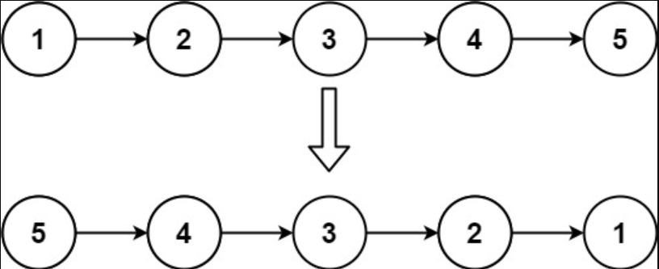
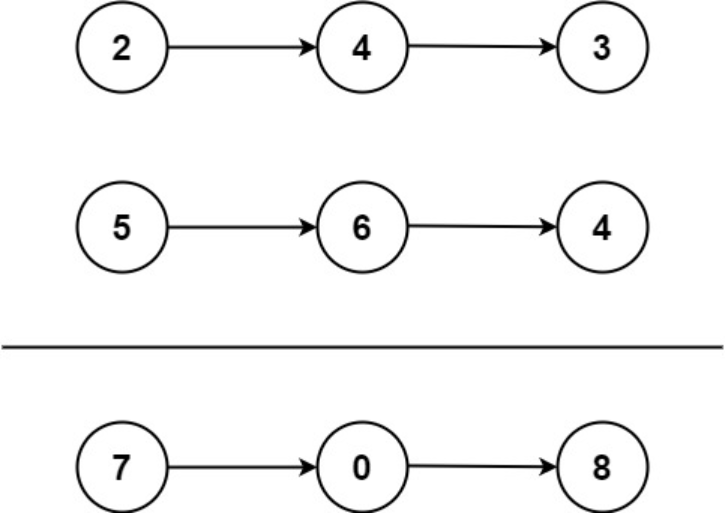
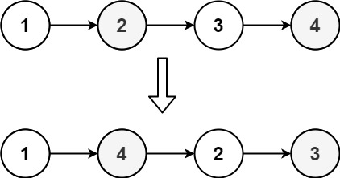
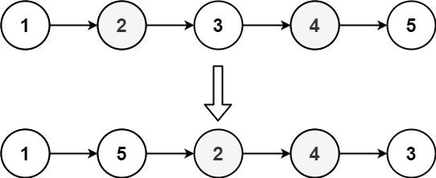

# 第三章 链表及其常见操作
链表使用指针连接离散节点，以随机访问能力换取灵活的结构调整。分析链表操作时，应区分“已经拿到目标节点”和“需要先遍历定位节点”两种情况。

## 3.1 链表基础概念
1. **节点（Node）结构**
    - **数据域** `data`：存储节点数据
    - **指针域** `nextPoint`：指向下一个节点
    - **核心特点**：  
    - 元素类型必须相同  
    - **空间不一定连续**（静态链表空间连续，动态链表不连续）  
        * 遍历：表头->表尾，依次查找 O(n)
        * 已知操作位置时，链接或断开节点可为 $O(1)$；若需先查找位置，总成本通常为 $O(n)$
        * 长度不固定：扩容方便，适合未知数据量处理
    - **头节点无前驱，尾节点无后继**（有的链表会增加 `head` 节点为头节点 ）
2. **链表定义（C++ 实现）**  

```cpp
typedef struct listnode {
    int data;                // 数据域
    listnode* next;         // 指针域
    // 构造函数：初始化成员
    listnode() : data(0), next(nullptr) {}
    listnode(int val) : data(val), next(nullptr) {}
    listnode(int val, listnode* nextnode) : data(val), next(nextnode) {}
} node, *pnode;  // pnode 为节点指针类型
```

```cpp
class List {
public:
    List() // 构造函数（初始化类成员）
    { 
        head = new node(); //初始化头节点
    }
    pnode getHead() 
    { 
        return head; 
    }
    void createNode(vector<int>& nums); // 通过数组创建链表
    void createNode(int n);          // 通过输入创建链表
    //链表操作……
private:
    pnode head;  // 表头指针
};
```

1. struct 方式定义节点
2. class 封装链表操作


## 3.2 链表的创建
1. **核心步骤**  
    - 申请新节点（`new node`）  
    - 将新节点链接到尾节点（新节点成为新的尾节点）
2. **C++ 代码实现：通过 `vector` 创建链表**

```cpp
void List::createNode(vector<int>& nums) 
{
    pnode p = head;
    while (p->next != nullptr) p = p->next; // 找到尾节点
    for (int i = 0; i < nums.size(); i++) 
    {
        p->next = new node(nums[i]); // 新节点链接到尾部
        p = p->next; // 更新尾节点指针
    }
}
```

**通过输入创建链表**

```cpp
void List::createNode(int n) 
{
    pnode p = head;
    while (p->next != nullptr) p = p->next;
    for (int i = 0; i < n; i++) 
    {
        int val; 
        cin >> val;
        p->next = new node(val);
        p = p->next;
    }
}
```

## 3.3 链表的遍历
**正序**  

**实现方法**

顺序访问 `next` 指针  

**C++代码示例**

```cpp
void printList(pnode head) 
{ 
    pnode p = head->next; 
    while(p) 
    { 
        cout << p->data << " "; p = p->next; 
    } 
}
```

**倒序**

**实现方法**

方法1：反转链表后正序遍历 

方法2：递归（类似二叉树后序遍历） 

方法3：栈辅助  

其他方法：

1. 数组存储，从后往前遍历数组
2. 链表存储，从后往前存储链表

**C++代码示例**

```cpp
void print(pNode nextNode)
{
    if (nextNode == nullptr) return;
    
    print(nextNode->next);
    cout << nextNode->data<<" ";
}
```

## 3.4 链表操作
### 3.4.1 反转链表
[LeetCode 206. 反转链表](https://leetcode.cn/problems/reverse-linked-list/)（hot100）

给你单链表的头节点 `head` ，请你反转链表，并返回反转后的链表。


**示例 1：**



<!-- image-source: https://assets.leetcode.com/uploads/2021/02/19/rev1ex1.jpg -->

```plain
输入：head = [1,2,3,4,5]
输出：[5,4,3,2,1]
```

**示例 2：**


<!-- image-source: https://assets.leetcode.com/uploads/2021/02/19/rev1ex2.jpg -->

```plain
输入：head = [1,2]
输出：[2,1]
```

**示例 3：**

```plain
输入：head = []
输出：[]
```


**提示：**

+ 链表中节点的数目范围是 `[0, 5000]`
+ `-5000 <= Node.val <= 5000`


**进阶：** 链表可以选用迭代或递归方式完成反转。你能否用两种方法解决这道题？

**递归：**

**思路**

**递归是怎么「自己调用自己」的**

> 「递」与「归」的一般概念、递归栈与四步解题套路见 [1.3 递归](1.算法分析与设计基础.md)；下面只结合本题看它如何落地。

+ **函数作用（语义）**：`reverseList(head)` 返回「以 `head` 为头的链表反转后的新表头」。把这个语义当成已知事实直接使用，是递归能够成立的前提——不用在每一层重新推导整条链表的反转过程。
+ **递归定义**：用自身的更小实例定义自身，必须有基例兜底。
    * **基例**：`head == nullptr`（空链表）或 `head->next == nullptr`（单节点），反转后仍是自己，直接返回 `head`。
    * **规模缩小**：`reverseList(head->next)` 处理的链表少了表头，长度从 $n$ 降到 $n-1$，一定会收敛到基例。
    * **归阶段组合**：假定 `head->next` 之后的部分已经反转完毕，剩下只需把 `head` 接到这段新链表的末尾。
+ **以 `[1,2,3]` 看写法二的「递」与「归」**：

| 阶段 | 调用 | 发生了什么 |
| --- | --- | --- |
| 递 | `reverseList(1)` | 不满足基例，挂起等 `reverseList(2)` 的结果 |
| 递 | `reverseList(2)` | 不满足基例，挂起等 `reverseList(3)` 的结果 |
| 递 | `reverseList(3)` | `head->next == nullptr`，命中基例，返回 `3` |
| 归 | `reverseList(2)` | `rev_head = 3`；`tail = head->next = 3`；`3->next = 2`；`2->next = nullptr`；返回 `3`，得到 `3→2` |
| 归 | `reverseList(1)` | `rev_head = 3`；`tail = head->next = 2`；`2->next = 1`；`1->next = nullptr`；返回 `3`，得到 `3→2→1` |

+ **两种写法在「递」与「归」上的分工不同**：
    * 写法一（成员变量 `pre`）：反转动作发生在「递」的阶段，每层把当前节点头插到 `pre` 前面；`pre` 就是「已反转部分」的状态，因为无法通过参数或返回值传递，才放在类成员里，每层返回的也都是同一个新表头。
    * 写法二（返回值）：反转动作发生在「归」的阶段，状态通过返回值 `rev_head` 回传；每层的 `head->next` 恰好是子链表反转后的尾节点，所以能直接尾插，函数不依赖任何外部状态。
+ **`head->next = nullptr` 为什么不能省**：尾插后 `head` 成为新链表末尾，但它原来的 `next` 仍指向 `tail`，而 `tail->next` 已经改成 `head`，两个节点互相指向就成环；置空才能让新链表有真正的尾。

```cpp
class Solution {
public:
    ListNode* reverseList(ListNode* head) 
    {
        if(head==nullptr)          // 走到表尾，pre 即新表头
        {
            return pre;
        }
        cur=head->next;            // 先记下后继
        head->next=pre;            // 反转：当前节点指向上一次处理的节点
        pre=head;                  // pre 前移，扩大“已反转部分”
        return reverseList(cur);   // 处理下一个节点
    }
private:
    ListNode* pre=nullptr,*cur;    // pre：已反转部分的表头；cur：下一个待处理节点
};
```

**递归（另一种写法）：**

与上面「从表头出发逐个头插」不同，这种写法先「递」到链表末尾拿到新表头，再在「归」的过程中把每个节点尾插到新链表末尾，不依赖成员变量：

```cpp
class Solution {
public:
    // 首先「递」到链表末尾，把末尾节点作为新链表的头节点 rev_head
    // 然后在「归」的过程中，把经过的节点依次插在新链表的末尾（尾插法）
    ListNode* reverseList(ListNode* head) {
        // 判断 head == nullptr 是为了兼容一开始链表就是空的情况
        if (head == nullptr || head->next == nullptr) {
            return head; // 链表末尾，即下面的 rev_head
        }
        auto rev_head = reverseList(head->next); // 「递」到链表末尾，拿到新链表的头节点
        ListNode* tail = head->next; // 在「归」的过程中，head->next 就是新链表的末尾
        tail->next = head; // 把 head 插在新链表的末尾
        head->next = nullptr; // 如果不写这行，新链表的末尾两个节点成环，这俩节点互相指向对方
        return rev_head;
    }
};
```

两种递归写法复杂度相同，见下方复杂度分析表。

**循环：**

**步骤**： 

**核心思想**：将原链表的节点逐个"摘下"，通过头插法插入到新链表的头部，实现链表反转。

① 定义变量：`newhead`（新头节点）、`take`（当前节点）、`breakNode`（下一节点） 

+ `newhead`：新链表的头指针（最终成为原链表的尾节点）
+ `take`：当前要"摘下"并插入到新链表的节点
+ `breakNode`：保存`take`的下一个节点，防止链表断裂

② 循环更新指针实现反转 

+ 改后继
+ 更新三个变量

③ 重置头节点指针

**C++代码**：  

```cpp
class Solution {
public:
    ListNode* reverseList(ListNode* head) 
    {
        if (!head || !head->next) return head; // 空链表/单节点处理
        ListNode* newHead = nullptr, *take = head, *breakNode = nullptr;
        while (take)
        {
            breakNode = take->next;   // 先保存后继，防止链表断裂
            take->next = newHead;     // 关键：反转指针
            newHead = take;
            take = breakNode;
        }
        return newHead;
    }
};
```

**复杂度分析**

| 方法 | 时间复杂度 | 空间复杂度 | 说明 |
| --- | --- | --- | --- |
| 递归 | $O(n)$ | $O(n)$ | 递归调用栈深度等于链表长度 |
| 迭代（头插法） | $O(n)$ | $O(1)$ | 三指针原地反转，空间最优 |

### 3.4.2 合并两个有序链表
[LeetCode 21. 合并两个有序链表](https://leetcode.cn/problems/merge-two-sorted-lists/)（hot100）

**题目描述**：

给你两个升序链表的头节点 `list1` 和 `list2` ，请你将两个链表合并为一个 **升序** 链表并返回。新链表是通过 **拼接** 给定的两个链表的所有节点组成的。

**示例 1：**

```plain
输入：l1 = [1,2,4], l2 = [1,3,4]
输出：[1,1,2,3,4,4]
```

**步骤**： 

定义变量newhead、tail

① 比较头节点确定新表头 

+ 比较头节点，小的成为表头

② 循环比较节点值，小的节点加入新链表 

+ 比较：小的添加到新表尾
+ 更新比较节点

③ 连接剩余未遍历节点  

**优化实现（C++）**：  

```cpp
void mergeLists(pnode& head, pnode list1, pnode list2) 
{
    if (!list1) 
    { 
        head = list2; 
        return; 
    }
    if (!list2) 
    { 
        head = list1; 
        return; 
    }
    
    pnode newHead = nullptr, tail = nullptr;
    // 确定表头
    if (list1->data < list2->data) 
    {
        newHead = tail = list1;
        list1 = list1->next;
    } 
    else 
    {
        newHead = tail = list2;
        list2 = list2->next;
    }
    
    // 合并过程
    while (list1 && list2) 
    {
        if (list1->data < list2->data) 
        {
            tail->next = list1;
            tail = list1;
            list1 = list1->next;
        }
        else 
        {
            tail->next = list2;
            tail = list2;
            list2 = list2->next;
        }
    }
    tail->next = list1 ? list1 : list2; // 连接剩余节点
    head = newHead;
}
```

**复杂度分析**

| 指标 | 说明 |
| --- | --- |
| 时间复杂度 | $O(m+n)$，两个链表各遍历一次 |
| 空间复杂度 | $O(1)$，只用 `newHead`、`tail` 两个指针，节点原地拼接 |

## 3.5 链表例题
**例题 1：两数相加（递归 + 进位，hot100）**

[LeetCode 2. 两数相加](https://leetcode.cn/problems/add-two-numbers/)

**题目描述**：

给你两个 **非空** 的链表，表示两个非负的整数。它们每位数字都是按照 **逆序** 的方式存储的，并且每个节点只能存储 **一位** 数字。

请你将两个数相加，并以相同形式返回一个表示和的链表。

你可以假设除了数字 `0` 之外，这两个数都不会以 `0` 开头。

**示例 1：**


<!-- image-source: https://assets.leetcode.cn/aliyun-lc-upload/uploads/2021/01/02/addtwonumber1.jpg -->

```plain
输入：l1 = [2,4,3], l2 = [5,6,4]
输出：[7,0,8]
解释：342 + 465 = 807.
```

**示例 2：**

```plain
输入：l1 = [0], l2 = [0]
输出：[0]
```

**示例 3：**

```plain
输入：l1 = [9,9,9,9,9,9,9], l2 = [9,9,9,9]
输出：[8,9,9,9,0,0,0,1]
```

**提示：**

+ 每个链表中的节点数在范围 `[1, 100]` 内
+ `0 <= Node.val <= 9`
+ 题目数据保证列表表示的数字不含前导零

**分析**

+ **逆序存储为什么省事**：个位恰好在表头，与「从低位向高位相加」的手算顺序一致，每一层递归处理一位，无需先反转链表；若像 445 题那样正序存储，就得先反转链表或借助栈。
+ **进位怎么传递**：把进位做成函数的第三个参数 `add`（默认为 0），本位和 `sum = x + y + add`，本位数字取 `sum % 10`，新进位 `sum / 10` 作为下一层递归的 `add` 传下去。
+ **终止条件**：`l1` 走完、`l2` 走完、`add == 0` 三者同时成立才返回 `nullptr`；不能只判两个链表为空，否则 999 + 1 这类最高位仍有进位的用例会丢掉最后的节点。
+ **短链表补齐**：递归中先看 `l1`、`l2` 是否为空再取值并后移，缺失的一位相当于补 0，因此不需要预先把两条链表对齐。
+ **一行建节点**：`return new ListNode(sum % 10, addTwoNumbers(l1, l2, sum / 10));` 用构造函数直接把当前位挂到下一层结果前面，相当于迭代写法里的 `tail->next = new ListNode(...)`；代价是递归调用栈占空间，改用哑节点 + 尾插可降到 $O(1)$，但代码更长。

**代码**

```cpp
/**
 * Definition for singly-linked list.
 * struct ListNode {
 *     int val;
 *     ListNode *next;
 *     ListNode() : val(0), next(nullptr) {}
 *     ListNode(int x) : val(x), next(nullptr) {}
 *     ListNode(int x, ListNode *next) : val(x), next(next) {}
 * };
 */
class Solution {
public:
    // add：来自低位的进位（首位默认 0）；返回当前位及更高位组成的新链表
    ListNode* addTwoNumbers(ListNode* l1, ListNode* l2,int add = 0) {
        // 终止：两条链表都走完且无进位，才不再产生节点
        if(l1 == nullptr && l2 == nullptr && add == 0)
            return nullptr;
        
        int sum = add;          // 本位和：先装入低位的进位
        if(l1!=nullptr)
        {
            sum+=l1->val;       // 加上 l1 当前位
            l1 = l1 -> next;    // l1 后移一位
        }
        if(l2!=nullptr)
        {
            sum+=l2->val;       // 加上 l2 当前位；l2 更短时这一位按 0 计
            l2 = l2->next;
        }

        // 先递归算出更高位，再用 sum%10 造当前节点并挂为新表头
        return new ListNode(sum%10,addTwoNumbers(l1,l2,sum/10));
    }
};
```

**复杂度分析**

| 指标 | 说明 |
| --- | --- |
| 时间复杂度 | $O(\max(m,n))$，每层递归处理一位，最高位进位只多一层 |
| 空间复杂度 | $O(\max(m,n))$，递归调用栈深度等于较长链表的长度（不计返回的结果链表）；若改写为迭代 + 哑节点版本则为 $O(1)$ |

**例题 2：相交链表（栈 / 长度差 / 指针切换，hot100）**

[LeetCode 160. 相交链表](https://leetcode.cn/problems/intersection-of-two-linked-lists/)

> LCR 023 是本题在「剑指 Offer」题单中的同题编号，题面与解法完全一致。

给定两个单链表的头节点 `headA` 和 `headB` ，请找出并返回两个单链表相交的起始节点。如果两个链表没有交点，返回 `null` 。

图示两个链表在节点 `c1` 开始相交 **：**


<!-- image-source: https://assets.leetcode.cn/aliyun-lc-upload/uploads/2018/12/14/160_statement.png -->

题目数据 **保证** 整个链式结构中不存在环。

**注意**，函数返回结果后，链表必须 **保持其原始结构** 。

> 示例中的 `intersectVal`、`skipA`、`skipB` 由评测系统用来构造测试数据，**不作为函数参数传入**；函数只接收 `headA`、`headB`。

**示例 1：**

```plain
输入：intersectVal = 8, listA = [4,1,8,4,5], listB = [5,6,1,8,4,5], skipA = 2, skipB = 3
输出：Intersected at '8'
解释：相交节点的值为 8（注意，如果两个链表相交则不能为 0）。
从各自的表头开始算起，链表 A 为 [4,1,8,4,5]，链表 B 为 [5,6,1,8,4,5]。
在 A 中，相交节点前有 2 个节点；在 B 中，相交节点前有 3 个节点。
```

**示例 2：**

```plain
输入：intersectVal = 2, listA = [1,9,1,2,4], listB = [3,2,4], skipA = 3, skipB = 1
输出：Intersected at '2'
解释：相交节点的值为 2（注意，如果两个链表相交则不能为 0）。
从各自的表头开始算起，链表 A 为 [1,9,1,2,4]，链表 B 为 [3,2,4]。
在 A 中，相交节点前有 3 个节点；在 B 中，相交节点前有 1 个节点。
```

**示例 3：**

```plain
输入：intersectVal = 0, listA = [2,6,4], listB = [1,5], skipA = 3, skipB = 2
输出：null
解释：从各自的表头开始算起，链表 A 为 [2,6,4]，链表 B 为 [1,5]。
由于这两个链表不相交，所以 intersectVal 必须为 0，而 skipA 和 skipB 可以是任意值。
```

**提示：**

+ `listA` 中节点数目为 `m`
+ `listB` 中节点数目为 `n`
+ `1 <= m, n <= 3 * 10^4`
+ `1 <= Node.val <= 10^5`
+ `0 <= skipA <= m`
+ `0 <= skipB <= n`
+ 如果 `listA` 和 `listB` 没有交点，`intersectVal` 为 `0`
+ 如果 `listA` 和 `listB` 有交点，`intersectVal == listA[skipA] == listB[skipB]`

**进阶：** 你能否设计一个时间复杂度 $O(m + n)$、仅用 $O(1)$ 内存的解决方案？

**方法1**：栈（时间 $O(m+n)$，空间 $O(m+n)$）

```cpp
ListNode* getIntersectionNode(ListNode* headA, ListNode* headB) 
{
    if (!headA || !headB) return nullptr; 

    stack<ListNode*> s1, s2;
    while (headA) 
    {
        s1.push(headA);
        headA = headA->next;
    }
    while (headB) 
     {
        s2.push(headB);
        headB = headB->next;
    }

    ListNode* res = nullptr;
    while (!s1.empty() && !s2.empty() && s1.top() == s2.top()) 
    {
        res = s1.top(); 
        s1.pop();
        s2.pop();
    }
    return res; 
}
```

**方法2**：计算两条链表长度，记录长度差为l，让长的先走l个节点后同时遍历（时间 $O(m+n)$，空间 $O(1)$）

```cpp
int getLength(ListNode* head) 
{
    int cnt = 0;
    while(head != nullptr)
     {
        ++cnt;
        head = head->next;
    }
    return cnt;
}
ListNode *getIntersectionNode(ListNode *headA, ListNode *headB) 
{
    int len1=  getLength(headA), len2 = getLength(headB);
    int d = abs(len1 - len2);
    while(d--) 
    {
        if(len1 > len2) headA = headA->next;
        else headB = headB->next;
    }
    while(headA != nullptr) 
    {
        if(headA == headB) return headA;
        headA = headA->next, headB = headB->next;
    }
    return nullptr;
}
```

**方法3**：数学方法（时间 $O(m+n)$，空间 $O(1)$）

+ **数学原理**：   
设链表A长度 `x+z`，链表B长度 `y+z`（`z`为公共部分），则：   
`(x+z) + y = (y+z) + x` → 两指针走完各自链表后，再走对方链表，必在交点相遇

```cpp
ListNode* getIntersectionNode(ListNode* headA, ListNode* headB) {
    ListNode* p = headA;
    ListNode* q = headB;
    while (p != q){
        p = p ? p->next : headB;
        q = q ? q->next : headA;
    }
    return p;
}
```

**复杂度**

| 操作 | 时间复杂度 | 空间复杂度 | C++实现要点 |
| --- | --- | --- | --- |
| 反转链表 | O(n) | O(1) | 三指针迭代，注意边界条件 |
| 合并有序链表 | O(n+m) | O(1) | 双指针比较，避免重复创建节点 |
| 寻找相交节点 | O(n+m) | O(1)（栈法为 $O(n+m)$） | 长度差对齐或指针切换；栈法用空间换思路 |


**例题 3：重排链表（找中点 + 反转 + 交替合并，hot100）**

[LeetCode 143. 重排链表](https://leetcode.cn/problems/reorder-list/)

**题目描述**：

给定一个单链表 `L` 的头节点 `head` ，单链表 `L` 表示为：

```plain
L0 → L1 → … → Ln - 1 → Ln
```

请将其重新排列后变为：

```plain
L0 → Ln → L1 → Ln - 1 → L2 → Ln - 2 → …
```

不能只是单纯的改变节点内部的值，而是需要实际的进行节点交换。


**示例 1：**



<!-- image-source: https://pic.leetcode.cn/1626420311-PkUiGI-image.png -->

```plain
输入：head = [1,2,3,4]
输出：[1,4,2,3]
```

**示例 2：**



<!-- image-source: https://pic.leetcode.cn/1626420320-YUiulT-image.png -->

```plain
输入：head = [1,2,3,4,5]
输出：[1,5,2,4,3]
```


**步骤**：

1. **分割链表**  
    - 用快慢指针找到链表中点（`middleNode`）  
    - 将链表拆分为前半部分（`head` 到中点）和后半部分（中点后）  
    - 断开连接：`list1->next = nullptr`
2. **反转后半部分**  
    - 将后半部分链表反转（`reverseList`）  
    - 反转后得到从原尾部到中点的逆序链表（`list2`）
3. **交替合并**  
    - 用指针 `cur` 从头开始  
    - **交替连接**：  
        * 奇数步：接 `list2` 的节点（`cur->next = list2`）  
        * 偶数步：接前半部分剩余节点（`cur->next = list1`）
    - 循环直到所有节点合并完成

**代码**

```cpp
class Solution 
{
public:
    void reorderList(ListNode* head) 
    {
        if (!head || !head->next) return;
        ListNode* list1=middleNode(head);
        ListNode* list2=reverseList(list1->next);
        list1->next=nullptr;
        ListNode* cur = head;
        bool t=true;
        list1=head->next;
        while(list1||list2)
        {
            if(t&&list2)
            {
                cur->next=list2;
                list2=list2->next;
            }
            else if(list1)
            {
                cur->next=list1;
                list1=list1->next;
            }
            cur=cur->next;
            t=!t;
        }
    }
    ListNode* middleNode(ListNode* head) 
    {
        ListNode* slow = head;
        ListNode* fast = head;
        while (fast->next && fast->next->next) 
        {
            slow = slow->next;
            fast = fast->next->next;
        }
        return slow;
    }
    ListNode* reverseList(ListNode* head) 
    {
        if(head==nullptr) return nullptr;
        ListNode* newHead=nullptr,*Take=head,*Break=head->next;
        while(Take!=nullptr)
        {
            Take->next=newHead;
            newHead=Take;
            Take=Break;
            if(Break) Break=Break->next;
        }
        return newHead;
    }
};
```


**例题 4：合并 K 个升序链表（顺序合并 / 分治，hot100）**

[LeetCode 23. 合并 K 个升序链表](https://leetcode.cn/problems/merge-k-sorted-lists/)

**题目描述**：

给你一个链表数组，每个链表都已经按升序排列。

请你将所有链表合并到一个升序链表中，返回合并后的链表。

**示例 1：**

```plain
输入：lists = [[1,4,5],[1,3,4],[2,6]]
输出：[1,1,2,3,4,4,5,6]
解释：链表数组如下：
[
  1->4->5,
  1->3->4,
  2->6
]
将它们合并到一个有序链表中得到。
1->1->2->3->4->4->5->6
```

**示例 2：**

```plain
输入：lists = []
输出：[]
```

**示例 3：**

```plain
输入：lists = [[]]
输出：[]
```

**方法一：顺序合并 (Sequential Merge)**

这种方法的思想比较直观，类似于“暴力”迭代。它维护一个结果链表，依次将数组中的每一个链表合并到这个结果链表中。

**步骤**

1. **初始化检查**：
    - 如果输入向量 `lists` 为空，直接返回 `nullptr`。
2. **寻找起点**：
    - 遍历 `lists`，找到第一个不为 `nullptr` 的链表，将其赋值给 `tmp`。`tmp` 代表“当前已经合并好的总链表”。
    - 如果所有链表都为空，返回 `nullptr`。
3. **循环合并**：
    - 从下一个链表开始遍历 (`i++`)。
    - 如果当前 `lists[i]` 为空，跳过。
    - **核心合并逻辑**（将 `tmp` 与 `lists[i]` 合并）：
        * 比较 `tmp` 和 `lists[i]` 的头结点值。
        * 较小者作为新链表的头 (`newhead`) 和尾 (`tail`)，并将该链表指针后移。
        * 进入 `while` 循环，不断比较 `tmp` 和 `lists[i]` 当前节点的值。
        * 将较小节点接在 `tail->next`，并移动 `tail` 和对应链表指针。
        * 循环结束后，将非空的那个链表剩余部分直接接在 `tail->next`。
    - **更新状态**：将合并后的新头结点 `newhead` 赋值给 `tmp`，以便下一轮循环继续合并。
4. **返回结果**：
    - 循环结束后，`tmp` 即为合并所有链表后的最终结果。

**c++代码**

```cpp
class Solution {
public:
    ListNode* mergeKLists(vector<ListNode*>& lists) 
    {
        
        if(lists.size()==0) return nullptr;  // 输入为空直接返回
        int i=0;
        while (i < lists.size() && lists[i] == nullptr) 
        { 
            i++; // 跳过所有空链表
        }  
        if (i >= lists.size()) return nullptr;  // 所有链表均为空
        tmp = lists[i];  // tmp 指向第一个非空链表
        i++;  // 指向下一个待合并链表
        
        for(; i < lists.size(); i++) 
        {
            if(lists[i] == nullptr) continue;  // 跳过空链表
            // 步骤 1: 比较头节点，确定新链表的起始点
            if(tmp->val > lists[i]->val) 
            {
                newhead = lists[i];  // lists[i] 作为新头
                tail = lists[i];     // tail 指向新头
                lists[i] = lists[i]->next;  // 移动 lists[i] 指针
            } 
            else 
            {
                newhead = tmp;       // tmp 作为新头
                tail = tmp;          // tail 指向新头
                tmp = tmp->next;     // 移动 tmp 指针
            }
            // 步骤 2: 逐节点合并两个链表
            while(tmp != nullptr && lists[i] != nullptr) 
            {
                if(tmp->val > lists[i]->val) 
                {
                    tail->next = lists[i];  // 接上较小的节点
                    tail = lists[i];        // 更新 tail
                    lists[i] = lists[i]->next;  // 移动 lists[i]
                } 
                else 
                {
                    tail->next = tmp;       // 接上较小的节点
                    tail = tmp;             // 更新 tail
                    tmp = tmp->next;        // 移动 tmp
                }
            }
            // 步骤 3: 连接剩余部分
            tail->next = tmp ? tmp : lists[i]; 
            // 步骤 4: 更新 tmp 为新合并结果
            tmp = newhead;
        }
        return tmp;
    }
};
```

**复杂度分析**

+ **时间复杂度**：$O(N \cdot K)$。假设共有 $K$ 个链表，总节点数为 $N$。最坏情况下，每次合并都需要遍历当前已合并的链表长度。第 $i$ 次合并耗时约 $i \times (N/K)$，累加后约为 $O(N \cdot K)$。
+ **空间复杂度**：$O(1)$。只使用了几个指针变量，没有额外的递归栈或数据结构。

---

**方法二：分治法 (Divide and Conquer)**

这种方法利用递归将问题规模缩小。类似于归并排序的思想，两两合并链表，直到最后只剩下一个链表。

**步骤**

1. **主函数入口**：
    - 处理边界情况（空数组或只有一个链表）。
    - 调用 `apart` 函数，传入整个数组的索引范围 `0` 到 `size-1`。
2. **分治递归（`apart` 函数）**：
    - **基准情况**：如果 `left == right`，说明当前范围内只有一个链表，直接返回该链表。
    - **分解**：计算中间位置 `mid`。
    - **递归**：
        * 调用 `apart(left, mid)` 合并左半部分，返回结果 `list1`。
        * 调用 `apart(mid+1, right)` 合并右半部分，返回结果 `list2`。
    - **合并**：调用 `merge(list1, list2)` 将左右两部分合并成一个链表并返回。
    - _过程示例_：如果有 4 个链表 [0,1,2,3]。
        * 第一层：分为 [0,1] 和 [2,3]。
        * 第二层：[0,1] 分为 0 和 1，合并；[2,3] 分为 2 和 3，合并。
        * 第一层回收：合并 (0+1) 的结果 和 (2+3) 的结果。
3. **双链表合并（`merge` 函数）**：
    - 处理其中一个链表为空的边界情况。
    - 比较 `list1` 和 `list2` 的头结点，较小者作为 `newHead` 和 `tail`。
    - 使用 `while` 循环，每次比较当前节点值，将较小者接在 `tail` 后面，移动 `tail` 和对应链表指针。
    - 循环结束后，将非空链表的剩余部分接在 `tail` 后面。
    - 返回 `newHead`。

**c++代码**

```cpp
class Solution {
public:
    ListNode* mergeKLists(vector<ListNode*>& lists) {
        if(lists.empty()) return nullptr;
        if(lists.size() == 1) return lists[0];
        // 调用分治函数，处理范围 [0, lists.size()-1]
        return apart(lists, 0, lists.size() - 1);
    }

private:
    // 分治递归函数
    ListNode* apart(vector<ListNode*>& lists, int left, int right) {
        if(left > right) return nullptr;
        if(left == right) return lists[left]; // 递归出口：只有一个链表
        
        int mid = (left + right) / 2;
        // 递归合并左半部分
        ListNode* list1 = apart(lists, left, mid);
        // 递归合并右半部分
        ListNode* list2 = apart(lists, mid + 1, right);
        
        // 合并左右两部分的结果
        return merge(list1, list2);
    }

    // 合并两个有序链表的辅助函数
    ListNode* merge(ListNode* list1, ListNode* list2) {
        if(!list1) return list2;
        if(!list2) return list1;

        ListNode* newHead, *tail;
        // 初始化头结点
        if(list1->val > list2->val) {
            newHead = list2;
            tail = list2;
            list2 = list2->next;
        } else {
            newHead = list1;
            tail = list1;
            list1 = list1->next;
        }

        // 遍历合并
        while(list1 && list2) {
            if(list1->val > list2->val) {
                tail->next = list2;
                tail = list2;
                list2 = list2->next;
            } else {
                tail->next = list1;
                tail = list1;
                list1 = list1->next;
            }
        }
        // 连接剩余部分
        tail->next = list1 ? list1 : list2;
        return newHead;
    }
};
```

**复杂度分析**

+ **时间复杂度**：$O(N \log K)$。
    - 递归树的高度为 $\log K$。
    - 每一层递归中，所有 `merge` 操作加起来总共遍历 $N$ 个节点。
    - 总时间 = 层数 $\times$ 每层节点数 = $\log K \times N$。
+ **空间复杂度**：$O(\log K)$。
    - 主要消耗在递归调用栈上，栈的深度为 $\log K$。

---

**对比**

| 特性 | 方法一：顺序合并 | 方法二：分治法 |
| :--- | :--- | :--- |
| **思路** | 依次将第 $i$ 个链表合并到前 $i-1$ 个的结果中 | 两两配对合并，像锦标赛一样向上归并 |
| **时间复杂度** | $O(N \cdot K)$ (较慢) | $O(N \log K)$ (较快) |
| **空间复杂度** | $O(1)$ | $O(\log K)$ (递归栈) |
| **代码结构** | 单层循环，内部包含合并逻辑 | 递归函数 + 独立合并函数，结构更清晰 |
| **推荐程度** | 适合链表数量 $K$ 很小的情况 | **推荐**，适合 $K$ 较大的通用情况 |


**例题 5：环形链表 II（快慢指针，hot100）**

[LeetCode 142. 环形链表 II](https://leetcode.cn/problems/linked-list-cycle-ii/)

**题目描述**：

给定一个链表的头节点  `head` ，返回链表开始入环的第一个节点。 _如果链表无环，则返回 _`null`_。_

如果从某个节点出发，连续沿 `next` 指针能够再次到达该节点，则链表中存在环。评测系统内部常用整数 `pos` 表示链表尾连接到链表中的位置（索引从 `0` 开始）；`pos == -1` 表示无环。**注意：`pos` 不作为函数参数传递**，它只用于描述测试数据。

**不允许修改** 链表。


**示例 1：**


<!-- image-source: https://assets.leetcode.com/uploads/2018/12/07/circularlinkedlist.png -->

```plain
输入：head = [3,2,0,-4], pos = 1
输出：返回索引为 1 的链表节点
解释：链表中有一个环，其尾部连接到第二个节点。
```

**示例 2：**


<!-- image-source: https://assets.leetcode.cn/aliyun-lc-upload/uploads/2018/12/07/circularlinkedlist_test2.png -->

```plain
输入：head = [1,2], pos = 0
输出：返回索引为 0 的链表节点
解释：链表中有一个环，其尾部连接到第一个节点。
```

**示例 3：**


<!-- image-source: https://assets.leetcode.cn/aliyun-lc-upload/uploads/2018/12/07/circularlinkedlist_test3.png -->

```plain
输入：head = [1], pos = -1
输出：返回 null
解释：链表中没有环。
```

**思路**

步骤：**快慢指针法（Floyd 判圈算法）** 核心思路分为两步：**检测环存在** → **定位环入口**

**1. 检测环是否存在（快慢指针相遇）**

+ **初始化**：  
`slow` 和 `fast` 指针都从链表头 `head` 出发。
+ 移动规则：
    - `slow` 每次走 **1 步**（`slow = slow->next`）
    - `fast` 每次走 **2 步**（`fast = fast->next->next`）
+ 终止条件：
    - 若 `fast` 或 `fast->next` 为 `nullptr` → 无环，返回 `nullptr`
    - 若 `slow == fast` → 有环，进入第二步

**为什么能检测环？**

> 设链表头到环入口距离为 `a`，环入口到相遇点距离为 `b`，环周长为 `c`。
>
> + 慢指针路程：`a + b`
> + 快指针路程：`a + b + n*c`（`n` 为快指针绕环圈数）
> + 速度关系：`2(a + b) = a + b + n*c` → `a = n\*c - b`  
**关键结论**：从头节点走 `a` 步 = 从相遇点走 `a` 步（在环中走 `n*c - b` 步 ≡ 逆时针走 `b` 步）→ 两者会在环入口相遇。
>

**2. 定位环的入口（双指针同步移动）**

+ 重置指针：
    - `head` 保持从**链表头**出发
    - `slow` 保持在**相遇点**（不重置）
+ 同步移动：
    - `head` 和 `slow` **每次各走 1 步**
    - 当 `head == slow` 时 → 此位置即为环入口

**代码**：

```cpp
class Solution {
public:
    ListNode* detectCycle(ListNode* head) 
    {
        ListNode* fast = head;
        ListNode* slow = head;
        while (fast&&fast->next) 
        {
            slow = slow->next;
            fast = fast->next->next;
            if (slow == fast) 
            {
                while (head != slow) 
                {
                    slow = slow->next;
                    head = head->next;
                }
                return head;
            }
        }
        return nullptr;
    }
};
```

**本章小结**：链表的核心是正确维护指针关系。处理反转、合并、相交和环时，应先画出节点连接变化，再决定是否需要哑节点、快慢指针或分治。
