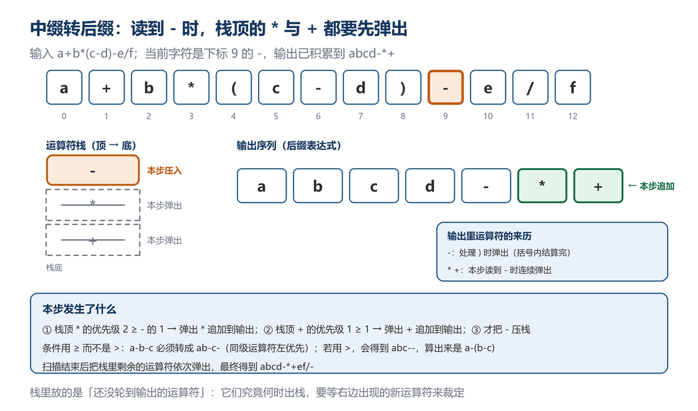
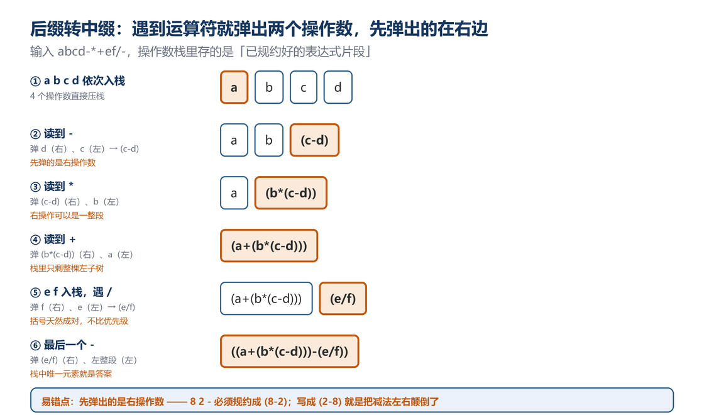
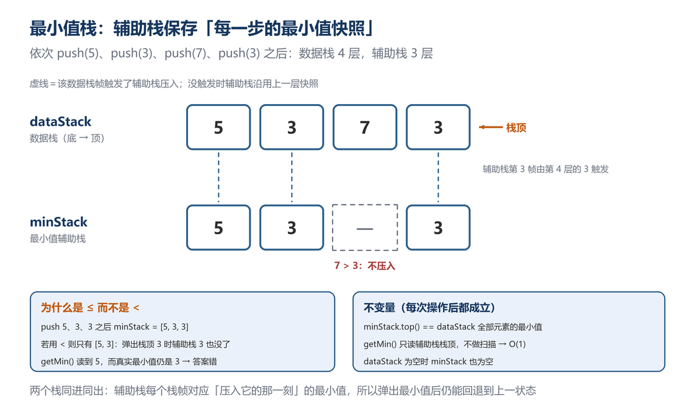
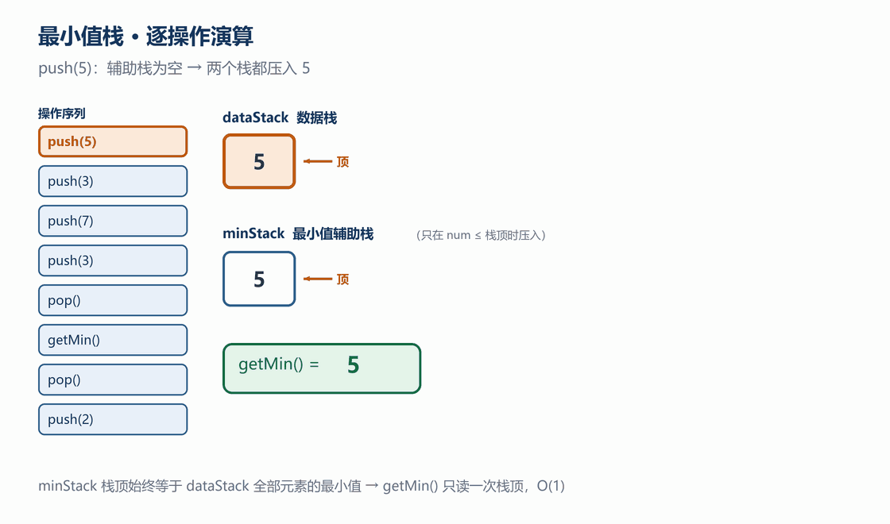
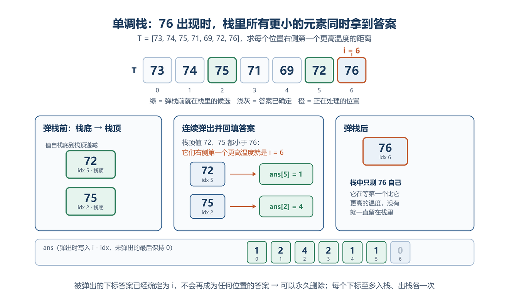
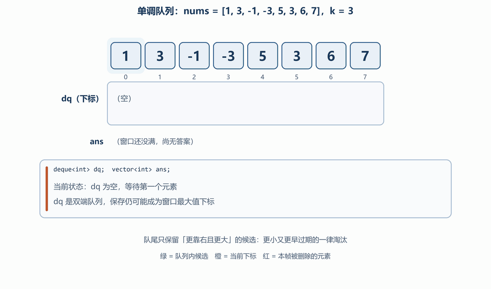
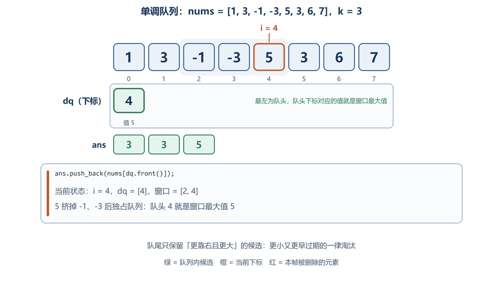

栈和队列都限制了元素的访问位置：栈遵循后进先出，队列遵循先进先出。限制访问方式可以让递归模拟、表达式处理、BFS 和滑动窗口等问题获得清晰且高效的实现。

# 4.1 栈（Stack）
## 4.1.1 栈的基本概念
1. **核心特点**  
    - **后进先出（LIFO）**：最后入栈的元素最先出栈  
    - **长度固定**（静态栈）：数组实现时长度无法动态改变  
    - **适用场景**：倒序处理问题（如回文判断、括号匹配、表达式求值）
2. **实现方式对比**  

| 实现方式 | 优点 | 缺点 | 适用场景 |
| --- | --- | --- | --- |
| **数组实现** | 访问速度快（连续内存） | 长度固定，扩容成本高 | 已知最大长度的场景 |
| **链表实现** | 动态扩容，无长度限制 | 额外指针开销 | 未知长度或频繁变长的场景 |


---

## 4.1.2 栈的组成结构
节点：数据域、指针域

封装：

1. 成员变量
    - 栈顶：表头
    - Count：节点数
2. 成员函数
    - 构造函数 初始化
    - push 在栈顶插入新节点
    - pop 弹出栈顶元素，并返回栈顶元素的值
    - clear 清空栈
    - getTop 获取栈顶元素的值（不删除）
    - getCount 获取栈的元素个数
    - isEmpty 判断栈是否为空（空true，非空false）
    - 析构函数 销毁

## 4.1.3 节点定义（链表实现）
```cpp
// 节点结构（数据域 + 指针域）
typedef struct ListNode {
    int data;                // 数据域
    ListNode* next;         // 指针域
    // 构造函数：初始化成员
    ListNode() : data(0), next(nullptr) {}
    ListNode(int val) : data(val), next(nullptr) {}
    ListNode(int val, ListNode* nextnode) : data(val), next(nextnode) {}
} Node, *pNode;  // pNode 为节点指针类型
```

## 4.1.4 栈类封装
```cpp
class Stack {
public:
    // 构造函数
    Stack() : top(nullptr), Count(0) {}  // 空栈初始化
    Stack(vector<int>& nums);            // 通过数组初始化栈
    Stack(int num);                     // 单元素初始化
    
    // 核心成员函数
    void push(int num);   // 入栈
    int pop();            // 出栈（弹出栈顶元素）
    void clear();         // 清空栈
    int getTop();         // 获取栈顶元素（不删除）
    int getCount();       // 获取元素个数
    bool isEmpty();       // 判断栈是否为空
    ~Stack();             // 析构函数（自动清理内存）

private:
    pNode top;   // 栈顶指针
    int Count;   // 元素计数
};
```

## 4.1.5 C++ 核心代码实现
### （1）栈操作函数
入栈：新节点插入栈顶

```cpp
void Stack::push(int num) {
    if (isEmpty()) {
        top = new Node(num);  // 首节点特殊处理
    } else {
        pNode p = new Node(num);
        p->next = top;        // 新节点指向原栈顶
        top = p;              // 更新栈顶指针
    }
    Count++;
}
```

出栈：弹出栈顶元素

```cpp
int Stack::pop() {
    if (isEmpty()) return -1;  // 空栈处理
    
    int num = top->data;
    pNode tmp = top;
    top = top->next;  // 栈顶指针下移
    delete tmp;       // 释放内存
    Count--;
    return num;
}
```

获取栈顶元素（不删除）

```cpp
int Stack::getTop() {
    return isEmpty() ? -1 : top->data;
}
```

清空栈

```cpp
void Stack::clear() {
    while (top) {
        pNode tmp = top;
        top = top->next;
        delete tmp;
    }
    Count = 0;
}
```

析构函数（自动调用clear）

```cpp
Stack::~Stack() 
{
    clear();
}
```


### （2）初始化方法
 通过vector初始化栈

```cpp
Stack::Stack(vector<int>& nums) : top(nullptr), Count(0) {
    for (int i = 0; i < nums.size(); i++) {
        push(nums[i]);  // 顺序入栈
    }
}
```

单元素初始化

```cpp
Stack::Stack(int num) : top(nullptr), Count(0) {
    push(num);
}
```

### （3）栈的经典应用：表达式转换与求值

三种写法描述的是**同一棵表达式树**：中缀是它的中序遍历，后缀是后序遍历，前缀是前序遍历——所谓「转换」，本质上只是换了一种遍历顺序。

**为什么计算机偏爱后缀/前缀**：中缀必须靠「优先级 + 括号」消歧，扫描到 `+` 时并不知道右边会不会冒出 `*`；而后缀从左往右扫，遇到运算符时它的两个操作数**一定已经算完**，既不回看也不加括号。所以编译器与计算器通常先转后缀再求值，或者用双栈直接求值。

**1. 表达式类型**

| 类型 | 示例 | 特点 |
| --- | --- | --- |
| **前缀表达式**（波兰表达式） | `+ 3 4` | 符号在操作数**左边** |
| **中缀表达式** | `3 + 4` | 符号在操作数**中间**（人类习惯） |
| **后缀表达式**（逆波兰表达式） | `3 4 +` | 符号在操作数**右边** |


**2. 中缀转后缀：思路、规则与演算**

**一句话思路**：把「还没轮到输出」的运算符先存进栈，等看清右边是否会出现优先级更高的运算符，再决定它什么时候出栈。栈在这里存的不是数据，而是**「谁先算」这个尚未做出的判断**。

**核心规则**

原则：左优先

借助辅助栈

1. **操作数**：遇到数字或字母（操作数），直接输出
2. **运算符**：遇到符号，将符号与栈顶元素进行优先级比较
    - 比较当前运算符与栈顶运算符优先级
    - 高优先级运算符先出栈
3. **括号处理**：遇到"("，直接入栈，遇到")"，依次将栈顶元素出栈，直到遇到"("停止
    - `(` 直接入栈
    - `)` 出栈直到遇到 `(`

把上面三条压成一张判定表——每读到一个字符，只做一件事：

| 读到 | 动作 | 是否输出 |
| --- | --- | --- |
| 操作数 | 直接追加到后缀串 | 输出 |
| `(` | 直接压栈 | 不输出 |
| `)` | 循环弹栈并输出，直到弹出 `(`；`(` 弹出后丢弃 | 括号内的运算符全部输出 |
| 其余运算符 | 循环弹掉栈顶所有「优先级 ≥ 自己」的运算符并输出，再把自己压栈 | 被弹的运算符输出 |

最后一行是全部关键：**先弹「不低于自己」的，再把自己压进去**。这一步保证了同优先级运算符按从左到右的顺序输出。

**为什么必须是 ≥ 而不是 >**

中缀 `a-b-c` 等价于 `(a-b)-c`，第二个 `-` 到来时，左边那个 `-` 必须先输出，于是得到 `ab-c-`。

| 出栈条件 | `a-b-c` 转出的后缀 | 求值结果 |
| --- | --- | --- |
| `>=`（连同级一起弹） | `ab-c-` | `(a-b)-c`，正确 |
| `>`（同级不弹） | `abc--` | `a-(b-c)`，错误 |

只有右结合的运算符（如幂 `^`）才反过来用 `>`，因为 `a^b^c = a^(b^c)`。

**完整演算**：`a+b*(c-d)-e/f`

| 步骤 | 读到 | 运算符栈（底→顶） | 输出（后缀） | 本步动作 |
| --- | --- | --- | --- | --- |
| 1 | `a` | 空 | `a` | 操作数直接输出 |
| 2 | `+` | `+` | `a` | 栈空，直接压栈 |
| 3 | `b` | `+` | `ab` | 操作数直接输出 |
| 4 | `*` | `+ *` | `ab` | `*` 的 2 > `+` 的 1，不弹，压栈 |
| 5 | `(` | `+ * (` | `ab` | 左括号直接压栈 |
| 6 | `c` | `+ * (` | `abc` | 操作数直接输出 |
| 7 | `-` | `+ * ( -` | `abc` | 栈顶是 `(`，优先级按 0 算，不弹 |
| 8 | `d` | `+ * ( -` | `abcd` | 操作数直接输出 |
| 9 | `)` | `+ *` | `abcd-` | 弹出 `-` 输出，再把 `(` 弹出丢弃 |
| 10 | `-` | `-` | `abcd-*+` | 弹 `*`、再弹 `+`，最后才压 `-` |
| 11 | `e` | `-` | `abcd-*+e` | 操作数直接输出 |
| 12 | `/` | `- /` | `abcd-*+e` | `/` 的 2 > `-` 的 1，不弹，压栈 |
| 13 | `f` | `- /` | `abcd-*+ef` | 操作数直接输出 |
| 14 | 扫描结束 | 空 | `abcd-*+ef/-` | 依次弹出 `/`、`-` |

第 9、10、14 步是三个「批量弹栈」的位置，下面的图定格在第 10 步。



**易错点**

| 错误写法 | 后果 | 原因 |
| --- | --- | --- |
| `while (opStack.getTop() != '(')` 不加空栈判断 | 括号不配对时死循环 | `pop()` 空栈返回 -1，永远弹不空 |
| 出栈条件写成 `>` | `a-b-c` 变成 `abc--` | 同级运算符的左结合被破坏 |
| 遇到 `)` 把 `(` 也追加到输出 | 后缀串里混进括号 | `(` 弹出后应直接丢弃 |
| 扫描结束忘记清栈 | 末尾的运算符全部丢失 | 栈里剩下的优先级最低，最后输出 |
| `priority('(')` 返回 2 | 括号内的运算符被提前弹出，括号失效 | `(` 的优先级必须最低（0） |
| 按 `char` 逐个处理多位数 | `12+3` 变成 `123+` | 需要用缓冲区把连续数字拼成完整操作数 |

最后一条是工程实现里最常见的：下面的代码只支持**一位**操作数，改成多位数时要用一个 `string buf` 累积，或按下标跳跃扫描。

**C++实现**：

```cpp
string infixToPostfix(string infix) 
{
    Stack opStack;  // 运算符栈
    string postfix = "";
    
    for (char c : infix)
    {
        if (isdigit(c) || isalpha(c)) 
        {  // 操作数
            postfix += c;
        } else if (c == '(') 
        {
            opStack.push(c);
        }
        else if (c == ')') 
        {
            while (!opStack.isEmpty() && opStack.getTop() != '(') 
            {
                postfix += opStack.pop();//c++栈的pop操作只有弹出，无返回值,代码里的pop相当于(pop()+top())
            }
            opStack.pop();  // 弹出 '('
        } 
        else 
        {  
            // 运算符
            while (!opStack.isEmpty() && precedence(opStack.getTop()) >= precedence(c)) 
            {
                postfix += opStack.pop();
            }
            opStack.push(c);
        }
    }
    
    // 清空剩余运算符
    while (!opStack.isEmpty()) 
    {
        postfix += opStack.pop();
    }
    return postfix;
}

// 优先级比较函数
int precedence(char op) 
{
    if (op == '+' || op == '-') return 1;
    if (op == '*' || op == '/') return 2;
    return 0;
}
```

**3. 后缀转中缀：把运算反过来做**

思路（只用一个操作数栈）：

1. 遇到操作数就压栈；栈里存的不是数字，而是**一段表达式字符串**。
2. 遇到运算符就连续弹两次：**先弹出的是右操作数，后弹出的是左操作数**。拼成 `(左 op 右)` 后再压回栈。
3. 扫描结束，栈里剩下的唯一元素就是整个中缀表达式。

**「先弹右、后弹左」是全部易错点**，以 `8 2 -` 为例：

| 弹出顺序 | 拼出的表达式 | 是否正确 |
| --- | --- | --- |
| 先弹 2（右）、再弹 8（左） | `(8-2)` | 正确 |
| 先弹 8、再弹 2 | `(2-8)` | 被减数与减数颠倒，错了 |

栈是后进先出，所以「后进栈的」恰好是「写在右边的」——这正是后缀表达式「操作数在前、运算符在后」的镜像。

**与后缀求值的区别**：两者骨架完全一样（遇到运算符就弹两个、算一步、压回），区别只在「算」这一步——求值做数值运算，转中缀拼字符串。看懂其中一个，另一个只是换一行。

**完整演算**：`abcd-*+ef/-` → `((a+(b*(c-d)))-(e/f))`

| 步骤 | 读到 | 操作数栈（底→顶） | 本步动作 |
| --- | --- | --- | --- |
| 1 | `a` | `a` | 入栈 |
| 2 | `b` | `a b` | 入栈 |
| 3 | `c` | `a b c` | 入栈 |
| 4 | `d` | `a b c d` | 入栈 |
| 5 | `-` | `a b (c-d)` | 弹 `d`（右）、`c`（左） |
| 6 | `*` | `a (b*(c-d))` | 弹 `(c-d)`（右）、`b`（左） |
| 7 | `+` | `(a+(b*(c-d)))` | 弹 `(b*(c-d))`（右）、`a`（左） |
| 8 | `e` | `(a+(b*(c-d))) e` | 入栈 |
| 9 | `f` | `(a+(b*(c-d))) e f` | 入栈 |
| 10 | `/` | `(a+(b*(c-d))) (e/f)` | 弹 `f`（右）、`e`（左） |
| 11 | `-` | `((a+(b*(c-d)))-(e/f))` | 弹 `(e/f)`（右）、左侧整段（左） |



**代码**

```cpp
// 单字符操作数版本：栈里存字符串，而不是数字
string postfixToInfix(const string& postfix) {
    stack<string> st;                    // 操作数栈（每格是一段表达式）

    for (char c : postfix) {
        if (c == ' ') continue;
        if (isalnum(c)) {
            st.push(string(1, c));       // 操作数：自己就是一段表达式
        } else {                          // + - * /
            string right = st.top(); st.pop();   // 先弹出：右操作数
            string left  = st.top(); st.pop();   // 后弹出：左操作数
            st.push("(" + left + c + right + ")");
        }
    }
    return st.empty() ? "" : st.top();
}
```

**为什么结果带满括号，以及怎么去掉冗余**

朴素拼接对每个运算符都加一层括号，得到 `((a+(b*(c-d)))-(e/f))`——正确但难看。想去括号，要先判断「去掉之后结合关系会不会变」：

1. 子表达式的根运算符优先级**高于**父运算符 → 可以去掉，例如 `a*(b+c)` 不行，`a*(b*c)` 可以；
2. 子表达式的根运算符优先级**低于**父运算符 → 括号必须保留，例如 `(a+b)*c`；
3. 同级时看位置与结合性：`+`、`*` 可去（结合律成立）；`-`、`/` 作为**左**孩子可去，作为**右**孩子不能去——`a-(b-c)` 去掉括号就变成 `a-b-c`，含义变了。

本节只要求读懂全括号版本；上面三条就是完整去括号器的全部判定依据，实现时把每段表达式连同「根运算符、是否原子」一起入栈即可。

**4. 后缀表达式求值（LeetCode 150）**

**逆波兰表达式求值** [leetcode150](https://leetcode.cn/problems/evaluate-reverse-polish-notation/?spm=a2ty_o01.29997173.0.0.15f25171oHEkg5)逆波兰表达式求值  用栈实现后缀表达式计算

给你一个字符串数组 `tokens` ，表示一个根据 [逆波兰表示法](https://baike.baidu.com/item/逆波兰式/128437) 表示的算术表达式。

请你计算该表达式。返回一个表示表达式值的整数。

**注意：**

+ 有效的算符为 `'+'`、`'-'`、`'*'` 和 `'/'` 。
+ 每个操作数（运算对象）都可以是一个整数或者另一个表达式。
+ 两个整数之间的除法总是 **向零截断** 。
+ 表达式中不含除零运算。
+ 输入是一个根据逆波兰表示法表示的算术表达式。
+ 答案及所有中间计算结果可以用 **32 位** 整数表示。

**示例 1：**

```plain
输入：tokens = ["2","1","+","3","*"]
输出：9
解释：该算式转化为常见的中缀算术表达式为：((2 + 1) * 3) = 9
```

**示例 2：**

```plain
输入：tokens = ["4","13","5","/","+"]
输出：6
解释：该算式转化为常见的中缀算术表达式为：(4 + (13 / 5)) = 6
```

**示例 3：**

```plain
输入：tokens = ["10","6","9","3","+","-11","*","/","*","17","+","5","+"]
输出：22
解释：该算式转化为常见的中缀算术表达式为：
  ((10 * (6 / ((9 + 3) * -11))) + 17) + 5
= ((10 * (6 / (12 * -11))) + 17) + 5
= ((10 * (6 / -132)) + 17) + 5
= ((10 * 0) + 17) + 5
= (0 + 17) + 5
= 17 + 5
= 22
```

**思路**

核心思想是利用栈的 **后进先出（LIFO）** 特性：

1. 遇到**数字**：直接压入栈中。
2. 遇到**运算符**：从栈中弹出两个数字进行计算，然后将**结果压回栈中**。
3. 遍历结束后，栈中剩下的唯一元素就是最终结果。

**代码**

```cpp
int evalRPN(vector<string>& tokens) {
    stack<int> st;

    for (const string& tok : tokens) {
        if (tok == "+" || tok == "-" || tok == "*" || tok == "/") {
            int right = st.top(); st.pop();      // 先弹出：右操作数
            int left  = st.top(); st.pop();      // 后弹出：左操作数
            if (tok == "+")      st.push(left + right);
            else if (tok == "-") st.push(left - right);
            else if (tok == "*") st.push(left * right);
            else                 st.push(left / right);  // 整数除法向零截断，与题意一致
        } else {
            st.push(stoi(tok));                  // 操作数：字符串转整数
        }
    }
    return st.top();
}
```

与原实现相比只改了四处，但都很关键：

| 改动 | 原实现 | 问题 |
| --- | --- | --- |
| 补分号 | `s.push(num1 * num2)` | 直接编译失败 |
| 去掉重复声明 | `int num1, num2;` 之后又在每个分支里 `int num1 = s.top();` | 内层重定义遮蔽外层，外层那两个变量从没用上 |
| 四个分支合并 | 四段几乎一样的代码 | 弹两个、算一步、压回，只差一行运算 |
| 统一命名 | `num1` / `num2` | 看不出谁是左谁是右，减法、除法的顺序极易写反 |

复杂度：每个 token 处理一次，时间 $O(n)$；栈最多同时存 $O(n)$ 个数，空间 $O(n)$。

**5. 中缀直接求值（双栈，选读）**

既然「中缀 → 后缀」和「后缀求值」都是 $O(n)$，也可以跳过转换，用**两个栈**（一个存数字、一个存运算符）一遍算完。规则与中缀转后缀几乎一样，只是把「输出」换成了「马上算」：

```cpp
// 弹出一个运算符，从数值栈取两个数做一次运算
void apply(stack<int>& num, stack<char>& op) {
    int right = num.top(); num.pop();
    int left  = num.top(); num.pop();
    char c = op.top(); op.pop();
    num.push(c == '+' ? left + right :
             c == '-' ? left - right :
             c == '*' ? left * right : left / right);
}

// 读到新运算符 c 时的核心循环（其余部分与中缀转后缀完全一致）
while (!op.empty() && op.top() != '(' && priority(op.top()) >= priority(c))
    apply(num, op);
op.push(c);
```

配套的两条规则：遇到 `)` 就一直 `apply` 直到弹出 `(`；扫描结束时把运算符栈清空，数值栈顶就是答案。

| 做法 | 优点 | 缺点 |
| --- | --- | --- |
| 先转后缀再求值 | 两个阶段各自简单、可分开调试；后缀串可复用 | 需要额外存储整个后缀串 |
| 双栈直接求值 | 一遍扫描、不存中间串 | 两栈交错，边界处理更难 |

# 4.2 队列（Queue）
## 4.2.1 队列基本概念
1. **核心特点**  
    - **先进先出（FIFO）**：最早入队的元素最先出队  
    - **适用场景**：  
        * 解决决策组循环问题（如BFS广度优先搜索）  
        * 任务调度系统（打印队列、消息队列）
2. **队列类型**  

| 类型 | 特点 | 应用场景 |
| --- | --- | --- |
| **普通队列** | 仅队尾入队，队首出队 | 基础任务调度 |
| **循环队列** | 取余使队尾指针回到数组开头，解决空间浪费 | 固定长度缓冲区 |
| **双端队列** | 两端均可入队/出队 | 滑动窗口问题 |
| **优先级队列** | 按优先级出队（非FIFO） | 任务调度（如CPU调度） |


---

## 4.2.2 队列的组成结构
**1. 节点定义（链表实现）**

```cpp
typedef struct ListNode 
{
    int data;                // 数据域
    ListNode* next;         // 指针域
    // 构造函数：初始化成员
    ListNode() : data(0), next(nullptr) {}
    ListNode(int val) : data(val), next(nullptr) {}
    ListNode(int val, ListNode* nextnode) : data(val), next(nextnode) {}
} Node, *pNode;  // pNode 为节点指针类型
```

**2. 队列类封装**

```cpp
class Queue 
{
public:
    // 构造函数
    Queue() : front(nullptr), back(nullptr), Count(0) {}
    Queue(vector<int>& nums);  // 通过数组初始化队列
    ~Queue();                  // 析构函数
    
    // 核心成员函数
    void push(int num);   // 入队（队尾插入）
    int pop();            // 出队（队首弹出）
    void clear();         // 清空队列
    int getFront();       // 获取队首元素（不删除）
    int getCount();       // 获取元素个数
    bool isEmpty();       // 判断队列是否为空

private:
    pNode front;  // 队首指针
    pNode back;   // 队尾指针
    int Count;    // 元素计数
};
```

## 4.2.3 C++ 核心代码实现
**队列操作函数**

**入队**：新节点插入队尾，尾插头删

```cpp
void Queue::push(int num) {
    if (isEmpty()) {
        front = back = new Node(num);  // 首节点特殊处理
    } else {
        back->next = new Node(num);    // 新节点插入队尾
        back = back->next;             // 更新队尾指针
    }
    Count++;
}
```

**出队**：弹出队首元素

```cpp
int Queue::pop() {
    if (isEmpty()) return -1;  // 空队列处理
    
    int num = front->data;
    pNode tmp = front;
    front = front->next;  // 队首指针后移
    delete tmp;           // 释放内存
    
    if (isEmpty()) back = nullptr;  // 队列清空时更新队尾
    Count--;
    return num;
}
```

**获取队首元素（不删除）**

```cpp
int Queue::getFront() {
    return isEmpty() ? -1 : front->data;
}
```

**清空队列**

```cpp
void Queue::clear() {
    while (front) {
        pNode tmp = front;
        front = front->next;
        delete tmp;
    }
    back = nullptr;
    Count = 0;
}
```

**析构函数（自动调用clear）**

```cpp
Queue::~Queue() {
    clear();
}
```

**2. 初始化方法**

通过vector初始化队列

```cpp
Queue::Queue(vector<int>& nums) : front(nullptr), back(nullptr), Count(0) 
{
    for (int i = 0; i < nums.size(); i++) 
    {
        push(nums[i]);  // 顺序入队
    }
}
```

## 4.2.4 队列的经典应用：BFS 广度优先搜索
**1. BFS算法模板**

```cpp
void BFS(TreeNode* root) {
    if (!root) return;
    
    Queue<TreeNode*> q;
    q.push(root);
    
    while (!q.isEmpty()) {
        TreeNode* node = q.pop();
        // 处理当前节点
        cout << node->val << " ";
        
        // 子节点入队
        if (node->left) q.push(node->left);
        if (node->right) q.push(node->right);
    }
}
```

**2. 二叉树层序遍历（LeetCode 102）**

[102. 二叉树的层序遍历](https://leetcode.cn/problems/binary-tree-level-order-traversal/)（Hot 100）

给你二叉树的根节点 `root`，返回其节点值的**层序遍历**（即逐层地、从左到右访问所有节点）。

**示例 1：**

```plain
输入：root = [3,9,20,null,null,15,7]
输出：[[3],[9,20],[15,7]]
```

**示例 2：**

```plain
输入：root = [1]
输出：[[1]]
```

**示例 3：**

```plain
输入：root = []
输出：[]
```

**提示：**

+ 树中节点数目在范围 `[0, 2000]` 内
+ `-1000 <= Node.val <= 1000`

**思路**

普通 BFS 只能保证「按入队顺序」逐个访问，却分不清哪些节点属于同一层。要分层，关键是在每一轮开始时**先记下当前队列的长度** `levelSize`：这一批元素恰好就是同一层的全部节点。

1. `levelSize = q.getCount()` 必须在进入内层循环前取好——循环过程中队列长度会变，但本轮只处理这 `levelSize` 个；
2. 依次出队 `levelSize` 个节点，把它们的孩子入队：孩子排在队尾，本轮不会被处理，正好构成下一层；
3. 本轮收集的 `level` 追加到 `result`，队列为空时结束。

与上一段 BFS 模板的区别只有一处：多了「按层切开」的内层循环。没有它，输出就是一根扁平的序列 `3 9 20 15 7`；有了它，才得到 `[[3],[9,20],[15,7]]`。

**代码**

```cpp
vector<vector<int>> levelOrder(TreeNode* root) {
    vector<vector<int>> result;
    if (!root) return result;
    
    Queue<TreeNode*> q;
    q.push(root);
    
    while (!q.isEmpty()) {
        int levelSize = q.getCount();
        vector<int> level;
        
        for (int i = 0; i < levelSize; i++) {
            TreeNode* node = q.pop();
            level.push_back(node->val);
            
            if (node->left) q.push(node->left);
            if (node->right) q.push(node->right);
        }
        result.push_back(level);
    }
    return result;
}
```

**复杂度分析**

| 指标 | 值 | 说明 |
| --- | --- | --- |
| 时间复杂度 | $O(n)$ | 每个节点入队、出队各一次 |
| 空间复杂度 | $O(n)$ | 队列最多同时容纳一层节点（最坏 $n/2$ 个），结果数组同样存 $n$ 个值 |

## 4.2.5 与栈的对比
| 特性 | 栈（Stack） | 队列（Queue） |
| --- | --- | --- |
| **操作原则** | LIFO（后进先出） | FIFO（先进先出） |
| **核心操作** | push/pop | push/pop（但方向不同） |
| **典型应用** | 表达式求值、括号匹配 | BFS、任务调度 |
| **指针维护** | 仅需top指针 | 需front和back双指针 |
| **STL容器** | std::stack | std::queue |


> **关键区别**：  
>
> + 栈：所有操作都在**同一端**（栈顶）  
> + 队列：入队在**队尾**，出队在**队首**
>

# 4.3 栈与队列的相互实现
## 4.3.1 两个栈实现队列
**1. 核心原理**

+ **入队操作**：   
`s2` 非空时，将 `s2` 中所有元素依次弹出并压入 `s1`，再将新元素压入 `s1`  
+ **出队操作**：   
`s1` 非空时，将 `s1` 所有元素压入 `s2`，再从 `s2` 弹出

**2. C++代码实现**

```cpp
class MyQueue {
private:
    stack<int> s1;  // 主栈（入队时使用）
    stack<int> s2;  // 辅助栈（出队时使用）

public:
    // 入队操作
    void push(int num) {
        // 确保s2为空，将s2元素转移到s1
        while (!s2.empty()) {
            s1.push(s2.top());
            s2.pop();
        }
        s1.push(num);  // 新元素入s1
    }

    // 出队操作
    int pop() {
        // 确保s1为空，将s1元素转移到s2
        while (!s1.empty()) {
            s2.push(s1.top());
            s1.pop();
        }
        int num = s2.top();  // 获取队首元素
        s2.pop();            // 弹出队首
        return num;
    }

    // 获取队首元素（不删除）
    int front() {
        while (!s1.empty()) {
            s2.push(s1.top());
            s1.pop();
        }
        return s2.top();
    }

    // 判断队列是否为空
    bool empty() {
        return s1.empty() && s2.empty();
    }
};
```

## 4.3.2 两个队列实现栈
**1. 核心原理**

+ **入栈操作**：   
新元素进入**非空队列**（若两队列均空，则进入 `q1`）  
+ **出栈操作**：   
将非空队列除**最后一个元素**外的所有元素转移到另一个队列，再弹出原队列尾元素

**2. C++代码实现**

```cpp
class MyStack {
private:
    queue<int> q1;  // 主队列
    queue<int> q2;  // 辅助队列

public:
    // 入栈操作
    void push(int num) 
    {
        if (q2.empty()) 
        {
            q1.push(num);  // q2空时，新元素入q1
        } 
        else 
        {
            q2.push(num);  // q2非空时，新元素入q2
        }
    }

    // 出栈操作
    int pop() 
    {
        if (q1.empty()) 
        {
            // q1空时，处理q2
            int num;
            while (q2.size() > 1) 
            {
                q1.push(q2.front());  // q2前n-1个元素转移到q1
                q2.pop();
            }
            num = q2.front();  // 保留最后一个元素
            q2.pop();
            return num;
        } 
        else 
        {
            // q2空时，处理q1
            int num;
            while (q1.size() > 1) 
            {
                q2.push(q1.front());  // q1前n-1个元素转移到q2
                q1.pop();
            }
            num = q1.front();  // 保留最后一个元素
            q1.pop();
            return num;
        }
    }

    // 获取栈顶元素
    int top() {
        if (q1.empty()) return q2.back();
        else return q1.back();
    }

    // 判断栈是否为空
    bool empty() {
        return q1.empty() && q2.empty();
    }
};
```

**3. 关键点解析**

+ **入栈**：始终向非空队列添加元素  
+ **出栈**：  

```cpp
// 伪代码
while (非空队列.size() > 1) {
    将元素转移到空队列;
}
弹出非空队列的最后一个元素;
```

# 4.4 最小值栈、单调栈与单调队列

这三个结构回答同一个问题：**怎样在 $O(1)$ 的时间里，拿到一个随「栈顶 / 窗口」变化而变化的极值？**

暴力做法每次都扫一遍候选集合，代价 $O(n)$。三者的共同手法是**及时丢弃不可能成为答案的候选**——某个元素一旦被证明「永远不会再被问到」，就立刻扔掉；于是每个元素至多进出一次，总代价被摊平成 $O(n)$。区别只在候选集合的形状：

| 结构 | 候选集合的形状 | 要回答的问题 |
| --- | --- | --- |
| 最小值栈 | 辅助栈栈顶 = 当前最小值快照 | 当前栈内最小的元素是谁 |
| 单调栈 | 栈内下标递增、值单调 | 某个元素左/右第一个更大（更小）的元素是谁 |
| 单调队列 | 双端队列内下标递增、值单调 | 当前滑动窗口内的最大（最小）元素是谁 |

## 4.4.1 最小值栈（Min Stack）

> **先纠正一个常见混用**：最小值栈**不是**单调栈。它的辅助栈里可以出现 `5 3 3` 这样「相邻相等」的序列，只记录「每个时刻的最小值」，并不要求严格单调；而单调栈靠「弹出即定案」来回答下一个更大/更小元素。

**核心原理**

+ **辅助栈设计**：使用额外栈记录当前栈内元素的最小值
+ **入栈规则**：新元素与栈顶元素比较，较小值压入辅助栈
+ **出栈规则**：主栈与辅助栈同步弹出

**为什么一个 `min` 变量不够**

单个变量只记得「现在的最小值」，记不住「历史」：栈为 `5, 3, 7` 时 `min = 3`；一旦 `pop()` 掉 3，新的最小值应该是 5，但这个 5 已经被覆盖掉了，只能重新扫描全栈。

关键观察是：**要恢复「上一个最小值」，需要的正是栈式的历史**——每压入一层就记一份当时的答案，弹出一层就恢复上一份。于是再开一个栈即可。

**不变量**

> `minStack.top() == min(dataStack 中的全部元素)`

- 辅助栈的每个栈帧，对应「压入它的那一刻」主栈的最小值；
- 只有新元素 ≤ 当前最小值时才压辅助栈，所以辅助栈不会比主栈长；
- `dataStack` 为空时 `minStack` 也为空——两个栈同生共死。

于是 `getMin()` 只是读一次 `minStack.top()`，不扫描任何东西。

**为什么是 ≤ 而不是 <**

| 操作 | 用 `<=` | 用 `<` |
| --- | --- | --- |
| push(5) | minStack: `5` | minStack: `5` |
| push(3) | minStack: `5 3` | minStack: `5 3` |
| push(3) | minStack: `5 3 3` | minStack: `5 3`（相等不压） |
| pop() | 两栈各弹一个 3 → `5 3` | 主栈剩 `5 3`，辅助栈也弹掉 3 → `5` |
| getMin() | 3，正确 | 5，错了（真实最小值仍是 3） |

重复的最小值必须**逐个记账**：辅助栈记的是「第几层时的最小值」，而不是「最小值出现过没有」。

**逐步演算**（push 5、3、7、3，然后 pop、getMin、pop、push 2）

| 操作 | dataStack（底→顶） | minStack（底→顶） | getMin() | 说明 |
| --- | --- | --- | --- | --- |
| push(5) | `5` | `5` | 5 | 辅助栈为空，直接压 |
| push(3) | `5 3` | `5 3` | 3 | 3 ≤ 5，压入 |
| push(7) | `5 3 7` | `5 3` | 3 | 7 > 3，只压主栈 |
| push(3) | `5 3 7 3` | `5 3 3` | 3 | 3 ≤ 3，相等也压 |
| pop() | `5 3 7` | `5 3` | 3 | 弹出的 3 等于辅助栈顶，两栈同步弹 |
| getMin() | `5 3 7` | `5 3` | 3 | 只读辅助栈顶 |
| pop() | `5 3` | `5 3` | 3 | 弹出 7 ≠ 3，辅助栈不动 |
| push(2) | `5 3 2` | `5 3 2` | 2 | 2 ≤ 3，压入 |





> 若编辑器不播放 GIF，看上一张静态结构图即可。

**LeetCode 155. 最小栈**（[题面](https://leetcode.cn/problems/min-stack/)）

设计一个支持 `push`、`pop`、`top` 操作，并能在常数时间内检索到最小元素的栈。实现 `MinStack` 类：`push(val)` 入栈、`pop()` 弹出栈顶、`top()` 取栈顶、`getMin()` 取最小元素。

```plain
输入：
["MinStack","push","push","push","getMin","pop","top","getMin"]
[[],[-2],[0],[-3],[],[],[],[]]

输出：
[null,null,null,null,-3,null,0,-2]

解释：
MinStack minStack = new MinStack();
minStack.push(-2);
minStack.push(0);
minStack.push(-3);
minStack.getMin();   --> 返回 -3
minStack.pop();
minStack.top();      --> 返回 0
minStack.getMin();   --> 返回 -2
```

**代码**（下面这个类与题面接口完全一致，可直接提交）

```cpp
class MinStack {
private:
    stack<int> dataStack;  // 存储实际数据
    stack<int> minStack;   // 存储当前最小值

public:
    void push(int num) {
        dataStack.push(num);
        // 辅助栈为空或新元素≤当前最小值
        if (minStack.empty() || num <= minStack.top()) {
            minStack.push(num);
        }
    }

    void pop() {
        if (dataStack.top() == minStack.top()) {
            minStack.pop();  // 同步弹出最小值
        }
        dataStack.pop();
    }

    int top() {
        return dataStack.top();
    }

    int getMin() {
        return minStack.top();  // O(1)获取最小值
    }
};
```

复杂度：`push` / `pop` / `top` / `getMin` 均为 $O(1)$；辅助栈最坏与主栈等长，空间 $O(n)$。

**四种等价写法**（都能 $O(1)$，差别在空间与出错风险）

| 写法 | 思路 | 额外空间 | 取舍 |
| --- | --- | --- | --- |
| 双栈（本节） | 辅助栈存「每层的最小值」 | 最坏 $O(n)$ | 最直观，代码最短 |
| 单栈存 `pair<int,int>` | 每个元素自带一份「当时的最小值」 | $O(n)$ | 只有一个栈，`pop` 不会漏弹 |
| 辅助栈只存严格更小的 | 只在 `<` 时压，`pop` 时判 `== min` 再弹 | 平均更省 | 判断条件绕，重复最小值易错 |
| 差值法 | 栈里存 `val - min`，另用一个 `long long min` | $O(1)$ | 需 `long long` 防溢出，可读性最差 |

## 4.4.2 单调栈

**问题引入**：`T = [73, 74, 75, 71, 69, 72, 76]`，求每个位置「右边第一个更高温度」距它几天。暴力对每个 `i` 向右扫，最坏 $O(n^2)$；浪费在于 `75` 后面那几个更矮的温度「能挡住谁」被反复重算。

**支配关系（单调性的来源）**

若 `j > i` 且 `T[j] > T[i]`，那么对 `i` 右边所有位置而言，**`j` 都比 `i` 有用**：`j` 更靠右、更大，能当答案的场合比 `i` 多；而 `i` 又比 `j` 更早过期。于是 `i` 一旦被 `j` 超过，就永远不会再成为任何位置的答案，可以永久删除。

把这条规则执行到底，栈里活下来的就是**下标递增、值递减**的一串候选——这就是单调栈。注意它不是「排序后塞进栈」，而是「按支配关系不断删人」的结果。

**三条操作**

1. 读到 `i` 时，把栈顶所有 `< T[i]` 的下标弹出；每弹出一个下标 `k`，说明 `i` 就是 `k` 右边第一个更大元素，于是 `ans[k] = i - k`（**出栈即定案**）；
2. 弹不动了，把 `i` 压栈——它要去等自己的答案；
3. 扫描结束后栈里还剩的，说明右边没有更大元素，答案保持默认值 0。

**模板**（求「右边第一个更大」= 单调递减栈，栈里存**下标**）

```cpp
vector<int> dailyTemperatures(vector<int>& T) {
    int n = T.size();
    vector<int> ans(n, 0);   // 默认 0：右边没有更高温度
    stack<int> st;           // 存下标；从栈底到栈顶，T 的值递减

    for (int i = 0; i < n; ++i) {
        while (!st.empty() && T[st.top()] < T[i]) {   // 当前元素比栈顶高
            int k = st.top(); st.pop();
            ans[k] = i - k;                           // 出栈即定案，写入距离
        }
        st.push(i);
    }
    return ans;
}
```

**四种问法**：改两个地方就能切换——「左边还是右边」决定扫描方向与写法，「更大还是更小」决定比较符号。

| 要求 | 弹栈条件 | 栈的单调性 |
| --- | --- | --- |
| 右边第一个更大 | `T[st.top()] < T[i]` | 递减 |
| 右边第一个更小 | `T[st.top()] > T[i]` | 递增 |
| 左边第一个更大 | 从左往右，弹掉 `T[st.top()] <= T[i]` 后，新的栈顶就是答案 | 递减 |
| 左边第一个更小 | 从左往右，弹掉 `T[st.top()] >= T[i]` 后，新的栈顶就是答案 | 递增 |

一句话记符号：求「严格更大」用 `<`（相等也弹，因为相等不算更大）；求「不小于」用 `<=`。多一个等号，含义就从「更大」变成「允许相等」。

**逐步演算**：`T = [73, 74, 75, 71, 69, 72, 76]`

| i | T[i] | 弹出并回填 | 栈（底→顶，存下标） | ans |
| --- | --- | --- | --- | --- |
| 0 | 73 | — | `0` | 全 0 |
| 1 | 74 | 弹 0 → ans[0]=1 | `1` | `1 _ _ _ _ _ _` |
| 2 | 75 | 弹 1 → ans[1]=1 | `2` | `1 1 _ _ _ _ _` |
| 3 | 71 | 71 < 75，不弹 | `2 3` | 不变 |
| 4 | 69 | 69 < 71，不弹 | `2 3 4` | 不变 |
| 5 | 72 | 弹 4 → ans[4]=1；弹 3 → ans[3]=2 | `2 5` | `1 1 _ 2 1 _ _` |
| 6 | 76 | 弹 5 → ans[5]=1；弹 2 → ans[2]=4 | `6` | `1 1 4 2 1 1 0` |



**复杂度**：每个下标入栈一次、出栈一次，总操作数不超过 $2n$，时间 $O(n)$；栈深最坏 $O(n)$，空间 $O(n)$。这正是不变量「出栈即定案」的价值——每个元素只被结算一次。

**拓展**：接雨水（42）用单调栈找每根柱子的左右边界；柱状图中最大矩形（84）同样靠「弹出时确定左右边界」。模板完全一样，变的只是「出栈那一刻要算什么」。

## 4.4.3 单调队列（双端队列实现）

**问题引入**：滑动窗口最大值（239）。窗口每右移一格，就有一个旧元素离开、一个新元素进入；暴力对每个窗口扫 `k` 个元素，总代价 $O(nk)$。要降到 $O(n)$，必须让「离开」与「进入」各自都是 $O(1)$——这正是双端队列的用武之地：两端都能操作，一端负责过期、一端负责淘汰。

**核心原理：双重淘汰**

+ **队列特性**：
    - **头部**：存储当前窗口的最大值
    - **尾部**：保证元素**单调递减**
+ **入队规则**：比新元素小的元素从队尾弹出，保持队列单调性
+ **出队规则**：离开窗口的元素从队头弹出

两条淘汰规则各自对应一种「没用的候选」：

1. **值淘汰（队尾）**：若 `j > i` 且 `nums[j] >= nums[i]`，则 `i` 既更小、又更早过期——它在任何包含自己的窗口里都竞争不过 `j`，可以立刻从队尾弹出。
2. **过期淘汰（队头）**：窗口左边界越过某个下标时，它已经不在窗口里，只能从队头弹出（它恰好也是队列里最老的那个）。

**不变量**

> `dq` 中的下标严格递增、对应的 `nums` 值严格递减；`dq.front()` 永远是当前窗口最大值的下标。

为什么队头一定在窗口内？因为每次滑窗都**先**做过期淘汰、**再**入队取值。「先过期、后入队」是这套写法最容易记错的顺序：若先入队，队头可能已经是刚过期的元素，判断条件就得改写成 `dq.front() < i-k+1`。

**为什么存下标而不是存值**

值无法判断「是否过期」，两个相同的值尤其致命（删掉一个，不知道删的是哪一个）。下标既能拿去取 `nums`，又能和窗口左边界比较，一举两得。

**LeetCode 239. 滑动窗口最大值**（[题面](https://leetcode.cn/problems/sliding-window-maximum/)）

给你一个整数数组 `nums`，有一个大小为 `k` 的滑动窗口从数组的最左侧移动到最右侧。你只可以看到窗口内的 `k` 个数字，窗口每次只向右移动一位。返回每个窗口中的最大值。

```plain
输入：nums = [1,3,-1,-3,5,3,6,7], k = 3
输出：[3,3,5,5,6,7]
解释：
滑动窗口的位置                最大值
---------------               -----
[1  3  -1] -3  5  3  6  7       3
 1 [3  -1  -3] 5  3  6  7       3
 1  3 [-1  -3  5] 3  6  7       5
 1  3  -1 [-3  5  3] 6  7       5
 1  3  -1  -3 [5  3  6] 7       6
 1  3  -1  -3  5 [3  6  7]      7
```

**逐步演算**（`k = 3`，队头看是否过期，队尾看是否太小）

| i | nums[i] | 已入队下标区间 | 过期淘汰（队头 ≤ i-k） | 值淘汰（队尾值 ≤ nums[i]） | dq（存下标） | ans |
| --- | --- | --- | --- | --- | --- | --- |
| 0 | 1 | `[0,0]` | 队空 | — | `0` | — |
| 1 | 3 | `[0,1]` | 队头 0 > -2 | 弹 0（1 ≤ 3） | `1` | — |
| 2 | -1 | `[0,2]` | 队头 1 > -1 | — | `1 2` | 3 |
| 3 | -3 | `[1,3]` | 队头 1 > 0 | — | `1 2 3` | 3 |
| 4 | 5 | `[2,4]` | 队头 1 ≤ 1 → 弹 1 | 弹 3（-3 ≤ 5）、弹 2（-1 ≤ 5） | `4` | 5 |
| 5 | 3 | `[3,5]` | 队头 4 > 2 | — | `4 5` | 5 |
| 6 | 6 | `[4,6]` | 队头 4 > 3 | 弹 5（3 ≤ 6）、弹 4（5 ≤ 6） | `6` | 6 |
| 7 | 7 | `[5,7]` | 队头 6 > 4 | 弹 6（6 ≤ 7） | `7` | 7 |

注意第 4 步：5 一口气把 `-3`、`-1` 全踢掉，它们永远不可能再当最大值；注意第 6 步：6 同样吃掉 3 和 5。每次「吃掉」都只是把不可能成为答案的候选提前删除。





> 若编辑器不播放 GIF，看下面这张定格图即可。

**代码**

```cpp
vector<int> maxSlidingWindow(vector<int>& nums, int k) {
    deque<int> dq;              // 存下标；对应值从队头到队尾严格递减
    vector<int> ans;

    for (int i = 0; i < nums.size(); ++i) {
        // 1. 过期淘汰：队头下标已经滑出窗口 [i-k+1, i]
        if (!dq.empty() && dq.front() <= i - k) dq.pop_front();

        // 2. 值淘汰：队尾元素既不更大、又更早过期
        while (!dq.empty() && nums[dq.back()] <= nums[i]) dq.pop_back();

        // 3. 入队
        dq.push_back(i);

        // 4. 窗口满 k 个才开始记录答案
        if (i >= k - 1) ans.push_back(nums[dq.front()]);
    }
    return ans;
}
```

**与原实现对比**

| 原实现的问题 | 后果 |
| --- | --- |
| `dq` 注释写「存索引」，实际却 `push_back(num)` 存了值 | 值与下标混用，`pop(index)` 永远对不上 |
| 队尾淘汰写成 `num >= dq.back()` | 拿值和下标比大小，比较对象完全错位 |
| 单独封装 `MonotonicQueue::pop(index)` | 多一层状态，还得额外保证「只有队头才弹」 |

三个函数合成一个循环后，只剩四行核心动作：过期 → 值淘汰 → 入队 → 取值。

**几个容易写错的点**

| 写法 | 结果 |
| --- | --- |
| 值淘汰用 `<` 而不是 `<=` | 结果仍正确（重复值都留着，先入队的会更早过期），但队列可能更长 |
| 先入队再判过期 | 队头可能已经是过期元素，判断条件要改成 `dq.front() < i-k+1` |
| 忘记 `i >= k-1` 才取答案 | 前 k-1 个位置窗口未满，`ans` 会多出几项 |
| 过期判断写成 `dq.front() <= i-k+1` | 会提前一天踢掉合法元素，窗口最大值变错 |

**复杂度**：每个下标至多入队一次、出队一次，时间 $O(n)$；队列长度不超过 $k$，空间 $O(k)$。

**变体**：求窗口**最小值**，只需把值淘汰改成 `nums[dq.back()] >= nums[i]`，队头就从最大值变成最小值；求「绝对差不超过限制的最长连续子数组」（1438），则要同时维护一个最大值队列和一个最小值队列。

## 4.4.4 经典应用场景

| 结构 | 典型题 | 要点 |
| --- | --- | --- |
| 最小值栈 | 155 最小栈；历史最低价一类问题 | 辅助栈记「每层的最小值」，而不是「全局最小值」 |
| 单调栈 | 739 每日温度、496 下一个更大元素 I、84 柱状图中最大的矩形、42 接雨水 | 出栈即定案：弹出那一刻才知道左右边界 |
| 单调队列 | 239 滑动窗口最大值、1438 绝对差不超过限制的最长连续子数组、862 和至少为 K 的最短子数组 | 双重淘汰；存下标才能判过期 |

**1. 最小值栈：历史最低价**

```cpp
// 计算每日为止的历史最低价
vector<int> getMinPrices(vector<int>& prices) {
    MinStack ms;
    vector<int> minPrices;
    for (int p : prices) {
        ms.push(p);
        minPrices.push_back(ms.getMin());   // 复用同一个栈，逐日读取
    }
    return minPrices;
}
```

> 这个例子其实只 push 不 pop，单个 `min` 变量就够。最小值栈真正不可替代的场合是**同时有 pop**——例如「撤销一步操作后仍要拿到当前最小值」。

**2. 单调栈：每日温度（739）与接雨水（42）**

- 739 的模板、演算与配图见 4.4.2；
- 42 接雨水把「每根柱子上方能积多少水」拆成「左边最高 + 右边最高」，用单调栈可以在弹出时一次算出左右边界；也可以用相向双指针做到 $O(1)$ 空间（详见[第 2 章 2.3.3](2.数组查找与排序算法.md)）。

**3. 单调队列：滑动窗口最大值（239）**

题面、演算与代码见 4.4.3。它的两个常见变体：

| 变体 | 改动 |
| --- | --- |
| 窗口最小值 | 队尾淘汰条件改成 `nums[dq.back()] >= nums[i]`，队头就变成最小值 |
| 窗口极差 ≤ limit（1438） | 同时维护两个单调队列（一个递减、一个递增），极差超限时用双指针收缩左端 |


## 4.4.5 关键总结

| 结构 | 候选集合的形状 | 淘汰规则 | 极值在哪 | 时间 / 空间 | 典型题 |
| --- | --- | --- | --- | --- | --- |
| 最小值栈 | 辅助栈每个栈帧 = 某深度的最小值快照 | 与主栈同进同出，不做取舍 | `minStack.top()` | 各操作 $O(1)$ / $O(n)$ | 155 |
| 单调栈 | 下标递增、值单调的栈 | 被「更靠右且更大」的元素支配时出栈 | 栈顶（下一个待结算的元素） | $O(n)$ / $O(n)$ | 739、84、42 |
| 单调队列 | 下标递增、值单调的双端队列 | 值淘汰（队尾）+ 过期淘汰（队头） | `dq.front()` | $O(n)$ / $O(k)$ | 239、1438 |

三者共用的思路只有一句话：**谁被证明「永远不会成为答案」，谁就立刻出局**。每个元素至多进出一次，正是 $O(n)$ 的来源。


> **最佳实践**：  
>
> 1. **边界处理**：  
>     - 空栈 / 空队列时先判 `empty()`，再取 `top()` / `front()`  
>     - 滑动窗口的区间是 `[i-k+1, i]`，过期条件写 `dq.front() <= i - k`；写成 `i-k+1` 会提前一天踢掉合法元素
> 2. **STL 选择**：  
>     - 最小值栈：两个 `std::stack`  
>     - 单调栈：`std::stack<int>`，存下标  
>     - 单调队列：`std::deque<int>`，需要两端操作，`stack` 做不到
> 3. **正确性优先**：  
>     - 单调结构里一律存**下标**，值和边界都能算出来  
>     - 比较符号决定「严格 / 非严格」：`<` 与 `<=` 只差一个等号，结果往往不同，先想清楚要的是「更大」还是「不小于」
>

**本章小结**：普通栈与队列的基础操作通常为 $O(1)$；单调结构通过及时移除不可能成为答案的元素，使每个元素至多进出一次，从而把整段处理控制在 $O(n)$。
