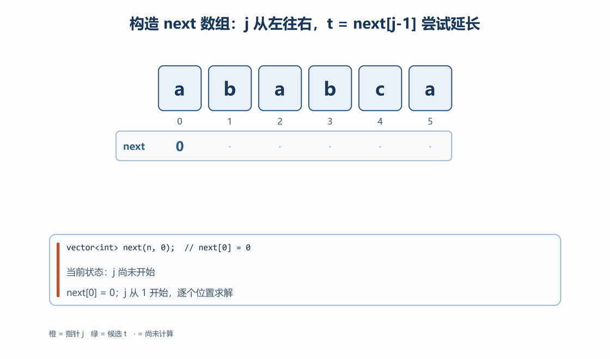

字符串既可视为字符序列，也常作为模式匹配问题的输入。学习时应区分字符级操作、单词级操作和子串匹配，并明确是否允许额外空间、是否需要原地修改。

# 5.1 替换空格问题
**问题**：将字符串 `"what a wonderful world"` 中的空格替换为 `"lucky"`  
**解决方法**：  

1. **辅助数据结构法**  
    - 新建数组/队列存储原字符串，遇到空格时替换为 `"lucky"`  
    - _C++ 实现_：  

```cpp
string replaceSpaces(const string& s) 
{
    string res;
    for (char c : s) 
    {
        if (c == ' ') res += "lucky";
        else res += c;
    }
    return res;
}
```

2. **暴力移动法**  
    - 计算空格数量 `count`，新长度 = 原长度 + count * (5-1)  
    - 从后向前移动字符（避免覆盖）  
    - _关键步骤_：  

```cpp
int newLen = s.length() + count * 4;
char* res = new char[newLen + 1];
for (int i = s.length() - 1, j = newLen - 1; i >= 0; i--) 
{
    if (s[i] == ' ') 
    {
        res[j--] = 'y'; res[j--] = 'k'; res[j--] = 'c'; 
        res[j--] = 'u'; res[j--] = 'l';
    }
    else 
    {
        res[j--] = s[i];
    }
}
```

3. **切割+拼接法**  
    - 用空格分割单词，再用 `"lucky"` 拼接  
    - _C++ 实现_：  

```cpp
string replaceSpacesSplit(const string& s) 
{
    vector<string> words;
    stringstream ss(s);
    string word;
    while (ss >> word) words.push_back(word);
    string res;
    for (const auto& w : words) 
    {
        if (!res.empty()) res += "lucky";
        res += w;
    }
    return res;
}
```

# 5.2 反转字符串问题
**问题**：将 `"what a wonderful world"` 反转为 `"world wonderful a what"`   
**解决方法**：  

1. **整体反转+单词反转（经典算法）**  
    - 步骤：  
        1. 整体反转字符串 → `"dlrow lufrednow a tahw"`  
        2. 逐个反转每个单词 → `"world wonderful a what"`
    - _C++ 核心代码_：  

```cpp
// 反转指定区间 [begin, end]
void reverseString(string& str, int begin, int end) 
{
    while (end > begin) 
    {
        swap(str[begin], str[end]);
        begin++; end--;
    }
}

// 反转整个句子的单词顺序
void reverseWords(string& str) 
{
    reverseString(str, 0, str.size() - 1); // 整体反转
    int start = 0;
    for (int i = 0; i <= str.size(); i++) 
    {
        if (i == str.size() || str[i] == ' ') 
        {
            reverseString(str, start, i - 1); // 反转单个单词
            start = i + 1;
        }
    }
}
```

2. **栈存储单词法 (倒序遍历字符串)**
    - 遍历字符串，将单词压栈，空格时弹出  
    - _C++ 示例_：  

```cpp
string reverseWordsStack(string s) 
{
    stack<string> words;
    string word;
    for (char c : s) 
    {
        if (c == ' ') 
        {
            if (!word.empty()) words.push(word);
            word = "";
        } 
        else word += c;
    }
    if (!word.empty()) words.push(word);
    
    string res;
    while (!words.empty()) 
    {
        res += words.top(); 
        words.pop();
        if (!words.empty()) res += " ";
    }
    return res;
}
```

3. **其他方法**

+ 以空格为界切割字符串，再拼接
+ 把单词（字串当作链表节点），进行链表反转
+ 读到空格时正序遍历，直到再次读到空格（或\0）

# 5.3 字符串查找
1. 在一个串中查找符合条件的某个字符

```cpp
// 查找第一个非重复字符
char findFirstNonRepeatingChar(const string& s) 
{
    unordered_map<char, int> count;
    for (char c : s) count[c]++;
    
    for (char c : s) 
    {
        if (count[c] == 1) return c;
    }
    return '\0';
}
```

2. 在一个串中查找符合条件的某个串

```cpp
// 使用KMP查找所有匹配位置
vector<int> findAllMatches(const string& str, const string& p) 
{
    vector<int> next(p.size());
    Next(p, next);
    
    vector<int> matches;
    int j = 0;
    for (int i = 0; i < str.size(); i++) 
    {
        while (j > 0 && str[i] != p[j]) j = next[j-1];
        if (str[i] == p[j]) j++;
        if (j == p.size()) 
        {
            matches.push_back(i - p.size() + 1);
            j = next[j-1];
        }
    }
    return matches;
}
```

3. 在多个串中查找符合条件的某个串

```cpp
// 在多个字符串中查找模式串
vector<string> findInMultipleStrings(const vector<string>& strings, const string& p) {
    vector<string> results;
    for (const string& s : strings) 
    {
        if (KMP(s, p)) results.push_back(s);
    }
    return results;
}
```

4. 两个串的公共子串

```cpp
// 寻找两个字符串的最长公共子串
string longestCommonSubstring(const string& s1, const string& s2) 
{
    int maxLen = 0;
    int endIndex = 0;
    
    vector<vector<int>> dp(s1.size() + 1, vector<int>(s2.size() + 1, 0));
    
    for (int i = 1; i <= s1.size(); i++) 
    {
        for (int j = 1; j <= s2.size(); j++) 
        {
            if (s1[i-1] == s2[j-1]) 
            {
                dp[i][j] = dp[i-1][j-1] + 1;
                if (dp[i][j] > maxLen) 
                {
                    maxLen = dp[i][j];
                    endIndex = i;
                }
            }
        }
    }
    
    return s1.substr(endIndex - maxLen, maxLen);
}
```

5. 字符串匹配（在一个串中查找另一个串首次出现的位置）

# 5.4 字符串匹配算法
## 5.4.1 KMP 算法
KMP 算法（Knuth-Morris-Pratt 算法）解决的是“一个串里找另一个串”。暴力匹配每次失配后都要把主串指针 `i` 拉回本轮起点的下一位重新比较，前面已经比对过的字符被白比一遍，最坏退化到 $O(mn)$。

KMP 靠两条观察把主串指针彻底固定住：

+ 失配发生时，`Pattern[0..j-1]` 已经与主串的某一段完全相等。这段已匹配内容内部若存在“某前缀 = 某后缀”，那段后缀本身也已经和主串对齐，模式串可以直接滑到让前缀对上后缀的位置继续比，不必退回本轮起点重来。
+ 这段“前缀 = 后缀”的信息只取决于模式串自身，与主串无关，因此可以离线预处理成一张表，即 `next` 数组（也叫前缀表）。

于是算法分成两个阶段：`getNext` 让模式串与自己的后缀对齐，算出每个位置的最长相等前后缀长度；`KMP` 再借这张表在主串上滑动模式串，整体复杂度降到 $O(m+n)$。

### （1）构造 `next` 数组

`next` 数组保存模式串自身的重复结构，是 KMP 能够跳过重复比较的依据。

**基本概念**

+ **真前缀**：从字符串开头连续取若干字符，但不能取整个字符串。
+ **真后缀**：从字符串末尾连续取若干字符，但不能取整个字符串。
+ **最长相等前后缀**：在一个字符串的所有真前缀和真后缀中，长度最大的相等部分。

例如，字符串 `abab` 的真前缀包括 `a`、`ab`、`aba`，真后缀包括 `b`、`ab`、`bab`，最长相等前后缀是 `ab`，长度为 `2`。

**`next[j]` 的定义**

$$
next[j] = \max\{\, t \;|\; 0 \le t < j+1,\ P[0..t-1] = P[j-t+1..j] \,\}
$$

即子串 `P[0..j]` 的最长相等前后缀长度。`t = 0` 对应“空前缀等于空后缀”，恒成立，所以定义式总有解；`next[0] = 0` 表示单个字符没有非空的真前缀和真后缀，代码里 `next` 由 `vector` 初始化为 `0`，与此含义一致。

![图 1：next 数组示意。模式串 ababca 的 next = 0 0 1 2 0 1；j = 3 处的真前缀 ab 与真后缀 ab 相等，因此 next[3] = 2](assets/kmp-next-array.png)

> 本节的两张动图循环播放；若编辑器不播放 GIF，可直接看每张动图下方的静态定格图。

**为什么 `t` 可以直接当作下标**

计算 `next[j]` 时令 `t = next[j-1]`，含义是：对 `P[0..j-1]` 而言，长度为 `t` 的前缀与后缀已经相等。

+ 长度为 `t` 的前缀占用下标 `0..t-1`。
+ 要把它向右延长一位，下一个待比较的字符正好是 `P[t]`。
+ 这就是同一个 `t` 既表示“已匹配前缀长度”、又能直接作为 `P[t]` 下标的原因。

**候选长度 `t` 只有两条出路**

1. `P[j] == P[t]`：原来的相等前后缀同时向右延长一位，`next[j] = t + 1`。
2. `P[j] != P[t]`：候选 `t` 作废。此时不必重新枚举所有更短长度，直接取“候选 `t` 内部的最长相等前后缀”，即 `t = next[t-1]`，作为次长候选再试一次。

第 2 条可能连续发生，所以要用 `while` 反复回退，直到 `P[j] == P[t]`（成功，长度为 `t + 1`）或 `t == 0` 且仍不相等（失败，长度为 `0`）。

下面这段动图按真实执行顺序走一遍 `getNext`：橙色箭头是 `j`，绿色箭头是候选 `t`，底部状态卡显示当前执行的语句。



![图 3：候选长度递减定格。计算 next[4] 时 t 从 next[3] = 2 回退到 next[1] = 0，仍失配，所以 next[4] = 0](assets/kmp-candidate-chain.png)

正文用 `P` 表示模式串；代码里对应的参数名是 `str`，`P[j]` 即 `str[j]`。

**原始代码**

```cpp
void getNext(string& str, vector<int>& next)
{
    if (str.size() <= 1) return;
    // 初始化：next[0] 默认为 0 (vector 初始化时已设为 0)
    for (int j = 1; j < str.size(); j++)
    {
        // 情况 A: 当前字符与前缀的下一个字符相同
        if (str[j] == str[next[j - 1]])
        {
            next[j] = next[j - 1] + 1;
        }
        else
        {
            // 情况 B: 不相同，需要向前回溯寻找匹配的前缀
            int t = next[j - 1];
            while (t > 0 && str[t] != str[j])
            {
                t = next[t - 1]; // 不断回退，更新比较对象 t
            }
            // 回溯结束后的判断
            if (str[t] == str[j])
            {
                next[j] = t + 1;
            }
            else
            {
                next[j] = 0; // 彻底不匹配，长度为 0
            }
        }
    }
}
```

**为什么代码写成 `if` / `else` 两段**

看上去 `if (str[j] == str[next[j - 1]])` 与 `else` 里的 `while` 是两个独立分支，实际上 `if` 就是 `while` 循环体的第一次迭代：初值 `t = next[j-1]` 与 `if` 判断的 `next[j - 1]` 是同一个量，判断条件也相同。拆成两段只是让最常见的“一次就延长成功”路径少做一次循环判断，两种写法结果完全一致。

+ `t = next[t - 1]`：当前长度为 `t` 的候选失败后，转向它内部次长的相等前后缀，而不是从头枚举所有长度。
+ 回退结束后再次判断 `str[t] == str[j]`：即使最长候选失败，更短候选仍可能成功；成功则长度为 `t + 1`，否则当前位置的前缀值为 `0`。

**为什么回退不会漏解**

需要说明的是“从 `t` 直接降到 `next[t-1]` 不会跳过答案”。

+ 候选 `t` 能成立，是因为 `P[0..t-1]` 等于 `P[0..j-1]` 的长度 `t` 后缀。
+ 若存在更短的候选 `t' < t`，那么 `P[0..t'-1]` 既等于 `P[0..j-1]` 的长度 `t'` 后缀，也就等于 `P[0..t-1]` 的长度 `t'` 后缀 —— 换句话说，`t'` 本身必须是 `P[0..t-1]` 的某个相等前后缀长度。
+ 这类值里最大的正是 `next[t-1]`（它由 `P[0..t-1]` 求得），所以下一步只需试它，一个候选都不会漏。

**摊还复杂度**

+ `j` 每前进一次，候选长度最多增加 `1`；每次 `while` 回退至少让候选长度减少 `1`。
+ 候选长度不会小于 `0`，因此回退总次数不超过“增加的总次数”，也就是不超过模式串长度 `m`。
+ 所以 `getNext` 是 $O(m)$，而不是表面上的 $O(m^2)$。

### （2）在主串中匹配模式串

主匹配阶段使用 `i` 扫描主串 `Text`，用 `j` 表示模式串 `Pattern` 已匹配的字符数。

**循环不变式**

进入每一轮 `for` 循环体时，始终有

$$
Pattern[0..j-1] = Text[i-j..i-1]
$$

即“模式串的前 `j` 个字符”与“主串中以 `i-1` 结尾、长度为 `j` 的那一段”完全相同。三种动作各自把不变式带进下一轮：

+ **回退 `j = next[j-1]`**：不变式说明 `Pattern[0..j-1]` 已等于主串的一段后缀；而 `Pattern[0..next[j-1]-1]` 又等于 `Pattern[0..j-1]` 的后缀，于是它也等于主串那段的后缀。`i` 不动、`j` 变小，不变式依然成立。
+ **匹配 `j++`**：`Text[i] == Pattern[j]` 使相等的段向右延长一位，`i`、`j` 同步加一，不变式继续成立。
+ **推进 `i++`**：`for` 循环让 `i` 加一，窗口整体右移，描述的对象换成“以新 `i-1` 结尾的长度 `j` 段”，形式不变。

**三条容易写错的细节**

+ 回退只改 `j`，不改 `i`。同一个 `Text[i]` 还没有与新的 `Pattern[j]` 比较过，所以 `while` 结束后必须继续执行本轮的 `if (Text[i] == Pattern[j])`。
+ 一次回退后可能仍然失配，因此要用 `while`；当 `j == 0` 时已没有可复用的前后缀，本轮必然失败，交给 `for` 让 `i` 前进。
+ 当 `j == Pattern.size()` 时模式串全部匹配完成。

`i` 只增不减，`j` 的每次回退又都会缩短 `j`，因此已经排除的对齐位置不会被反复检查，主匹配阶段是 $O(n)$。

下面这段动图按真实执行顺序走一遍 `KMP`：橙色箭头是主串指针 `i`，绿色箭头是已匹配长度 `j`；注意失配后模式串窗口整体右滑，而 `i` 始终不动。

![图 4：主匹配过程动图，i 扫描 abababca，i = 4 失配后窗口从起点 0 滑到 2，最终命中区间 [2, 7]](assets/kmp-match-anim.gif)

![图 5：失配回退定格。Text = abababca、Pattern = ababca 在 i = 4 失配，j 由 4 回退到 next[3] = 2，模式串右移 2 位而 i 保持不动](assets/kmp-failure-realign.png)

**原始代码**

_主串 (Text)，模式串 (Pattern)_

```cpp
bool KMP(string& Text, string& Pattern)
{
    // 1. 初始化 next 数组
    vector<int> next(Pattern.size(), 0);
    getNext(Pattern, next); // 计算模式串 Pattern 的 next 数组

    int j = 0; // 模式串 Pattern 的指针
    // 2. 遍历主串 Text
    for (int i = 0; i < Text.size(); i++)
    {
        // 核心回溯逻辑：当字符不匹配且 j 没有回到起点时，利用 next 数组跳转
        while (j != 0 && Text[i] != Pattern[j]) 
        {
            j = next[j - 1]; 
        }
        
        // 如果当前字符匹配，模式串指针后移
        if (Text[i] == Pattern[j]) 
        {
            j++;
        }
        
        // 3. 检查模式串是否遍历完
        if (j == Pattern.size()) 
        {
            return true; // 匹配成功
        }
    }
    return false; // 遍历结束未找到
}
```

> **使用前提**：这份原始代码要求 `Pattern` 非空。函数只返回是否找到匹配，不返回匹配起始下标；下文给出的下标仅用于说明算法过程。

**关键语句为什么正确**

| 语句 | 作用 | 依据 |
| --- | --- | --- |
| `j = next[j - 1]` | 把已匹配部分中仍可复用的最长后缀当作下一轮的模式串前缀，等效于“模式串右移” | 图 5 |
| `while (j != 0 && Text[i] != Pattern[j])` | 较长前缀失配后，更短前缀仍可能匹配，必须连续回退 | 图 3 |
| 回退后仍执行 `if (Text[i] == Pattern[j])` | 回退只完成重新对齐，当前主串字符尚未被新位置消费 | 图 5 |
| `i` 从不回退 | 已匹配区间内部的重复信息已全部记在 `next` 里，旧位置无需再算 | 图 5 |

**要找出全部匹配时**

把 `return true` 改为记录起点 `i - Pattern.size() + 1`，再令 `j = next[j-1]` 继续扫描即可，这样连重叠的匹配也能发现（例如在 `aaaa` 中找 `aa`）。5.3 中的 `findAllMatches` 用的就是这个写法。

### （3）示例：`abababca` 中查找 `ababca`

设主串 `Text = "abababca"`，模式串 `Pattern = "ababca"`。

**构造模式串的 `next` 数组**

| `j` | `Pattern[j]` | 初始 `t` | 比较与回退 | `next[j]` | 原因 |
| --- | --- | --- | --- | --- | --- |
| 0 | `a` | — | 初始化 | 0 | 单个字符没有非空的真前后缀 |
| 1 | `b` | 0 | `b != a` | 0 | 没有相等前后缀 |
| 2 | `a` | 0 | `a == a` | 1 | 相等前后缀为 `a` |
| 3 | `b` | 1 | `b == b` | 2 | 相等前后缀为 `ab` |
| 4 | `c` | 2 | `c != a`，回退到 `t = next[1] = 0`，仍有 `c != a` | 0 | 所有候选都无法延长（见图 3） |
| 5 | `a` | 0 | `a == a` | 1 | 相等前后缀为 `a` |

因此：

```plain
Pattern = a b a b c a
next    = 0 0 1 2 0 1
```

这串 `next` 值与图 1 中的标注一致。

**主匹配过程**

| `i` | `Text[i]` | 比较前的 `j` | 操作与原因 | 操作后的 `j` |
| --- | --- | --- | --- | --- |
| 0 | `a` | 0 | `Text[0] == Pattern[0]` | 1 |
| 1 | `b` | 1 | `Text[1] == Pattern[1]` | 2 |
| 2 | `a` | 2 | `Text[2] == Pattern[2]` | 3 |
| 3 | `b` | 3 | `Text[3] == Pattern[3]` | 4 |
| 4 | `a` | 4 | `a != c`，令 `j = next[3] = 2`；保持 `i = 4`，再比较得到 `a == Pattern[2]` | 3 |
| 5 | `b` | 3 | `Text[5] == Pattern[3]` | 4 |
| 6 | `c` | 4 | `Text[6] == Pattern[4]` | 5 |
| 7 | `a` | 5 | `Text[7] == Pattern[5]` | 6，匹配完成 |

失配发生时，已经匹配的 `abab` 中，前缀 `ab` 与后缀 `ab` 相等。`next[3] = 2` 直接把模式串前两个字符与这段后缀对齐，因此主串下标 `2`、`3` 的字符不需要重新比较——这正是图 5 画出的那一步。最终匹配区间是 `[2, 7]`，起始下标为 `2`。

暴力匹配会在失配后依次尝试新的起点并重新比较已经看过的字符；KMP 用 `next` 数组直接跳到仍可能成功的对齐方式，同时保持 `i` 不回退。

**算法复杂度**

+ **时间复杂度**：$O(m + n)$
    - `getNext` 是 $O(m)$：`j` 每轮至多把候选长度加一，回退总量被这个增量摊还掉（`m` 为模式串长度）。
    - `KMP` 主匹配是 $O(n)$：主串指针 `i` 从不回退，`j` 的回退也只会缩短 `j`（`n` 为主串长度）。
+ **空间复杂度**：$O(m)$
    - 需要额外开辟一个大小为模式串长度的 `next` 数组。

**总结**

1. **预处理阶段（`getNext` 函数）**：通过模式串自比较，计算每个位置的最长相等前后缀长度。
2. **匹配阶段（`KMP` 函数）**：失配时利用 `next` 回退模式串指针 `j`，主串指针 `i` 始终向前。

## 5.4.2 Sunday 算法
Sunday 算法是 Daniel M. Sunday 在 1990 年提出的一种字符串查找算法。它是 BM (Boyer-Moore) 算法的一种简化优化版本。

**核心特点**：

1. **平均跳跃距离较大**：在许多普通文本上，Sunday 算法可能比 KMP 更快，但性能仍取决于文本与模式串分布。
2. **核心思想**：在匹配失败时，它不关注当前不匹配的字符，而是关注**主串中参与匹配的子串的“下一位”字符**。

步骤一：**Next 数组（偏移表）计算**

在 Sunday 算法中，`next` 数组（通常称为偏移表）的作用是记录**模式串中每个字符最靠右出现的位置**

`next` **数组的计算逻辑**

1. **初始化**：
    - `next` 数组长度为 256（覆盖所有 ASCII 字符）。
    - 初始值全部设为 `-1`（表示该字符在模式串中不存在）。
2. **从右向左遍历**：
    - 从模式串的最后一个字符开始向前遍历 (`i--`)。
3. **记录位置**：
    - **找字符在字符串中首次出现的位置（从右向左）**：
    - 判断 `if (next[str[i]] == -1)`。如果是 -1，说明这是从右边数第一次遇到这个字符，将其下标 `i` 存入 `next`。
    - **为什么这么做？**：我们需要知道当主串中出现某个字符时，模式串中该字符**最靠右**在哪里，这样才能保证移动后不会漏掉可能的匹配，同时移动距离尽可能大。

**代码**

```cpp
void Next(const string& str, vector<int>& next)
{
    // 从右向左遍历模式串
    for (int i = static_cast<int>(str.size()) - 1; i >= 0; i--)
    {
        // 如果该字符还没被记录过，则记录其下标
        // 因为是从右向左遍历，所以记录的一定是该字符在模式串中“最靠右”的位置
        unsigned char c = static_cast<unsigned char>(str[i]);
        if (next[c] == -1) next[c] = i;
    }
}
```

步骤二：**Sunday 主匹配过程**

这是算法的核心，利用 `next` 数组进行快速跳转。

**主匹配过程逻辑**

1. **初始化**：
    - `target = 0`：表示当前主串和模式串对齐的起始位置（target 代表主串当前匹配窗口的起始位置）。
    - `j = 0`：模式串从第一个字符开始比。
2. **窗口内比较**：
    - 令 `j = 0`，依次比较 `Text[target + j]` 与 `Pattern[j]`。
    - 若 `j == len`，说明模式串全部匹配，返回 `true`。
3. **分支处理**：
    - **不相等**：
        * 若当前窗口已经到达主串末尾，返回 `false`，避免访问越界。
        * 否则查看窗口后一位 `Text[target + len]`，按 `target += len - next[c]` 移动窗口。
        * 新窗口重新从 `j = 0` 开始比较。

**代码**

_主串 (Text)，模式串 (Pattern)_

```cpp
bool Sunday(const string& Text, const string& Pattern)
{
    if (Pattern.empty()) return true;
    if (Text.size() < Pattern.size()) return false;

    // 1. 初始化 next 数组
    vector<int> next(256, -1);
    Next(Pattern, next);

    size_t target = 0; // 主串当前匹配窗口的起始位置
    size_t len = Pattern.size();

    // 2. 逐个检查能够容纳模式串的窗口
    while (target + len <= Text.size())
    {
        size_t j = 0;
        while (j < len && Text[target + j] == Pattern[j]) j++;
        if (j == len) return true;

        // 当前窗口已经是最后一个窗口，右侧没有可用于跳转的字符
        if (target + len >= Text.size()) return false;

        unsigned char c = static_cast<unsigned char>(Text[target + len]);
        int last = next[c];
        target += (last == -1) ? len + 1 : len - static_cast<size_t>(last);
    }
    return false;
}
```

**关键步骤深度解析**：为什么要这样跳转？

这是 Sunday 算法最精髓的地方， `target = target + len - next[...]` 公式的由来。

**问题：为什么看 `Text[target + len]`？**

+ **KMP/BM 的做法**：关注**当前不匹配**的那个字符。
+ **Sunday 的做法**：关注**当前匹配窗口后面紧接着的那个字符**。
    - **原因**：如果这个字符（我们叫它 `Sunday 字符`）根本不在模式串里，那么模式串可以直接跳过整个窗口，甚至移得更远。这使得 Sunday 算法在随机文本上极快。

**公式推导：** `target = target + len - next[char]`

假设：

+ 模式串长度 `len = 4` (例如 "ABCD")
+ 当前 `target = 0`
+ 主串中 `Text[target + len]` 的字符是 'X'。

**情况 1：'X' 不在模式串中（`next['X'] == -1`）**

+ 公式：`target = 0 + 4 - (-1) = 5`。
+ **解释**：模式串直接向后移动 `len + 1` 位。因为 'X' 都不在模式串里，包含 'X' 的任何对齐方式都不可能匹配，所以直接跨过 'X'。

**情况 2：'X' 在模式串中，且最右位置是 `k`（`next['X'] == k`）**

+ 公式：`target = 0 + 4 - k`。
+ **解释**：我们将模式串向后移动，直到模式串中的 'X' (下标为 `k`) 与主串中的 'X' (下标为 `target + len`) **对齐**。
+ 移动距离 = `(target + len) - k`。
+ 新的 `target` = 旧 `target` + 移动距离 = `target + len - k`。

**总结**

1. **预处理**：从右向左记录字符最右位置，为快速跳转做准备。
2. **匹配**：一旦发现不匹配，立刻查看“下一位”字符，利用偏移表将模式串“拉”到与该字符对齐的位置，从而跳过大量不必要的比较。

## 5.4.3 算法对比
| **特性** | **KMP算法** | **Sunday算法** |
| --- | --- | --- |
| **时间复杂度** | $O(n+m)$ | 平均情况下接近 $O(n)$，最坏为 $O(nm)$ |
| **空间复杂度** | O(m) | O(1)（固定大小的移动表） |
| **适用场景** | 模式串重复率高的场景 | 文本编辑器搜索等一般场景 |
| **实现难度** | 中等 | 简单 |
| **平均性能** | 稳定 | 通常优于KMP |


**本章小结**：直接操作适合简单变换；KMP 利用模式串自身的前后缀信息保证线性最坏复杂度，Sunday 则利用窗口后一字符决定移动距离，通常实现更简洁。

**非线性结构概览**

非线性结构允许一个节点与多个节点关联。树强调层次关系，图表达更一般的网络关系；遍历时通常需要递归栈、显式栈、队列或访问标记。
