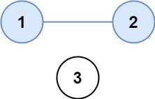
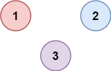

# 第七章 并查集与连通性问题
并查集是一种树形数据结构，用于处理若干不相交集合的合并与查询。它特别适合动态连通性问题，例如判断两个节点是否连通、统计连通分量，以及在 Kruskal 算法中检测成环。

---

## 7.1 核心概念
+ **森林**：并查集由多棵树组成，每棵树代表一个集合。
+ **根节点**：每棵树的根节点代表该集合的**标识**。如果两个节点的根节点相同，说明它们属于同一个集合。
+ **`parent` 数组**：`parent[i]` 存储节点 `i` 的父节点。若 `parent[i] == i`，则 `i` 是根节点。

---

## 7.2 核心操作与优化
并查集主要有两个操作：**查找 (Find)** 和 **合并 (Union)**。为了保证效率，必须配合两种优化手段。

### 7.2.1 查找（Find）与路径压缩（Path Compression）
+ **目的**：找到元素 `x` 所在集合的根节点。
+ **优化思路**：在查找过程中，将路径上的所有节点**直接指向根节点**。
+ **效果**：树的高度会显著降低；配合按秩或按大小合并时，单次操作的均摊复杂度为 $O(\alpha(n))$，在实际规模下非常接近常数。

### 7.2.2 合并（Union）与按秩合并（Union by Rank）
+ **目的**：将元素 `x` 和 `y` 所在的两个集合合并为一个。
+ **优化思路**：
    - 记录每棵树的**秩 (Rank)**（近似树的高度）。
    - 合并时，永远将**秩小**的树接到**秩大**的树下。
+ **效果**：避免树退化成链表，保持树的平衡，确保查找效率。

---

## 7.3 C++ 代码
这是一个封装好的 `UnionFind` 类，包含了路径压缩和按秩合并。

```cpp
#include <vector>
#include <numeric>
using namespace std;

class UnionFind 
{
private:
    vector<int> parent; // 记录每个节点的父节点
    vector<int> rank;   // 记录每个根节点对应树的高度（秩）
    int count;          // 记录当前集合的数量（可选）

public:
    // 1. 初始化
    UnionFind(int n) 
    {
        count = n;
        parent.resize(n);
        rank.resize(n, 0); // 初始高度都为 0
        // iota(parent.begin(), parent.end(), 0); // 填充 0, 1, 2...
        for (int i = 0; i < n; i++) 
        {
            parent[i] = i; // 初始时，每个元素自成一个集合，父节点指向自己
        }
    }

    // 2. 查找操作 (带路径压缩)
    int Find(int x) 
    {
        if (parent[x] != x) 
        {
            // 递归查找根节点，并将父节点直接指向根节点
            parent[x] = Find(parent[x]);
        }
        return parent[x];
    }

    // 3. 合并操作 (按秩合并)
    void Union(int x, int y) 
    {
        int rootX = Find(x);
        int rootY = Find(y);

        // 如果已经在同一集合，不需要合并
        if (rootX == rootY) return;

        // 按秩合并：将秩较小的树连接到秩较大的树下
        if (rank[rootX] < rank[rootY]) 
        {
            parent[rootX] = rootY; // X 树挂到 Y 树下
        } 
        else if (rank[rootX] > rank[rootY]) 
        {
            parent[rootY] = rootX; // Y 树挂到 X 树下
        } 
        else 
        {
            // 秩相同，随便挂，但被挂的树秩要 +1
            parent[rootY] = rootX; 
            rank[rootX]++;
        }
        count--; // 集合数量减 1
    }

    // 4. 判断是否连通
    bool isConnected(int x, int y) 
    {
        return Find(x) == Find(y);
    }
    
    // 5. 获取集合数量
    int getCount() 
    {
        return count;
    }
};
```

---

## 7.4 经典应用
### 7.4.1 [LeetCode 547 省份数量](https://leetcode.cn/problems/number-of-provinces/description/)
有 `n` 个城市，其中一些彼此相连，另一些没有相连。如果城市 `a` 与城市 `b` 直接相连，且城市 `b` 与城市 `c` 直接相连，那么城市 `a` 与城市 `c` 间接相连。

**省份** 是一组直接或间接相连的城市，组内不含其他没有相连的城市。

给你一个 `n x n` 的矩阵 `isConnected` ，其中 `isConnected[i][j] = 1` 表示第 `i` 个城市和第 `j` 个城市直接相连，而 `isConnected[i][j] = 0` 表示二者不直接相连。

返回矩阵中 **省份** 的数量。

**示例 1：**



<!-- image-source: https://assets.leetcode.com/uploads/2020/12/24/graph1.jpg -->

```plain
输入：isConnected = [[1,1,0],[1,1,0],[0,0,1]]
输出：2
```

**示例 2：**



<!-- image-source: https://assets.leetcode.com/uploads/2020/12/24/graph2.jpg -->

```plain
输入：isConnected = [[1,0,0],[0,1,0],[0,0,1]]
输出：3
```

**解题思路**

1. **阶段一：初始化 (Initialization)** 每个城市最初都是一个独立的省份。
    - **初始化并查集（每个节点独立）**
2. **阶段二：合并连通分量（Union Operations）**
    - 遍历矩阵，找到具有连接关系的城市：
    - 如果 `isConnected[i][j] == 1`，说明城市 `i` 和 `j` 相连。
    - 调用 `unite(i, j)` 将它们合并到同一个集合。
        * 查找 find  找到两个集合的根
        * 合并  合并两个集合的根
3. **阶段三：统计结果 (Counting)** 统计根节点数量（即连通分量数）
    - 方法一：使用类中的 `count` 变量，每次成功合并减 1。
    - 方法二：遍历 `parent` 数组，统计 `parent[i] == i` 的个数（即根节点的个数）。

_为什么要先“查找 find”根节点，再“合并 union”？_

1. **处理间接连接**：
    - 假设 A 连 B，B 连 C。矩阵里只有 `(A,B)` 和 `(B,C)` 的记录，没有 `(A,C)`。
    - 当我们处理 `(B,C)` 时，B 可能已经挂在 A 下面了（A 是 B 的根）。
    - 如果我们直接把 C 连到 B 上，结构就乱了。正确的做法是：找到 B 的老大（A），找到 C 的老大（C），然后把 C 的老大连到 A 上。这样 A、B、C 就都在 A 的麾下了。
2. **保持树结构**：
    - 并查集是通过**根节点**来代表整个集合的。只有合并两个集合的**根节点**，才能一次性把两棵树合并成一棵大树。如果只合并叶子节点，会导致树的结构断裂或无法正确代表集合。

**C++ 代码实现**

```cpp
class Solution {
public:
    int findCircleNum(vector<vector<int>>& isConnected) 
    {
        int len = isConnected.size();
        if (len == 1)
            return 1;

        // parent数组 赋初值
        vector<int> parent(len);
        for (int i = 0; i < len; i++) 
        {
            parent[i] = i;
        }
        // 遍历矩阵
        for (int i = 0; i < len; i++) 
        {
            for (int j = 0; j < i; j++) 
            {
                // 找到具备连接关系的城市
                // 合并
                if (isConnected[i][j] == 1) 
                {
                    // 找到两个集合的根
                    // 合并
                    Union(parent, i, j);
                }
            }
        }

        // 计算省份数量
        // 遍历parent数组，找根的个数
        int cnt = 0;
        for (int i = 0; i < len; i++) 
        {
            if (parent[i] == i) 
            {
                cnt++;
            }
        }
        return cnt;
    }

private:
    // 查找 find
    int find(vector<int>& parent, int x) 
    {
        if (x == parent[x]) return x;
        parent[x] = find(parent, parent[x]);
        return parent[x];
    }

    // 合并 union
    void Union(vector<int>& parent, int x, int y)
    {
        parent[find(parent, x)] = find(parent, y);
    }
};
```

### 7.4.2 [LeetCode 200. 岛屿数量](https://leetcode.cn/problems/number-of-islands/)
给你一个由 `'1'`（陆地）和 `'0'`（水）组成的的二维网格，请你计算网格中岛屿的数量。

岛屿总是被水包围，并且每座岛屿只能由水平方向和/或竖直方向上相邻的陆地连接形成。

此外，你可以假设该网格的四条边均被水包围。

**示例 1：**

```plain
输入：grid = [
  ['1','1','1','1','0'],
  ['1','1','0','1','0'],
  ['1','1','0','0','0'],
  ['0','0','0','0','0']
]
输出：1
```

**示例 2：**

```plain
输入：grid = [
  ['1','1','0','0','0'],
  ['1','1','0','0','0'],
  ['0','0','1','0','0'],
  ['0','0','0','1','1']
]
输出：3
```


## 7.5 总结
+ **适用场景**：判断元素是否属于同一组、计算连通分量个数、最小生成树 (Kruskal 算法)。
+ **时间复杂度**：经过路径压缩和按秩合并优化后，单次操作的均摊复杂度为 $O(\alpha(n))$（反阿克曼函数），在实际规模下接近 $O(1)$。
+ **关键点**：`parent` 数组存父节点，`find` 函数找根，`unite` 函数合并根。

_功能_：高效处理不相交集合的合并与查询。
