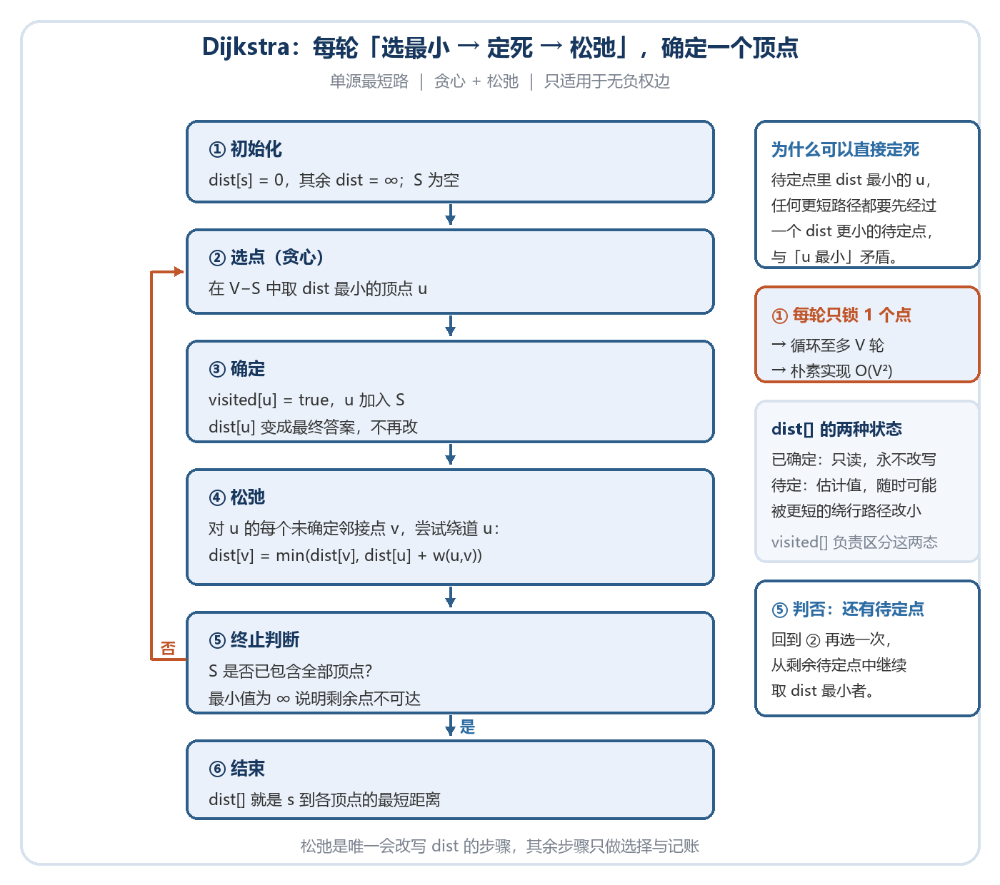
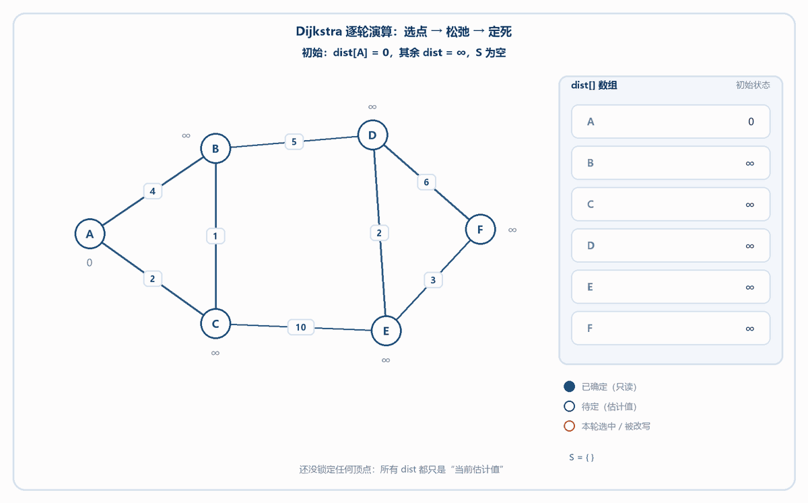
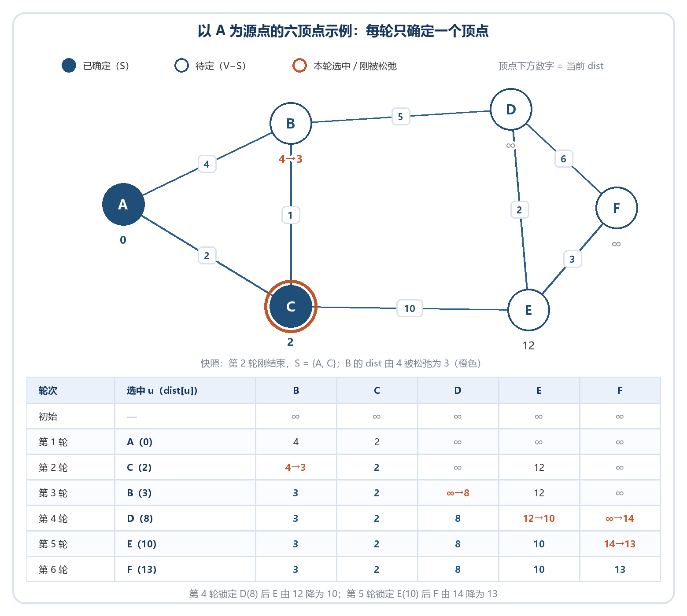
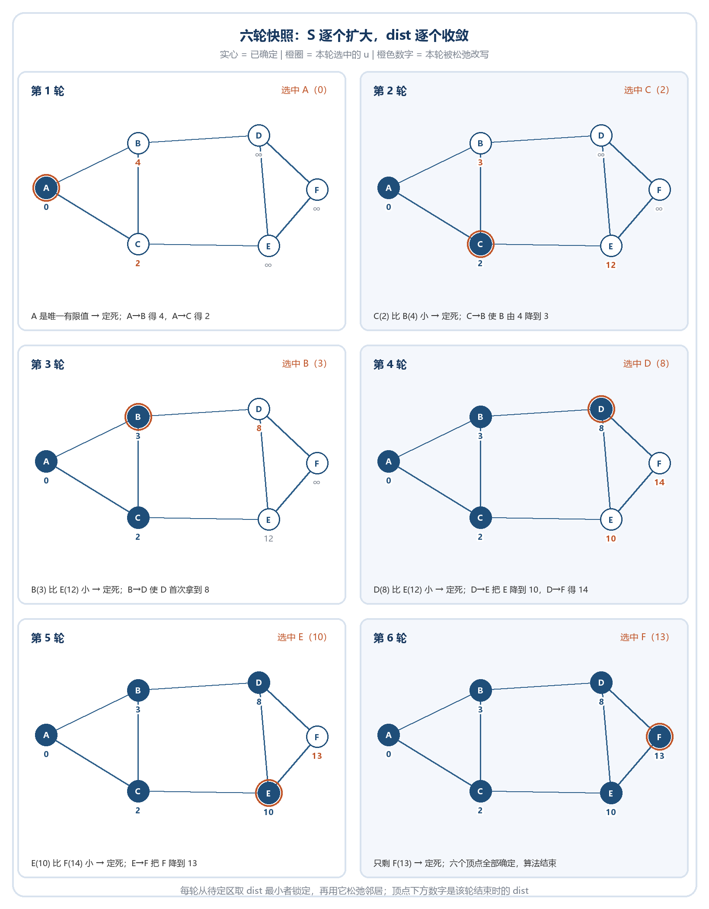

图用于表达任意对象之间的连接关系。学习图算法时，应先确定图是有向还是无向、带权还是无权、稠密还是稀疏，再选择存储结构和遍历或优化算法。

# 8.1 图的基本概念（Basic Concepts）
## 8.1.1 定义与术语
+ **图 (Graph)**：由顶点集 $V$ (Vertex) 和边集 $E$ (Edge) 组成，记为 $G(V, E)$。
+ **阶 (Order)**：顶点集 $V$ 中元素的个数（顶点数）。
+ **大小 (Size)**：边集 $E$ 中元素的个数（边数）。
+ **无向图**：边是无方向的
+ **有向图**：每条边有方向
+ **完全图**：任意两个不同顶点间都有边相连的图。
    - 无向完全图边数：$n(n-1)/2=C_n^2$。
    - 有向完全图边数：$n(n-1)=A_n^2$。
+ **子图 (Subgraph)**：由原图中部分顶点和这些顶点之间的边组成的图。

## 8.1.2 路径与连通性
+ **路径**：顶点序列 $v_1, v_2, \ldots, v_k$，相邻顶点间有边连接。
+ **简单路径**：除起点终点外，顶点不重复的路径。
+ **连通 (Connected)**：两点之间存在路径。

**无向图**：

+ **连通图**：无向图中任意两个顶点间都存在路径。
+ **连通分量**：无向图的极大连通子图。

**有向图**：

+ **强连通图**：有向图中，任意两个顶点 $x, y$，都存在 $x \to y$ 和 $y \to x$ 的路径。
+ **强连通分量**：有向图中的极大强连通子图。

## 8.1.3 顶点的度（Degree）
+ **无向图**：
    - **度** $\deg(v)$：与该顶点相连的边的数量。
    - **握手定理**：所有顶点度数之和等于边数的 2 倍。
+ **有向图**：
    - **入度** $d^-(v)$：以 $v$ 为终点的边的数量。
    - **出度** $d^+(v)$：以 $v$ 为起点的边的数量。
    - **度**：$d(v) = d^+(v) + d^-(v)$。

---

# 8.2 图的存储结构
## 8.2.1 邻接矩阵（Adjacency Matrix）
+ **适用**：**稠密图**（边很多）。
+ **结构**：$n \times n$ 的二维数组。`matrix[i][j] = 1` (或权值) 表示 $i$ 连向 $j$（无权图填1，有权图填权值）。
+ **特点**：
    - 无向图矩阵对称。
    - 空间复杂度：$O(n^2)$。
    - 判断两点是否连通：$O(1)$。

## 8.2.2 邻接表（Adjacency List）
+ **适用**：**稀疏图**（边很少）。
+ **结构**：数组 + 链表（或 `vector`）。每个顶点维护一个列表，存储所有与之相邻的顶点。
+ **特点**：
    - 无向图中每条边存两次（数据冗余）。
    - 空间复杂度：$O(V+E)$。
    - 有向图中，通常只在起点顶点的链表中存储边

## 8.2.3 十字链表（Orthogonal List）
+ **适用对象**：**有向图**。
+ **解决痛点**：
    - 普通的**邻接表**：找顶点的**出度**（以我为起点的边）很快，但找**入度**（以我为终点的边）很慢，需要遍历全图。
    - 普通的**逆邻接表**：找入度快，找出度慢。
    - **十字链表**：将邻接表和逆邻接表**合二为一**。
+ **核心结构**：
    - 每条边（弧）是一个节点，包含两个指针：
        1. `hlink`：指向**终点相同**的下一条边（方便求入度）。
        2. `tlink`：指向**起点相同**的下一条边（方便求出度）。
+ **优势**：既能快速求入度，也能快速求出度。

---

## 8.2.4 邻接多重表（Adjacency Multilist）
+ **适用对象**：**无向图**。
+ **解决痛点**：
    - 在普通**邻接表**中，无向图的一条边 `(A, B)` 会被存储**两次**（A 的链表里存 B，B 的链表里存 A）。
    - 如果要**删除**这条边，或者**标记**这条边已访问，需要同时修改两个地方，容易出错且效率低。
+ **核心结构**：
    - **每条边只存一个节点**。
    - 边节点中包含两个指针：
        1. `ilink`：指向依附于顶点 `i` 的下一条边。
        2. `jlink`：指向依附于顶点 `j` 的下一条边。
+ **优势**：边不冗余，删除边或标记边时只需操作一次，数据一致性更好。

## 8.2.5 C++ 图类实现（基于邻接矩阵）
**成员变量**：

+ 顶点个数（vertex）
+ 边条数（edge）
+ 边的存储结构（matrix）

```cpp
#include <iostream>
#include <vector>
using namespace std;

class Graph 
{
public:
    int vertex; // 顶点数
    int edge;   // 边数
    vector<vector<int>> matrix; // 邻接矩阵

    // 构造函数
    Graph(int v, int e) : vertex(v), edge(e), matrix(v, vector<int>(v, 0)) {}

    // 创建图 (输入边集)
    void create(const vector<vector<int>>& nums) {
        for (const auto& e : nums) {
            int v0 = e[0];
            int v1 = e[1];
            // 无向图：对称赋值
            if (matrix[v0][v1] == 0) {
                matrix[v0][v1] = 1;
                matrix[v1][v0] = 1;
            } else {
                cout << "Data error: duplicate edge" << endl;
            }
        }
    }
};
```

---

# 8.3 图的遍历（Graph Traversal）
遍历是图算法的基础，需要配合 **`visited` 标记数组** 防止死循环。

## 8.3.1 深度优先搜索（DFS）
+ **思路**：类似树的前序遍历。一条路走到黑，走不通了回溯。
+ **步骤**：
    1. **申请标记数组**：访问起始节点，标记 `visited`。
    2. **选顶点做始点，遍历当前节点的邻接节点（循环）**：查找该节点的第一个未访问邻接点。
    3. 递归执行 DFS。

```cpp
void DFS(int v, vector<bool>& mark, const vector<vector<int>>& matrix) 
{
    // 1. 打印/访问
    cout << v << "->";
    // 2. 标记已访问
    mark[v] = true;
    
    // 3. 递归访问邻接节点
    for (int i = 0; i < matrix.size(); i++) 
    {
        // 如果 v 和 i 有边，且 i 没被访问过
        if (matrix[v][i] == 1 && !mark[i]) 
        {
            DFS(i, mark, matrix);
        }
    }
}
```

## 8.3.2 广度优先搜索（BFS）
+ **思路**：类似树的层序遍历。层层递进。
+ **步骤**：
    1. 申请标记数组
    2. 申请队列
    3. 起始节点入队，标记 `visited`。
    4. 当队列不空，循环遍历：
        * 弹出队头 `front`，访问。
        * 将 `front` 的所有**未访问**邻接点入队，并标记。


```cpp
void BFS(int v, vector<bool>& mark, const vector<vector<int>>& matrix) {
    queue<int> q;
    q.push(v);
    mark[v] = true; // 入队即标记

    while (!q.empty()) 
    {
        int front = q.front();
        //弹出
        q.pop();
        cout << front << "->"; // 访问

        // 遍历所有邻接点
        for (int i = 0; i < matrix.size(); i++) 
        {
            if (matrix[front][i] == 1 && !mark[i])
            {
                //入队
                q.push(i);
                //标记
                mark[i] = true;
            }
        }
    }
}
```

---

# 8.4 图的经典算法
## 8.4.1 最短路径（Shortest Path）
**Dijkstra 算法（单源最短路）**

**问题**：给定带权图 $G(V,E)$ 与源点 $s$，求 $s$ 到其余每个顶点的最短距离（单源最短路）。

**思想**：贪心 + 松弛。把顶点分成两堆——已确定最短路的集合 $S$，和尚未确定的 $V-S$。每一轮从 $V-S$ 中挑出“当前估计距离最小”的顶点，锁进 $S$，再用它去更新邻居的估计值，一圈一圈向外扩张。

**适用**：边权全部非负的图。若图包含负权边，应改用 Bellman-Ford 等算法；Dijkstra 的贪心确定过程在负权边存在时不成立——一个点被锁死后，仍可能被后面绕远再折回的负权路径改小。

**核心不变量**：任何时刻，集合 $S$ 中每个顶点的 `dist` 都已经是最终答案，之后不再被任何操作改写。

为什么“待定点中 `dist` 最小的 $u$”可以直接定死？反证：若还存在一条更短的 $s \to u$ 路径，它必须有一刻离开 $S$ 才能走到 $u$；设那一步的落脚点为 $x$（$x$ 是待定点），边权非负保证 $dist[x] \le$ 该路径的前缀长度 $< dist[u]$，与“$u$ 是待定点中最小”矛盾。

**`dist[]` 的两种状态**（用 `visited[]` 区分）：

+ **已确定**（$u \in S$，`visited[u] = true`）：只读，永远不再被改写。
+ **待定**（$u \notin S$）：只是一个“当前估计值”，随时可能因为发现更短的绕行路径而变小。

**两个动作**：

+ **松弛（Relaxation）**：若 `dist[u] + w(u,v) < dist[v]`，则令 `dist[v] = dist[u] + w(u,v)`。尝试“绕道 $u$”，成功就改写——这是全算法**唯一**会修改 `dist` 的地方。
+ **确定（Settle）**：`visited[u] = true`，把 $u$ 收进 $S$。此后 $u$ 只作为松弛的中转点，不再是松弛的目标。

**步骤**：

+ **① 初始化**：`dist[s] = 0`，其余 `dist[v] = ∞`，$S$ 为空。先“点亮”源点，否则没有任何起点可比大小。
+ **② 选点（贪心）**：在 $V-S$ 中取 `dist` 最小的顶点 $u$。这是贪心的落点：最小者可以直接定死（见上面的反证）。
+ **③ 确定**：`visited[u] = true`，$u$ 加入 $S$。此刻不变量成立，`dist[u]` 从估计值变成最终答案。
+ **④ 松弛**：遍历 $u$ 的所有未确定邻接点 $v$，若 $dist[u] + w(u,v) < dist[v]$ 则更新。这一步把“经过 $u$ 会更近”这一信息传给邻居。
+ **⑤ 终止判断**：$S$ 包含全部顶点（或本次选出的最小值为 $∞$，说明剩余顶点不可达）时就结束，此时 `dist[]` 就是答案；否则回到 ② 再选一轮。



> 图：循环体只有 ②③④ 三步。每一轮“锁死”一个顶点，因此循环最多执行 $V$ 轮；⑤ 判否即回到 ② 再来一轮。

**动图演示**：下面这个 GIF 把上面四步跑一遍（六顶点实例，逐轮推进，循环播放）：



> 图：每轮三拍——① 选点（全体待定点里 `dist` 最小者被圈出）→ ② 松弛（它出发的边变粗，邻居的 `dist` 被改写）→ ③ 定死（该点变深蓝，此后不再变化）。注意第 4 轮一次改写了 E、F 两个值，而第 6 轮什么都不用改。动图不动时可直接点开文件查看。

**简化版 Dijkstra（$O(V^2)$）代码**

```cpp
/*
1.  维护dist[]数组，dist[i]表示起点到i的当前最短距离。初始化为无穷大，起点为0。
2.  维护集合S，存放已确定最短路的顶点。
3.  每次从未加入S的顶点中，选择dist最小的顶点u，加入S。
4.  松弛操作：更新u的所有邻接点v的距离：if (dist[u] + w < dist[v]) dist[v] = dist[u] + w。
*/
void dijkstra(int start, int n, const vector<vector<int>>& graph) 
{
    vector<int> dist(n, INT_MAX);
    vector<bool> visited(n, false);
    dist[start] = 0;

    for (int i = 0; i < n; i++) 
    {
        int u = -1, minVal = INT_MAX;
        // 1. 找未访问且距离最小的点
        for (int j = 0; j < n; j++) 
        {
            if (!visited[j] && dist[j] < minVal) 
            {
                u = j;
                minVal = dist[j];
            }
        }
        if (u == -1) break;
        visited[u] = true;

        // 2. 松弛邻接点
        for (int v = 0; v < n; v++) 
        {
            if (graph[u][v] != 0 && !visited[v]) 
            { // 0 表示无边
                if (dist[u] + graph[u][v] < dist[v]) 
                {
                    dist[v] = dist[u] + graph[u][v];
                }
            }
        }
    }
}
```

上述邻接矩阵代码约定 `0` 表示“无边”，因此不能直接表示权值为 `0` 的边；若需要零权边，应使用独立的无边标记或无穷大值。

**完整实例：以 A 为源点的六顶点图**

例题图（无向、权值全非负）：A–B 4、A–C 2、B–C 1、B–D 5、C–E 10、D–E 2、D–F 6、E–F 3，求 A 到 B、C、D、E、F 的最短距离。



> 图：上半部分是第 2 轮结束时的快照（实心=已确定，橙色圈=本轮选中的 $u$）；下半部分每行一轮，橙色 `旧→新` 是该轮一次成功的松弛，深蓝为已定死的值。

逐轮过程（选谁 → 为什么是它 → 松弛了谁 → 结果）：

+ **第 1 轮｜选中 A(0)**：只有 A 的 `dist` 是有限值，直接锁定。松弛两条出边：A→B 得 4，A→C 得 2，`dist = [0, 4, 2, ∞, ∞, ∞]`。
+ **第 2 轮｜选中 C(2)**：待定区里 C 的 2 比 B 的 4 小，锁定 C。松弛时 C→B 得 $2+1=3<4$，B 由 4 降到 3；C→E 得 $2+10=12$，E 首次有值。
+ **第 3 轮｜选中 B(3)**：3 仍比 E 的 12 小，锁定 B。B 的邻居中 C 已确定、跳过，只处理 B→D：$3+5=8$。
+ **第 4 轮｜选中 D(8)**：8 比 E 的 12 小，锁定 D。D→E 得 $8+2=10<12$，E 由 12 降到 10；D→F 得 $8+6=14$，F 首次有值。
+ **第 5 轮｜选中 E(10)**：10 比 F 的 14 小，锁定 E。E→F 得 $10+3=13<14$，F 由 14 降到 13。
+ **第 6 轮｜选中 F(13)**：只剩 F，锁定后六轮结束，六个顶点的 `dist` 全部确定。



> 图：每格是一轮结束时的状态。深蓝实心为已确定，橙圈是本轮选中的 $u$，橙色数字是本轮被松弛改写（或首次赋值）的 `dist`。小图省略了边权（数值见上方总览图）；把相邻两格对照着看，下落的就是该轮真正发生变化的分量。

最终 `dist = [A:0, B:3, C:2, D:8, E:10, F:13]`，对应的最短路径树为 A→C、C→B、B→D、D→E、E→F。

**逐轮动作表**（与上面两张图一一对应，只记录该轮到底改了什么）：

| 轮次 | 选中 u（dist） | 尝试的松弛 | 结果 |
| --- | --- | --- | --- |
| 1 | A(0) | A→B、A→C | `dist[B]=4`、`dist[C]=2` 首次赋值 |
| 2 | C(2) | C→B、C→E | B：4→3（成功）；E：∞→12（首次赋值） |
| 3 | B(3) | B→D | D：∞→8（首次赋值） |
| 4 | D(8) | D→E、D→F | E：12→10（成功）；F：∞→14（首次赋值） |
| 5 | E(10) | E→F | F：14→13（成功） |
| 6 | F(13) | 无（邻居都已确定） | 无变化，算法结束 |

两条规律从表里直接能读出来：**每轮恰好锁一个顶点**——“选中”列不会空也不会重；但**每轮被改写的顶点个数不固定**——第 2 轮同时改了两个，第 3 轮只给一个顶点首次赋值，第 6 轮什么都没改。另外，已锁定的顶点不会再作为松弛的目标出现（如第 3 轮跳过已确定的 C）。

**复杂度与取舍**：

| 实现 | 时间复杂度 | 额外空间 | 适用场景 |
| --- | --- | --- | --- |
| 邻接矩阵 + 线性扫描找最小 | $O(V^2)$ | $O(V)$ | 稠密图；代码最短，顶点数在千级以内够用 |
| 邻接表 + 优先队列（堆优化） | $O((V+E)\log V)$ | $O(V+E)$ | 稀疏图；工程与竞赛常用 |

+ 朴素版每轮“找最小”要扫一遍全表（$O(V)$），共 $V$ 轮，加上 $V$ 轮松弛，总计 $O(V^2)$。
+ 堆优化把“找最小”从 $O(V)$ 降到 $O(\log V)$，同时换成邻接表避免每轮扫整行；它只加速了“选点”，算法骨架与正确性完全不变。

Floyd 算法 (多源最短路)

+ **思想**：动态规划。
+ **适用**：计算任意两点间的最短路，可处理负权边（但不能有负环）。
+ **步骤**
    1. **初始化距离矩阵 `dist`**
        * 如果顶点 `i` 和 `j` 直接相连，`dist[i][j]` = 边权值。
        * 如果 `i` 和 `j` 不直接相连，`dist[i][j]` = 无穷大 (`INF`)。
        * 自己到自己，`dist[i][i]` = 0。
    2. **三重循环迭代（核心）**
        * **第一层 (k)**：枚举**中间节点**（中转站）。表示我们尝试允许路径经过节点 `k`。
        * **第二层 (i)**：枚举**起点**。
        * **第三层 (j)**：枚举**终点**。
    3. **松弛操作 (Relaxation)**  
在循环内部，判断是否通过中转点 `k` 能让 `i` 到 `j` 的距离更短：

```cpp
if (dist[i][k] + dist[k][j] < dist[i][j]) 
{
    dist[i][j] = dist[i][k] + dist[k][j];
}
```

实现时若使用有限整数表示无穷大，应先确认 `dist[i][k]` 和 `dist[k][j]` 均可达，再执行加法，避免溢出。

* **含义**：如果“从 i 到 k"加上“从 k 到 j"的距离 小于“直接从 i 到 j"的距离，则更新 `dist[i][j]`。

4. **结束**
    * 当最外层循环 `k` 遍历完所有节点后，`dist[i][j]` 中存储的就是顶点 `i` 到 `j` 的最短路径长度。


**核心代码**：

```cpp
for (int k = 0; k < n; k++) // 中间点
    for (int i = 0; i < n; i++) // 起点
        for (int j = 0; j < n; j++) // 终点
            dist[i][j] = min(dist[i][j], dist[i][k] + dist[k][j]);
```

**关键点**

+ **循环顺序**：`k` (中转点) 必须放在**最外层**。这是动态规划的状态转移顺序，表示逐步扩大允许经过的中转点集合。
+ **时间复杂度**：$O(N^3)$，适合顶点数较少（如 $N \le 200$）的稠密图。
+ **负权边**：可以处理负权边，但**不能**处理负权环。

## 8.4.2 最小生成树（MST）
最小生成树针对**连通、无向、带权图**。若原图不连通，相同思想得到的是最小生成森林，而不是覆盖全部顶点的一棵树。

Kruskal 算法 (从边出发)

+ **思想**：贪心。
+ **步骤**：
    1. 将所有边按权值**从小到大排序**。
    2. 创建一个森林（每个顶点初始时是一棵独立的树）（并查集）
    3. 按排序后的顺序处理每条边(u, v)：
        * 如果顶点u和v不在同一个连通分量中（即不在同一棵树中）
        * 则将这条边加入最小生成树中
        * 合并包含u和v的两棵树（连通分量）
    4. 重复步骤3，直到最小生成树包含图中所有顶点（即V-1条边，其中V是顶点数）
+ **适用**：稀疏图（配合并查集）。

Prim 算法 (从点出发)

+ **思想**：类似 Dijkstra。
+ **步骤**：
    1. 选择图中任意一个顶点作为起始点，加入最小生成树集合
    2. 初始化一个优先队列，包含所有与当前最小生成树集合中顶点相邻的边
    3. 从优先队列中选择权重最小的边，如果该边连接的顶点已在最小生成树集合中，则丢弃；否则将该顶点加入最小生成树集合
    4. 更新优先队列，加入与新顶点相邻的边
    5. 重复步骤3和4，直到最小生成树包含图中所有顶点或优先队列为空
+ **适用**：稠密图。

**扩展：Kruskal与Prim算法的比较**

| 特性 | Kruskal算法 | Prim算法 |
| --- | --- | --- |
| 基本思想 | 按权重排序边，逐边添加 | 从单个顶点开始，逐点扩展 |
| 数据结构 | 并查集 | 优先队列 |
| 适用场景 | 稀疏图 | 稠密图 |
| 时间复杂度 | O(E log E) | O(E log V)（使用二叉堆） |
| 实现难度 | 中等（需要并查集） | 中等（需要优先队列） |
| 中间状态 | 森林（多棵树） | 单棵树 |
| 边的处理 | 全局最小边优先 | 局部最小边优先 |


## 8.4.3 拓扑排序（Topological Sort）
拓扑排序是图论中针对**有向无环图 (DAG)** 的一种线性排序算法。它常用于解决**任务调度**、**课程安排**等具有**先后依赖关系**的问题。

**核心定义**

**1.AOV 网 (Activity On Vertex Network)**

+ **定义**：用**顶点**表示活动，用**有向边**表示活动之间的优先关系（先后顺序）的网。
+ **例子**：`课程 A -> 课程 B` 表示必须先修完 A 才能修 B。

**2 拓扑排序序列**

+ **目标**：将图中所有顶点排成一个线性序列。
+ **规则**：对于图中任意一对顶点 `u` 和 `v`，若存在从 `u` 到 `v` 的有向边（即 `u` 是 `v` 的前驱），则在序列中 `u` 必须出现在 `v` **之前**。
+ **前提**：图必须是**有向无环图 (DAG)**。如果图中有环（例如 A 依赖 B，B 依赖 A），则无法进行拓扑排序。

**算法思路 (Kahn 算法)**

基于 **广度优先搜索 (BFS)** 的 Kahn 算法

**核心逻辑**

1. **统计入度**：计算每个顶点的**入度**（有多少条边指向它）。入度为 0 表示该活动没有前置依赖，可以立即执行。
2. **初始化队列**：将所有**入度为 0** 的顶点放入队列。
3. 当队列不空，循环处理 (BFS)：
    - **弹出**：从队列取出一个顶点 `u`，加入结果序列。
    - **删边（模拟）**：遍历 `u` 的所有邻接点 `v`，将 `v` 的入度减 1（相当于删除了边 `u->v`）。
    - **入队**：如果 `v` 的入度变为 0，说明 `v` 的所有前置任务都完成了，将 `v` 入队。
4. **判环**：如果结果序列中的顶点数 **小于** 图的总顶点数，说明图中有环，无法完成拓扑排序。

**代码**

```cpp
vector<int> topologicalSort(int n, const vector<vector<int>>& adj) 
{
    vector<int> inDegree(n, 0);
    // 1. 统计入度
    for (int u = 0; u < n; u++) 
    {
        for (int v : adj[u]) 
        {
            inDegree[v]++;
        }
    }
    
    queue<int> q;
    // 2. 入度为 0 的入队
    for (int i = 0; i < n; i++) 
    {
        if (inDegree[i] == 0) q.push(i);
    }
    
    vector<int> result;
    while (!q.empty()) 
    {
        int u = q.front(); q.pop();
        result.push_back(u);
        
        // 3. 处理邻接点
        for (int v : adj[u]) 
        {
            inDegree[v]--;
            if (inDegree[v] == 0) q.push(v);
        }
    }
    
    return result; // 如果 result.size() != n，说明有环
}
```

**本章小结**：邻接矩阵适合稠密图，邻接表适合稀疏图；DFS 与 BFS 是大多数图算法的遍历基础；Dijkstra、Floyd、Kruskal、Prim 和拓扑排序分别解决不同约束下的路径、连通与依赖问题。套用算法前必须先核对边权、方向和是否存在环。
