# 一、因特网概述
## 网络、互连网（互联网）和因特网
+ 网络 (Network) 由若干**结点** (Node) 和连接这些结点的**链路** (Link) 组成。
+ 多个网络还可以通过路由器互连起来，这样就构成了一个覆盖范围更大的网络，即互连网（或互连网）。因此，互连网是“**网络的网络 (Netwrok of Networks)**”。

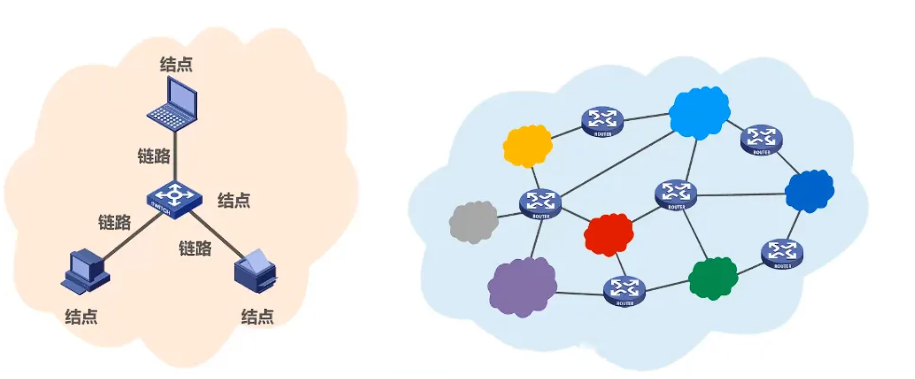

+ 因特网 (Internet) 是世界上最大的互连网络（用户数以亿计，互连的网络数以百万计）。

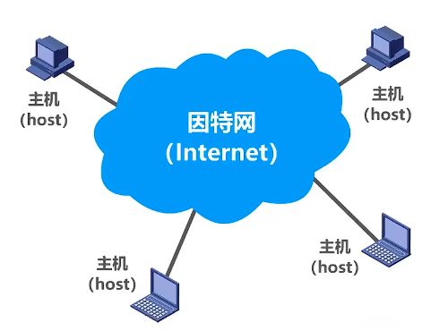
**internet与Internet的区别**

**internet**（互联网或互连网）是一个通用名词，它泛指由多个计算机网络互连而成的网络。在这些网络之间的通信协议可以是任意的。

**Internet**（因特网）则是一个专用名词，它指当前全球最大的、开放的、由众多网络相互连接而成的特定计算机网络，它采用TCP/IP协议族作为通信的规则，其前身是美国的ARPANET。

## 因特网服务提供者lsp(lnternetserviceprovider)

.png>)

基于ISP的三层结构的因特网

.png>)

## 因特网的组成
+ 边缘部分

由所有连接在因特网上的**主机**（包括台式电脑、大型服务器、笔记本电脑、平板电脑、智能手机、智能手表以及物联网智能硬件等）组成，这部分是**用户直接使用**的，用来进行**通信**（传送数据，音频或视频）和资源共享

+ 核心部分

由**大量网络**和连接这些网络的**路由器**组成。这部分是为**边缘部分提供服务**的（提供连通性和交换） 

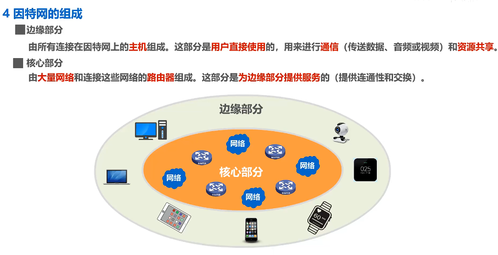

# 二、三种交换方式（电路交换、分组交换和报文交换）
## 1.电路交换（Circuit Switching）

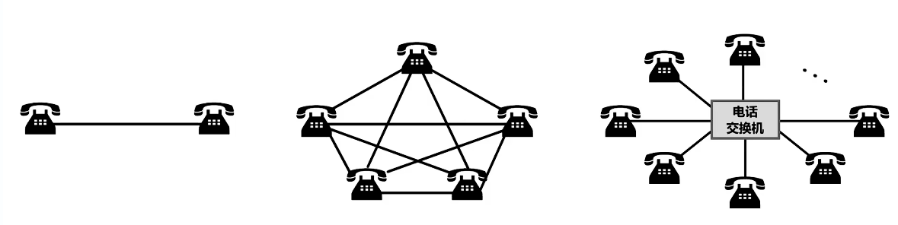

+ 电话交换机接通电话线的方式称为电路交换；
+ 的分配角度来看，交换（switching)就是按照某种方式动态地分配传输线
+ 电路交换的三个步骤：
    1. 建立连接（分配通信资源）
    2. 通话（一直占用通信资源）
    3. 释放连接（归还通信资源）

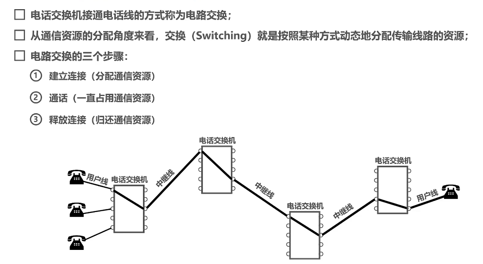

若使用电路交换来传送计算机数据时，线路的传输效率往往很低，原因如下：

**根本原因**

电路交换的**静态资源分配机制（面向连接、资源预留、静态独占）** 与计算机数据通信的**突发性、随机性、间歇性**的传输之间存在根本性矛盾

**具体原因**

1. **连接建立与拆除的额外开销**  
	电路交换在数据传输前需经历**呼叫建立阶段**，在通信结束后需进行**连接释放**。计算机数据往往具有短突发、长静默的特点（如网页浏览、文件间歇传输），若每次短会话均需经历完整的信令交互过程，信令开销在总通信时长中的占比显著增加，导致有效传输效率降低。
2. **信道资源的静态独占与空置浪费**  
	电路交换一旦建立连接，将在整个通信期间为通信双方**固定分配并独占一条物理或逻辑信道**，无论该时刻是否实际有数据传输。计算机通信的数据流量极不均衡，**突发峰期短、空闲期长**，在无数据传输的静默时段内，被独占的信道资源无法被其他用户复用，造成**严重的信道空载浪费**，线路利用率低下。
3. **不适应计算机通信的统计复用需求**  
	计算机数据流对时延抖动容忍度较高，天然适合**统计时分复用**（分组交换）。电路交换面向恒定速率业务（如话音）设计，其带宽粒度固定。当计算机数据速率远低于信道带宽时（例如仅占用64kbps数据却占据2Mbps链路），多余带宽无法动态释放给其他用户，导致**带宽资源利用率严重不足**。
4. **对非对称流量与突发峰值的适应性差**  
	计算机应用（如HTTP请求/响应、FTP下载）普遍呈现**上下行流量非对称**及**突发巨量传输**特征。电路交换的双向对称独占信道难以根据瞬时流量动态调整资源分配，峰时易拥塞丢弃，谷时则信道闲置，无法实现网络资源的全局高效利用。

## 2.分组交换（Packet Switching）
**分组交换机**：因特网中最重要的分组交换机路由器，负责将各种网络互连起来，并对接收到的分组进行转发（分组交换）

**信息发送流程**

H6给H2发送报文

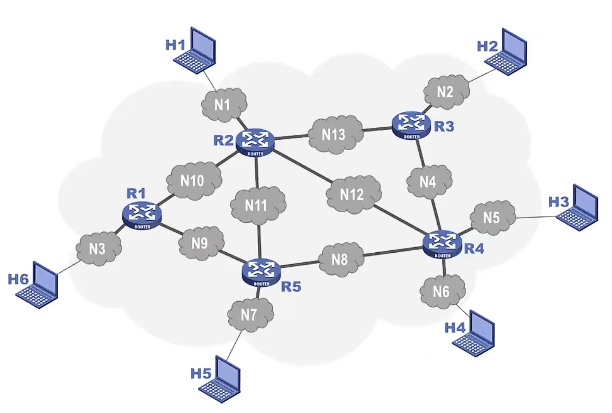

**发送方（图中H6）**

先**构造分组**再**转发分组**

构造分组：将较长的报文分成一个个更小的等长数据段，并每个数据段前面加上由必要的控	制信息组成的首部（分组可简称为包，首部可简称为包头）

+ 首部作用：首部中包含了分组的目的地址，使分组交换机（路由器）知道如何转发分组

转发分组：将构造出的各分组依次转发出去

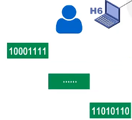
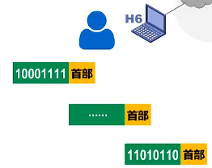

**路由器（分组交换机）**

先**缓存分组**再**转发分组**

缓存分组：分组交换机收到分组后，先将分组暂时存储下来

转发分组 ：检查分组首部，按照首部中的目的地址进行查表转发，找到合适的转发接口，通过该接口将分组转发给下一个分组交换机

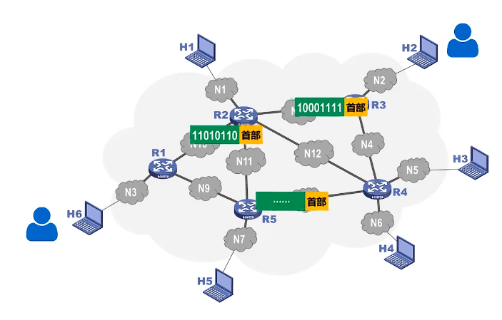

**接收方（图中H2）**

先**接收分组**再**还原报文**

接收分组：接收方从链路中接受分组

还原报文：收到分组后，去掉它们的首部，将各数据段组合还原出原始报文

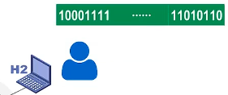

## 3.报文交换（Message Switching）
与分组交换类似，报文交换中的交换节点也采用存储转发方式，但报文交换对报文的大小没有限制，这就要求交换节点需要有较大的缓存空间，注：报文交换主要用于早期的电报通信网，现在被较先进的分组交换方式所取代

## 4.三组交换方式的对比

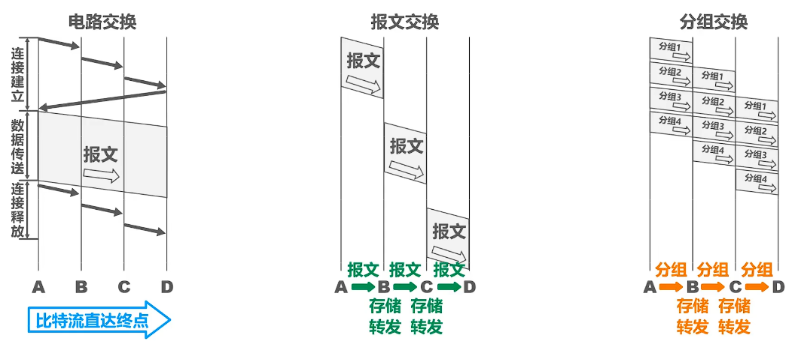

### （一）电路交换
**优点：**

1. **通信时延小**：数据通路一经建立即为**物理直连或时隙固定分配**，中间节点仅执行透明传输，无需存储处理
2. **有序传输**：信息沿**固定路由**传输，比特流到达顺序与发送顺序严格一致
3. **没有冲突**：资源**独占式预分配**，同一信道内无其他用户竞争接入
4. **适用范围广**：既支持模拟话音，亦可通过适配器承载数字数据
5. **实时性强**：传输时延固定且极小，适用于对时延抖动敏感的业务（如语音）
6. **控制简单**：连接建立后，中间节点无需执行复杂的协议处理与路由决策

**缺点：**

1. **建立连接时间长**：端到端呼叫建立信令需逐段协商资源，连接释放亦需拆除通路
2. **线路独占，使用效率低**：计算机数据具有**突发性**，静默期信道空置但无法释放给第三方，导致**空载损耗**
3. **灵活性差**：一旦建链，通路固定，无法根据网络拥塞状态动态调整路由。
4. **难以规格化**：不同业务速率差异大，固定带宽信道难以适配计算机数据的**非对称与突发特性**

### （二）报文交换
**优点：**

1. **无需建立连接**：采用**存储转发**机制，有数据即发送，省去端到端信令握手过程
2. **动态分配线路**：链路仅在实际传输报文时被占用，非独占方式
3. **提高线路可靠性**：网络节点可择优选路，某段链路故障时可绕行，具备**路由迂回能力**
4. **提高线路利用率**：基于**统计时分复用**，多用户报文共享传输带宽
5. **提供多目标服务**：一份报文可经中间节点复制后向多个目的站转发

**缺点：**

1. **引起了转发时延**：报文必须在中间节点**完整接收并校验**后方可转发，时延较长
2. **需要较大存储缓存空间**：报文长度不定且可能极大，节点需预留充足内存以应对长报文突发
3. **需要传输额外的信息量**：报头需携带源/目的地址及控制信息，构成协议开销

### （三）分组交换
**优点：**

1. **无需建立连接**（数据报方式）：各分组独立寻址传输，省去连接建立阶段
2. **线路利用率高**：采用**细粒度统计复用**，多个逻辑连接共享同一物理链路，带宽按需竞争分配
3. **简化了存储管理**：分组长度受限且较小，节点缓冲区管理更为规整高效
4. **加速传输**：基于**流水线并行处理**，后一分组在前一分组未到达终点时已可开始转发
5. **减少出错概率和重发数据量**：仅需重传出错的单个分组，无需重传整份报文

**缺点：**

1. **引起了转发时延**：每个分组均需在节点排队、查表、处理，产生**节点处理与排队时延**
2. **需要传输额外的信息量**：每个分组均携带**完整的报头**，协议开销比例随分组数增加而上升
3. **数据报服务问题**：分组可能经不同路径到达，引发**失序、丢失或重复**，需上层协议恢复
4. **虚电路服务问题**：虽有序且免寻址，但引入了**呼叫建立、数据传输、虚电路释放**三个阶段的控制开销

# 三、计算机网络的定义和分类
本节了解即可

## 1.计算机网络的定义
+ 计算机网络的精确定义并未统一
+ 计算机网络的最简单的定义是：一些**互相连接**的，**自治**的计算机的**集合**。
    - **互连：** 是指计算机之间可以通过有线或无线的方式进行数据通信
    - **自治：** 是指独立的计算机，它有自己的硬件和软件，可以单独运行使用
    - **集合：** 是 是指至少需要两台计算机
+ 计算机网络的较好的定义是：计算机网络主要是由一些**通用的，可编程的硬件互连**而成的，而这些硬件并非专门用来实现某一特定目的（例如，传送数据或视频信号）.这些可编程的硬件能够用来**传送多种不同类型的数据**，并能**支持广泛的和日益增长的应用**。
    - 计算机网络所连接的硬件，并不限于一般的计算机，而是包括了智能机等智能硬件。
    - 计算机网络并非专门用来传送数据，而是能够支持很多种的应用（包括今后可能出现的各种应用）

## 2.计算机网络的分类
1. 按交换技术分类
    - 电路交换网络
    - 报文交换网络
    - 分组交换网络
2. 按使用者分类
    - 公用网：指由电信运营企业建设、面向全社会所有用户提供网络接入与通信服务的网络，如公共电话网、互联网骨干网。
    - 专用网：指由电信运营企业建设、面向全社会所有用户提供网络接入与通信服务的网络，如公共电话网、互联网骨干网。
3. 按传输介质分类
    - **有线网络**：采用双绞线、同轴电缆、光纤等实体线缆作为传输媒介的网络，具有传输稳定、抗干扰强、保密性好等特点。
    - **无线网络**：利用无线电波、微波、红外线等自由空间电磁波传输数据的网络，具有部署灵活、支持移动接入等特点。
4. 按覆盖范围分类
    - **广或网WAN**：覆盖范围可达数十公里至数千公里，用于跨地区、跨国乃至全球范围的网络互联，时延较高。
    - **城域网MA**：覆盖范围约为一个城市及其郊区（数公里至数十公里），作为城市内部的主干传输平台。
    - **局域网LAN**：覆盖范围通常在几米至几公里内，用于单一建筑或园区内的终端互联，具有传输速率高、误码率低的特点。
    - **个域网PAN**：覆盖范围极小（通常在十米以内），用于个人随身设备之间的近距离通信，如蓝牙设备连接。
5. 按拓扑结构分类
    - **总线型网络**：使用单根传输线把计算机连接起来
        * 优点：建网容易；增减节点方便；节省线路
        * 缺点：重负载时通信效率不高；总线一处出现故障则全网瘫痪

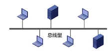

- **星型网络**：每个计算机都以单独的线路与中央设备（早期是计算机，后来是集线器，现在一般是交换机或路由器）相连
    * 优点：便于网络的集中控制和管理（原因：端用户之间的通信必须经过中央设备）
    * 缺点：成本高，中央设备对故障敏感

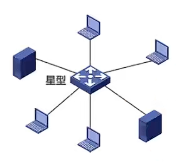

- **环型网络**：将所有计算机网络接口连接成一个环，环可以是单环或双环，环中信号是单向传输的

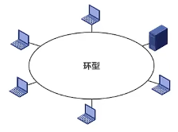

- **网状型网络**：一般情况下每个节点至少由两条路劲与其他结点相连，多用在广域网中
    * 优点：可靠性高
    * 缺点：控制复杂；线路成本高

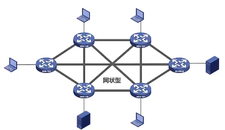

# 四、计算机网络的性能指标
**性能指标作用**：性能指标可以从不同的方面来度量计算机网络的性能。

常用的计算机网络的性能指标有以下8个：

## 1.速率
### 比特
计算机中数据量的单位，也是信息论中信息量的单位。一个比特就是二进制数字中的一个 **1** 或 **0**。

**常用数据量单位**

| 单位 | 换算关系（以 Byte 为基础，基于$2^{10}$） |
| :--- | :--- |
| **基本关系** | $8 \text{ bit} = 1 \text{ Byte (B)}$ |
| **KB** | $1 \text{ KB} = 2^{10} \text{ B} = 1024 \text{ B}$ |
| **MB** | $1 \text{ MB} = 2^{10} \text{ KB} = 2^{20} \text{ B}$ |
| **GB** | $1 \text{ GB} = 2^{10} \text{ MB} = 2^{30} \text{ B}$ |
| **TB** | $1 \text{ TB} = 2^{10} \text{ GB} = 2^{40} \text{ B}$ |

### 速率（比特率/数据率）
连接在计算机网络上的主机在数字信道上传送比特的速率，也称为 **比特率** 或 **数据率**。

**常用数据率单位**

**关键提示：** 速率单位之间的换算以 $10^3$ 为倍数关系（即 $k = 10^3$），与数据量单位中的 $2^{10}$ 进制严格区分。

| 单位 | 换算关系（以 b/s 为基础，基于 $10^3$） |
| :--- | :--- |
| **基本单位** | $\text{bit/s}$ 或$\text{bps}$ |
| **kb/s** | $1 \text{ kb/s} = 10^3 \text{ b/s}$ |
| **Mb/s** | $1 \text{ Mb/s} = 10^3 \text{ kb/s} = 10^6 \text{ b/s}$ |
| **Gb/s** | $1 \text{ Gb/s} = 10^3 \text{ Mb/s} = 10^9 \text{ b/s}$ |
| **Tb/s** | $1 \text{ Tb/s} = 10^3 \text{ Gb/s} = 10^{12} \text{ b/s}$ |

### 例题：
> 例1：有一个待发送的数据块，大小为 100 MB，网卡的发送速率为 100 Mbps，则网卡发送完该数据块需要多长时间？
>

---

**计算与解释**

**1. 单位换算依据**

+ **数据量单位（MB）**：依据前述定义，计算机存储容量采用二进制计量，即  
$$
1 \text{ MB} = 2^{10} \text{ KB} = 2^{20} \text{ Bytes}
$$
+ **速率单位（Mbps）**：依据前述定义，数据率采用十进制计量，即  
$$
1 \text{ Mbps} = 10^3 \text{ kbps} = 10^6 \text{ bps}
$$

**2. 统一化为比特（bit）**

待发送数据块总比特数：

$ \begin{aligned}
100 \text{ MB} &= 100 \times 2^{20} \text{ Bytes} 
\end{aligned} $

由于 1 Byte = 8 bit，故：

$$
8\times 100 \times 2^{20} \text{ Bytes}  = 100 \times 2^{23} \text{ bits}
$$

网卡发送速率：

$$
100 \text{ Mbps} = 100 \times 10^6 \text{ bps}
$$

**3. 计算发送时间**

发送时间 (t) 等于总比特数除以发送速率：

$$
t = \frac{100 \times 2^{23} \text{ bits}}{100 \times 10^6 \text{ bps}} = 8.388608 \text{s}
$$

## 2.带宽
**带宽在模拟信号系统中的意义**

**信号**所包含的各种不同频率成分所占据的**频率范围**

单位：$\text{Hz}(\text{KHz},\text{MHz},\text{GHz})$

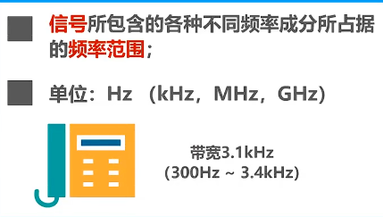

**带宽在计算机网络中的意义**

用来表示网络的**通信线路**所能传送数据的能力，因此网络带宽表示在单位时间内从网络中的某一点到另一点所能通过的"**最高数据率**"

单位：$\text{b/s}(\text{Kb/s},\text{Mb/s},\text{Gb/s},\text{Tb/s})$

"带宽"的这两种表述之间有着密切的联系。一条通信线路的 "频带宽度"越宽，其所传输数据的"最高数据率" 也越高。

## 3.吞吐量
1. 吞吐量表示在**单位时间内通过某个网络（或信道，接口）的数据量**。
2. 吞吐量被经常用于对现实世界中的网络的一种测量，以便知道实际上到底有多少数据量能够通过网络。
3. 吞吐量**受网络的带宽或额定速率的限制**。

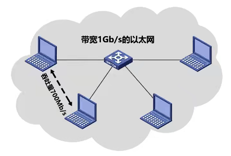

## 4.时延
### 时延的组成
网络时延由发送时延、传播时延、处理时延组成

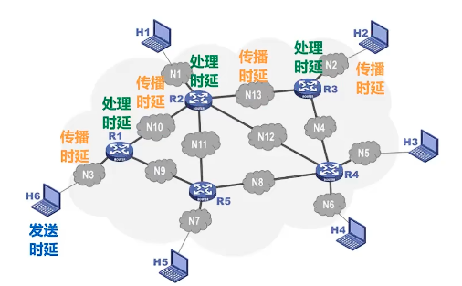

1. **发送时延（传输时延，Transmission Delay）**
+ **定义**：节点（如路由器、主机）将整个数据块（分组/帧）从自身发送到通信链路上所需的时间。
+ **产生原因**：数据必须被“推”到链路上，受限于接口的发送速率（即带宽）。

**公式**：

$$
\text{发送时延}=\frac{\text{分组长度}\ (\mathrm{b})}{\text{发送速率}\ (\mathrm{b/s})}=\frac{\text{分组长度}\ (\mathrm{b})}{\text{传输速率}\ (\mathrm{b/s})}
$$

注：发送速率和传输速率略有区别（在最小帧长部分介绍），计算时可以忽略

+ **特点**：取决于**数据长度**和**链路带宽**，与传输距离无关。

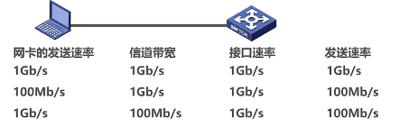

2. **传播时延（Propagation Delay）**
+ **定义**：信号（电磁波/光）在物理介质上从发送端传播到接收端所需的时间。
+ **产生原因**：信号以有限速度在介质中传播。

**公式**：

$$
\frac{\text{信道长度}\ (\mathrm{m})}{\text{电磁波传播速率}\ (\mathrm{m/s})}
$$

电磁波传播速率：

- 自由空间：$3\times 10^{8} \text{ m/s}$ 
- 铜线：$2.3\times10^{8} \text{m/s}$ 
- 光纤：$2.0\times 10^{8} \text{ m/s}$

+ **特点**：取决于**传输距离**和**介质性质**，与数据长度和带宽无关。
3. **处理时延（Processing Delay）**

一般不方便计算（通常忽略不计）

+ **定义**：网络节点（如路由器、交换机）收到数据后，对其进行处理（解析首部、查路由表、计算校验、决定转发端口等）所花费的时间。
+ **产生原因**：设备的硬件（CPU、ASIC）和软件处理能力有限。
+ **典型值**：微秒到毫秒级，高性能路由器可低至几十微秒。
+ **特点**：与设备负载、处理复杂度有关，通常比发送时延和传播时延小（除非节点非常繁忙）。
4. **排队时延（Queuing Delay）**
+ **定义**：数据在发送队列中等待处理的时间

### 例题
**T1：** 数据块长度为 **100 MB**，信道带宽为 **1 Gb/s**，传送距离为 **1000 km**，计算发送时延和传播时延。

解答

+ **发送时延**
    - $\frac{\text{分组长度}\ (\mathrm{b})}{\text{发送速率}\ (\mathrm{b/s})}$= $\frac{100 \times 2^{20} \times 8(b)}{10^9 \text{b/s}} = 838.8608(\text{s})$
+ **传播时延**
    - $\frac{\text{分组长度}\ (\mathrm{b})}{\text{发送速率}\ (\mathrm{b/s})}$= $\frac{1000 \times  10^3 (\text{m})}{2 \times 10^8(\text{m/s})} = 0.005(\text{s})$

**T2：** 数据块长度为 **1 B**，信道带宽为 **1 Mb/s**，传送距离为 **1000 km**，计算发送时延和传播时延。

解答

+ **发送时延**
    - $\frac{\text{分组长度}\ (\mathrm{b})}{\text{发送速率}\ (\mathrm{b/s})}$= $\frac{1 \times 8(b)}{10^6(\text{b/s})} = 8 \times 10^{-6} (\text{s})$
+ **传播时延**
    - $\frac{\text{信道长度}\ (\mathrm{m})}{\text{电磁波传播速率}\ (\mathrm{m/s})}$= $\frac{1000 \times 10^3 (\text{m})}{2 \times 10^8 (\text{m/s})} = 0.005 (\text{s})$

## 5.时延带宽积
时延带宽积 = 传播时延 × 带宽

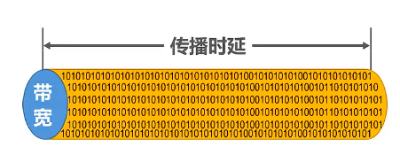

+ 若发送端连续发送数据，则在所发送的第一个比特即将到达终点时，发送端就已经发送了时延带宽积个比特；
+ 链路的时延带宽积又称为**以比特为单位的链路长度**。

## 6.往返时间
在许多情况下，因特网上的信息不仅仅单方向传输，而是双向交互。我们有时很需要知道双向交互一次所需的时间。因此，往返时间 **RTT**(Round-Trip Time) 也是一个重要的性能指标。

**RTT**(Round-Trip Time)：从源主机发送分组开始，知道源主机收到来自目的主机的确认分组为止所需要的时间

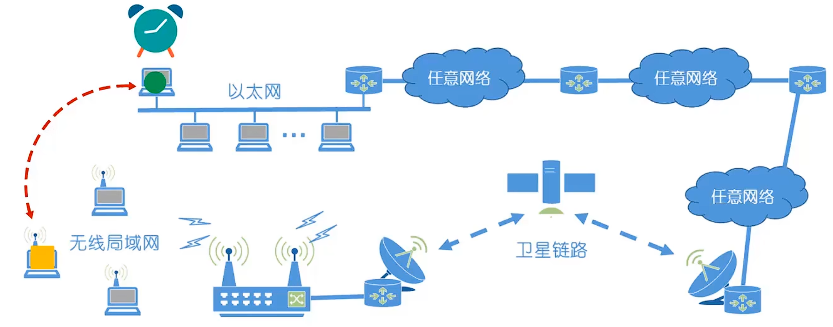

## 7.利用率
### 利用率的组成
1. **信道利用率**：用来表示某信道有百分之几的时间是被利用的（有数据通过）。
2. **网络利用率**：全网络的信道利用率的加权平均。

### 利用率的特点
+ 根据排队论，当某信道的利用率增大时，该信道引起的时延也会迅速增加。因此，**信道利用率并非越高越好**。
+ 如果令$D_0$表示网络空闲时的时延，$D$表示网络当前的时延，那么在适当的假定条件下，可以用下面的简单公式来表示$D$、$D_0$和利用率$U$之间的关系：

$$
D = \frac{D_0}{1 - U}
$$

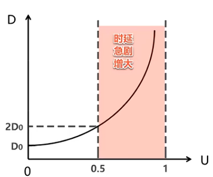

- 当网络的利用率达到50%时，时延就要加倍；
- 当网络的利用率超过50%时，时延急剧增大；
- 当网络的利用率接近100%时，时延就趋于无穷大；
- 因此，一些拥有较大主干的ISP通常会控制它们的信道利用率不超过50%。如果超过了，就要准备扩容，增大线路的带宽。

+ 也不能使信道利用率太低，这会使宝贵的通信资源被白白浪费。应该使用一些机制，可以根据情况动态调整输入到网络中的通信量，使网络利用率保持在一个合理的范围内。

## 8.丢包率
1. 丢包率即分组丢失率，是指在一定的时间范围内，传输过程中**丢失的分组数量与总分组数量的比率**。
2. 丢包率具体可分为接口丢包率、结点丢包率、链路丢包率、路径丢包率、网络丢包率等。
3. 丢包率是网络运维人员非常关心的一个网络性能指标，但对于普通用户来说往往并不关心这个指标，因为他们通常意识不到网络丢包。

**分组丢失主要有两种情况：**

+ 分组在传输过程中出现**误码**，被结点丢弃；
+ 分组到达一台队列已满的分组交换机时被丢弃；  
在通信量较大时就可能造成**网络拥塞**。

**丢包率反映了网络的拥塞情况：**

+ 无拥塞时路径丢包率为0
+ 轻度拥塞时路径丢包率为1%~4%
+ 严重拥塞时路径丢包率为5%~15%

# 五、计算机网络体系结构 **重点**
## 1. 常见的计算机网络体系结构 
### OSI体系结构和TCP/IP体系结构
 
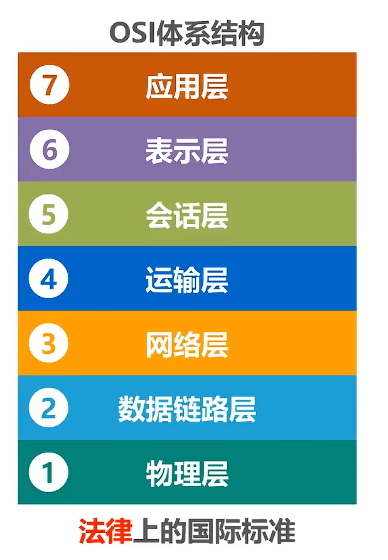
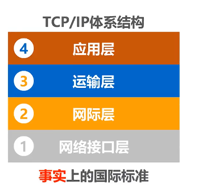

**OSI标准失败的原因：**

1.OSI的专家们缺乏实际经验，他们在完成OSI标准时没有商业驱动力

2.OSI协议实现起来过分复杂，而且运行效率很低

3.OSI标准的制定周期太长，使得按OSI标准生产的设备无法及时进入市场

4.OSI的层次划分不太合理，有些功能在多个层次中重复出现

**对比两个体系结构：**

TCP/IP体系结构相当于将OSI体系结构的物理层和数据链路层合并为了网络接口层，并去掉了会话层和表示层，由于TCP/IP在网络层使用的协议是IP协议（网际协议），因此TCP/IP在网络层常称为网际层。

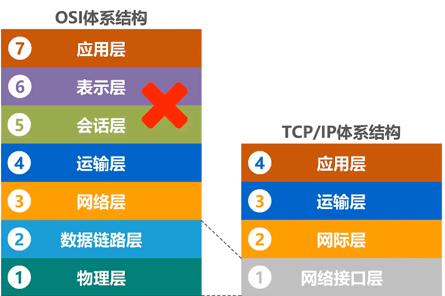

1. 接入因特网的主机必须使用TCP/IP协议
2. 用户主机的操作系统中，通常都带有符合TCP/IP体系结构标准的TCP/IP协议簇
3. 用于网络互联的路由器中，也带有符合TCP/IP体系结构标准的TCP/IP协议簇，只是路由器一般只包含网络接口层和网际层

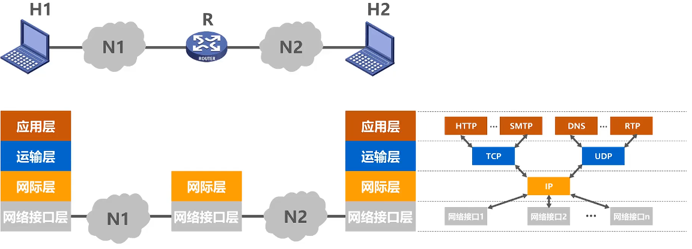

1. TCP/IP体系结构的网络接口层并没有规定具体的内容，目的是可以互联全世界各种不同的网络接口（例如：有线的以太网接口，无线局域网的wifi接口），而不限定仅使用一种或几种的网络接口。因此：本质上TCP/IP体系结构只有上面的三层。
2. IP协议是TCP/IP体系结构网际层的核心协议。IP协议可以将不同的网络接口进行互联，并向其上的TCP协议和UDP协议提供网络互联服务。IP协议作为TCP/IP体系结构中的核心协议，一方面负责互联不同的网络接口（IP over everything），另一方面为各种网络应用提供服务（Everything over IP）
3. TCP和UDP是TCP/IP体系结构运输层的重要协议。TCP协议在享受IP协议提供的网络互联服务的基础上，可向应用层协议提供可靠传输的服务（TCP可靠但是延迟较高）；UDP协议在享受IP协议提供的网络互联服务的基础上，可向应用层协议提供不可靠传输的服务。
4. TCP/IP体系结构的应用层包含了大量应用层协议（例如：HTTP、SMTP、DNS、RTP等）。
5. TCP/IP体系结构中包含有大量的协议，IP协议和TCP协议是其中非常重要的两个协议，因此用TCP和IP这两个协议来表示整个协议大家族，常称为TCP/IP协议簇。

 

### 原理体系结构
由于TCP/IP体系结构为了将不同的网络接口层进行互连，因此他的网络接口层并没有规定什么具体的内容。然而这对于学习计算机完整体系而言，就会缺少一部分内容。因此在学习计算机网络原理时往往采取折中的办法，综合OSI体系结构和TCP/IP体系结构的优点，采用一种五层协议的原理体系结构 。

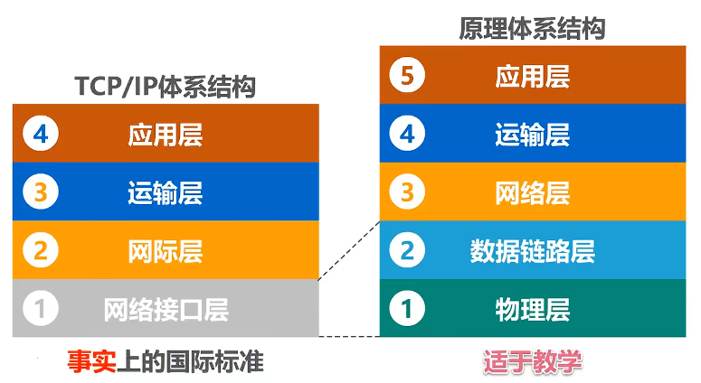

## 2. 计算机网络体系结构分层的必要性  
+ 计算机网络是个非常复杂的系统。早在最初的ARPANET设计时就提出了分层的设计理念。
+ “分层”可将庞大而复杂的问题，转化为若干较小的局部问题，而这些较小的局部问题就比较容易研究和处理。

### （1）物理层

需考虑以下问题：

**1.采用怎样的传输媒体（介质）**

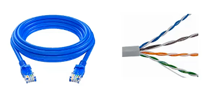

**2.计算机上采用怎样的物理接口来连接传输媒体**

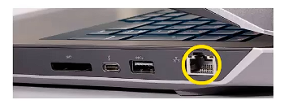

**3.使用怎样的信号表示比特0和1**

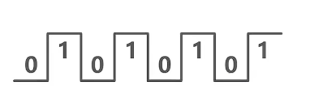

这些问题可以划归到**物理层**（住：1.严格来说传输媒体不属于物理层，并不包含在体系结构之中；2.计算机网络传输的信号并不是举例的方波信号）

### （2）数据链路层
假设以解决物理层问题，主机间可以发送信号传输比特0或1，还有什么需要解决的问题？

主机A要给主机C发送数据，但是表示数据的信号会通过总线传播到总线上的每个主机，问题：主机C如何知道数据是发给自己的，自己要接受？主机B、D、E又如何知道数据并不是发给自己的，自己应该拒绝？

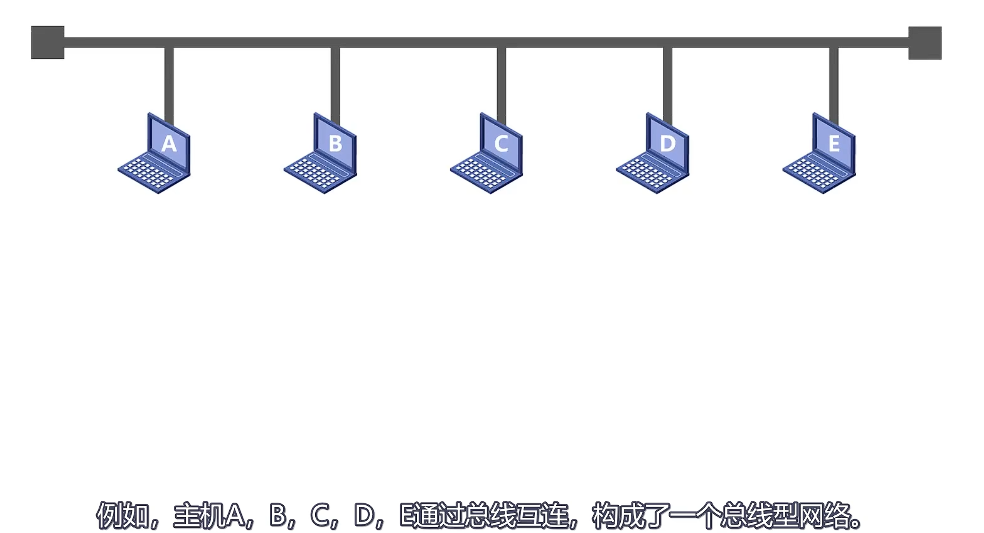

**1.如何标识网络中的各主机（主机编址问题，例如MAC地址（主机在网络中的地址））**

主机在发送数据时，应该给数据附加目的地址，当其他主机收到后，根据目的地址和自身地址，来决定是否接受数据。

**2.如何从信号所表示的一连串比特流中区分出地址和数据**

需要解决分组的封装格式问题。

**3.如何协调各主机争用总线**

某个时刻总线是空闲的，也就是没有主机使用总线来发送数据。片刻之后主机B和D同时向总线发送数据，必然会造成信号碰撞。

注：总线型网络早已被淘汰，现在常用的是使用以太网交换机将多台主机互联形成交换式以太网

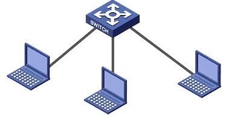

### （3）网络层
解决物理层和数据链路层各自所面临的问题，就可以实现分组在一个网络上传输了。但是因特网是由非常多的网络和路由器互连起来的，仅解决物理层和数据链路层的问题，依旧不能正常工作。

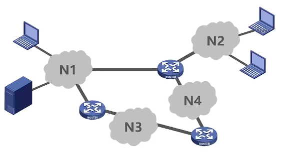

在多个网络中面临的问题：

**1.如何标识各网络以及网络中的各主机（网络和主机共同编址的问题，例如IP地址）**

在同一个子网上，IP的前三个十进制数因该相同，第四个十进制数各不相同，用于标识自己

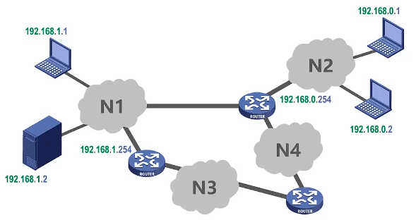

**2.路由器如何转发分组，如何进行路由选择**

解释：分组从源主机到目的主机可以走不同的路径 

### （4）运输层
假设同一台主机运行着两个与网络通信相关的应用进程，服务器中运行着与网络通信相关的服务器进程，某个时刻，主机收到了来自服务器的分组。那么，这些分组应该交给浏览器进程处理呢，还是应该交给QQ进程处理？

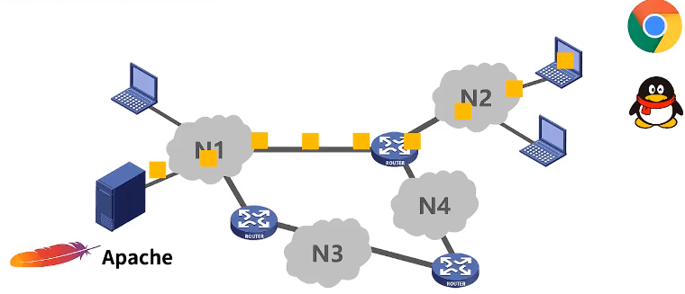

**1.如何解决进程之间基于网络的通信问题**

标识与网络通信相关的应用进程

**2.出现传输错误时，如何处理**

若某个分组在传输过程中出现的误码，或者由于服务器繁忙导致路由器丢失分组，该如何处理

### （5）应用层
解决了物理层、数据链路层、网络层、运输层各自的问题则可以实现**进程之间**基于网络的通信。在此基础上，只需制定各种应用层协议，并按协议标准编写相应的应用程序，通过应用进程间的交互来完成特定的网络应用。

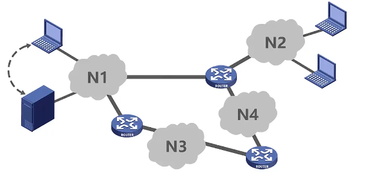

通过应用进程间的交互来完成特定的网络应用

支特万维网应用的http协议

支特电子邮件的smtp协议

支持特文件传送的ftp协议

### 总结 
应用层：解决通过应用进程的交互来实现特定网络应用的问题

运输层：解决进程之间基于网络的通信问题

网络层：解决分组在多个网络上传输（路由）的问题

数据链路层：解决分组在一个网络（或一段链路）上传输的问题

物理层：解决使用何种信号来传输比特的问题

## 3. 计算机网络体系结构分层思想举例  
主机和Web服务器之间基于网络的通信，实际上是主机中的浏览器应用进程，与Web服务器中的Web服务器应用进程之间基于网络的通信。

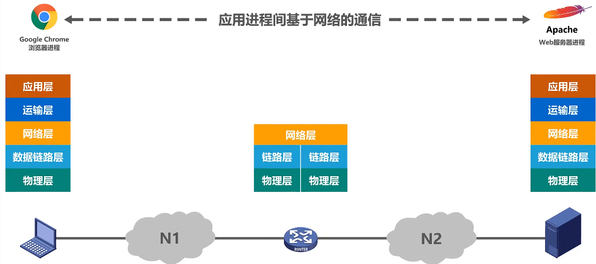

以图中的场景为例：**Google Chrome 浏览器**（客户端）向 **Apache 服务器**请求网页，数据从 N1 主机发出，经过路由器转发，到达 N2 服务器。

### 各层的作用
**1. 应用层**

**作用**：最贴近用户，直接为**应用进程**提供网络服务，定义通信规则和数据格式。

**2. 运输层**

**作用**：为两台主机上的**应用程序进程之间**提供端到端的数据传输服务。负责分段、建立连接、差错校验、流量控制、区分不同应用（通过端口）。

**3. 网络层**

**作用**：负责将数据包从**源主机**经由多个网络和路由器送到**目的主机**，核心是**逻辑寻址（IP地址）和路由选择**。

**4. 数据链路层**

**作用**：在**相邻两个节点之间**（如主机到路由器、路由器到路由器）的物理链路上实现数据帧的透明传输。负责物理寻址（MAC地址）、帧的封装/解封装、差错检测和介质访问控制。

**5. 物理层**

**作用**：在物理传输介质上透明地传输**比特流**。定义接口特性、电平、速率、线缆规格等物理特性，将数据中的 0/1 转换成电信号、光信号或无线信号。

### 图中的体现
1.主机端：

**1.应用层**：浏览器和服务器使用 HTTP 协议来交换 Web 页面内容。应用层按HTTP协议的规定构建“请求报文”，将用户想要访问的网页信息组织成应用数据，交给下层处理。

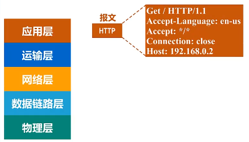

**2.运输层**：基于 HTTP 协议的需求，通常会使用 **TCP**（传输控制协议）。如果是视频通话等场景，可能用 UDP，提供尽力而为的无连接传输。运输层将 HTTP 请求报文添加一个TCP首部，使之成为TCP报文段（运输层将 HTTP 报文划分成适合传输的片段，加上**端口号**（如服务器端口80）），然后将TCP报文段交付给网络层处理。首部作用：区分应用进程，确保这些片段能在 Chrome 进程和 Apache 进程之间**可靠、有序**地交付。

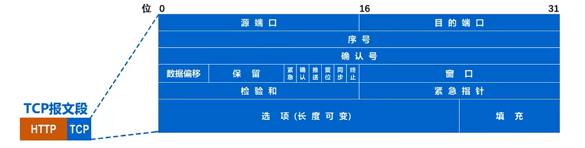

**3. 网络层：** 网络层给TCP报文段添加IP首部，把数据封装成 **IP 数据报**（含有源 IP 和目的 IP），并决定数据报如何经过 **Router（路由器）** 的转发，跨越不同网络，最终到达 N2。网络层将IP数据报交付给数据链路层处理。首部作用：使IP数据报可以在互联网上传输，也就是被路由器转发。

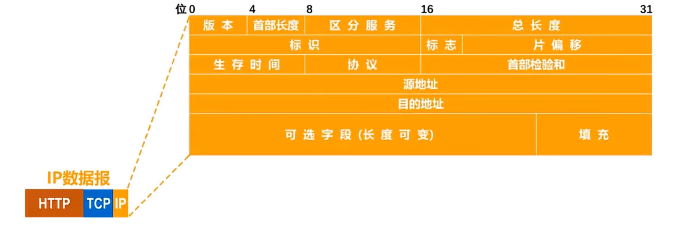

**4. 数据链路层**：该层保证每一“跳”链路上的数据完整送达下一节点。数据链路层给IP数据报添加链路层首部（如以太网头，包含下一跳的 MAC 地址）和尾部，构成**帧**，数据链路层将帧交给物理层。首部作用：为了让帧能够在一段链路上或一个网络上传输，能够被相应的目的主机接收；尾部作用：让目的主机检查所收到的帧是否有误码。

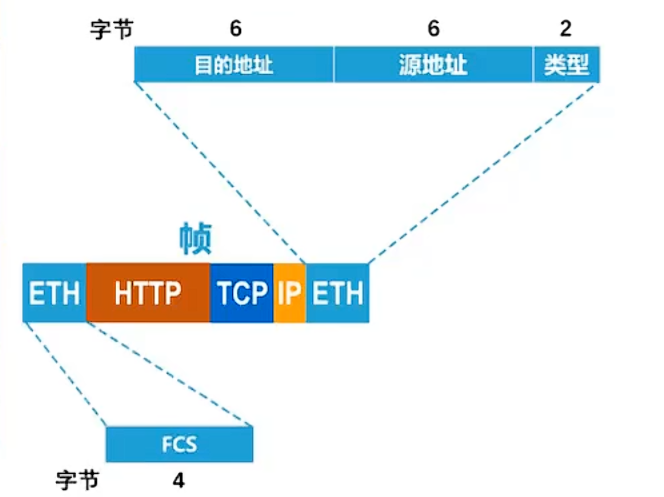

**5. 物理层**：由于网络N1是以太网，物理层会给该比特流前面添加前导码（作用：为了让目的主机做好接收帧的准备）。连接主机与路由器、路由器与 N2 的物理介质（如双绞线、光纤、无线信道）。物理层只负责将链路层交下来的比特流按位变成相应的信号发送到传输媒体，不关心比特的含义，是整个通信的基础。。信号通过传输媒体到达路由器。

2.路由器

**1. 物理层**：将信号变成比特流，然后去掉前导码（帧）交付给数据链路层。

**2. 数据链路层**：将帧的首部尾部去掉后（IP数据报）交付给网络层

**3. 网络层**：路由器上的操作就涉及网络层，根据目的 IP 查表转发。网络层解析IP数据报的首部，从中提取出目的网络地址，然后查找自身的路由表确定转发端口，以便于转发，然后将IP数据报交付给数据链路层。

**4. 数据链路层**：数据链路层给IP数据报添加一个首部和一个尾部使之成为帧，然后将帧交付给物理层。在路由器这一跳，帧会先被解封装，取出 IP 数据报，查表转发到网络层，然后重新封装成新的帧发往 N2。

**5. 物理层**：将帧看做成比特流，由于网络N1是以太网，物理层会给该比特流前面添加前导码。然后将包含前导码的比特流变换成相应的信号发送到传输媒体。信号通过传输媒体到达Web服务器。

3.Web服务器

**1. 物理层**：将信号变成比特流，然后去掉前导码（帧）交付给数据链路层。

**2. 数据链路层**：将帧的首部尾部去掉后（IP数据报）交付给网络层。

**3. 网络层**：网络层将IP数据报的首部去掉后（TCP报文段）将其交付给运输层。

**4. 运输层**：运输层将TCP报文段的首部去掉后（HTTP请求报文）将其交付给应用层。

**5. 应用层**：应用层对HTTP请求报文进行解析，然后给主机发回HTTP“响应报文”。

与之前的过程类似，HTTP“响应报文”在Web服务器**层层封装**，然后通过物理层变成相应的信号，再通过传输媒体传输到路由器。路由器**转发**该响应报文给主机。主机通过物理层将收到的信号转换为比特流，之后通过**逐层解封**，最终取出HTTP响应报文。

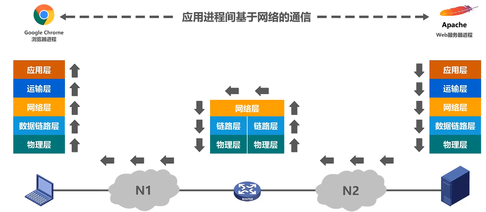

**通信过程总结：**  
数据在发送方（N1）从**应用层向下逐层封装**（每层加上自己的控制信息），到**物理层变成比特流**传输出去；经**路由器转换**（物理层→链路层→网络层转发→再向下封装）；再沿链路到**接收方（N2）**，比特流从物理层向上逐层解封装，最终将 HTTP 请求还原，交给 Apache 进程；Apache 处理后的响应再按相反的路径和方法返回给 Chrome 浏览器。

## 4. 计算机网络体系结构中的专用术语
### （1）实体
**实体** 任何可发送或接收信息的**硬件**或**软件进程**（图中带字母标识的小方格）

**对等实体** 收发双方**相同层次中的实体**

例子：通信双方的网卡和正在通信的应用进程都是对等实体

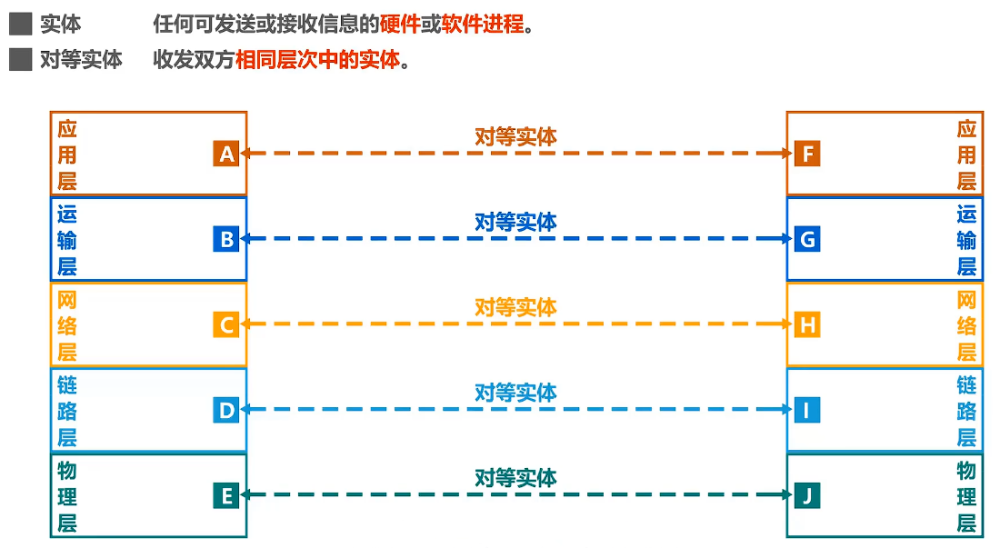

### （2）协议
**协议** 控制两个对等实体进行逻辑通信的规则的集合

应用层**对等实体**在应用层协议（例如 HTTP，SMTP)的控制下进行**逻辑通信**

运输层**对等实体**在运输层协议（例如 TCP，UDP)的控制下进行**逻辑通信**

网络层**对等实体**在网络层协议（例如 IP) 的控制下进行**逻辑通信**

链路层**对等实体**在用链路层协议（例如 传统以太网CSMA/CD)进行)的控制下进行**逻辑通信**

物理层**对等实体**在用物理层协议（例如 传统以太网使用曼彻斯特编码）的控制下进行**逻辑通信**

注：之所以称为逻辑通信因为这种通信其实并不存在，只是假设出来的一种通信。

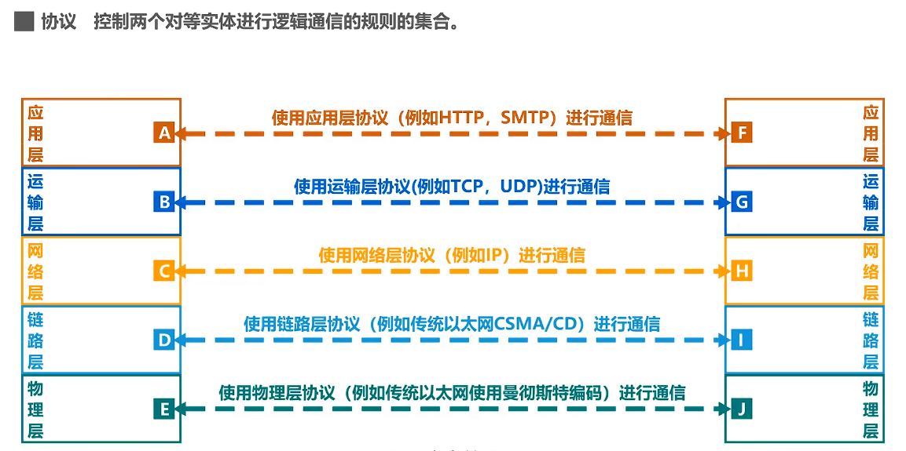

**协议的三要素** 语法 语义 同步

**语法** 定义所交换信息的格式（定义图中小格子（称为字段或域）的长度（bit）和先后顺序也就是定义		       了所交换信息由哪些字段以及何种顺序构成）

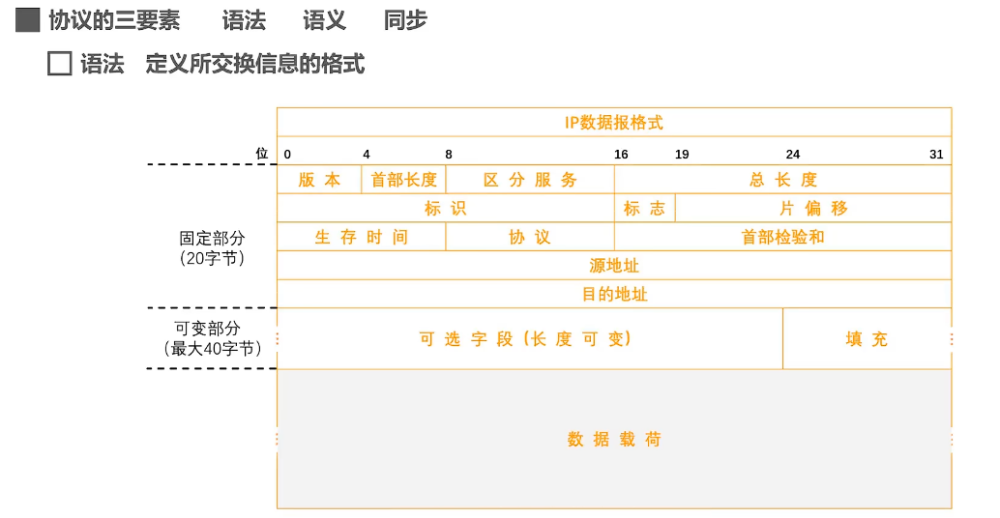

**语义** 定义收发双方所要完成的操作

**同步** 定义收发双方的时序关系

### （3）服务
**服务** 在协议的控制下，两个对等实体间的逻辑通信使得本层能够向上一层提供服务。

- 物理层**对等实体**在物理层协议的控制下向数据链路层提供服务

+ 要实现本层协议，还需要使用下面一层所提供的服务。
    - 数据链路层**对等实体**"享受"物理层提供的服务 **，** 在数据链路层协议的控制下向进行逻辑通信，给网络层提供服务。
    - 网络层**对等实体**"享受"数据链路层提供的服务 **，** 在网络层协议的控制下向进行逻辑通信，给运输层提供服务。
    - 运输层**对等实体**"享受"网络层提供的服务 **，** 在运输层协议的控制下向进行逻辑通信，给应用层提供服务。
    - 应用层**对等实体**"享受"运输层提供的服务 **，** 在应用层协议的控制下向进行逻辑通信，给用户提供服务。
+ 协议是"**水平的**",服务是"**垂直的**".
+ 实体看得见相下层所提供的服务，但并不知道实现该服务的具体协议。也就是说，下面的协议对上面的	实体是"**透明**"的（例如用户看得见手机提供的各种服务，但无需弄懂手机的工作原理）。

**服务访问点** 在同一系统中**相邻两层的实体交换信息的逻辑接口**，用于区分不同的服务类

数据链路层的服务访问点为帧的"类型"字段。

网络层的服务访问点为ip数据报首部中的"协议字段"。

运输层的服务访问点为"端口号"。

**服务原语** 上层使用下层所提供的服务必须通过与下层**交换一些命令**，这些命令称为服务原语。

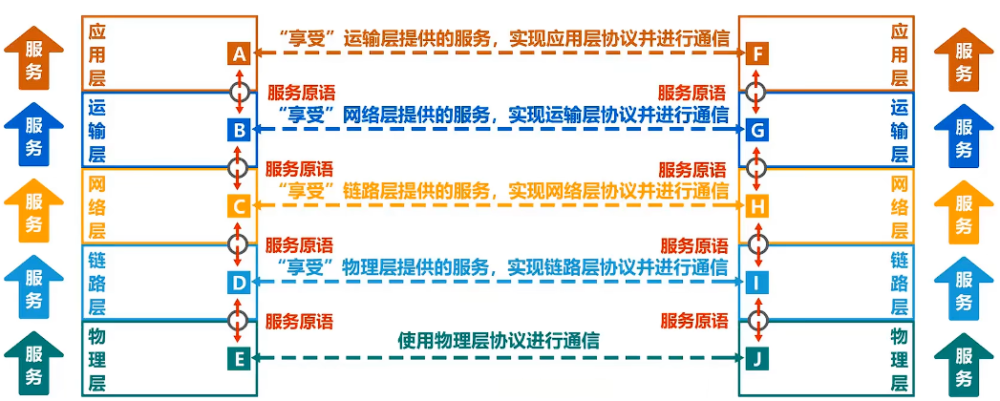

**协议数据单元PDU   对等层次之间传送的数据包**称为该层的协议数据单元。

物理层对等实体逻辑通信的数据包称为比特流

数据链路层对等实体逻辑通信的数据包称为帧

网络层对等实体逻辑通信的数据包称为IP数据报或分组

运输层对等实体逻辑通信的数据包称为TCP报文段（采用TCP协议）或UDP报文段（采用UDP协议）

应用层对等实体逻辑通信的数据包称为应用报文

**服务数据单元SDU**   **同一系内，层与层之间交换的数据包**称为服务数据单元。

多个SDU可以合成为一个PDU;一个SDU也可划分为几个PDU。

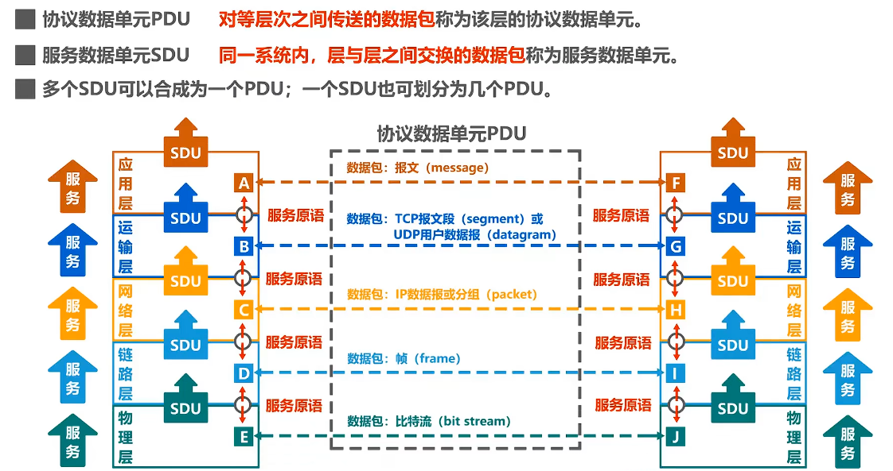
