# 一、数据链路层的概述
## 1.数据链路层在网络体系结构中的地位

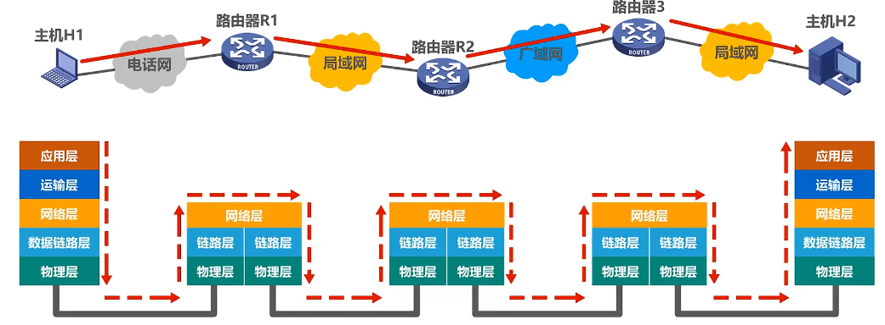

如图所示，主机H1给主机H2发送数据，中间要经过三个路由器和电话网、局域网以及广域网等多种网络。从五层协议原理体系结构的角度来看，主机应具有体系结构中的各个层次，而路由器只需具有体系结构中的下面三层，各设备通过物理层下面的传输媒体进行互联。

**当主机H1向H2发送数据时：**

1.主机H1将待发送的数据**逐层封装**后，通过**物理层**将构成数据包的各比特**转换为电信号**，发送到传输媒体。

2.数据包进入路由器后，**由下往上逐层解封**到网络层。**路由器**根据数据包的目的、网络地址和自身转发表**确定数据包的转发端口**，然后从网络层**向下逐层封装数据包**，并通过物理层将数据包发送到传输媒体。

3.数据包最终到达主机H2时，还要**由下往上逐层解封**，最终解封出主机H1所发送的数据。


当专门研究数据链路层的问题时，在大多数情况下，可以只关心数据链路层，而不考虑网络体系结构的其他各层。换句话说，以想象数据包只在数据链路层从左向右沿水平方向传送。从数据链路层来看主机H1到H2的通信可以看成是在四段不同的链路上的通信组成的。
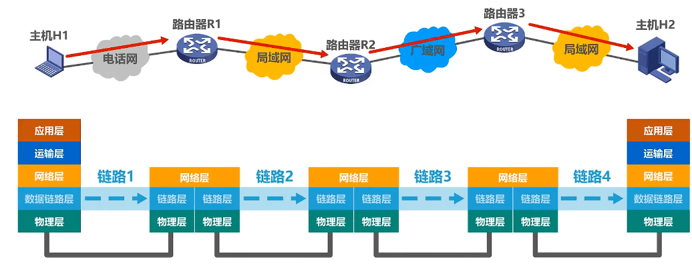

## 2.基本概念
**链路（Link）**：就是从一个节点到相邻节点的一段物理线路，中间没有任何其他的交换节点。

**数据链路（Data Link）**：把实现通信协议（控制数据的传输）的硬件和软件加到链路上，就构成了数据链路。

**帧**：在数据链路层上传输的数据包又称为帧，也就是说数据链路层以帧为单位传输和处理数据。、


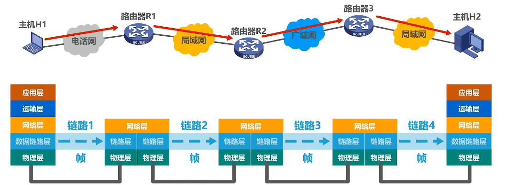

## 3.数据链路层的三个重要问题
**数据链路层的三个重要问题：封装成帧、差错检测、可靠传输。**

### 封装成帧
以以太网MAC帧为例


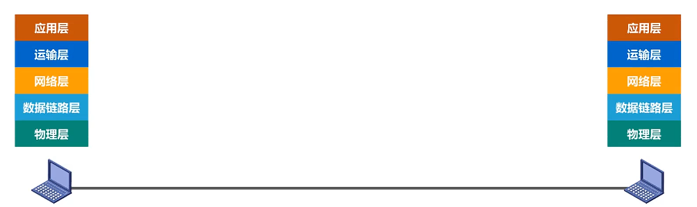

两台主机都会对所发送或接收的数据包进行五个层次的封装和解封

1.发送方将待发送的数据通过应用层**封装成为应用层协议数据单元**，然后交付给运输层。


2.运输层为其**添加运输层协议首部**，使之成为运输层协议数据单元，然后交付给网络层。


3.网络层为其**添加网络层协议首部**，使之成为网络层协议数据单元，然后交付给数据链路层。


4.数据链路层给网络层协议数据单元**添加一个数据链路层协议首部**，简称为帧头，还要给其**添加一个帧尾**。我们将数据链路层给网络层交付的协议数据单元**添加帧头和帧尾的操作称为封装成帧**。


添加帧头和帧尾的目的都是为了在链路上以帧为单元来传送数据，也就是为了实现数据链路层本身的功能。


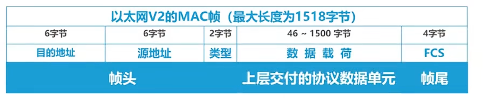

| 字段名称 | 长度 | 核心含义与作用（精炼版） |
| :--- | :---: | :--- |
| **目的 MAC 地址** | 6 字节 | **收件人**。接收方网卡的物理地址。若全为 `1`（即 `FF:FF:FF:FF:FF:FF`），则表示**广播帧**，局域网内所有网卡都会接收。 |
| **源 MAC 地址** | 6 字节 | **寄件人**。发送方网卡的物理地址。 |
| **类型 (Type)** | 2 字节 | **指路牌**。标识上层协议（如 `0x0800` 代表 IPv4），指导接收方将数据向哪个协议交付。 |
| **数据 (Data)** | 46 ~ 1500   字节 | **货物**。上层交下来的载荷（如 IP 数据报）。   ⚠️ **注意**：如果上层数据小于 46 字节，必须**强行填充（Padding）** 垃圾数据到 46 字节，以保证整个 MAC 帧满足 **64 字节**的最小帧长要求（用于 CSMA/CD 冲突检测）。 |
| **FCS** | 4 字节 | **验钞机**。帧检验序列（Frame Check Sequence），通常是 CRC 循环冗余校验码。接收方用它检测帧在传输中是否出错，**出错则直接默默丢弃**。 |


_(注：在物理层发送时，帧的前面还会加上 8 字节的__**前导码**__和*帧开始定界符_，用于唤醒接收方和时钟同步，但这 8 字节通常不计入 MAC 帧的有效长度中。)

**“类型”字段**

+ **长度**：2 字节（16 bit）。
+ **核心作用**：当接收方网卡收到 MAC 帧并剥去首部和尾部后，它需要知道剩下的数据该交给操作系统的**哪个上层协议**去处理。类型字段就是用来标识上层协议的。

**常见的“类型”值（十六进制）：**

| 类型字段的值 | 代表的上层协议 | 含义说明 |
| :--- | :--- | :--- |
| `**0x0800**` | **IPv4** | 载荷是 IPv4 数据报（互联网中最最常见）。 |
| `**0x0806**` | **ARP** | 载荷是 ARP 请求或应答报文（用于查询 MAC 地址）。 |
| `**0x86DD**` | **IPv6** | 载荷是 IPv6 数据报。 |
| `**0x8100**` | **802.1Q (VLAN)** | 这是一个带有虚拟局域网（VLAN）标签的帧。 |


### 差错检测
发送方将封装好的针通过物理层发送到传输媒体帧，在传输过程中遭遇干扰后可能会出现误码，也就是比特0可能变成了比特1


接收方主机可以通过检错码来发现帧在传输过程中的出现了误码。发送方在发送帧之前，基于待发送的数据和检错算法计算出检错码，并将其封装在帧尾。例如以太网版本2的MAC帧的帧尾就是4字节的帧检验序列FCS字段，要写入该字段的内容，也就是所说的检错码。


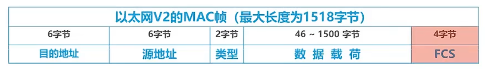

接收方主机收到帧后，通过检错码和检错算法就可以判断出帧在传输过程中是否出现了误码。


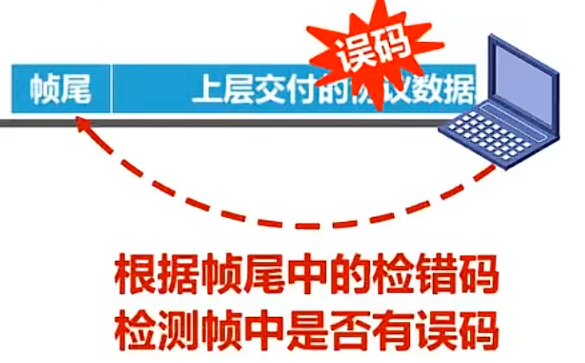

### 可靠传输
接收方主机收到有误码的帧后，是不会接受该帧的将其丢弃。如果数据链路层向其上层提供的是不可靠服务，那么丢弃就丢弃了，不会再有更多措施。如果数据链路层向其上层提供的是可靠服务，那么就还需要其他措施来确保接收方主机还可以重新收到被丢弃的这个真的正确副本。

尽管误码是不能完全避免的，但若能实现发送方发送什么，接收方最终都能收到什么，就称为可靠传输。

---

封装成帧、差错检测、可靠传输是数据链路层中最基本、最重要的问题。需要说明的是，我们在介绍这三个问题的时候，使用的是点对点信道的数据链路层来举例的。

## 4.使用广播信道的数据链路层
对于使用广播信道的数据链路层，除了包含封装成帧、差错检测、可靠传输，还有一些其他需要解决的问题。

### 编址问题

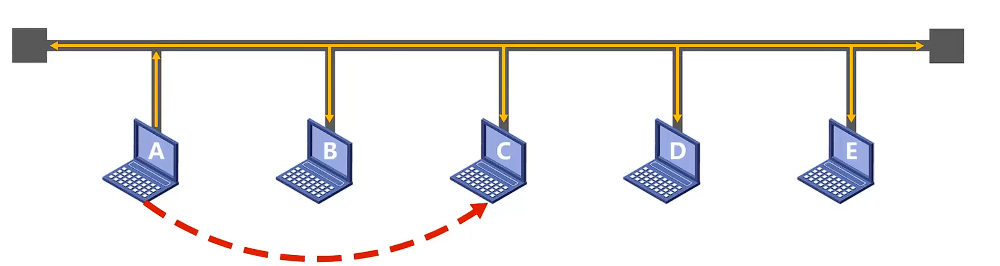

如图所示，主机A B C D E通过一根总线进行互联，主机A要给主机C发送帧，代表帧的信号会通过总线传输到总线上的其他各主机。那么主机B D E如何知道所收到的真不是发送给他们的，而主机C又如何知道所收到的帧恰恰是发送给自己的呢？

通过地址或者说编址的问题，也就是将帧的目的地址添加在帧中一起传输。例如这是以太网版本2的MAC帧格式，其首部中的三个字段中有两个字段和地址相关，一个是目的地址字段，另一个是原地址字段。


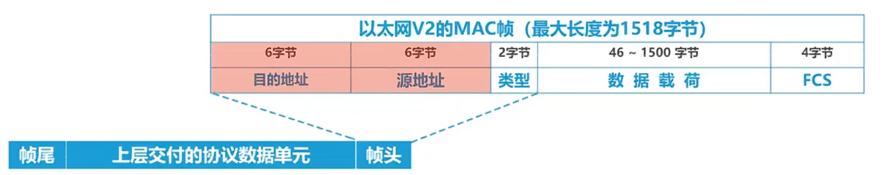

### 碰撞检测
当总线上多台主机同时使用总线来传输真实传输信号就会产生碰撞，这是采用广播信道的共享式局域网不可避免的。以太网采用的协调方法是使用一种特殊的协议CSMA/CD，也就是载波监听多点接入/碰撞检测。


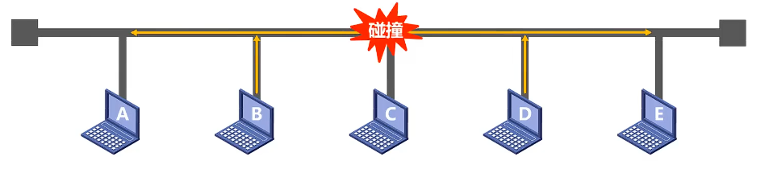

## 5.交换式局域网
随着技术的发展，交换技术的成熟和成本的降低，具有更高性能的使用点对点链路和链路层交换机的交换式局域网，在有线领域已完全取代了共享式局域网。


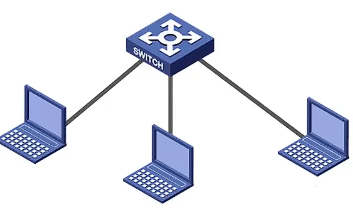

## 6.无线局域网

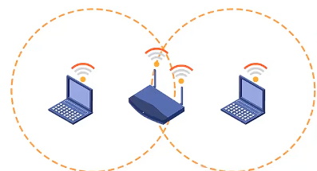

由于无线信道的广播天性，无线局域网仍然使用的是共享信道技术。例如802.11局域网采用的媒体接入控制协议是CSMA/CA，也就是在载波监听多点接入/碰撞避免。 

## 7.数据链路层的协议
| 数据单元（帧） | 协议常用简称 | 协议标准全称 (中英文) | 制定机构 | 核心特征与帧结构特点 |
| :--- | :--- | :--- | :--- | :--- |
| **PPP 帧** | PPP | **Point-to-Point Protocol**   (**点对点协议**) | IETF   (RFC 1661) | **无 MAC 地址**。有明确的帧定界符（`0x7E`），需要字符/零比特填充来实现透明传输。 |
| **以太网 MAC 帧** | 以太网   (Ethernet) | **IEEE 802.3 Standard for Ethernet**   (**IEEE 802.3 以太网标准 / 带有 CSMA/CD 的局域网标准**) | IEEE   (802.3委员会) | **有 2 个 MAC 地址**（源和目的）。有最小帧长限制（64字节），无结束标志，靠物理层信号或长度字段定界。_(注：实际中最常用的是 DIX Ethernet V2 帧格式)_ |
| **Wi-Fi MAC 帧** | Wi-Fi | **IEEE 802.11 Wireless LAN MAC and PHY Specifications**   (**IEEE 802.11 无线局域网 MAC 和物理层规范**) | IEEE   (802.11委员会) | **最多有 4 个 MAC 地址**（用于无线基站到有线网络的桥接转发）。包含复杂的帧控制字段（如重试位、电源管理），有链路层 ACK 机制。 |


## 8.数据链路层中比较重要的问题
1. 数据链路层在网络体系结构中的地位
2. 使用点对点信道的数据链路层

三个重要问题：封装成帧，差错检测，可靠传输

3. 使用广播信道的数据链路层

共享 共享式以太网的媒体接入控制协议CSMA/DA

802.11局域网的媒体接入控制协议CSMA/CA

4. 数据链路层的互连设备

网桥和交换机的工作原理

集线器 (物理层互连设备）与交换机的区别

---

# 二、封装成帧
## 1.**封装成帧**
**封装成帧**：指数据链路层给上层（网络层）交付下来的协议数据单元添加帧头和帧尾，使之成为帧。

+ 在帧头和帧尾中包含有重要的控制信息。


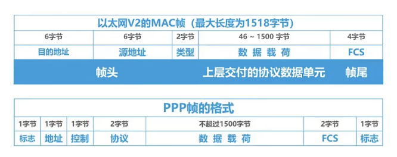


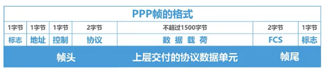

+ 帧头和帧尾的作用之一就是**帧定界**（用于使接收方的数据链路层从物理层交付的比特流中提取出一个个的帧）

需要说明的是，并**不是每一种数据链路层协议的帧都包含有帧定界标志**（以太网MAC帧没有帧定界，PPP帧有）。例如，以太网V2的MAC帧在帧头和帧尾中并没有包含帧定界标志。接收方从物理层交付的比特流中提取出一个个的以太网帧依靠前导码，以太网的数据链路层封装好MAC帧后将其交付给物理层。**物理层会在MAC帧前面添加8字节的前导码**，然后再将比特流转换成电信号发送。前导码中的前7个字节为前同步码，作用是使接收方的时钟同步，之后的1字节为帧开始定界符表明其后面紧跟着的就是MAC帧。


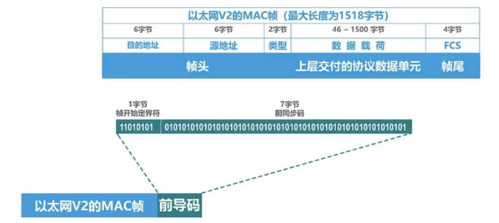

另外，**以太网还规定了帧间间隔时间为96比特的发送时间**，因此MAC帧并不需要帧结束定界符。


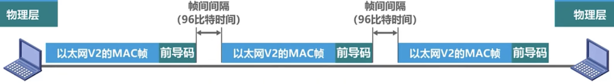

> 以太网 MAC 帧根本没有特定的结束标志位（它靠物理层电信号的消失，或者读取帧头部的“长度字段”来知道帧在哪里结束）。既然没有固定的结束标志，就不存在“数据和结束标志冲突”的问题。此外，以太网物理层使用的“曼彻斯特编码”自带时钟跳变，不会出现长串 0 或 1 导致接收方失步的问题，所以以太网 MAC 层不需要做任何填充。
>

## 2.透明传输
**透明传输：数据链路层对上层交付的传输数据并没有任何限制**，就好像数据链路层不存在一样。

**为什么需要透明传输？**

数据链路层在组帧（PPP帧）时，会用**特殊的标志或字符**来标识帧的开始和结束（类似起始密码子和终止密码子）。


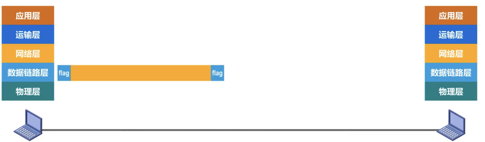

如果**数据部分恰好出现了这个标志**，接收方（接收方的数据链路层）就会误以为帧提前结束，导致传输错误。这就是“不透明”的问题。


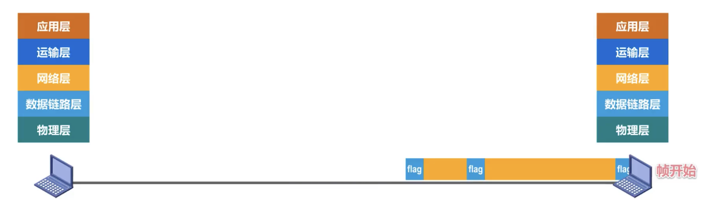


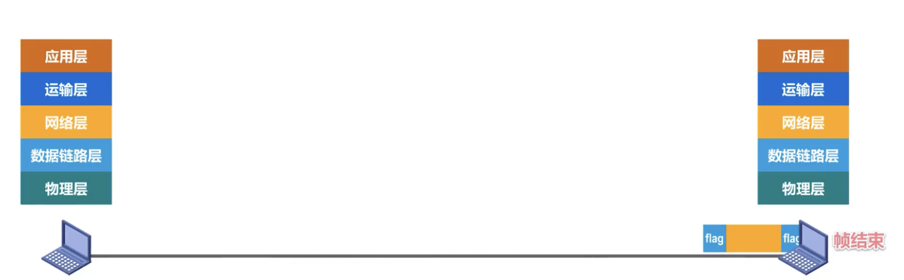

**如何实现透明传输？**

**1. 字节填充（字符填充）**

用于**面向字符**的协议。

+ **做法**：在数据中出现的特殊控制字符（比如帧定界符 `SOH`、`EOT`、转义字符 `ESC`）前，**插入一个转义字符** `ESC`。


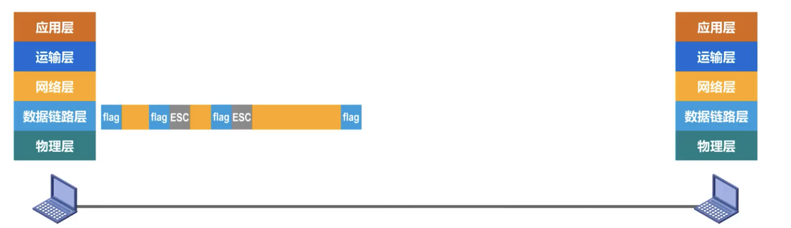

- 注：转义字符是一种特殊的控制字符，其长度为一个字节，十进制值为**27**，十六进制值为 **0x1B**。

+ 接收方收到后，会去掉这个插入的 `ESC`，并把跟在后面的字符作为普通数据，不解释为控制命令。
+ **举例**：如果数据中有一个 `ESC`，就把它变成 `ESC ESC`；如果数据中有帧开始/结束符 `FLAG`，就变成 `ESC FLAG`。这样接收方就能正确还原。


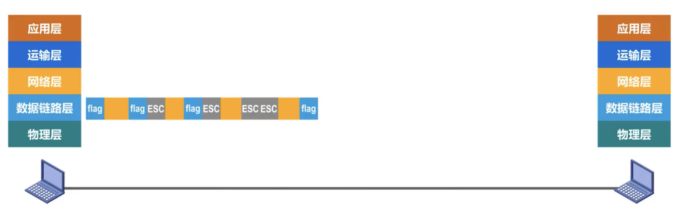

**2. 比特填充（零比特填充）**

用于**面向比特**的协议。


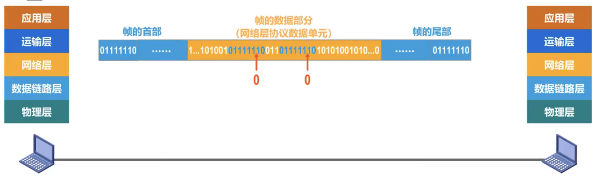

+ **做法**：发送方扫描数据部分，只要发现**5 个连续的** `1`，就在其后面强制插入一个 `0`。这样数据中永远不会出现 6 个或更多连续的 `1`，也就**不会与标志** `01111110` **（6个1）混淆**。
+ 接收方执行相反操作：看到 `111110` 时，就删掉紧随的 `0`，恢复原始数据。
+ **效果**：数据中的比特组合完全不受限制，可以包含任意比特序列。

### 例题
**【2013年 题37】** HDLC协议对 `0111110001111110` 组帧后对应的比特串为  **A**

A. `011111000011111010`  
B. `01111100011111010111110`  
C. `01111100011111010`  
D. `01111100011111001111101`  

**【解析】**  
	高级数据链路控制协议 HDLC 采用帧头和帧尾中的标志字段作为帧定界符，其值为 `01111110`。HDLC 为了实现“透明传输”，采用“零比特填充法”：每遇到连续的 5 个 `1`，就在其后插入一个比特 `0`。  

对原始比特串 `0111110001111110` 逐位扫描：  

+ `011111` → 出现 5 个连续 `1`（第 2~6 位），在第 5 个 `1` 后插入 `0`，得到 `0111110`，此时比特串变为`01111100001111110`
+ `011111` → 出现 5 个连续 `1`（第 11~15 位），在第 5 个 `1` 后插入 `0`，得到 `0111110`，此时比特串变为`011111000011111010`

## 3.提高帧的传输效率
+ 为了提高帧的传输效率，应当使**帧的数据部分的长度尽可能大一些**。
    - 因为仅从数据链路层来看，帧的数据部分才是真正要传输的数据，帧头和帧尾是为了实现数据链路层功能而额外添加的。
+ 考虑到差错控制等多种因素，每一种数据链路层协议都规定了帧的数据部分的长度上限，称为**最大传送单元MTU**（**M**aximum **T**ransfer **U**nit）。

---

# 三、差错检测
## 1.差错检测
**比特差错**:实际的通信链路都不是理想的，比特在传输过程中可能会产生差错：1可能变成0，而0也可能变成1，这称为**比特差错**。

原因：比特流在传输过程中由于受到各种干扰，就可能会出现比特差错，或称为误码。

**误码率**：在一段时间内，传输错误的比特占所传输比特总数的比率称为**误码率BER**（**B**it **E**rror **R**ate）。

**Q：接收方的数据链路层又是通过怎样的方法才能知道呢？**

使用**差错检测码**来检测数据在传输过程中是否产生了比特差错，是数据链路层所要解决的重要问题之一。

1.**以太网版V2的MAC帧**格式，其**帧尾**中包含了一个长度为四字节的帧检验序列FCS字段，其作用就是让接收方的数据链路层检查帧在传输过程中是否产生了误码。


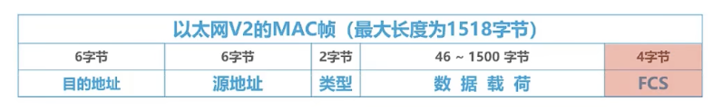

2.**点对点协议PPP的帧**格式，其**帧尾**中也包含了一个长度为2字节的帧检验序列FCS字段。其作用也是让接收方的数据链路层检查正在传输过程中是否产生了误码率。


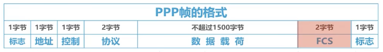

## 2.奇偶校验
在待发送的数据后面**添加1位奇偶校验位**（1或0），使整个数据（包括所添加的校验位在内）中的 **"1"的个数**为奇数（奇校验）或为偶数（偶校验）。

+ **偶校验**：让“1”的总个数是偶数。如果数据中“1”的个数已是偶数，校验位补0；否则补1。
+ **奇校验**：让“1”的总个数是奇数。如果数据中“1”的个数已是奇数，校验位补0；否则补1。

**具体例子**

假设我们要发送一个 **7 位的 ASCII 字符** `‘S’` ，它的二进制是 `1010011`（7位里有4个“1”，偶数）。数据链路层在组帧时，如果决定对这个字符的数据部分使用偶校验，会这样处理：

**1. 发送方加校验位**

+ 当前数据位有 4 个“1”，已经是偶数。
+ 为了保持偶数，**校验位填** `0`。
+ 实际传输的 8 位数据变成：`1010011 0` （最后一位是校验位）。

**2. 传输中出错**  
假设在链路上受到干扰，其中一位翻转了，比如变成了 `1010010 0` （第三位从1变0，现在“1”的个数变成3个，奇数）。

**3. 接收方检查**  
接收方把收到的 8 位当成一个整体，统计“1”的个数，得到 3，是奇数。而它知道约定是偶校验，于是立刻判断：**这一组数据在传输中出错了**。

**奇偶校验局限性**

如果有**奇数个位发生误码**，则奇偶性会发生变化（也就是奇变偶或者是偶变奇），这样就**可以检查出误码**。

如果有**偶数个位发生误码**，则奇偶性不会发生变化（每个误码对奇偶性的影响相互抵消了），这样就**无法检查出误码（漏检）**。

---

由于奇偶校验的漏检率比较高，因此计算机网络的数据链路层一般不会采用这种检测方法。

## 3.循环冗余校验CRC
循环冗余校验CRC（**C**yclic **R**edundancy **C**heck），是一种具有很强检测能力的检测方法，漏检率极低。

### 步骤
**（1）把数据表示为多项式**

一个二进制串 `101001` 可以看作多项式 $1⋅x^5+0⋅x^4+1⋅x^3+0⋅x^2+0⋅x^1+1⋅x^0$比特位对应系数，运算在模2规则下（加法不进位，减法不退位，等价于异或）。

**（2）收发双方约定一个生成多项式**$G(x)$

算法要求CRC多项式必须包含最低次项。这是一个固定的除数，如 `1101` 对应 $x^3+x^2+1⋅x^0$。生成多项式的最高次幂$r$决定了余数的长度（也就是冗余码的位数）。

**（3）发送方的操作：计算冗余码并附加**

发送方基于待发送的数据和生成多项式计算出差错检测码（**冗余码**），并将其添加到待传输数据的后面一起传输。

+ 设数据有$k$位，生成多项式$G(x)$的最高次幂为$r$。
+ 在数据后面**添上**$r$**个零**，得到$k+r$__位串，把它当成被除数。
+ 用模2除法，除以生成多项式对应的二进制串，得到$r$位的**余数**。
+ 这个余数就是帧检验序列 FCS，把它替换掉刚才添加的$r$个零，附加在原始数据后面，构成最终的发送帧。


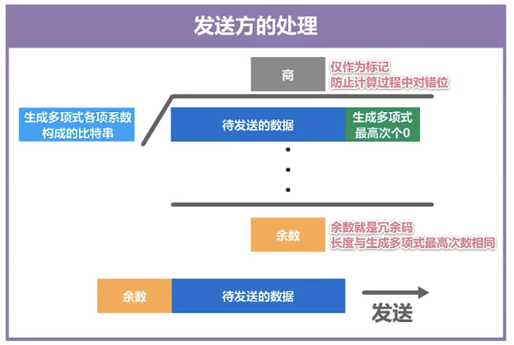

注：余数就是所计算出的冗余码，将其添加到待发送数据的后面一起发送。冗余码的长度与生成多项式最高次数相同，而商仅作为标记，防止计算过程中对错位。

**（4）接收方操作：检验**

接收方通过生成多项式来计算收到的数据是否产生了误码。

+ 把收到的整个帧（数据 + FCS）作为被除数，用同一个生成多项式做模2除法。
+ 如果余数为 **0**，则判定传输**无错**，接受数据；如果余数**不为 0**，则判定传输**出错**，丢弃该帧。


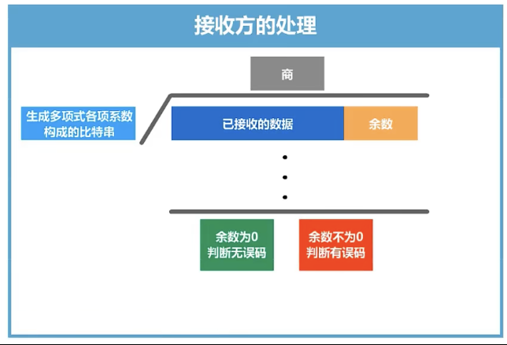

### 常用的生成多项式标准
数据链路层协议中使用的生成多项式是经过精心设计和国际标准化的，保证极强的检错能力：

+ **CRC-16**：$x^{16}+x^{15}+x^2+1$（如 HDLC、PPP 中常用）
+ **CRC-CCITT**：$x^{16}+x^{12}+x^5+1$__
+ **CRC-32**：$x^{32}+x^{26}+x^{23}+x^{22}+x^{16}+x^{12}+x^{11}+x^{10}+x^8+x^7+x^5+x^4+x^2+x+1$（**以太网**使用的标准，放在帧尾的 FCS 字段中）

### 练习
【循环冗余校验CRC举例】待发送的信息为 `101001`，生成多项式为 $G(x)=x^3+x^2+1$。请计算校验码（余数）。

**步骤1：构造被除数**  
	生成多项式的最高次数为$3$，因此在待发送信息后面添加$3$个$0$，得到被除数：

`101001000`

**步骤2：构造除数**  
	生成多项式$G(x)=x^3+x^2+1$的系数（从高次到低次）为：$x^3$系数$1$，$x^2$系数$1$，$x^1$系数$0$，$x^0$系数 1，即比特串：

`1101`

**步骤3：做模2除法（异或运算）**


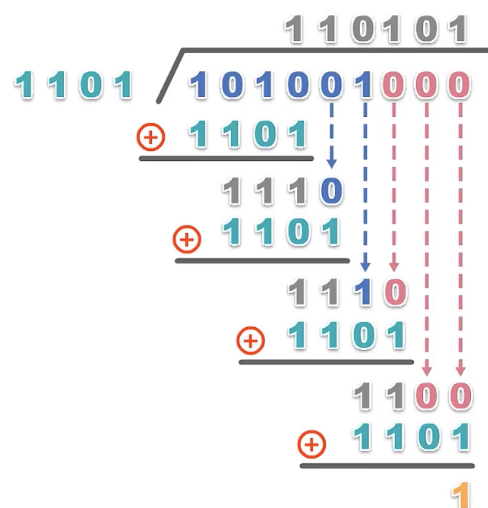

**步骤4：检查余数**

检查余数。余数的位数应与生成多项式最高次数相同，如果位数不够，则在余数前补零来凑足位数。

因此得到余数`001`

将余数添加到待发送信息的后面得到`101001001`。

---

【循环冗余校验CRC举例】接收到的信息为101101001，生成多项式为$G(x)=x^3+x^2+1$，判断传输是否误码？

**步骤1：构造被除数**  
接收到的信息就是被除数：`101101001`

**步骤2：构造除数**  
生成多项式各项系数构成的比特串：  
$G(x)=x^3+x^2+1$→ 系数（高次到低次）：1, 1, 0, 1→除数 `1101`

**步骤3：做“除法”**（模2除法，异或运算）


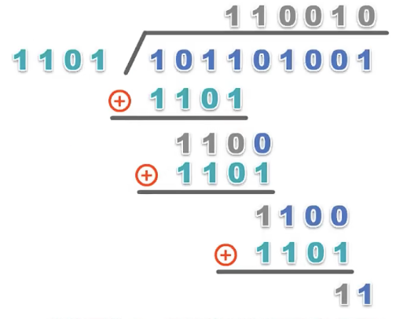

**步骤4：检查余数**  
余数为0 → 可认为传输过程无误码；  
余数不为0 → 可认为传输过程产生误码。

因此本题答案：传输产生误码

### 注意
+ **检错码**只能检测出帧在传输过程中出现了差错，但并不能定位错误，因此**无法纠正错误**。
+ 要想纠正传输中的差错，可以使用冗余信息更多的**纠错码**进行**前向纠错**。但纠错码的开销比较大，在**计算机网络中较少使用**
+ 循环冗余校验**CRC**有很好的检测能力（**漏检率非常低**）。虽然计算比较复杂，但非常**易于用硬件来实现**，因此被**广泛应用于数据链路层**。
+ 在计算机网络中通常采用**检错重传方式来纠正传输中的差错**，**或者仅仅是丢弃检测到差错的帧**。这取决于数据链路层向其上层提供的是可靠传输服务还是不可靠传输服务。

---

# 四、可靠传输
## 1.基本概念
由上一节可知，使用**差错检测技术**（循环冗余校验CRC），接收方的数据链路层就可以检测出帧在传输过程中是否产生了**误码**（比特错误）。那么接下来该如何处理呢？这取决于数据链路层向其上层提供的服务类型。

+ 提供的是不可靠传输服务：**仅仅丢弃有误码的帧**，其他什么也不做。
+ 提供的是可靠传输服务：想办法实现发**送端发送什么，接收端就收到什么**。

一般情况下，**有线链路**的误码率比较低，为了减少开销，并**不要求数据链路层**向上提供**可靠**传输服务。即使出现了误码，可靠传输的问题由其上层处理。


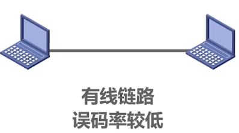

**无线链路**易受到干扰，误码率比较高，因此要求**数据链路层**必须向上层提供**可靠**传输服务。


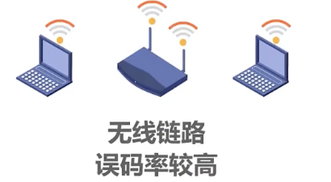

## 2.传输差错
+ **比特差错**只是传输差错中的一种
+ 从整个计算机网络体系结构来看，传输差错还包括**分组丢失**、**分组失序**以及**分组重复**（请注意，此处将真的称呼改为了分组。这意味着传输差错不仅仅局限于数据链路层的比特差错）。
    - 分组丢失：主机H6给主机H2发送的分组到达了路由器R5，由于此时R5的输入队列快满了，R5根据自己的分组丢弃策略将该分组丢弃。
    - 分组失序：主机H6依次给主机H2发送了三个分组，但他们并未按照发送顺序依次到达H2，也就是说最先发送的分组未必最先到达。
    - 分组重复：主机H6给主机H2发送的分组由于某些原因在网络中滞留了，没有及时到达H2这可能造成H6对该分组的超时重发，重发的分组到达H21段时间后，滞留在网络中的那个分组又到达了H2，这就会造成分组重复的传输差错。


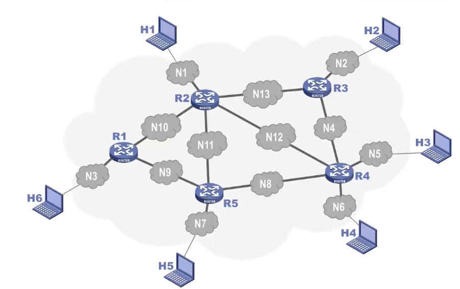

+ 分组丢失、分组失序以及分组重复。这些传输差错一般不会出现在数据链路层，而会出现在其上层。
+ **可靠传输服务并不仅局限于数据链路层**，其他各层均可选择实现可靠传输服务。


+ 可靠传输的实现比较复杂，开销也就比较大，是否使用可靠传输取决于应用需求。

## 3.可靠传输的实现机制
可靠传输的实现机制：停止-等待协议（SW：**S**top and **W**ait）、回退N帧协议（GBN：**G**o-**B**ack-**N**）、选择重传协议（SR：**S**elective **R**equest）。

这三种可靠传输实现机制的基本原理并不仅限于数据链路层，可以应用到计算机网络体系结构的各层协议中。

### （1）停止-等待协议
在数据链路层，为了在不可靠的物理链路上实现可靠传输，常采用**停止-等待**机制，配合**确认（ACK）** 与**否认（NAK）** 分组来控制重传。


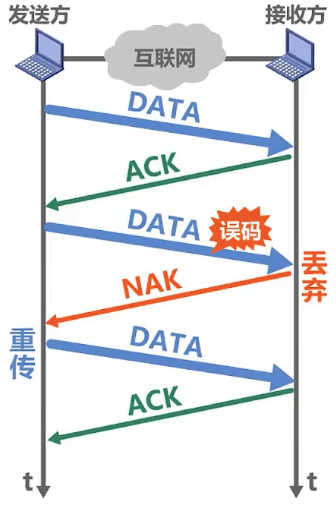

#### 可能会出现的情况
##### a. 无差错情况
+ 发送方发出一个数据分组后，**立即停止**发送下一个分组，进入等待状态。
+ 接收方收到数据分组，进行差错检测（如 CRC 校验）：
    - 若**无误码**，则接受该分组，并回送一个**确认分组 ACK**（Acknowledge character，确认字符，表示数据已正确接收）。
+ 发送方收到 ACK 后，才将该分组从缓存中清除，并**启动下一个分组的发送**。

---

##### b. 出现误码情况
+ 接收方检测到数据分组**存在误码**：
    - 直接**丢弃**该分组，并回送一个**否认分组 NAK**（Negative Acknowledgment，否认字符）。
+ 发送方收到 NAK 后，得知刚才的分组传输出错，**立即重传**该分组，并再次等待确认。

---

##### c. 缓存管理与可靠传输
+ 发送方每发出一个分组，**不能立即删除缓存**，必须保留副本以备重传。
+ 只有收到对应分组的 ACK 后，才可将其从缓存中移除。
+ 通过这种“**发送—停止—等待确认/否认—决定重传或发下一个**”的简单循环，无论传输过程中有无差错，接收方最终都能正确收到数据，从而实现**可靠传输**。

---

##### d. 发送方数据分组丢失 —— 超时重传
实际传输中，数据分组可能在链路上完全丢失。尽管对于点对点的数据链路层信道，帧丢失的概率较低，但在复杂的网络环境（如跨越多个路由器）中却常有发生。一旦分组丢失：

+ 接收方没有任何数据可收，自然**不会发送 ACK 或 NAK**。
+ 发送方若不做额外处理，将**无限期等待**反馈，造成死锁。

为此，发送方每发出一个分组，便启动一个**超时计时器**。若计时器到期（即超过设定的**重传时间**）仍未收到任何反馈，发送方就认为分组已丢失，并**自动重传**该分组，这一过程称为**超时重传**。

**重传时间的设置**：通常选择“略大于”从发送方到接收方的平均往返时间（RTT），以避免过早重传导致不必要的重复，或过晚重传降低效率。

超时重传的典型流程：

+ 发送方超时后重传原分组，接收方正确收到后回送 ACK。
+ 发送方收到 ACK 后，停止计时，清除该分组，接着发送下一个分组。


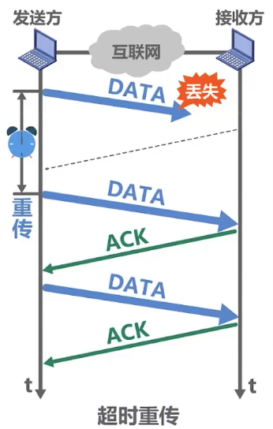

##### e. 确认或否认分组丢失 —— 序号与重复判断
不仅数据分组可能丢失，接收方回送的确认分组（ACK）或否认分组（NAK）同样可能在传输中丢失，这会引发新的问题：

+ 发送方发出一个数据分组，接收方正确接收后回送 ACK，但该 **ACK 在传输中丢失**。
+ 发送方因迟迟收不到反馈而**超时重传**原分组。
+ 接收方会再次收到同一数据分组，此时它必须判断：这究竟是**新分组**还是**重复的旧分组**。

为避免分组重复导致的传输错误，必须给每个数据分组**带上序号**。例如，发送方首次发送的分组序号为 `0`。

> **为何 1 比特序号就足够？**  
停止-等待协议中，发送方每发一个分组就停下来等待，只有确认当前分组已正确交付后，才会发送下一个。因此，只需区分“当前分组”和“上一个分组”即可，用 1 个比特交替编号（`0` → `1` → `0` → `1` …）完全满足需求。
>

接收方依据序号做出判断：

+ 若收到的分组序号**与上次不同**，则是**新分组**：接受并回送 ACK。
+ 若收到的分组序号**与上次相同**，则是**重复分组**：**直接丢弃**，但仍须回送 ACK（否则发送方会继续超时重传）。

**流程示例：**

+ 发送方发 `0` 号分组，接收方正确收到，回送 ACK，但 ACK 丢失。
+ 发送方超时，重传 `0` 号分组。
+ 接收方发现序号仍为 `0`，判定为重复，**丢弃数据但重发 ACK**。
+ 发送方收到 ACK 后，清除 `0` 号分组，发送 `1` 号新分组。
+ 接收方正确收到 `1` 号分组，回送 ACK，传输继续。

通过这种**序号交替 + 重复丢弃 + ACK 重确认**的机制，即使确认分组丢失，也能避免重复递交，从而在不可靠信道上实现真正的可靠传输。


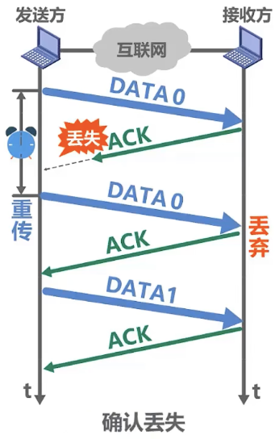

---

##### f. 确认分组迟到与确认分组的序号问题
确认分组（ACK）本身也可能出现“迟到”现象，这进一步引出了**确认分组是否需要编号**的问题。

**场景：确认迟到导致的重复确认误判**

假设发送方发出 `0` 号数据分组，接收方正确收到后回送 `ACK`。但该 `ACK` 因网络延迟而**迟迟未到**（迟到），导致发送方**超时重传** `0` 号数据分组。

在重传过程中，那个**迟到的** `ACK` 终于抵达发送方，发送方误以为重传的 `0` 号分组已确认，于是开始发送 `1` 号新分组。

随后，接收方收到重传的 `0` 号分组：

+ 发现序号是重复的，**丢弃该分组**；
+ 但仍回送一个 `ACK`，以免发送方再次超时重传。

**问题来了：**  
发送方收到这个 `ACK` 时，它并不知道这是针对 `0` 号旧分组的“重复确认”，很可能会**误认为这是对** `1` **号新分组的确认**，从而错误地认为 `1` 号分组已成功交付。

**解决方案：给确认分组编号**

为避免这种误判，可以让确认分组也**携带序号**，指明它确认的是哪一个数据分组。

+ 接收方收到 `0` 号数据分组，回送 `ACK 0`。
+ 发送方收到 `ACK 0`，知道这是对 `0` 号分组的确认。
+ 当那个重复的 `ACK 0` 再次到达时，发送方通过序号立刻识别出它是**重复确认**，**直接忽略**，不会误认为是对 `1` 号分组的确认。
+ 接收方正确收到 `1` 号数据分组后，回送 `ACK 1`，发送方收到后才确认 `1` 号分组交付成功。

至此，通过给确认分组编号，彻底解决了确认迟到带来的重复确认误判问题。

**特别说明：数据链路层的简化**

需要指出的是，对于**数据链路层的点对点信道**（如直接相连的两台设备），往返时间比较固定，几乎**不会出现确认迟到**的情况。因此，如果**只在数据链路层实现停止-等待协议**，通常**可以不对确认分组进行编号**，以简化实现。

但在往返时间波动较大的网络环境（如跨越多个路由器的广域网）中，确认分组编号就显得非常必要。


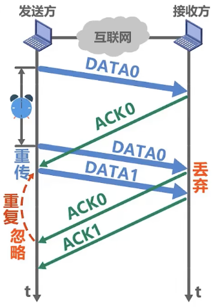

#### 小结
（1）误码时的两种处理策略

接收端检测到数据分组有误码时，可选择两种方式：

+ **默认方式**：直接丢弃，等待发送方**超时重传**。
+ **优化方式**：对于误码率较高的点对点链路，可回送**否认分组 NAK**，使发送方**尽早重传**，减少等待时延。

---

（2）数据分组的序号

为让接收方判断分组是否重复，需给每个数据分组**编号**。  
停止-等待协议一次只发一个分组，只需区分前后两个分组，因此**1 个比特**（序号 `0` 和 `1`）即可满足需求。

---

（3）确认分组的序号（数据链路层可省略）

为让发送方判断收到的 ACK 是否重复，确认分组同样需要**编号**，所用比特数与数据分组相同。

> **但在数据链路层**：点对点信道的往返时间固定，几乎不会出现确认迟到的情况，因此**可以不给确认分组编号**，以简化实现。  
在往返时间波动较大的上层网络环境（如运输层）中，确认分组编号则非常必要。
>

---

（4）超时重传时间的设置

超时计时器的重传时间需仔细选择：

+ 一般设为**略大于**从发送方到接收方的**平均往返时间**。
+ 在**数据链路层**：点对点往返时间确定，重传时间容易设定。
+ 在**运输层**：端到端往返时间非常不确定，设置合适的重传时间有时很困难。（这一问题将在 TCP 协议中详细讨论。）

#### 停止等待协议的信道利用率
**工作过程的时间分析**

停止-等待协议的工作周期可用下图的时间轴来描述（假设收发双方为直通信道）：

1. 发送方发送一个数据分组，耗费 **发送时延 TD**。
2. 分组经信道传播到达接收方，加上接收方处理并回送确认分组，两者共同构成**往返时间 RTT**。
3. 接收方发送确认分组，耗费 **发送时延 TA**。

> **简化假设**：图中忽略了接收方对数据分组的处理时延，以及发送方收到确认分组后的处理时延。
>

从发送方发出一个数据分组开始，到它可以发送下一个数据分组为止，所经历的总时间为：**TD + RTT + TA**。

---

**信道利用率的计算**

在这个周期内，只有 **TD** 这段时间真正用于传输有效数据（数据分组本身）。因此，**信道利用率 U** 定义为：

$$
U = \frac{T_D}{T_D + RTT + T_A}
$$

实际中，**TA 通常远小于 TD**，可以忽略不计，上式简化为：

$$
U \approx \frac{T_D}{T_D + RTT}
$$

---

**结论：RTT 远大于 TD 时利用率极低**

当 **RTT 远大于 TD** 时（例如长距离、高传播延迟的链路），分母显著增大，信道利用率会**非常低**。

+ 这意味着绝大部分时间信道处于空闲等待状态，有效数据传输占比极小。
+ 这是停止-等待协议的根本性能缺陷，也是后续引入**流水线协议**（如连续 ARQ、选择重传）的直接原因。


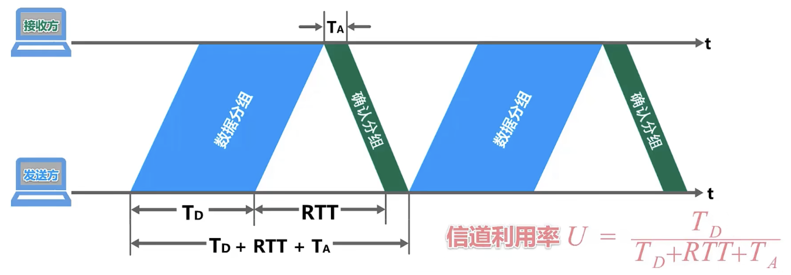

---

**利用率计算举例**

假设信道长度为 2000 km，数据分组长度为 1500 字节，信号传播速度按 200,000 km/s 计，则：

**（1）发送速率为 10 Mbps 时**

+ 数据帧发送时延$T_D = \frac{1500 \times 8 \text{ bit}}{10 \times 10^6 \text{ bps}} = 1.2 \text{ ms}$
+ 往返时间$RTT = 2 \times \frac{2000 \text{ km}}{200,000 \text{ km/s}} = 20 \text{ ms}$
+ 忽略确认帧发送时延$T_A$，信道利用率：  
$$
U = \frac{T_D}{T_D + RTT} = \frac{1.2}{1.2 + 20} \approx 5.66%
$$

**（2）发送速率提升至 100 Mbps 时**

+ $T_D = \frac{1500 \times 8}{100 \times 10^6} = 0.12 \text{ ms}$
+ $RTT$仍为 20 ms
+ 信道利用率：  
$$
U = \frac{0.12}{0.12 + 20} \approx 0.6%
$$

**结论**：当往返时延$RTT$远大于发送时延$T_D$时（如卫星链路、高速率长距离链路），停止-等待协议的信道利用率极低。若再出现重传，有效数据传输的利用率还会进一步降低。

---

**改进协议**

为克服停止-等待协议信道利用率低的缺陷，产生了两种改进协议：

+ **后退 N 帧协议（GBN，Go-Back-N）**
+ **选择重传协议（SR，Selective Repeat）**

它们通过**流水线方式**连续发送多个分组，不再发一个停一个，从而大幅提升信道利用率。

---

#### 例题解析（2018 年考研真题 36 题）
**题目**：主机甲与主机乙之间使用停止-等待协议进行数据链路层通信，数据传输速率为 3 kbps，单向传播时延为 200 ms，确认帧的发送和处理时延均可忽略。若要求信道利用率达到 40%，则数据帧的长度应为	**D**

A. 240比特		B.400比特		C.480比特		D.800比特

**解析**：


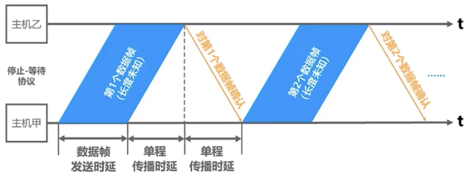

+ 停止-等待协议的信道利用率公式：  
$$
U = \frac{T_D}{T_D + 2\tau}
$$
其中$T_D$为数据帧发送时延，$\tau$为单向传播时延，$2\tau$即往返时延 $RTT$。

其中：

+ $U$为信道利用率，题目要求$U = 0.4$；
+ $T_D$为数据帧的发送时延，设数据帧长度为$L$比特，数据传输速率$R = 3 \text{ kbps} = 3000 \text{ bps}$，则$T_D = L / R = L / 3000$秒；
+ $RTT$为往返时延，单向传播时延$\tau = 200 \text{ ms} = 0.2 \text{ s}$，则$RTT = 2\tau = 0.4 \text{ s}$。

代入公式：

$$
0.4 = \frac{L/3000}{L/3000 + 0.4}
$$

因此，数据帧的长度应为 **800 比特**。

**答案**：D 选项（800 比特）。

---

#### 补充
+ 停止-等待协议通过 **确认与重传** 机制，实现了不可靠链路上的可靠传输。
+ 该类协议又常被称为 **自动请求重传协议（ARQ，Automatic Repeat reQuest）**，意为重传请求由接收方自动触发（通过 ACK/NAK 或超时机制），无需显式要求发送方重传出错分组。
+ 其最大缺点是 **信道利用率低**，尤其在高速、长距离链路上表现明显，这直接推动了后续 GBN 与 SR 协议的诞生。

### （2）回退N帧协议
#### 引言
**停止-等待协议**要求发送方每发送一个数据分组后，必须收到接收方的确认分组才能发送下一个。

<!-- 这是一张图片，ocr 内容为：接收方 确认分组 确认分组 互联网 数据分组 数据分组 发送方 -->
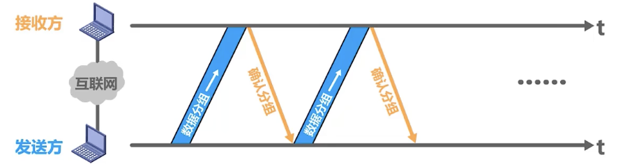

当往返时间（RTT）较大（如卫星链路）时，信道利用率很低；若出现超时重传，利用率会进一步下降。

<!-- 这是一张图片，ocr 内容为：接收方 互联网 数据分组 数据分组 数据分组 数据分组 数据分 发送方 -->
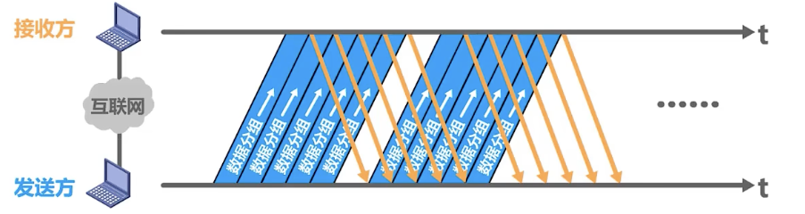

为提高传输效率，可采用**流水线传输**：发送方在未收到确认的情况下，可连续发送多个数据分组。**回退N帧协议GBN**（**G**o-**B**ack-**N**）正是基于流水线传输，并通过**发送窗口**限制连续发送的分组数量。

#### 基本原理
假设用 **3 个比特** 为分组编号，序号范围是 **0～7**（模8循环）。  

<!-- 这是一张图片，ocr 内容为：接收方 发送方 互联网 7 2 7 0 5 9 1 9 5 4 4 2 -->


+ **发送窗口**：序号落在窗口内的分组可被连续发送，无需等待确认。  
    - 发送窗口的尺寸记为 $W_T$。  
    - 取值范围：**1 <** $W_T$ **≤ 2ⁿ − 1**（n 为序号比特数）。  
        * 若 $W_T$ = 1，则退化为停止等待协议。  
        * 若 $W_T$ > 2ⁿ − 1，会造成接收方无法分辨新旧分组，出现重复接收错误（后文举例说明）。
    - 对于本例：$W_T$取值范围是1 < $W_T$ ≤ 2<sup>3</sup>− 1（3是构成分组序号的比特数量），本例取$W_T$ = 5 ，序号 0～4 可连续发送。

<!-- 这是一张图片，ocr 内容为：发送窗口 WT5 12 7 3 5 0 4 2 9 0 1 允许发送5个 不允许发送这些 数据分组 数据分组 -->
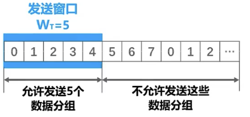

+ **接收窗口**：  
    - 尺寸记为$W_R$，在回退N帧协议中$W_R$**固定为 1**（与停止等待相同）。  
    - 接收方仅接受**当前期望序号**且无差错的数据分组，窗口按序向前滑动。

<!-- 这是一张图片，ocr 内容为：接收窗口 WR1 2 1 0 7 1 2 4 3 6 5 0 不允许接收这些数据分组 准备接收 0号数据分组 -->
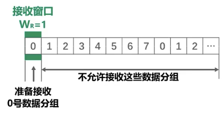

#### 无差错情况下的工作过程
1. 发送方将发送窗口内（0～4号）的分组依次连续发出。  

<!-- 这是一张图片，ocr 内容为：发送方 接收方 互联网 接收窗口 发送窗口 WT5 WR1 7 5 1 0 6 4 70 2 1 6 1 2 5 3 2 0 -->
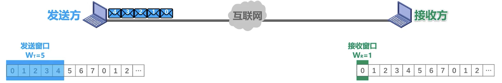

2. 分组无差错、不乱序，正确到达接收方。  

<!-- 这是一张图片，ocr 内容为：发送方 接收方 互联网 发送窗口 接收窗口 WT5 WR1 7 7 9 2 6 3 5 4 1 0 5 1 2 0 2 1 4 ".. -->
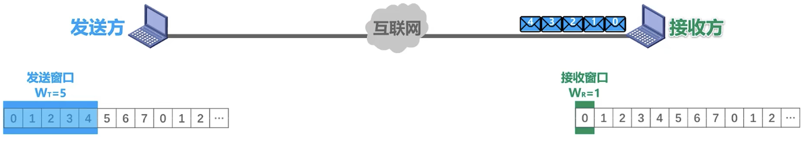

3. 接收方每收到一个分组，接收窗口向前滑动一位，并发送对应的确认分组。

<!-- 这是一张图片，ocr 内容为：接收方 发送方 互联网 ACK ACK ACK 接收窗口 发送窗口 WT5 WR1 7 9 5 2 7 0 9 0 5 1 -->
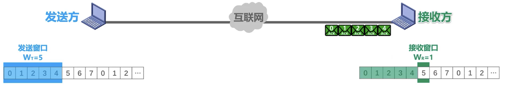

4. 发送方收到确认后，发送窗口向前滑动，已确认的分组可从缓存中删除，新序号落入窗口，可继续发送。  

<!-- 这是一张图片，ocr 内容为：发送方 接收方 互联网 发送窗口 接收窗口 WT5 WR1 7 2 7 1 5 1 0 9 5 0 2 9 3 4 2 4 " 3 -->
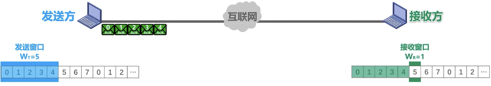

<!-- 这是一张图片，ocr 内容为：发送方 接收方 互联网 接收窗口 发送窗口 WT5 WR1 7 0 2 1 6 5 -->
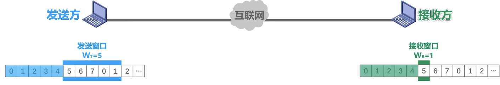

<!-- 这是一张图片，ocr 内容为：发送方 接收方 互联网 发送窗口 接收窗口 WT5 WR1 7 0 1 6 5 2 2 1 3 67 0 4 4 -->
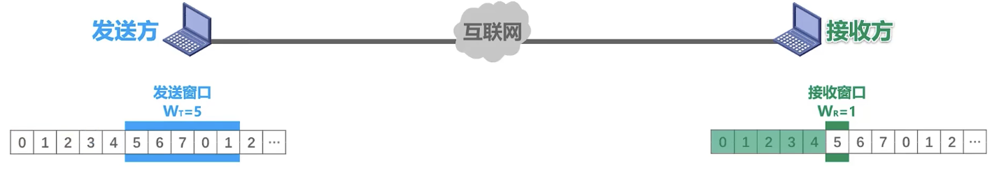

5. 接收方在适当时机将已接收的分组按序交付上层。

<!-- 这是一张图片，ocr 内容为：接收方 发送方 互联网 接收窗口 发送窗口 WR1 WT5 67 7 2 1 6 5 0 2 3 1 4 5 -->
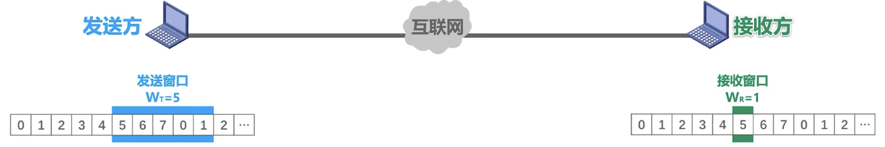

#### 累计确认机制
使用回退N帧协议的接收方可采用**累计确认**：接收方**不一定**要对收到的数据分组**逐个发送确认**，而是可以在收到几个数据分组后（由具体实现决定）,**对按序到达的最后一个数据分组发送确认**。

+ **ACK n** 表示序号为 **n 及之前** 的所有数据分组均已正确接收。

**示例**：

1. 发送方连续发送 0～4 号分组。
2. 接收方在正确接收 0、1 号后发送 ACK1；继续正确接收 2、3、4 号后发送 ACK4。

<!-- 这是一张图片，ocr 内容为：接收方 发送方 互联网 ACK 发送窗口 接收窗口 WR1 WT5 7 7 6 5 0 1 23 5 9 4 2 2 1 0 3 4 -->
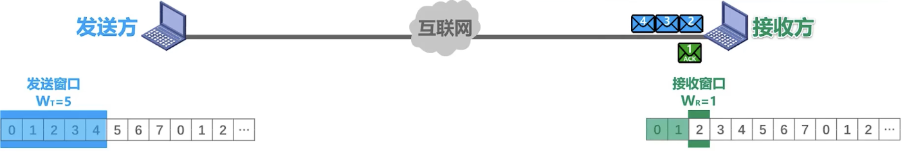

<!-- 这是一张图片，ocr 内容为：发送方 接收方 互联网 ACK 发送窗口 接收窗口 WT5 WR1 7 9 7 2 3 5 5 0 1 O 9 4 -->
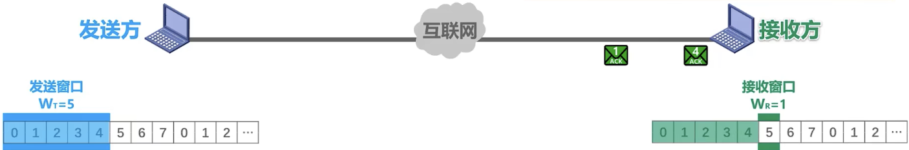

3. 若 ACK1 在传输中丢失，但 ACK4 成功到达，发送方即可得知 4 号及之前全部分组均已成功接收，无需重传。

<!-- 这是一张图片，ocr 内容为：发送方 接收方 互联网 发送窗口 接收窗口 WT5 WR1 7 56 7 2 0 3 2 0 5 1 1 4 4 9 -->


4. 发送方收到 ACK4 后，序号为4及之前的数据分组已被接收方正确接收，于是将发送窗口向前滑动5个位置，已确认的分组可从缓存中删除，新序号落入窗口，可继续发送。  

<!-- 这是一张图片，ocr 内容为：发送方 接收方 互联网 接收窗口 发送窗口 WT5 WR1 7 0 2 1 6 5 -->


<!-- 这是一张图片，ocr 内容为：发送方 接收方 互联网 发送窗口 接收窗口 WT5 WR1 7 0 1 6 5 2 2 1 3 67 0 4 4 -->


5. 接收方在适当时机将已接收的分组按序交付上层。

<!-- 这是一张图片，ocr 内容为：接收方 发送方 互联网 接收窗口 发送窗口 WR1 WT5 67 7 2 1 6 5 0 2 3 1 4 5 -->


**优点**：  

+ 即使某个确认分组丢失，后续确认仍可覆盖，可能避免不必要的重传。  
+ 减少接收方发送确认分组的开销，节约网络资源。

**缺点**：  

+ 不能及时向发送方反馈每一个分组的接收状态。

#### 差错处理与回退重传
1. 发送方将窗口内的分组（如 5、6、7、0、1）依次连续发出。  

<!-- 这是一张图片，ocr 内容为：发送方 接收方 互联网 接收窗口 发送窗口 WT5 WR1 7 2 9 0 5 2 3 4 3 5 6 1 4 -->


2. 若其中某号（如 5 号）分组出现误码，接收方通过检错码发现错误，丢弃该分组。 

<!-- 这是一张图片，ocr 内容为：发送方 接收方 互联网 接收窗口 发送窗口 WT5 WR1 7 2 5 9 7 2 0 1 2 6 3 3 5 4 4 0 2 -->


3. 后续到达的 6、7、0、1 号分组，因序号与接收窗口期望不符，**一律丢弃**。同时，接收方对最后按序正确接收的分组（如 4 号）重复发送确认（如 ACK4）。

<!-- 这是一张图片，ocr 内容为：发送方 接收方 互联网 发送窗口 接收窗口 序号不匹配 WT5 WR1 7 2 2 7 1 2 0 0 5 6 2 6 -->


<!-- 这是一张图片，ocr 内容为：接收方 发送方 互联网 发送窗口 接收窗口 WT5 WR1 1 1 2 2 7 2 0 1 7 5 3 3 0 0 4 6 5 -->


4. 发送方收到重复 ACK 后，判断出现差错。  

<!-- 这是一张图片，ocr 内容为：接收方 发送方 互联网 接收窗口 发送窗口 WR1 WT5 67 0 2 1 1 0 2 2 3 2 -->


- 若累积收到多个重复 ACK，可由具体实现决定是否在超时前**立即重传**。  
- 否则，等待重传计时器超时。

5. 超时后，发送方将**发送窗口内所有已发送但未确认的分组**全部重传。即使某些分组已被正确接收，但因未按序到达窗口而一同被丢弃，仍会被牵连重传。

<!-- 这是一张图片，ocr 内容为：发送方 接收方 互联网 发送窗口 接收窗口 WT5 WR1 7 0 2 7 5 6 6 5 4 4 -->


####  “回退N帧”名称的由来
因接收方只按序接收，一旦某个分组出错，后续所有正确到达的分组都会被丢弃，发送方必须“回退”到出错序号，重新发送该序号及之后的所有分组，故称为Go-Back-N（回退N帧）

#### 信道利用率
当通信线路质量较差、误码率较高时，大量正确分组被连带重传，信道利用率可能并不优于停止等待协议。

#### 协议参数小结
| 项目 | 说明 |
| --- | --- |
| 发送窗口 $W_T$ | 1 < $W_T$ ≤ 2ⁿ − 1（n 为序号比特数） |
| 接收窗口 $W_R$ | 固定为 1 |
| 发送方式 | 窗口内分组可连续发送，无需等待确认 |
| 接收规则 | 仅接收期望序号的无误分组，按序交付上层 |
| 确认方式 | 累计确认（ACK n），或稍带确认 |
| 差错处理 | 丢弃失序分组，重复确认最后按序接收的分组 |
| 重传策略 | 超时后重传窗口内所有已发未确认分组；收到多个重复 ACK 可提前触发重传（取决于实现） |
| 窗口滑动 | 发送方收到确认后才可向前滑动发送窗口；接收方正确接收一个分组，接收窗口即向前滑动一位 |


---

#### 典型例题分析
##### 发送窗口尺寸超限的错误
采用 3 个比特编号，$W_T$的最大允许值为 2³ − 1 = 7。

1. 若故意将$W_T$设为 8，发送方可将 0～7 号全部分组连续发出。

<!-- 这是一张图片，ocr 内容为：接收方 发送方 互联网 接收窗口 发送窗口 WR1 WT8 67 7 5 0 6 0 0 2 1 3 2 2 4 3 4 -->


2. 接收方正确接收后回送 ACK7，但 ACK7 在传输中丢失。

<!-- 这是一张图片，ocr 内容为：接收方 发送方 互联网 ACK 接收窗口 发送窗口 WT8 WR1 2 1 0 0 0 4 2 1 3 5 0 5 1 2 -->


3. 发送方超时重传 0～7 号分组。

<!-- 这是一张图片，ocr 内容为：接收方 发送方 互联网 发送窗口 接收窗口 WT8 WR1 7 2 4 3 0 5 1 0 9 3 2 2 4 5 -->


4. 此时接收方接收窗口期望序号仍为 0，会把这些重传分组当作新分组按序接收，从而导致**分组重复**，接收方无法分辨新旧分组。

<!-- 这是一张图片，ocr 内容为：接收方 发送方 互联网 接收窗口 发送窗口 WT8 WR1 12 1 2 6 -->


**结论**：发送窗口尺寸必须 **不超过 2ⁿ − 1**。

---

##### 考研真题（2009-35）
数据链路层使用后退N帧（GBN）协议，发送方已发送编号0~7的帧。计时器超时时，发送方只收到0、2、3号帧的确认。则发送方需要重发的帧数是	**C**

A. 2				B. 3				C. 4				D. 5

**分析**：  

+ 确认 ACK3 表示 0～3 号帧均已被正确接收（1 号帧的确认虽丢失，但被 ACK3 累计覆盖）。  
+ 因此，发送方应从 **4 号帧** 开始重传。  
+ 需要重传的帧为已发送但未被确认的 4、5、6、7 号帧，**共计 4 个帧**。

<!-- 这是一张图片，ocr 内容为：45678 2 0 0 3 6 8 1 10 15 14 12 13 11 丢失 超时 ACK1 ACK2 ACK3 ACKO -->


---

#### 总结
+ 回退N帧协议是一种**连续 ARQ 协议**，基于流水线传输，通过发送窗口控制连续发送的数据分组数量。  
+ 发送窗口和接收窗口在工作过程中不断向前滑动，故该类协议也称为**滑动窗口协议**。  
+ 相比停止等待，回退N帧在低误码率下能显著提高信道利用率；但当线路质量不佳时，因正确分组可能被牵连重传，利用率改善有限。  

### （3）选择重传协议
#### 引入与背景
在**回退N帧协议中**，接收窗口尺寸$W_R$**只能等于1**，接收方必须按序接收数据分组。只要有一个数据分组出现误码，即使后续多个数据分组没有误码，也会因为未按序到达而被丢弃。发送方不得不对这些被丢弃的分组进行超时重传，造成了通信资源的浪费。

为了进一步提高性能，可以设法**只重传出错的数据分组**，这就要求接收窗口$W_R > 1$。接收方可以先收下失序到达但无误码、且序号落在接收窗口内的数据分组，等所缺分组到齐后再一并递交给上层。这就是**选择重传（Selective Repeat）协议**的核心思想。

需要注意：为了让发送方仅重传出错的分组，接收方**不能采用累积确认**，而必须对每个正确接收到的数据分组进行**逐一确认**。

---

#### 举例说明工作原理
假设用 **3 比特** 给分组编号，序号范围 `0~7`（当序号增加到 7 时，下一个序号从 0 开始）。  
发送窗口$W_T$的取值范围是$1 < W_T \le 2^{3-1}$（其中 3 为序号比特数），本例取 $W_T = 4$。  
接收窗口$W_R$一般与$W_T$相同，本例$W_R = 4$。


初始时，发送窗口包含序号 `0,1,2,3`，接收窗口同样包含 `0,1,2,3`。

**传输过程**

1. 发送方将窗口内 0~3 号数据分组依次发出，假设 **2 号数据分组丢失**。


2. 接收方收到 0、1 号数据分组（无误码且落入窗口），立即发送 0、1 号确认分组，接收窗口向前滑动 2 位，新窗口变为 `2,3,4,5`。


3. 接收方收到 3 号数据分组，因未按序（缺少 2 号），只发送 3 号确认分组，接收窗口不滑动。


4. 发送方依次收到 0、1 号确认分组，发送窗口向前滑动 2 位变为 `2,3,4,5`，随后发送 4、5 号数据分组，并从缓存中删除已确认的 0、1 号数据分组；接收方可择机将 0、1 号数据分组交付上层（数据链路层的上层）。


5. 发送方收到 3 号确认分组，但因未按序（尚未收到 2 号确认），发送窗口不能滑动，只记录“3 号已确认”以防止超时重传。


6. 4、5 号数据分组到达接收方，接收方发送 4、5 号确认分组，但接收窗口因仍缺少 2 号数据分组，接收窗口不滑动（4、5数据分组是未按序到达的数据分组）。


7. 在 4、5 号确认分组传输期间，发送方对 2 号分组的重传计时器超时，重传 2 号数据分组。


8. 发送方收到 4、5 号确认分组，记录它们已确认（窗口仍不滑动，因为未按序，缺少 2 号确认分组，记录4、5数据分组收到确认是保证不会超时）。


9. 重传的 2 号分组到达接收方，接收方接收并发送 2 号确认。此时接收方已按序收齐 2、3、4、5 号分组，接收窗口滑动 4 位，新窗口为 `6,7,0,1`。


10. 发送方收到 2 号确认后，发送窗口滑动 4 位至 `6,7,0,1`，可以继续发送这 4 个分组。 


---

#### 窗口尺寸的限制与问题演示
+ **发送窗口**：$1 < W_T \le 2^{N-1}$，其中$N$为序号比特数。  
    - 若$W_T = 1$，则退化为停止等待协议；  
    - 若$W_T > 2^{N-1}$，接收方可能无法分辨新旧分组，导致重复接收。
+ **接收窗口**：$1 < W_R \le W_T$。  
    - 若$W_R = 1$，与回退N帧协议相同；  
    - 若$W_R > W_T$则没有意义。

#### 窗口越界的错误示例
仍使用 3 比特序号（0~7），正常的最大窗口应为$2^{3-1} = 4$。故意将$W_T = 5$、$W_R = 5$，观察问题：

1. 发送方发出 0~4 号分组。


2. 接收方全部正确接收，发送 0~4 号确认，接收窗口滑动 5 位，变为 `5,6,7,0,1`。


3. 确认分组陆续到达发送方，但 **0 号确认丢失**。发送方收到 1~4 号确认并记录，发送窗口不滑动。


4. 0 号数据分组的重传计时器超时，发送方重传 0 号数据分组。


5. 重传的 0 号分组到达接收方时，其序号 0 仍在接收窗口 `5,6,7,0,1` 内，接收方会接收它。但接收方此前已正确接收过 0 号分组，于是出现**分组重复**的传输差错。


**结论**：一旦$W_T$超过$2^{N-1}$，接收方就无法辨别新旧分组，导致重复接收。

---

#### 选择重传协议要点小结
+ 发送方可连续发送落在发送窗口内的所有数据分组，无需等待确认。
+ 接收方可接收**未按序但无误码**且序号在接收窗口内的分组。
    - 只重传出错分组 → **必须逐一分组确认**，不能使用累积确认。
+ 接收窗口**只有按序收齐分组后才能向前滑动**。
+ 发送窗口**只有按序收到确认分组后才能向前滑动**；若收到未按序确认，仅记录该分组已确认以防止超时重传，窗口不滑动。

---

#### 考研真题练习（2011 年统考 35 题）
数据链路层采用选择重传协议（SR) 传输数据，发送方已发送了0~3号数据帧，现已收到1号帧的确认，而0、2号帧依次超时，则此时需要重传的帧数是 **B**

A.1				B.2				 C.3 				D.4

> 与回退N帧协议不同，选择重传协议不支持累积确认，接收方每收到一个数据帧就立即发回相应的确认帧。  
题目已知：收到了 1 号帧的确认，而 0 号和 2 号帧的重传计时器依次超时，则需重传 **0 号和 2 号帧**。  
已发送的 3 号帧未给出任何线索，故无需考虑。
>

  
发送方将序号 0~3 的帧全部发出 → 收到 1 号确认 → 0 号和 2 号超时 → 重传 0 号、2 号。

---

## 4.补充
在计算机网络数据链路层协议中，并不是所有帧都有选择重传机制

**1.有 ACK、有重传（可靠的数据链路层）**

+ **代表协议**：**Wi-Fi（IEEE 802.11 MAC层）**、早期的 **HDLC**（高级数据链路控制，常用于老旧的专线）、蓝牙。
+ **工作机制**：发送方发一个数据帧，接收方校验 CRC 没问题后，**必须回复一个链路层的 ACK 帧**。如果发送方超时没收到 ACK，或者接收方校验 CRC 发现错了，**链路层硬件会自动重传这个帧**。
+ **上层感知**：对于上层的 IP 和 TCP 来说，这条链路是“绝对可靠”的，数据到了链路层就不会因为信号干扰而丢失。

**2.无 ACK、直接丢弃（不可靠的数据链路层）**

+ **代表协议**：**有线以太网（IEEE 802.3）**、**PPP 协议**、光纤链路。
+ **工作机制**：发送方发一个数据帧，接收方只做 CRC 校验。**如果校验正确，就收下交给上层；如果校验出错，直接把这个帧扔进垃圾桶，绝不回复任何 ACK，也绝不要求重传！**
+ **上层感知**：这条链路是“不可靠”的。如果数据因为物理干扰出错了，上层（TCP）根本不知道是哪条网线出了问题，它只知道自己发出的数据没收到回应，于是 **TCP 会在端到端层面发起重传**。

**核心结论：** 你脑海中“有 ACK 的链路层”是存在的（比如 Wi-Fi），但我前面提到的**以太网和 PPP，为了追求极致的转发速度，故意砍掉了链路层的 ACK 机制，选择了“错就丢弃”**。

> 重点：即使传输层中选择TCP协议，由于**透明传输**机制（数据链路层并不知道上层传输的内容），在**数据链路层中也不一定有选择重传机制**，TCP的可靠传输在运输层体现。
>

---

# 五、点对点协议PPP
## 1.协议概述与应用场景
点对点协议 PPP（**P**oint-to-**P**oint **P**rotocol）是目前使用最广泛的数据链路层协议之一，专门设计用于点对点链路。

**主要应用场景：**

+ **用户接入因特网：**  
普通用户通常需要连接到 **因特网服务提供者 (ISP)**，如中国电信、中国联通、中国移动，才能访问因特网。
    - 用户计算机必须从 ISP 获取到一个合法的 IP 地址，才能成为因特网上的主机。
    - 用户计算机与 ISP 通信时，数据链路层普遍采用 PPP 协议。
    - 在宽带接入中，广泛使用的是 **PPPoE (PPP over Ethernet)**，它于 1999 年公布，使得 ISP 能够通过 DSL、调制解调器、以太网等宽带技术，以以太网接口的形式为用户提供接入服务。


+ **广域网连接：**  
PPP 协议也广泛应用于广域网中路由器与路由器之间的专用点对点线路。


**标准化进程：**  
	PPP 协议由 **因特网工程任务组 (IETF)** 于 1992 年制定，并在 1993 年和 1994 年修订，现已成为因特网的正式标准。其详细规范记录在 RFC 文档中，可在 IETF 官网查阅。

---

## 2.协议的构成
PPP 协议为在点对点链路上传输多种网络层协议的数据报，提供了一个标准方法。它主要由以下三部分构成：

1. **封装方法：**  
	规定了如何将上层交付的协议数据单元（如 IP 数据报）封装成 PPP 帧（封装成帧）。
2. **链路控制协议 (LCP - Link Control Protocol)：**  
	用于建立、配置和测试数据链路连接。负责协商一些选项，如最大帧长度、是否进行身份鉴别等。
3. **一套网络控制协议 (NCPs - Network Control Protocols)：**  
NCP 包含了一族协议，每个协议为不同的网络层协议提供支持。
    - **IPCP (IP Control Protocol)**：用于配置和启用 IP 协议（即 TCP/IP 协议族中的 IP）。
    - **IPXCP (IPX Control Protocol)**：用于支持 Novell NetWare 网络操作系统的 IPX 协议。
    - **ATCP (AppleTalk Control Protocol)**：用于支持苹果公司的 AppleTalk 协议。


从网络体系结构的角度看，PPP 协议在数据链路层工作，通过 LCP 管理链路本身，通过 NCP 支持并适配多种网络层协议。

---

## 3.PPP 帧的格式
PPP 帧的格式首部有 4 个字段，尾部有 2 个字段。


| 字段名 | 长度 (字节) | 取值 | 作用与说明 |
| :--- | :--- | :--- | :--- |
| **标志 (Flag)** | 1 | `0x7E` (`01111110`) | 帧的定界符，标识一帧的开始和结束。 |
| **地址 (Address)** | 1 | `0xFF` (`11111111`) | 广播地址。在点对点链路中，地址字段并无实质意义，保留此值。 |
| **控制 (Control)** | 1 | `0x03` (`00000011`) | 保留值，表示无编号帧。其含义至今未被重新定义。 |
| **协议 (Protocol)** | 1 或 2 | 见下文 | 指明封装在“数据”部分中的协议类型（应交由哪个协议处理）。 |
| **数据 (Data)** | 可变 | 协议数据 | 上层协议的数据报，最大长度默认通常为 1500 字节。 |
| **帧检验序列 (FCS：Frame Check Sequence)** | 2 (或 4) | CRC 校验值 | 用于检查帧在传输中是否产生误码。 |
| **标志 (Flag)** | 1 | `0x7E` | 帧的定界符，标识一帧的结束。 |


**帧中关键字段的典型取值：**

+ **协议字段：**
    - `0x0021`：数据部分是 **IP 数据报**。


- `0xC021`：数据部分是 **LCP 分组**。


- `0x8021`：数据部分是 **NCP 分组**。


+ **地址和控制字段：**  
虽然在帧格式中定义，但这两个字段实际上并没有携带真正的 PPP 帧信息。

---

## 4.透明传输：数据部分出现标志字段的解决方案
当 PPP 帧的数据部分出现了与标志字段 `0x7E` 相同的比特组合时，会造成接收方对帧边界的误判。为解决此问题，PPP **根据链路类型**采用不同的透明传输方法。


**1. 面向字节的异步链路：字节填充法**  
以字节为单位处理，将特殊字符进行转义。

+ **关键转换规则：**
    - `0x7E`(PPP帧的定界符标志) → `0x7D 0x5E`
    - `0x7D` (转义字符本身) → `0x7D 0x5D`
    - 小于 `0x20` 的 ASCII 控制字符 → 先插入 `0x7D`，再将该字符编码加 `0x20`。
+ **接收方：** 执行**反向转换**即可恢复原始数据。


**2. 面向比特的同步链路：零比特填充法**  
以比特为单位处理，防止数据部分出现 `0x7E` 的 `01111110` 模式。

+ **发送方规则：** 扫描数据部分，只要发现 5 个连续的比特 `1`，就立刻在其后**插入**一个比特 `0`。
+ **接收方规则：** 扫描数据部分，只要发现 5 个连续的比特 `1`，就立刻**删除**其后的比特 `0`。
+ **实施：** 此过程通常由硬件完成。

---

## 5.差错检测
PPP 协议通过帧尾部的 **帧检验序列 (FCS)** 字段进行差错检测。

+ **计算方法：** 使用循环冗余校验 **CRC**。


+ **生成多项式：** RFC 1662 文档中定义了具体的生成多项式，并提供了用 C 语言实现的查表法，以减少 CPU 开销。
+ **处理流程：**
    - **接收方**每收到一个 PPP 帧，就对其重新计算 CRC。
    - 若计算结果与 FCS 字段值**一致**（CRC 检验正确），则接受该帧。
    - 若**不一致**，则直接丢弃该帧。
+ **服务类型：** PPP 协议本身不向上层提供可靠传输服务，即它只负责检错，**不负责重传**

---

## 6.PPP 协议的工作状态 (以拨号接入为例)
PPP 链路从建立到拆除，经历一系列状态变迁，形成一个状态机。

1. **静止状态：**  
链路起点和终点。此时物理层连接不存在。
2. **建立状态：**  
当调制解调器检测到载波信号，物理层连接建立后，PPP 进入此状态。双方通过 **LCP** 协商配置选项。
    - **协商成功**：进入鉴别状态。
    - **协商失败**：返回静止状态。
    - _协商内容示例_：最大帧长度、所采用的鉴别协议等。
3. **鉴别状态 (可选)：**  
根据 LCP 协商结果，进行身份验证。协议可选 PAP 或 CHAP。
    - **无需鉴别或鉴别成功**：进入网络状态。
    - **鉴别失败**：进入终止状态。
4. **网络状态：**  
双方通过 **NCP** 为各自的网络层进行配置。如在 TCP/IP 环境下，使用 **IPCP** 为链路每一端分配或协商 IP 地址。
5. **打开状态：**  
NCP 配置完成后，链路进入打开状态，此时可以进行正常的网络层数据通信。
6. **终止状态：**  
出现链路故障、一方主动发出终止请求或物理层载波停止时，链路进入终止状态，释放所有资源，最终返回静止状态。


.png>)

---

## 7.总结
+ **协议定位：** PPP 是数据链路层协议，用于点对点通信。
+ **应用：** 广泛用于用户因特网接入（PPPoE）和广域网专线。
+ **体系构成：** 封装 + LCP（管理链路）+ NCP（支持多种网络层协议）。
+ **核心机制：**
    - **帧定界：** 使用 `0x7E` 标志字段。
    - **透明传输：** 异步链路用**字节填充**，同步链路用**零比特填充**。
    - **差错检测：** 使用 **CRC** 校验，仅检错，不重传。
+ **工作流程：** 遵循一个由 LCP 和 NCP 驱动的状态机，经历静止→建立→(鉴别)→网络→打开→终止→静止的过程。

### 和MAC帧的对比
| 对比维度 | PPP 帧 (Point-to-Point Protocol) | 以太网 MAC 帧 (Ethernet / IEEE 802.3) |
| :--- | :--- | :--- |
| **应用场景** | **点对点链路**（如：路由器连路由器、早期拨号上网、光纤直连）。 | **局域网/广播信道**（如：办公室网线、电脑连交换机、校园网）。 |
| **节点数量** | 只有 **2 个** 节点（你和我）。 | 有 **多个** 节点（大家共享同一个网络）。 |
| **是否有 MAC 地址？** | **没有！**（不需要，因为对面只有唯一的一个接收者）。 | **必须有！**（6字节源MAC + 6字节目的MAC，用来在人群中精准找人）。 |
| **最小帧长限制** | **没有严格限制**。（因为点对点不会发生多人冲突）。 | **严格限制为 64 字节**。（为了在半双工下检测冲突 CSMA/CD）。 |
| **透明传输机制** | 需要处理（异步用**字符填充**，同步用**零比特填充**）。 | **不需要**（物理层的曼彻斯特等编码自带时钟同步，无标志位冲突问题）。 |
| **协议标识字段** | 叫 **“协议”字段**（如 0x0021 代表 IP 数据报）。 | 叫 **“类型”字段**（如 0x0800 代表 IPv4）。 |
| **帧定界（怎么判断帧结束）** | 有明确的**标志字段 (Flag, 0x7E)** 作为帧的开头和结尾。 | **没有专门的结束标志**。靠物理层信号中断或帧头部的“长度/类型”字段来判断结束。 |


---

# 六、媒体接入控制（MAC）
## 1.媒体接入控制基本概念
### （1）共享信道与冲突问题
在总线型局域网中，多台主机通过一根同轴电缆等共享传输媒体连接在一起，各主机竞争使用总线，随机地在信道上发送数据。如果恰巧有两个或更多的站点在同一时刻发送数据，信号在共享媒体上就会产生碰撞（冲突），使得这些站点的发送都失败。


**示例**：主机C和主机D同时使用总线发送数据，必然会产生信号的碰撞。

共享信道需要解决的核心问题是：**如何协调多个发送和接收站点对一个共享传输媒体的占用**，这就是**媒体接入控制**（**M**edium **A**ccess **C**ontrol，MAC）。

### （2）媒体接入控制技术分类  
MAC技术主要分为两大类：

**1.静态划分信道**

预先固定分配好信道资源，主要包括：

+ **频分多址（FDMA）**
+ **时分多址（TDMA）**
+ **码分多址（CDMA）**

**特点**：不灵活，对于突发性数据传输信道利用率很低。通常用于无线网络的物理层，而非数据链路层。

**2.动态接入控制**

进一步分为两类：

**（1）受控接入**

+ **集中控制**：采用多点轮询协议，存在一个主站以循环方式轮询各站点有无数据发送，只有被轮询到的站点才能发送数据。最大缺点：存在单点故障问题。
+ **分散控制**：采用令牌传递协议，各站点平等连接成环形网络。令牌（一种特殊的控制帧）沿环逐站传递，接收到令牌的站点才有权发送数据，发送完数据后将令牌传递给下一个站点。

> **历史网络案例**：IEEE 802.5令牌环网、IEEE 802.4令牌总线网、光纤分布式数据接口（FDDI）。这些网络因市场竞争已逐步退出历史舞台。
>

**（2）随机接入**

所有站点通过竞争随机地在信道上发送数据。如果恰巧有两个或更多站点同时发送，信号在共享媒体上产生碰撞（冲突），导致发送失败。

**核心问题**：如何尽量避免冲突，以及发生冲突后如何尽快恢复通信。

> **典型应用**：共享式以太网采用随机接入方式。
>

> **重要说明**：随着交换技术成熟和成本降低，使用点对点链路和链路层交换机的交换式局域网在有线领域已完全取代共享式局域网。但由于无线信道的广播天性，无线局域网仍使用共享媒体技术。
>

<!-- 这是一张图片，ocr 内容为：频分多址 静态划分信道 时分多址 码分多址 媒体接入控制 集中控制 受控接入 分散控制 动态接入控制 随机接入 -->


---

## 2.静态划分信道——信道复用技术
### （1）信道复用基本概念
**复用（Multiplexing）**：通过一条物理线路同时传输多路用户的信号。当传输媒体的传输容量大于多条单一信道传输的总通信量时，可利用复用技术在一条物理线路上建立多条通信信道，充分利用传输媒体带宽。

**基本结构**：发送端使用复用器，接收端使用分用器，多对用户可共享一条物理线路通信。

<!-- 这是一张图片，ocr 内容为：分用 复用 三对用户各自使用一条独立的物理线路 三对用户共享一条物理线路 -->


### （2）常见信道复用技术
#### 频分复用（FDM）
将传输线路的频带资源划分成多个子频带，形成多个子信道。各子信道之间需留出隔离频带，以免造成干扰。

<!-- 这是一张图片，ocr 内容为：隔离频带 子信道1 (子频带1 复用器 分用器 隔离频带 B 子信道2(子频带2) 隔离频带 子信道3 (子频带3) 隔离频带 -->


**工作原理**：多路信号输入复用器，复用器将每一路信号调制到不同频率的载波上。接收端分用器通过滤波将各路信号分开，恢复原始多路信号。

**特点**：所有用户**同时**占用**不同频带资源**并行通信。

#### 时分复用（TDM）
将时间划分成一个个时隙，将传输线路的带宽资源按时隙轮流分配给不同用户，每个用户只在所分配的时隙里使用线路传输数据。

<!-- 这是一张图片，ocr 内容为：TDM帧 TDM帧 TDM帧 TDM帧 TDM帧 A与A使用 C与C使用 B与B使用 A与A使用 B与B使用 A与A使用 A与A使用 B与B使用 A与A使用 B与B使用 C与C使用 C与C使用 C与C使用 C与C使用 B与B使用 频带宽度 时 时隙 时 时时 时时时时时时时时时 时 时间 隙隙隙隙隙隙隙隙隙隙 隙隙 隙隙 -->


**时分复用帧**：时间划分成一段段等长的时分复用帧，每一个用户在每一个时分复用帧中占用固定序号的时隙，周期性出现，周期即为时分复用帧长度。

**特点**：所有用户**不同时间**占用**同样频带宽度**。

#### 波分复用（WDM）
波分复用即光的频分复用。

<!-- 这是一张图片，ocr 内容为：光调制器 光解调器 1550NM 1550NM 1551.6NM 1551.6NM 120KM 光复用器 1553.2NM 光分用器 1553.2NM 多路光载波 乡路光载波 1554.8NM 1554.8NM 20GB/S 1556.4NM 1556.4NM 1558NM 1558NM 掺钒光纤放大器 掺钒光纤放大器 EDFA EDFA 1559.6NM 1559.6NM 1561.2NM 1561.2NM 每路(1310NM, 2.5GB/S) 每路(1310NM ,2.5GB/S) -->


**示例**：8路传输速率均为2.5Gbps的光载波（波长1310nm），经光调制后分别将波长变换到1550~1561.2nm（各光载波相隔1.6nm），经光复用器（合波器）在一根光纤中传输，总速率达8×2.5Gbps=20Gbps。

**掺铒光纤放大器（EDFA）**：对衰减的光信号进行放大（光信号传输一段时间会衰减），两个光纤放大器间光缆长度可达120km，光复用器和光分用器之间可放入四个掺铒光纤放大器，无光电转换距离可达600km。

#### 码分复用（CDM）与码分多址（CDMA）
码分复用是另一种共享信道方法，主要用于多址接入，更常用的名词是**码分多址（CDMA**：**C**ode **D**ivision **M**ultiple **A**ccess **）**。

> **复用与多址概念辨析**：
>
> + **复用**：将单一媒体的频带资源划分成多个相互独立、互不干扰的子信道，每个子信道只占用媒体频带资源的一部分；
> + **多址（多点接入）**：处理动态分配信道给用户，适用于用户仅暂时性占用信道的应用（如移动通信系统），而永久性分配信道的应用（如无线电广播）则不需要。频分多址（FDMA：**F**requency **D**ivision **M**ultiple **A**ccess）、时分多址（TDMA：**T**ime **D**ivision **M**ultiple **A**ccess）、码分多址可分别看成频分复用、时分复用、码分复用的应用。
>

**CDMA核心特点**：每一个用户可以在**同样的时间使用同样的频带进行通信**。由于**各用户使用经特殊挑选的不同码型**，因此各用户之间**不会造成干扰**。

**应用背景**：最初用于军事通信（信号抗干扰能力强，频谱类似白噪声不易被发现），随着技术进步，码分多址设备价格和体积大幅下降，现已广泛用于民用移动通信。

**码片序列**：

+ 每一个比特时间再划分为m个短的间隔，称为**码片**（chip）
+ m通常为64或128（为简单起见，常假设m=8）
+ 每个站被指派一个唯一的**m bit（比特）码片序列**（Chip Sequence）

**发送规则**：

+ 发送比特1：发送自己的**m比特码片序列**
+ 发送比特0：发送自己**m比特码片序列的二进制反码**

**示例**：站点码片序列00011011

+ 发送比特1：发送00011011
+ 发送比特0：发送11100100（二进制反码）

**书写惯例**：将码片序列中的0写为-1，1写为+1。上例码片序列写为：-1 -1 -1 +1 +1 -1 +1 +1

> 这种通信方式称为**直接序列扩频（DSSS）**。
>

**码片序列挑选原则**：

1. 分配给每个站的码片序列必须**各不相同**（实际常采用伪随机码序列）
2. 分配给每个站的码片序列必须**相互正交**（规格化内积为0）

**正交性公式**：向量S表示站S的码片序列，向量T表示其他任何站的码片序列。S和T的规格化内积为0：

<!-- 这是一张图片，ocr 内容为：S.T 三 M . S,T; 0 运1 -->


**内积性质**：

+ 任何码片向量与自己的规格化内积：**1**
+ 任何码片向量与其他站码片反码向量的内积：**0**
+ 任何码片向量与该码片反码向量的内积：**-1**

**练习**：

例：站S码片序列01011101（向量S：-1 +1 -1 +1 +1 +1 -1 +1），站T码片序列10111000（向量T：+1 -1 +1 +1 +1 -1 -1 -1），分配正确吗？

码片序列各不相同，但计算S·T ≠ 0，不满足正交性要求，分配不正确。

**CDMA应用示例**：

假设A、B、C、D四个站点：

+ A发送比特1（发送向量A）
+ B发送比特0（发送向量B̄）
+ C未发送数据
+ D接收叠加信号

<!-- 这是一张图片，ocr 内容为：发送比特1 CDMA 发送A 发送比特0 B 发送B 接收到(A+B) 未发送 STOSTEO 参考公式 SSS三1SS三-1 -->


接收站D用各站码片向量进行规格化内积运算判断：

+ 与A的内积=1：A发送了比特1
+ 与B的内积=-1：B发送了比特0
+ 与C的内积=0：C未发送数据

<!-- 这是一张图片，ocr 内容为：计算结果为数值1, 发送比特1 B A CDMA 三1 (A+B)A 0 被判断方发送了比特1 发送A 计算结果为数值-1, 发送比特0 D (A+B)B)B +B B B 0二 (-1) 发送B 被判断方发送了比特0 接收到(A+B) 计算结果为数值0, B).C A C+B .B.C 未发送 (A 0+0- 被判断方未发送 -->


#### 练习
【习题】共有4个站进行CDMA通信，这4个站的码片序列分别为：

A: (-1 -1 -1 +1 +1 -1 +1 +1)  
B: (-1 -1 +1 -1 +1 +1 +1 -1)  
C: (-1 +1 -1 +1 +1 +1 -1 -1)  
D: (-1 +1 -1 -1 -1 -1 +1 -1)  

现收到码片序列(-1 +1 -3 +1 -1 -3 +1 +1)。问是哪些站发送了数据？发送的是比特1还是0？

【解析】用收到的码片序列分别与各站的码片序列进行求内积运算。若计算结果为数值1，则被判断的站发送了比特1；若计算结果为数值-1，则被判断的站发送了比特0；若计算结果为数值0，则被判断的站未发送数据。

---

**内积计算（归一化前）**

内积结果需除以码片长度8，得到归一化值（±1或0）。

1. **与A的内积**  
(-1)×(-1) + (-1)×(+1) + (-1)×(-3) + (+1)×(+1) + (+1)×(-1) + (-1)×(-3) + (+1)×(+1) + (+1)×(+1)  
= 1 + (-1) + 3 + 1 + (-1) + 3 + 1 + 1 = 8  
归一化：8/8 = 1 → **A发送了比特1**
2. **与B的内积**  
(-1)×(-1) + (-1)×(+1) + (+1)×(-3) + (-1)×(+1) + (+1)×(-1) + (+1)×(-3) + (+1)×(+1) + (-1)×(+1)  
= 1 + (-1) + (-3) + (-1) + (-1) + (-3) + 1 + (-1) = -8  
归一化：-8/8 = -1 → **B发送了比特0**
3. **与C的内积**  
(-1)×(-1) + (+1)×(+1) + (-1)×(-3) + (+1)×(+1) + (+1)×(-1) + (+1)×(-3) + (-1)×(+1) + (-1)×(+1)  
= 1 + 1 + 3 + 1 + (-1) + (-3) + (-1) + (-1) = 0  
归一化：0/8 = 0 → **C未发送数据**
4. **与D的内积**  
(-1)×(-1) + (+1)×(+1) + (-1)×(-3) + (-1)×(+1) + (-1)×(-1) + (-1)×(-3) + (+1)×(+1) + (-1)×(+1)  
= 1 + 1 + 3 + (-1) + 1 + 3 + 1 + (-1) = 8  
归一化：8/8 = 1 → **D发送了比特1**

---

【2014年 题37】站点A、B、C通过CDMA共享链路，A、B、C的码片序列（chipping sequence）分别是(1, 1, 1, 1)、(1, -1, 1, -1) 和 (1, 1, -1, -1)。若C从链路上收到的序列是 (2, 0, 2, 0, 0, -2, 0, -2, 0, 2, 0, 2)，则C收到A发送的数据是   **B**

A. 000 		B. 101		 C. 110 			D. 111  

【解析】  
由于题目所给各站的码片序列为4位，因此将站点C收到的序列分成三部分，每部分也由4位组成：  
(2, 0, 2, 0), (0, -2, 0, -2), (0, 2, 0, 2)  

将站点A的码片序列 (1, 1, 1, 1) 分别与上述三个部分进行内积运算，根据结果可判断出A发送的数据是  

(1, 1, 1, 1) · (2, 0, 2, 0) = (1×2 + 1×0 + 1×2 + 1×0) ÷ 4 = 1 → 发送比特1  
(1, 1, 1, 1) · (0, -2, 0, -2) = (1×0 + 1×(-2) + 1×0 + 1×(-2)) ÷ 4 = -1 → 发送比特0  
(1, 1, 1, 1) · (0, 2, 0, 2) = (1×0 + 1×2 + 1×0 + 1×2) ÷ 4 = 1 → 发送比特1  

因此A发送的数据为 101，选 B。

---

## 3.随机接入——CSMA/CD协议
以太网(Ethernet)协议名：**IEEE 802.3 以太网**（CSMA/CD协议包含于协议中）

### （1）协议概述
<!-- 这是一张图片，ocr 内容为：碰撞 总线本身空闲,主机B和C同时发送数据,则传输信号发生碰撞(或称冲突) 碰撞 主机B正在占用总线传输数据,主机C也要发送数据,则传输信号发生碰撞 -->


早期共享式以太网采用**载波监听多址接入/碰撞检测（CSMA/CD**：**C**arrier **S**ense **M**ultiple **A**ccess/**C**ollision **D**etection **）** 协议来解决总线竞争问题。协议包含三个核心机制：

**多址接入（MA）**

多个主机（站点/站）连接在一条总线上，竞争使用总线。

**载波监听（CS）**

每一个站在发送帧之前，先检测总线上是否有其他站点在发送帧（可比喻为“**先听后说**”）：

+ 若检测到总线**空闲96比特时间**，则发送帧；
+ 若检测到总线**忙**，则继续检测，等待总线转为空闲96比特时间后再发送。

> **96比特时间**：发送96比特所耗费的时间，称为帧间最小间隔。作用：使接收方可以检测出一个帧的结束，同时使所有站点都能有机会平等竞争信道并发送帧。
>

**碰撞检测（CD）**

每一个正在发送帧的站**边发送边检测碰撞**（可比喻为“**边说边听**”）：

+ 一旦发现总线上出现碰撞，立即停止发送；
+ 退避一段随机时间后再次重新发送（可比喻为“一旦冲突，立即停说，等待时机重新再说”）。

### （2）CSMA/CD工作过程示例


**场景一：主机C发送帧**

主机C进行载波监听，检测到总线空闲96比特时间后发送帧。

**场景二：主机B在主机C发送过程中请求发送**

主机B进行载波监听，发现总线忙，持续检测。一旦发现总线空闲96比特时间，立即发送帧，**边发送边检测碰撞**。只要未检测到碰撞，继续发送帧的剩余部分。

<!-- 这是一张图片，ocr 内容为：奇 B 有帧要发送 信道空闲 96比特时间? 发送帧 检测到碰撞? -->


**场景三：碰撞发生**

假设主机B发送帧过程中，主机C也要发送帧。主机C载波监听发现总线空闲96比特时间后立即发送帧，必然产生碰撞。在碰撞时刻，双方都在边发边检测，但暂时都检测不到碰撞。碰撞信号沿总线传播：

+ 主机C比主机B更早检测到碰撞，停止发送，退避随机时间后重发；
+ 主机B检测到碰撞后，立即停止发送，退避随机时间后重发。

<!-- 这是一张图片，ocr 内容为：碰撞 检测到碰撞 检测到碰撞 停止发送 停止发送 退避一段随机时间 退避一段随机时间 有帧要发送 信道空闲 退避一段随机时间 96比特时间? 是 发送帧 检测到碰撞? 否 -->


**强化碰撞措施**

当发送帧的站点检测到碰撞时，除立即停止发送帧外，还要**再继续发送32比特或48比特的人为干扰信号**，以便有足够多的碰撞信号使所有站点都能检测出碰撞。

### （3）争用期（碰撞窗口）概念
#### 争用期定义
<!-- 这是一张图片，ocr 内容为：以太网单程端到端传播时延T T0.A检测到信道空闲,发送数据-- T-8,D检测到信道空闲,发送数据 -T-8/2,发生碰撞 碰撞 -T,D检测到碰撞,停止发送 T2T-8,A检测到碰撞,停止发送-- T -->


设主机A和D处于总线型以太网两端，以太网单程端到端传播时延为τ。

+ 时刻0：主机A检测到总线空闲96比特时间后发送帧；
+ 时刻(τ-δ)：主机D也要发送帧，检测到总线空闲96比特时间后立即发送（注意：主机D检测到总线空闲，但实际总线并不空闲，只是检测不出来），必然产生碰撞；
+ 碰撞时刻：τ-δ/2；
+ 主机D检测到碰撞时刻：τ；
+ 主机A检测到碰撞时刻：2τ-δ。

主机最多经过**2τ**（即δ趋近于0时）就可检测到本次发送是否遭受碰撞。因此，以太网的**端到端往返传播时延2τ**称为**争用期**或**碰撞窗口**。

发送帧的主机经过争用期这段时间还未检测到碰撞，才能肯定这次发送不会产生碰撞。每一主机在发送帧后的一小段时间内存在遭遇碰撞的可能，这段时间不确定，取决于另一个发送主机到本主机的距离，但不会超过争用期。

#### 争用期与网络规模限制
在以太网中，发送帧的主机越多，端到端往返传播时延越大，碰撞概率越大。因此**共享式以太网不能连接太多主机，总线不能太长**。

**10Mbps以太网参数**：

+ 争用期定为512比特发送时间，即51.2μs；
+ 总线长度不能超过5120m（考虑信号衰减等因素，规定不超过2500m）。

### （4）最小帧长
<!-- 这是一张图片，ocr 内容为：碰撞 收到有差错的帧 发送完毕 不再针对该帧检测碰撞 丢弃 不知道已发送完毕的该 帧遭遇了碰撞, 不会重发该帧 -->


假设主机A给主机B发送一个很短的帧，边发送边检测碰撞。主机A很快发送完毕，之后不再针对该帧检测碰撞。若在该帧传输过程中，主机C检测到总线空闲96比特时间后立即发送帧（实际总线不空闲），必然产生碰撞。主机B最终收到遭遇碰撞的帧并丢弃，但主机A不知道已发送完毕的帧遭遇了碰撞，因此不会重发该帧。

为了确保 A 在发送完毕前能收到冲突信号，**A 发送整个数据帧的时间（传输时延）必须大于或等于 2τ**。如果帧太短，A 发完数据就停止监听了，此时远端传来的冲突信号 A 就收不到，A 会误以为数据发送成功，从而导致协议失效。

**最小帧长规定**

`最小帧长 = 数据传输速率 × 往返传播时延（争用期）`

由上例可知，使用CSMA/CD协议的以太网帧长不能太短。

+ **最小帧长**：64字节（512比特）
+ **512比特发送时间**即为争用期

如果要发送的数据非常少，必须加入填充字节使帧长不小于64字节。最小帧长确保主机可在帧发送完成前检测到该帧是否遭遇碰撞：

+ 如果在争用期（发送64字节所需时间）内未检测到碰撞，后续发送的数据一定不会发生碰撞；
+ 如果在争用期内检测到碰撞，立即终止发送，已发送的数据一定小于64字节。

> **结论**：凡长度小于64字节的帧，都是因碰撞而异常终止的无效帧。
>

---

#### 补充：传播速率、传输速率和发送速率的区别
**1. 传输速率 (Transmission Rate / Link Capacity)**

+ **别名**：链路带宽、物理速率、接口速率。
+ **定义**：物理介质（网线、光纤）和网卡硬件**理论上能支持的最大比特推送速度**。
+ **决定者**：由**硬件**决定（比如你买了一张千兆网卡，插了 Cat6 网线，传输速率就是 1Gbps）。
+ **特点**：它是一个**固定的物理上限**。

**2. 发送速率 (Sending Rate)**

+ **别名**：实际发送速率、应用层/传输层吞吐量。
+ **定义**：主机在一段时间内，**实际成功注入网络的数据量**。
+ **决定者**：由**软件协议（如 TCP 拥塞控制）、网络拥堵程度、接收方处理能力**共同决定。
+ **特点**：它是**动态变化**的，且**永远小于或等于**传输速率。

| 对比维度 | 传播速率 (Propagation Velocity) | 传输速率 (Transmission Rate / Bandwidth) | 发送速率 (Sending Rate) |
| :--- | :--- | :--- | :--- |
| **常见别名** | 传播速度、电磁波速度 | 带宽、接口速率、数据率、链路容量 | 实际发送速率、实际吞吐量 |
| **核心定义** | 电磁波（或光/电信号）在**物理介质中跑**的速度。 | 硬件接口在单位时间内能**往外推**的比特总数（物理极限）。 | 主机在单位时间内**实际成功注入**网络的数据量。 |
| **决定因素** | **传输介质的物理特性**（如折射率、材质）。   _(与带宽、数据量、网络拥堵完全无关！)_ | **硬件设备和协议标准**（如网卡、光纤、Wi-Fi标准）。 | **软件控制与网络环境**（如TCP拥塞控制、流量控制、网络拥堵情况）。 |
| **典型单位** | **米/秒 (m/s)** 或 千米/秒 (km/s) | **比特/秒 (bps, Mbps, Gbps)** | **比特/秒 (bps, Mbps, Gbps)** |
| **典型数值** | 光纤中约 $2.0 \times 10^8$ m/s   铜线中约 $2.3 \times 10^8$ m/s   真空中为光速 $3.0 \times 10^8$ m/s | 100 Mbps, 1 Gbps, 10 Gbps, Wi-Fi 6 的 9.6 Gbps 等 | 动态变化，通常 **小于或等于** 传输速率（带宽）。 |
| **影响的时延** | **传播时延** (Propagation Delay)   _(公式：距离 ÷ 传播速率)_ | **发送时延** (Transmission Delay)   _(公式：数据长度 ÷ 传输速率)_ | **信道利用率 / 实际吞吐量** |
| **通俗比喻** | **汽车在高速公路上行驶的极限车速**。（路修得再宽，光速/电磁波速度是物理死穴，无法突破）。 | **收费站闸机放行的速度**。（一秒钟能抬起杆子放行多少辆车，取决于闸机的性能）。 | **车队实际上路的速度**。（受限于路况拥堵、红绿灯，实际一小时开过去多少辆车）。 |


> 计算时传输速率和发送速率没有区别
>

---

#### 最小帧长例题
**【2009年题37】** 在一个采用CSMA/CD协议的网络中，传输介质是一根完整的电缆，传输速率为1Gbps，电缆中的信号传播速度是200 000km/s。若最小数据帧长度减少800比特，则最远的两个站点之间的距离至少需要  **D**

A. 增加160m  					B. 增加80m  

C. 减少160m  					D. 减少80m

最小帧长 = 争用期 × 数据传输速率，由题给条件推导出最远两个站点之间的距离为 $d(\text{m})$，最小帧长为$l(\text{bit})$  

$$
l = \left( \frac{d}{200000 \times 10^3} \times 2 \right) \times 10^9
$$

$$
d = \frac{l}{10}
$$

若最小帧长减少800比特，最远两站点距离至少减少80m。

---

### （5）最大帧长与帧格式
**限制帧长的原因**

<!-- 这是一张图片，ocr 内容为：总线怎么还是忙啊 我正在给D发送 这个帧太长了 总线怎么还是忙啊 我的缓冲区快满了 我有帧要发,着急 我有帧要发,着急 一个很长的帧 边发送边检测碰撞 -->


+ 主机发送很长帧会长时间占用总线，其他主机迟迟拿不到总线使用权；
+ 帧过长可能导致接收方接收缓冲区溢出。

**以太网帧格式**

**以太网V2的MAC帧格式**：

<!-- 这是一张图片，ocr 内容为：以太网V2的MAC帧(最大长度为1518字节) 类型 数据载荷 源地址 FCS 目的地址 6 6 字节 2 46~1500字节 -->


+ 数据载荷最大长度：1500字节
+ 首部+尾部：18字节
+ 帧最大长度：**1518字节**
+ 数据载荷最小长度：46字节（加上首部尾部18字节，正好满足最小帧长64字节）

**插入VLAN标记字段后的802.1Q帧**：

<!-- 这是一张图片，ocr 内容为：插入VLAN标记后的802.1Q帧(最大长度为1522字节) 数据载荷 类型 源地址 FCS VLAN标记 目的地址 字节 42~1500字节 9 9 2 -->


+ 数据载荷最大长度：1500字节
+ 首部+尾部：22字节
+ 帧最大长度：**1522字节**
+ 数据载荷最小长度：42字节（加上首部尾部22字节，正好满足最小帧长64字节）

### （6）退避算法——截断二进制指数退避
#### 算法公式
退避时间 = 基本退避时间 × 随机数r

+ 基本退避时间 = 争用期2τ
+ 随机数r：从离散整数集合${0, 1, ..., 2^k - 1}$中随机选出
+ $k = min(重传次数, 10)$

#### 计算示例
+ **第1次重传**：k = min(1, 10) = 1，集合{0, 1}，可能退避时间：0×2τ, 1×2τ
+ **第2次重传**：k = min(2, 10) = 2，集合{0, 1, 2, 3}，可能退避时间：0×2τ, 1×2τ, 2×2τ, 3×2τ
+ **第12次重传**：k = min(12, 10) = 10，集合{0, 1, ..., 1023}，可能退避时间：0×2τ ~ 1023×2τ

#### 算法特点
连续多次发生碰撞表明可能有较多主机参与竞争信道，退避算法**使重传需要推迟的平均时间随重传次数而增大**（**动态退避**），从而减**小碰撞概率**，有利于系统稳定。

当重传多达**16次**仍不能成功时，表明同时发送帧的主机太多以至于连续碰撞，则**丢弃该帧**并向高层报告。

### （7）信道利用率分析
**极端情况**

<!-- 这是一张图片，ocr 内容为：可能发生多次碰撞,进行多次退避 争用期 发送成功 争用期 争用期 HE-辛 2TITI TO 发送一帧所需的平均时间 -->


设帧发送时延为T₀，单程端到端传播时延为τ（源主机和目的主机在总线的两端，相隔较远）。

发送一帧所需平均时间 = 多个争用期2τ + 一个帧发送时间T₀ + 一个单程端到端传播时延τ

**理想情况**

<!-- 这是一张图片，ocr 内容为：可能发生多次碰撞,进行多次退避 占用信道时间 发送成功 争用期 争用期 争用期 TRLI 21 TO 发送一帧所需的平均时间 -->


各主机发送帧都不会产生碰撞，总线一旦空闲就有主机立即发送帧（争用期部分不存在）。

发送一帧占用总线时间 = $T₀ + τ$，帧本身发送时间为$T₀$。

极限信道利用率  $S_{max}=\frac{T₀}{T₀ + τ}$

参数$a = \frac{τ}{T₀}$,$S_{max}=\frac{1}{1 + a}$，为提高信道利用率，应使参数a尽量小：

+ $τ$尽量小：以太网端到端距离应受限，不应太长；
+ $T₀$尽量大：以太网帧长应尽量大一些。

### （8）CSMA/CD协议流程
**帧发送流程**

<!-- 这是一张图片，ocr 内容为：封装成帧 重传次数C0 否 信道空闲 96比特时间? 检测到碰撞后的处理 载波监听 等待T时间 是 截断二进制指数算法 发送帧的第一比特 计算退避时间T 否 是 有碰撞? C15? 发送32或48比特干扰信号 C二C+1 否 是 继续发送帧的下一比特 达到最大重传次数 碰撞检测 发送完成? 放弃发送该帧并向高层报告 是 结束 -->


**帧接收流程**

<!-- 这是一张图片，ocr 内容为：监听信道 否 信道活跃? 开始接收帧 否 接收完成? 是 是 小于最短帧长则认为遭遇了碰撞 帧太短? 否 帧的目的MAC地址与接收方的MAC地址 否 地址正确? 相同或是广播地址 是 否 使用CRC检查帧是否出现了误码 丢弃该帧 校验正确? 接收结束 接受该帧 -->


1. 若接收帧长度小于最短帧长（64字节），认为该帧遭遇碰撞，丢弃；
2. 检查目的MAC地址：若不匹配且非广播地址，丢弃；
3. 循环冗余校验（CRC）：若检测出误码，丢弃；
4. 通过上述三项检查，主机才能接受所收到的帧。

### （9）练习题分析
**【2015年题36】** 下列关于CSMA/CD协议的叙述中，错误的是  **B**  

A. 边发送数据帧，边检测是否发生冲突  

B. 适用于无线网络，以实现无线链路共享  

C. 需要根据网络跨距和数据传输速率限定最小帧长  

D. 当信号传播延迟趋近于0时，信道利用率趋近100%

+ A ✓：碰撞检测是CSMA/CD协议的一部分
+ B ✗：CSMA/CD协议不适用于无线网络，无线网络使用CSMA/CA协议
+ C ✓：网络跨距给出端到端传播时延τ，进而得出争用期2τ，乘以数据速率即为最小帧长
+ D ✓：$S_{max}=\frac{1}{1 + \frac{τ}{T_0}}$当τ趋近于0时，信道利用率趋近于100%

---

**【2010年题47第一问】**

+ **最短冲突检测时间**：两主机同时发送数据时，信号传播到距离中点处的时间 + 碰撞信号传播回主机的时间，即单程传播时延<!-- 这是一张图片，ocr 内容为：2KM:20000 000KMLS 0.0LMS -->


<!-- 这是一张图片，ocr 内容为：2KM 碰撞 主机乙 主机甲 碰撞信号 -->


+ **最长冲突检测时间**：一主机发送数据信号传播到无限接近另一主机时，另一主机检测到信道空闲开始发送，主机甲检测到碰撞的最长时间为两台主机间信号往返时延（争用期2τ）<!-- 这是一张图片，ocr 内容为：(2KM - 200 000KMLS ) X 2 - 0.02MS -->


<!-- 这是一张图片，ocr 内容为：2KM 碰撞 主机甲 主机乙 碰撞信号 -->


> **注意**：CSMA/CD协议曾用于各种总线结构以太网和双绞线以太网的早期版本。现在的以太网基于交换机和全双工连接，不会有碰撞，因此没有必要使用CSMA/CD协议。
>

---

## 4.无线局域网MAC协议——CSMA/CA
无线局域网MAC协议名：**IEEE 802.11 Wi-Fi 协议**（CSMA/CA协议包含于IEEE 802.11 Wi-Fi 协议中）

### （1）为什么无线局域网不能使用CSMA/CD？
在**无线局域网中仍可使用载波监听多址接入**（CSMA），即发送帧前先对传输媒体进行载波监听，若发现有其他站在发送帧则推迟发送以避免碰撞。

但**不能使用碰撞检测（CD）**，原因如下：

1. **信号强度差异巨大**：无线信道传输条件特殊，信号强度动态范围非常大。无线网卡接收到的信号强度往往远小于发送信号强度（可能相差百万倍），**实现碰撞检测对硬件要求极高**。
2. **隐蔽站问题**：即使硬件能实现碰撞检测，由于无线电波传播的特殊性（**隐蔽站问题**），**碰撞检测意义也不大**。

**隐蔽站问题示例**：


+ A的信号覆盖B但不能覆盖C
+ C的信号覆盖B但不能覆盖A
+ A和C都检测不到对方信号
+ 当A和C同时给B发送帧时产生碰撞，但A和C都无法检测到碰撞

> 有线局域网不存在此问题：总线上信号最多经一个端到端传播时延就能被各主机接收，碰撞信号最多经一个往返传播时延也能传遍总线。
>

### （2）802.11无线局域网解决方案
**802.11无线局域网**使用**CSMA/CA（载波监听多址接入/碰撞避免，C**arrier **S**ense **M**ultiple **A**ccess/**C**ollision **A**voidance **）** 协议，在CSMA基础上增加**CA（碰撞避免）** 功能，不再实现CD（碰撞检测）。

由于**不可能避免所有碰撞**，且**无线信道误码率较高**，802.11标准还使用**数据链路层确认机制（停止等待协议）** 来保证数据被正确接收。

### （3）802.11 MAC层两种接入控制方式
**分布式协调功能（DCF：D**istributed **C**oordination **F**unction **）**

+ 没有中心控制站点
+ 每个站点使用CSMA/CA协议通过争用信道获取发送权
+ **802.11定义的默认方式**

**点协调功能（PCF）**

+ 使用集中控制的接入算法（一般在接入点AP实现集中控制）
+ 802.11定义的**可选方式**，实际中较少使用

### （4）帧间间隔（IFS）
802.11标准规定所有**站点必须在持续检测到信道空闲一段指定时间后才能发送帧**，这段时间称为**帧间间隔（IFS：I**nter **F**rame **S**pace **）**。

帧间间隔长短取决于站点要发送帧的类型：

+ **高优先级帧**等待时间较短，可优先获得发送权
+ **低优先级帧**等待时间较长，若低优先级帧未发送而高优先级帧已发送到信道，则信道变忙，低优先级帧只能推迟发送，减少碰撞机会

**常用帧间间隔**：

| 类型 | 长度 | 用途 |
| --- | --- | --- |
| SIFS（短帧间间隔） | 28μs | 最短间隔，分隔属于一次对话的各帧（站点应从发送方式切换到接收方式）。用于：ACK帧、CTS帧、过长MAC帧分片后的数据帧、回答AP探寻的帧、PCF方式中AP发出的任何帧 |
| DIFS（DCF帧间间隔） | 128μs | 在DCF方式中用于发送数据帧和管理帧 |


### （5）CSMA/CA协议工作原理


**基本流程**：

1. 源站检测到信道空闲，等待DIFS后发送数据帧
2. 目的站正确收到数据帧，经过SIFS后向源站发送ACK确认帧
3. 若源站在规定时间（由重传计时器控制）内未收到ACK，必须重传数据帧，直到收到确认或经若干次重传失败后放弃发送

**设计考虑**：

+ 源站检测到信道空闲后等待DIFS才发送：考虑到可能有其他站有高优先级帧要发送
+ 目的站正确接收后等待SIFS才发送ACK：SIFS是最短帧间间隔，用于分隔一次对话的各帧，站点在此期间从发送方式切换到接收方式

### （6）退避机制


**为什么需要退避**：当信道从忙转为空闲并经过DIFS后，其他要发送数据的站点需退避一段随机时间才能发送，防止多个站点同时发送数据产生碰撞。

**不使用退避的情况**：站点检测到信道空闲，且所发送数据帧不是成功发送完上一个数据帧后立即连续发送的数据帧。

**必须使用退避的情况**：

1. 发送数据帧前检测到信道处于忙状态
2. 每一次重传数据帧时
3. 每一次成功发送后要连续发送下一个帧时（避免一个站点长时间占用信道）

**退避算法**：

+ 站点为退避计时器设置随机退避时间
+ 退避计时器减到0时开始发送数据
+ 退避计时器未到0而信道变忙时，**冻结**退避计时器数值
+ 重新等待信道空闲，经过DIFS后继续启动退避计时器（从冻结值继续倒计时）

**退避时间计算**：

+ 退避时间 = 时隙编号（$Random(0,1,… ,2^{2+i} - 1)$）× 时隙长度（基本退避时间）
+ i：第i次退避
+ 当$2^{2+i} - 1$达到255（对应第6次退避）时不再增加
+ 从较大范围随机选择使不同站点选择相同退避时间的概率减少

**退避过程示例**（A、B、C、D、E五个站点）：


1. A占用信道发送帧，B、C、D需要发送，检测信道忙，各自选择随机退避时间
2. 信道由忙转空闲，经DIFS后退避计时器开始倒计时
3. C退避时间最短，到时后立即发送帧，信道变忙
4. B和D检测到信道忙，冻结各自剩余退避时间
5. E也要发送帧，检测信道忙，选择随机退避时间
6. C发送完毕，信道空闲经DIFS后，B和D从冻结值继续倒计时
7. D的退避计时器先到时，D开始发送，B和E冻结
8. 依此类推，直至各站完成发送

> **注意**：若某站发送完一帧后还有帧要发送，检测信道空闲经DIFS后必须再退避一段随机时间才能发送。
>

### （7）信道预约与虚拟载波监听
为**减少碰撞概率**和降低碰撞影响，802.11标准允许要发送数据的站点**对信道进行预约**。


**RTS/CTS机制**：

1. 源站发送数据帧前先发送**RTS（请求发送，R**equest **T**o **S**end **）** 短控制帧，包含源地址、目的地址及通信所需持续时间
2. 目的站正确收到RTS，经SIFS后发送**CTS（允许发送，C**lear **T**o **S**end **）** 响应控制帧，同样包含通信所需持续时间
3. 源站收到CTS，等待SIFS后发送数据帧
4. 目的站正确收到数据帧，等待SIFS后发送ACK确认帧

**作用**：除源站和目的站外的其他站，收到CTS帧或数据帧后推迟接入，保证源站和目的站通信不受干扰。

**RTS帧碰撞处理**：若RTS帧发生碰撞，源站收不到CTS帧，执行退避算法重传RTS帧。

**优势**：RTS帧和CTS帧很短，碰撞概率、碰撞开销及本身开销都很小。数据帧发送时延往往大于传播时延，碰撞概率大，一旦发生碰撞重发浪费很多时间。因此用很小代价预约信道往往是值得的。

**使用选择**（802.11规定三种情况供用户选择）：

1. 使用RTS帧和CTS帧
2. 不使用RTS帧和CTS帧
3. 仅当数据帧长度超过某一数值时才使用RTS帧和CTS帧

**虚拟载波监听**：

除RTS和CTS帧外，数据帧也能携带通信需要持续的时间。**站点只需监听到RTS帧、CTS帧或数据帧中的任何一个，就能知道信道被占用的持续时间**，不需要真正监听到信道上的信号，因此**虚拟载波监听解决隐蔽站带来的碰撞问题。**

**虚拟载波监听解决隐蔽站问题**：


A和C互为隐蔽站（A信号覆盖B不覆盖C，C信号覆盖B不覆盖A）。A给B发送数据前使用RTS帧预约信道：

+ C收不到RTS帧
+ 但C可收到B发送给A的CTS帧
+ C得知信道将被占用多长时间，在此期间不争用信道
+ 结果：A给B发送数据帧时不会受C干扰

### （8）相关协议对比练习
**【2011年题36】** 下列选项中，对正确接收到的数据帧进行确认的MAC协议是  **D**

A.CSMA		 B.CDMA		 C.CSMA/CD 		D.CSMA/CA

| 协议 | 特点 | 确认机制 |
| --- | --- | --- |
| CSMA | 载波监听多址接入 | 不使用 |
| CSMA/CD | 载波监听多址接入/碰撞检测，早期共享总线以太网协议 | 不使用 |
| CSMA/CA | 载波监听多址接入/碰撞避免，802.11无线局域网协议 | 使用停止等待协议（无线信道通信质量远不如有线，每发完一个数据帧需收到确认才能继续发送下一帧） |
| CDMA | 码分多址，属于静态划分信道，物理层信道复用技术 | 不属于MAC协议 |


**【2013年题36】** 下列介质访问控制方法中，可能发 ,可能发生冲突的是	**B**

A.CDMA 		B.CSMA		 C.TDMA 		D.FDMA

+ CDMA（码分多址）、TDMA（时分多址）、FDMA（频分多址）：物理层信道复用技术，静态划分信道，多用户共享信道不会发生冲突
+ CSMA（载波监听多址接入）：争用型MAC协议，以竞争方式发送数据帧，可能出现冲突（碰撞）

**【2018年题35】** IEEE 802.11无线局域网的MAC协议CSMA/CA进行信道预约的方法是	**D**

A.发送确认帧 				B.采用二进制指数退避

C.使用多个MAC地址 			D.交换RTS与CTS帧

CSMA/CA协议使用RTS帧和CTS帧预约信道，它们都携带有通信需要持续的时间。此外数据帧也能携带通信需要持续时间，这是802.11的虚拟载波监听机制。

---

## 5.学习总结
### （1）媒体接入控制技术体系
```plain
媒体接入控制（MAC）
├── 静态划分信道
│   ├── 频分多址（FDMA）
│   ├── 时分多址（TDMA）
│   └── 码分多址（CDMA）
└── 动态接入控制
    ├── 受控接入
    │   ├── 集中控制（轮询协议，有单点故障问题）
    │   └── 分散控制（令牌传递协议，如IEEE 802.5、802.4、FDDI）
    └── 随机接入
        ├── CSMA/CD（有线以太网早期使用，现已被交换式局域网取代）
        └── CSMA/CA（无线局域网802.11使用，配合停止等待确认机制）
```

### （2）关键参数对比
| 参数/概念 | CSMA/CD（有线以太网） | CSMA/CA（无线局域网802.11） |
| --- | --- | --- |
| 核心机制 | 碰撞检测（CD） | 碰撞避免（CA）+ 确认重传 |
| 最小帧长 | 64字节 | — |
| 争用期 | 2τ（512比特时间@10Mbps） | — |
| 帧间间隔 | 96比特时间 | SIFS(28μs)/DIFS(128μs) |
| 退避算法 | 截断二进制指数退避 | 二进制指数退避（冻结机制） |
| 信道预约 | 无 | RTS/CTS + 虚拟载波监听 |
| 确认机制 | 无（CRC检错） | 停止等待协议（ACK确认） |
| 当前应用 | 已被全双工交换式以太网取代 | 无线局域网标准协议 |


### （3）重要演变趋势
+ **有线局域网**：共享式以太网（CSMA/CD）→ 交换式以太网（全双工，无碰撞，无需CSMA/CD）
+ **无线局域网**：因广播特性和隐蔽站问题，仍使用共享媒体技术（CSMA/CA + 碰撞避免机制）

# 七、MAC地址、IP地址以及**ARP**协议
**概述**

+ **MAC地址**：是以太网MAC子层所使用的地址，属于**数据链路层**的范畴。
+ **IP地址**：是TCP/IP体系结构网际层所使用的地址，属于**网际层**的范畴。
+ **ARP协议**：属于TCP/IP体系结构的网际层，其作用是在已知设备IP地址的情况下，通过ARP协议获取到设备对应的MAC地址。

尽管IP地址和ARP协议属于TCP/IP体系结构的网际层，但它们与MAC地址存在紧密关系，且日常的网络应用都离不开这三者，因此将它们放在一起讨论。

---

## 1.MAC地址
### （1）为什么需要MAC地址
+ **点对点信道**：连接在信道上的主机只有两个，不需要使用地址即可通信。


+ **广播信道（如总线型局域网）**：信号通过总线会传送到所有主机。为了判断帧是否是发送给自己的，必须使用地址来区分各主机。每个主机都必须有一个唯一的标识，即数据链路层地址。这类用于**媒体接入控制**的地址，英文缩写为MAC（**M**edia **A**ccess **C**ontrol）。


### （2）MAC地址的封装与识别
在发送帧时，**帧首部**需填入目的地址和源地址：

+ **目的地址**：接收主机的MAC地址。
+ **源地址**：发送主机的MAC地址。  
总线上其他主机收到帧后，根据帧首部中的目的地址是否与自己的MAC地址匹配，决定**接受**该帧还是**丢弃**该帧。


### （3）硬件实现与物理地址辨析
+ **固化位置**：MAC地址一般被固化在网卡的电可擦可编程只读存储器（EEPROM）中，因此也称为**硬件地址**。
    - _硬件示例_：以Realtek 8169SC千兆以太网卡为例，其EEPROM芯片（如93C46）用于存储MAC地址及网卡信息。


- _其他组件_：Boot ROM插槽（用于无盘工作站启动）、网络隔离变压器（防雷击与抗干扰）。
- MAC地址常被称为物理地址，但**绝不属于物理层**，而是属于**数据链路层**。切忌仅凭“物理”二字进行字面理解。


### （4）MAC地址的归属
+ 严格来说，MAC地址是**对网络上各接口的唯一标识**，而不是对网络上各设备的唯一标识。
+ 用户主机通常包含有线网卡和无线网卡，各自拥有一个全球唯一的MAC地址；交换机和路由器拥有更多接口，因此拥有更多MAC地址。

### （5）MAC地址格式（IEEE 802标准）


+ **构成**：由**48个比特**（6个字节）构成，从左至右依次为第一到第六字节。
    - **前3个字节**：组织唯一标识符（OUI），厂商需向IEEE注册申请。
    - **后3个字节**：由获得OUI的厂商自行分配，称为扩展的唯一标识符（EUI-48）。
+ **表示方法**：
    - 每4个比特写成一个十六进制字符，共12个字符。
    - **短线分隔**（Windows风格）：每2个字符一组，用“-”连接。
    - **冒号分隔**（Linux/苹果/安卓风格）：每2个字符一组，用“:”连接。
    - **点分隔**（Packet Tracer风格）：每4个字符一组，用“.”连接。
+ **厂商查询**：已知MAC地址可通过IEEE官网或第三方查询网站获取设备的厂商信息。

### （6）MAC地址的分类
第一个字节的特定比特位决定了地址类型：


+ **b0位**：0为单播地址，1为多播（组播）地址。
+ **b1位**：0为全球管理（全球唯一），1为本地管理。
+ **快速判断多播**：若第一个十六进制字符不能整除2（即为1, 3, 5, 7, 9, B, D, F），则是多播地址。

主要分为四类：


1. **全球单播**：厂商固化，接口唯一（笔记本、台式机、手机的以太网接口、Wi-Fi接口、蓝牙接口）。
2. **全球多播**：标准网络设备支持的特定功能地址（如生成树协议）。
3. **本地单播**：网络管理员分配，优先级高于全球单播。
4. **本地多播**：软件配置，表明主机属于哪些多播组。

**特别注意**：48比特全为1（即全F）是**广播地址**。

### （7）发送顺序与工作示例
+ **发送顺序**：字节顺序为第1到第6字节；字节内比特顺序为b0到b7。


+ **单播**：帧中填入目的单播地址（帧首部：目的地址字段（目的主机的MAC地址）+原地址字段（自己的MAC地址）），只有目的主机接受并处理（目的主机的网卡发现该单播帧的目的MAC地址与自己的MAC地址匹配），其他主机丢弃（其他主机的网卡发现该单播帧的目的MAC地址与自己的MAC地址不匹配）。


+ **广播**：目的地址填入全F，网段内所有主机接受并处理（收到广播帧的主机的网卡发现帧首部的目的地址是广播地址）。


+ **多播**：主机需配置多播组列表。只有列表中含有该多播地址的主机才接受帧。


### （8）随机MAC地址
出于隐私保护（防止通过Wi-Fi探针跟踪用户），自iOS、Windows 10及安卓6.0起，移动设备扫描网络时普遍采用**随机MAC地址**技术。

---

## 2.IP地址
###  （1）IP地址的作用
IP地址属于**网络层**的范畴，用于标识两部分信息：

+ **网络编号**：标识因特网上的特定网络。
+ **主机编号**：标识同一网络上的不同主机或路由器接口。


**核心特性**：同一个网络上所有接口的IP地址，**网络号部分必须相同，主机号部分必须互不相同**。  
MAC地址不具备区分不同网络的功能；若主机需接入因特网，则IP地址和MAC地址需同时使用。

### （2）体系结构中的封装位置


以五层原理体系结构为例：

+ **网络层首部**：封装有**源IP地址**和**目的IP地址**。
+ **数据链路层首部**：封装有**源MAC地址**和**目的MAC地址**。  
下层看不懂也无需看懂上层的内容，仅作为载荷进行封装。

### （3）数据包转发中的地址变化规律
主机有完整的体系结构，而路由器最高工作到网络层。


+ **IP地址**：在数据包从源主机到目的主机的全过程中，**源IP地址和目的IP地址始终保持不变**。
+ **MAC地址**：每经过一段链路（或一个网络），**源MAC地址和目的MAC地址都会改变**，变为当前段两端接口的MAC地址。

---

【2018年 题37】路由器R通过以太网交换机S1和S2连接两个网络，R的接口、主机H1和H2的IP地址与MAC地址如下图所示。若H1向H2发送一个IP分组P，则H1发出的封装P的以太网帧的目的MAC地址、H2收到的封装P的以太网帧的源MAC地址分别是  **D**

A. 00-a1-b2-c3-d4-62  00-1a-2b-3c-d4-52  

B. 00-a1-b2-c3-d4-62  00-1a-2b-3c-d4-61  

C. 00-1a-2b-3c-d4-51  00-1a-2b-3c-d4-52  

D. 00-1a-2b-3c-d4-51  00-1a-2b-3c-d4-61


在主机H1向H2发送数据的路径（H1 -> R -> H2）中：


1. **H1到R**：目的IP填H2的IP，目的MAC填R接口的MAC。
2. **R到H2**：目的IP仍填H2的IP，目的MAC改填H2的MAC。原IP始终为H1。

---

## 3.ARP协议（地址解析协议）
### （1）引入问题
主机在发送数据前，知道目标的IP地址，但不知道其对应的MAC地址，无法封装数据链路层帧。ARP协议的作用就是**根据IP地址解析出对应的MAC地址**。

### （2）工作原理


**场景**：主机B（IP: 192.168.0.2）要给主机C（IP: 192.168.0.3）发送数据。

1. **查表**：B首先查找自己的**ARP高速缓存表**。若未找到C的对应记录，则暂停发送数据。
2. **请求（广播）**：B发送ARP请求报文（封装在广播帧中）。


- 询问内容：“谁是192.168.0.3？请把你的MAC地址告诉192.168.0.2。”
- 网络内所有主机收到此请求。

3. **应答（单播）**：C收到后，发现询问的是自己。


- C先将B的IP和MAC映射存入自己的缓存表。
- C发送ARP响应报文（封装在单播帧中，目的MAC就是B的MAC）。
- B收到响应后，将C的IP和MAC映射存入缓存表。

4. **发送数据**：B此时有了C的MAC地址，即可发送此前积压的数据包。


### （3）ARP缓存表的条目类型
+ **动态**：自动获取，默认生命周期约**2分钟**，到期删除（应对网卡更换等变化）。
+ **静态**：手工配置，生命周期视操作系统而定。

### （4）ARP协议的使用范围


**ARP协议仅在当前网段有效，不能跨网络使用**。跨网络通信中，ARP解析是逐段链路进行的。

### （5）扩展与安全
+ **无故ARP/免费ARP**：用于检测IP地址冲突。
+ **安全缺陷**：ARP协议没有安全验证机制，存在ARP欺骗或ARP攻击等风险。

#### 免费 ARP (Gratuitous ARP) 
**1.地址特征**

免费 ARP 是一种特殊的 ARP 报文，其最显著的特征是**源 IP 地址与目的 IP 地址完全相同**，均为发送方自身的 IP 地址。

+ **源 MAC 地址 (Source MAC)**：发送方自身的物理 MAC 地址。
+ **目的 MAC 地址 (Destination MAC)**：`FF:FF:FF:FF:FF:FF`（以太网广播地址，确保局域网内所有设备接收）。
+ **源 IP 地址 (Sender IP)**：发送方自身的 IP 地址。
+ **目的 IP 地址 (Target IP)**：**发送方自身的 IP 地址**。

**2.主要作用**

1. **IP 地址冲突检测 (Duplicate Address Detection, DAD)**  
	当主机配置新 IP 或网卡启动时，通过发送免费 ARP 探测局域网。若收到其他主机的 ARP 应答，则表明该 IP 已被占用，从而触发 IP 冲突警告。
2. **通知 MAC 地址变更 (高可用架构/VIP 漂移)**  
	在双机热备（如 VRRP/Keepalived）场景中，当备用节点接管虚拟 IP (VIP) 时，会主动发送免费 ARP。其目的是通知局域网内的交换机和其他主机，该 VIP 现已映射到新的物理 MAC 地址，从而实现网络流量的无缝切换。

**3.其他主机收到免费 ARP 的反应**

当网络中的其他主机或路由器收到免费 ARP 报文后，通常遵循以下处理逻辑：

1. **更新本地 ARP 缓存表**  
接收方会检查本地 ARP 缓存中是否已存在该源 IP 地址的映射记录：
    - **若存在旧记录**：接收方会将该 IP 对应的 MAC 地址**强制更新**为免费 ARP 报文中携带的源 MAC 地址。
    - **若不存在记录**：根据 RFC 标准，接收方通常会**忽略**该报文（不主动添加新条目）；但在部分操作系统实现中，也可能会将其作为新条目添加到 ARP 缓存中。
2. **不产生 ARP 应答**  
	由于报文的目的 IP 是发送方自身，其他主机识别出这并非针对自己的地址解析请求，因此**不会**向发送方回复 ARP Reply 报文（除非发生 IP 冲突，冲突方会回复以宣告所有权）。

## 4.协议关系总结
在 OSI 七层模型或 TCP/IP 模型中，它们的位置和包含关系如下：

```latex
【网络层 (Network Layer)】
   │
   ├── IP 协议 (负责逻辑寻址：IP地址)
   │
   └── ARP 协议 (跨层翻译官：把 IP 地址翻译成 MAC 地址)
         │
         ▼ (ARP 报文直接交给下层封装)
         
【数据链路层 (Data Link Layer)】
   │
   ├── 分支 A：广播型网络 (多台设备共享介质，需要 MAC 地址寻址)
   │    │
   │    ├── 1. Wi-Fi 标准 (IEEE 802.11) 
   │    │     └── 内部核心算法：CSMA/CA (碰撞避免)
   │    │
   │    └── 2. 以太网标准 (IEEE 802.3)
   │          └── 内部核心算法：CSMA/CD (碰撞检测)
   │
   └── 分支 B：点对点网络 (只有两台设备直连，不需要 MAC 地址)
        │
        └── 3. PPP 协议 (无 MAC 子层，无 CSMA 机制)
```

**1. “包含”关系：谁是壳，谁是核？**

+ **Wi-Fi (802.11)** 和 **以太网 (802.3)** 是**完整的协议外壳**（包含了物理层和 MAC 层的标准）。
+ **CSMA/CA** 和 **CSMA/CD** 协议只是寄生在壳里的**内部算法**。
    - Wi-Fi 包含 CSMA/CA。
    - 以太网包含 CSMA/CD。
    - **PPP** 是个特例，它是点对点专线，不需要抢信道，所以它**既不包含 CSMA/CA，也不包含 CSMA/CD**。

**2. “翻译”关系：ARP 是如何把它们串联起来的？**

**ARP（地址解析协议）** 是整个体系中的 **“跨层翻译官”**。

+ **痛点**：当你的电脑（网络层）想发一个 IP 数据报给路由器时，它只知道路由器的 **IP 地址**。但是，底层的 Wi-Fi 或以太网在打包 MAC 帧时，**必须**知道路由器的 **MAC 地址**才能发送。
+ **ARP 的作用**：ARP 站出来，在局域网里大吼一声（发送 ARP 广播请求）：“谁的 IP 是 192.168.1.1？请把你的 MAC 地址告诉我！” 路由器听到后，单播回复自己的 MAC 地址。
+ **层级归属**：ARP 报文**不需要封装在 IP 数据报里**，而是直接交给数据链路层，封装在 MAC 帧中发送。因此，ARP 通常被认为是工作在**网络层和数据链路层之间**的协议。

**3. “适用”关系：谁需要 ARP，谁不需要？（经典考点）**

这是考试中最爱挖坑的地方：**不是所有的数据链路层协议都需要 ARP！**

+ **Wi-Fi 和 以太网（需要 ARP）**：  
它们是**广播型网络**，局域网里有几十台设备。为了精准找到目标设备，必须使用 MAC 地址。既然需要 MAC 地址，就**必须使用 ARP 协议**把 IP 翻译成 MAC。同时，ARP 请求本身也是通过**广播 MAC 帧**（目的 MAC 为 `FF:FF:FF:FF:FF:FF`）发出去的。
+ **PPP（绝对不需要 ARP）**：  
PPP 是**点对点网络**（比如你的电脑通过光纤直连运营商的机房）。这条线上一头是你，另一头**只有唯一的一个接收者**。  
既然对面只有一个人，你发数据还需要写“收件人 MAC 地址”吗？完全不需要！  
既然 PPP 帧里**连 MAC 地址字段都没有**，自然也就**不需要 ARP 协议**来翻译 MAC 地址了。在 PPP 链路上，IP 数据报直接扔给 PPP 封装发走即可。

**4.对比总结表**

| 协议/机制名称 | 本质属性 | 工作层级 | 网络拓扑类型 | 是否有 MAC 地址？ | 是否需要 ARP 协议？ | 内部信道控制机制 |
| :--- | :--- | :--- | :--- | :---: | :---: | :--- |
| **Wi-Fi (802.11)** | 完整的协议标准 | 物理层 + 链路层(MAC) | 无线广播网 | 有 (最多4个) | **需要** | 包含 **CSMA/CA** |
| **以太网 (802.3)** | 完整的协议标准 | 物理层 + 链路层(MAC) | 有线广播网 | 有 (2个) | **需要** | 包含 **CSMA/CD** |
| **PPP** | 完整的协议标准 | 链路层 (无 MAC 子层) | 有线点对点 | 无 | **不需要** | 无 (不抢信道) |
| **CSMA/CA** | 内部协议<br/>(算法/机制) | 链路层 (MAC 子层) | - | - | - | 碰撞**避免** (带ACK) |
| **CSMA/CD** | 内部协议<br/>(算法/机制) | 链路层 (MAC 子层) | - | - | - | 碰撞**检测** (无ACK) |
| **ARP** | 独立协议 | 介于网络层与链路层之间 | 仅适用于广播网 | - | - | 通过广播 MAC 帧工作 |


---

# 八、集线器与交换机的区别
## 1.早期总线型以太网


+ 早期的以太网采用总线型结构，最初使用**粗同轴电缆**作为传输媒体，后来演进到价格相对便宜的**细同轴电缆**。
+ 当初认为使用无源电缆和大量机械接头的连接方法既简单又可靠（因为那个时代普遍认为有源元器件不可靠，无源电缆最可靠）。
+ 实践证明，这种使用无源电缆和大量机械接头的总线型以太网并不像想象的那么可靠。

## 2.集线器的引入与特点
+ 后来发展出使用大规模集成电路、可靠性非常高的设备——**集线器**，并使用更便宜、更灵活的双绞线作为传输媒体。
+ 主机网卡与集线器各接口使用 **RJ45 插座**，通过双绞线电缆连接，双绞线两端为 **RJ45 插头**。  
+ 使用双绞线和集线器比使用大量机械接头的无源电缆更可靠、更便宜、更方便，粗缆和细缆以太网因此被淘汰。


+ 使用集线器的以太网在物理拓扑上是**星型**，但逻辑上仍是**总线网**，各站共享逻辑总线，使用 **CSMA/CD** 协议。
+ 集线器只工作在**物理层**，每个接口仅简单转发比特，不进行碰撞检测（碰撞检测由各站网卡负责）。分析时可将集线器简单看作一条总线。
+ 集线器一般具有少量容错能力和网络管理功能，例如：若某网卡故障并持续发送帧，集线器可检测到该问题，在内部断开与故障网卡的连接，使网络其余部分仍能正常工作。
+ 使用集线器扩展以太网，就是在**物理层**扩展以太网。

### （1）使用集线器扩展以太网示例


+ 假设某学院三个系部各有一个用集线器互联的以太网，各自独立，是三个独立的**碰撞域（冲突域）**。
+ 一系主机发送数据帧，信号会传到一系所有其他主机。
+ 二系多台主机同时发送则产生碰撞，碰撞后信号会传到二系所有主机。
+ 再用一个集线器将三个系部的以太网互连，原来三个独立的碰撞域合并成一个更大的碰撞域，形成更大的总线型以太网。此时，一系某主机发往二系某主机的数据帧信号会传输到整个网络的所有主机。

### （2）以太网交换机的引入


+ 集线器之后出现了更先进的网络互联设备——**以太网交换机**。
+ 共享总线式以太网（集线器组网）：主机发送单播帧，该帧通过共享总线传输到所有其他主机。
+ 交换式以太网（交换机组网）：主机发送单播帧，交换机将其**仅转发给目的主机**，而非网络中其他各主机。交换机具有明显优势。
+ **说明**：本节课所有举例的前提条件是忽略 ARP 过程，并假设交换机的帧交换表已学习或配置好。

### （3）交换机的工作特点


+ 交换机通常有多个接口，每个接口可通过双绞线与主机或另一台交换机相连。一般都工作在**全双工**方式（发送和接收可同时进行）。
+ 注意：使用集线器的以太网逻辑上共享总线，需 CSMA/CD 协调，只能**半双工**（收发不能同时进行）。
+ 交换机具有并行性，能同时连通多对接口，使多对主机同时通信而无碰撞。接口一般支持多种速率（10Mbps、100Mbps、1Gbps、10Gbps等）。
+ 交换机工作在**数据链路层**（也包含物理层）。收到帧后，在**帧交换表**中查找目的 MAC 地址对应的接口号，然后从该接口转发帧。
    - 例如：主机A发帧给主机B，交换机查表得知目的MAC对应接口2，就从接口2转发出去。


+ 交换机是**即插即用**设备，上电即工作，内部帧交换表通过**自学习算法**自动逐渐建立。
+ 帧转发方式：
    - **存储转发**：先缓存整个帧再处理转发。
    - **直通交换**：接收帧的同时就根据目的 MAC 地址决定转发接口，不缓存整个帧，转发速率高，交换时延非常小。一般采用基于硬件的交叉矩阵。但缺点是不检查帧是否有差错就直接转发。

## 3.集线器与交换机的详细对比
### （1）主机发送单播帧
+ **集线器（共享总线型）**：单播帧会传播到总线上所有其他主机，各主机网卡根据目的 MAC 地址决定是否接受。


+ **交换机（交换式）**：交换机收到单播帧后，根据目的 MAC 和帧交换表，仅将帧转发给目的主机，而不是其他主机。


### （2）发送广播帧
+ **集线器**：广播帧会传播到总线上的所有其他主机，各主机检测到广播地址后接受该帧。


+ **交换机**：交换机收到广播帧，检测到目的 MAC 是广播地址，则从除进入接口外的其他所有接口转发该帧。网络中除源主机外的其他主机收到广播帧后接受。


+ 结论：无论使用集线器还是交换机，网络中的各主机都属于**同一个广播域**。对于广播帧，效果上没有区别。

### （3）多台主机同时给另一台主机发送单播帧
+ **集线器**：必然产生碰撞，遭遇碰撞的帧会传播到总线上的所有主机。


+ **交换机**：交换机会将收到的多个帧缓存起来，然后逐个转发给目的主机，**不会产生碰撞**。


### （4）扩展以太网的对比
+ **仅使用集线器扩展**：发送单播帧时，帧会传播到整个扩展后的总线网所有主机；发送广播帧亦然。扩展后的以太网在逻辑上仍是共享总线，形成**更大的碰撞域**，参与竞争总线的主机更多，容易产生碰撞。


+ **仅使用交换机扩展**：发送单播帧时，帧仅被转发到目的主机所在路径，不会泛洪到所有主机，因此同样的传输任务不会产生碰撞。发送广播帧时，效果与集线器扩展相同（所有主机都能收到）。


+ 重要结论：仅使用集线器扩展以太网，会**同时扩大广播域和碰撞域**；使用交换机将各自独立的碰撞域连接起来，**只扩大广播域，而不会扩大碰撞域**，即交换机可以**隔离碰撞域**。

## 4.小结
+ 集线器工作在物理层，逻辑上为共享总线，所有接口属于同一碰撞域和同一广播域，使用 CSMA/CD，只能半双工，多主机同时发送会碰撞。
+ 交换机工作在数据链路层，基于帧交换表进行定向转发，可隔离碰撞域，各接口属于独立碰撞域，但默认所有接口仍属于同一广播域（划分VLAN后可分割广播域）。交换机支持全双工、多路同时通信无碰撞，性能远高于集线器。
+ 集线器在价格和性能上已被交换机全面超越，逐渐被市场淘汰，目前很难在市场上见到。

---

# 九、以太网交换机自学习和转发帧的流程
## 1.以太网交换机自学习和转发帧的流程
### （1）交换机的基本工作方式
+ 以太网交换机工作在**数据链路层**（也包含物理层），是一种**即插即用**设备。刚上电启动时，内部的帧交换表为空。
+ 随着网络中各主机间通信，交换机通过**自学习算法**自动、逐渐地建立起帧交换表。
+ 收到帧后，在帧交换表中查找目的MAC地址所对应的接口号，若找到则从该接口转发，若找不到则进行**泛洪**（从除进入接口外的所有其他接口转发）。
+ 目前市场上也有包含网络层部分功能的交换机，称为三层交换机。

### （2）举例说明：自学习与转发过程
+ 网络拓扑：两台以太网交换机相互连接，交换机1连接主机A、B、C，交换机2连接主机D、E、F。各主机网卡MAC地址分别以字母A~F表示且各不相同。
+ 假设各主机已知道网络中其他主机的MAC地址（无需ARP）。

#### 1. 主机A发送帧给主机B


+ 帧从交换机1的接口1进入。
+ **交换机1自学习**：将源MAC地址`A`及进入接口`1`登记到帧交换表中。
+ 查表转发：目的MAC`B`在帧交换表中找不到 → **泛洪**，从除接口1外的其他所有接口（包括连交换机2的接口）转发该帧。
+ 主机B收到帧，发现目的MAC是自己，**接受**；主机C收到，目的MAC不是自己，**丢弃**。
+ 帧从交换机2的接口2进入。
+ **交换机2自学习**：记录源MAC`A`对应接口`2`。
+ 查表转发：目的MAC`B`找不到 → **泛洪**，主机D、E、F均收到，目的MAC均不是自己，全部**丢弃**。

#### 2. 主机B发送帧给主机A


+ 帧从交换机1的接口3进入。
+ **交换机1自学习**：记录源MAC`B`对应接口`3`。
+ 查表转发：目的MAC`A`在表中可找到，对应接口`1` → **明确转发**，仅从接口1发出。
+ 主机A收到并**接受**，交换机2不会收到该帧。

#### 3. 主机E发送帧给主机A


+ 帧从交换机2的接口3进入。
+ **交换机2自学习**：记录源MAC`E`对应接口`3`。
+ 查表转发：目的MAC`A`在表中找到，对应接口`2` → **明确转发**，从接口2发出。
+ 帧从交换机1连接交换机2的接口（假设接口4）进入。
+ **交换机1自学习**：记录源MAC`E`对应接口`4`。
+ 查表转发：目的MAC`A`找到对应接口`1` → **明确转发**，从接口1发出，主机A**接受**。

### （3）交换机丢弃帧的情况


+ 为演示丢弃，在交换机1的接口1所连总线上增加一台主机G（与主机A共享同一物理线路，例如通过集线器）。
+ 主机G发送帧给主机A，帧在总线上传输，主机A收到并**接受**；同时交换机1的接口1也收到该帧。
+ **交换机1自学习**：记录源MAC`G`对应接口`1`。
+ 查表转发：目的MAC`A`在表中查到对应接口`1`，但该帧正是从接口1进入的，交换机**不会从同一接口再转发出去**，于是**丢弃该帧**。交换机2不会收到。

### （4）帧交换表记录的有效期
+ 帧交换表中的每条记录都有**有效时间**，到期自动删除。
+ 原因：MAC地址与交换机接口的对应关系**并非永久不变**。例如，接口所连主机被更换，或主机更换了新网卡，对应关系都会改变。
+ 类似的，ARP高速缓存表中的IP-MAC地址记录也会定期自动删除。

## 2.习题与考研题解析
### 课堂习题


### 2009年统考真题 第36题
[2009年题36]以太网交换机进行转发决策时使用的PDU地址是     **A**

A.目的物理地址				 B.目的IP地址

C.源物理地址 		      		 D.源IP地址

+ **解析**：PDU指协议数据单元。以太网交换机工作在数据链路层，其接收并转发的PDU通常称为**帧**。帧的目的MAC地址（硬件地址/物理地址）在帧交换表中查找对应接口。虽然被称为“物理地址”，但它实际上属于**数据链路层**范畴，不要被“物理”二字误导。答案选A。

### 2014年统考真题 第34题
[2014年题34]某以太网拓扑及交换机当前转发表如下图所示，主机00-e1-d5-00-23-a1向主机00-e1-d5-00-23-c1发送1个数据帧，主机00-e1-d5-00-23-c1收到该帧后，向主机00-e1-d5-00-23-a1发送1个确认帧，交换机对这两个帧的转发端口分别是

A.{3和1} 		B.{2,3}和{1} 		C.{2,3}和{1,2}		 D.{1,2,3}和{1}


+ **题目概要**：左侧主机发数据帧给右侧主机，右侧主机回复确认帧。问交换机转发这两个帧的端口。
+ **解析**：
    - 左侧主机发出的数据帧从交换机接口1进入，交换机登记源MAC后查目的MAC，找不到 → **泛洪**，从接口**2和3**转发。
    - 右侧主机从接口3收到后回复确认帧，该帧从接口3进入，交换机登记源MAC后查目的MAC（左侧主机）已存在（对应接口1） → **明确转发**，仅从接口**1**转发。
    - 因此，转发数据帧的端口为2和3，转发确认帧的端口为1。答案选B。

## 3.本节小结
+ 交换机通过**自学习**建立帧交换表：收到帧时记录其**源MAC地址**和**进入接口**。
+ **转发规则**：
    - 目的MAC在表中有对应接口，且该接口≠进入接口 → 从对应接口**明确转发**。
    - 目的MAC在表中找不到 → 从除进入接口外的所有接口**泛洪**。
    - 目的MAC对应接口恰为帧的进入接口 → **丢弃**，不转发。
+ 帧交换表条目有生存期，到期自动删除，以适应网络拓扑或主机网卡的变化。
+ 交换机能够隔离**碰撞域**，但默认情况下不隔离**广播域**（泛洪机制会扩散广播帧）。

---

# 十、以太网交换机的生成树协议STP
## 1.为什么需要生成树协议
### （1）提高可靠性的需求


+ **问题提出**：如何提高以太网的可靠性？
+ **单链路故障影响**：
    - 两台交换机间链路故障，会导致其中一台交换机上的所有主机与网络中其他主机通信中断。
    - 多链路故障可能导致网络分裂成多个无法互相通信的独立小网络。
+ **解决方案**：添加**冗余链路**。


- 即使某条链路出现故障，冗余链路可提供备用路径，确保全网仍然联通。


### （2）冗余链路带来的问题——网络环路
添加冗余链路提高可靠性的同时，会形成**网络环路**，带来两大问题：**广播风暴**和**MAC地址表震荡**。


**问题一：广播风暴**

+ **形成过程**（以三台交换机、一条冗余链路为例）：
    1. 主机H1发送一个广播帧。
    2. 交换机B收到后，从除接收口外的所有接口转发。
    3. 交换机A收到后同样泛洪转发，交换机C也收到并泛洪转发。
    4. 交换机C会从交换机A收到同一广播帧并再次转发，交换机A也会从交换机C收到并再次转发。
    5. 广播帧在交换机之间**反复转发**，按顺时针和逆时针方向同时“兜圈”，永无止境。
+ **危害**：
    - 大量消耗网络带宽，使正常数据帧无法转发。
    - 主机反复收到相同广播帧，大量消耗CPU资源。
    - 导致交换机的帧交换表（MAC地址表）震荡。

---

**问题二：MAC地址表震荡**


+ **形成过程**：
    - **初始正确记录**：主机H1发送广播帧从接口1进入，交换机B记录 `MAC地址H1 → 接口1`（正确）。
    - **第一次错误更新**：交换机B从交换机C收到同一广播帧（源MAC仍是H1），误认为H1从接口2接入，将记录更新为 `MAC地址H1 → 接口2`（错误）。
    - **第二次错误更新**：交换机B从交换机A又收到同一广播帧，误认为H1从接口3接入，将记录更新为 `MAC地址H1 → 接口3`（错误）。
    - **反复震荡**：只要广播帧仍在环路中循环，上述两条错误记录就会不断相互覆盖，导致MAC地址表无法稳定。
+ **危害**：交换机无法正确学习设备位置，严重影响单播帧的正常转发。

---

## 2.生成树协议（STP）概述
### （1）STP的核心思想
+ **全称**：**S**panning **T**ree **P**rotocol，生成树协议。
+ **目标**：在增加冗余链路提高可靠性的**同时**，自动避免网络环路带来的问题。
+ **工作原理**：
    - 不论交换机之间采用怎样的物理连接，运行STP的交换机都能通过交互参数、运行生成树算法，**自动计算并构建出一个逻辑上没有环路的网络**。
    - 最终逻辑拓扑结构必须是**树形**的，即无逻辑环路。

### （2）端口状态与逻辑拓扑
+ **端口状态**：
    - **正常状态（转发状态）**：接口正常工作，可收发数据帧。
    - **阻塞状态**：接口在逻辑上被关闭，不转发用户数据帧（但可接收STP协议报文）。
+ **构建逻辑拓扑示例**：
    - 五台交换机之间存在多条冗余链路，物理上形成多个环路。
    - 各交换机运行STP后，自动协商判断哪些接口应该进入**阻塞状态**。
    - 阻塞部分接口后，物理有环的网络在逻辑上变为**无环的树形拓扑**，同时确保全网仍然联通。


### （3）故障时的重新计算
+ **触发条件**：
    - 交换机首次连接。
    - 网络物理拓扑发生变化（人为改变或链路/设备故障）。
+ **重新计算过程**：
    - 相关交换机检测到拓扑变化后，重新运行生成树计算。
    - 可能将之前阻塞的接口**恢复为正常状态**，启用备用冗余链路。
    - 形成一个新的、逻辑无环的联通网络，实现故障自动恢复。

> **说明**：生成树协议的具体算法（如根桥选举、端口角色确定等）较为复杂，超出本基础课程大纲，感兴趣者可进一步学习相关进阶课程。
>

---

## 3.总结
| 知识点 | 核心内容 |
| :--- | :--- |
| **冗余链路的作用** | 提高以太网可靠性，避免单链路故障导致通信中断。 |
| **网络环路的两大危害** | **广播风暴**（广播帧在环路中无限循环）和 **MAC地址表震荡**（交换机反复错误学习主机位置）。 |
| **STP的目标** | 自动构建**逻辑无环**的树形拓扑，同时保留物理冗余以提高可靠性。 |
| **实现手段** | 交换机间交互参数，运行生成树算法，将部分接口置为**阻塞状态**以破除环路。 |
| **故障恢复** | 检测到拓扑变化后自动**重新计算**，将阻塞接口恢复为转发状态，启用备用链路。 |


# 十一、虚拟局域网VLAN
## 1.VLAN 基本概念
### （1）背景与问题
+ **以太网交换机工作层次**：数据链路层（也涉及物理层）。
+ **交换式以太网**：由一台或多台交换机互连而成，默认情况下，所有站点都属于**同一个广播域**。


+ **广播域扩大的弊端**：
    - **广播风暴**：网络中一个主机发送广播（如 ARP 请求），所有主机都能收到，浪费网络资源和各主机 CPU 资源。
    - **难以管理和维护**。
    - **潜在的安全问题**。 

> **补充：网络中广播很频繁**  
TCP/IP 协议栈中的许多协议都依赖广播，如：
>
> + **ARP**（地址解析协议：已知IP地址，找到对应的MAC地址）
> + **RIP**（路由信息协议）
> + **DHCP**（动态主机配置协议：自动配置IP）
>

### （2）如何分割广播域
+ **使用路由器**：
    - 路由器工作在网络层（第三层），默认**不转发广播包**，能自然隔离广播域。
    - **缺点**：路由器成本较高，局域网内部全部使用路由器隔离不现实。
+ **使用 VLAN 技术**：


- **VLAN**（Virtual Local Area Network，虚拟局域网）是一种将局域网内的设备划分成**与物理位置无关的逻辑组**的技术。
- **核心作用**：同一个 VLAN 内部可以广播通信，**不同 VLAN 之间不能广播通信**，从而将较大的广播域分割成更小的广播域。


---

## 2.VLAN 的实现机制
### （1）实现基础
VLAN 技术在交换机上实现，需要交换机具备两大功能：

1. **处理带有 VLAN 标记的帧**，即 **IEEE 802.1Q 帧**。
2. **支持不同的端口类型**，不同端口类型对帧的处理方式不同。

### （2）IEEE 802.1Q 帧
+ **别名**：Dot One Q 帧。
+ **格式**：对以太网 MAC 帧格式进行扩展，**插入了 4 字节的 VLAN 标记**。


+ **VLAN 标记字段关键信息**：
    - 最后 12 个比特是 **VLAN 标识符（VID）**，唯一标识该帧属于哪个 VLAN。
    - **VID 取值范围**：0 ~ 4095$(2^{12}-1)$。
        * **0** 和 **4095** 不使用。
        * **有效范围**：**1 ~ 4094**。
+ **帧处理的两个关键操作（由交换机完成）**：
    - **打标签**：收到普通以太网帧时，插入 4 字节 VLAN 标记，转变为 802.1Q 帧。
    - **去标签**：转发 802.1Q 帧时，可能删除 4 字节 VLAN 标记，转变为普通以太网帧。

### （3）交换机的端口类型
交换机端口一般有三种类型：**Access**、**Trunk**、**Hybrid**（思科交换机无 Hybrid 端口）。

#### 核心概念：PVID（端口 VLAN ID）
+ 每个端口有且仅有一个 PVID。
+ 思科称为“本征 VLAN”（Native VLAN）。
+ 华为称为“端口 VLAN ID”（PVID）。
+ **默认情况**：交换机未配置时，所有端口默认属于 VLAN 1，PVID = 1。

---

**Access 端口**


+ **用途**：一般用于连接**用户计算机**。
+ **特点**：只能属于**一个** VLAN，其 PVID 值与所属 VLAN ID 相同。

| 处理阶段 | 规则 |
| :--- | :--- |
| **接收（入方向）** | 一般只接受**未打标签**的帧；根据端口的 PVID 值给帧**打标签**（插入 VLAN 标记，VID = PVID）。 |
| **发送（出方向）** | 若帧中的 VID **等于**端口的 PVID，则**去标签**后转发；否则，不转发。 |


**应用示例**：  
将主机 A 和 B 划入 VLAN 2，主机 C 和 D 划入 VLAN 3。端口 1、2 的 PVID=2，端口 3、4 的 PVID=3。

+ A 发广播帧，从端口 1 进入，被打上 VID=2 的标签。只有端口 2 的 PVID=2，所以只有 B 能收到（去标签后转发），C、D 收不到，实现了广播隔离。

**Trunk 端口**


+ **用途**：一般用于**交换机之间**或**交换机与路由器之间**的互联。
+ **特点**：可以属于**多个** VLAN，能接收和发送多个 VLAN 的帧。默认 PVID=1。

| 处理阶段 | 规则 |
| :--- | :--- |
| **发送（出方向）** | 若帧中的 VID **等于**端口的 PVID，则**去标签**再转发；若 VID **不等于** PVID，则**直接转发**（保留标签）。 |
| **接收（入方向）** | 若收到**未打标签**的帧，根据 PVID 给帧**打标签**；若收到**已打标签**的帧，则直接接收。 |


**应用示例（跨交换机 VLAN）**：  
主机 A、B 和 E、F 在 VLAN 1，主机 C、D 和 G、H 在 VLAN 2。两台交换机互联的端口 5 设置为 Trunk 端口，PVID=1。

+ **VLAN 1 通信（A发广播）**：帧在交换机 1 端口 5 出去时，因 VID(1) 等于 PVID(1)，**去标签**转发。到交换机 2 端口 5 时，收到未打标签帧，根据 PVID(1) 重新**打上 VID=1 的标签**，最终转发给 E、F。
+ **VLAN 2 通信（C发广播）**：帧在交换机 1 端口 5 出去时，因 VID(2) 不等于 PVID(1)，**带标签**直接转发。到交换机 2 端口 5 时，收到已打标签的 802.1Q 帧，直接接收，并根据 VID=2 转发给 G、H。

**Hybrid 端口（华为私有）**

+ **用途**：兼具 Access 和 Trunk 的功能。既可用于连接交换机/路由器，也可用于连接用户计算机。
+ **特点**：绝大部分功能与 Trunk 端口相同，**主要区别在于发送处理机制**。

| 处理阶段 | 规则 |
| :--- | :--- |
| **发送（出方向）** | 查看帧的 VID 是否在端口的 **“去标签列表”** 中：   - 在列表中：**去标签**后再转发。   - 不在列表中：**直接转发**（保留标签）。 |


**应用示例（端口隔离）**：  
需求：A 和 B 都能与 C 通信，但 A 与 B 之间不能通信。

+ 端口 1 (A)：PVID=10，去标签列表 = [VLAN 10, VLAN 30]
+ 端口 2 (B)：PVID=20，去标签列表 = [VLAN 20, VLAN 30]
+ 端口 3 (C)：PVID=30，去标签列表 = [VLAN 10, VLAN 20, VLAN 30]
+ **A->C 通信**：A 发出的帧从端口 1 进入，打上 VID=10 的标签。从端口 3 发出时，因为 VID(10) 在端口 3 的去标签列表中，所以**去标签**转发，C 能正确收到。
+ **A->B 通信**：A 发出的帧打上 VID=10 标签。从端口 2 发出时，因为 VID(10) **不在**端口 2 的去标签列表中，所以**带标签**直接转发。B 作为普通主机无法识别 802.1Q 帧，会将其丢弃，从而实现了 A 与 B 的隔离。

---

## 3.总结
| 知识点 | 核心内容 |
| :--- | :--- |
| **VLAN 目的** | 在交换机上逻辑分割广播域，解决广播风暴和安全性问题。 |
| **802.1Q 帧** | 在标准以太帧中插入 4 字节 VLAN 标记，其中 12 位 VID（1-4094）标识 VLAN。 |
| **Access 端口** | 连接主机，收发**无标签帧**。进入时打标签（VID=PVID），发出时去标签（仅当 VID=PVID）。 |
| **Trunk 端口** | 连接交换机，允许多 VLAN 帧通过。仅当发出帧的 VID=PVID 时才去标签，否则保留标签转发。 |
| **Hybrid 端口** | 华为设备特有，可灵活设置“去标签列表”，实现更精细的 VLAN 转发控制，常用于端口隔离场景。 |
