# 一、物理层的基本概念
+ 物理层考虑的是怎样才能在连接各种计算机的传输媒体上传输数据比特流。
+ 物理层为数据链路层屏蔽了各种传输媒体的差异，使数据链路层只需要考虑如何完成本层的协议和服务，而不必考虑网络具体的传输媒体是什么。

## 1.传输媒体的类型
导引型传输媒体：1.双绞线	2.同轴电缆	3.光纤

非导引型传输媒体： 微波通信（2~40ghz)（例如使用2.4GHz和5.8GHz频段的WiFi）

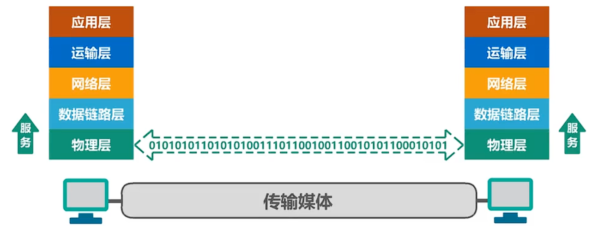

## 2.物理层协议
物理层为了解决在各种传输媒体上传输比特0和1的问题，进而给数据链路层提供透明（数据链路层不知道物理层使用什么方法传输比特0和1，只管享受物理层提供的比特流传输的服务即可）比特流的服务。

物理层协议的主要任务：

**机械特性**：指明接口所用接线器的**形状**和**尺寸**，**引脚数目**和**排列**，**固定**和**锁定**装置。

**电气特性**：指明在接口电缆的各条线上出现的**电压的范围**。

**功能特性**：指明某条线上出现的某一电平的**电压表示何种意义**。

**过程特性**：指明对于不同功能的各种可能**事件的出现顺序**。

# 二、物理层下面的传输媒体
**本节不是重点，了解即可**

注：传输媒体不属于计算机网络体系结构的任何一层，如果非要将它添加到体系结构中，那只能将其放在物理层之下。

## 传输媒体分类
导引型传输媒体：在导引型传输媒体中，电磁波被导引沿着固体媒体传播

（1）同轴电缆

同轴电缆有两类，一类是50欧阻抗的基带同轴电缆，用于数字传输，在早期局域网中广泛使用。另一类是75欧阻抗的宽带同轴电缆，用于模拟传输，目前主要用于有线电视的入户线。

同轴电缆价格较贵，且布线不够灵活和方便。随着集线器的出现，在局域网领域，双绞线取代了同轴电缆。

（2）双绞线

无屏蔽双绞线UTP电缆

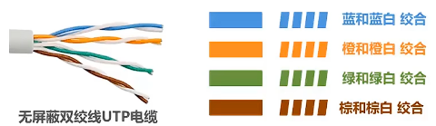

绞合有两个作用：1.抵御部分来自外界的电磁干扰；2.减少相邻导线的电磁干扰。

蔽双绞线STP电缆

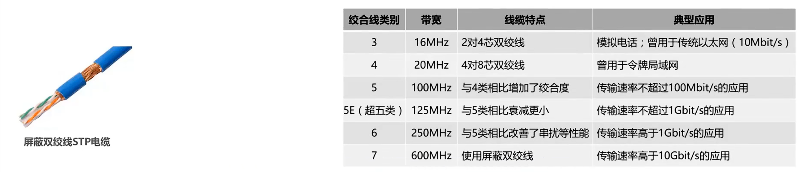

（3）光纤

光纤的纤芯非常细，多模光纤的纤芯直径有50微米和62.5微米，单模光纤的纤芯直径为9微米。而铅锌外面的包层也非常细，直径不超过125微米。

在光纤通信中，常用三个波段的中心分别位于0.85微米 (衰减较大）、1.3微米（衰减较小）和1.55微米（衰减较小）。

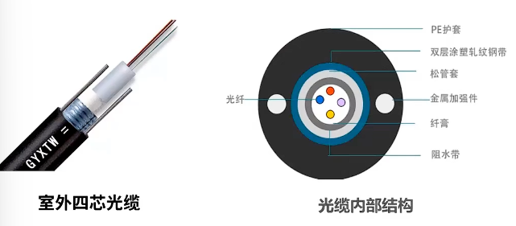

光纤优点

1. 通信容量非常大（25000~30000GHz的带宽）
2. 传输损耗小，在远距离传输时更加经济。
3. 抗雷电和电磁干扰性能好，这在有大电流脉冲干扰的环境下尤为重要。
4. 无串音干扰，保密性好，不易被窃听。
5. 体积小，重量轻（例如一公里长的1000对双绞线电缆约重8000公斤，而同样长度但容量大的多的一对两芯光缆仅重100公斤）。

光纤缺点

1. 割接光纤需要专用设备。
2. 目前光电接口的价格还比较贵。

多模光纤

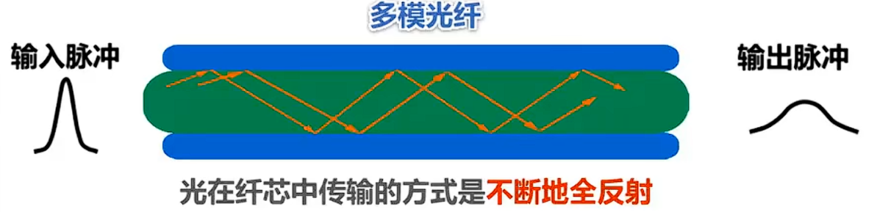

1. 由于光的色散问题（模式、材料、波导色散），光在多目光纤中传输一定距离后，必然产生信号失真（**脉冲展宽**）
2. 因此多模光纤只适合**近距离传输**(在建筑物内)
3. 多模光纤对光源的要求不高，可以使用比较便宜的发光二极管，相应的可采用光电二极管检测光脉冲

单模光纤

若光纤的直径减小到只有一个光的波长，则光纤就像一根波导那样，它可使光线一直向前传播，而不会产生多次反射，这样的光纤称为单模光纤。

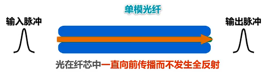

1. **单模光纤没有色散**，在1.3微米波长附近，材料色散和波导色散大小相等，符号相反，两者正好抵消，没有脉冲展宽问题。
2. 单模光纤适合**长距离传输**且衰减小，但它的制造成本高，对光源要求也高
3. 需要使用昂贵的半导体激光器作为光源，相应的需要采用激光检波器检测光脉冲。

（4）电力线

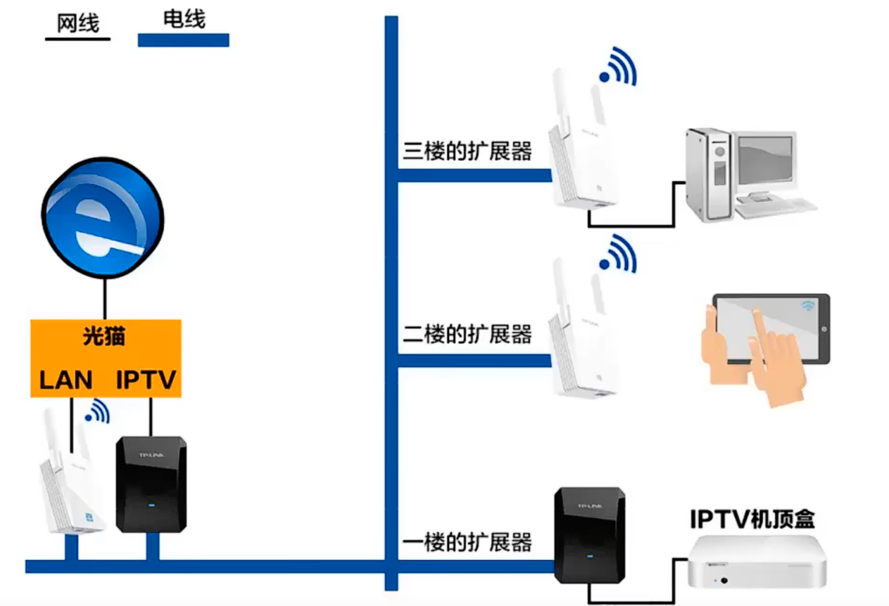

非导引型传输媒体：非导引型传输媒体是指自由空间

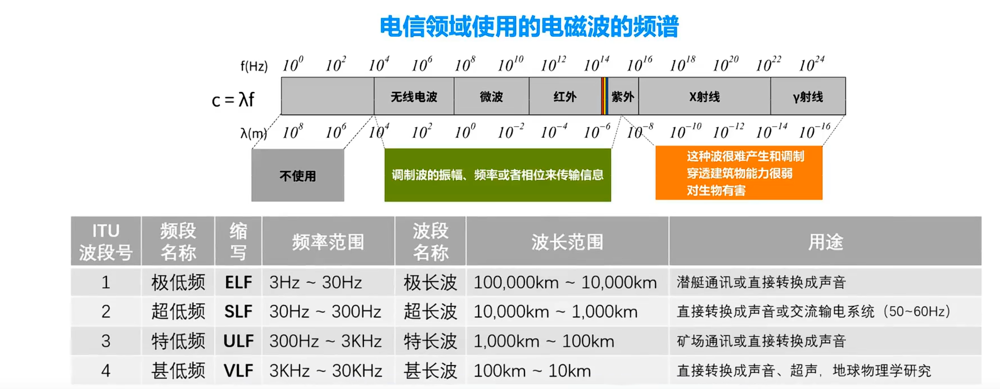

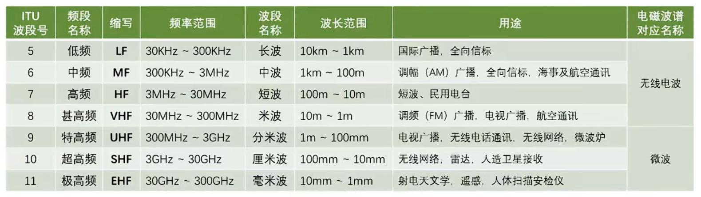

（1）无线电波

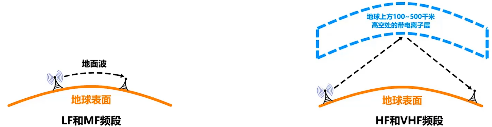

（2）微波

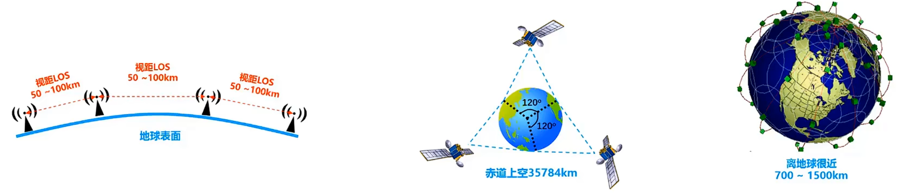

（3）红外线

红外通信特点：1.点对点无线传输；2.中间不能有障碍物，传输距离短；3.传输速率也很低（4Mb/s~16Mb/s）

以前的笔记本电脑基本都带有红外接口，可以进行红外通信。现在笔记本电脑已经取消了红外接口，但很多智能手机还带有红外接口，以方便用户对电视、空调等家用电器进行红外遥控。

（4）可见光

# 三、传输方式
**本节课的内容比较容易理解，重点是弄清楚同步传输中的同步，异步传输中的异步，它们各自的含义是什么**

## 1.串行传输和并行传输
**串行传输**：数据是一个比特一个比特依次发送的，因此在发送端和接收端之间只需要一条数据传输线路即可。

**并行传输**：一次发送N个比特，而不是一个比特，为此在发送端和接收端之间需要有N条传输线路。并行传输的优点是速度为串行传输的N倍，但也存在一个严重的缺点，即成本高。

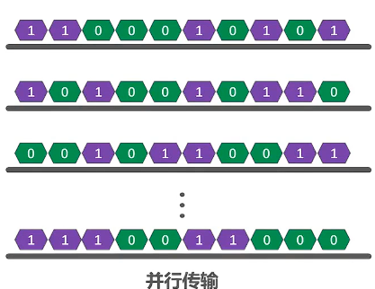

在计算机网络中，数据在传输线路上的传输采用是串行传输。计算机内部的数据传输常采用并行传输方式，例如CPU与内存之间通过总线进行数据传输，常见的数据总线宽度有8位、16位、32位和64位。

## 2.同步传输和异步传输
**（1）同步传输方式**

数据块以稳定的比特流的形式传输，字节之间没有间隔。接收端在每个比特信号的中间时刻进行检测，以判别接收到的是比特零还是比特一。

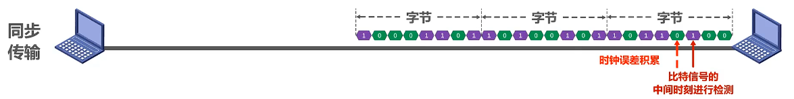

由于不同设备的时钟频率存在一定差异，不可能做到完全相同。在传输大量数据的过程中所产生的判别时刻的累计误差，会导致接收端对比特信号的判别错位。因此需要采取方法使收发双方的时装保持同步。

实现收发双方时钟同步的方法：

1. 外同步：在收发双方之间添加一条单独的时钟信号线，发送端在发送数据信号的同时，另外发送一路时钟同步信号，接收端按照时钟同步信号的节奏来接收数据
2. 内同步：发送端将时钟同步信号编码到发送数据中一起传输（例如曼彻斯特编码）

**（2）异步传输方式**

以字节为独立的传输单位，字节之间的时间间隔不是固定的，接收端仅在每个字节的起始处对字节内的比特实现同步。为此，通常要在每个字节前后分别加上起始位和结束位。

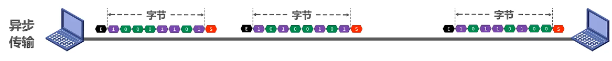

这里异步是指字节之间异步（字节之间的时间间隔不固定），但字节中的每个比特仍然要同步（各比特的持续时间是相同的）

## 3.单工、半双工以及全双工通信
（1）单工通信：又称为单向通信，通信双方只有一个数据传输方向，例如无线电广播采用的就是这种通信方式

（2）半双工通信：又称为双向交替通信，通信双方可以相互传输数据，但不能同时进行，例如对讲机采用的就是这种通信方式

（3）全双工通信：又称为双向同时通信，通信双方可以同时发送和接收信息，例如电话采用的就是这种通信方式。

# 四、编码与调制
**本节课的内容稍有难度，但还是请认真搞懂本节课的内容。因为物理层的主要任务就是解决比特0和1在线路上传输的问题，而本节课的内容就是其相关的理论基础。**

## 1.基本概念
**消息**：计算机处理和传输用户的文字、图片、音频和视频统称为消息。

**数据**：运送消息的实体，计算机处理的二进制数据，也就是比特0和比特1。

**信号**：信号是数据的电磁表现。分为**数字信号**（值是离散的）和**模拟信号**（值是连续的）。

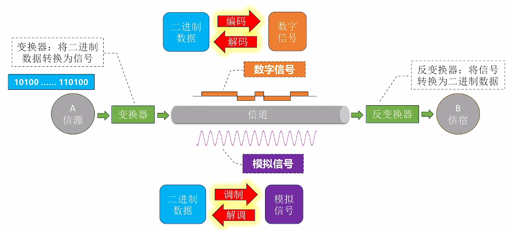

**基带信号**：由信源发出的原始电信号称为基带信号。基带信号可分为两类，一类是**数字基带信号**，例如计算机内部CPU与内存之间传输的信号。另一类是**模拟基带信号**，例如麦克风收到声音后产生的音频信号。

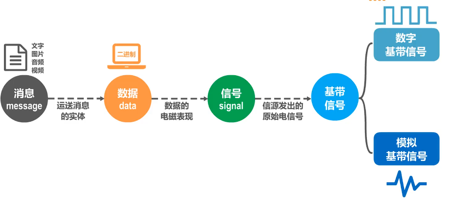

信号需要在信道中进行传输，信道可分为数字信道和模拟信道两种。

（1）数字基带信号

**数字信道**：在不改变信号性质的前提下，仅对数字基带信号的波形进行变换称为**编码**。编码后产生的信号仍为**数字信号**，可以在数字信道中传输。例如，以太网使用曼彻斯特编码4B/5B，8B/10B等编码。

**模拟信道**：把数字基带信号的频率范围搬移到较高的频段并转换为模拟信号，称为**调制**。调制后产生的信号是**模拟信号**，可以在模拟信道中传输。例如wifi使用补码监控、直接序列扩频、正交频分复用等调制方法。

（2）模拟基带信号

对模拟基带信号进行编码的典型应用是对音频信号进行编码的麦码调制PCM，也就是将模拟音频信号通过采样、量化编码这三个步骤进行数字化。

对模拟信号进行调制的典型应用是将语音数据加载到模拟的载波信号中传输，例如传统的电话。另一个是频分复用FDM技术可以充分利用带宽资源。

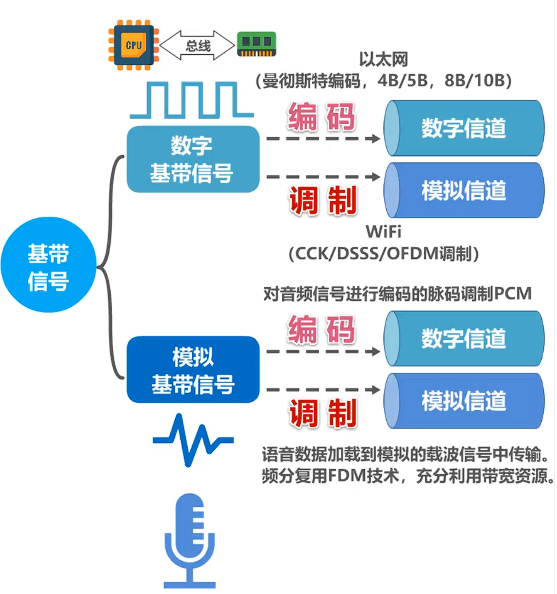

**码元**：在使用时间域的波形表示数字信号时，**代表不同离散数值的基本波形**。简单来说，**码元**就是构成信号的一段波形。

注：严格来说，传输媒体和信道不能直接划等号。对于单工传输，传输媒体中只包含一个信道，要么是发送信道，要么是接收信道。而对于半双工和全双工传输，传输媒体中要包含两个信道，一个是发送信道，另一个是接收信道。如果使用信道复用技术，一条传输媒体还可以包含多个信道。

## 2.编码与调制的常用编码
在计算机网络中，常见的是将数字基带信号通过编码或调制的方法在相应信道进行传输。

### 常用编码
（1）不归零编码

采用不归零编码产生的该比特流的相应信号。正电平表示比特1，负电平表示比特0，这是零电平。所谓不归零，就是指在整个码元时间内电平不会出现零电平。例如该码源在其时间内全部是正电平，而该码源在其时间内全部是负电平。

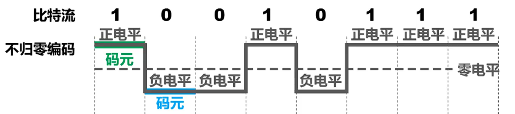

接收端判断码源数目的方法：

核心：需要发送方的发送与接收方的接收做到严格的同步

+ 需要**额外一根传输线来传输时钟信号**，接收方按时钟信号的节拍来逐个接收码源（发送方与接收方同步）。
+ 对于计算机网络，**宁愿利用这个传输线来传输数据信号**，而不是要传输时钟信号。

因此，由于不归零编码存在同步问题，计算机网络中的数据传输不采用这类编码。

（2）归零编码

+ **每个码源传输结束后信号都要“归零”**，所以接收方只要在信号归零后进行采样即可，不需要单独的时钟信号。
+ 实际上归零编码相当于把时钟信号用“归零方“式编码在了数据之内，这称为 **”自同步“** 信号。
+ 但是归零编码中大部分的**数据带宽**都用来传输“归零”而**浪费**掉了。

归零编码的优点是字同步，但缺点是编码效率低。

（3）曼彻斯特编码

在每个码元时间的中间时刻，信号都会发生跳变。例如负跳变表示比特1，正跳变表示比特0。码元中间时刻的跳变既表示时钟又表示数据（传统以太网使用的就是曼彻斯特编码）

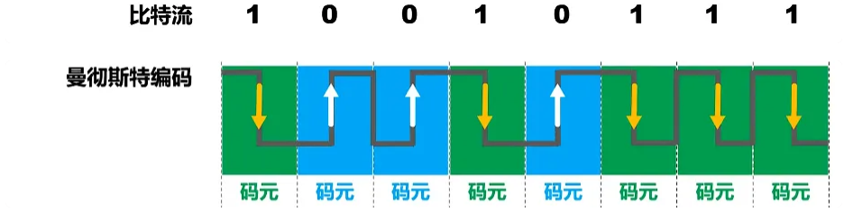

（4）差分曼彻斯特编码

在每个码元时间的中间时刻，信号都会发生跳变。

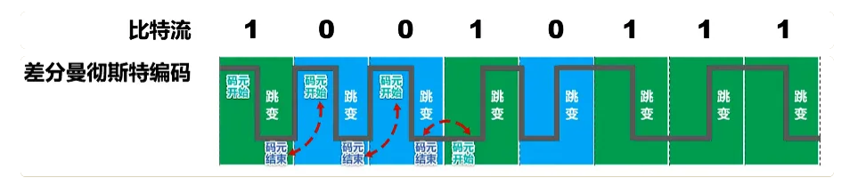

与曼彻斯特编码不同：

1.跳变仅表示时钟

2.码源开始处电平是否发生变化来表示数据

### 基本调制方法
（1）调幅

这是调幅所产生的模拟信号。无载波输出表示比特0，有载波输出表示比特1。

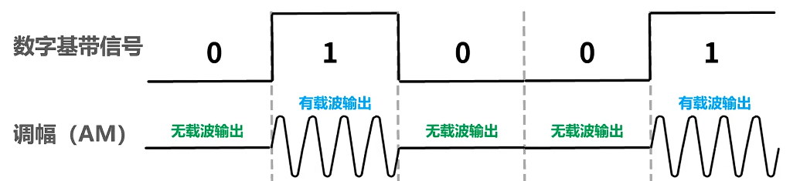

（2）调频

这是调频所产生的模拟信号。频率F1的波形表示比特0，频率F2的波形表示比特1。

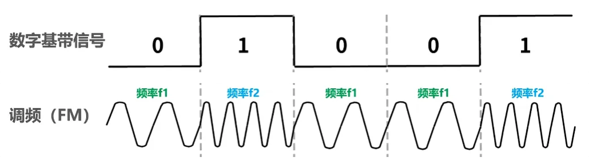

（3）调相

这是调相所产生的模拟信号。初相位0度的波形表示比特0，初相位180度的波形表示比特1。

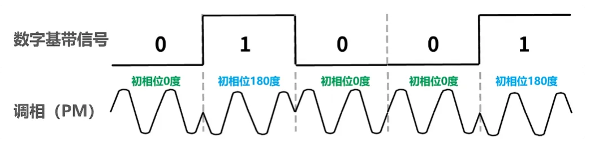

（4）混合调制

使用基本调制方法，一个码源只能表示或者说包含一个比特信息。为了能使一个码源包含更多的比特呢，可以采用混合调制的方法。

因为**频率和相位是相关**的，即频率是相位随时间的变化率，所以**一次只能调制频率和相位两个中的一个**。通常情况下，相位和振幅可以结合起来一起调制，称为**正交振幅调制QAM**。

QAM-16：

这种调制方法所调制出的波形可以有12种相位，每种相位有一或两种振幅可选。

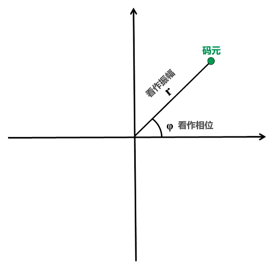

这是QM16可调制出的16种码源，每种码元可以对应表示4个比特。

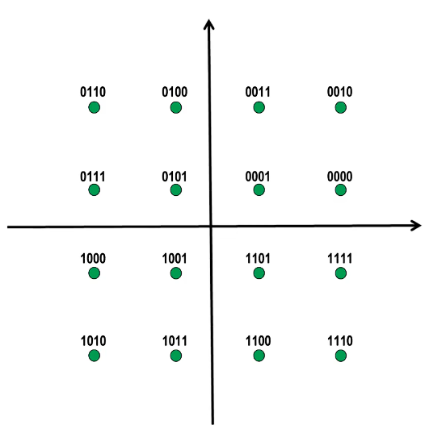

那么每个码元与四个比特的对应关系可以随便定义吗？每个码元与四个比特的对应关系不能随便定义。每个码源与四个比特的对应关系应该采用格雷码，也就是任意两个相邻码元只有一个比特不同。

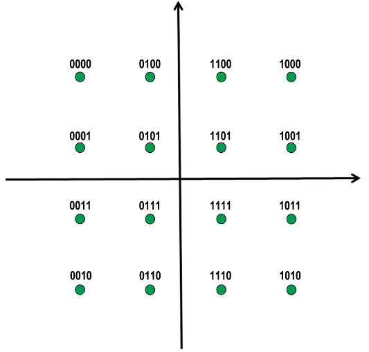

# 五、信道极限容量
**本节课中介绍了与信道极限容量相关的两个公式，一个是奈氏准则，另一个是香农公式。他们为提高信息传输速率提供了理论依据，希望能够掌握并利用这两个公式进行一些简单的相关计算。**

## 1.失真
信号在传输过程中会受到各种因素的影响。如图所示，这是一个数字信号，当它通过实际的信道后，波形会产生失真。当失真不严重时，在输出端还可根据已失真的波形还原出发送的码源。但当失真严重时，在输出端就很难判断这个信号在什么时候是1和在什么时候是0。信号波形失去了码元之间的清晰界限，这种现象叫做**码间串扰**。

**产生失真的原因：** 码元传输速率、信号传输距离、噪声干扰、传输媒体质量等。

## 2.奈氏准则
**奈氏准则**：在假定的理想条件下，**为了避免码间串扰，码元传输速率是有上限**

理想**低通信道**（频率从0开始，直到某个最高频率$f_H$ ，例如：电话线、以太网双绞线）的**最高码元传输速率 = 2W Baud = 2W 码元/秒**

---

理想**带通信道**（频率范围在$f_L$到$f_H$之间，**不包含 0**（不能通过直流），例如：无线电广播、Wi-Fi 信号、卫星通信）的**最高码元传输速率 = W Baud = W 码元/秒**

W：信道带宽（单位为Hz）是指一个信道能够有效传输信号的频率范围

- **物理意义**：它等于信道允许通过的**最高频率**与**最低频率**之差。
    * 对**低通信道**（频率从$0$到某个上限$f_H$），带宽$W = f_H$。
    * 对**带通信道**（频率从$f_L$到$f_H$），带宽$W = f_H - f_L$。
- **在奈氏准则中的角色**：决定了信道在无噪声情况下能够传输码元速率的上限。带宽越宽，能通过的信号频率分量越多，最高码元传输速率也就越高。

Baud：波特，即**码元/秒**

1.**码元传输速率又称为波特率**、调制速率、波形速率或符号速率。它与比特率有一定关系：

+ 当1个码元只携带1比特的信息量时，则波特率（码元/秒）与比特率（比特/秒）在数值上是相等的；
+ 当1个码元携带n比特的信息量时，则波特率转换成比特率时
    - 比特率 = 波特率 × 每个码元携带的信息量
    - $n=log_2(V)$
        * _**n**_：每个码元携带的信息量，单位是 **比特 (bit)**。
        * _**V**_：码元的**离散状态个数**（即这个码元有多少种不同的波形、电压电平或相位）。

2.要提高信息传输速率（比特率），就必须设法使每一个码元能携带更多个比特的信息量。这需要采用多元制（调幅、调频以及调相这三种基本调制属于二元调制，混合调制属于多元调制）

3.实际的信道所能传输的最高码元速率，要明显低于奈氏准则给出的这个上限数值

仅从公式来看，只要采用更好的调制方法，让码元可以携带更多的比特，岂不是可以无限制的提高信息的传输速率吗？答案是否定的。信道的极限信息传输速率还要受限于实际的信号在信道中传输时的信噪比。因为信道中的噪声也会影响接收端对码元的识别，并且噪声功率相对信号功率越大影响就越大。

## 2.香农公式
**香农公式**：带宽受限且有高斯白噪声干扰的信道的极限信息传输速率

$ c = W \times \log_2\left(1 + \frac{S}{N}\right)
 $

+ $C$：信道的极限信息传输速率（单位：b/s）
+ $W$：信道带宽（单位：Hz）
+ $S$：信道内所传信号的平均功率
+ $N$：信道内的高斯噪声功率
+ $S/N$：信噪比。信噪比有两种记发：一种无单位记法$S/N$，信噪比=S/N；另一种分贝$ dB
 $记法，$ \text{信噪比（dB）} = 10 \times \log_{10}\left(\frac{S}{N}\right) \ (\text{dB}) $

**从香农公式可以看出**：

1. 信道带宽或信道中信道比越大，信息的极限传输速率就越高。
2. 在实际信道上能够达到的信息传输速率要比该公式的极限传输速率低不少。这是因为在实际信道中，信号还要受到其他一些损伤，例如各种脉冲干扰信号、在传输中的衰减和失真等，这些因素在香农公式中并未考虑。

## 3.奈氏准则和香农公式
1. 在信道带宽一定的情况下，根据奈氏准则和香农公式，要想**提高信息的传输速率**就必须采用**多元制**（更好的调制方法），并努力**提高信道中的信噪比**
2. 自从香农公式发表以后，各种**新的信号处理和调制方法就不断出现**，其目的都是为了尽可能的**接近香农公式所给出的传输速率极限**

## 4.例题
**【2014年 题35】** 下列因素中，不会影响信道数据传输速率的是  **D**  

A. 信噪比    			B. 频率带宽    				C. 调制速度    			   D. 信号传播速度  

---

从**香农公式**可知，信噪比和频率带宽都会影响信道数据传输速率。从**奈氏准则**可知，调制速度，也就是码元传输速度和码元所携带的比特数量都会影响信道数据传输速率。而信号的传播速度不影响数据传输速率。

这道题考察**奈氏准则**（无噪声情况）下，结合调制技术计算最大数据传输速率。

---

**【2009年 题34】** 在无噪声情况下，若某通信链路的带宽为3kHz，采用4个相位，每个相位具有4种振幅的QAM调制技术，则该通信链路的最大数据传输速率是  **B**

**A. 12 kbps		B. 24 kbps	 	C. 48 kbps		D. 96 kbps**

---

**【解析】**

1. **计算最高码元速率**（奈氏准则，无噪声，低通信道）$\text{最高码元传输速率} = 2W = 2 \times 3\text{k} = 6\text{k Baud} = 6\text{k 码元/秒}$
2. **计算每个码元携带的比特数**：
    - 4 个相位 × 4 种振幅（QAM调制技术） = 16 种不同的码元
    - 每个码元携带的信息量 = $\log_2 16 = 4$比特
3. **计算最大数据传输速率**：  
$$
\text{最大数据传输速率} = 6\text{k} \times 4 = 24\text{k bps}
$$

注：不管题目给出的调制技术多么牛，或者对于我们而言多么陌生，这都不会影响我们解题。我们**只需关心这种调制技术可以调制出多少个不同的基本波形即可**。

---

**【2011年 题34】** 若某通信链路的数据传输速率为2400bps，采用4相位调制，则该链路的波特率是  **B**

**A. 600波特		 B. 1200波特 			C. 4800波特			D. 9600波特**

---

**【解析】**

1. **计算每个码元携带的比特数**：
    - 采用4相位调制，即共有 4 种不同的码元。
    - 每个码元携带的信息量 =$\log_2 4 = 2$比特。
2. **根据公式计算波特率**：
    - 数据传输速率（比特率） = 波特率 × 每个码元携带的比特数
    - $2400 \text{ bps} = \text{波特率} \times 2 \text{ 比特/码元}$
    - 解得：波特率 =$2400 \div 2 = 1200$波特

---

这道题考察**香农公式**，并结合信噪比（dB）的换算。

---

**【2016年 题34】** 若连接R2和R3链路的频率带宽为8kHz，信噪比为30dB，该链路实际数据传输速率约为理论最大数据传输速率的50%，则该链路的实际数据传输速率约是   **C**

**A. 8 kbps			B. 20 kbps			C. 40 kbps			D. 80 kbps**

---

**【解析】**

1. **求信噪比 ( S/N )**：
    - 已知信噪比 =$30 \text{ dB}$
    - 公式：信噪比（dB）=$10 \times \log_{10}(S/N)$即$30 = 10 \times \log_{10}(S/N)$
    - 解得：$S/N = 10^3 = 1000$
2. **求理论最大数据传输速率 C（香农公式）**：
    - $C = W \times \log_2(1 + S/N)$
    - 代入 ( W = 8\text{kHz} )，( S/N = 1000 )：
    - $C = 8\text{k} \times \log_2(1 + 1000)$
    - $\approx 8\text{k} \times \log_2(1024) ( 1024 = 2^{10} )（此处用近似）$=$8\text{k} \times 10 = 80 \text{ kbps}$
3. **求实际数据传输速率**：
    - 实际速率 = 理论最大值 × 50%
    - $80 \text{ kbps} \times 0.5 = 40 \text{ kbps}$

---

**【2017年 题34】** 若信道在无噪声情况下的极限数据传输速率不小于信噪比为30dB条件下的极限数据传输速率，则信号状态数至少是 **D**

A. 4			B. 8			C. 16		D. 32

---

**【解析】**

设信号状态数（可调制出的不同基本波形或码元数量）为$X$  
则每个码元可携带的比特数量为$\log_2 X$

+ 信道在**无噪声**情况下的极限数据传输速率（用**奈氏准则**计算）：  
$$
= 2W \text{ (码元/秒)} = 2W \log_2 X \text{ (比特/秒)}
$$
+ **30dB信噪比**条件下的极限数据传输速率（用**香农公式**计算）：  
$$
= W \log_2(1 + 1000) \text{ (比特/秒)}
$$
（注：30dB 对应 (S/N = 1000)）

根据题意列出不等式：  
$$
2W \log_2 X \geq W \log_2(1 + 1000)
$$

消去 (W)，解得：  
$$
\log_2 X \geq \frac{1}{2} \log_2 1001 \approx 5
$$
$$
X \geq 2^5 = 32
$$
