# 一、运输层概述
在计算机网络体系结构中，物理层、数据链路层以及网络层共同解决了异构网络互联的问题，实现了**主机到主机（Host-to-Host）** 的通信。然而，在实际的网络通信中，真正的通信实体并非主机本身，而是运行在通信两端主机上的**应用进程（Application Process, AP）**。


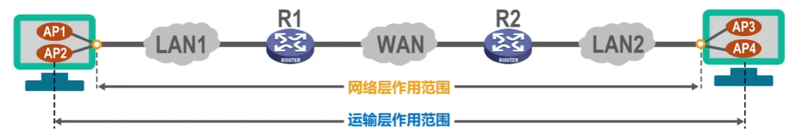

本文档将系统概述运输层（Transport Layer）的核心概念、功能及其在网络体系结构中的关键作用。

## 1. 运输层的核心任务：进程间通信
网络层的作用范围局限于主机到主机。例如，局域网 A 中的主机与局域网 B 中的主机通过广域网互联，网络层仅负责将数据报从源主机路由到目的主机。但一台主机通常同时运行多个网络应用进程（如主机 A 中的进程 AP1、AP2 与主机 B 中的进程 AP3、AP4）。**如何为运行在不同主机上的应用进程提供直接的通信服务，是运输层的核心任务。**


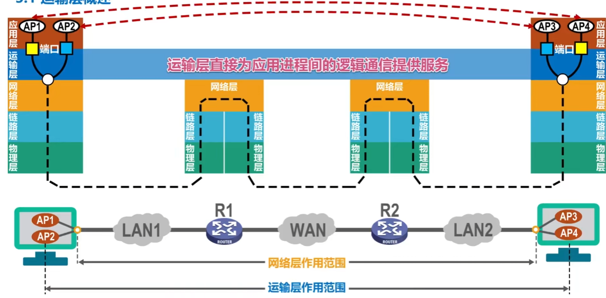

因此，运输层协议又被称为**端到端（End-to-End）协议**，其作用范围从“主机到主机”延伸到了“应用进程到应用进程”。

## 2. 端口与报文交付机制
在计算机网络体系结构中，假设源主机的应用进程 AP1 与目的主机的应用进程 AP4 进行通信，同时 AP2 与 AP3 进行通信。为了在运输层准确区分和交付数据，引入了**端口（Port）** 的概念。

+ **端口标识与分用**：运输层使用不同的端口号来映射和对应不同的应用进程。发送方将应用层报文封装后，通过网络层及其下层协议进行传输；接收方的运输层则通过解析报文首部中的目的端口号，将收到的应用层报文准确交付给应用层中相应的应用进程（这一过程在网络体系中称为**分用**，Demultiplexing）。
+ **逻辑端口与物理端口的区别**：需要特别强调的是，运输层中的“端口”并非指路由器或主机网卡上可见的物理硬件接口，而是指操作系统中用于区分不同应用进程的**软件层面的逻辑标识符**（通常为 16 位无符号整数，范围 0~65535）。在 C++ 而言中，进行 Socket 网络编程时，绑定的正是这种逻辑端口。

## 3. 逻辑通信与底层细节屏蔽
在学习和研究运输层时，通常认为运输层直接为应用进程间的**逻辑通信**提供服务。

+ **逻辑通信的本质**：从应用层的视角来看，两个运输层实体之间的数据传送似乎是沿水平方向直接进行的，仿佛两者之间存在一条端到端的逻辑通信信道。
+ **物理传输的实际路径**：事实上，这两个运输层实体之间并没有直接的水平物理连接。数据必须向下穿越网络层、数据链路层和物理层，经过网络核心中多个路由器的多次存储转发（即沿垂直方向多次传递），最终到达目的主机的运输层。
+ **屏蔽网络核心细节**：运输层向高层用户（应用层）完美屏蔽了底层网络核心的复杂细节（如网络拓扑结构、路由选择协议、节点交换机制等）。应用层只需调用运输层提供的接口，即可实现透明的端到端数据传输。

## 4. 运输层的两大核心协议
根据不同应用场景对可靠性、实时性及传输效率的需求差异，因特网的运输层为应用层提供了两种主流的运输层协议，这也是后续深入学习网络编程的核心内容：

1. **TCP（Transmission Control Protocol，传输控制协议）**：提供**面向连接的、可靠的字节流传输服务**。适用于要求数据绝对完整性的场景（如 Web 浏览、文件传输、C++ 后端微服务间的 RPC 调用及数据库交互）。
2. **UDP（User Datagram Protocol，用户数据报协议）**：提供**无连接的、尽最大努力交付的数据报传输服务**。适用于对实时性要求极高、允许少量丢包的场景（如实时音视频流、在线游戏状态同步、DNS 查询）。

---

# 二、运输层端口号、复用与分用的概念
## 1.运输层概述与端口号的引入
运输层的核心任务是为运行在不同主机上的**应用进程**提供直接的逻辑通信服务。在操作系统层面，本地进程通常使用进程标识符（PID）进行标志。然而，互联网中的计算机运行着不同的操作系统（如 Windows、Linux、macOS 等），其 PID 的格式和分配机制各不相同。

为了实现跨操作系统的应用进程网络通信，TCP/IP 体系结构在运输层引入了统一的**端口号（Port Number）** 来标识应用层的不同应用进程。

## 2.端口号的分类与特性
端口号使用 16 位（bit）表示，取值范围为 `0 ~ 65535`（2byte）。根据互联网号码分配局（IANA）的规定，端口号主要分为以下三类：

1. **熟知端口号（Well-Known Ports）**
    - **范围**：`0 ~ 1023`。
    - **说明**：IANA 将这些端口号指派给 TCP/IP 体系中最核心、最重要的应用层协议。
    - **示例**：HTTP（80）、DNS（53）、FTP（20、21）、SSH（22）。
2. **登记端口号（Registered Ports）**
    - **范围**：`1024 ~ 49151`。
    - **说明**：分配给没有熟知端口号的特定应用程序。使用此类端口必须在 IANA 按规定手续登记，以防止冲突。
    - **示例**：微软远程桌面（RDP）使用 3389。
3. **短暂端口号（Ephemeral/Dynamic Ports）**
    - **范围**：`49152 ~ 65535`。
    - **说明**：留给客户端进程在发起通信时临时使用。当服务器收到客户端报文时，即可获知客户端使用的短暂端口号。通信结束后，该端口号会被释放，供后续其他客户端进程使用。

**端口号的本地意义**：  
	端口号仅用于标识**本计算机**应用层中的各个进程。在互联网中，不同计算机上的相同端口号之间没有任何必然联系。

## 3.复用与分用机制
复用与分用是运输层实现多进程并发通信的核心机制。

**1.复用（Multiplexing）**

在发送方，不同的应用进程可以通过同一个运输层协议发送数据，最终交由网络层发送。

+ **运输层复用**：多个应用进程的数据交由 UDP 或 TCP 封装，分别称为 UDP 复用和 TCP 复用。
+ **网络层（IP）复用**：无论是 UDP 用户数据报还是 TCP 报文段，在网络层都被封装成 IP 数据报。IP 数据报首部中的**协议字段**用于标识上层协议（值为 `6` 表示 TCP，值为 `17` 表示 UDP）。

**分用（Demultiplexing）**

在接收方，数据从网络层逐层向上交付的过程。

+ **IP 分用**：接收方网络层收到 IP 数据报后，根据协议字段将其数据载荷上交至运输层（若值为 17 则上交 UDP，若值为 6 则上交 TCP）。
+ **运输层分用**：运输层根据报文首部中的**目的端口号**，将数据准确交付给上层对应的应用进程。


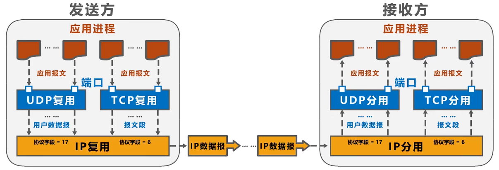

## 4.常用应用层协议与熟知端口号
以下列举 TCP/IP 体系中常用应用层协议及其对应的运输层协议与熟知端口号：

| 应用层协议 | 运输层协议 | 熟知端口号 | 说明 |
| :--- | :---: | :---: | :--- |
| **DNS** | UDP / TCP | 53 | 域名解析（短查询用 UDP，区域传送用 TCP） |
| **HTTP** | TCP | 80 | 超文本传输协议 |
| **HTTPS** | TCP | 443 | 安全的超文本传输协议 |
| **FTP** | TCP | 20, 21 | 文件传输（20为数据端口，21为控制端口） |
| **SSH** | TCP | 22 | 安全外壳协议 |
| **SMTP** | TCP | 25 | 简单邮件传输协议 |
| **DHCP** | UDP | 67 | 动态主机配置协议 |


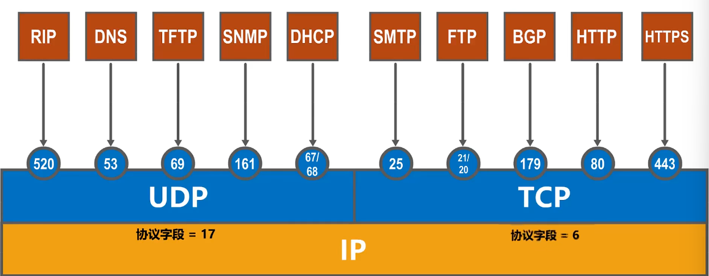

## 5.实例分析：DNS 与 HTTP 通信过程
假设用户 PC、DNS 服务器、Web 服务器处于同一以太网中。Web 服务器域名为 `www.porttest.com`，对应 IP 地址为 `192.168.0.3`。

### DNS 解析阶段（基于 UDP）
+ **DNS 请求**：PC 上的 DNS 客户端进程发送查询报文。使用 UDP 封装，**源端口**选取短暂端口（如 `49152`），**目的端口**为 DNS 熟知端口 `53`。


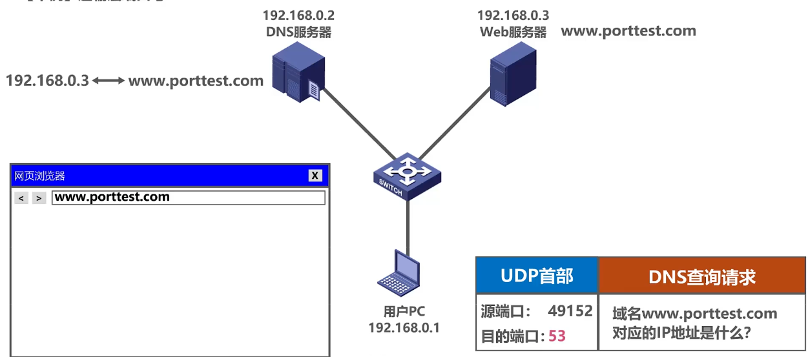

+ **DNS 响应**：DNS 服务器收到报文后，根据目的端口 `53` 将数据交付给 DNS 服务端进程。解析后返回响应报文（包含 IP `192.168.0.3`）。使用 UDP 封装，**源端口**为 `53`，**目的端口**为 PC 的短暂端口 `49152`。


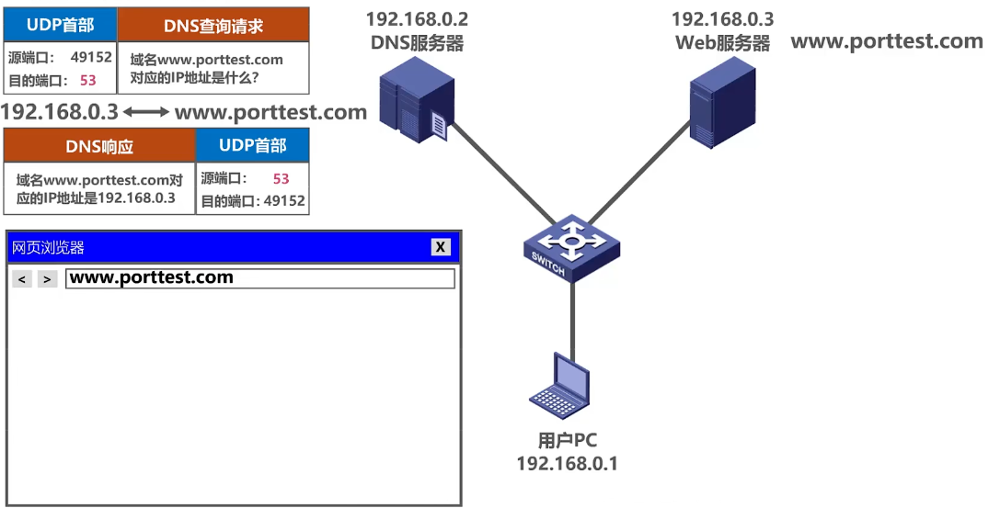

+ **PC 接收**：PC 收到报文后，根据目的端口 `49152` 将数据交付给 DNS 客户端进程，完成域名到 IP 的解析。

### HTTP 访问阶段（基于 TCP）
+ **HTTP 请求**：PC 上的 HTTP 客户端进程（如浏览器）向 Web 服务器发起连接并请求首页。使用 TCP 封装，**源端口**选取一个新的短暂端口（如 `49153`，_注：TCP 与 UDP 端口空间独立，但操作系统通常会分配新的短暂端口_），**目的端口**为 HTTP 熟知端口 `80`。


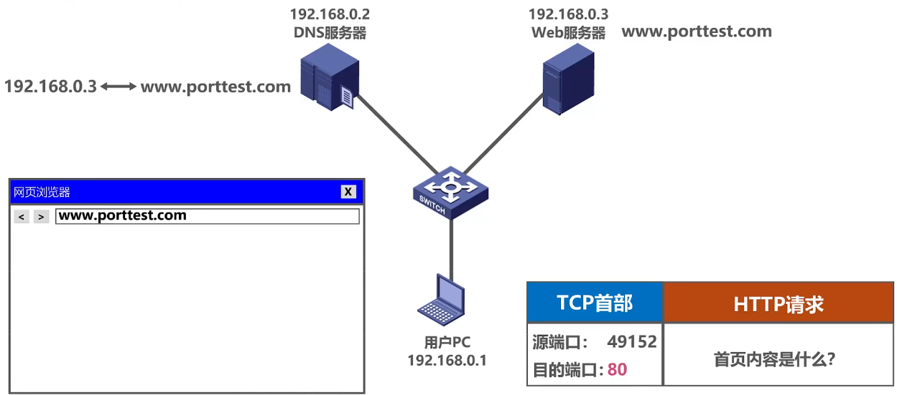

+ **HTTP 响应**：Web 服务器收到报文后，根据目的端口 `80` 将数据交付给 HTTP 服务端进程。处理后返回响应报文（包含首页内容）。使用 TCP 封装，**源端口**为 `80`，**目的端口**为 PC 的短暂端口 `49153`。


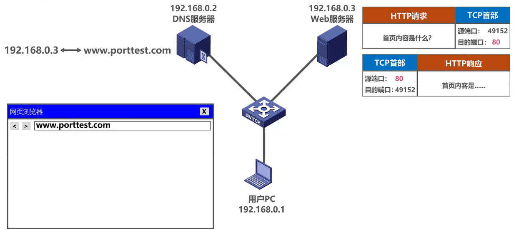

+ **PC 接收**：PC 收到报文后，根据目的端口 `49153` 将数据交付给 HTTP 客户端进程，浏览器渲染并显示首页内容。

---

## 6.补充：端口与网络编程
在C++中，进行 Socket 网络编程时，对端口号的理解将直接体现在 API 的调用中：

1. **服务端的端口绑定（Bind）**  
在服务端开发中，创建 Socket 后必须调用 `bind()` 函数，将 Socket 与特定的**IP 地址**和**熟知端口（或登记端口）** 进行绑定，随后调用 `listen()` 监听该端口。
    - _工程实践_：服务端重启时，由于 TCP 的 `TIME_WAIT` 状态，熟知端口可能无法立即被重新绑定。通常需要在 `bind()` 前通过 `setsockopt()` 设置 `SO_REUSEADDR` 选项以允许端口复用。
2. **客户端的隐式绑定**  
在客户端开发中，通常只需调用 `socket()` 和 `connect()`。在调用 `connect()` 发起三次握手时，操作系统内核会自动为其分配一个未被占用的**短暂端口**作为源端口，开发者无需手动调用 `bind()`。
3. **多路复用 I/O（I/O Multiplexing）**  
在后端高并发服务器开发中，常使用 `epoll`（Linux）或 `select/poll` 等 I/O 多路复用技术。需要注意的是，**I/O 多路复用**（监控多个 Socket 描述符的读写事件）与运输层的**复用/分用**（多个进程共享网络协议栈）是两个不同层面的概念，在系统设计与面试中需严格区分。

# 三、UDP和TCP对比（重点）
## 1.协议概述
UDP（User Datagram Protocol，用户数据报协议）与 TCP（Transmission Control Protocol，传输控制协议）是 TCP/IP 体系结构运输层的两个核心协议。在基于 TCP/IP 的网络通信中，二者的使用频率仅次于网际层的 IP 协议。应用层协议根据业务需求选择依赖 UDP 或 TCP 提供的传输服务。


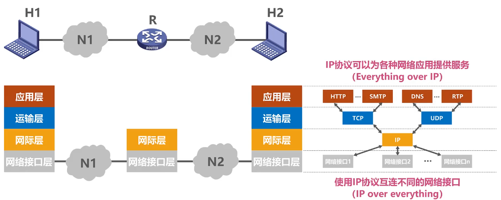

## 2.核心特性对比
### （1）连接特性
| 特性 | UDP | TCP |
| :--- | :--- | :--- |
| **连接模式** | 无连接 | 面向连接 |
| **通信前准备** | 无需建立连接，可随时发送数据 | 需通过**三次握手**建立逻辑连接 |
| **通信后释放** | 无需释放连接 | 需通过**四次挥手**释放连接 |
| **连接本质** | - | 逻辑连接（非物理链路），维护状态信息 |


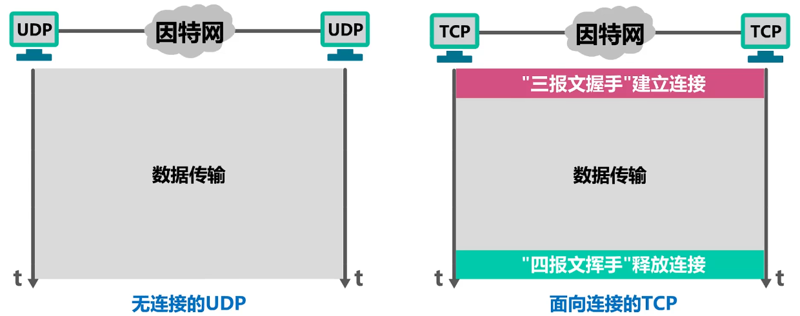

> **说明**：三次握手与四次挥手属于 TCP 的连接管理机制，过程较为复杂，涉及序列号同步、状态迁移等，将在后续课程中详细讲解。
>

### （2）通信模式支持
| 通信模式 | UDP | TCP |
| :--- | :---: | :---: |
| **单播（一对一）** | ✓ | ✓ |
| **多播（一对多）** | ✓ | ✗ |
| **广播（一对全）** | ✓ | ✗ |


+ **UDP**：支持单播、多播与广播，适用于服务发现、实时媒体分发等场景。


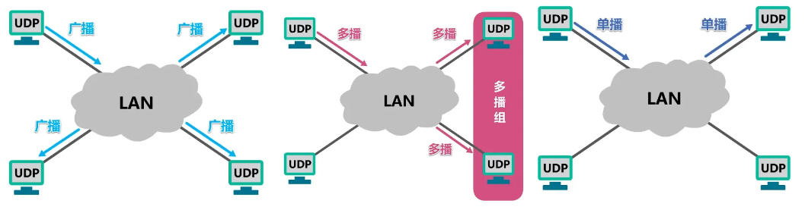

+ **TCP**：仅支持点对点单播通信，通信双方通过唯一的逻辑连接进行数据交换。


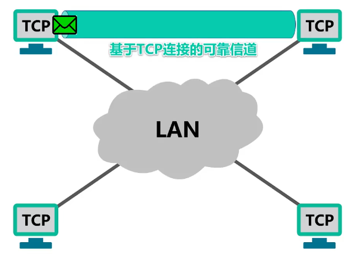


### （3）应用层数据处理方式
| 特性 | UDP | TCP |
| :--- | :--- | :--- |
| **数据视图** | 面向**应用报文**（Message-Oriented） | 面向**字节流**（Stream-Oriented） |
| **报文边界** | 保留应用层报文边界，不合并、不拆分 | 不保留边界，视为无结构字节序列 |
| **交付保证** | 接收方应用进程收到的报文与发送方一一对应 | 接收方应用进程收到的字节流内容与发送方一致，但数据块划分可能不同 |


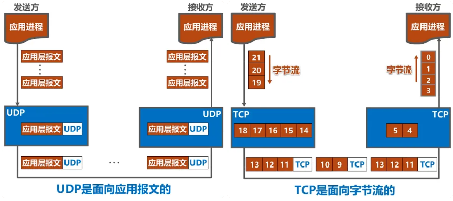

> **工程提示**：使用 TCP 时，应用层需设计协议帧格式（如长度字段、分隔符）以解决粘包/拆包问题；UDP 则天然保留消息边界，适用于定长或自带长度字段的协议设计。
>

### （4）传输可靠性
| 特性 | UDP | TCP |
| :--- | :--- | :--- |
| **服务类型** | 无连接、不可靠传输 | 面向连接、可靠传输 |
| **差错处理** | 仅通过校验和检测误码，发现错误直接丢弃，无重传机制 | 通过确认应答、超时重传、序列号等机制保障数据不丢失、不重复、按序到达 |
| **流量控制** | 无 | 滑动窗口机制 |
| **拥塞控制** | 无 | 慢启动、拥塞避免、快重传、快恢复 |
| **适用场景** | 实时音视频、在线游戏、DNS 查询等容忍少量丢包、追求低延迟的场景 | 文件传输、网页浏览、邮件收发等要求数据完整可靠的场景 |


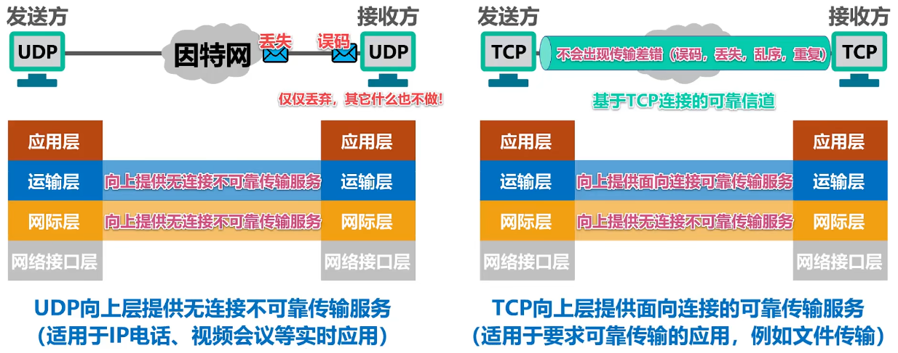

> **补充**：尽管网际层 IP 协议本身提供不可靠服务，但 TCP 在运输层通过复杂的状态机与算法，向上层屏蔽了底层网络的不可靠性，实现了端到端的可靠传输。
>

### （5）首部格式与开销
**UDP 用户数据报首部（固定 8 字节）**：


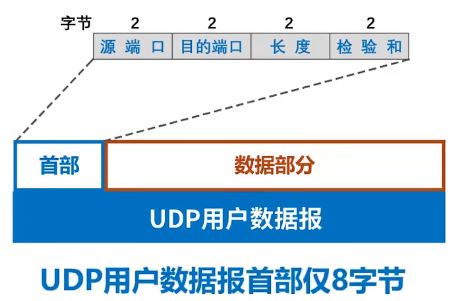

+ 字段简洁：源端口、目的端口、长度、校验和，各占 2 字节。
+ 开销低：适用于对头部开销敏感的高频小报文场景。

**TCP 报文段首部（最小 20 字节，最大 60 字节）**：


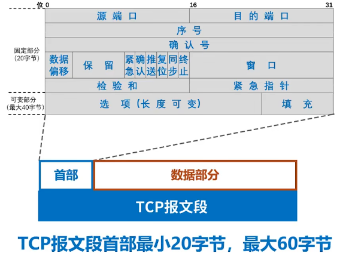

+ 字段丰富：包含序列号、确认号、窗口大小、标志位（SYN/ACK/FIN 等）、选项等，支撑连接管理、可靠传输、流量与拥塞控制。
+ 开销较高：适用于对可靠性要求高于头部开销的场景。

## 3.协议选型建议
| 评估维度 | 优先选择 UDP | 优先选择 TCP |
| :--- | :--- | :--- |
| **数据可靠性要求** | 可容忍少量丢包（如实时监控） | 要求 100% 数据完整（如订单交易） |
| **时延敏感度** | 极低时延优先（如游戏同步） | 可接受适度延迟换取可靠性 |
| **通信模式** | 需广播/多播（如服务发现） | 仅需点对点通信 |
| **协议设计复杂度** | 应用层需自行实现重传、排序等逻辑 | 内核协议栈已实现可靠传输，开发成本低 |
| **连接管理开销** | 无连接状态，适合海量短连接 | 需维护连接状态，适合长连接或连接池 |


**C++ 网络编程实践提示**：

1. **Socket API 差异**：
    - UDP：`socket(AF_INET, SOCK_DGRAM, 0)` + `sendto()`/`recvfrom()`
    - TCP：`socket(AF_INET, SOCK_STREAM, 0)` + `connect()`/`listen()`/`accept()` + `send()`/`recv()`
2. **缓冲区管理**：
    - TCP 需注意发送/接收缓冲区的调优（`SO_SNDBUF`/`SO_RCVBUF`），避免缓冲区满导致阻塞。
    - UDP 需控制单次发送报文大小（通常 ≤ 1472 字节，避免 IP 分片）。
3. **并发模型**：
    - UDP 服务端通常采用单 Socket + 多线程/协程处理不同客户端报文。
    - TCP 服务端常结合 `epoll`/`IOCP` 实现高并发连接管理。

## 4.内容小结
| 对比项 | UDP | TCP |
| :--- | :--- | :--- |
| **连接性** | 无连接 | 面向连接 |
| **通信模式** | 单播/多播/广播 | 仅单播 |
| **数据视图** | 面向报文 | 面向字节流 |
| **可靠性** | 不可靠（尽力交付） | 可靠（确认重传、有序交付） |
| **流量/拥塞控制** | 无 | 有 |
| **首部开销** | 8 字节（固定） | 20~60 字节（可变） |
| **典型应用** | DNS、DHCP、音视频流、游戏 | HTTP、HTTPS、FTP、SMTP、SSH |


> **注**：TCP 的流量控制与拥塞控制机制较为复杂，涉及滑动窗口、慢启动、拥塞避免等算法，将在后续课程中专题讲解。
>

---

# 四、TCP的流量控制
## 1.流量控制的基本概念
在计算机网络通信中，若发送方的数据发送速率过快，接收方可能因处理能力不足或接收缓存溢出而来不及接收，从而导致数据丢失。**流量控制（Flow Control）** 的核心目的就是**抑制发送方的发送速率，确保接收方能够及时处理并接收数据**。

在 TCP 协议中，流量控制是通过**滑动窗口（Sliding Window）机制**来实现的。接收方通过在 TCP 报文段首部中的**窗口（Window）字段**（通常称为接收窗口，rwnd）告知发送方自己当前的剩余接收能力，发送方据此动态调整自己的发送窗口大小。

> **注**：TCP 发送方的实际发送窗口大小由接收窗口（rwnd）和拥塞窗口（cwnd）共同决定，公式为：`发送窗口 = min(rwnd, cwnd)`。本节主要聚焦于由接收方主导的流量控制（即 rwnd 的变化），暂不深入探讨拥塞控制。
>

---

## 2.基于滑动窗口的流量控制过程（实例解析）
假设主机 A（发送方）与主机 B（接收方）已建立 TCP 连接。主机 A 向主机 B 发送数据，每个 TCP 报文段携带 100 字节的数据。

### 初始状态与数据发送
+ **初始窗口**：建立连接时，主机 B 告知主机 A 其接收窗口 `rwnd = 400`。主机 A 随即将自己的发送窗口设置为 400 字节。这意味着在未收到确认的情况下，A 最多可发送 400 字节的数据。
+ **数据发送**：
    - A 发送序号 `1~100` 的报文段（SEQ=1）。
    - A 发送序号 `101~200` 的报文段（SEQ=101）。
    - A 发送序号 `201~300` 的报文段（SEQ=201），**但该报文段在网络传输中丢失**。
    - 此时，A 的发送窗口内还有 100 字节的额度（301~400）可供发送。


### 累积确认与窗口滑动
+ **接收方确认**：主机 B 收到了前两个报文段，发现序号 201 的报文段未到达。B 对 201 之前的数据进行**累积确认**，发送确认报文：
    - `ACK = 201`：表示序号 201 之前的数据（即 1~200）已全部正确接收，期望下次收到序号从 201 开始的数据。
    - `rwnd = 300`：B 根据自身缓存情况，将接收窗口调整为 300。
+ **发送方窗口滑动**：
    - A 收到确认后，将发送窗口向前滑动，移出已确认的 `1~200` 字节数据，并从发送缓存中删除这些数据。
    - A 根据 B 提供的 `rwnd = 300`，将发送窗口大小调整为 300 字节。
    - 此时，A 的发送窗口覆盖序号 `201~500`。其中 `201~300` 为已发送但未确认的数据（等待超时重传），`301~500` 为允许发送的新数据。
+ **继续发送与重传**：
    - A 继续发送 `301~400` 和 `401~500` 的报文段。此时发送窗口额度耗尽，暂停发送新数据。
    - 随后，`201~300` 报文段的重传计时器超时，A 重新发送该报文段。


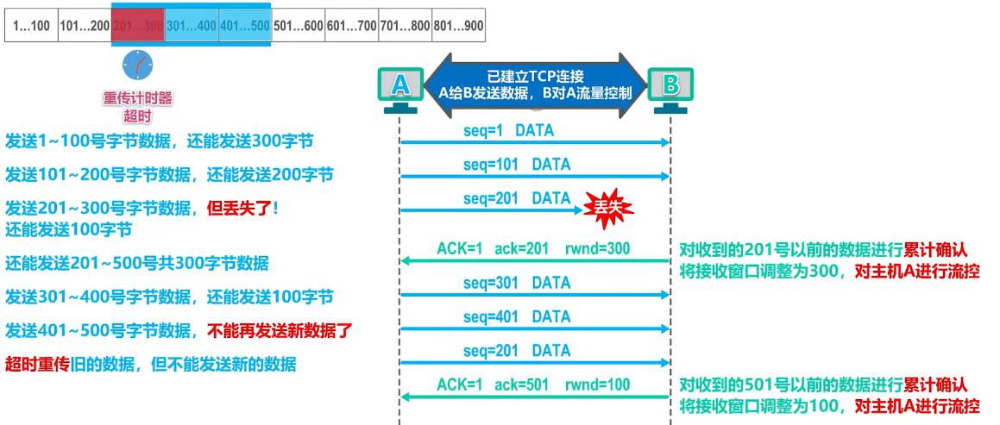

### 零窗口与发送暂停
+ **第二次确认**：B 收到重传的 `201~300` 报文段后，数据按序到达。B 发送累积确认：`ACK = 501`，并调整 `rwnd = 100`。
+ **窗口再次滑动**：A 收到确认，删除缓存中 `201~500` 的数据，发送窗口滑动至 `501~600`（大小为 100）。A 发送 `501~600` 的报文段后，窗口额度再次耗尽。
+ **零窗口通知**：B 收到 `501~600` 后，发送确认报文：`ACK = 601`，并调整 `rwnd = 0`。
+ **发送暂停**：A 收到零窗口通知，将发送窗口调整为 0。此时 A **不能再发送普通的 TCP 数据报文段**，流量控制生效，A 进入等待状态。


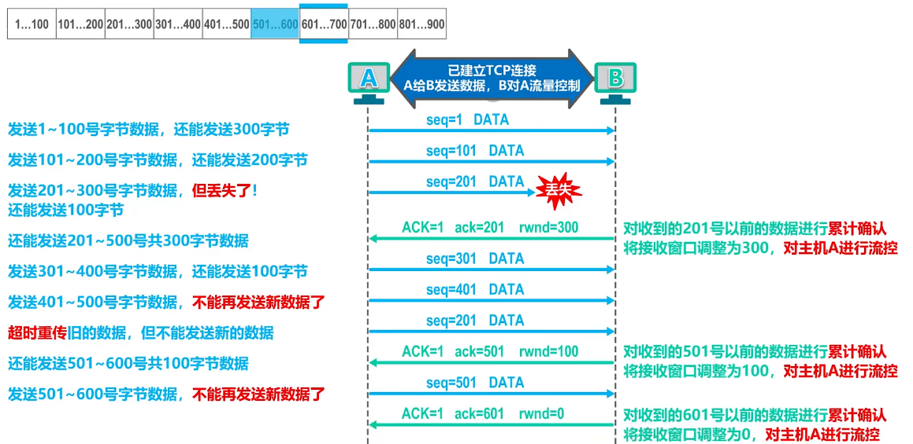

---

## 3.零窗口死锁问题与持续计时器
### 死锁的产生场景
当主机 B 发送 `rwnd = 0` 的报文后，若其应用层随后从接收缓存中读取了部分数据，腾出了存储空间，B 会向 A 发送一个窗口更新报文（如 `rwnd = 300`）。  
**风险**：如果这个窗口更新报文在网络中**丢失**，主机 A 将一直等待非零窗口通知而拒绝发送数据；主机 B 则一直等待 A 发送数据以触发新的确认。双方互相等待，形成**死锁（Deadlock）**。


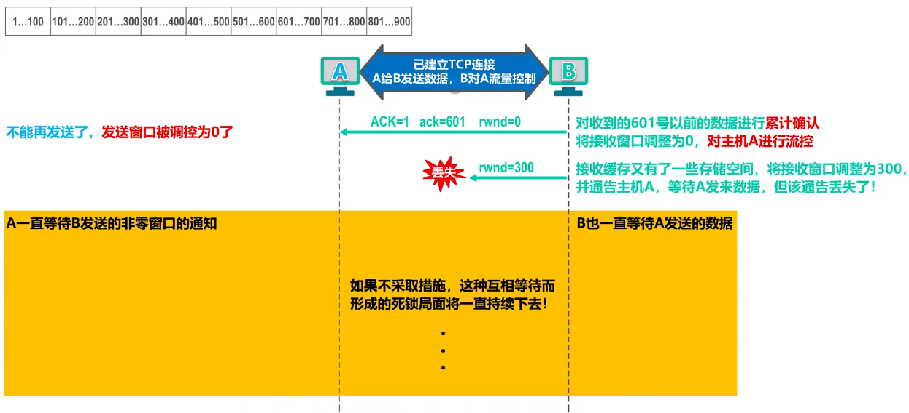

### 持续计时器（Persist Timer）机制
为了防止死锁，TCP 为每个连接引入了**持续计时器**：

+ 当发送方（A）收到接收方（B）的**零窗口通知**时，立即启动持续计时器。
+ 若计时器超时，A 会向 B 发送一个**零窗口探测报文段（Zero-Window Probe）**，该报文段仅携带 **1 字节**的数据。
+ B 收到探测报文后，必须在确认报文中返回当前的 `rwnd` 值：
    - 若 `rwnd` 仍为 0，A 重启持续计时器，等待下次超时再探测。
    - 若 `rwnd` 大于 0，死锁被打破，A 恢复数据发送。


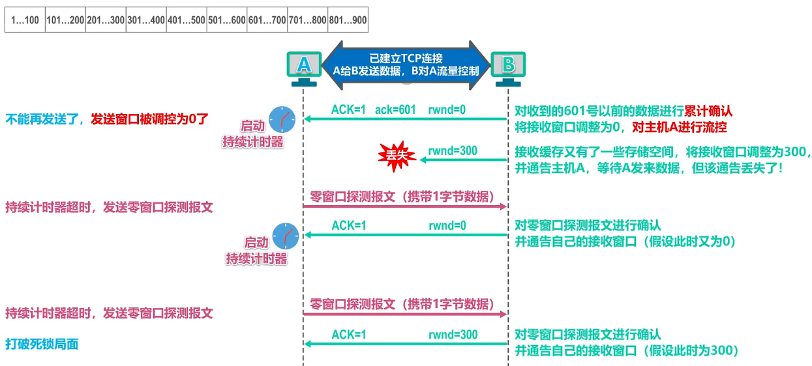

### 零窗口探测报文的特殊规定与丢失处理
+ **强制接收规定**：TCP 协议明确规定，即使接收窗口为 0，接收方也**必须**接收并处理以下三类报文：
    1. 零窗口探测报文段
    2. 确认报文段（ACK）
    3. 携带紧急数据（Urgent Data）的报文段
+ **探测报文丢失处理**：如果零窗口探测报文段在网络中丢失，**持续计时器**会采用指数退避算法再次超时，并触发探测报文的重传，从而保证死锁最终能够被打破。（_注：此处由持续计时器本身控制重传，而非普通的数据重传计时器 RTO_）。

---

## 4.考研真题解析

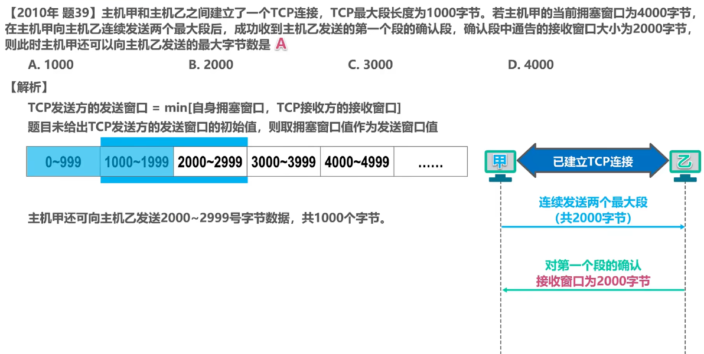
主机甲向主机乙发送数据。甲的初始发送窗口为 4000 字节（本题假设忽略拥塞控制限制，或认为初始拥塞窗口足够大，发送窗口仅受限于初始设定）。甲连续发送两个最大报文段，共 2000 字节（序号 `0~999` 和 `1000~1999`）。乙对第一个报文段进行确认，并在确认报文中告知当前接收窗口 `rwnd = 2000` 字节。  
**问题**：甲此时还能向乙发送多少字节的数据？

**解析过程**：

1. **初始发送**：甲发送了序号 `0~1999` 的数据，共 2000 字节。
2. **确认与窗口滑动**：甲收到乙对第一个报文段（`0~999`）的累积确认（`ACK = 1000`）。甲的发送窗口左边界滑动至 1000。
3. **窗口大小更新**：根据乙返回的 `rwnd = 2000`，甲将发送窗口大小调整为 2000 字节（假设 cwnd 仍大于 2000）。
4. **计算剩余可发送量**：
    - 当前发送窗口覆盖的序号范围为：`1000 ~ 2999`（共 2000 字节）。
    - 窗口内**已发送但未确认**的数据为第二个报文段：`1000 ~ 1999`（共 1000 字节）。
    - **还能发送的数据量** = 窗口总大小 - 已发送未确认数据 = 2000 - 1000 = **1000 字节**（即序号 `2000 ~ 2999` 的数据）。

**答案**：1000 字节（对应原题选项 A）。

---

## 5.补充：后端开发视角下的流量控制实践
在实际的网络编程与系统调优中，理解 TCP 流量控制具有以下实战意义：

1. **接收缓冲区与** `rwnd` **的关系**
    - 操作系统内核为每个 TCP Socket 维护了一个**接收缓冲区（Receive Buffer）**。`rwnd` 的大小本质上反映了该缓冲区的剩余可用空间。
    - 当应用层（如你的 C++ 服务端程序）调用 `recv()` 或 `read()` 读取数据的速度**慢于**网络数据到达的速度时，接收缓冲区会被填满，内核会自动将 `rwnd` 缩减，甚至发送 `Zero Window` 报文。
    - **优化手段**：若发现服务端吞吐量上不去，可通过 `setsockopt()` 调整 `SO_RCVBUF` 增大接收缓冲区，或优化应用层业务逻辑，加快 Socket 数据的消费速度。
2. **网络抓包与故障排查**
    - 在生产环境中，若客户端反馈下载慢或请求延迟高，可使用 `tcpdump` 或 `Wireshark` 抓包。
    - 若过滤出大量的 `TCP ZeroWindow` 和随后的 `TCP Window Update` 报文，通常意味着**接收端的应用层处理出现了瓶颈**（如数据库查询慢、锁竞争导致读取 Socket 阻塞），而非网络本身的带宽问题。
3. **粘包/拆包与流量控制的关联**
    - 由于 TCP 是面向字节流的，且发送窗口大小动态变化，发送方可能会将多个应用层消息合并在一个 TCP 报文段中发送（粘包），或者将一个消息拆分到多个报文段中（拆包）。
    - **工程实践**：在 C++ 后端开发中，必须在应用层设计明确的**协议帧边界**（如 `Header(Length) + Body` 格式），并在接收端通过状态机或循环读取来正确拼装完整的业务消息，而不能依赖 TCP 报文段的边界。

---

# 五、TCP的拥塞控制
## 1.拥塞控制的基本概念
在计算机网络中，若在某段时间内对网络中某一资源的需求超过了该资源所能提供的可用部分，网络性能就会显著下降，这种情况称为**拥塞（Congestion）**。网络资源主要包括链路容量、交换节点的缓存和处理机等。若出现拥塞且不加以控制，整个网络的吞吐量将随输入负载的增大而急剧下降。

通过“吞吐量 vs 输入负载”曲线可以直观理解拥塞控制的作用：

+ **理想拥塞控制**：在吞吐量达到网络饱和之前，吞吐量等于输入负载（呈 45 度斜线）；达到饱和后，吞吐量维持在最大值（水平线），多余的输入负载被合理丢弃或限制。
+ **实际无控制网络**：随着输入负载增大，吞吐量增长率逐渐减小（轻度拥塞）；当负载达到某一临界值时，吞吐量反而随负载增大而下降（拥塞状态）；若负载继续增大，吞吐量可能降为零，导致网络**死锁**。


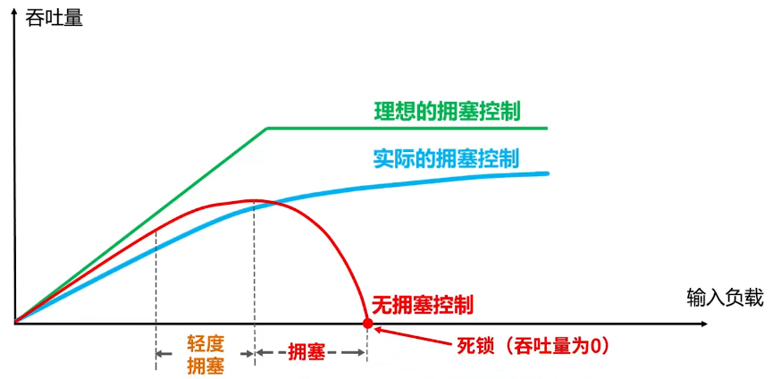

因此，拥塞控制的核心目的是使实际网络的吞吐量曲线尽量贴近理想曲线，防止网络崩溃。

---

## 2.拥塞控制算法的前提假设
为了聚焦于拥塞控制的核心机制，在理论分析时通常作以下简化假设：

1. **单向数据传输**：假设数据是单向传送的，反向链路仅传送确认报文（ACK）。
2. **接收方缓存无限大**：假设接收方总有足够大的缓存空间，即接收窗口（rwnd）不会成为瓶颈。此时，**发送方的发送窗口大小仅由拥塞窗口（cwnd）决定**（即 `发送窗口 = cwnd`）。
3. **以 MSS 为单位**：讨论问题时以 TCP 最大报文段（MSS）的个数为单位，而非字节。


> **核心状态变量**：
>
> + **拥塞窗口（cwnd）**：其值取决于网络的拥塞程度并动态变化。原则是：网络无拥塞则增大 cwnd，出现拥塞则减小 cwnd。判断拥塞的依据通常是**未按时收到确认（超时重传）** 或**收到重复确认**。
> + **慢开始门限（ssthresh）**：用于界定慢开始与拥塞避免算法的切换边界。
>

---

## 3.TCP 的四种拥塞控制算法
TCP 的拥塞控制主要包含四种算法：**慢开始（Slow Start）**、**拥塞避免（Congestion Avoidance）**、**快重传（Fast Retransmit）** 和**快恢复（Fast Recovery）**。

### （1）慢开始与拥塞避免（Tahoe 版本，1988年）
+ **慢开始（Slow Start）**：
    - **触发条件**：`cwnd < ssthresh` 时执行。
    - **增长规则**：发送方每收到一个对新报文段的确认，就将 `cwnd` 加 1。这意味着在一个传输轮次（RTT）结束后，`cwnd` 的值会翻倍，呈**指数级增长**（1 -> 2 -> 4 -> 8...）。
    - **概念澄清**：“慢开始”并非指窗口增长速度慢，而是指在连接建立初期，向网络注入的报文段数量较少，避免瞬间冲垮网络。
+ **拥塞避免（Congestion Avoidance）**：
    - **触发条件**：`cwnd >= ssthresh` 时执行。
    - **增长规则**：每个传输轮次（RTT）结束后，`cwnd` 仅**线性加 1**。
    - **概念澄清**：“拥塞避免”并非指完全能避免拥塞，而是指在此阶段让窗口缓慢线性增长，使网络不至于过快进入拥塞状态。
+ **超时重传处理（严重拥塞判定）**：  
当发送方检测到超时重传时，认为网络发生了严重拥塞，采取以下措施：
    1. 将 `ssthresh` 更新为发生拥塞时 `cwnd` 值的一半（`ssthresh = cwnd / 2`）。
    2. 将 `cwnd` 重置为 1。
    3. 重新开始执行**慢开始**算法。


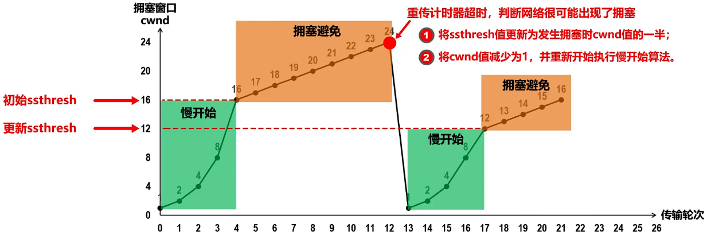

### （2）快重传与快恢复（Reno 版本，1990年）
在实际网络中，个别报文段的丢失可能只是因为链路偶发错误，而非全局拥塞。如果一律按超时重传处理并触发慢开始，会严重降低传输效率。

+ **快重传（Fast Retransmit）**：
    - **机制**：要求接收方在收到失序报文段时，**立即发送重复确认**（而不是等待发送数据时进行捎带确认）。
    - **触发**：发送方一旦连续收到 **3 个重复确认**，就认为该报文段丢失，**立即重传**丢失的报文段，而不等待重传计时器超时。


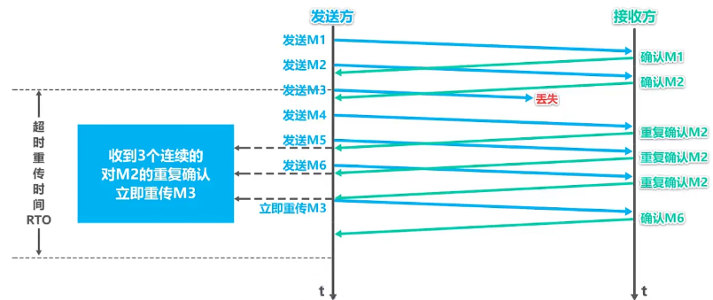

- **收益**：可尽早发现丢包，使网络整体吞吐量提高约 20%。

+ **快恢复（Fast Recovery）**：
    - **机制**：发送方收到 3 个重复确认时，认为网络只是个别丢包，并未发生严重拥塞（因为有 3 个报文已经安全离开网络，缓存在接收方）。因此，**不启动慢开始**，而是执行快恢复。
    - **状态调整**：
        1. 将 `ssthresh` 更新为当前 `cwnd` 的一半（`ssthresh = cwnd / 2`）。
        2. 将 `cwnd` 设置为新的 `ssthresh` 值（部分实现如 NewReno 会设置为 `ssthresh + 3`）。
        3. 随后直接执行**拥塞避免**算法（线性增长）。


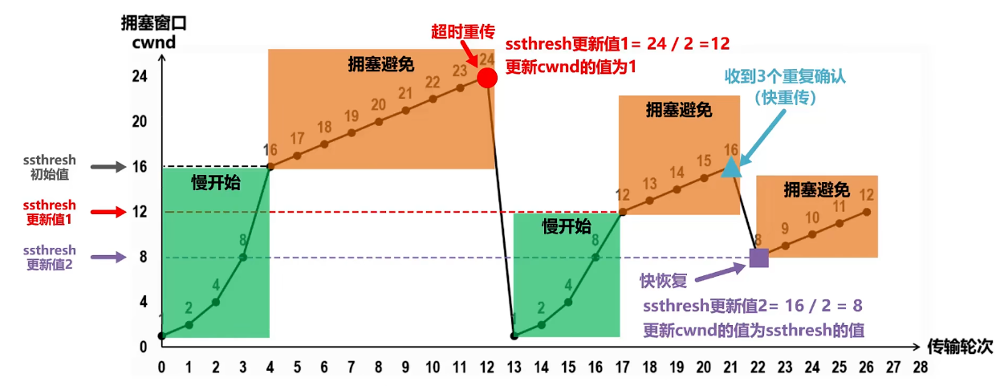

---

## 4.拥塞控制状态转换总结
| 触发事件 | 慢开始门限 (ssthresh) | 拥塞窗口 (cwnd) | 后续执行算法 |
| :--- | :--- | :--- | :--- |
| **连接初始化 / 超时重传** | `cwnd / 2` | `1` | 慢开始 |
| **收到 ACK (cwnd < ssthresh)** | 不变 | 每个 ACK 加 1 (指数增长) | 慢开始 |
| **收到 ACK (cwnd >= ssthresh)** | 不变 | 每个 RTT 加 1 (线性增长) | 拥塞避免 |
| **收到 3 个重复确认** | `cwnd / 2` | `ssthresh` (或 `ssthresh + 3`) | 拥塞避免 (快恢复) |


---

## 5.考研真题解析

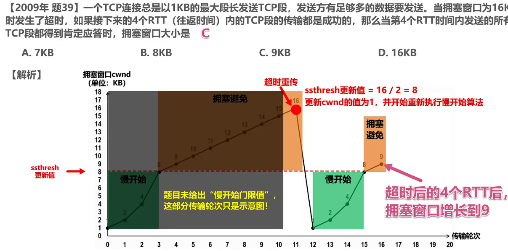
主机甲向主机乙发送数据，初始慢开始门限未知。当拥塞窗口增长到 `16 KB` 时，发生**超时重传**。问：在超时后的第 4 个往返时间（RTT/传输轮次）结束后，拥塞窗口的大小是多少？

**解析过程**：

1. **超时重传处理**：
    - 发生拥塞时的 `cwnd = 16 KB`。
    - 更新 `ssthresh = 16 / 2 = 8 KB`。
    - 重置 `cwnd = 1 KB`。
    - 开始执行**慢开始**算法。
2. **轮次推演**：
    - **第 1 个 RTT 结束**：`cwnd` 翻倍，变为 `2 KB`。（`2 < 8`，继续慢开始）
    - **第 2 个 RTT 结束**：`cwnd` 翻倍，变为 `4 KB`。（`4 < 8`，继续慢开始）
    - **第 3 个 RTT 结束**：`cwnd` 翻倍，变为 `8 KB`。（`8 == ssthresh`，下一轮转为拥塞避免）
    - **第 4 个 RTT 结束**：进入**拥塞避免**阶段，`cwnd` 线性加 1，变为 `8 + 1 = 9 KB`。

**答案**：`9 KB`（对应原题选项 C）。

---

## 6.补充：后端开发与系统调优视角下的拥塞控制
深入理解 TCP 拥塞控制对于高并发、大流量系统的网络调优至关重要。在实际生产环境中，需关注以下进阶知识：

**1. 拥塞控制算法的演进**

+ **CUBIC**：目前 Linux 内核默认的拥塞控制算法。它利用三次函数（Cubic Function）来调整窗口大小，在长肥网络（高带宽、高延迟）下比传统的 Reno 具有更好的带宽利用率。
+ **BBR (Bottleneck Bandwidth and Round-trip propagation time)**：由 Google 提出。传统的基于丢包的算法（如 CUBIC/Reno）在遇到随机丢包（如无线网络干扰）或浅缓存路由器时会误判为拥塞。BBR 不依赖丢包信号，而是通过探测网络的**最大带宽**和**最小 RTT** 来建立网络模型，从而在存在一定丢包率的网络中依然能跑满带宽，极大提升了吞吐量。

**2. 服务器内核参数调优**

在 Linux 后端服务器上，可以通过 `sysctl` 调整 TCP 拥塞控制相关参数：

+ **切换拥塞控制算法**：

```bash
# 查看当前系统支持的算法
sysctl net.ipv4.tcp_available_congestion_control
# 将默认算法修改为 BBR (需内核 >= 4.9)
sysctl -w net.ipv4.tcp_congestion_control=bbr
```

+ **初始拥塞窗口 (initcwnd)**：Linux 默认的初始 `cwnd` 为 10 个 MSS。对于短连接较多的 Web 服务（如 HTTP/HTTPS API），适当增大初始窗口（如通过 `ip route` 设置 `initcwnd 20`）可以显著减少首屏加载或首次请求的延迟。

**3. 丢包与拥塞的辩证看待**

在微服务架构或云原生环境中，跨机房通信可能会遇到偶发的网络抖动导致丢包。如果后端服务对延迟极其敏感（如实时竞价、高频交易），传统的 TCP 拥塞控制导致的窗口减半和重传等待可能无法满足 SLA。此时，部分核心系统会选择在 **UDP** 之上实现**应用层的可靠传输与自定义拥塞控制**（如 QUIC 协议），以绕过内核 TCP 协议栈的僵化限制，实现更精细的流量调度。

---

# 六、TCP的超时重传时间的选择
## 1.RTO 与 RTT 的基本关系
在 TCP 协议中，发送方发出数据后需要等待接收方的确认（ACK）。如果在一定时间内未收到确认，发送方就会重传该数据，这个等待时间被称为**超时重传时间（RTO, Retransmission Time-Out）**。而数据从发送方到达接收方，再由确认报文返回发送方所经历的时间，称为**往返时间（RTT, Round-Trip Time）**。

RTO 的设置大小直接影响 TCP 的传输效率：

+ **若 RTO < RTT**：会导致报文段在正常传输过程中被误判为丢失，引起**不必要的重传**，从而增大网络负荷。


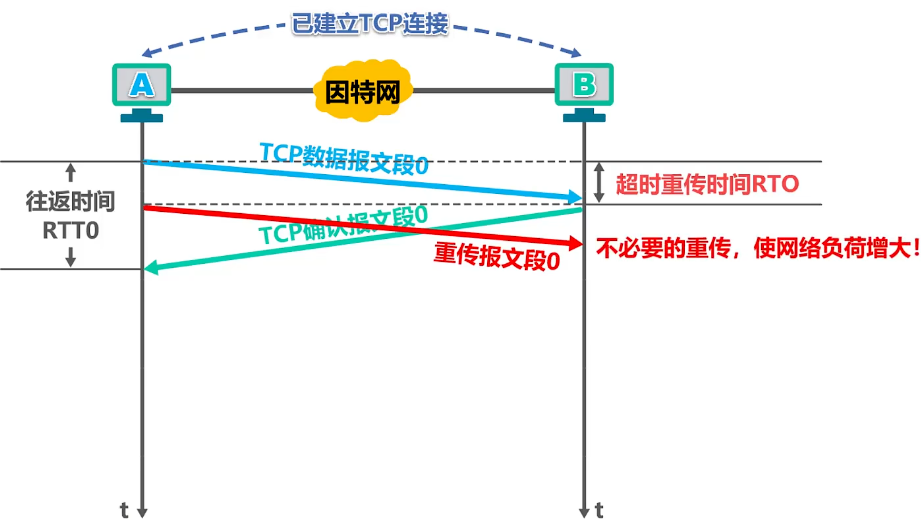

+ **若 RTO >> RTT**：当报文段真正丢失时，发送方需要等待很长时间才会触发重传，导致**重传推迟**，网络空闲时间增大，严重降低传输效率。


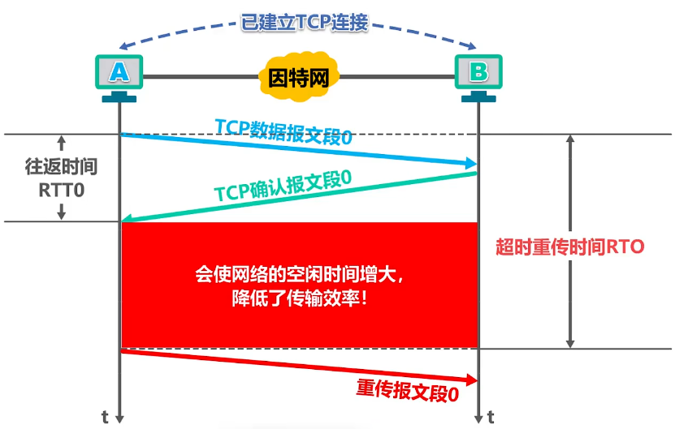

**基本结论**：RTO 的值应当**略大于** RTT 的值。然而，互联网环境极其复杂，报文段可能经过不同速率的链路和不同的路由，导致 RTT 是动态波动的。因此，不能直接使用单次测量的 RTT 样本，而需要通过算法计算平滑后的 RTT 值。

---

## 2.平滑往返时间（RTTs）与偏差（RTTd）的计算
为了得到平滑的往返时间，RFC 6298 标准推荐使用**指数加权移动平均（EWMA）** 算法来计算平滑往返时间（$RTT_S$）和 RTT 偏差的加权平均（$RTT_D$）。

**1. 平滑往返时间** $RTT_S$

+ **初始值**：当测量到第一个 RTT 样本时，$RTT_S = RTT_1$。
+ **更新公式**：以后每测量到一个新的 RTT 样本，按以下公式更新：

$$
RTT_S = (1 - \alpha) \times RTT_S + \alpha \times RTT_{new}
$$

- **参数说明**：$\alpha$ 的取值范围为 $0 \le \alpha < 1$。RFC 6298 推荐 $\alpha = 1/8 = 0.125$。
- **物理意义**：$\alpha$ 越小，新样本对 $RTT_S$ 的影响越小，结果越平滑；$\alpha$ 越接近 1，新样本的影响越大。


**2. RTT 偏差的加权平均** $RTT_D$

+ **初始值**：当测量到第一个 RTT 样本时，$RTT_D = RTT_1 / 2$。
+ **更新公式**：以后每测量到一个新的 RTT 样本，按以下公式更新：

$$
RTT_D = (1 - \beta) \times RTT_D + \beta \times |RTT_S - RTT_{new}|
$$

- **参数说明**：$\beta$ 的取值范围为 $0 \le \beta < 1$。RFC 6298 推荐 $\beta = 1/4 = 0.25$。


3. **超时重传时间 RTO 的计算**

得出 $RTT_S$ 和 $RTT_D$ 后，RTO 的计算公式为：

$$
RTO = RTT_S + 4 \times RTT_D
$$


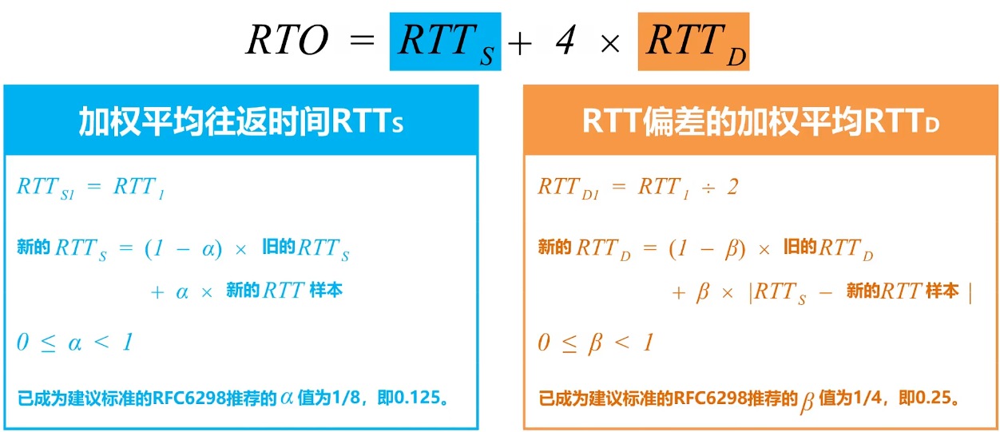

---

## 3.RTT 测量的二义性问题与 Karn 算法
在实际网络中，RTT 的测量并非总是准确的，尤其是在发生**超时重传**时，会产生**二义性问题**：

1. **场景一：报文段丢失导致重传**


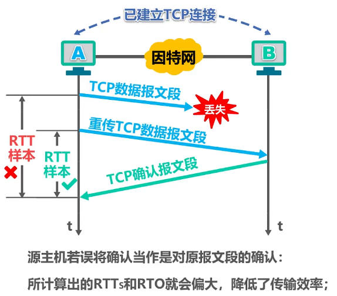

- 发送方发送报文段 A，丢失后超时重传 A'。接收方收到 A' 后发送 ACK。
- 发送方收到 ACK 时，**无法判断这是对原报文 A 的确认，还是对重传报文 A' 的确认**。
- 若误认为是对 A 的确认，测得的 RTT 会包含超时等待时间，导致计算出的 RTT **偏大**，降低传输效率。

2. **场景二：ACK 迟到导致重传**


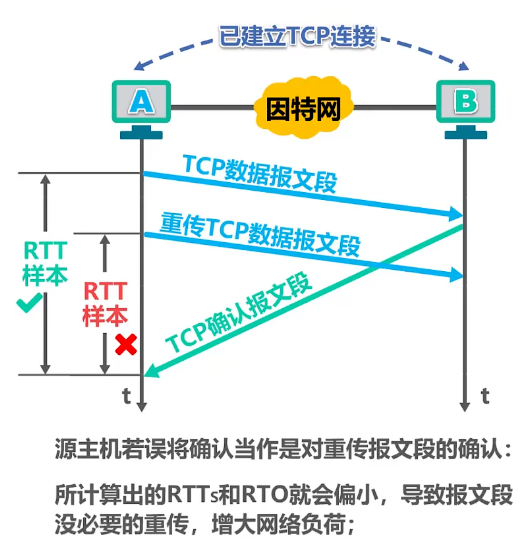

- 发送方发送报文段 B，接收方发送 ACK，但 ACK 迟到导致发送方超时重传 B'。随后迟到的 ACK 到达。
- 发送方收到迟到的 ACK 时，若误认为这是对重传报文 B' 的确认，测得的 RTT 会**偏小**，导致后续 RTO 设置过小，引发不必要的重传。


**Karn 算法的解决方案**：  
	针对上述二义性问题，Karn 提出：**只要报文段发生了重传，就不采用其 RTT 样本**。即在计算 $RTT_S$ 和 $RTT_D$ 时，忽略重传报文段的 RTT，保持 RTO 不变。

---

## 4.指数退避机制（RTO 的修正）
Karn 算法虽然解决了二义性问题，但引入了新的缺陷：  
	如果网络延迟突然增大且持续（如网络拥堵），根据 Karn 算法，RTO 不会被更新。这会导致 RTO 始终小于实际的网络延迟，从而引发**反复超时重传**。

**修正方案（指数退避）**：  
为了应对网络延迟的突然增大，TCP 引入了**指数退避机制**：

+ 报文段每重传一次，就将 RTO 增大。
+ 典型做法是：**新 RTO = 旧 RTO × 2**。
+ 当收到有效的 ACK 后，退避机制取消，恢复正常的 RTO 计算逻辑。

---

## 5.RTO 计算实例推演
假设我们依次测量到 5 个 RTT 样本，计算过程如下：

1. **第 1 个样本 (**$RTT_1$**)**：
    - $RTT_{S1} = RTT_1$
    - $RTT_{D1} = RTT_1 / 2$
    - $RTO_1 = RTT_{S1} + 4 \times RTT_{D1}$
2. **第 2 个样本 (**$RTT_2$**)**：
    - $RTT_{S2} = (1 - 0.125) \times RTT_{S1} + 0.125 \times RTT_2$
    - $RTT_{D2} = (1 - 0.25) \times RTT_{D1} + 0.25 \times |RTT_{S2} - RTT_2|$
    - $RTO_2 = RTT_{S2} + 4 \times RTT_{D2}$
3. **第 3、4 个样本 (**$RTT_3, RTT_4$**)**：
    - 同理代入公式，依次计算出 $RTO_3$ 和 $RTO_4$。
4. **第 5 个样本 (**$RTT_5$**) 与超时重传**：
    - 假设在等待第 5 个样本的 ACK 时，基于 $RTO_4$ 的计时器超时，触发了重传。
    - 根据 **Karn 算法**，不采用 $RTT_5$ 更新 $RTT_S$ 和 $RTT_D$。
    - 根据 **指数退避机制**，新的超时时间直接翻倍：$RTO_5 = 2 \times RTO_4$。


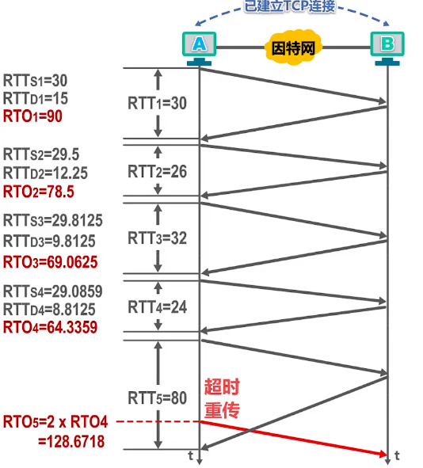

---

## 6.补充：后端开发与系统底层视角下的超时重传
深入理解 TCP 超时重传机制对于排查线上网络抖动、优化弱网环境下的接口响应具有重要意义。在实际生产环境中，需关注以下进阶知识：

**1. TCP 时间戳选项（TCP Timestamps）**

Karn 算法的“忽略重传样本”是一种妥协方案。为了彻底解决 RTT 测量的二义性问题，现代 TCP 协议引入了 **TCP 时间戳选项（RFC 7323）**。

+ **原理**：发送方在 TCP 首部中记录发送时的时间戳，接收方在 ACK 报文中回显该时间戳。发送方收到 ACK 后，用当前时间减去回显时间戳，即可精确计算出该特定报文段的 RTT。
+ **优势**：即使发生重传，发送方也能准确区分是对原报文还是重传报文的确认，从而**在重传时依然可以更新 RTT 样本**，废弃了 Karn 算法的忽略策略。
+ **工程实践**：在 Linux 系统中，可通过 `sysctl net.ipv4.tcp_timestamps` 查看或开启此功能（通常默认开启）。

**2. RTO 的下限限制（TCP_RTO_MIN）**

在计算 $RTO = RTT_S + 4 \times RTT_D$ 时，如果网络极好（如局域网内），计算出的 RTO 可能非常小（如几毫秒）。但在广域网中，微小的网络抖动或接收方延迟发送 ACK（Delayed ACK）都可能导致误判超时。

+ **内核限制**：Linux 内核强制规定了 RTO 的最小值（`TCP_RTO_MIN`），通常为 **200ms**。这意味着即使计算出的 RTO 小于 200ms，内核也会将其限制在 200ms，以防止在轻微抖动时发生“伪超时”。
+ **优化手段**：在数据中心内部（同机房极低延迟环境），200ms 的超时时间显得过长。可以通过修改内核参数或应用层使用 DPDK/用户态协议栈来突破此限制。

**3. 现代重传优化：TLP 与 RACK**

传统的 RTO 超时重传（尤其是尾部丢包时）会导致长达 200ms 甚至更久的延迟。现代 Linux 内核（3.x/4.x 及以上）引入了更先进的机制来减少对 RTO 的依赖：

+ **TLP (Tail Loss Probe)**：在连接空闲或发送窗口末尾时，主动发送一个探测包，利用接收方返回的重复 ACK 来触发快速重传，避免陷入 RTO 超时。
+ **RACK (Recent ACK)**：基于时间而非单纯的 ACK 数量来判断丢包。如果某个报文段发送后经过了一定时间（基于 RTT 计算）仍未被确认，即使没有收到 3 个重复 ACK，也会判定其丢失并立即重传。
+ **后端启示**：在排查服务端接口偶尔出现的“毛刺”延迟时，若抓包发现大量 RTO 超时，可检查内核版本是否支持并开启了 TLP/RACK，这能显著改善弱网环境下的 P99 延迟。

---

# 七、TCP可靠传输的实现
## 1.基于字节流的滑动窗口机制
TCP 的可靠传输是基于**以字节为单位的滑动窗口**来实现的。为简化理论分析，通常假定数据在连接中进行单向传输（即发送方发送数据报文段，接收方返回确认报文段），这样讨论可聚焦于发送方的**发送窗口**与接收方的**接收窗口**。

---

## 2.发送窗口的构造与移动规则
**1.发送窗口的构造**

接收方通过 TCP 报文段首部中的字段向发送方反馈状态：

+ **确认号（ACK）**：例如值为 `31`，表示序号 `30` 及以前的数据已全部正确接收，期望收到下一个序号为 `31` 的数据。
+ **窗口（Window）**：例如值为 `20`，表示接收方当前的接收窗口尺寸为 20 字节。

发送方据此构造自己的发送窗口。在忽略网络拥塞控制（即假设拥塞窗口足够大）的前提下，发送方将**发送窗口尺寸设置为 20 字节**（序号 `31 ~ 50`）。在未收到新确认的情况下，发送方可将窗口内的数据依次全部发送。凡是已发送但未确认的数据，必须保留在发送缓存中以备超时重传。


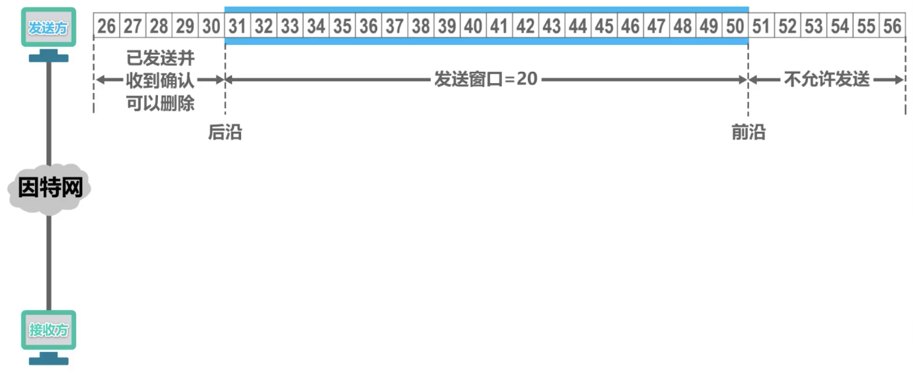

**2.发送窗口后沿的移动**

+ **不动**：未收到新的确认。
+ **向前移动**：收到了新的确认。
+ **不可能向后移动**：因为已收到的确认代表数据已被安全接收，不能被撤销。后沿后方的数据（已确认数据）可从发送缓存中删除。

**3. 发送窗口前沿的移动**

+ **向前移动**：收到新确认，且接收方通知的窗口大小未变或增大。
+ **不动**：未收到新确认且窗口大小未变；或收到新确认使窗口前移，但接收方通知的窗口缩小量恰好等于前移量。
+ **向后收缩**：接收方通知的窗口变小。**TCP 标准强烈不赞成窗口收缩**，因为发送方可能在收到缩小通知前，就已经发送了原窗口内的数据，强行收缩会导致协议状态混乱与错误。

---

## 3.发送窗口的状态维护
在底层网络协议栈或应用层模拟实现滑动窗口时，通常使用三个指针来精确维护发送窗口的状态：


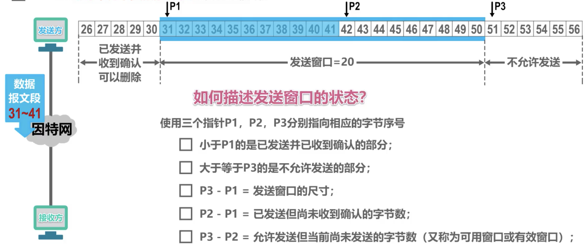

| 指针 | 含义 | 状态说明 |
| :--- | :--- | :--- |
| **P1** | 发送窗口后沿 | 指向已发送并收到确认的下一个字节（即未确认的最小序号）。`< P1` 的数据可从缓存删除。 |
| **P2** | 已发送未确认前沿 | 指向已发送但尚未收到确认的下一个字节（即允许发送但尚未发送的最小序号）。 |
| **P3** | 发送窗口前沿 | 指向当前允许发送的最后一个字节的下一个位置（即不允许发送的最小序号）。`>= P3` 的数据当前禁止发送。 |


**核心计算公式**：

+ **发送窗口尺寸** = `P3 - P1`
+ **已发送但未确认的字节数** = `P2 - P1`
+ **允许发送但尚未发送的字节数** = `P3 - P2`

---

## 4.接收窗口的处理与乱序数据管理
**1. 接收窗口的边界**

假设接收窗口尺寸为 20（序号 `31 ~ 50`）。


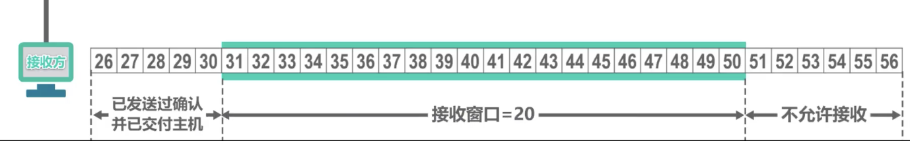

+ `<= 30` 的数据：已发送确认并交付给应用进程，从接收缓存中删除。
+ `31 ~ 50` 的数据：允许接收的窗口范围。
+ `>= 51` 的数据：超出接收窗口，当前不允许接收。

**2. 乱序数据的处理机制**

TCP 标准并未明确规定如何处理乱序到达的数据，但现代 TCP 实现通常选择**暂存而非丢弃**，以提高网络资源利用率，避免发送方不必要的重传。

+ **场景推演**：
    1. 接收方收到 `32`、`33` 号数据，但 `31` 号丢失或滞留。由于未按序到达，接收方将其**暂存于接收缓存**，并发送**重复确认**（确认号仍为 `31`，窗口仍为 `20`）。


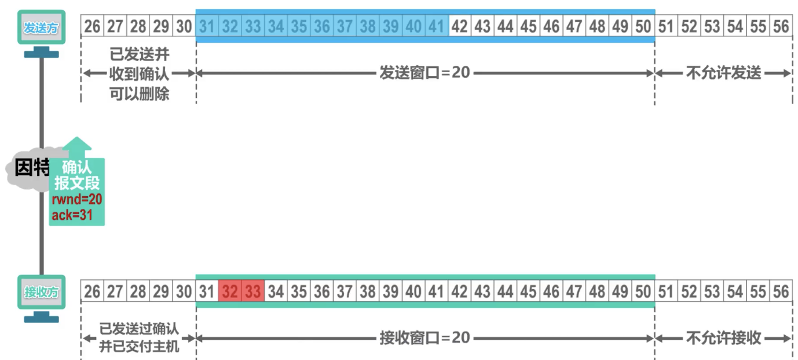

2. 当 `31` 号数据到达后，接收方将 `31 ~ 33` 号数据按序交付给应用进程，接收窗口向前滑动 3 个序号，并发送新的确认（确认号为 `34`）。


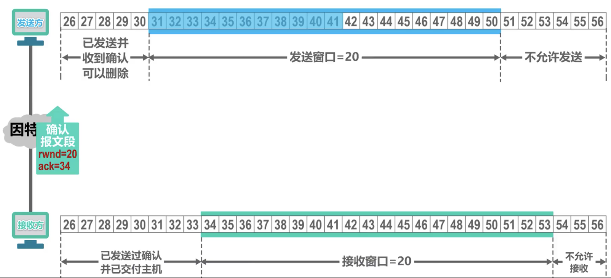

3. 若后续收到 `37`、`38`、`40` 号等乱序数据，同样暂存于缓存，等待缺失的字节（如 `34~36`、`39`）到达后再一并交付。


---

## 5.TCP 可靠传输的核心补充说明
### （1）发送窗口与接收窗口的差异
在同一时刻，发送方的发送窗口不一定等于接收方的接收窗口。原因包括：网络传输窗口值存在时间滞后；且发送方必须结合**拥塞窗口（cwnd）** 动态调整实际发送窗口（`发送窗口 = min(rwnd, cwnd)`）。

### （2）TCP 的确认机制
TCP 的确认机制是其可靠传输的核心，主要包含以下三个层面的设计：

**1. 累积确认（Cumulative Acknowledgment）**

TCP 默认采用累积确认机制，即接收方仅对按序收到的最高序号进行确认，大幅减少确认报文的数量。接收方发送的确认号（ACK=N）表示：**序号 N-1 及之前的所有字节均已按序正确接收**，期望收到下一个序号为 N 的字节。

+ **特点**：即使接收方收到了 N 之后的乱序报文，只要 N 没到，ACK 依然停留在 N。

**2.乱序缓存与重复确认（Duplicate ACK）**

与理论上的 GBN 不同，**TCP 接收方不会丢弃乱序到达的报文段**，而是将其暂存在接收缓存中。

+ 当接收方收到一个乱序报文（例如期望 100，却收到了 200）时，它会缓存 200，并**再次发送 ACK=100**。
+ 发送方连续收到多个相同的 ACK（即**重复确认，Dup ACK**），就能敏锐地察觉到网络中可能发生了丢包或严重乱序。

**3.选择性确认（SACK, Selective Acknowledgment）**

纯粹的累积确认存在“盲点”：发送方只知道哪些数据没收到，但不知道哪些乱序数据已经安全到达接收方。

+ **SACK 机制**：接收方在 TCP 选项字段中附加 SACK 块，明确告知发送方“我已经收到了哪些不连续的字节区间”（例如：`ACK=100, SACK=[200-300], [400-500]`）。
+ **意义**：这使得发送方能够精确构建出接收方的“数据空洞”，从而避免不必要的重传。

**4.捎带确认（Piggybacking）**

接收方在发送自己的反向数据时，顺便将确认信息放入 TCP 首部。若无反向数据，可推迟发送确认（**延迟确认，Delayed ACK**），但**推迟时间不应超过 0.5 秒**，以免引发发送方不必要的超时重传。若收到一连串最大长度报文段，通常每隔一个报文段发送一次确认。

---

### （3）TCP 的重传细节：重传所有还是指定重传？
针对“超时或丢包时，是重传 ACK 后的所有报文，还是指定某个报文重传”的问题，答案非常明确：**TCP 绝对不会盲目重传所有未确认报文，而是指定重传丢失或最早未确认的报文。**

**1. 超时重传（RTO 触发）**

+ **传统 TCP（无 SACK）**：当超时发生时，发送方**只重传发送窗口中最早未被确认的那个报文段**（即发送窗口后沿的第一个报文），而不是重传窗口内所有已发送的报文。
+ **现代 TCP（有 SACK）**：结合 SACK 信息，发送方知道哪些报文已经到达接收方。超时发生时，发送方会**重传 SACK 空洞中最前面的那个丢失报文**。

**2. 快速重传（Fast Retransmit 触发）**

+ 当发送方连续收到 **3 个重复的 ACK** 时，无需等待超时计时器到期，直接**指定重传该 ACK 所指示的那个丢失报文段**。
+ 若开启了 SACK，发送方甚至可以根据 SACK 块一次性重传多个确认丢失的报文段。

### （4）全双工通信的独立性
TCP 是全双工协议，通信双方同时具备发送方和接收方的角色。因此，双方都独立维护各自的发送窗口和接收窗口，在分析网络行为时，必须明确窗口所属的主体。

---

## 6.数据链路层的可靠传输和传输层TCP可靠传输的区别
### （1）数据链路层的可靠：相邻节点的“单跳交接”
+ **作用范围**：只负责**相邻两个节点**之间（比如：你的电脑 → 你的路由器，或者 路由器A → 路由器B）。
+ **主要应对**：物理线路上的干扰（如电磁干扰导致的比特翻转、信号衰减导致的帧丢失）。
+ **机制**：通常比较简单。发送方发一个“帧”，接收方校验（CRC）没问题就回一个“链路层 ACK”；如果超时没收到 ACK，或者校验出错，发送方就**立刻重传**这个帧。
+ **特点**：速度极快，延迟极低，因为它不需要跨越整个互联网，只在两个挨着的设备之间进行。

### （2）传输层的 TCP：源到目的的“全程监控”
+ **作用范围**：负责**源主机到目的主机**的整个漫长路径（端到端）。它跨越了无数个路由器和不同类型的链路。
+ **主要应对**：网络层的不可靠性（如某个骨干路由器太忙了导致**拥塞丢包**、路由改变导致**数据包乱序**等）。
+ **机制**：极其复杂。除了确认和重传，TCP 还有**流量控制**（防止把接收方压垮）和**拥塞控制**（防止把整个互联网压垮）。
+ **特点**：视野是全局的，机制是复杂的，延迟相对较高。

### （3）UDP 报文在数据链路层的可靠传输
当应用层发送一个 UDP 报文时，数据是这样往下走的：

1. **UDP** 给数据加上 UDP 首部。
2. **IP** 给 UDP 报文加上 IP 首部，变成 IP 数据报。
3. **数据链路层**（比如 Wi-Fi 网卡）给 IP 数据报加上 MAC 帧头和帧尾，变成 MAC 帧。

数据链路层的网卡在发送数据时，它**根本不看、也不认识**里面装的是 TCP 还是 UDP。在它眼里，这只是一个需要发送的“MAC 帧”。  
	如果你的电脑连着 Wi-Fi，Wi-Fi 协议（802.11）在链路层有重传机制。那么，**你的 UDP 报文在“电脑** $\rightarrow$ **路由器”这一跳，依然会享受 Wi-Fi 链路层的 ACK 和重传保护。** 如果这一跳因为信号不好丢了，Wi-Fi 网卡会自动帮你重传。

虽然链路层保护了 UDP 的“第一跳”，但链路层的保护是**有边界的**：

如果在路由器那里，因为网络太拥堵，路由器把你的 UDP 报文**直接丢弃了**。此时，**数据链路层无能为力**（因为报文已离开你的 Wi-Fi 链路了）。而 **UDP 协议本身又没有重传机制**，导致接收方永远收不到这个UDP报文，发送方也不知道。

### （4）核心区别总结
| 对比维度 | 数据链路层可靠传输 (如 Wi-Fi MAC层) | 传输层 TCP |
| :--- | :--- | :--- |
| **保护范围** | **局部（单跳）**：只保证相邻两个设备间不丢。 | **全局（端到端）**：保证从源头到终点全程不丢。 |
| **应对的错误** | 物理信号干扰、单条链路偶尔丢帧。 | 路由器拥塞丢包、网络延迟导致乱序。 |
| **是否管“拥塞”** | **不管**。链路层不知道整个网络堵不堵。 | **管**。有复杂的拥塞控制算法（如慢启动）。 |
| **处理速度** | 极快（微秒/毫秒级），硬件直接处理。 | 较慢（毫秒/秒级），操作系统软件协议栈处理。 |


| 对比维度 | 回退 N 帧 (GBN) | 选择重传 (SR) | TCP 协议实际实现 |
| :--- | :--- | :--- | :--- |
| **接收方对乱序报文的处理** | **直接丢弃**，不缓存。 | **缓存**乱序报文，等待缺失报文到达后一并交付。 | **缓存**乱序报文（类似 SR）。 |
| **确认机制** | **累积确认**。只确认按序到达的最高序号。 | **独立确认**。对每个正确接收的报文单独发送 ACK。 | **累积确认 + SACK**。默认累积确认，通过 SACK 选项提供选择性确认信息。 |
| **超时重传策略** | **重传所有**已发送但未确认的报文（窗口内全量重传）。 | **仅重传**真正超时的单个报文。 | **仅重传**最早未确认的报文，或 SACK 指示丢失的报文（类似 SR）。 |
| **接收窗口限制** | 发送窗口 $\le 2^n - 1$。 | 发送窗口 + 接收窗口 $\le 2^n$。 | 窗口大小动态调整（受 rwnd 和 cwnd 限制），无严格的 $2^n$ 理论限制（通过时间戳防止序号绕回）。 |
| **协议本质** | 极端的保守策略，实现简单但带宽浪费大。 | 理想的精确策略，实现复杂（需维护大量定时器）。 | **GBN 与 SR 的工程折中与进化**。利用累积确认降低 ACK 开销，利用缓存和 SACK 实现精确重传。 |


TCP 在**确认方式**上偏向 GBN（累积确认减少了网络中的 ACK 报文数量），但在**接收方行为**和**重传策略**上高度偏向 SR（缓存乱序包、只重传丢失包）。引入 SACK 后，TCP 几乎完全具备了 SR 的精确重传能力。

> **注意：**
>
> 在现代的**有线以太网**（插网线）中，数据链路层其实**不做可靠传输**！它只做 CRC 校验，如果发现帧错了，**直接丢弃，绝不重传**。  
为什么？因为有线的误码率极低，如果让链路层去重传，反而会拖慢整个网络的速度。有线网络把“重传”的烂摊子全扔给了上层的 TCP。  
**但是**，在**无线网络（Wi-Fi、4G/5G）** 中，因为空气干扰大，误码率高，所以**链路层（MAC层）必须做可靠传输（有 ACK 和重传机制）**，否则网络根本没法用。
>

---

## 7.考研真题解析
### 1. 2009年统考题 38

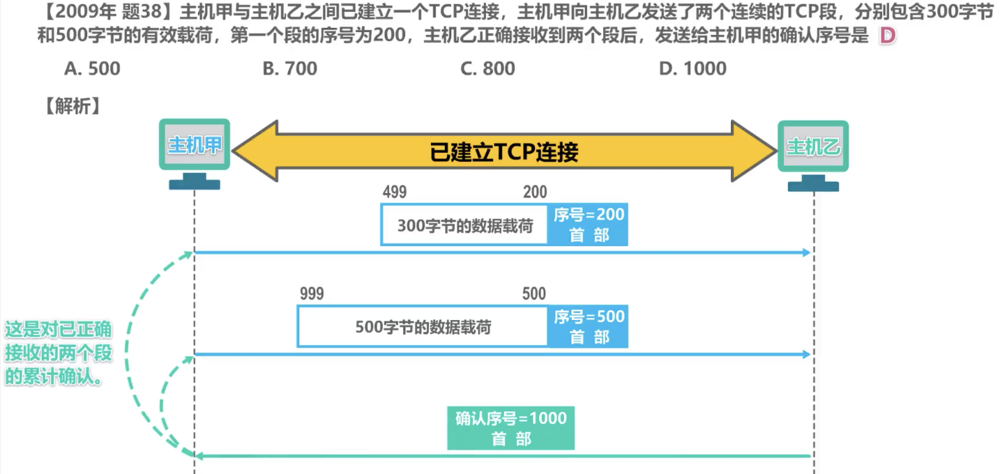

**解析**：

+ 报文段 1：序号 200，数据 300 字节 $\rightarrow$ 字节范围 `200 ~ 499`。
+ 报文段 2：紧接其后，序号 500，数据 500 字节 $\rightarrow$ 字节范围 `500 ~ 999`。
+ 确认逻辑：乙对两个报文段进行累积确认，期望收到下一个字节 1000。  
**答案**：**确认号为 1000**（对应选项 D）。

### 2. 2011年统考题 40

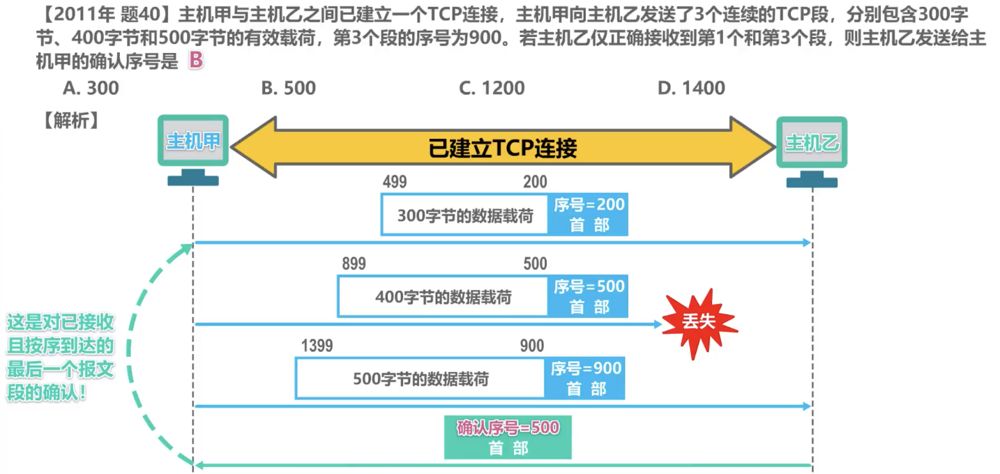

**解析**：

+ 报文段 3：序号 900，数据 500 字节 $\rightarrow$ 字节范围 `900 ~ 1399`。
+ 报文段 2：数据 400 字节，紧接在报文段 3 之前 $\rightarrow$ 序号 500，字节范围 `500 ~ 899`。
+ 报文段 1：数据 300 字节，紧接在报文段 2 之前 $\rightarrow$ 序号 200，字节范围 `200 ~ 499`。
+ 确认逻辑：乙收到了报文段 1 和 3，但报文段 2 丢失。TCP 只能对**按序到达**的最高序号进行累积确认。由于缺失 `500 ~ 899`，乙只能确认到报文段 1，期望收到的下一个字节是 500。  
**答案**：**确认号为 500**（对应选项 B）。

---

## 8.补充：后端开发视角下的可靠传输实践
深入理解 TCP 可靠传输的底层机制，对于优化高并发网络服务、排查线上延迟毛刺具有重要实战价值：

### 1. 延迟确认（Delayed ACK）与 Nagle 算法的死锁陷阱
+ **Nagle 算法**：为了减少网络中的小报文，TCP 默认开启 Nagle 算法。其规则是：若发送缓存中有**已发送但未确认**的数据，则新产生的小数据必须积攒到一个 MSS（最大报文段长度）才能发送。
+ **冲突场景**：当应用层执行“写小块请求 -> 阻塞读响应”的交互逻辑时，写操作受限于 Nagle 算法无法发出（因为上一个包的 ACK 还没回来）；而服务端的读操作受限于**延迟确认**机制，没有反向数据时不立即发 ACK。这会导致客户端陷入长达 0.5 秒的等待，表现为接口偶发的高延迟。
+ **工程实践**：在交互式后端服务（如 RPC 框架、Redis、数据库连接）中，通常通过 `setsockopt` 设置 `TCP_NODELAY` 选项来**禁用 Nagle 算法**，确保小包立即发送。

### 2. 乱序缓存（Out-of-Order Queue）与内存安全
+ 当接收端处理乱序数据时，内核需要分配额外的内存队列来暂存这些报文。
+ **安全风险**：在遭受恶意网络攻击（如攻击者故意发送大量乱序报文，但永远不发送缺失的“空洞”报文）时，可能导致接收端乱序队列膨胀，耗尽系统内存。现代 Linux 内核对此有严格的队列长度限制（如 `tcp_max_reordering`）和超时清理机制，后端开发者在调优内核参数时需权衡抗攻击能力与弱网环境下的吞吐量。

### 3. 零拷贝（Zero-Copy）与发送窗口流转
+ 传统的 `send()` 系统调用需要将数据从用户态拷贝到内核态的 TCP 发送缓存（Send Buffer），再交由滑动窗口机制发送。
+ **性能优化**：在 C++ 高并发网关或文件服务器中，可结合 `sendfile`、`splice` 或 `io_uring` 等零拷贝技术，直接在内核态完成数据到 TCP 发送窗口的流转，极大降低 CPU 上下文切换与内存拷贝的开销。

---

# 八、TCP的运输连接管理（重点）
## 1.TCP 的运输连接管理概述
TCP 是面向连接的协议，基于运输连接来传送 TCP 报文段。TCP 运输连接的管理包含三个必不可少的阶段：

1. **连接建立**：通过“三次握手”建立逻辑连接。
2. **数据传送**：基于已建立的连接进行可靠的数据传输。
3. **连接释放**：数据传输结束后，通过“四次挥手”释放连接。


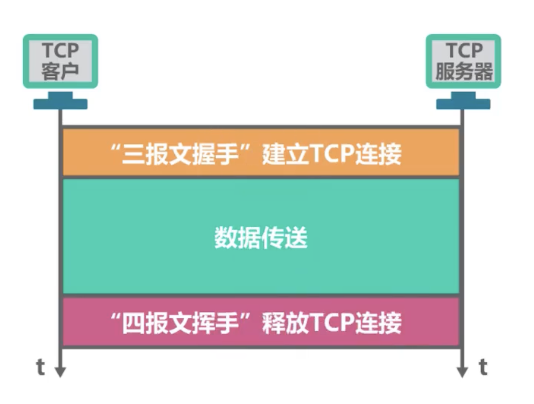

TCP 连接管理的核心目标是确保连接的建立和释放都能正常、安全地进行，避免资源浪费与状态混乱。

---

## 2.TCP 连接的建立（三次握手）
### （1）连接建立需解决的核心问题
在数据传输前，三次握手必须解决以下三个问题：

+ **确知对方的存在**：确保通信双方均在线且能够互相收发数据。
+ **协商通信参数**：协商最大窗口值、是否使用窗口扩大选项和时间戳选项、最大报文段长度（MSS）以及服务质量（QoS）等。
+ **分配运输实体资源**：双方为连接分配传输控制块（TCB）、发送/接收缓存、重传队列等系统资源。


### （2）三次握手详细过程与状态变迁
假设主机 A（TCP 客户端）主动向主机 B（TCP 服务端）发起连接。


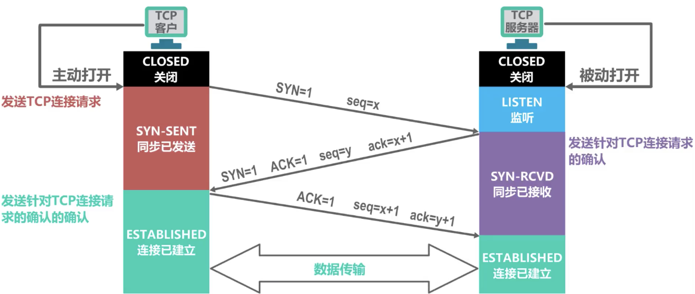

| 步骤 | 发送方 | 接收方 | 报文段标志位与关键字段 | 状态变迁 |
| :---: | :--- | :--- | :--- | :--- |
| **准备** | - | 服务端 | 创建 TCB，准备接受请求。 | `CLOSED` $\rightarrow$ `LISTEN` (被动打开) |
| **第一次** | 客户端 | 服务端 | **SYN=1**, **seq=x**   _(连接请求，不携带数据但消耗1个序号)_ | 客户端: `CLOSED` $\rightarrow$ `SYN-SENT` (主动打开) |
| **第二次** | 服务端 | 客户端 | **SYN=1**, **ACK=1**, **seq=y**, **ack=x+1**   _(连接确认，不携带数据但消耗1个序号)_ | 服务端: `LISTEN` $\rightarrow$ `SYN-RCVD` |
| **第三次** | 客户端 | 服务端 | **ACK=1**, **seq=x+1**, **ack=y+1**   _(普通确认，若携带数据则消耗序号，否则不消耗)_ | 客户端: `SYN-SENT` $\rightarrow$ `ESTABLISHED`   服务端: `SYN-RCVD` $\rightarrow$ `ESTABLISHED` |


> **传输控制块（TCB, Transmission Control Block）**：  
在 TCP 连接建立前，双方均需创建 TCB 以存储连接的核心信息，包括：本地与远端 IP/端口、指向发送/接收缓存的指针、重传队列指针、当前发送/接收序号、窗口大小等。在 Linux 内核中，TCB 主要体现为 `struct tcp_sock` 结构体。
>

### （3）为什么必须是“三次”握手？（防止历史连接干扰）
若简化为“两次握手”，将无法防止**已失效的历史连接请求**导致资源浪费。


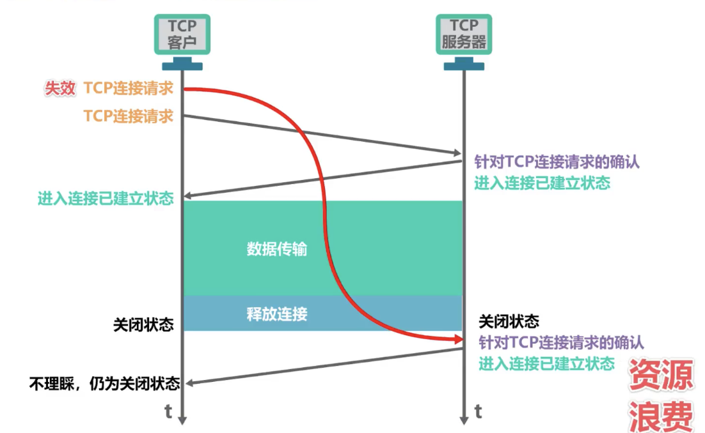

+ **异常场景**：客户端发送的连接请求报文在网络节点中长时间滞留，导致超时重传。重传的报文正常到达，双方完成两次握手并传输数据，随后正常释放连接。
+ **错误触发**：一段时间后，那个**滞留的历史请求报文**突然到达服务端。服务端误以为这是一个新的连接请求，于是发送确认报文并单方面进入 `ESTABLISHED` 状态，分配资源等待数据。
+ **结果**：由于是两次握手，客户端收到确认后不会再次回复，服务端将永远死等，白白浪费主机资源。**三次握手**要求客户端必须对服务端的确认进行最后一次回复，若客户端未发起新连接，则会忽略该历史确认，服务端超时后便会释放资源。

### （4）考研真题解析（2011年题39）

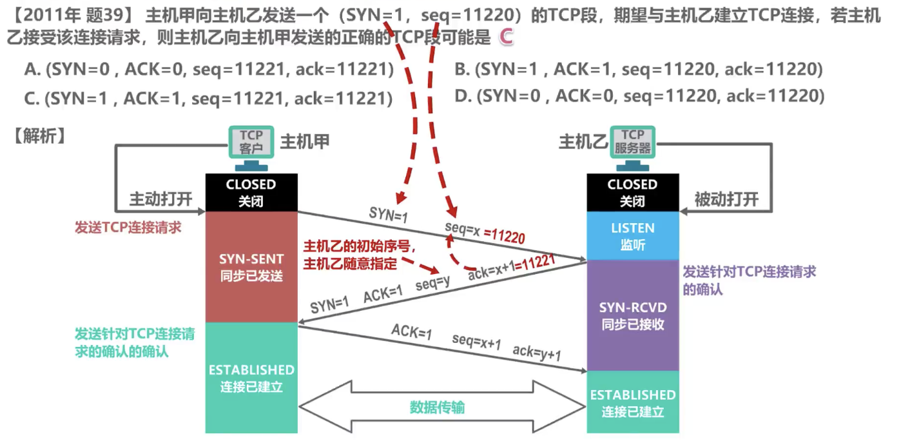

**解析**：

+ 乙回复的是连接确认报文，必须包含 **SYN=1** 和 **ACK=1**。
+ **确认号（ack）**：对甲初始序号的确认，故 `ack = 11220 + 1 = 11221`。
+ **序号（seq）**：乙自己选择的初始序号，可由乙**随机指定**，与甲的序号无关。题目选项中若 `seq=11221` 仅为巧合或迷惑项。  
**答案**：正确选项为包含 `SYN=1, ACK=1, seq=任意值(如11221), ack=11221` 的选项（原题选项 C）。

---

## 3.TCP 连接的释放（四次挥手）
TCP 通信是全双工的，因此连接的释放需要双方各自独立关闭自己的发送通道，这需要四个报文段来完成。

### （1）四次挥手详细过程与状态变迁
假设客户端主动发起连接释放（被动关闭方为服务端）。


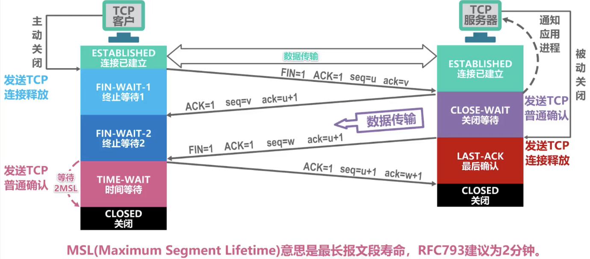

| 步骤 | 发送方 | 接收方 | 报文段标志位与关键字段 | 状态变迁 |
| :---: | :--- | :--- | :--- | :--- |
| **第一次** | 客户端 | 服务端 | **FIN=1**, **ACK=1**, **seq=u**, **ack=v**   _(释放请求，消耗1个序号)_ | 客户端: `ESTABLISHED` $\rightarrow$ `FIN-WAIT-1` |
| **第二次** | 服务端 | 客户端 | **ACK=1**, **seq=v**, **ack=u+1**   _(对 FIN 的确认)_ | 服务端: `ESTABLISHED` $\rightarrow$ `CLOSE-WAIT`   客户端: `FIN-WAIT-1` $\rightarrow$ `FIN-WAIT-2` |
| **第三次** | 服务端 | 客户端 | **FIN=1**, **ACK=1**, **seq=w**, **ack=u+1**   _(服务端数据发完，发送释放请求)_ | 服务端: `CLOSE-WAIT` $\rightarrow$ `LAST-ACK` |
| **第四次** | 客户端 | 服务端 | **ACK=1**, **seq=u+1**, **ack=w+1**   _(对服务端 FIN 的确认)_ | 客户端: `FIN-WAIT-2` $\rightarrow$ `TIME-WAIT`   服务端: `LAST-ACK` $\rightarrow$ `CLOSED` |
| **等待** | - | - | 客户端等待 **2MSL** 时间后关闭。 | 客户端: `TIME-WAIT` $\rightarrow$ `CLOSED` |


### （2）半关闭状态（Half-Close）
在第二次挥手后，客户端进入 `FIN-WAIT-2`，服务端进入 `CLOSE-WAIT`。此时，**客户端到服务端的连接已释放（客户端不再发送数据），但服务端到客户端的连接依然保持**。  
	如果服务端还有剩余数据需要发送，客户端必须继续接收。这种状态称为“半关闭状态”，直到服务端数据发送完毕并发送自己的 FIN 报文（第三次挥手）为止。

### （3）为什么需要 TIME-WAIT 状态（2MSL）？
客户端在发送最后一个 ACK 后，必须进入 `TIME-WAIT` 状态，等待 **2MSL**（Maximum Segment Lifetime，最长报文段寿命，RFC 793 建议为 2 分钟，现代系统常设置为 30s 或 60s）的时间才能进入 `CLOSED` 状态。其核心原因有二：

1. **确保最后一个 ACK 能够到达服务端**：若该 ACK 丢失，服务端会超时重传 FIN 报文。客户端在 `TIME-WAIT` 状态下可以再次接收 FIN 并重传 ACK。若直接进入 `CLOSED`，客户端将忽略重传的 FIN，导致服务端无法正常关闭。


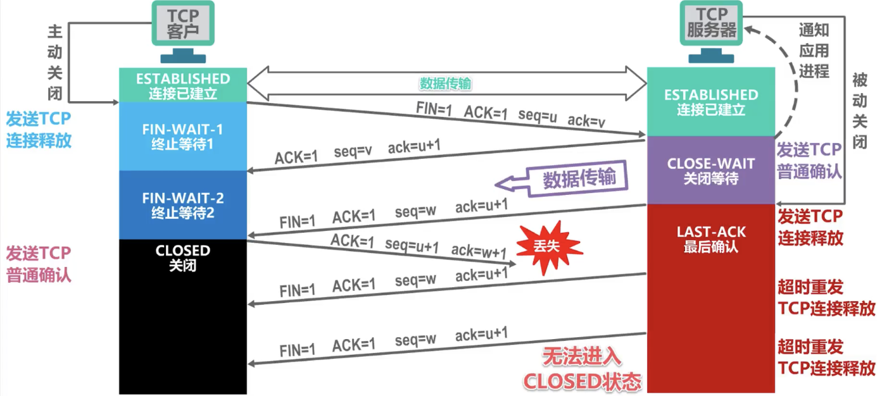

2. **让旧连接的报文在网络中消亡**：等待 2MSL 可确保本次连接产生的所有报文段都从网络中彻底消失，防止下一个复用相同四元组（源IP、源端口、目的IP、目的端口）的新连接收到属于旧连接的延迟报文，从而引发数据错乱。

---

## 4.TCP 保活计时器（Keepalive Timer）
若 TCP 双方建立连接后，客户端主机突然宕机或网络中断，服务端将永远收不到数据，导致连接资源被无效占用。为解决此问题，TCP 引入了**保活计时器** ：


+ **触发机制**：服务端每收到一次客户端的数据，就重置并启动保活计时器。
+ **探测过程**：若在定时周期内（默认通常为 2 小时）未收到任何数据，服务端将发送一个**探测报文段**。
+ **重试与关闭**：若未收到响应，则每隔 **75 秒**发送一次探测报文。若连续发送 **10 次**探测报文均无响应，服务端将判定对端主机故障，主动强制关闭该连接。

---

## 5.补充：后端开发视角下的连接管理实战
深入理解 TCP 连接管理的底层机制，对于排查线上故障、优化高并发网关具有决定性作用。以下是工程实践中的核心考点：

**1.半连接队列与全连接队列（SYN Flood 防御）**

在 Linux 内核中，服务端的三次握手状态变迁由两个队列管理：

+ **半连接队列（SYN Queue）**：处于 `SYN-RCVD` 状态的连接存放于此。大小由内核参数 `tcp_max_syn_backlog` 控制。
+ **全连接队列（Accept Queue）**：处于 `ESTABLISHED` 但尚未被应用层调用 `accept()` 取走的连接存放于此。大小由 `somaxconn` 和代码中 `listen(fd, backlog)` 的 `backlog` 参数共同决定（取两者较小值）。
+ **实战排障**：若高并发时客户端出现“连接超时”，但服务端 CPU/网络正常，通常是**全连接队列溢出**导致内核丢弃了第三次握手的 ACK。可通过 `netstat -s | grep overflowed` 查看溢出情况，并调大 `somaxconn` 解决。此外，开启 `tcp_syncookies` 可有效抵御 SYN Flood 恶意攻击。

**2.CLOSE_WAIT 堆积问题（代码级 Bug）**

+ **现象**：服务器出现大量 `CLOSE_WAIT` 状态的 Socket，最终导致文件描述符（FD）耗尽，服务拒绝新连接。
+ **根因**：`CLOSE_WAIT` 是内核在收到对端 FIN 并回复 ACK 后的状态。进入此状态后，**内核等待应用层调用** `close()` **来发送自己的 FIN**。如果代码中存在逻辑漏洞（如异常分支漏写 `close()`、连接池管理不当、死锁导致未能执行关闭逻辑），Socket 就会永远卡在 `CLOSE_WAIT`。
+ **解决**：排查代码逻辑，确保所有 Socket 生命周期结束时都能正确触发 `close()`。

**3. TIME_WAIT 过多的优化**

+ **现象**：高并发短连接场景（如 HTTP API 网关）下，服务端主动断开连接，产生海量 `TIME_WAIT`，耗尽本地可用端口（`ip_local_port_range`），导致无法向外部发起新请求。
+ **优化手段**：
    - 开启 `tcp_tw_reuse`：允许将 `TIME-WAIT` 状态的 Socket 重新用于新的 TCP 连接（需配合 TCP 时间戳选项使用），这是最安全的优化方式。
    - _避坑指南_：切勿盲目开启 `tcp_tw_recycle`。在 NAT（网络地址转换）环境下，`recycle` 会因时间戳校验失败而直接丢弃合法客户端的 SYN 报文（Linux 4.12 及以上内核已彻底移除此参数）。

**4. TCP Keepalive vs 应用层心跳包（Heartbeat）**

+ **局限性**：TCP 原生的 Keepalive 默认超时时间长达 2 小时，且无法区分“对端宕机”与“网络中间节点故障”，完全无法满足现代微服务对高可用和快速故障转移（Failover）的需求。
+ **工程实践**：在 C++ 后端开发中（如 RPC 框架、WebSocket、长连接网关），通常**关闭 TCP Keepalive**，转而在**应用层实现心跳机制（Ping/Pong 协议）**。应用层心跳可以在秒级甚至毫秒级发现死连接，并触发业务层的重连、节点剔除与流量调度。

---

# 九、TCP报文段的首部格式
## 1.TCP 报文段的基本结构
TCP 协议采用面向字节流的方式实现可靠传输。应用层交付的数据被视为无结构的字节流，存入 TCP 的发送缓存中。在发送数据时，TCP 从缓存中提取部分或全部字节，并附加一个 TCP 首部，封装成 **TCP 报文段（TCP Segment）** 后交由网络层发送。


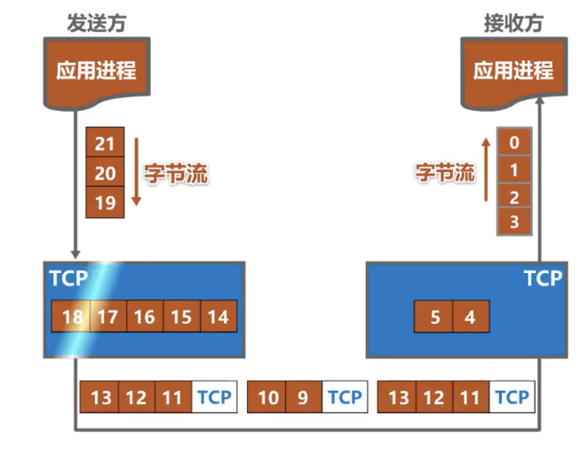

一个完整的 TCP 报文段由**首部**和**数据载荷**两部分组成。TCP 协议的核心功能（如可靠传输、流量控制、拥塞控制、连接管理）均通过首部中的各个字段来实现。TCP 首部格式与 IP 数据报首部类似，包含 **20 字节的固定首部**和**最大 40 字节的可选首部**。

---

## 2.固定首部字段解析（20 字节）
TCP 固定首部包含以下核心字段，用于标识进程、维护字节流序号及实施流量控制：


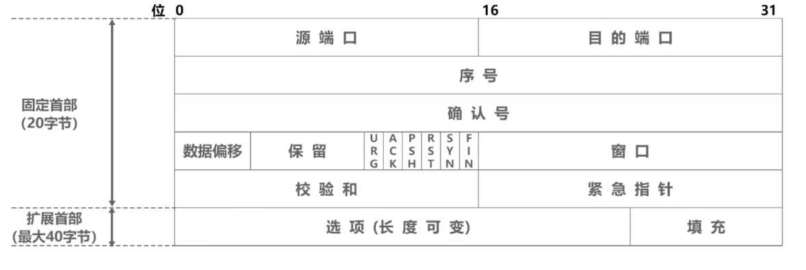

| 字段名称 | 长度 | 说明 |
| :--- | :---: | :--- |
| **源端口** | 16 bit | 标识发送该报文段的应用进程。 |
| **目的端口** | 16 bit | 标识接收该报文段的应用进程。 |


**端口号应用实例**：  
	当主机浏览器（客户端）访问 Web 服务器时，浏览器构建 TCP 报文段，**源端口**填写操作系统分配的短暂端口（如 `49152`），**目的端口**填写 HTTP 熟知端口 `80`。


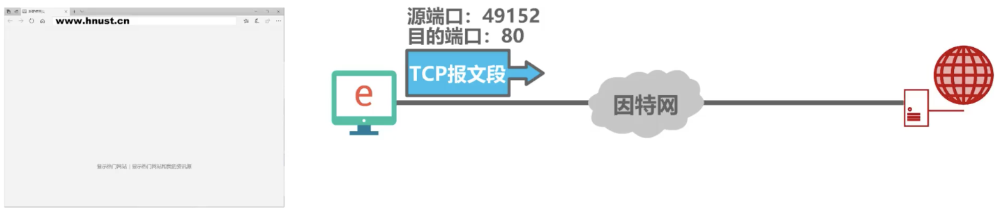

Web 服务器收到后，根据目的端口 `80` 将数据上交 Web 进程；响应时，Web 服务器将**源端口**设为 `80`，**目的端口**设为 `49152`，确保数据准确返回浏览器进程。


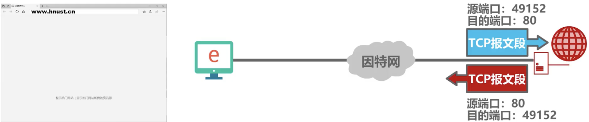

| 字段名称 | 长度 | 说明 |
| :--- | :---: | :--- |
| **序号 (SEQ)** | **32 bit** | **指出本报文段数据载荷的第一个字节的序号。取值范围为** $0 \sim 2^{32}-1$**，达到最大值后循环回 0。** |


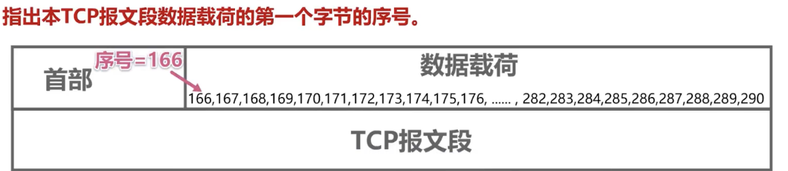

| 字段名称 | 长度 | 说明 |
| :--- | :---: | :--- |
| **确认号 (ACK)** | **32 bit** | **指出期望收到对方下一个报文段数据载荷的第一个字节序号。代表对之前所有数据的累积确认。若确认号为** $N$**，则表示序号** $N-1$ **及之前的数据已全部正确接收。** |


确认标志位ACK：取值为1时确认号字段才有效；取值为0时确认号字段无效。

TCP规定，在连接建立后所有传送的TCP报文段都必须把ACK置1.


| 字段名称 | 长度 | 说明 |
| :--- | :---: | :--- |
| **数据偏移** | **4 bit** | **以 4 字节为单位**，指出数据载荷起始位置距离报文段起始位置的距离（即首部长度）。最小值为 5（**首部固定长度为 20（5*4）字节，数据偏移字段最小值为** `0101`），最大值为 15（**首部最大长度为 60（15*4）字节，数据偏移字段最大值为** `1111`）。 |


| 字段名称 | 长度 | 说明 |
| :--- | :---: | :--- |
| **保留字段** | **6 bit** | **保留为今后使用，通常置为 0。（**_注：现代 TCP 实现中，部分保留位已被用于显式拥塞通知 ECN_**）。** |
| **窗口** | **16 bit** | 以字节为单位，指出发送本报文段一方的接收窗口大小。用于流量控制。实际发送窗口大小由接收窗口和拥塞窗口共同决定 **（取两者较小值）。** |
| **校验和** | **16 bit** | 用于检查整个 TCP 报文段（含 12 字节的伪首部）在传输过程中是否出现误码。 |
| **紧急指针** | **16 bit** | 以字节为单位，配合 URG 标志位使用，指明本报文段数据载荷中紧急数据的长度。 |


---

## 3.控制标志位详解
TCP 首部中包含 6 个控制标志位，用于管理连接状态和控制数据传输行为：


| 标志位 | 全称 | 功能说明 |
| :---: | :--- | :--- |
| **URG** | Urgent | **紧急标志**。置 1 时，表明报文段包含紧急数据，紧急指针字段有效。接收方需优先处理并直接上交应用层，无需在缓存中排队。 |
| **ACK** | Acknowledgment | **确认标志**。置 1 时，确认号字段有效。TCP 规定，**连接建立后所有传送的报文段 ACK 必须置 1**。 |
| **PSH** | Push | **推送标志**。置 1 时，接收方 TCP 会尽快将数据上交应用进程，而不必等待接收缓存填满。 |
| **RST** | Reset | **复位标志**。置 1 时，表明 TCP 连接出现严重异常，必须释放并重建连接；也可用于拒绝非法的报文段或拒绝建立连接。 |
| **SYN** | Synchronize | **同步标志**。在连接建立时用于同步序号。SYN=1 表示这是一个连接请求或连接确认报文段。 |
| **FIN** | Finish | **终止标志**。置 1 时，表明发送方数据已发送完毕，要求释放 TCP 连接。 |


---

## 4.可选字段与填充（最大 40 字节）
TCP 允许在首部添加选项以扩展协议功能。由于“数据偏移”字段以 4 字节为单位，若选项长度加上 20 字节固定首部后不能被 4 整除，则必须使用**填充字段（Padding）**（全 0）补齐。

常用的 TCP 选项包括：

1. **最大报文段长度（MSS, Maximum Segment Size）**
    - 指明 TCP 报文段**数据载荷部分**的最大长度（不包含首部）。在连接建立时双方协商，通常根据底层网络的 MTU（最大传输单元）计算得出（如以太网下 MSS 通常为 1460 字节）。
2. **窗口扩大选项（Window Scale）**
    - 由于固定首部中的窗口字段仅 16 位（最大 65535 字节），在高速宽带网络中不足以维持高吞吐量。该选项允许将窗口值左移指定的位数，从而扩大接收窗口的上限。
3. **时间戳选项（Timestamps）**
    - **计算 RTT**：用于精确测量往返时间，避免 Karn 算法在重传时的二义性问题。
    - **防止序号绕回（PAWS）**：在高速网络中，32 位序号可能在报文段生命周期内循环使用。时间戳可用于区分当前报文段与延迟到达的旧报文段。
4. **选择确认选项（SACK, Selective Acknowledgment）**
    - 传统的累积确认在遇到非连续丢包时会导致大量不必要的重传。SACK 允许接收方告知发送方哪些不连续的字节块已成功接收，使发送方仅重传真正丢失的数据。

---

## 5.核心机制深度剖析（补充扩展）
### （1）校验和与伪首部（Pseudo-Header）
TCP 的校验和计算不仅覆盖 TCP 首部和数据载荷，还包含一个 12 字节的**伪首部**。伪首部并不实际发送，仅用于计算校验和，其目的是确保 TCP 报文段确实到达了正确的目的 IP 地址。

+ **伪首部结构**：源 IP 地址（32 bit） + 目的 IP 地址（32 bit） + 全 0（8 bit） + 协议号 6（8 bit） + TCP 报文段总长度（16 bit）。

### （2）序号绕回（Sequence Number Wrap-around）与 PAWS
TCP 序号为 32 位，最大值为 $2^{32}-1$（约 42.9 亿）。在千兆或万兆网络中，序号可能在极短时间内耗尽并回绕到 0。若网络中存在延迟极大的旧报文，其序号可能与新连接的序号重合，导致数据错乱。

+ **PAWS（Protect Against Wrapped Sequences）机制**：通过 TCP 时间戳选项，接收方会比较报文段的时间戳。若收到一个序号合法但时间戳明显“陈旧”的报文，接收方会将其判定为旧报文并直接丢弃。

### （3）MSS 与 MTU 的关系
+ **MTU（Maximum Transmission Unit）**：数据链路层允许的最大帧大小（以太网通常为 1500 字节）。
+ **MSS 计算**：`MSS = MTU - IP 首部长度 (通常 20) - TCP 首部长度 (通常 20)`。因此，标准以太网下的 MSS 通常为 **1460 字节**。若网络中存在隧道封装（如 PPPoE、IPSec），MTU 会减小，MSS 也必须相应调小，以避免 IP 层分片。

---

## 6.C++ 后端开发视角下的 TCP 首部实践
深入理解 TCP 首部字段对于网络编程调优和线上故障排查至关重要：

### （1）Socket API 与 TCP 标志位的映射
+ **PSH 标志位与 Nagle 算法**：默认情况下，TCP 启用 Nagle 算法以合并小数据包，这会延迟 PSH 标志位的发送。在对延迟敏感的 RPC 或实时通信服务中，需通过 `setsockopt` 设置 `TCP_NODELAY` 选项禁用 Nagle 算法，确保数据立即发送并置位 PSH。

```cpp
int flag = 1;
setsockopt(sockfd, IPPROTO_TCP, TCP_NODELAY, (char *)&flag, sizeof(int));
```

+ **MSS 调整**：在特殊网络环境（如存在 GRE 隧道）下，可通过 `TCP_MAXSEG` 选项手动限制发送的 MSS 值，防止中间路由器进行 IP 分片，从而降低丢包率和延迟。

### （2）RST 报文段的触发场景与排查
在服务端日志中若发现连接被意外重置（Connection reset by peer），通常是因为收到了 RST 报文。常见触发原因包括：

+ 客户端在连接建立后未调用 `close()` 而是直接退出（进程崩溃），操作系统发送 RST。
+ 服务端向一个已经关闭的 Socket 继续写入数据（触发 `SIGPIPE` 信号并发送 RST）。
+ 接收方收到不属于任何已知连接的报文段（如服务器重启后丢失了 TCB 状态）。

### （3）抓包分析与 SACK 的价值
在生产环境中排查网络吞吐量下降或延迟毛刺时，使用 `tcpdump` 或 Wireshark 抓包是标准操作。

+ 若抓包发现大量 **TCP Retransmission**，且伴随 **TCP Dup ACK**，需检查是否开启了 SACK。若未开启 SACK，发送方在遇到“空洞”（如丢包 2、4，收到 1、3、5）时，会盲目重传 2 及之后的所有数据；开启 SACK 后，发送方能精准重传丢失的 2 和 4，极大提升弱网环境下的传输效率。Linux 系统默认开启 SACK（`net.ipv4.tcp_sack = 1`）。

---
