# 一、应用层概述
## 1. 计算机网络体系结构下层回顾
在进入应用层的学习之前，有必要对计算机网络体系结构中自底向上的前四层进行简要回顾：

+ **物理层 (Physical Layer)**：解决使用何种物理信号来传输比特流的问题。
+ **数据链路层 (Data Link Layer)**：解决数据分组在单一网络或单段链路上的传输问题。
+ **网络层 (Network Layer)**：解决数据分组在多个异构网络之间的传输与路由选择问题。
+ **运输层 (Transport Layer)**：解决端到端（即进程与进程之间）基于网络的通信问题。

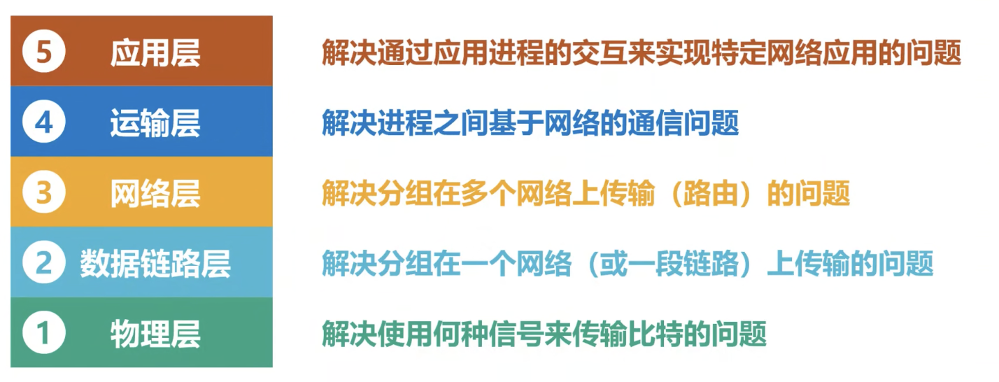

## 2. 应用层的定位与核心功能
应用层（Application Layer）是计算机网络体系结构的最顶层。其核心定位与功能如下：

+ **服务调用**：应用层享受其下层（运输层、网络层等）提供的通信服务。
+ **功能实现**：通过应用进程之间的交互，实现特定的网络应用功能。
+ **终极目标**：应用层是设计和建立计算机网络的最终目的，直接面向终端用户，也是计算机网络中发展最快、创新最活跃的层次。

## 3. 网络应用的发展历程与驱动因素
网络应用伴随着底层网络技术的发展而不断演进：

+ **早期基于文本的应用**：如电子邮件（Email）、远程登录（Telnet）、文件传输（FTP）以及新闻组（Usenet）等。
+ **Web 时代的爆发**：20世纪90年代，万维网（World Wide Web, WWW）的出现将因特网带入千家万户，极大地推动了互联网的普及。
+ **现代多元化应用**：当今互联网充斥着即时通信（IM）、P2P（Peer-to-Peer）文件共享、各类音视频流媒体应用等。

**未来发展的驱动因素**：  
	计算设备的小型化与泛在化（如物联网设备）、宽带住宅接入以及无线接入技术（如 5G/Wi-Fi 6）的迅速普及，为未来涌现更多新型网络应用提供了广阔的基础设施舞台。

## 4. 经典网络应用及其核心协议
本章将以经典的网络应用为切入点，深入学习其工作原理、应用层协议及底层实现机制。

**1.万维网 (WWW) 与 HTTP 协议**

+ **应用场景**：用户在浏览器地址栏输入域名即可访问网站内容。万维网是推动互联网飞速发展的核心应用。
+ **核心协议**：超文本传输协议（HTTP / HTTPS）。
+ **后端延伸**：HTTP 是后端开发中最核心的应用层协议，深入理解其请求/响应模型、状态码、Header 设计及 Keep-Alive 机制，对于开发高性能 Web 服务器（如 Nginx 底层逻辑）或微服务接口至关重要。

**2.域名系统 (DNS)**

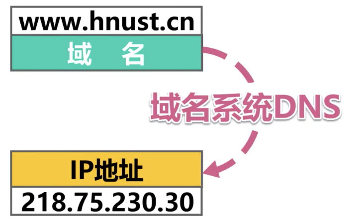

+ **应用场景**：用户习惯使用具有语义的“域名”进行访问，而 TCP/IP 体系的网络层使用“IP 地址”来标识目的主机。
+ **核心功能**：DNS 属于应用层范畴，负责在后台自动完成从域名到 IP 地址的映射与解析工作，屏蔽底层网络细节，提升用户体验。
+ **后端延伸**：后端架构中常涉及 DNS 负载均衡、全局流量调度（GSLB）以及本地 DNS 缓存优化，是保障服务高可用性的关键组件。

**3.其他常见网络应用**

除上述核心应用外，本章后续课程还将深入剖析以下经典应用及其协议：

+ **动态主机配置协议 (DHCP)**：用于局域网内自动分配 IP 地址及相关网络配置参数。
+ **电子邮件系统**：涉及简单邮件传输协议（SMTP）以及邮局协议（POP3）/互联网邮件访问协议（IMAP）。
+ **文件传送协议 (FTP)**：用于在网络上进行可靠的文件双向传输。
+ **P2P 文件共享**：去中心化的分布式网络架构，探讨节点发现与数据传输机制。
+ **多媒体网络应用**：探讨实时传输协议（RTP）及流媒体传输机制，分析延迟、抖动对音视频质量的影响。

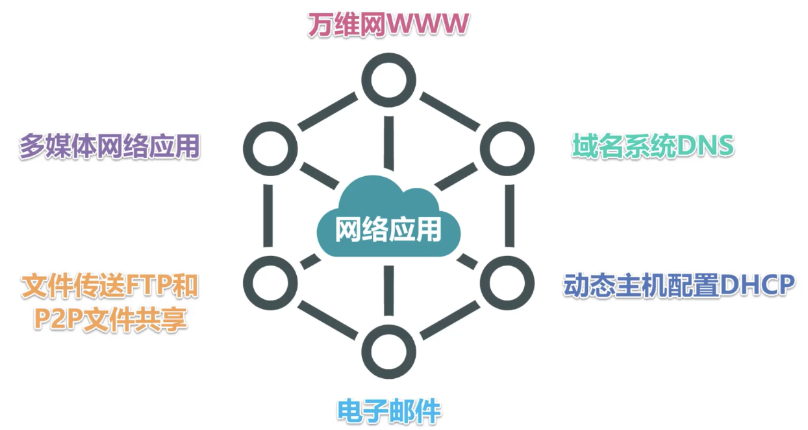

## 5. 本章学习路线与目标
+ **掌握原理**：理解各类经典网络应用的基本工作原理及架构模式（如 C/S 架构与 P2P 架构）。
+ **剖析协议**：深入分析 HTTP、DNS、SMTP、FTP 等核心应用层协议的报文格式与交互流程。
+ **指导实践**：结合 C++ 网络编程（如 Socket 编程、Reactor 模型），将理论知识转化为实际的后端网络服务开发能力。

---

# 二、客户——服务器方式和对等方式
网络应用程序运行在处于网络边缘的不同端系统上，通过彼此间的通信来共同完成特定任务。因此，在开发一种新的网络应用时，首要考虑的问题便是网络应用程序在各种端系统上的**组织方式**以及**节点间的交互关系**。

目前，网络应用最主流的架构模式主要有两种：**客户-服务器方式 (Client-Server, C/S)** 与 **对等方式 (Peer-to-Peer, P2P)**。

---

## 1. 客户-服务器方式 (Client-Server, C/S)
**1.核心概念与角色定义**

在 C/S 架构中，“客户”和“服务器”本质上是指通信中所涉及的两个**应用进程**。该方式描述的是进程之间**服务与被服务**的关系。

+ **客户 (Client)**：
    - **进程层面**：运行在主机 A 上的客户程序称为**客户进程**（主动发起通信的一方）。
    - **主机层面**：运行客户进程的主机通常称为**客户机 (Client Host)**，在语境明确时也常简称为“客户”。
+ **服务器 (Server)**：
    - **进程层面**：运行在主机 B 上的服务器程序称为**服务器进程**（被动等待并处理请求的一方）。
    - **主机层面**：运行服务器进程的主机通常称为**服务器 (Server Host)**，有时也简称为“服务器”。

.png>)

**2.工作特征与网络要求**

+ **交互模式**：客户是**服务的请求方**，主动发起连接；服务器是**服务的提供方**，被动接受连接。
+ **运行状态**：服务器进程必须始终保持运行状态，随时准备处理客户的请求；而客户进程仅在需要服务时才运行。
+ **网络寻址**：
    - **服务器**：必须具有**固定的 IP 地址**和**固定的知名运输层端口号**（例如，HTTP 服务器默认使用 80 端口，HTTPS 使用 443 端口）。
    - **客户机**：通常使用动态分配的 IP 地址和临时的运输层端口号，无需对外提供固定的网络入口。

**3.架构特点与扩展方案**

C/S 方式是因特网上最传统、最成熟的架构模式，广泛应用于万维网 (WWW)、电子邮件 (SMTP/POP3/IMAP)、文件传输 (FTP) 等经典网络应用。

+ **服务集中型**：应用服务集中在网络中数量远少于客户机的服务器节点上。
+ **性能瓶颈**：由于单台服务器需要为海量客户机提供服务，极易出现计算资源或网络带宽的瓶颈，导致无法及时响应众多请求。
+ **扩展方案（后端视角补充）**：
    - **基础设施扩展**：采用**计算机集群 (Cluster)** 或**服务器农场 (Server Farm)**，通过硬件堆叠构建强大的虚拟服务器。
    - **架构优化**：在现代 C++ 后端开发中，通常结合**负载均衡 (Load Balancing)**、**反向代理**、**微服务架构**以及**CDN (内容分发网络)** 来分散单点压力，提升系统吞吐量与高可用性。

---

## 2. 对等方式 (Peer-to-Peer, P2P)
**1.核心概念与角色定义**

在 P2P 架构中，**不存在固定的服务请求者和服务提供者**。分布在网络边缘各端系统中的应用进程地位对等，被称为**对等方 (Peer)**。

+ **交互模式**：对等方之间直接进行通信。每个对等方既是服务的请求者（下载数据），又是服务的提供者（上传数据）。
+ **工作示例**：假设主机 C、D、E、F 均运行同一种 P2P 下载软件。

.png>)

- E 和 F 互为对等方，C 和 D 互为对等方，同时 E 和 D 也互为对等方。
- 在实际运行中，节点 E 在从节点 F 下载文件片段的同时，也在为节点 D 提供已下载片段的上传服务。

**2.工作特征与应用场景**

+ **典型应用**：P2P 文件共享（如 BitTorrent）、部分即时通信工具、P2P 流媒体、分布式存储系统，以及近年来兴起的**区块链与 Web3 节点网络**。
+ **服务分散型**：服务不集中在少数数据中心，而是分散在大量对等计算机中。这些节点通常不属于服务提供商，而是由个人控制的桌面计算机、笔记本或边缘设备，广泛分布于住宅、校园和办公室网络中。

**3.架构优势与局限性**

+ **卓越的可扩展性 (Scalability)**：这是 P2P 最突出的特性。系统每增加一个对等方，不仅增加了一个服务请求者，同时增加了一个服务提供者。因此，系统的整体服务能力和性能不会因规模的增大而降低，反而可能增强。
+ **显著的成本优势**：P2P 充分利用了边缘设备的计算、存储和带宽资源，服务提供商无需投资庞大的数据中心设施和昂贵的服务器出口带宽。
+ **局限性（后端视角补充）**：
    - **网络穿透难题**：由于多数个人设备位于 NAT（网络地址转换）或防火墙之后，节点间的直接 P2P 通信需要复杂的**NAT 穿透技术**（如 STUN/TURN/ICE）。
    - **管理与安全**：缺乏集中控制导致节点管理困难、数据一致性难以保证，且容易面临版权争议和安全攻击（如恶意节点投毒）。

---

## 3. 架构对比与 C++ 开发启示
| 对比维度 | 客户-服务器方式 (C/S) | 对等方式 (P2P) |
| :--- | :--- | :--- |
| **角色划分** | 严格区分客户与服务器 | 无固定角色，均为对等方 (Peer) |
| **控制方式** | 集中式控制 | 分布式/去中心化控制 |
| **可扩展性** | 受限于服务器集群规模，扩展成本高 | 随节点增加自然扩展，扩展性极佳 |
| **单点故障** | 服务器宕机可能导致服务不可用 | 鲁棒性高，部分节点离线不影响全局 |
| **C++ 开发侧重点** | 侧重于**高并发服务器开发**（如 epoll、Reactor 模型、多线程/协程池、内存池优化）。 | 侧重于**分布式节点开发**（如 DHT 分布式哈希表、NAT 穿透、P2P 协议栈实现、节点状态机管理）。 |

在实际的复杂网络系统设计中，C/S 与 P2P 并非绝对互斥。现代大型网络应用（如大型多人在线游戏、现代流媒体分发）常采用**混合架构 (Hybrid Architecture)**：利用 C/S 架构进行用户认证、元数据管理与调度，同时利用 P2P 架构进行大体积数据块的高效分发，从而兼顾管理效率与传输性能。

---

# 三、动态主机配置协议DHCP
## 1. DHCP 的作用与应用场景
在构建计算机网络时，接入网络的每台主机都需要配置相关的网络参数，包括 **IP 地址、子网掩码、默认网关以及 DNS 服务器地址**。

+ **手工配置的痛点**：如果网络中的主机数量庞大，依赖网络管理员逐台手工配置不仅工作量巨大，而且极易出现 IP 地址冲突或配置错误，后期维护成本极高。
+ **DHCP 的自动化优势**：动态主机配置协议（Dynamic Host Configuration Protocol, DHCP）完美解决了这一问题。通过在局域网内部署一台 DHCP 服务器并预先配置好地址池和网络参数，网络中的各主机在开机时会自动启动 DHCP 客户端程序，向服务器请求并自动获取网络配置信息，全程无需人工干预。

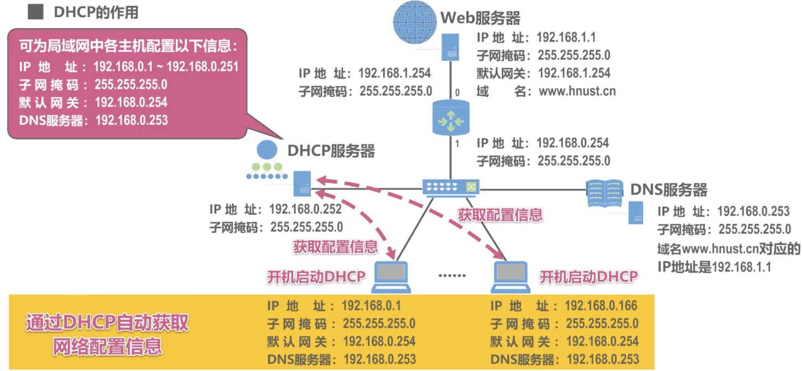

## 2. DHCP 协议基础与报文封装
DHCP 采用典型的**客户-服务器 (C/S) 架构**：

+ **DHCP 服务器**：运行在服务器端，负责管理和分配 IP 地址池，响应客户端的配置请求。
+ **DHCP 客户**：运行在用户主机上，负责发起配置请求并应用获取到的网络参数。

**协议栈封装过程**：  
DHCP 属于 TCP/IP 体系结构中的**应用层**协议，它依赖运输层的 **UDP** 提供服务。

+ **端口号**：DHCP 服务器监听熟知端口 **UDP 67**，DHCP 客户使用熟知端口 **UDP 68**。
+ **封装层级**：应用层的 DHCP 报文首先被封装为 UDP 用户数据报，接着在网络层被封装为 IP 数据报，最后在数据链路层被封装为相应的帧（如以太网帧）进行物理传输。

## 3. DHCP 的核心工作过程 (DORA 机制)
DHCP 的核心交互过程通常被称为 **DORA**（Discover, Offer, Request, ACK）。假设网络中存在多台 DHCP 服务器和一台新接入的用户主机，其完整交互流程如下：

**1.DHCP Discover (发现)**

.png>)

+ **触发条件**：主机启用 DHCP 且尚未获得 IP 地址。
+ **报文特征**：DHCP 客户以**广播**形式发送 Discover 报文。
    - **源 IP 地址**：`0.0.0.0`（因为客户尚未分配 IP）。
    - **目的 IP 地址**：`255.255.255.255`（受限广播地址）。
+ **核心字段**：报文中封装了随机生成的**事务 ID (Transaction ID)** 以及客户机的 **MAC 地址**。
+ **网络行为**：由于是广播报文，子网内所有设备都会收到。但只有监听 UDP 67 端口的 DHCP 服务器进程会接收并处理该报文，其他设备的非 DHCP 进程会将其丢弃。

**2.DHCP Offer (提供)**

.png>)

+ **触发条件**：DHCP 服务器收到 Discover 报文。
+ **处理逻辑**：服务器根据报文中的 MAC 地址查找本地数据库。若存在静态绑定记录，则使用指定配置；否则从动态地址池中挑选一个可用 IP。
    - _冲突检测_：服务器在分配 IP 前，通常会使用 ARP 或 ICMP Ping 探测该 IP 是否已被网络中其他主机占用，以确保分配的合法性。
+ **报文特征**：服务器以**广播**形式发送 Offer 报文（因为客户仍无 IP 地址，无法进行单播）。
    - **源 IP 地址**：DHCP 服务器的 IP 地址。
    - **目的 IP 地址**：`255.255.255.255`。
+ **核心字段**：包含事务 ID、提议的 IP 地址、子网掩码、租期、默认网关、DNS 服务器等配置信息。
+ **客户处理**：客户机收到多个 Offer 时，通过比对**事务 ID**确认是否为自己发起的请求。通常客户会选择**最先到达**的 Offer，并丢弃其他 Offer。

**3.DHCP Request (请求)**

.png>)

+ **触发条件**：客户机选定某个 DHCP 服务器的 Offer。
+ **报文特征**：客户机依然以**广播**形式发送 Request 报文。
    - **源 IP 地址**：`0.0.0.0`。
    - **目的 IP 地址**：`255.255.255.255`。
+ **设计意图**：采用广播而非单播的目的，是为了**同时通知网络中所有的 DHCP 服务器**。被选中的服务器将确认租约，而未被选中的服务器收到该报文后，会收回之前 Offer 的 IP 地址，以便分配给其他客户。
+ **核心字段**：包含事务 ID、客户 MAC 地址、接受的 IP 地址，以及**提供该租约的 DHCP 服务器的 IP 地址**。

**4.DHCP ACK (确认)**

.png>)

+ **触发条件**：被选中的 DHCP 服务器收到 Request 报文。
+ **报文特征**：服务器以**广播**形式发送 ACK (Acknowledgment) 确认报文。
+ **客户处理与冲突检测**：客户收到 ACK 后，在正式使用该 IP 之前，会发送**免费 ARP (Gratuitous ARP)** 探测网络，检测该 IP 是否真的未被占用。
    - **若发生冲突**：客户向服务器发送 **DHCP Decline (谢绝)** 报文，拒绝该租约，并重新发起 Discover 过程。
    - **若无冲突**：客户正式配置网络接口，开始与其他主机通信。

## 4. DHCP 租约管理与续约机制
DHCP 分配 IP 地址采用“租约 (Lease)”机制，客户机必须在租期到期前进行续约，以维持网络连接。

+ **T1 续约 (50% 租期)**：  
当租期过去一半时，客户机会向原 DHCP 服务器发送 **单播** 的 DHCP Request 报文（此时源 IP 为客户 IP，目的 IP 为服务器 IP）。
    - 若服务器同意，则回复 DHCP ACK 更新租期；
    - 若服务器不同意，则回复 **DHCP NAK (否认)**，客户机必须立即停止使用该 IP 并重新发起 Discover。

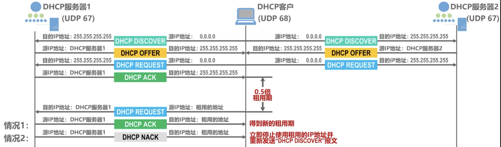

+ **T2 重新绑定 (87.5% 租期)**：  
若服务器在 T1 阶段未响应，当租期达到 87.5% 时，客户机会以**广播**形式发送 DHCP Request 报文，尝试向网络中**任何可用**的 DHCP 服务器请求续约。
+ **租期到期**：  
若在 T2 阶段仍未得到响应，当租期 100% 到期时，客户机必须立即停止使用该 IP，并重新发起 Discover 申请新地址。
+ **提前释放**：  
客户机若主动关机或断开网络，可随时向服务器发送 **DHCP Release** 报文，提前终止租约，释放 IP 资源。

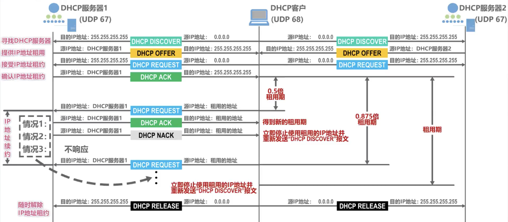

## 5. 跨网段配置：DHCP 中继代理 (Relay Agent)
**问题背景**：

.png>)

DHCP Discover 报文是链路层和网络层的广播报文，**路由器默认不会转发广播报文**。但是，如果每个子网都部署一台 DHCP 服务器，将导致硬件成本和管理成本急剧上升。

**解决方案**：引入 **DHCP 中继代理 (DHCP Relay Agent)**。

+ **工作原理**：在连接客户端所在子网的路由器上开启 DHCP 中继功能，并配置远端 DHCP 服务器的单播 IP 地址。
+ **交互过程**：当路由器收到客户端广播的 DHCP Discover 报文后，会将其修改为**单播**报文（源 IP 改为路由器接口 IP，目的 IP 改为指定的 DHCP 服务器 IP），并转发给远端服务器。后续的 Offer、Request、ACK 交互均通过该路由器进行单播中转。
+ **优势**：极大地减少了 DHCP 服务器的部署数量，实现了集中化管理。

.png>)

---

## 6. C+ 后端开发视角下的 DHCP 实现 (补充)
对于 C++ 后端开发工程师而言，若需开发自定义的 DHCP 服务器（如用于物联网设备管理、边缘计算网关或定制化网络准入控制），需重点关注以下底层技术细节：

### 1.UDP Socket 编程与 MAC 地址获取
+ **端口绑定**：服务端需绑定 `0.0.0.0:67`，并设置 `SO_REUSEADDR` 和 `SO_BROADCAST` 选项以处理广播流量。
+ **获取客户端 MAC**：在标准的 UDP `recvfrom` 中只能获取客户端的 IP 地址。由于 DHCP Discover 时客户端 IP 为 `0.0.0.0`，服务端必须通过底层 API 获取数据链路层的源 MAC 地址。在 Linux 下，通常需要使用 `recvmsg` 结合 `IP_PKTINFO` 或 `PACKET_AUXDATA` 控制消息，或者直接使用 `AF_PACKET` 原始套接字来抓取以太网帧头。

### 2.报文解析与构建 (网络字节序)
DHCP 报文基于早期的 BOOTP 协议，具有严格的定长结构（最小 576 字节）。

+ **结构体对齐**：在 C++ 中定义 DHCP 报文结构体时，必须使用 `#pragma pack(1)` 或 `__attribute__((packed))` 禁用编译器默认的内存对齐，确保报文长度与协议规范完全一致。
+ **字节序转换**：报文中的事务 ID (xid)、IP 地址等字段均采用**网络字节序 (大端)**，在解析和构建时务必使用 `ntohl`、`htonl` 等函数进行转换。

### 3.Options 字段的 TLV 解析
DHCP 的扩展配置（如租期、路由、DNS）存放在报文尾部的 `Options` 字段中。该字段采用 **TLV (Type-Length-Value)** 格式编码，且必须以 Magic Cookie (`99.130.83.99`) 开头，以 `255` (End 选项) 结束。开发时需编写健壮的 TLV 状态机解析器，防范恶意构造的畸形报文导致的越界读取 (Buffer Overflow)。

### 4.高并发与状态机管理
+ **租约状态机**：DHCP 服务器需要维护每个 IP 的状态（Free, Offered, Bound, Reserved）。在多核高并发场景下，需使用无锁队列或细粒度锁（如分段锁、读写锁）来保护 IP 地址池，避免超卖。
+ **持久化与容灾**：租约信息需定期持久化到磁盘或数据库（如 Redis/SQLite），防止服务器重启导致 IP 冲突或租约丢失。

---

# 四、域名系统DNS
## 1.域名系统 (DNS) 概述
### （1）DNS 的核心作用
在计算机网络中，主机之间的通信最终依赖于 IP 地址进行寻址（如使用 `ping` 命令测试连通性时，底层实际使用的是 IP 地址）。然而，IP 地址（如 `192.0.2.1`）不便于人类记忆。因此，因特网引入了**域名系统 (Domain Name System, DNS)**，其核心作用是建立**人类可读的域名**与**机器可读的 IP 地址**之间的映射关系。

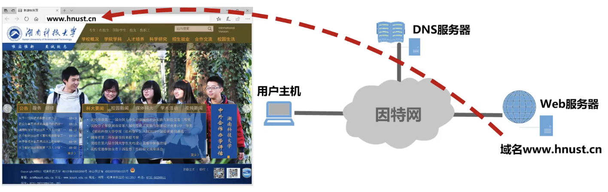

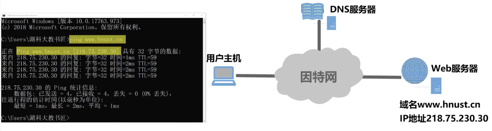

当用户在浏览器中输入 Web 服务器的域名时，用户主机会首先查询本地 DNS 缓存；若未命中，则向网络中的 DNS 服务器发送查询报文。DNS 服务器在其数据库中查找对应的 IP 地址并返回给用户主机，随后浏览器即可通过该 IP 地址建立 TCP 连接并访问目标内容。

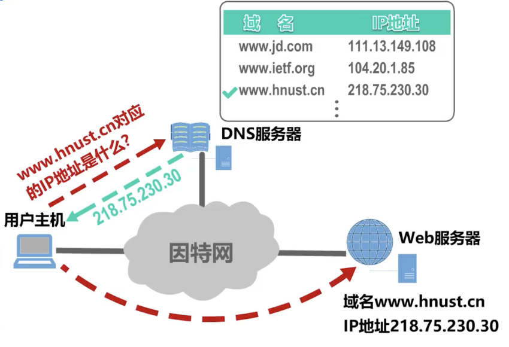

### （2）分布式架构的必然性
理论上，因特网可以只使用一台集中的 DNS 服务器来存储所有域名映射，但在工程实践中这种做法是不可取的：

+ **单点故障**：一旦该服务器宕机，整个因特网的域名解析将瘫痪。
+ **性能瓶颈**：全球海量的并发查询请求会轻易压垮单一服务器的计算与网络带宽。
+ **维护困难**：集中式数据库的更新和管理成本极高。

因此，自 1983 年起，因特网采用了**层次树状结构的命名机制**与**分布式域名系统**。这种设计使得大多数域名查询能够在本地或就近解析，仅少量查询需要在广域网上通信，极大地提高了系统效率与鲁棒性。

---

## 2.域名的层次树状结构
### （1）域名命名规则
域名空间呈现为一棵倒置的树结构。域名的结构由若干个分量组成，各分量之间用点（`.`）隔开，分别代表不同级别的域名。

+ **字符限制**：每一级域名由英文字母和数字组成，不区分大小写，单级长度不超过 **63 个字符**，完整域名总长度不超过 **255 个字符**。
+ **书写顺序**：级别最低的域名写在最左边，级别最高的顶级域名写在最右边

+ **管理权限**：DNS 既不规定一个域名必须包含多少个下级域名，也不规定每一级域名的具体含义。各级域名由其上一级的域名管理机构管理，而最高的顶级域名由 **ICANN**（因特网名称与数字地址分配机构）统一管理。

### （2）顶级域名 (TLD) 分类
顶级域名主要分为以下三类：

1. **国家顶级域名 (nTLD)**：采用 ISO 3166 标准，如 `.cn`（中国）、`.us`（美国）、`.uk`（英国）。
2. **通用顶级域名 (gTLD)**：最常见的早期通用顶级域名包括：
    - `.com`（公司企业）
    - `.net`（网络服务机构）
    - `.org`（非营利性组织）
    - `.int`（国际组织）
    - `.edu`（美国教育机构）
    - `.gov`（美国政府部门）
    - `.mil`（美国军事部门）
3. **反向域名 (arpa)**：用于反向域名解析，即将 IP 地址反向解析为域名。

### （3）二级域名的划分（以中国为例）
在国家顶级域名（如 `.cn`）下注册的二级域名由该国自行确定。我国将 `.cn` 下的二级域名划分为两类：

+ **类别域名（7个）**：`.ac.cn`（科研机构）、`.com.cn`（工商金融企业）、`.edu.cn`（教育机构）、`.gov.cn`（政府部门）、`.net.cn`（网络服务机构）、`.mil.cn`（军事机构）、`.org.cn`（非营利性组织）。
+ **行政区域名（34个）**：对应各省、自治区、直辖市。如 `.bj.cn`（北京）、`.sh.cn`（上海）、`.js.cn`（江苏）等。

_注：名称相同的域名在不同层级下含义可能不同。例如 _`.com`_ 是通用顶级域名，但在 _`.cn`_ 下也有一个名为 _`.com.cn`_ 的二级域名。_

---

## 3.域名空间与域名服务器分类
域名空间是一棵倒置的树，最顶端是**根节点**（无对应名称），根节点下一级是顶级域名，依次向下划分为二级、三级、四级域名等。例如：

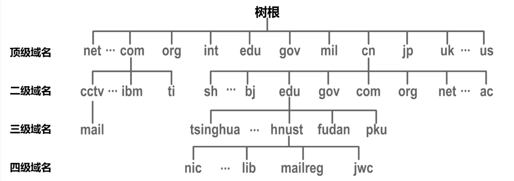

+ `cctv.com`、`ibm.com`、`mit.com` 属于 `.com` 顶级域名下的二级域名。
+ `tsinghua.edu.cn`、`hnust.edu.cn` 属于 `.edu.cn` 二级域名下的三级域名（分别代表清华大学、湖南科技大学）。
+ `nic.hnust.edu.cn` 则是湖南科技大学下属的四级域名（代表网络信息中心）。

为了实现高效的分布式解析，域名服务器被划分为以下四种类型：

| 服务器类型 | 职责与特点 |
| :--- | :--- |
| **根域名服务器** | 最高层次的服务器。全球共有 13 个逻辑根服务器（实际由分布在全球的集群构成，采用 **Anycast 任播技术**）。它们知道所有顶级域名服务器的 IP 地址，通常不直接解析最终 IP，而是返回顶级域名服务器的地址。 |
| **顶级域名服务器 (TLD)** | 负责管理在该顶级域名（如 `.com` 或 `.cn`）下注册的所有二级域名。返回权威域名服务器的 IP 地址或最终结果。 |
| **权威域名服务器**   _(部分教材称“权限域名服务器”)_ | 负责管理某个区（Zone）的域名。每个主机的域名必须在某台权威域名服务器处注册。它保存了该辖区内域名到 IP 地址的最终映射关系。 |
| **本地域名服务器**   _(默认域名服务器)_ | **不属于**上述层次结构。当主机发起 DNS 请求时，首先发送给本地域名服务器（通常由 ISP 提供）。它充当代理，负责向层次结构中的其他服务器发起查询。离用户较近，其 IP 地址需配置在用户主机的网络设置中。 |

---

## 4.域名解析过程与高速缓存
DNS 解析主要采用两种查询方式：**递归查询**与**迭代查询**。

### （1）查询方式

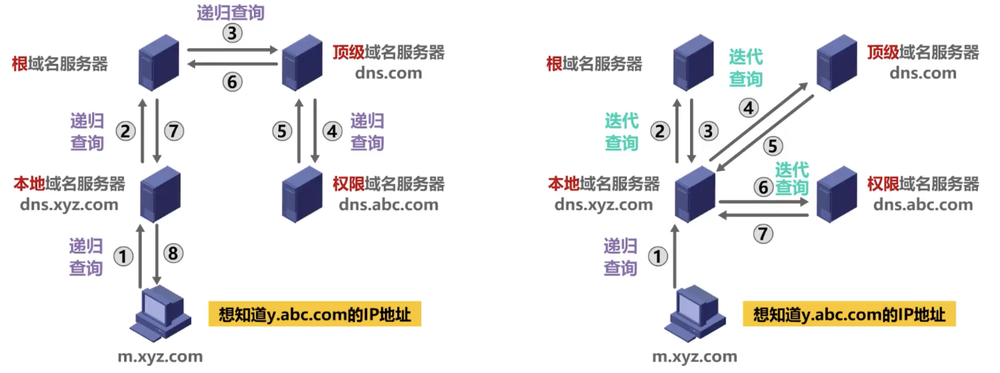

+ **递归查询 (Recursive Query)**：  
请求者要求被请求者必须给出最终答案（IP 地址或报错）。如果被请求者不知道，它必须自己去向其他服务器查询，直到获得结果。这种方式对被查询服务器的负担极大。
    - **应用场景**：通常仅用于 **用户主机** $\rightarrow$ **本地域名服务器** 之间的查询。
+ **迭代查询 (Iterative Query)**：  
被请求者如果不知道最终答案，会返回“下一步你应该去问谁”的提示（即下一级服务器的 IP 地址），由请求者自己去发起新的查询。
    - **应用场景**：通常用于 **本地域名服务器** $\rightarrow$ **根/顶级/权威域名服务器** 之间的查询。
    - **标准解析流程**：主机向本地 DNS 发起递归查询 $\rightarrow$ 本地 DNS 向根 DNS 发起迭代查询 $\rightarrow$ 根 DNS 返回 TLD DNS IP $\rightarrow$ 本地 DNS 向 TLD DNS 查询 $\rightarrow$ TLD DNS 返回权威 DNS IP $\rightarrow$ 本地 DNS 向权威 DNS 查询 $\rightarrow$ 获得最终 IP 并返回给主机。

### （2）高速缓存 (DNS Cache)
为了提高查询效率并减轻根服务器负担，DNS 系统广泛使用了高速缓存机制。

.png>)

+ **工作原理**：本地 DNS 服务器和主机操作系统都会缓存最近查询过的域名及其 IP 映射。
+ **TTL (生存时间)**：由于域名与 IP 的映射关系并非永久不变（如服务器迁移、负载均衡调度），缓存中的每条记录都带有一个 TTL 计时器。超过 TTL 的记录会被自动删除，以保证数据的最终一致性。

不但在本地域名服务器中需要高速缓存，在用户主机中也很需要。许多用户主机在启动时从本地域名服务器下载域名和ip地址的全部数据库，维护存放自己最近使用的域名的高速缓存，并且只在从缓存中找不到域名时才向域名服务器查询。同理，主机也需要保持高速缓存中内容的正确性。

### （3）完整的 DNS 解析链路 (从输入 URL 到获取 IP)
当用户在浏览器输入 `www.example.com` 并按下回车时，完整的解析过程如下：

1. **浏览器缓存 (Browser Cache)**：浏览器首先检查自身的 DNS 缓存（如 Chrome 的 `chrome://net-internals/#dns`）。若命中，直接返回 IP。
2. **操作系统缓存 (OS Cache)**：若浏览器未命中，查询 OS 级别的缓存（如 Windows 的 DNS Client 服务或 Linux 的 `systemd-resolved`）。
3. **本地 Hosts 文件**：若 OS 缓存未命中，读取本地 Hosts 文件（Windows: `C:\Windows\System32\drivers\etc\hosts`，Linux: `/etc/hosts`）。若存在静态映射，直接返回。
4. **本地 DNS 服务器 (Local DNS)**：若以上均未命中，OS 将 DNS 请求发送给配置的本地 DNS 服务器（如 ISP 提供的 DNS 或 `114.114.114.11`）。**此步骤主机向本地 DNS 发起的是递归查询**。
5. **根域名服务器 (Root DNS)**：本地 DNS 若无缓存，向根服务器发起**迭代查询**。根服务器返回 `.com` TLD 服务器的 IP 地址。
6. **顶级域名服务器 (TLD DNS)**：本地 DNS 向 `.com` TLD 服务器发起**迭代查询**。TLD 服务器返回 `example.com` 权威 DNS 服务器的 IP 地址。
7. **权威域名服务器 (Authoritative DNS)**：本地 DNS 向权威服务器发起**迭代查询**。权威服务器查询其区域文件（Zone File），返回 `www.example.com` 的最终 IP 地址。
8. **结果返回与缓存**：本地 DNS 将最终 IP 返回给客户端 OS，OS 返回给浏览器。同时，本地 DNS 和客户端 OS 均根据 TTL 将该记录写入各自的高速缓存。

### （4）特殊记录 (CNAME) 对解析过程的影响
在实际工程中，域名往往配置了 **CNAME (别名记录)**（常用于 CDN 调度或负载均衡）。

+ 如果权威服务器返回的不是 A 记录（IP 地址），而是 CNAME 记录（例如 `www.example.com` 别名指向 `cdn.example.com`），则本地 DNS 必须**重启解析流程**。
+ 本地 DNS 会对 `cdn.example.com` 再次从根服务器（或直接查询缓存）开始迭代查询，直到获取最终的 A 记录。这会增加额外的 RTT（往返时间）开销。

---

## 5.考研真题解析

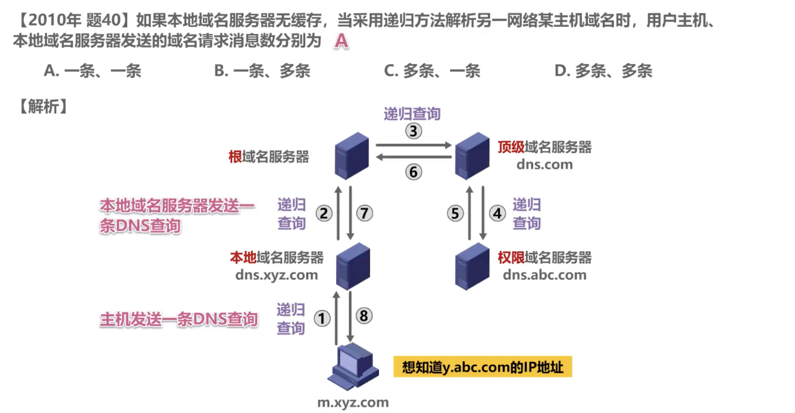

+ **考点**：递归查询与迭代查询的流程区别。
+ **解析**：题目考察主机向本地 DNS 发送查询后，本地 DNS 无缓存时的行为。本地 DNS 收到主机的**递归查询**委托后，会向根 DNS 发送**迭代查询**（或代表主机继续向下查询）。理解“谁委托谁负责”是解题关键。
+ **答案**：选项 A。

---

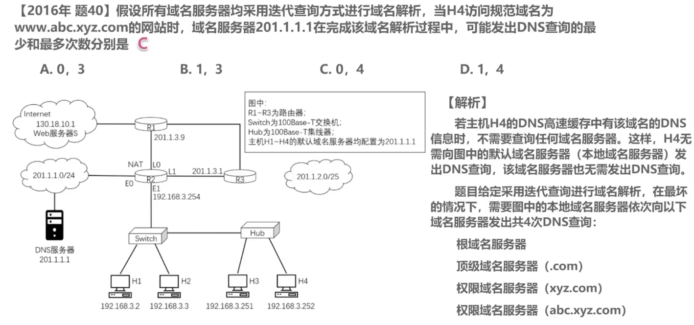

+ **考点**：DNS 缓存的作用与迭代查询的最坏情况次数。
+ **解析**：
    1. 若主机 H4 本地缓存有该域名信息，则直接返回，无需向本地 DNS 和外部 DNS 发送任何查询报文。
    2. 若采用迭代查询，在最坏情况下（所有层级的 DNS 服务器均无缓存），本地 DNS 需要依次向：根 DNS $\rightarrow$ `.com` TLD DNS $\rightarrow$ `xyz.com` 权威 DNS $\rightarrow$ `abc.xyz.com` 权威 DNS 发出查询。共计 **4 次**外部 DNS 查询。
+ **答案**：选项 C。

---

## 6.DNS 协议基础与安全机制
**1.传输层协议与端口**

+ **默认协议**：DNS 报文主要使用运输层的 **UDP 协议**进行封装，熟知端口号为 **53**。UDP 的无连接特性使其具有极低的延迟，适合短小的查询请求。
+ **TCP 的使用场景**：当 DNS 响应报文长度超过 512 字节（UDP 限制），或者在进行**区域传送 (Zone Transfer)**（主从 DNS 服务器同步整个区域的数据库）时，DNS 会使用 **TCP 协议**（端口同样为 53）以保证数据的可靠传输。

**2. DNS 安全问题**

由于传统 DNS 协议基于明文 UDP 传输且缺乏源验证机制，容易遭受多种安全攻击：

+ **DNS 劫持/污染**：攻击者在网络链路中伪造 DNS 响应报文，将域名解析到恶意的 IP 地址，从而实现流量窃听或审查。
+ **防御机制**：现代网络引入了 **DNSSEC**（域名系统安全扩展）以验证响应的数字签名，以及 **DoT (DNS over TLS)** 和 **DoH (DNS over HTTPS)** 来加密 DNS 查询流量，防止中间人窃听与篡改。

---

## 7.DNS 技术实践 (补充拓展)
对于 C++ 后端开发工程师而言，DNS 解析不仅是网络通信的第一步，更是影响系统高并发性能与稳定性的关键环节。在实际开发中需重点关注以下技术细节：

**1. 同步阻塞 vs 异步非阻塞解析**

+ **传统 API 的缺陷**：C 标准库提供的 `gethostbyname` 和 POSIX 标准的 `getaddrinfo` 都是**同步阻塞**的。在高并发 C++ 服务器（如基于 `epoll` 的 Reactor 模型）中，如果在主工作线程中调用这些函数，一旦遇到 DNS 响应缓慢或超时，将直接阻塞整个事件循环，导致服务器吞吐量断崖式下跌。
+ **异步 DNS 解决方案**：在生产级 C++ 后端中，通常引入异步 DNS 解析库（如 **c-ares**、**libuv** 的 DNS 模块，或 Boost.Asio 的异步解析接口）。这些库通过非阻塞 Socket 和状态机在后台完成 UDP 交互，解析完成后通过回调函数通知主线程，彻底消除阻塞瓶颈。

**2. 本地 DNS 缓存与连接池优化**

+ **减少解析开销**：频繁调用系统 DNS 解析不仅耗时，还可能触发本地 DNS 服务器的限流。C++ 后端服务通常会在应用层维护一个**带 TTL 的本地 DNS 缓存 (Local DNS Cache)**。
+ **动态 IP 适配**：对于依赖域名访问的下游微服务或数据库，后端连接池需具备**DNS 重解析机制**。当缓存 TTL 过期或检测到连接异常断开时，触发后台异步重解析，平滑切换到新的 IP 地址，实现无感知的故障转移与负载均衡。

**3. UDP 截断与 TCP 降级处理**

+ **EDNS0 扩展**：传统的 DNS UDP 报文限制在 512 字节。现代 DNS 支持 EDNS0 扩展，允许 UDP 报文达到 1220 字节或更大。在 C++ 中自行实现 DNS 客户端时，必须在请求报文中附加 OPT 伪记录以声明支持大报文。
+ **TCP Fallback (降级)**：如果 UDP 响应报文的 `TC` (Truncated) 标志位被置 1，表示报文被截断。健壮的 C++ DNS 客户端必须能够自动捕获该标志，并立即**降级使用 TCP 协议**向同一服务器的 53 端口重新发起查询，以获取完整的 DNS 记录（如包含大量 IP 的 A 记录或复杂的 TXT 记录）。

---

# 五、文件传送协议FTP
## 1. FTP 协议概述与历史背景
文件传送协议（File Transfer Protocol, FTP）是因特网上使用最广泛的文件传送标准。作为一项基础的网络应用，它旨在解决将文件从一台计算机通过网络传送到另一台可能相距甚远的计算机中的问题。

**核心特性：**

+ **交互式访问**：FTP 允许客户指明文件的类型与格式（例如指定是否使用 ASCII 码或二进制模式传输）。
+ **存取权限控制**：支持身份验证机制，访问文件的用户通常需要经过授权并输入有效的口令（也支持匿名访问）。
+ **跨平台兼容性**：FTP 屏蔽了底层各计算机操作系统的细节差异，使其非常适用于在异构网络中的任意计算机之间进行文件传送。

**历史地位**：在因特网发展的早期阶段，FTP 产生的通信量曾占据整个因特网总通信量的三分之一，甚至超过了早期的电子邮件和域名系统（DNS）。直到 1995 年，随着万维网（WWW）的爆发式普及，HTTP 协议的通信量才首次超越 FTP。

## 2. FTP 的典型应用场景与访问方式
FTP 采用经典的**客户-服务器 (C/S) 架构**。FTP 客户机可将各种类型的文件上传（Upload）至 FTP 服务器，或从服务器下载（Download）文件。根据业务需求，FTP 服务器既可以是企业级的高性能、高可靠性集群，也可以是一台普通的个人计算机。

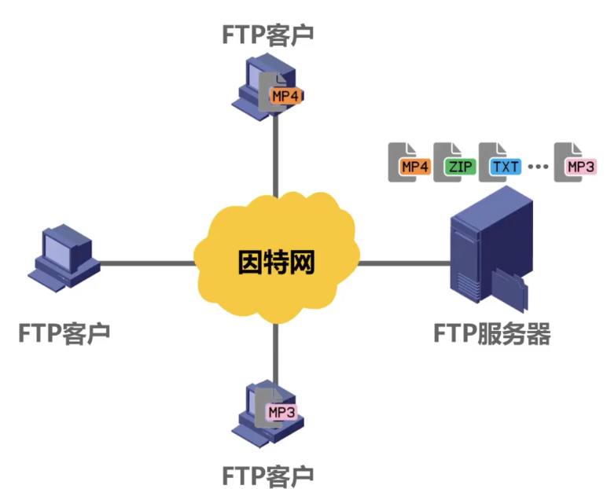

**常见用途：**

+ 在计算机之间进行大批量文件的可靠传输。
+ 网站开发者将构成网站内容的大量静态资源（HTML、CSS、图片等）批量上传至 Web 服务器。

**客户端访问方式：**

1. **浏览器访问**：在浏览器地址栏输入 `ftp://[服务器IP]`。_(注：出于安全考虑，现代主流浏览器如 Chrome、Edge 已逐步移除对 FTP 协议的原生支持，目前多需借助插件或专用客户端。)_

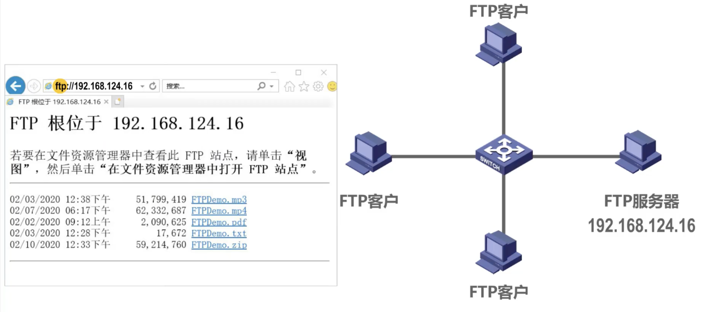

2. **命令行工具**：使用操作系统自带的 FTP 命令行客户端（如 Windows 的 `ftp` 命令或 Linux 的 `ftp`/`lftp`）。支持匿名登录（Anonymous）或账号登录，通过 `ls`、`get`、`put` 等指令进行操作。此方式对普通用户不够友好。

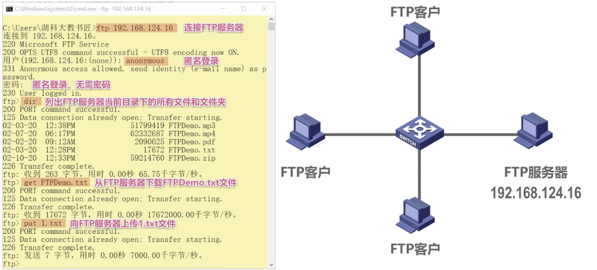

3. **第三方 GUI 客户端**：大多数用户使用如 FileZilla、WinSCP 等图形化工具，通过直观的拖拽界面完成登录、上传与下载。

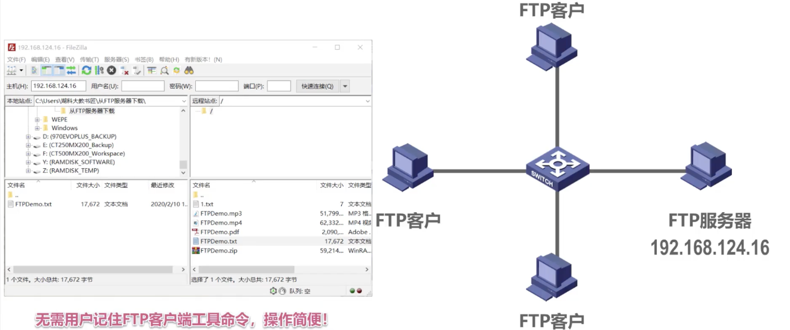

## 3. FTP 的核心工作原理 (双连接机制)
FTP 协议最显著的设计特点是使用了**两个并行的 TCP 连接**来完成文件传输：控制连接和数据连接。

**1.控制连接 (Control Connection)**

.png>)

+ **建立方式**：FTP 服务器在熟知端口 **TCP 21** 监听。客户端随机选择一个临时端口，主动向服务器的 21 端口发起 TCP 连接。
+ **生命周期**：控制连接在整个 FTP 会话期间**始终保持打开状态**。
+ **功能**：专门用于在客户与服务器之间传送 FTP 控制命令（如 `USER`, `PASS`, `LIST`, `RETR`, `STOR` 等）以及服务器的响应状态码。

**2.数据连接 (Data Connection) 与传输模式**

数据连接专门用于实际的文件数据传输或目录列表的获取。它在每次需要传输数据时才建立，传输结束后立即关闭。根据数据连接建立方式的不同，FTP 分为**主动模式**和**被动模式**。

**主动模式 (Active Mode / PORT 命令)**

.png>)

+ **建立过程**：客户端通过控制连接发送 `PORT` 命令，告知服务器自己用于接收数据的临时端口号（如端口 X）。随后，**FTP 服务器主动**使用自己的熟知端口 **TCP 20** 作为源端口，向客户端的端口 X 发起 TCP 连接，从而建立数据通道。
+ **特点**：服务器主动连接客户端。在客户端处于 NAT（网络地址转换）或防火墙后时，服务器往往无法直接穿透连接到客户端的内部端口，导致主动模式 frequently 失败。

**被动模式 (Passive Mode / PASV 命令)**

.png>)

+ **建立过程**：客户端通过控制连接发送 `PASV` 命令。服务器收到后，开启一个协商好的临时高端口（如端口 Y），并通过控制连接将端口 Y 的号码告知客户端。随后，**FTP 客户端主动**发起 TCP 连接，连接到服务器的端口 Y，从而建立数据通道。
+ **特点**：服务器被动等待客户端连接。此模式完美解决了客户端位于 NAT/防火墙后无法接收外部连接的问题，是现代 FTP 客户端默认使用的模式。

## 4. 经典考研真题解析

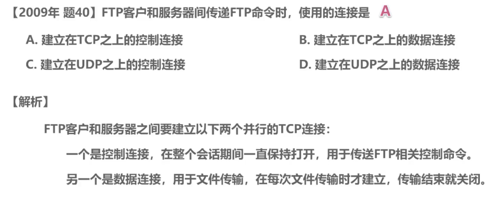

+ **考点**：FTP 控制连接与数据连接的生命周期。
+ **解析**：FTP 客户和服务器之间建立两个并行的 TCP 连接。控制连接在整个会话期间一直保持打开，用于传送控制命令；数据连接仅在每次文件传输（或目录列表获取）时建立，传输结束即关闭。
+ **正确答案**：选项 A（控制连接在整个会话期间保持打开，数据连接在传输时建立，结束关闭）。

---

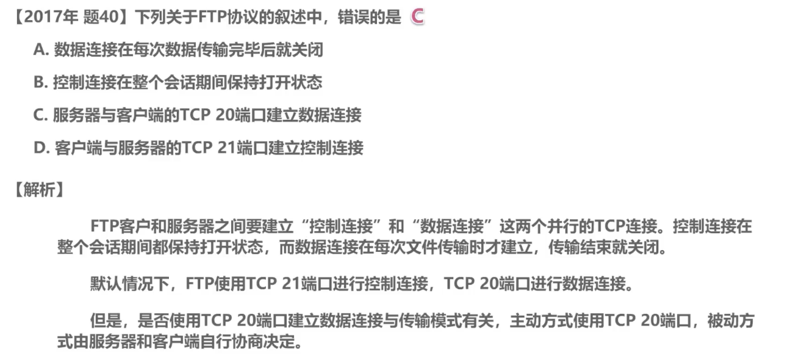

+ **考点**：FTP 默认端口号及传输模式对端口的影响。
+ **解析**：默认情况下，FTP 使用 TCP 21 号端口进行控制连接。对于数据连接，**只有在主动模式下**，服务器端才固定使用 TCP 20 号端口作为源端口；而在被动模式下，服务器端使用的是随机协商的高端口，并非 20 端口。
+ **正确答案**：选项 C（控制连接使用 TCP 21，数据连接是否使用 TCP 20 取决于传输模式，主动模式使用，被动模式协商）。

## 5. C++ 开发视角下的 FTP 协议 (补充拓展)
对若需开发自定义的 FTP 服务端（如用于内部日志收集、固件升级分发）或高性能 FTP 客户端，需深入理解以下底层技术细节：

### 5.1 基于文本的命令交互与状态机
FTP 控制连接传输的是纯文本命令。服务端开发时，需要实现一个健壮的**协议状态机**来解析客户端发来的指令（如 `USER admin\r\n`）。必须严格处理 TCP 粘包/半包问题，以 `\r\n` 作为命令分隔符进行拆包，并返回标准的三位数字状态码（如 `220 Service ready`, `331 User name okay, need password`, `530 Login incorrect`）。

### 5.2 NAT 穿透与防火墙配置 (核心痛点)
+ **主动模式的困境**：如果 C++ 服务端部署在公网，而客户端在内网，主动模式下服务端无法主动连接客户端的内网 IP 和端口。
+ **被动模式的 ALG 问题**：在被动模式下，客户端连接服务端的随机高端口。如果服务端部署在 NAT 网关后，服务端在 `PASV` 响应中返回的是其**内网 IP**，导致公网客户端无法连接。
+ **解决方案**：在后端架构中，通常需要在 FTP 服务端配置**被动模式端口范围 (Passive Port Range)**，并在云服务器的安全组/防火墙上放行该端口段；同时配置**公网 IP 映射 (Masquerade Address)**，强制服务端在 `PASV` 响应中返回公网 IP 而非内网 IP。

### 5.3 高并发模型设计
在 C++ 中实现高性能 FTP 服务器时，不能为每个控制连接和数据连接都分配一个独立线程（Thread-per-connection），这会导致资源耗尽。

+ **Reactor 模型**：控制连接（长连接、小数据量）非常适合使用 `epoll` 等 I/O 多路复用技术进行非阻塞管理。
+ **异步数据传输**：数据连接（短连接、大数据量）在建立后，可将其注册到独立的线程池或使用异步 I/O（如 Linux 的 `io_uring` 或 `AIO`）来处理大文件的磁盘读写与网络发送，避免阻塞控制连接的事件循环。

---

# 六、电子邮件
## 1.电子邮件系统概述
电子邮件（Email）是因特网上最早流行且至今最重要、最实用的应用之一。与传统的实时电话通信相比，电子邮件具有显著的异步通信优势：它不要求主叫和被叫双方同时在场，也不会不必要地打断用户的工作与休息。

电子邮件的工作模式类似于邮政系统：发件人将邮件发送至自己的邮件服务器，该服务器根据目的地址将邮件转发至收件人的邮件服务器，收件人可在方便时登录服务器获取邮件。其具备使用方便、传递迅速、费用低廉的特点，且支持多媒体附件。由于电子邮件的普及，传统的电报业务已在世界多国（包括我国）逐渐退出历史舞台。

**系统架构与核心组件：**

电子邮件系统采用经典的**客户-服务器 (C/S) 架构**，主要由以下三个核心构件组成：

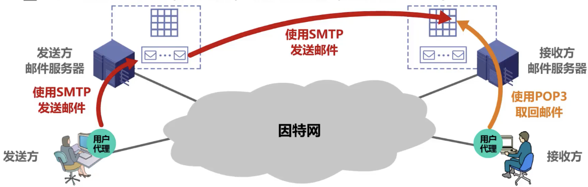

1. **用户代理 (User Agent, UA)**：
    - 即电子邮件客户端软件（如 Outlook、Foxmail、手机邮件 App）。
    - 它是用户与电子邮件系统的接口，负责邮件的撰写、编辑、发送、读取和管理。
2. **邮件服务器 (Mail Server)**：
    - 电子邮件系统的基础设施。因特网上的服务提供商（ISP）或企业均部署有邮件服务器。
    - 负责接收、发送、转发邮件，并持久化维护用户的邮箱数据。
3. **电子邮件协议**：
    - 规定了用户代理与邮件服务器之间、以及邮件服务器相互之间的通信规则。主要分为**邮件发送协议**（例如SMTP）和**邮件读取协议**（例如POP3、IMAP）两类。

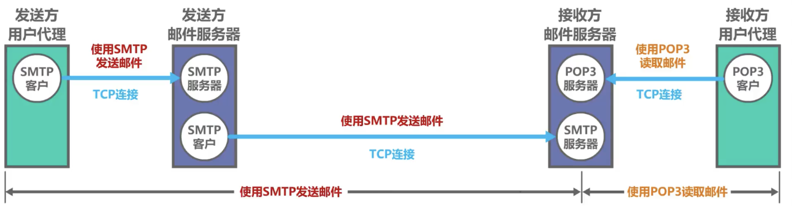

---

## 2.邮件发送与接收的核心流程
电子邮件的传输过程严格区分了“推（Push）”和“拉（Pull）”的操作：

1. **发送方 UA** $\rightarrow$ **发送方邮件服务器**：使用**邮件发送协议**（如 SMTP）。
2. **发送方邮件服务器** $\rightarrow$ **接收方邮件服务器**：使用**邮件发送协议**（如 SMTP）。
3. **接收方邮件服务器** $\rightarrow$ **接收方 UA**：使用**邮件读取协议**（如 POP3 或 IMAP）。

_注：SMTP 用于将邮件“推”送到服务器，而 POP3/IMAP 用于将邮件从服务器“拉”取到本地客户端。_

---

## 3.简单邮件传送协议 (SMTP) 工作原理
SMTP (Simple Mail Transfer Protocol) 是因特网标准的邮件发送协议。它基于 **TCP 连接**，默认使用熟知端口 **25**。

**交互过程与命令响应：**

SMTP 采用基于文本的命令与应答交互机制。以下是一次典型的邮件发送会话流程：

-工作原理.png>)

+ **连接建立**：TCP 连接成功后，服务器主动发送就绪应答，代码 `220`（如 `220 smtp.163.com ESMTP`）。
+ **身份标识**：客户端发送 `HELO <域名>` 表明身份。服务器若认可，回复 `250 OK`。
+ **指定发件人**：客户端发送 `MAIL FROM:<sender@example.com>`。服务器回复 `250 OK`。
+ **指定收件人**：客户端发送 `RCPT TO:<recipient@example.com>`（可有多个）。服务器检查邮箱是否存在，存在则回复 `250 OK`。
+ **数据传输**：客户端发送 `DATA` 命令。服务器回复 `354 Start mail input; end with <CRLF>.<CRLF>`，表示准备好接收内容。
+ **发送邮件内容**：客户端发送邮件首部和主体，最后以单独一行的 `<CRLF>.<CRLF>`（即回车换行加一个点再加回车换行）作为结束符。服务器接收成功后回复 `250 OK`。
+ **断开连接**：客户端发送 `QUIT`，服务器回复 `221 Bye` 并主动断开 TCP 连接。

_补充：在实际的现代邮件系统中，为了防止滥用，通常在 _`HELO`_ 之后会加入身份认证过程（如 _`AUTH LOGIN`_），并使用 _`STARTTLS`_ 命令将明文连接升级为加密连接。_

---

## 4.电子邮件的信息格式与 MIME 扩展
### （1）邮件格式标准 (RFC 5322)
电子邮件的信息格式由 RFC 822 定义（现已更新为 **RFC 5322**）。一封完整的电子邮件由**信封 (Envelope)** 和**内容 (Content)** 组成，而内容又分为**首部 (Header)** 和**主体 (Body)**。

+ **信封**：包含 SMTP 协议交互所需的底层路由信息（如 `MAIL FROM` 和 `RCPT TO`），由邮件系统自动提取并生成，用户无需手动填写。
+ **首部**：包含用户可见的元数据，关键字段包括：
    - `From`：发件人地址（通常由系统自动填入）。
    - `To`：主要收件人地址（必填）。
    - `Cc`：抄送人地址（Carbon Copy）。
    - `Subject`：邮件主题（必填，反映核心内容）。
    - `Date`：发送时间。
+ **主体**：用户撰写的核心文本信息。首部和主体之间必须用一个**空行**隔开。

.png>)

### （2）MIME (多用途因特网邮件扩展)
**痛点**：早期的 SMTP 协议设计仅支持传送 **7位 ASCII 码文本数据**。它无法直接传输可执行文件、二进制对象（图片、音视频），甚至无法直接传输非英语字符（如中文、俄文或带重音符号的法文）。

**解决方案**：引入 **MIME (Multipurpose Internet Mail Extensions)** 协议。

+ **工作原理**：在发送端，MIME 将非 ASCII 数据（如二进制附件或 UTF-8 中文）通过特定的编码算法（如 **Base64** 或 **Quoted-Printable**）转换为合法的 ASCII 字符流，然后再通过 SMTP 传输。接收端收到后，再进行逆向解码还原。

.png>)

+ **新增首部字段**：MIME 在邮件首部增加了 `MIME-Version`、`Content-Type`（定义数据类型，如 `text/html`, `image/jpeg`）、`Content-Transfer-Encoding`（定义编码方式）等字段，实现了多媒体邮件表示方法的标准化。
+ **跨界应用**：MIME 不仅用于电子邮件，后来也被广泛应用于 **HTTP 协议**中（如 HTTP 响应头中的 `Content-Type: application/json` 即源自 MIME 标准）。

---

## 5.邮件读取协议：POP3 与 IMAP
当邮件到达接收方服务器后，用户代理需要将其读取到本地。常用的读取协议有以下两种：

| 特性 | POP3 (邮局协议第3版) | IMAP4 (因特网邮件访问协议第4版) |
| :--- | :--- | :--- |
| **默认端口** | TCP 110 (加密: 995) | TCP 143 (加密: 993) |
| **工作模式** | 离线/下载模式 | 联机/同步模式 |
| **核心功能** | 功能简单。通常采用“下载并删除”或“下载并保留”方式将邮件拉取到本地。 | 功能强大。允许客户端直接操作服务器端的邮箱（如创建文件夹、移动邮件、标记已读）。 |
| **多端同步** | 极差。本地操作（如删除、已读）难以同步到服务器和其他设备。 | 极佳。所有操作直接作用于服务器，多设备登录状态完全一致。 |

**基于万维网的电子邮件 (Webmail)**

如今大量用户直接使用浏览器访问邮件网站（如网页版网易、Gmail）。

+ **协议差异**：在 Webmail 模式下，用户浏览器与邮件服务器之间使用的是 **HTTP/HTTPS 协议**，而非 SMTP 或 POP3/IMAP。

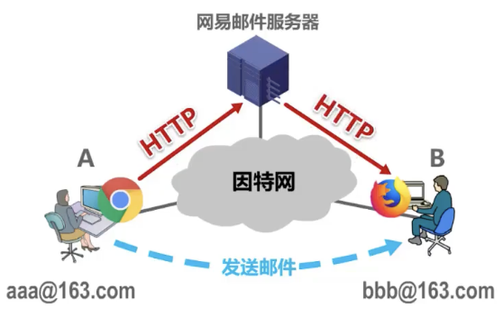

+ **跨域发送**：如果网易用户发给 Gmail 用户，浏览器通过 HTTP 将邮件提交给网易服务器后，**网易服务器与 Gmail 服务器之间依然使用 SMTP 协议**进行跨域转发。

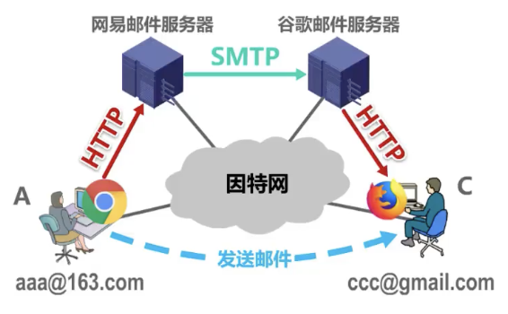

---

## 6.考研真题解析

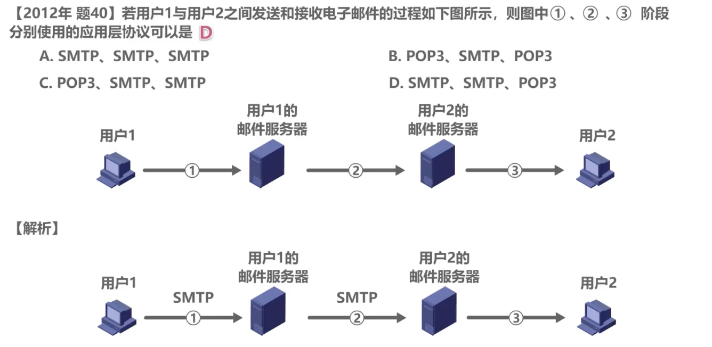

+ **考点**：邮件传输各阶段所使用的协议。
+ **解析**：
    1. 用户一 UA $\rightarrow$ 用户一邮件服务器：发送阶段，使用 **SMTP**。
    2. 用户一邮件服务器 $\rightarrow$ 用户二邮件服务器：转发阶段，使用 **SMTP**。
    3. 用户二邮件服务器 $\rightarrow$ 用户二 UA：读取阶段，使用 **POP3** (或 IMAP)。
+ **答案**：选项 D。

---

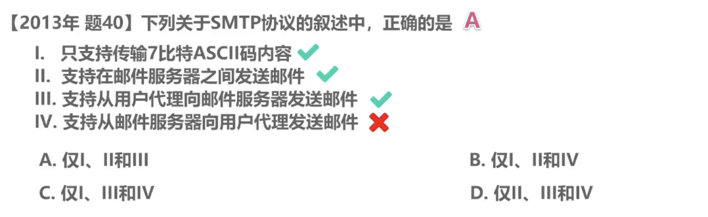

+ **考点**：SMTP 的局限性与 MIME 的作用。
+ **解析**：
    - 叙述一：SMTP 仅支持 ASCII，非 ASCII 数据需经 MIME 转换。**正确**。
    - 叙述二：邮件服务器之间使用 SMTP。**正确**。
    - 叙述三：UA 向服务器发送邮件使用 SMTP。**正确**。
    - 叙述四：UA 读取邮件只能使用 POP3。**错误**（还可以使用功能更强的 IMAP）。
+ **答案**：选项 A。

---

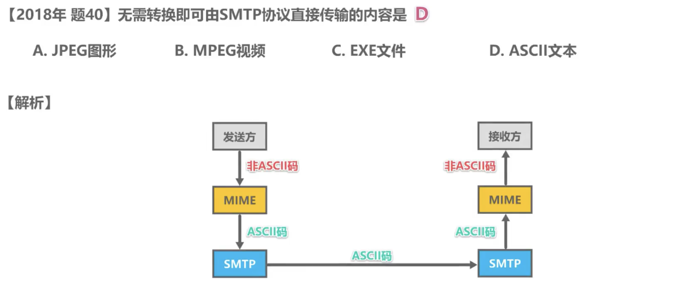

+ **考点**：协议与端口的对应关系及工作模式。
+ **解析**：主要考察对 SMTP (25)、POP3 (110)、IMAP (143) 等基础概念的准确记忆与场景判断。
+ **答案**：选项 D。

---

## 7.邮件系统实现 (补充拓展)
对于 C++ 后端开发工程师而言，若需参与企业级邮件网关、高并发邮件推送系统或自定义邮件代理的开发，需深入掌握以下底层技术细节：

### 1. 高并发网络模型与协议解析
+ **Reactor 模型**：SMTP 和 IMAP 都是基于文本的协议。在处理海量并发连接时，必须使用 `epoll` 等非阻塞 I/O 多路复用技术。
+ **粘包/半包处理**：协议指令以 `\r\n` (CRLF) 为分隔符。在 C++ 中需要实现高效的 Ring Buffer（环形缓冲区）和状态机，准确切割出完整的命令或数据块，防止 TCP 粘包导致解析错误。
+ **IMAP 的复杂性**：与 SMTP 的同步阻塞模型不同，IMAP 支持**带标签的并发命令**（Tagged Commands，如 `A001 FETCH...`），允许客户端在同一个 TCP 连接上同时发起多个请求。服务端必须实现精细的会话状态机和异步任务调度来处理这些并发指令。

### 2. MIME 解析与二进制处理
+ **编解码性能**：处理邮件附件时，需要进行大量的 Base64 编解码。在 C++ 中应使用经过 SIMD 指令集（如 AVX2）优化的 Base64 库，以提升大文件的吞吐率。
+ **多部分表单 (Multipart)**：邮件常包含复杂的嵌套结构（如 `multipart/mixed` 嵌套 `multipart/alternative`）。需要编写健壮的树状解析器来提取 HTML 正文、纯文本备用正文以及各类附件，并严格处理内存，防止畸形邮件导致的内存泄漏或越界访问。

### 3. 安全传输与加密 (TLS/SSL)
+ 现代邮件系统强制要求加密传输（SMTPS 465, Submission 587, IMAPS 993）。
+ 在 C++ 后端中，通常需要集成 **OpenSSL**、**mbedTLS** 或 **BoringSSL**。需要妥善处理 TLS 握手过程、证书链验证、SNI (Server Name Indication) 支持，以及在使用 `STARTTLS` 命令时，将明文 Socket 平滑升级为加密 Socket 的状态切换逻辑。

### 4. 反垃圾邮件与防伪协议 (SPF/DKIM/DMARC)
+ 作为邮件发送网关，C++ 服务端必须实现邮件防伪机制以确保送达率。
+ **DKIM (DomainKeys Identified Mail)**：需要在 C++ 中对邮件首部和主体进行 canonicalization（标准化）处理，计算哈希值，并使用 RSA 或 Ed25519 算法生成数字签名，插入到邮件首部。这要求后端具备高效的密码学运算能力和异步 DNS 查询能力（用于验证公钥）。

---

# 七、万维网
## 1. 万维网概述与浏览器架构
**万维网 (World Wide Web, WWW)** 并非某种特殊的计算机网络，而是一个大规模的、联机式的信息储藏所，是运行在因特网上的一个分布式应用。它利用超链接 (Hyperlink) 将分布在全球不同服务器上的网页连接成一张逻辑上的信息网。

+ **发展历史**：万维网由欧洲核子研究中心 (CERN) 的 Tim Berners-Lee 于 1989 年提出；1993 年诞生了首个图形界面浏览器 Mosaic；1995 年 Netscape (网景) 浏览器上市，推动了 Web 的商业化普及。

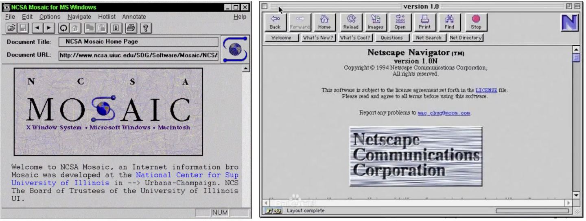

+ **浏览器内核**：浏览器的核心是**渲染引擎**（即浏览器内核），负责对网页内容进行解析和渲染显示。主流内核包括 Blink (Chrome, Edge)、WebKit (Safari)、Gecko (Firefox) 等。由于不同内核对 Web 标准的解析存在差异，前端开发通常需要进行跨浏览器兼容性测试。

## 2. 统一资源定位符 (URL) 与万维网文档
**1.统一资源定位符 (URL)**

为了方便定位和访问全球范围内的资源，万维网使用 URL (Uniform Resource Locator) 来指明因特网上任何种类资源的位置。其标准格式由四部分组成：  
`<协议>://<主机>:<端口>/<路径>`  
_示例：_`http://www.hnust.edu.cn:80/index.html`

**2.万维网文档技术栈**

现代 Web 页面通常由前端“三剑客”协同构建，这些文档部署在服务器端（静态文件或后端动态生成），并通过网络传输至浏览器进行解析：

-与万维网文档.png>)

+ **HTML (超文本标记语言)**：使用标签定义网页的**结构与内容**（如 `<head>`, `<body>`, `
`, `<button>`）。

-与万维网文档.png>)

+ **CSS (层叠样式表)**：从视觉角度定义网页的**样式与布局**（如颜色、字体大小、像素）。

-与万维网文档.png>)

-与万维网文档.png>)

+ **JavaScript (JS)**：一种脚本语言，用于控制网页的**动态行为与交互逻辑**（如响应点击事件、修改 DOM 元素）。

-与万维网文档.png>)

-与万维网文档.png>)

## 3. HTTP 协议基础与连接管理
**超文本传输协议 (HTTP)** 是 TCP/IP 体系应用层的核心协议，定义了浏览器（客户进程）如何向 Web 服务器请求文档，以及服务器如何传送文档。HTTP 基于 **TCP 连接**，默认使用熟知端口 **80**（HTTPS 使用 443）。

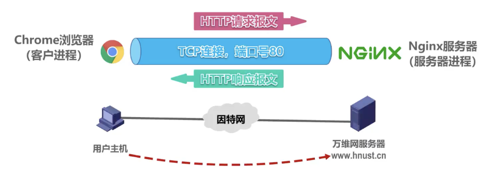

### HTTP/1.0：非持续连接
在 HTTP/1.0 中，默认采用非持续连接方式。每请求一个对象（如 HTML 文件、图片）都需要经历以下步骤：

1. 建立 TCP 连接（1 个 RTT，往返时间）。
2. 发送 HTTP 请求并接收响应（1 个 RTT + 文档传输时延）。

**缺陷**：请求一个包含多个引用对象（如图片）的网页时，每个对象都需要额外花费 2 个 RTT 的开销。虽然浏览器可通过建立多个并行 TCP 连接来减少总时延，但这会大量消耗服务器的并发连接资源。

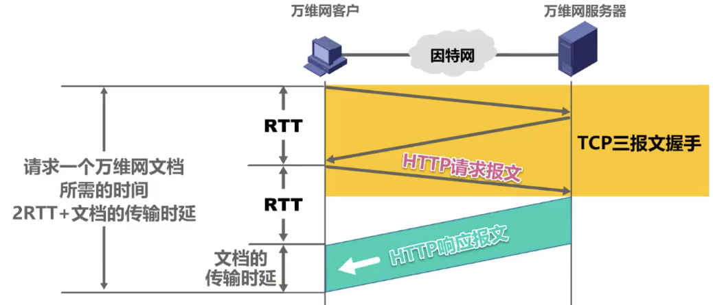

### HTTP/1.1：持续连接
HTTP/1.1 默认采用**持续连接 (Persistent Connection)**。服务器在发送响应后保持 TCP 连接打开，后续对同一服务器的请求可复用该连接，省去了重复 TCP 握手的开销。持续连接分为两种工作模式：

+ **非流水线方式**：客户在收到前一个响应后，才能发送下一个请求。
+ **流水线方式 (Pipelining)**：客户每遇到一个对象引用就立即发出请求，无需等待响应。这进一步减少了 RTT 开销和 TCP 连接的空闲时间。（_注：由于存在“队头阻塞”问题，现代浏览器已基本弃用 HTTP/1.1 流水线，转而依赖 HTTP/2 的多路复用机制。_）

## 4. HTTP 报文格式解析
HTTP 是面向文本的协议，报文中的字段均为 ASCII 字符串，长度不固定，字段间以 `CRLF`（回车换行）分隔。

### 请求报文 (Request)

.png>)

**请求行**：由**方法**（如 `GET`, `POST`）、**URL** 和 **HTTP 版本**组成。

.png>)

**首部行**：包含多个键值对，如：

1. 基础与客户端信息

+ `Host`：目标服务器的域名及端口号（HTTP/1.1 必填）。用于支持虚拟主机技术，使一台物理服务器能够托管多个不同域名的网站。
+ `User-Agent`：发起请求的客户端软件名称、版本及操作系统信息（如 `Mozilla/5.0 (Windows NT 10.0; Win64; x64)...`）。服务器可据此进行设备适配或反爬虫拦截。
+ `Referer`：指示当前请求是从哪个页面链接跳转过来的（即来源 URL）。常用于访问统计分析、广告归因或服务器的防盗链校验。
+ `Date`：表示请求产生的日期和时间（GMT 格式）。普通浏览器发起的常规网页请求通常不包含此字段，但在后端服务间通信或调用外部 API 时，客户端常携带此字段用于服务器的安全校验（如防止重放攻击、生成签名）或日志审计

2. 内容协商 (Accept 系列)

客户端通过这些字段告知服务器自己“喜欢”或“能够处理”什么样的响应数据：

+ `Accept`：客户端能够接收的响应内容 MIME 类型（标识、描述和传输各种多媒体数据类型的通用基础标准，如 `text/html`, `application/json`, `*/*`）。
+ `Accept-Language`：客户端期望的响应语言优先级（如 `zh-CN,zh;q=0.9,en;q=0.8`，表示优先中文，其次英文）。
+ `Accept-Encoding`：客户端支持的内容压缩/编码算法（如 `gzip`, `deflate`, `br`）。服务器若支持，会对响应体进行压缩以节省网络带宽。

3. 连接与状态管理

+ `Connection`：控制底层 TCP 网络连接的状态。`keep-alive` 表示保持持续连接以复用 TCP 通道，`close` 表示当前请求/响应完成后立即关闭连接。
+ `Cookie`：客户端自动携带的、属于该域名的 Cookie 键值对。这是浏览器自动执行的机制，用于向服务器维持用户的会话状态（如登录态）。
+ `Authorization`：包含客户端访问受保护资源所需的认证凭据。常见格式包括 `Bearer <JWT Token>` 或 `Basic <Base64编码的账号密码>`。

4. 请求体 (实体主体) 描述

_主要用于 _`_POST_`_、_`_PUT_`_、_`_PATCH_`_ 等携带数据载荷的请求方法：_

+ `Content-Type`：指示客户端发送给服务器的请求体数据格式。常见值包括 `application/json`（JSON数据）、`application/x-www-form-urlencoded`（表单数据）、`multipart/form-data`（文件上传）。
+ `Content-Length`：指示请求体的确切字节长度，帮助服务器判断数据是否接收完整。

5. 条件请求 (缓存协商)

+ `If-Modified-Since` / `If-None-Match`：客户端携带本地缓存的资源最后修改时间或 ETag（哈希值），询问服务器资源自该时间/版本后是否发生过更新。若未更新，服务器可返回 `304 Not Modified` 以节省传输带宽。

**空行**：标志首部结束。

**实体主体**：通常用于 `POST` 方法携带提交的数据，`GET` 方法通常为空。

### 响应报文 (Response)

.png>)

+ **状态码**

.png>)

**状态行**：由 **HTTP 版本**、**状态码** 和 **状态短语** 组成。

+ `200 OK`：请求成功。
+ `304 Not Modified`：资源未修改（用于缓存协商）。
+ `400 Bad Request`：请求报文存在语法错误。
+ `404 Not Found`：服务器找不到请求的资源。

**首部行**：包含多个键值对，用于向客户端传递服务器的附加信息及实体主体的元数据。常见的首部字段包括：

1. 服务器信息

+ `Server`：处理该请求的服务器软件名称及版本（如 `nginx/1.24.0`, `Apache/2.4.54`）。出于安全考虑，生产环境通常会隐藏或修改此字段以防止版本漏洞被利用。
+ `Date`：表示服务器产生该响应的日期和时间（GMT 格式）。HTTP 规范要求服务器在大多数常规响应中必须包含此字段。客户端常利用此时间作为基准，结合 `Expires` 字段计算缓存的相对过期时间，或用于评估网络传输延迟。
+ `Connectio****n`：服务器告知客户端，本次响应完成后 TCP 连接的状态及逐跳控制。
    - **连接控制**：服务器回复 `keep-alive` 表示同意保持连接，回复 `close` 表示服务器在发送完当前响应后将主动关闭 TCP 连接（例如服务器负载过高、或处理完请求后认为无需保持连接时）。
    - **逐跳控制（进阶）**：与请求报文类似，服务器可通过 `Connection` 列出仅适用于当前连接的响应首部（如 `Connection: Keep-Alive` 或自定义的逐跳首部），代理服务器在转发响应给客户端时必须将其剥离。

2. 内容描述与编码

+ `Content-Type`：声明实体主体中数据的 MIME 媒体类型及字符集（标识、描述和传输各种多媒体数据类型的通用基础标准，如 `text/html; charset=utf-8` 或 `application/json`），指导浏览器或客户端如何正确解析和渲染数据。
+ `Content-Length`：指明实体主体的确切字节长度。对于没有明确长度的流式传输（如分块传输 `Transfer-Encoding: chunked`），此字段会被省略。
+ `Content-Encoding`：指示服务器对实体主体实际采用的压缩/编码方式（如 `gzip`）。它必须与客户端请求时提供的 `Accept-Encoding` 相匹配。

3. 缓存控制

+ `Cache-Control`：HTTP/1.1 引入的核心缓存控制指令，优先级高于 `Expires`。常见值包括：
    - `max-age=3600`：表示资源在 3600 秒内是新鲜的，可直接使用本地缓存。
    - `no-cache`：允许缓存，但在使用前必须向服务器发起条件请求验证是否过期。
    - `no-store`：禁止任何形式的缓存（常用于包含敏感信息的页面）。
+ `Expires`：资源的绝对过期时间（HTTP/1.0 遗留标准，如 `Wed, 21 Oct 2026 07:28:00 GMT`）。由于依赖客户端本地时间，易产生误差，现多被 `Cache-Control` 取代。
+ `Last-Modified`：资源在服务器上的最后修改时间，用于响应客户端的 `If-Modified-Since` 条件请求。
+ `ETag`：资源的特定版本标识符（通常是文件内容或元数据的 Hash 值）。比时间戳更精确，能解决“文件被修改但内容未变”或“一秒内多次修改”导致的缓存误判问题。

4. 状态与重定向

+ `Location`：通常配合 `301 Moved Permanently` 或 `302 Found` 等重定向状态码使用，指示客户端应当自动跳转到的新 URL 地址。
+ `Set-Cookie`：服务器用于在客户端浏览器中创建、更新或删除 Cookie 状态信息的指令。可附带 `HttpOnly`（防 XSS）、`Secure`（仅限 HTTPS）、`SameSite`（防 CSRF）等安全属性。

5. 安全与跨域 (CORS)

+ `Access-Control-Allow-Origin`：CORS（跨源资源共享）机制的核心首部。指示哪些外部域名（源）被允许跨域读取该响应资源。例如 `*` 表示允许所有源，`https://example.com` 表示仅允许特定源。
+ `Access-Control-Allow-Methods` / `Access-Control-Allow-Headers`：在 CORS 预检请求（OPTIONS）的响应中，告知客户端服务器允许的 HTTP 方法和自定义请求头。

**空行**：以一个独立的回车换行符（`CRLF`）构成，用于明确标志首部行的结束。它提示客户端解析器：接下来的数据流不再包含协议控制字段，而是纯粹的实体内容。

**实体主体**：包含服务器返回给客户端的实际业务数据（例如完整的 HTML 网页源码、RESTful API 返回的 JSON 字符串、或图片/音视频的二进制流）。需要注意的是，在某些特定的响应场景下（如客户端发起 `HEAD` 请求，或服务器返回 `304 Not Modified` 缓存命中状态时），响应报文**不包含**实体主体。

## 5. 状态管理：Cookie 机制
HTTP 协议本身是**无状态**的，服务器无法识别两次请求是否来自同一用户。为了支持电子商务、登录状态保持等复杂应用，引入了 **Cookie** 机制对 HTTP 进行状态化。

**工作流程**：

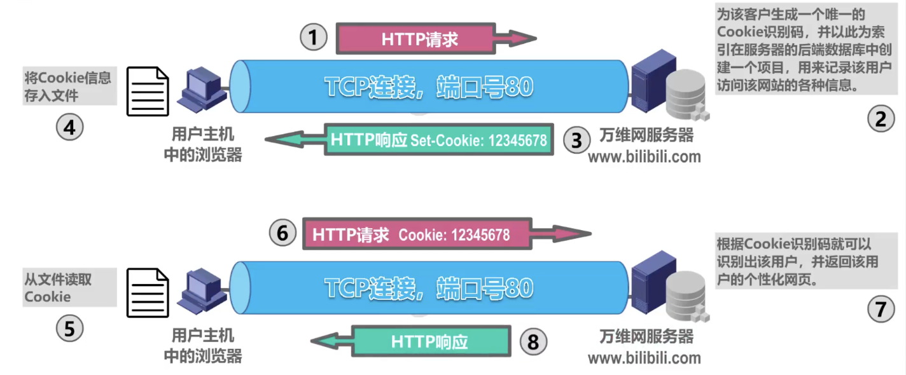

1. **生成**：用户首次访问时，服务器生成唯一的 Cookie 识别码，并在后端数据库（或 Session 存储）中创建关联记录。
2. **下发**：服务器在响应报文中添加 `Set-Cookie` 首部，将识别码发给浏览器。
3. **存储**：浏览器将其保存在本地的 Cookie 文件中。
4. **携带**：后续访问同一域名时，浏览器自动在请求报文中添加 `Cookie` 首部，携带该识别码。
5. **识别**：服务器根据识别码检索后端状态，返回个性化内容。

## 6. Web 缓存与代理服务器
**Web 缓存 (代理服务器)** 位于客户端与原始服务器之间，用于暂存最近的请求和响应，从而减少外部链路流量、降低访问延迟并减轻原始服务器负担。

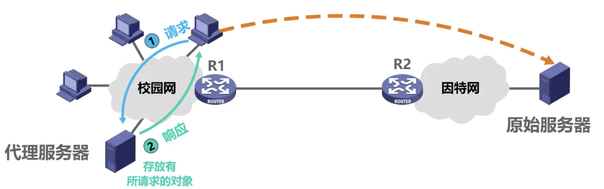

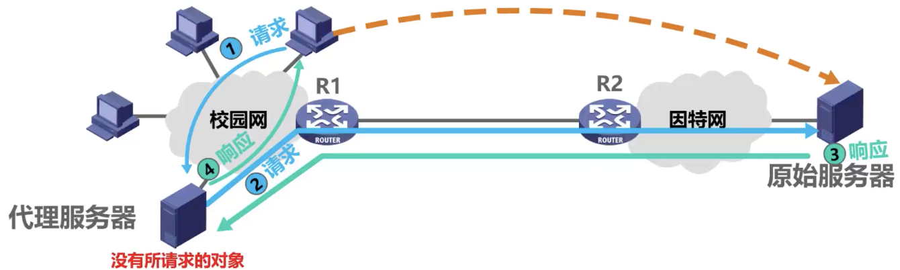

**缓存一致性与条件请求**：  
为防止客户端获取到过期文档，HTTP 引入了条件请求机制：

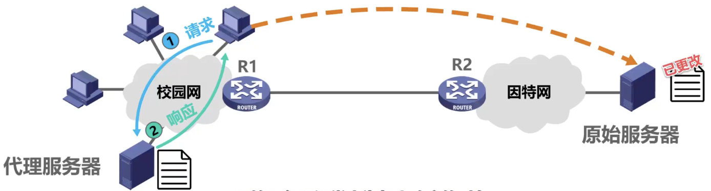

1. 原始服务器在响应中提供文档的**最后修改时间** (`Last-Modified`) 或 **过期时间** (`Expires`)。

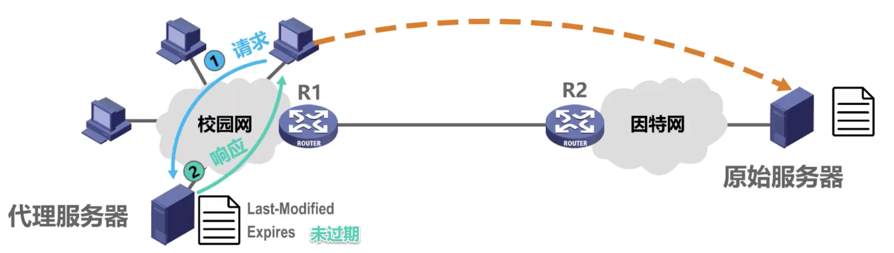

2. 当代理服务器缓存的文档过期后，向原始服务器发送请求时，会附带 `If-Modified-Since` 首部（值为缓存文档的修改时间）。
3. **服务器判断**：
    - 若文档**未修改**：返回 `304 Not Modified` 状态码，**不包含实体主体**。代理服务器更新本地缓存的过期时间并返回给客户端。

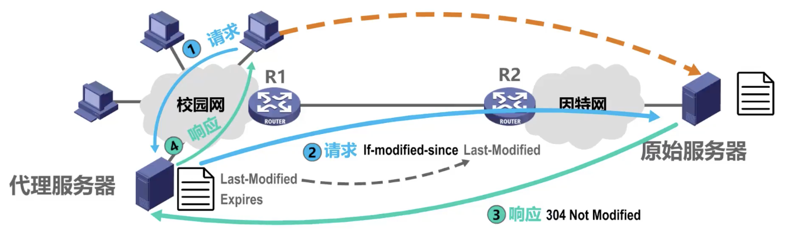

- 若文档**已修改**：返回 `200 OK` 状态码及**新的实体主体**。代理服务器更新缓存并返回给客户端。

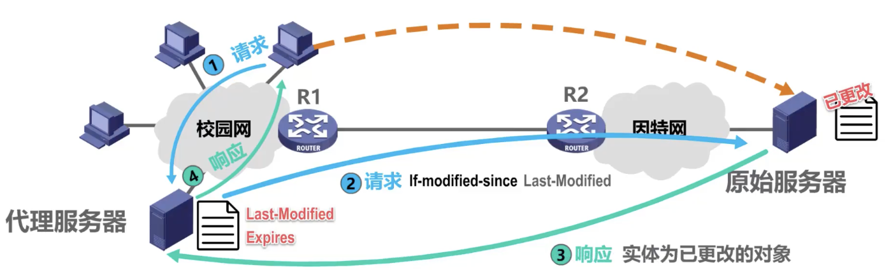

## 7. 考研真题解析 (408 计算机网络)

.png>)

+ **考点**：HTTP 请求报文首部字段的含义。
+ **解析**：
    - `Host` 字段指明目标域名（正确）。
    - `Connection: close` 告知服务器在发送完响应后关闭 TCP 连接，即采用**非持续连接**方式。若为持续连接，该值应为 `keep-alive`。因此，描述“采用持续连接方式”的选项错误。
    - `Cookie` 字段携带服务器之前下发的识别码（正确）。
+ **答案**：选项 C（描述错误的选项）。

---

.png>)

+ **场景**：浏览器请求 `rfc.html`，该页面引用了 2 个 JPEG 小图像。采用**持续连接**且**非流水线**方式。
+ **解析**：
    1. TCP 三次握手建立连接：消耗 **1 RTT**（第三个握手报文可直接携带 HTTP 请求）。
    2. 请求并接收 `rfc.html`：消耗 **1 RTT**。
    3. 解析 HTML 发现 2 个图片。由于是持续连接，无需重新握手；由于是非流水线，需依次请求。每个图片的请求与响应各消耗 **1 RTT**，共计 **2 RTT**。
    - **总耗时**：1 + 1 + 2 = **4 RTT**。

---

## 8. HTTP 与 Web 技术 (补充拓展)
对于 C++ 后端开发工程师而言，深入理解 HTTP 协议及其底层网络实现是构建高性能 Web 服务器（如 Nginx、Tengine）或微服务网关的核心能力。

### 高并发 HTTP 服务器设计
+ **I/O 多路复用与状态机**：HTTP 是典型的请求-响应协议。在 C++ 中，通常使用 `epoll` (Reactor 模型) 监听海量并发连接。由于 TCP 粘包/半包现象，必须实现基于**有限状态机 (FSM)** 的 HTTP 报文解析器（如著名的 `http_parser` 或 `llhttp` 库），逐字节解析请求行、Header 和 Body，避免阻塞主线程。
+ **Keep-Alive 的底层管理**：维持大量长连接会消耗服务器的文件描述符和内存。后端需设计**定时器轮 (Timer Wheel)** 或**最小堆 (Min-Heap)** 来管理连接超时，及时清理空闲的 Keep-Alive 连接，防止资源耗尽。

### 现代状态管理与安全
+ **Session 与 JWT**：传统的 Cookie-Session 机制在分布式集群中面临状态共享难题（需引入 Redis 集中存储）。现代 C++ 后端更倾向于使用无状态的 **JWT (JSON Web Token)**，将用户状态加密签名后直接下发给客户端，服务端仅做 CPU 校验，极大提升了水平扩展能力。
+ **Cookie 安全属性**：在设置 `Set-Cookie` 时，后端必须强制附加 `HttpOnly`（防 XSS 窃取）、`Secure`（仅限 HTTPS 传输）和 `SameSite`（防 CSRF 攻击）属性，以保障系统安全。

### 协议演进：从 HTTP/1.1 到 HTTP/3
+ **HTTP/1.1 的局限**：虽然支持 Keep-Alive，但本质上是“队头阻塞”的（前一个请求未响应，后续请求只能等待）。
+ **HTTP/2 (多路复用)**：引入二进制分帧层和 Stream 概念，允许在单个 TCP 连接上并发交错传输多个请求/响应，彻底解决了应用层的队头阻塞问题。C++ 实现 HTTP/2 需处理复杂的 HPACK 首部压缩和流控逻辑。
+ **HTTP/3 (基于 QUIC)**：将底层传输协议从 TCP 替换为基于 UDP 的 **QUIC** 协议，解决了 TCP 层的队头阻塞问题，并实现了 0-RTT 的连接建立。目前许多现代 C++ 网络库（如基于 `ngtcp2` 或 `lsquic` 的库）已开始支持 HTTP/3 的服务端与客户端开发。
