# 一、网络层概述
## 1.引言：网络层的核心任务
网络层是计算机网络体系结构中至关重要的一层，其主要任务可以概括为两大步：

1. **实现网络互联：** 将不同的异构型网络（这些网络可能使用不同的物理层和数据链路层技术）连接起来。
2. **实现数据包在各网络之间的传输：** 确保数据包能够跨越多个网络，从源主机成功到达目的主机。

要实现内部通信，单个网络只需物理层和数据链路层即可。但若要实现跨网络的互联，**路由器**这一网络层核心设备就不可或缺。


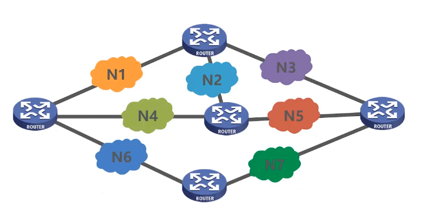

> **补充注解：** 网络层是第一个真正实现端到端（源主机到目的主机）通信的层次。物理层和数据链路层解决的是相邻节点间的通信问题，而网络层则关注如何将数据从源端跨越多个“跳”传递到远端。
>

---

## 2.网络层需解决的三大核心问题
为了实现其任务，网络层必须解决以下三个关键问题：

### （1）服务模型：提供怎样的服务？（可靠 vs. 不可靠）
网络层向上面的运输层提供的服务，主要分为两种模型：

+ **不可靠传输服务：**
    - **定义：** 网络层对于数据包在传输中可能出现的**误码、丢失（被路由器丢弃）、失序（不按序到达）** 等传输错误，**不采取任何纠正措施**。
    - **特点：** 尽最大努力交付，但不保证。简单、高效。
    - **典型代表：** 因特网使用的 TCP/IP 协议栈的网际层（IP协议）（无连接的，不可靠的数据报服务）。
+ **可靠传输服务：**
    - **定义：** 网络层设计相应机制，对这些传输错误采取措施进行纠正，最终使得接收方能正确、完整地接收数据包。
    - **特点：** 通信质量有保障，但实现复杂。
    - **典型代表：** ATM、帧中继、X.25 等网络体系结构的网络层，它们提供的是“虚电路服务”。

> **补充注解：** TCP/IP 模型选择“边缘智能，核心简单”的设计哲学。它将可靠性交给了端系统上的运输层（如TCP协议），而让网络层（IP协议）保持简洁高效，这也是因特网能够迅速扩展的关键之一。
>

### （2）寻址问题：如何标识网络中的设备？
要实现全局通信，必须有一套统一的编址方式。在 TCP/IP 协议栈中，这套方式就是 **IP地址**。

+ **结构特点：** IP地址采用分层结构，由**网络编号**和**主机编号**两部分组成。
+ **举例分析：**


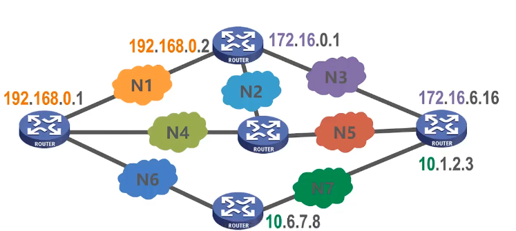

- **网络N1** 中的两个接口IP地址，前三个数字相同，可视为**网络编号**；最后一个数字不同，用于区分该网络内**不同的接口**。
- **网络N3** 中，前两个数字相同（网络编号），后两个数字不完全相同（区分接口）。
- **网络N7** 中，第一个数字相同（网络编号），后三个数字不完全相同（区分接口）。


> **关键洞察：** 这个例子生动地说明了 IP 地址设计之初的“分类寻址”思想。不同规模的网络，其“网络编号”部分长度不同，以适应不同数量的主机，这引出了后续将学习的 A、B、C 类地址。
>

### （3）路由选择问题：数据包走哪条路？
这是网络层最核心、最动态的问题。数据包从源站到目的站，通常存在多条可能的路径。


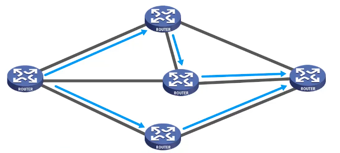

+ **决策依据：** 路由器收到数据包后，会检查数据包中的**目的地址**，并查询自己的**路由表**，来决定从哪个接口将其转发出去。
+ **路由表示例分析：**


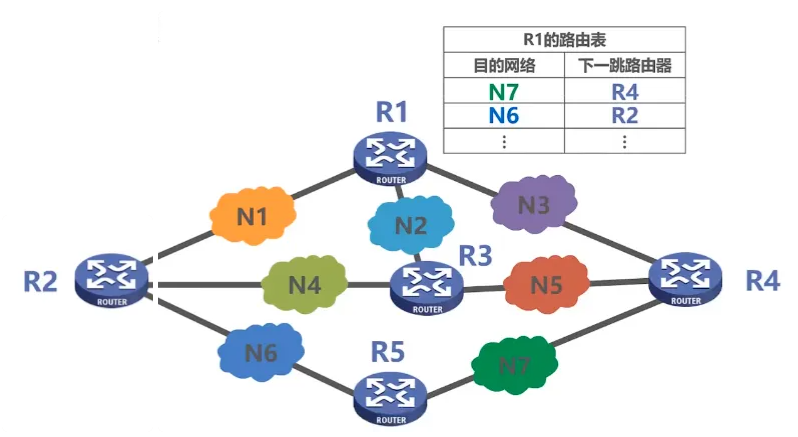

- 路由器R1的路由表中有记录：到达网络 N7，下一跳应转发给路由器 R4。
- 路由器R1的路由表中有记录：到达网络 N6，下一跳应转发给路由器 R2。

+ **路由记录的产生方式：**
    1. **人工配置（静态路由）：** 由管理员手动添加。适用于规模小、拓扑稳定的网络。
    2. **动态路由协议（动态路由）：** 路由器通过运行路由选择协议（如 RIP、OSPF），自动计算和更新路由表。适用于大规模、拓扑常变的互联网，这是因特网采用的主要方式。

> **补充说明：** 路由选择协议的核心是**路由选择算法**，它负责动态地发现网络、计算最优路径、并自适应网络拓扑的变化（如链路故障）。
>

---

## 3.TCP/IP 协议栈中的网络层
因特网（Internet）使用 TCP/IP 四层模型，其网络层通常被称为**网际层**。


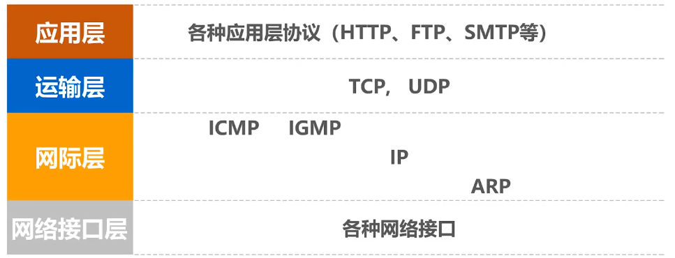

+ **核心协议——IP（网际协议）：** IP 是整个 TCP/IP 协议栈的核心，它提供的是**无连接的、不可靠的数据报服务**。它像一根细线，把所有不同的网络缝合成了一个巨大的互联网。
+ **网际层的其他重要协议（“网际层协议族”）：**
    - **ARP（地址解析协议）：** 已知目的IP地址，解析出对应的硬件（MAC）地址。这是跨网络通信必不可少的一步。
    - **ICMP（网际控制报文协议）：** 用于在网络设备之间传递错误报告和控制信息（例如常用的 `ping` 命令就基于此协议）。
    - **IGMP（网际组管理协议）：** 用于管理多播组成员，实现一对多的通信。

---

## 4.本节内容小结
1. **网络层的根本任务**是实现网络互联和数据包跨网络传输，核心设备是**路由器**。
2. 网络层必须解决**服务模型**（可靠/不可靠）、**寻址**（如IP地址）和**路由选择**三大问题。
3. 因特网的**网际层**采用**无连接的、不可靠的IP协议**作为核心，辅以ARP、ICMP、IGMP等协议协同工作，最终为上层提供全球范围的数据传输能力。
4. 路由表的建立分为**静态人工配置**和**动态路由协议**两种方式，后者是大规模网络的核心。

# 二、网络层提供的两种服务
## 1.引言：可靠通信由谁负责？
网络层需要向上面的运输层提供通信服务。但围绕“可靠通信该由网络自身来保证，还是由用户主机来保证”这个问题，存在两种截然不同的设计理念，也因此产生了网络层的两种核心服务模型：

1. **面向连接的虚电路服务**
2. **无连接的数据报服务**

---

## 2.面向连接的虚电路服务
这种服务模型的核心思想是：**可靠通信应由网络自身来保证**。


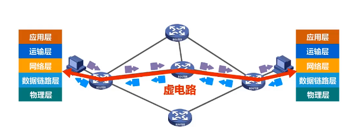

**1. 工作流程**  
它借鉴了传统电话网“先建立连接，再通信，最后释放连接”的思路，整个过程分为三个阶段：

+ **虚电路建立：** 两台计算机开始通信前，需先在网络层建立一条逻辑连接，即 **“虚电路” (Virtual Circuit)** 。建立过程中，双方协商好所需的一切网络资源。
+ **数据传输：** 一旦虚电路建立完毕，所有分组都会沿着这条既定的逻辑路径，以存储转发的方式依次传送。

> **关键理解：** 这仅仅是“逻辑上”的连接，而不是物理上独占了一条线路。分组交换的虚连接与电路交换的物理连接在本质上是不同的。
>

+ **虚电路拆除：** 通信完成后，需要释放（拆除）之前建立的虚电路，将占用的网络资源归还。

**2. 关键特征**

+ **使用虚电路编号，而非完整地址：** 每个分组的首部中，除了在连接建立阶段需要携带完整的目的主机地址外，后续的数据分组只需携带一个简短的**虚电路编号**即可。路由器根据这个编号就能知道该将分组发往何处。
+ **可靠性依赖：** 这种服务如果再配合使用可靠传输的网络协议，就能确保发送的分组最终正确、完整、按序地到达接收方。

**3. 实际应用**  
	历史上很多广域分组交换网都采用这种设计，例如 **X.25**、**帧中继**（Frame Relay）以及 **ATM**（异步传输模式）。这些技术目前大多已被更简单高效的IP网络取代。

---

## 3.无连接的数据报服务
因特网的先驱者们选择了一条完全不同的道路。这种服务模型的核心思想是：**可靠通信应由用户主机（端系统）自身来保证，网络层只提供尽可能简单的转发服务。**


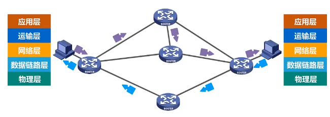

**1. 工作流程**

+ **无需建立连接：** 两台计算机通信前，它们的网络层**不需要**预先建立任何连接。
+ **独立选路：** 每个分组都是一个独立的“数据报”，可以被网络独立地转发。这意味着，即使是同一个消息拆分出的不同分组，也**可以走不同的路径**到达目的地。

**2. 关键特征**

+ **必须携带完整目的地址：** 由于没有预先建好的“路径”，每个分组的首部都必须携带完整的目的主机地址，以供沿途每个路由器进行独立的路由选择决策。
+ **网络不保证可靠性：** 由于网络本身不提供端到端的可靠传输服务，数据报在传输中可能会出现**误码、丢失、重复以及失序**等差错。这些问题都将交由网络边缘的用户主机和其上的运输层（如TCP）去发现和纠正。

**3. 设计哲学与优势**

这种设计体现了一种“**边缘智能，核心简单**”的哲学，其好处是巨大的：

+ **降低网络造价：** 因为不承担复杂的可靠性保证工作，网络核心的路由器可以做得非常简洁、高效，这使其成本远低于早期电信网中那些笨重昂贵的交换机。
+ **运行方式灵活，适应性强：** 这种简单、尽最大努力交付的服务（Best-Effort Delivery）能够适应各种不同类型的上层应用（从文件传输到实时音视频），为因特网的快速创新铺平了道路。

因特网能够从一个小型的科研网络，发展到今日连接全球数十亿设备的空前规模，充分证明了当初选择这种**无连接数据报服务**设计思想的正确性。

> **补充注解：** 这两种模型的选择，本质上是将复杂性和智能放置在网络核心还是网络边缘的权衡。因特网的设计者们选择了“边缘智能，核心简单”，这使得因特网的核心网络能够专注于高速转发数据，而将可靠性、安全性等复杂功能“外包”给连接在网络边缘的智能主机。这种架构上的分工，是理解整个因特网体系的关键。
>

---

## 4.本课小结与本章学习导向
1. **两种服务模型对比**：


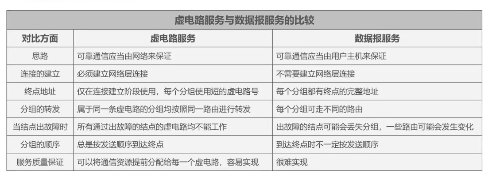

- **虚电路服务**：面向连接，网络负责保证可靠通信，分组使用虚电路编号，适用于X.25、ATM等早期网络。
- **数据报服务**：无连接，用户主机负责保证可靠通信，分组须带完整目的地址，这是因特网（IP协议）采用的方式。

2. **因特网的选择**：TCP/IP体系结构的网际层提供的是**简单灵活的、无连接的、尽最大努力交付的数据报服务**。
3. **本章后续学习的核心主题**：由于数据报服务是因特网网际层的基石，因此本章的所有内容都将围绕一个核心主题展开——**网际层是如何传送IP数据报的**。我们将逐步学习IP地址、子网划分、路由协议以及IP数据报的具体转发过程等内容。

# 三、IPv4地址
## 1.IPv4地址基本概念
### （1）什么是IPv4地址
在TCP/IP体系中，**IP地址**是一个最基本的概念。

> **定义**：**IPv4地址**就是给因特网上的**每一台主机或路由器的每一个接口**，分配一个在全世界范围内**唯一的32比特标识符**。
>

### （2）IP地址的分配机构
| 层级 | 机构 | 职责 |
| --- | --- | --- |
| 全球 | **ICANN**（因特网名字与数字分配机构，Internet Corporation for Assigned Names and Numbers） | 全球IP地址的总分配管理 |
| 区域 | **APNIC**（亚太网络信息中心，Asia-Pacific Network Information Centre） | 亚太地区用户可向其申请IPv4地址 |


> **补充说明**：
>
> + 申请IP地址需要缴纳费用，且一般**不接受个人申请**，通常由ISP或大型组织申请。
> + **2011年2月3日**，IANA（因特网号码分配管理局）宣布IPv4地址池已全部分配完毕。
> + 我国在**2014～2015年**也逐步停止向新用户和新应用分配IPv4地址，同时全面开展IPv6的商用部署。
>

### （3）IPv4编址方法的三个历史阶段
IPv4地址的编址方法依次经历了以下三个阶段：

| 阶段 | 名称 | 特点 |
| --- | --- | --- |
| 第一阶段 | **分类编址的IP地址** | 将地址划分为A、B、C、D、E五类 |
| 第二阶段 | **划分子网的IP地址** | 从主机号中借用若干位作为子网号（三级结构） |
| 第三阶段 | **无分类编址的IP地址（CIDR）** | 消除分类概念，使用网络前缀 |


> 后续将依次对这三种编址方法进行详细讨论。
>

---

## 2.IPv4地址的表示方法与进制转换
### （1）点分十进制表示法
32比特的IP地址不方便阅读、记录和输入，因此采用**点分十进制表示方法**。

**转换步骤：**

1. 将32比特IP地址每 **8个比特**分为一组，共 **4组**。
2. 将每组8比特所对应的**十进制数**写出。
3. 每个十进制数之间用**点（.）** 分隔。

**示例：**


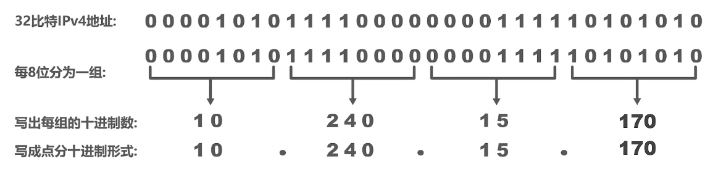

### （2）八位无符号二进制数转十进制数
**基本原理**

八位无符号二进制整数的一般形式：

$$
B_7 B_6 B_5 B_4 B_3 B_2 B_1 B_0 \quad (\text{括号外的“2”表示二进制})
$$

+ $B_0$ 为**最低位**，$B_7$ 为**最高位**
+ 各位的**权值**由高到低依次为：

| $B_7$ | $B_6$ | $B_5$ | $B_4$ | $B_3$ | $B_2$ | $B_1$ | $B_0$ |
| :---: | :---: | :---: | :---: | :---: | :---: | :---: | :---: |
| **128** | **64** | **32** | **16** | **8** | **4** | **2** | **1** |


**转换方法**：将各位乘以其权值后相加。

---

**转换技巧与举例**

**方法一：逐位相乘（通用方法）**

> 例：$(10101010)_2 = 1 \times 128 + 0 \times 64 + 1 \times 32 + 0 \times 16 + 1 \times 8 + 0 \times 4 + 1 \times 2 + 0 \times 1 = 128+32+8+2 = \mathbf{170}$
>

**方法二：减法技巧（适用于0较少的情况）**

> 例：$(11111100)_2$  
0的位权值为2和1，因此：$255 - 2 - 1 = \mathbf{252}$
>

**方法三：直接加法（适用于1较少的情况）**

> 例：$(10000001)_2$  
只有最高位和最低位为1：$128 + 1 = \mathbf{129}$
>

> **练习**：$(11110000)_2 = 128 + 64 + 32 + 16 = \mathbf{240}$
>

### （3）十进制正整数转八位无符号二进制数
**除2取余法（通用方法）**

**步骤**：反复除以2，记录余数，直到商为0；从下往上写出余数。

> 例：将十进制数 **130** 转换为二进制
>

| 步骤 | 除法 | 商 | 余数 |
| :---: | :--- | :---: | :---: |
| 1 | 130 ÷ 2 | 65 | **0** |
| 2 | 65 ÷ 2 | 32 | **1** |
| 3 | 32 ÷ 2 | 16 | **0** |
| 4 | 16 ÷ 2 | 8 | **0** |
| 5 | 8 ÷ 2 | 4 | **0** |
| 6 | 4 ÷ 2 | 2 | **0** |
| 7 | 2 ÷ 2 | 1 | **0** |
| 8 | 1 ÷ 2 | 0 | **1** |


从下往上读取余数：$(130)_{10} = \mathbf{(10000010)_2}$

**凑值法（快速方法）**

适用于IP地址点分十进制转二进制的场景。前提是熟悉各位权值（128、64、32、16、8、4、2、1）。

> 例：将十进制数 **171** 转换为二进制
>
> $171 = 128 + 32 + 8 + 2 + 1$
>
> 因此：$(171)_{10} = \mathbf{(10101011)_2}$
>

| 128 | 64 | 32 | 16 | 8 | 4 | 2 | 1 |
| :---: | :---: | :---: | :---: | :---: | :---: | :---: | :---: |
| 1 | 0 | 1 | 0 | 1 | 0 | 1 | 1 |


---

## 3.分类编址的IPv4地址
### （1）五类地址概览
分类编址将IPv4地址划分为 **A、B、C、D、E** 五类：


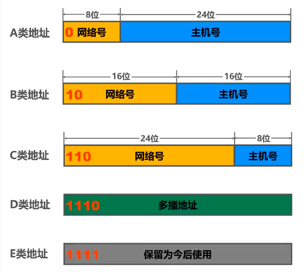

| 类别 | 网络号位数 | 主机号位数 | 最高位固定值 | 第一字节范围 | 默认子网掩码 | 用途 |
| :---: | :---: | :---: | :---: | :---: | :---: | :---: |
| **A** | 8 | 24 | `0` | 0～127 | 255.0.0.0 | 单播 |
| **B** | 16 | 16 | `10` | 128～191 | 255.255.0.0 | 单播 |
| **C** | 24 | 8 | `110` | 192～223 | 255.255.255.0 | 单播 |
| **D** | — | — | `1110` | 224～239 | 多播地址 | 多播 |
| **E** | — | — | `1111` | 240～255 | 保留地址 | 保留 |


> **重要规则**：
>
> + 只有 **A、B、C三类**地址可分配给主机或路由器的接口。
> + **主机号为全 0** 的地址是**网络地址**，不能分配给主机或路由器接口
> + **主机号为全 1** 的地址是**广播地址**，不能分配给主机或路由器接口。
>

### （2）A类地址详解
**网络号**：8 位，最高位固定为 0，可变化位 7 位。


**结构**：`[0 | 7位网络号] [24位主机号]`

**特殊网络号**

| 网络号 | 十进制 | 用途 |
| :---: | :---: | :--- |
| `00000000` | **0** | 保留，不可指派 |
| `01111111` | **127** | 本地软件**环回测试**（Loopback） |


+ 第一个可指派网络号：**1**（`00000001`），网络地址：`1.0.0.0`


+ 最后一个可指派网络号：**126**（`01111110`），网络地址：`126.0.0.0`


+ 最小环回测试地址：`127.0.0.1`


+ 最大环回测试地址：`127.255.255.254`


**A类地址的数量计算**

$$
\text{可指派A类网络数} = 2^{8-1} - 2 = 128 - 2 = \mathbf{126}
$$

> 减2是因为去掉了网络号0和网络号127。
>

$$
\text{每个A类网络可分配IP数} = 2^{24} - 2 = 16777216 - 2 = \mathbf{16777214}
$$

> 减2是因为去掉了网络地址（主机号全0）和广播地址（主机号全1）。
>

### （3）B类地址详解
**网络号**：16 位，最高两位固定为 10。


**结构**：`[10 | 14位网络号] [16位主机号]`

+ 最小网络号：`10000000 00000000` → **128.0**，网络地址：`128.0.0.0`


+ 最大网络号：`10111111 11111111` → **191.255**，网络地址：`191.255.0.0`


**B类地址的数量计算**

$$
\text{可指派B类网络数} = 2^{16-2} = 2^{14} = \mathbf{16384}
$$

> **关于128.0的说明**：有些教材认为128.0是保留网络号，第一个可指派的为128.1。但根据2002年9月发表的 **RFC 3330**，128.0已经可以分配使用。
>

$$
\text{每个B类网络可分配IP数} = 2^{16} - 2 = 65536 - 2 = \mathbf{65534}
$$

### （4）C类地址详解
**网络号**：16 位，最高两位固定为 10。


**结构**：`[110 | 21位网络号] [8位主机号]`

+ 最小网络号：`11000000 00000000 00000000` → **192.0.0**，网络地址：`192.0.0.0`


+ 最大网络号：`11011111 11111111 11111111` → **223.255.255**，网络地址：`223.255.255.0`


**C类地址的数量计算**

$$
\text{可指派C类网络数} = 2^{24-3} = 2^{21} = \mathbf{2097152}
$$

> **关于192.0.0的说明**：有些教材认为192.0.0是保留网络号，第一个可指派的为192.0.1。但根据RFC 3330，192.0.0已经可以分配，只是目前尚未分配出去。
>

$$
\text{每个C类网络可分配IP数} = 2^{8} - 2 = 256 - 2 = \mathbf{254}
$$

### （5）地址类别判定练习题

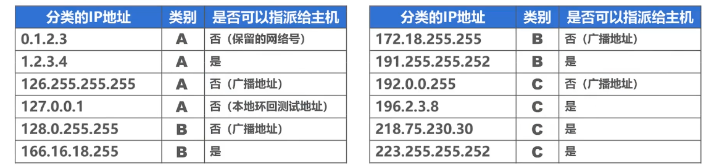

**判定规则**：

+ 第一字节 < 127 → A类
+ 128 ≤ 第一字节 ≤ 191 → B类
+ 192 ≤ 第一字节 ≤ 223 → C类

**不可指派的三种情况**：

1. A类网络号 **0** 和 **127** 不能指派
2. 主机号**全0**（网络地址）不能指派
3. 主机号**全1**（广播地址）不能指派

### （6）特殊IPv4地址汇总
| 特殊地址 | 说明 | 使用限制 |
| :--- | :--- | :--- |
| `0.0.0.0` | 表示"本网络上的本主机" | 只能作为**源地址**（如DHCP发现报文） |
| `127.x.x.x`（非全0/全1） | 环回测试地址 | 既可作**源地址**也可作**目的地址**，用于本地软件环回测试 |
| `255.255.255.255` | 受限广播地址 | 只能作为**目的地址**，仅在本网络广播，路由器不转发 |


### （7）分类编址下的IP分配方案练习
**题目**：给定一个包含多个网络的拓扑图，按节约IP地址的原则为各网络分配IP地址。

**解题步骤**：

1. **识别所有网络**：
    - 每个广播域（包括交换机互连的以太网）算一个网络
    - 两台路由器直连的链路也算一个网络
2. **统计各网络所需IP数量**：
    - 需求 = 主机数 + 路由器接口数（还需预留网络地址和广播地址）
3. **按需分配网络类别**：


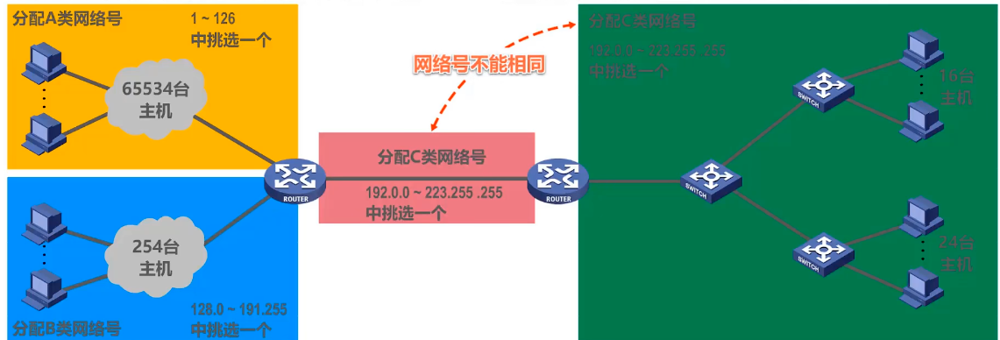

| 所需地址数 | 可分配类别 | 节约原则 |
| :---: | :--- | :--- |
| 65535 | A类（提供16777214个） | 只能选A类 |
| 255 | A类或B类（提供65534个） | **选B类** |
| 41 | A/B/C类均可 | **选C类** |
| 2 | A/B/C类均可 | **选C类** |


4. **分配网络号**：
    - A类：在 1～126 中选取
    - B类：在 128.0～191.255 中选取
    - C类：在 192.0.0～223.255.255 中选取
    - **不同网络的网络号不能相同**
5. **分配主机/接口IP**：
    - 各IP互不相同
    - 主机号**不能全0**（网络地址）
    - 主机号**不能全1**（广播地址）

---

## 4.划分子网的IPv4地址
### （1）为什么需要划分子网
**场景**：某单位申请到一个B类网络（65534个可用IP），但实际只用了一小部分，剩余地址无法被其他单位使用。


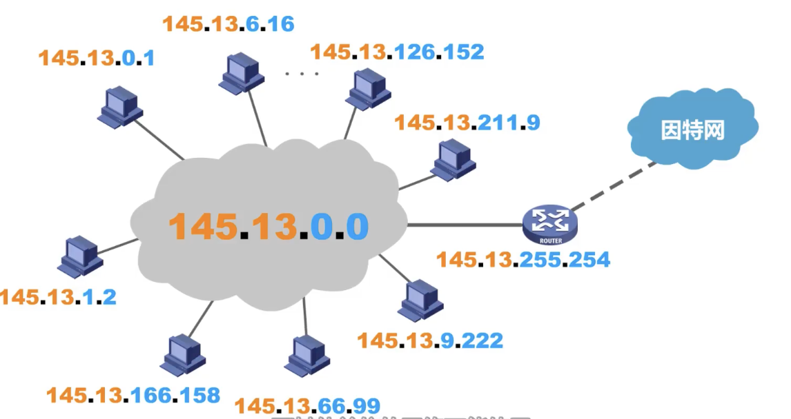

**问题**：

+ 新增子网需再申请新网络号 → 时间长、费用高
+ 新网络号使全球路由表膨胀
+ 原有网络中大量IP地址被浪费

**解决方案**：从主机号部分**借用若干位**作为**子网号**，将两级结构（网络号+主机号）变为三级结构（网络号+子网号+主机号）。


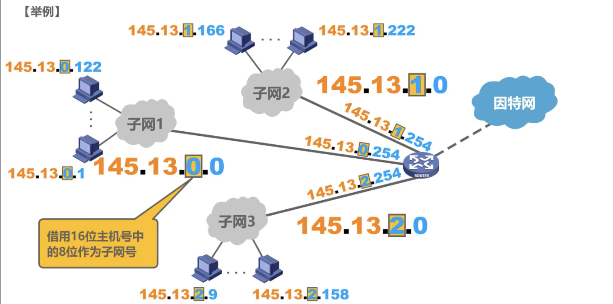

> **示例**：借用16位主机号中的8位作为子网号，可将一个B类网络划分为多个子网（子网号0、1、2...）。
>

### （2）子网掩码
**核心问题**：外界如何知道主机号中有多少位被用作了子网号？

**答案**：使用**子网掩码（Subnet Mask）**。

+ 子网掩码为**32比特**
+ **连续的1** → 对应网络号和子网号
+ **连续的0** → 对应主机号

**核心运算**：

$$
\text{IP地址} \quad \textbf{AND} \quad \text{子网掩码} = \text{子网的网络地址}
$$

> 逻辑与运算：逐比特相与，网络号和子网号被保留，主机号被清零。
>


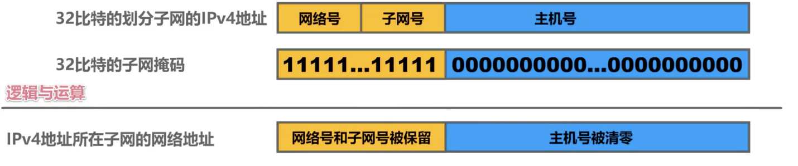

### （3）划分子网实例
**题目**：已知C类网络 `218.75.230.0`，使用子网掩码 `255.255.255.128` 划分子网。

**分析**：

1. **识别类别**：第一字节为218 → **C类**（网络号24位，主机号8位）
2. **解析子网掩码**：`128` = $(10000000)_2$→ 从主机号借用 **1位** 作为子网号

**计算**：

+ 可划分子网数：$2^1 = 2$ 个
+ 每个子网可用地址数：$2^{8-1} - 2 = 2^7 - 2 = 128 - 2 = \mathbf{126}$ 个

**原C类网络地址范围**：

| 地址 | 值 | 说明 |
| :--- | :--- | :--- |
| 网络地址 | `218.75.230.0` | 第一个地址（主机号全0） |
| 第一个可用地址 | `218.75.230.1` | 网络地址 + 1 |
| 最后一个可用地址 | `218.75.230.254` | 广播地址 - 1 |
| 广播地址 | `218.75.230.255` | 最后一个地址（主机号全1） |
| 总地址数 | 256 | 可用地址254个 |


**子网0**（子网号 = 0）：

| 地址类型 | 二进制（主机号7位） | 点分十进制 |
| :--- | :--- | :--- |
| 网络地址 | `0 0000000` | `218.75.230.0` |
| 最小可用 | `0 0000001` | `218.75.230.1` |
| 最大可用 | `0 1111110` | `218.75.230.126` |
| 广播地址 | `0 1111111` | `218.75.230.127` |


**子网1**（子网号 = 1）：

| 地址类型 | 二进制（主机号7位） | 点分十进制 |
| :--- | :--- | :--- |
| 网络地址 | `1 0000000` | `218.75.230.128` |
| 最小可用 | `1 0000001` | `218.75.230.129` |
| 最大可用 | `1 1111110` | `218.75.230.254` |
| 广播地址 | `1 1111111` | `218.75.230.255` |


> **结论**：使用子网掩码 `255.255.255.128` 可将C类网 `218.75.230.0` 均分为两个子网，每个子网可用126个IP地址。
>

### （4）例题
**【习题1】** 已知某个网络的地址为218.75.230.0，使用子网掩码255.255.255.192对其进行子网划分，请给出划分细节。

【解析】

1. 根据所给网络地址可知其为C类网络地址，网络号占3个字节，主机号占1个字节；
2. 根据所给子网掩码可知从1字节主机号中借用2位作为子网号；

C类网218.75.230.0包含的全部IP地址（共256个）

划分出的子网数量 $2^2 = 4$  
每个子网可分配的地址数量 $2^{(8-2)} - 2 = 62$

**详细划分表：**

| 网络号 | 子网号 | 主机号 | 说明 | 结果 |
| :--- | :--- | :--- | :--- | :--- |
| 218.75.230. | 0 0 | 0 0 0 0 0 0 | 子网0的网络地址 | **218.75.230.0** |
| 218.75.230. | 0 0 | 0 0 0 0 0 1 | 可分配最小地址 | **218.75.230.1** |
| ... | ... | ... | ... | ... |
| 218.75.230. | 0 0 | 1 1 1 1 1 0 | 可分配最大地址 | **218.75.230.62** |
| 218.75.230. | 0 0 | 1 1 1 1 1 1 | 子网0的广播地址 | **218.75.230.63** |
|  |  |  |  |  |
| 218.75.230. | 0 1 | 0 0 0 0 0 0 | 子网1的网络地址 | **218.75.230.64** |
| 218.75.230. | 0 1 | 0 0 0 0 0 1 | 可分配最小地址 | **218.75.230.65** |
| ... | ... | ... | ... | ... |
| 218.75.230. | 0 1 | 1 1 1 1 1 0 | 可分配最大地址 | **218.75.230.126** |
| 218.75.230. | 0 1 | 1 1 1 1 1 1 | 子网1的广播地址 | **218.75.230.127** |
|  |  |  |  |  |
| 218.75.230. | 1 0 | 0 0 0 0 0 0 | 子网2的网络地址 | **218.75.230.128** |
| 218.75.230. | 1 0 | 0 0 0 0 0 1 | 可分配最小地址 | **218.75.230.129** |
| ... | ... | ... | ... | ... |
| 218.75.230. | 1 0 | 1 1 1 1 1 0 | 可分配最大地址 | **218.75.230.190** |
| 218.75.230. | 1 0 | 1 1 1 1 1 1 | 子网2的广播地址 | **218.75.230.191** |
|  |  |  |  |  |
| 218.75.230. | 1 1 | 0 0 0 0 0 0 | 子网3的网络地址 | **218.75.230.192** |
| 218.75.230. | 1 1 | 0 0 0 0 0 1 | 可分配最小地址 | **218.75.230.193** |
| ... | ... | ... | ... | ... |
| 218.75.230. | 1 1 | 1 1 1 1 1 0 | 可分配最大地址 | **218.75.230.254** |
| 218.75.230. | 1 1 | 1 1 1 1 1 1 | 子网3的广播地址 | **218.75.230.255** |


---


已知B类IP地址和子网掩码 `255.255.252.0`，求主机所在子网的网络地址和广播地址。

**分析**：

+ B类地址：网络号16位，主机号16位
+ 子网掩码 `252.0` → `(11111100 00000000)_2` → 借用 **6位** 作为子网号

**解题**：

+ 将主机号转为二进制
+ 子网掩码中连续6个1对应的部分作为子网号
+ 保持网络号和子网号不变，主机号10位全0 → **网络地址**
+ 保持网络号和子网号不变，主机号10位全1 → **广播地址**


> 例如得到：网络地址 `180.80.76.0`，广播地址 `180.80.79.255`
>

### （5）默认子网掩码
**定义**：在未划分子网的情况下使用的子网掩码。

| 类别 | 网络号 | 主机号 | 默认子网掩码（二进制） | 默认子网掩码（点分十进制） |
| :---: | :---: | :---: | :--- | :---: |
| **A** | 8位 | 24位 | `11111111 00000000 00000000 00000000` | **255.0.0.0** |
| **B** | 16位 | 16位 | `11111111 11111111 00000000 00000000` | **255.255.0.0** |
| **C** | 24位 | 8位 | `11111111 11111111 11111111 00000000` | **255.255.255.0** |


---

## 5.无分类编址的IPv4地址（CIDR）
### （1）**无分类编址（CIDR）**
**提出背景**

划分子网虽在一定程度上缓解了IP地址紧张问题，但：

+ 大量C类网络因地址空间太小未被充分利用
+ IPv4地址仍在加速消耗
+ 整个IPv4地址空间面临耗尽威胁

> **解决方案**：IETF提出**无分类编址（CIDR：C**lassless **I**nter **-D**omain **R**outing **）**，同时成立IPv6工作组研究下一代IP协议。
>
> 1993年，IETF发布了无分类域间路由选择（**CIDR**，读作 _sider_）的相关RFC文档。
>

---

**CIDR的核心特点**

+ **消除**了传统A、B、C类地址及划分子网的概念
+ 更加**有效**地分配IPv4地址空间
+ 在IPv6全面部署前，允许因特网规模继续增长

---

**CIDR记法（斜线记法）**

**格式**：`IP地址/网络前缀位数`（**斜线后面写上网络前缀所占的比特数量**）


> **示例**：`128.14.35.7/20`  
表示该32位IP地址的前 **20个比特**为**网络前缀**，剩余 **12个比特**为主机号。
>

---

**CIDR地址块**

CIDR将**网络前缀相同**的连续IP地址组成一个**CIDR地址块**。已知块中任意一个地址，即可推导出该地址块的全部细节。

**地址块的全部细节包括**：

1. 最小地址
2. 最大地址
3. 地址数量
4. 聚合某类网络的数量
5. 地址掩码

---

**实例分析：** `**128.14.35.7/20**`

**步骤1：确定前缀和主机号**

+ 网络前缀：前20比特（第1字节 + 第2字节 + 第3字节的前4位）
+ 主机号：剩余12比特

**步骤2：将第3、4字节转为二进制**

```plain
第3字节 35 = 0010 0011
           ↑↑↑↑
        前4位属于前缀

第4字节  7 = 0000 0111
           全部属于主机号
```

**步骤3：计算地址块参数**


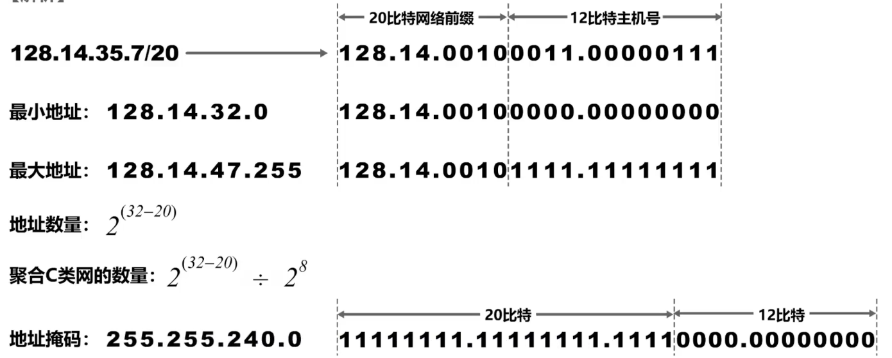

| 参数 | 计算方法 | 结果 |
| :--- | :--- | :--- |
| **最小地址** | 前缀不变，主机号全0 | `128.14.32.0` |
| **最大地址** | 前缀不变，主机号全1 | `128.14.47.255` |
| **地址数量** | $2^{32-20} = 2^{12}$ | **4096** |
| **聚合C类网数量** | $2^{12} / 2^{8} = 2^4$ | **16个C类网** |
| **地址掩码** | 20个1 + 12个0 | `255.255.240.0` |


> 掩码推导：`11111111 11111111 11110000 00000000` → `255.255.240.0`
>

练习：


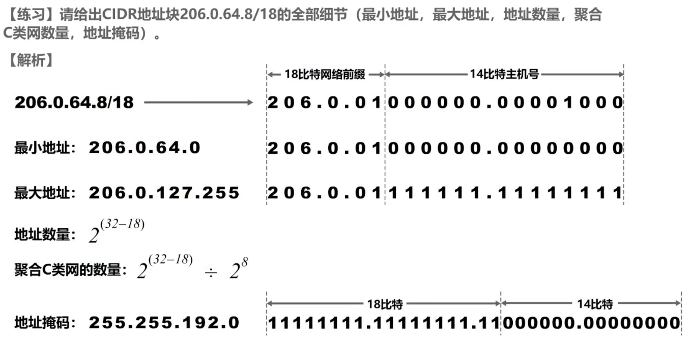

### （2）路由聚合（构造超网）
**目的**：减少路由表中的路由记录数量。

**方法**：找出多个目的网络地址的**共同前缀**。

**实例**


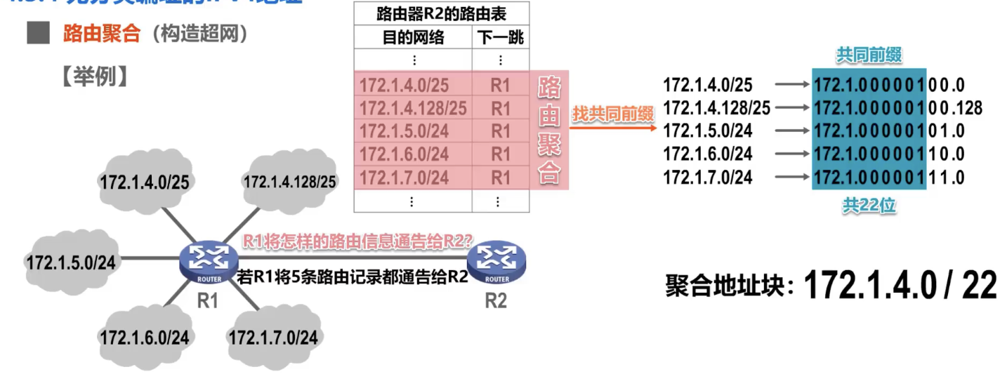

假设路由器R1直连5个网络，需向相邻路由器R2通告路由信息。

+ 5个网络的前两个字节相同，从第三字节开始不同
+ 将第三字节转为二进制，找出共同前缀为 **22位**
+ 记为 `/22`
+ 共同前缀保持不变，剩余10位全0 → 得到聚合后的地址块（**超网**）

**重要原则 — 最长前缀匹配**：

> 若路由器查表转发分组时发现有多条路由可选，则选择**网络前缀最长**的那条路由。
>
> **原因**：网络前缀越长 → 地址块越小 → 路由越**具体**。
>

### （3）考研真题解析
**2011年题38**


**分析**：


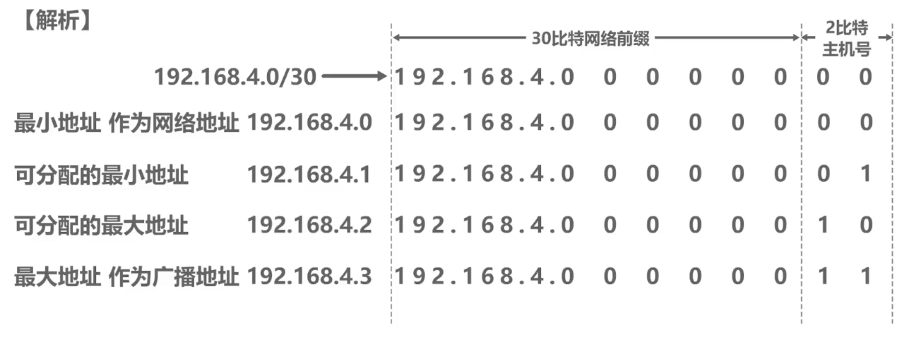

+ `/30` → 前缀30位，主机号仅 **2位**
+ 最小地址（网络地址）：`192.168.4.0`
+ 最大地址（广播地址）：`192.168.4.3`
+ 可分配地址：`192.168.4.1` 和 `192.168.4.2`（仅2个）
+ 目的地址 `192.168.4.3` 为**广播地址** → 所有主机都能收到
+ **答案**：最大主机数为 **2**

---

**2018年题38**

**题目**：对4个目的网络地址进行路由聚合。

**分析**：


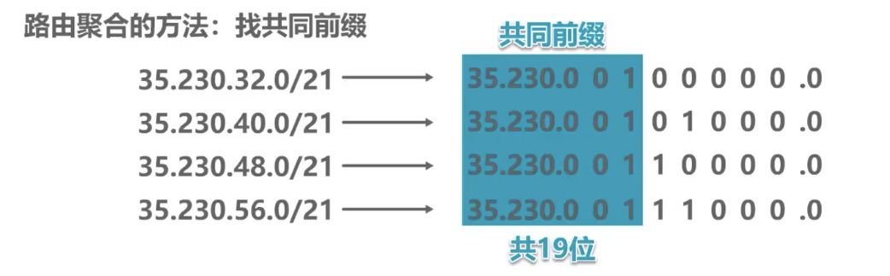

+ 前两个字节相同，从第三字节开始不同
+ 将第三字节转为二进制，找出共同前缀为 **19位**
+ 记为 `/19`
+ 共同前缀不变，剩余13位全0 → 得到聚合后的目的网络地址

---

## 6.IPv4地址的应用规划（FLSM与VLSM）
### （1）概述
给定一个IPv4地址块，需将其划分为若干更小的地址块并分配给不同网络，主要有两种方法：

| 方法 | 全称 | 特点 | 优缺点 |
| :--- | :--- | :--- | :--- |
| **FLSM** | 定长子网掩码 | 所有子网使用**同一个**子网掩码 | 每个子网分配IP数相同，**容易浪费** |
| **VLSM** | 变长子网掩码 | 不同子网使用**不同的**子网掩码 | 按需分配，**减少浪费** |


### （2）FLSM（定长子网掩码）划分实例
**场景**：申请到C类网络 `218.75.230.0`，需划分为5个子网。

**各网络IP需求统计**：0


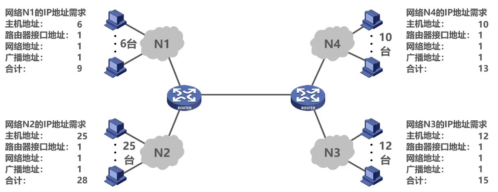

| 网络 | 主机数 | 路由器接口 | 网络地址 | 广播地址 | 总需求 |
| :---: | :---: | :---: | :---: | :---: | :---: |
| N1 | 6 | 1 | 1 | 1 | **9** |
| N2 | 25 | 1 | 1 | 1 | **28** |
| N3 | — | — | — | — | （类似计算） |
| N4 | — | — | — | — | （类似计算） |
| N5 | 0 | 2 | 1 | 1 | **4** |


> N5为两台路由器直连链路，无主机，仅需2个接口地址。
>

**划分方案**：


+ 从8位主机号中借用 **3位** 作为子网号
+ 可划分子网数：$2^3 = 8$ 个（≥ 5，满足需求）
+ 每个子网地址数：$2^{8-3} = 2^5 = 32$ 个（≥ 各网络最大需求28，满足）
+ 子网掩码：`11100000` → **224**
+ 完整子网掩码：**255.255.255.224**

**子网划分细节**（以子网1、2为例）：


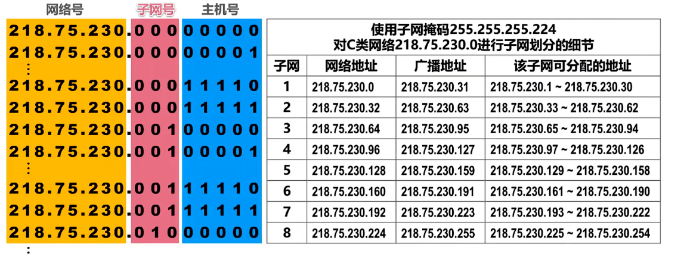

> 以此类推，可得到全部8个子网的地址范围，从中任选5个分配给N1～N5。
>

**FLSM的缺陷**：

+ 只能划分出 $2^N$ 个子网
+ 每个子网分配的IP数相同
+ N5仅需4个地址，却被分配32个 → **严重浪费**（浪费了28个地址）

### （3）VLSM（变长子网掩码）划分实例
**场景**：同FLSM，但改用变长子网掩码。

**按需分配原则**：根据各网络实际需要的地址数，确定主机号位数。


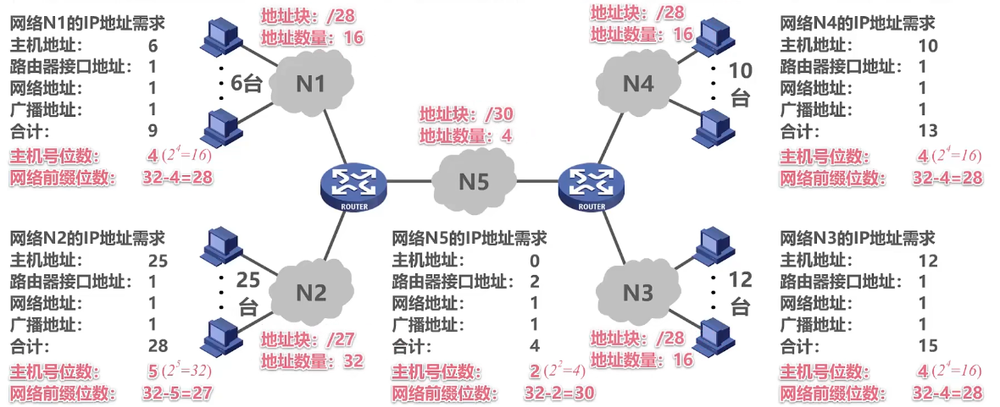

| 网络 | 需求 | 主机号位数 | 地址块大小 | 网络前缀位数 |
| :---: | :---: | :---: | :---: | :---: |
| N2 | 28 | 5位（$2^5=32 \geq 28$） | 32 | 27位 |
| N1 | 9 | 4位（$2^4=16 \geq 9$） | 16 | 28位 |
| N3 | — | — | 16 | 28位 |
| N4 | — | — | 16 | 28位 |
| N5 | 4 | 2位（$2^2=4 \geq 4$） | 4 | 30位 |


**分配原则**：

> 子块的**起点位置**不能随意选取，只能选取**块大小整数倍**的地址作为起点。
>
> **建议**：先给大的子块分配，再分配小的。
>

**分配过程**（基于地址块 `218.75.230.0/24`）：


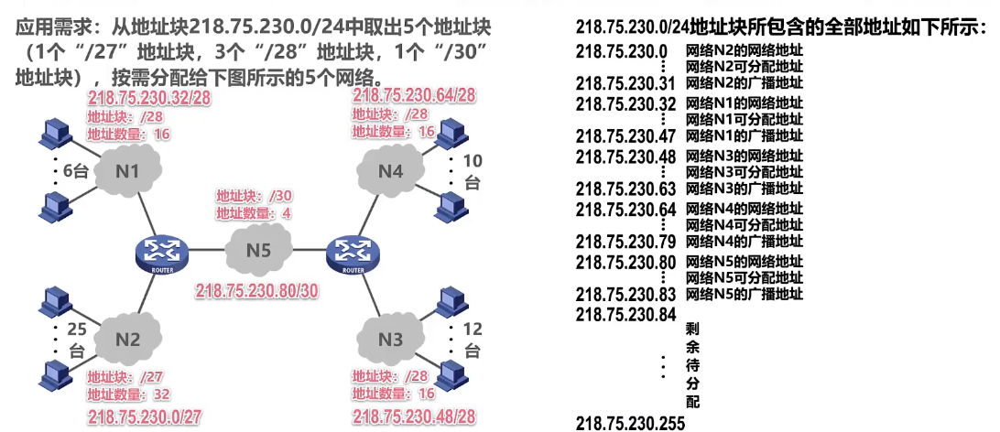

| 网络 | 地址块大小 | 网络地址 | 广播地址 | 可用范围 |
| :---: | :---: | :--- | :--- | :--- |
| **N2** | 32 | `218.75.230.0` | `218.75.230.31` | `.1` ～ `.30` |
| **N1** | 16 | `218.75.230.32` | `218.75.230.47` | `.33` ～ `.46` |
| **N3** | 16 | `218.75.230.48` | `218.75.230.63` | `.49` ～ `.62` |
| **N4** | 16 | `218.75.230.64` | `218.75.230.79` | `.65` ～ `.78` |
| **N5** | 4 | `218.75.230.80` | `218.75.230.83` | `.81` ～ `.82` |


> 原地址块中 `.84` ～ `.255` 的地址可留作今后分配。
>

**VLSM的优势**：

+ 按需划分，子网数量灵活
+ 各子网分配的IP数可不同
+ N5仅需4个地址，精确分配4个 → **零浪费**

### （4）FLSM 与 VLSM 对比总结
| 对比维度 | FLSM（定长子网掩码） | VLSM（变长子网掩码） |
| :--- | :--- | :--- |
| 子网掩码 | 所有子网**相同** | 各子网**可以不同** |
| 子网数量 | 只能为 $2^N$ 个 | 灵活，按需划分 |
| 每个子网IP数 | **相同** | **可以不同** |
| IP地址利用率 | 较低，易浪费 | 较高，浪费少 |
| 配置复杂度 | 简单 | 相对复杂 |
| 适用场景 | 各子网规模相近 | 各子网规模差异大 |


---

# 四、IP数据报的发送和转发过程
## 1. 引言与核心概念界定
在TCP/IP协议栈中，IP数据报的传输过程主要包含两个核心环节：

1. **主机发送IP数据报**：源主机将数据报交付给网络。
2. **路由器转发IP数据报**：中间路由器根据路由表将数据报向目的网络推进。

> **学习范围界定**：  
为了聚焦于**网际层（IP层）** 的发送与转发机制，本文档将忽略数据链路层的相关细节，包括：使用ARP协议获取目的主机或路由器接口MAC地址的过程，以及以太网交换机自学习与转发MAC帧的过程。
>

---

## 2.网络拓扑与交付方式判定
**网络拓扑与地址规划**

假设存在一个小型互联网，包含一台路由器和两个交换式以太网（网络1与网络2）。路由器接口0直连网络1，接口1直连网络2。各网络的主机与路由器接口均配置了相应的IP地址与子网掩码。


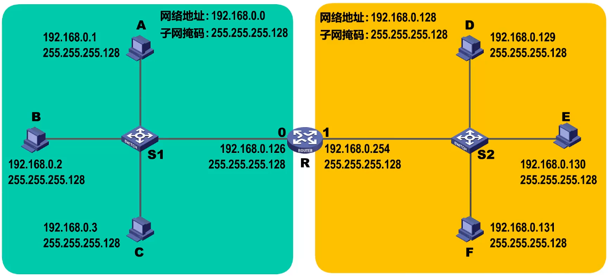

**直接交付与间接交付**

+ **直接交付**：同一网络中的主机之间直接通信，无需路由器中转。
+ **间接交付**：不同网络中的主机之间通信，必须通过路由器进行中转。


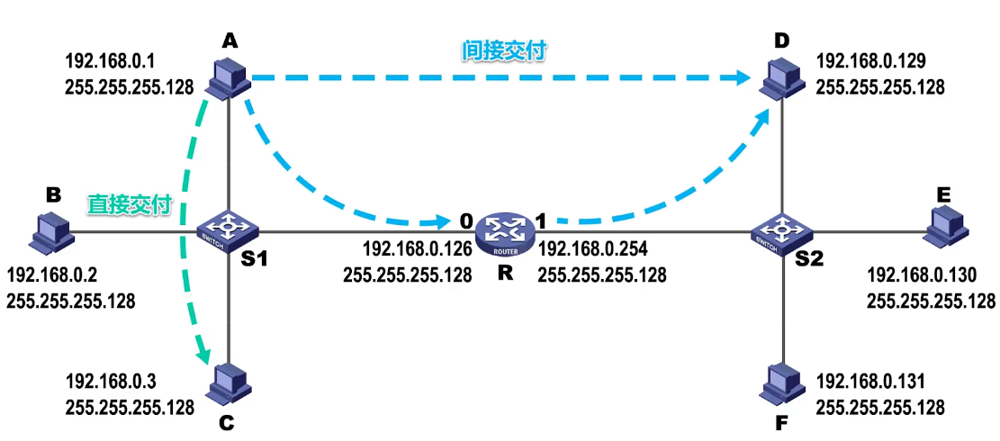

**判定算法：源主机如何判断交付方式？**

源主机在发送数据报前，需判断目的主机是否与自己在同一网络。判定步骤如下：

1. **计算源网络地址**：将源主机自身的IP地址与其子网掩码进行**逻辑与（AND）** 运算。
2. **计算目的网络地址**：将目的主机的IP地址与**源主机的子网掩码**进行逻辑与运算。
3. **比对结果**：
    - 若两者**相等** $\rightarrow$ 在同一网络，执行**直接交付**。
    - 若两者**不等** $\rightarrow$ 不在同一网络，执行**间接交付**。


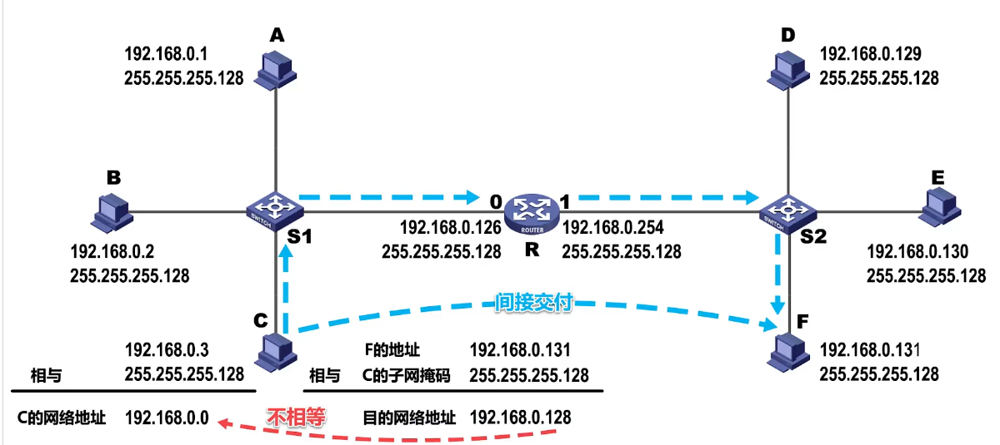

> **示例**：主机C向主机F发送IP数据报。主机C将主机F的IP与自己的子网掩码相与，得到的目的网络地址与自身的网络地址不相等，因此判定为间接交付，需将数据报交由路由器处理。
>

---

## 3.默认网关（Default Gateway）机制
当源主机判定需要进行**间接交付**时，它需要知道应将IP数据报交给哪个路由器。

+ **定义**：默认网关是本网络中指定的一个路由器接口的IP地址，负责帮助本网络内的主机转发跨网数据报。
+ **配置原则**：主机必须将与其直连的路由器接口的IP地址配置为自己的默认网关。
+ **工作机制**：当主机需要与其他网络通信时，会在数据链路层将MAC帧发送给默认网关的MAC地址，由默认网关在网络层提取IP数据报并进行后续转发。


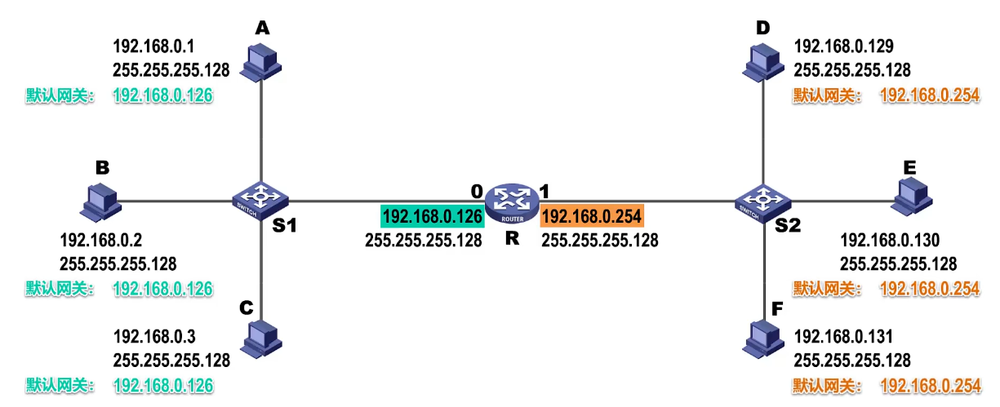

---

## 4.路由器转发IP数据报的核心机制
当路由器收到IP数据报后，其标准处理流程如下：


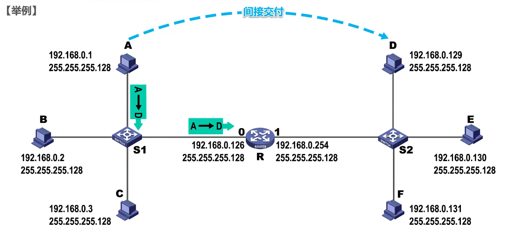

**首部校验与差错处理**

1. 路由器首先检查IP数据报首部是否出错（如首部校验和错误）。
2. **若出错**：直接丢弃该数据报，并向源主机发送 **ICMP（Internet Control Message Protocol）差错报告报文**。
3. **若无错**：提取首部中的**源IP地址**和**目的IP地址**，进入查表转发阶段。

**路由表（Routing Table）的构成**

路由表是路由器进行转发决策的核心数据库，其条目主要来源包括：

| 路由类型 | 生成方式 | 特点 | 示例 |
| :--- | :--- | :--- | :--- |
| **直连路由** | 配置接口IP和掩码时**自动生成** | 无下一跳路由器，出接口明确 | 接口0直连 `192.168.0.0/25` |
| **静态路由** | 网络管理员**手工配置** | 适用于小型、拓扑稳定的网络 | 指向特定下一跳IP的固定路径 |
| **动态路由** | 路由器运行**路由协议**（如OSPF, BGP）自动学习 | 适用于大型、拓扑复杂的网络 | 根据网络状态动态更新 |


**查表转发算法**


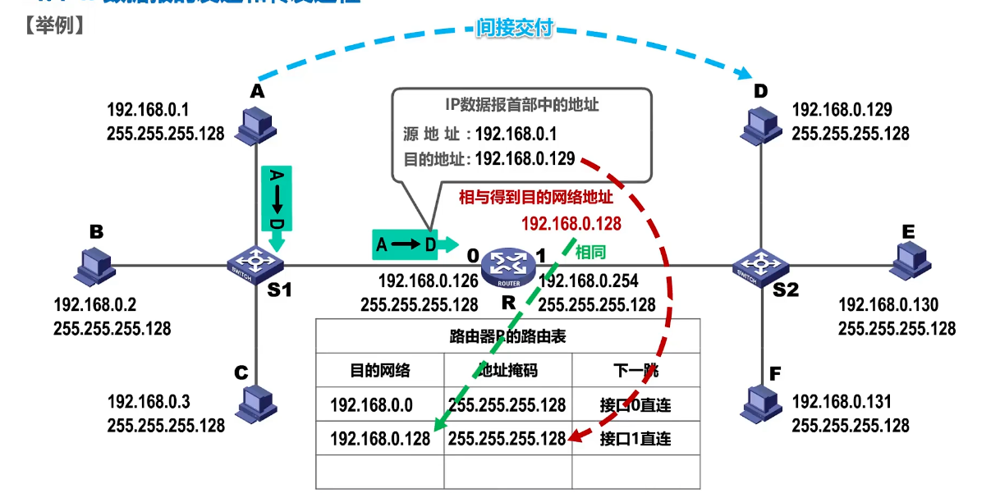

路由器根据目的IP地址，在路由表中逐条查找匹配的路由条目：

1. 取出路由条目中的**地址掩码**。
2. 将**目的IP地址**与该掩码进行逻辑与运算，得到计算出的目的网络地址。
3. 将计算结果与路由条目中的**目的网络地址**进行比对。
4. 若相同，则匹配成功，按照该条目指示的**下一跳IP**和**出接口**转发数据报；若遍历完所有条目均未匹配，则丢弃数据报并发送ICMP目的不可达报文。

> **后端开发视角补充：路由查找的数据结构优化**  
讲稿中提到的“逐条检查”仅为原理演示。在实际的高性能路由器研发或C++后端网关开发中，线性遍历无法满足线速转发（Line-rate）的需求。工程上通常采用高效的数据结构来加速最长前缀匹配（Longest Prefix Match），例如：
>
> + **Trie树（字典树）/ 多叉树**：利用IP地址的比特前缀特性进行树形检索。
> + **DIR-24-8 算法**：通过空间换时间，利用多级查表（TCAM或SRAM）实现 $O(1)$ 或 $O(2)$ 复杂度的硬件级路由查找。
>

---

## 5.广播域隔离与广播数据报处理
**广播地址的类型**

+ **直接广播地址**：主机号全为1的地址（如 `192.168.0.127` 对于 `/25` 网络）。
+ **受限广播地址**：`255.255.255.255`，仅在本网络内广播。


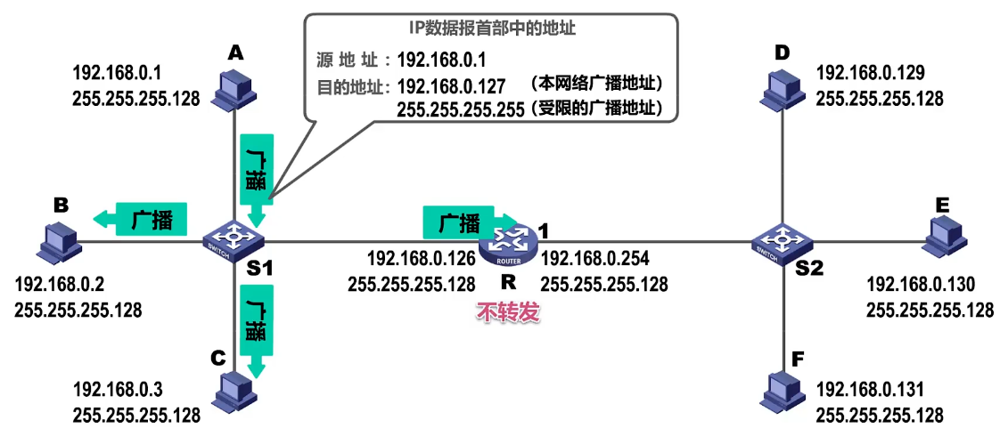

**路由器对广播报的处理原则**

1. **本网络广播**：主机向本网络发送广播报（目的地址为本网络广播地址或受限广播地址），本网络所有设备接收。**路由器接收但不转发**。
2. **跨网络广播**：主机向其他网络发送广播报（目的地址为其他网络的直接广播地址），数据报到达路由器后，路由器识别其为广播地址，**拒绝转发**。

> **核心结论：路由器隔离广播域。**  
这一设计至关重要。若因特网中的路由器转发广播数据报，将引发全局性的**广播风暴（Broadcast Storm）**，导致网络拥塞甚至瘫痪。
>

---

## 6.历年考研真题深度解析


**解析**：

| 设备 | 工作层级 | 隔离冲突域 | 隔离广播域 |
| :--- | :--- | :---: | :---: |
| 中继器、集线器（Hub） | 物理层 | 不隔离 | 不隔离 |
| 网桥、交换机（Switch） | 数据链路层 | 隔离 | 不隔离 |
| **路由器（Router）** | **网络层** | **隔离** | **隔离** |


---


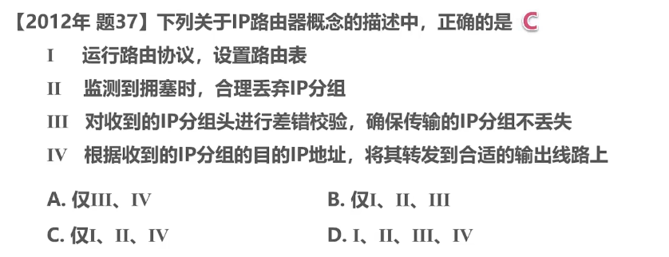

**题目考点**：TCP/IP网际层（IP层）的服务模型与路由器行为。  
**解析**：

+ IP协议提供的是**无连接、尽最大努力交付**的服务，**不保证可靠传输**（不保证IP分组不丢失、不重复、不乱序）。
+ 路由器仅对IP**首部**进行差错校验，不对数据部分校验。发现首部错误时，丢弃分组并发送 **ICMP** 差错报告。
+ 题目中描述“IP路由器负责可靠传输”是错误的。利用排除法可得正确选项。

---


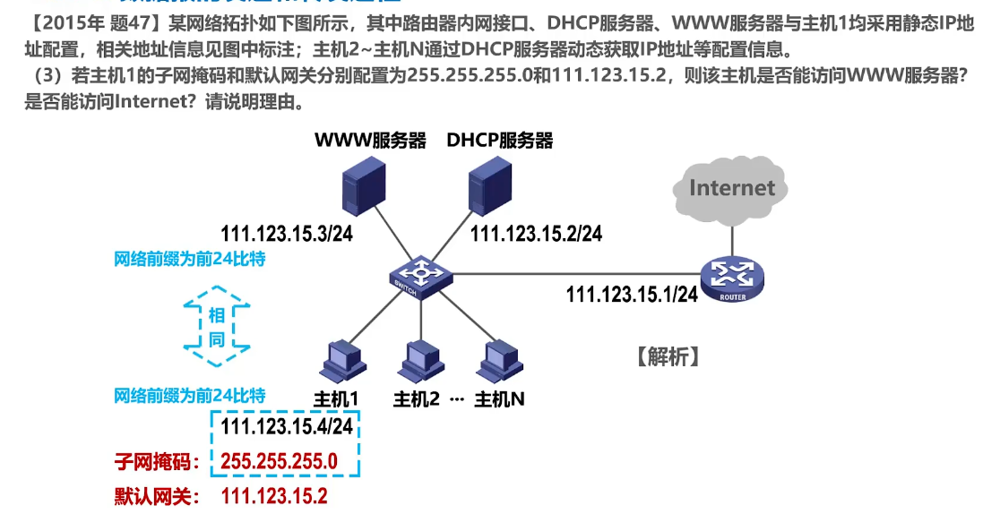

**题目场景**：主机1能访问同网段的Web服务器，但无法访问Internet。  
**解析**：

1. **同网段通信**：主机1与Web服务器的IP地址网络前缀相同（均为 `/24`），属于直接交付，物理连接与IP配置正常，故能访问Web服务器。
2. **跨网段通信故障**：主机1访问Internet属于间接交付，必须依赖默认网关。经排查，主机1的默认网关被**错误配置为DHCP服务器的IP地址**。
3. **根因**：DHCP服务器仅负责分配IP，不具备路由转发功能。正确的默认网关必须配置为**直连路由器的接口IP地址**。

---

## 7.全文总结
本文档系统梳理了IP数据报在TCP/IP网际层的发送与转发机制：

1. **交付判定**：通过IP与子网掩码的逻辑与运算，精确区分直接交付与间接交付。
2. **网关机制**：默认网关是主机跨网通信的唯一出口。
3. **路由转发**：路由器通过校验首部、查询路由表（直连/静态/动态），基于最长前缀匹配原则进行数据报转发。
4. **广播控制**：路由器严格隔离广播域，从根本上防止了广播风暴的发生。

> **学习建议**：对于致力于C++后端开发的同学，理解IP转发机制不仅有助于应对考试，更是后续学习**网络编程（Socket API）**、**分布式系统路由**以及**高性能网关设计**的底层理论基石。建议在掌握原理的基础上，尝试使用C++实现一个简易的基于Trie树的IP路由查找模块，以加深对数据结构与网络协议结合的理解。
>

---

# 五、静态路由配置及其可能产生的路由环路问题
## 1.静态路由概述
### （1）定义与特点
**静态路由（Static Routing）** 是指由网络管理员或用户通过路由器的配置命令，人工手动维护和管理的路由表条目。

| 维度 | 特点说明 |
| :--- | :--- |
| **优点** | 配置简单、逻辑清晰；不占用网络带宽和路由器CPU资源（无需运行路由协议计算），**开销极小**。 |
| **缺点** | 缺乏灵活性，**无法自动适应网络拓扑和状态的变化**。 |
| **适用场景** | 拓扑结构稳定、规模较小的网络，或作为动态路由的补充（如默认出口路由）。 |


### （2）静态路由引发路由环路的三大诱因
在静态路由配置中，若设计或操作不当，极易产生**路由环路（Routing Loop）**，导致IP数据报在网络中无限循环。主要诱因包括：

1. **人工配置错误**（如下一跳指向错误）。
2. **路由聚合不当**（聚合了实际不存在的子网）。
3. **网络故障**（直连链路Down掉后，默认路由兜底引发环路）。

---

## 2.路由表条目类型与匹配原则
在深入分析环路问题前，需明确路由器路由表中常见的四种路由条目类型及其生成方式。

### （1）路由条目分类

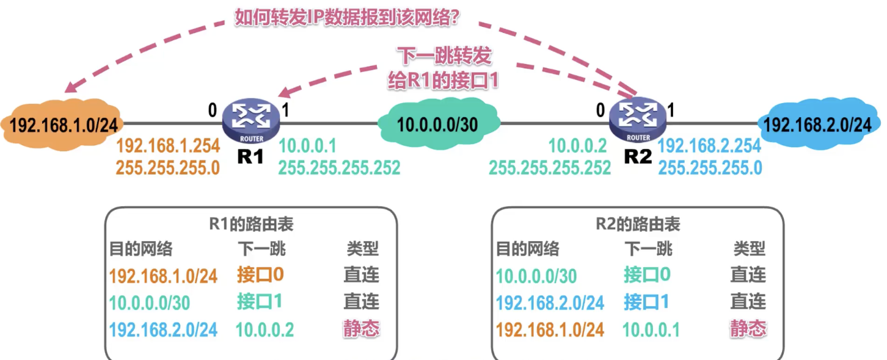

| 路由类型 | 生成方式 | 目的网络与掩码示例 | 下一跳 (Next Hop) | 应用场景 |
| :--- | :--- | :--- | :--- | :--- |
| **直连路由** | 配置接口IP和掩码后**自动生成** | `192.168.1.0/24` | 指向本地出接口（无下一跳IP） | 路由器直连的网络 |
| **静态路由** | 管理员**人工配置** | `10.0.0.0/24` | 指向相邻路由器的接口IP | 明确目的网络的固定路径 |
| **默认路由** | 管理员**人工配置** | `0.0.0.0/0` (CIDR) | 指向出口网关IP | 替代大量明细路由，常用于连接Internet |
| **特定主机路由** | 管理员**人工配置** | `192.168.1.100/32` | 指向特定下一跳 | 网络测试、安全控制、精准流量调度 |


### （2）最长前缀匹配原则 (Longest Prefix Match)
当路由器查表转发IP数据报时，若存在多条匹配的路由条目，将严格遵循**最长前缀匹配原则**：

+ **特定主机路由 (/32)**：前缀最长，路由**最具体**，优先级最高。
+ **明细网络路由 (如 /24)**：前缀居中。
+ **默认路由 (/0)**：前缀最短，路由**最模糊**，仅作为最后的“兜底”选项。

---

## 3.路由环路问题剖析与防御机制
### 场景一：人工配置错误与 TTL 机制
**问题现象**：  
假设路由器 R2 需要转发数据报给网络 A，管理员错误地将 R2 的下一跳配置为 R3；而 R3 的路由表中，网络 A 的下一跳又指向了 R2。


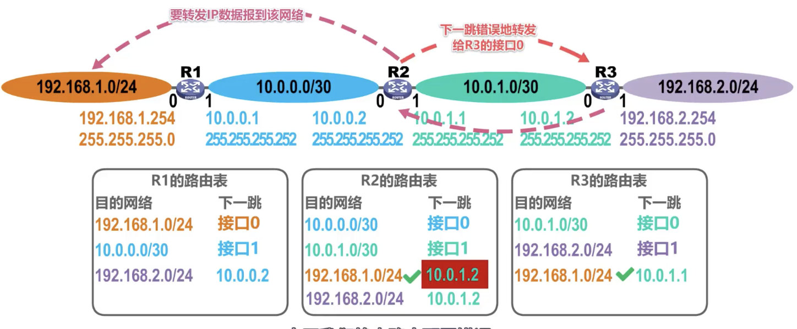

+ **结果**：数据报在 R2 和 R3 之间无限“踢皮球”，形成**路由环路**。

**防御机制：生存时间 (TTL, Time To Live)**  
	为了防止IP数据报在环路中永久兜圈导致网络拥塞，IP数据报首部设计了 **TTL 字段**（通常为8比特，初始值多为64或128）。

1. 数据报每进入一个路由器，TTL 值**减 1**。
2. 若 TTL > 0，路由器继续转发。
3. 若 TTL = 0，路由器**丢弃**该数据报，并向源主机发送 **ICMP 超时报文**。

> **💡 后端开发视角：TTL 思想的延伸**  
在C++后端开发与分布式系统设计中，TTL 思想被广泛应用于**防环与防雪崩**：
>
> + **消息队列 (MQ)**：为消息设置 TTL，防止死信队列无限堆积或消息在多个消费者间循环路由。
> + **RPC 调用/微服务**：在请求 Header 中传递 `X-Request-Depth` 或 `TraceID`，当调用深度超过阈值时直接熔断，防止微服务间的循环调用导致系统崩溃。
>

### 场景二：路由聚合不当与黑洞路由 (Null0)
**问题现象**：


.png>)


.png>)

  
假设 R2 将 4 个连续的 `/26` 子网聚合为一个 `/24` 的超网，并将下一跳指向 R1。但实际上，这 4 个子网中**有 2 个是不存在的**。

1. 当发往“存在子网”的数据报到达 R1 时，R1 查表明细路由，正常转发。
2. 当发往“**不存在子网**”的数据报到达 R1 时，R1 找不到明细路由，只能匹配**默认路由**，将数据报又扔回给 R2。
3. R2 再次匹配聚合路由扔给 R1，形成 **R1 与 R2 之间的环路**。

**解决方案：配置黑洞路由 (Blackhole Route)**  
针对聚合后不存在的子网，在 R2 上配置一条指向 `Null0` **接口**的明细路由。


.png>)

+ **Null0** 是路由器内部的虚拟接口，形象地称为“黑洞”。数据报进入 Null0 后会被**直接丢弃**（有去无回）。
+ **生效原理**：利用**最长前缀匹配原则**。发往不存在子网的数据报，会优先匹配前缀更长的 `Null0` 黑洞路由，从而被丢弃，避免了匹配聚合路由发往 R1，彻底打破环路。

### 场景三：网络故障与黑洞路由的动态切换
**问题现象**：  
假设 R1 的接口 0 直连网络 A。R2 将发往网络 A 的数据报发给 R1。

1. **正常状态**：R1 存在网络 A 的直连路由，正常交付。
2. **故障状态**：网络 A 发生故障（链路 Down），R1 的**直连路由自动消失**。
3. **环路产生**：R2 继续发包给 R1，R1 查不到网络 A 的明细路由，触发**默认路由**，将包扔回给 R2，形成环路。

**解决方案：浮动黑洞路由 (Floating Static Route)**


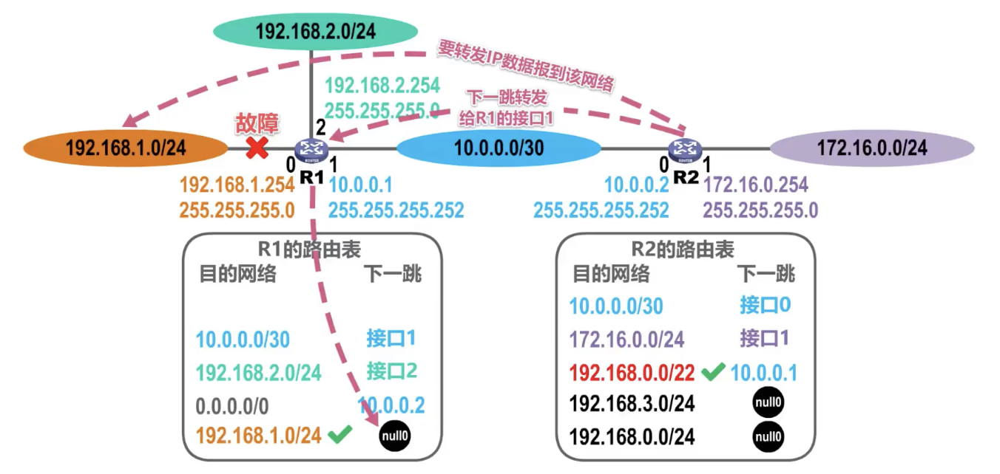

提前在 R1 上为网络 A 配置一条指向 `Null0` 的静态黑洞路由，并通过**路由优先级（Preference / Administrative Distance）** 实现动态切换：

+ **网络正常时**：直连路由的优先级最高（最优先），黑洞路由被**隐藏（失效状态）**，不影响正常通信。
+ **网络故障时**：直连路由消失，优先级较低的静态黑洞路由**浮现（生效状态）**。此时 R1 收到发往网络 A 的包，会匹配黑洞路由将其丢弃，防止环路。
+ **网络恢复时**：直连路由重新生成，黑洞路由再次隐藏。

---

## 4.全文总结
本文档系统梳理了静态路由的配置方法及其潜在的路由环路风险：

1. **基础配置**：掌握了直连路由、静态路由、默认路由（`0.0.0.0/0`）与特定主机路由（`/32`）的应用场景及**最长前缀匹配原则**。
2. **防环机制**：
    - 依赖 **TTL** 机制防止配置错误导致的物理环路无限循环。
    - 引入 **Null0 黑洞路由** 解决路由聚合包含无效子网，以及直连网络故障时默认路由兜底引发的逻辑环路。
3. **工程思维**：网络层的防环与流量控制思想（如 TTL、黑洞丢弃），可完美映射至后端分布式系统的超时控制、熔断降级与恶意流量拦截设计中。

> **学习建议**：在掌握理论的基础上，建议使用 GNS3 或 eNSP 等网络模拟器，亲手搭建拓扑并配置 `Null0` 路由，通过抓包（Wireshark）观察 TTL 递减和 ICMP 超时响应的真实过程，以加深对网络底层行为的理解。
>

# 六、路由选择协议
## 1.路由选择协议基本概念
### （1）静态路由与动态路由
路由选择算法按照工作方式可分为 **静态路由选择** 与 **动态路由选择** 两类。

| 对比维度 | 静态路由选择 | 动态路由选择 |
| --- | --- | --- |
| 配置方式 | 人工配置 | 路由器通过协议自动获取 |
| 路由信息来源 | 管理员手工添加 | 路由选择协议自动交互 |
| 常见路由类型 | 网络路由、默认路由、特定主机路由、黑洞路由 | 由协议算法动态计算 |
| 复杂度 | 简单，开销小 | 复杂，开销较大 |
| 适应性 | 不能及时适应网络变化 | 能较好适应网络状态变化 |
| 适用场景 | 小规模网络 | 大规模网络 |


> **后端视角补充**：在 Linux 系统中，静态路由常通过 `ip route add` 命令配置，常用于开发环境中的网关、VPN 路由策略；而生产环境下的服务器路由通常由底层网络设备的动态路由协议自动维护。
>

### （2）因特网路由选择协议的三大特点
因特网作为全球最大的互联网络，其路由选择协议具有以下三个核心特征：

1. **自适应（Adaptive）**  
采用动态路由选择机制，能根据网络拓扑、链路状态的变化自动调整路由。
2. **分布式（Distributed）**  
各路由器通过相互间的信息交互，**共同完成**路由信息的获取和更新，没有单一中心节点。
3. **分层次（Hierarchical）**  
将整个因特网划分为多个较小的 **自治系统（Autonomous System, AS）**，系统内部与外部采用不同类别的路由协议。

### （3）自治系统（AS）与分层次路由
**自治系统（AS）的定义**

**自治系统（AS）** 是指在单一技术管理下的一组路由器和网络，例如一家大型 ISP（因特网服务提供商）可以构成一个 AS。AS 内部与外部采用不同的路由协议类别。


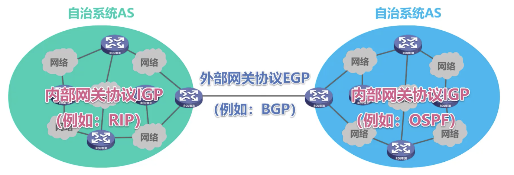

**域内路由与域间路由**

| 类型 | 英文简称 | 使用协议类别 | 说明 |
| --- | --- | --- | --- |
| 域内路由选择 | Intra-AS Routing | **IGP**（内部网关协议） | AS 内部的路由选择 |
| 域间路由选择 | Inter-AS Routing | **EGP**（外部网关协议） | AS 之间的路由选择 |


> **术语说明**：
>
> + **IGP（Interior Gateway Protocol）** 与 **EGP（Exterior Gateway Protocol）** 是协议**类别名称**，不是具体的协议。
> + 早期 RFC 文档中使用"**网关（Gateway）**"一词指代路由器，新文档已改为"**路由器（Router）**"。因此 IGP/EGP 也可分别称为 IRP（内部路由协议）/ ERP（外部路由协议），但为便于查阅经典 RFC，课程仍沿用旧称。
>

**常见路由选择协议一览**


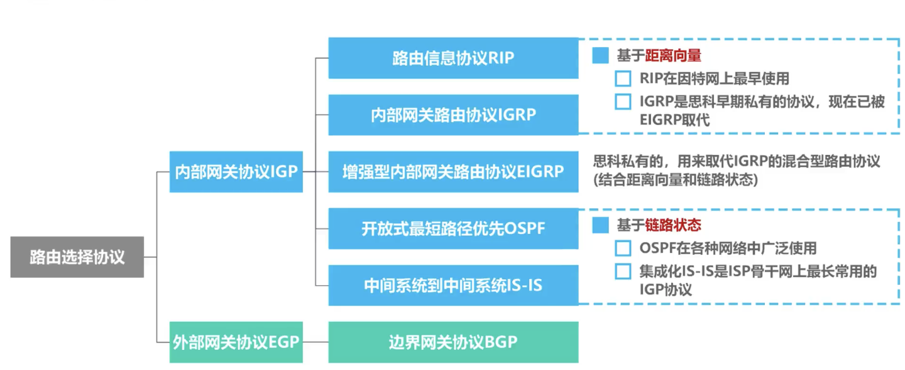

| 典型协议 | 协议类别 | 算法基础 | 特点与应用场景 |
| :--- | :--- | :--- | :--- |
| **RIP**, IGRP (Cisco 早期私有，已被 EIGRP 取代) | **IGP** | 距离向量（DV） | 基于跳数，适用于小型网络 |
| **OSPF**, IS-IS（ISP 骨干网常用） | **IGP** | 链路状态 | 基于带宽/代价，收敛快，OSPF广泛用于企业网，IS-IS多用于ISP骨干网 |
| EIGRP (Cisco 私有，结合距离向量与链路状态) | **IGP** | 混合型 | 结合距离向量与链路状态特性 |
| **BGP**（Border Gateway Protocol，边界网关协议） | **EGP** | 路径向量 | 基于策略路由，用于因特网核心AS间的互联 |


```plain
路由选择协议
├── IGP（内部网关协议，AS 内部使用）
│   ├── 基于距离向量：RIP、IGRP（Cisco 早期私有，已被 EIGRP 取代）
│   ├── 基于链路状态：OSPF、IS-IS（ISP 骨干网常用）
│   └── 混合型：EIGRP（Cisco 私有，结合距离向量与链路状态）
└── EGP（外部网关协议，AS 之间使用）
    └── BGP（Border Gateway Protocol，边界网关协议）
```

---

## 2.路由器的基本结构
路由器是一种具有**多个输入端口和输出端口**的专用计算机，核心任务是**转发分组**。其结构可分为两大部分：**路由选择部分** 与 **分组转发部分**。


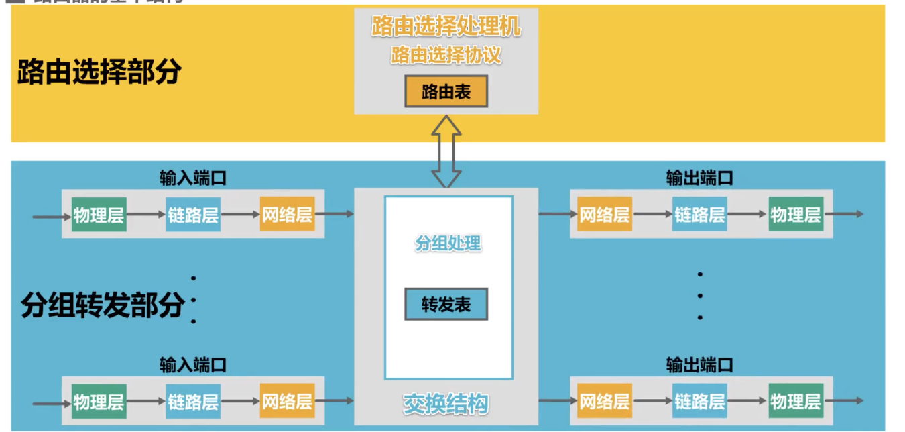

**路由选择部分（控制平面）**

+ **核心构件**：路由选择处理器（Routing Processor）
+ **主要任务**：
    - 运行路由选择协议
    - 周期性与其他路由器交换路由信息
    - 维护和更新**路由表（Routing Table）**
+ **路由表特点**：包含"目的网络 → 下一跳"的映射，针对**网络拓扑变化的计算**进行优化。

**分组转发部分（数据平面）**

由以下三部分构成：**交换结构（Switching Fabric）**、**输入端口组**、**输出端口组**。

---

**分组转发完整流程**

```plain
[输入物理链路]
    ↓
物理层：信号 → 比特流
    ↓
数据链路层：识别帧 → 去帧头帧尾 → 提取分组
    ↓
网络层：根据目的地址查【转发表】
    ├─ 匹配失败 → 丢弃分组
    └─ 匹配成功 → 按指示端口转发，更新 TTL（减 1）等字段
    ↓
数据链路层：重新封装成帧
    ↓
物理层：比特流 → 电信号 → 输出
```

**路由报文的特殊处理**

若进入网络层的分组是**路由协议报文**（如 RIP 更新、OSPF LSU），则送交**路由选择处理器**处理，用于更新路由表。同时路由选择处理器也会周期性向外发送本路由器的路由信息。

### 路由表与转发表

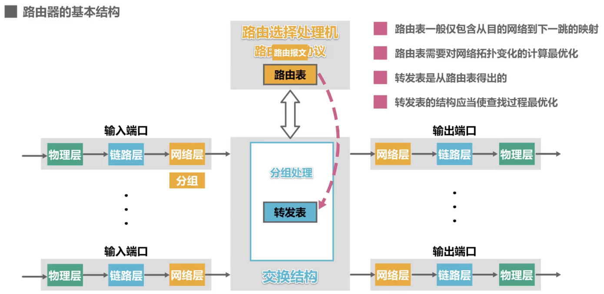

| 项目 | 路由表（Routing Table） | 转发表（Forwarding Table） |
| --- | --- | --- |
| 来源 | 由路由协议算法计算得出 | 由路由表推导生成 |
| 优化目标 | 拓扑变化计算最优 | 查找过程最优（高速查表） |
| 工程实践 | 教学中常不严格区分两者 | 高性能路由器中分离实现 |


### 输入/输出缓冲区

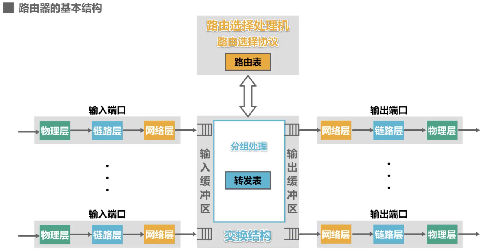

+ **输入缓冲区**：暂存进入路由器但尚未处理的分组
+ **输出缓冲区**：暂存已处理但尚未发送的分组
+ 路由器的每个物理端口通常同时具备输入与输出功能（全双工）

---

## 3.内部网关协议 IGP —— RIP
在计算机网络中，**DV算法** 的全称是 **距离向量路由算法（Distance Vector Routing Algorithm）**。它是互联网中用于计算数据包转发路径（即路由）的一种经典**分布式算法**。

DV 算法的每个路由器都不需要知道整个网络的拓扑结构，它只需要知道两件事：

+ **距离（Distance）**：到达目的网络的“代价”（Cost），通常是**跳数**（经过了多少个路由器）、延迟或带宽。
+ **向量（Vector）**：方向，即数据包应该发往的**下一跳路由器**（Next Hop）。

**RIP（Routing Information Protocol，路由信息协议）** 是最早被广泛使用的 IGP，相关标准为 **RFC 1058**。最著名的基于 DV 算法的路由协议是 **RIP**。

### （1）基本工作原理
+ 要求 AS 内每个路由器维护**从自身到 AS 内其他每一个网络的距离记录**，这组距离称为**距离向量（Distance Vector）**。
+ **度量标准**：使用**跳数（Hop Count）** 衡量距离。
    - 到直连网络的距离 = **1**（Cisco 实现中为 0）
    - 到非直连网络的距离 = 经过的路由器数 + 1


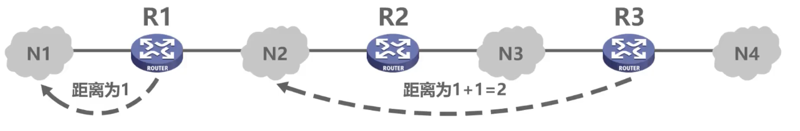

+ **最大跳数限制**：最多只能包含**15个**路由器，**跳数 = 16 表示不可达**
+ **适用范围**：小型互联网（受 15 跳限制）

> **工程思考**：RIP 认为"好的路由 = 距离短 = 跳数少"。这可能导致选出一条跳数少但带宽极低的链路，而忽略跳数多但带宽高的链路。这正是 RIP 在小规模简单网络之外被淘汰的核心原因。
>


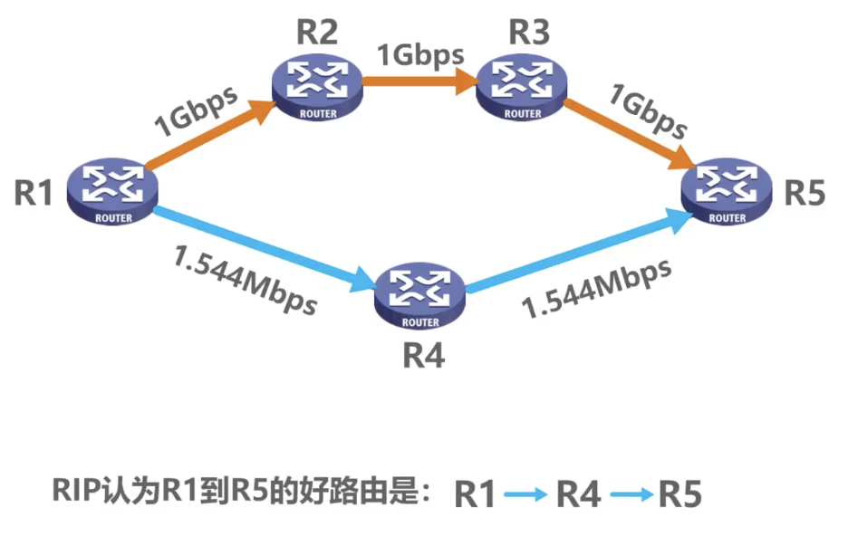

### （2）等价负载均衡
当到达同一目的网络存在**多条距离相等**的路由时，RIP 支持**等价负载均衡（Equal-Cost Load Balancing）**，将流量均匀分布到多条路径上。

### （3）RIP 的三个要点

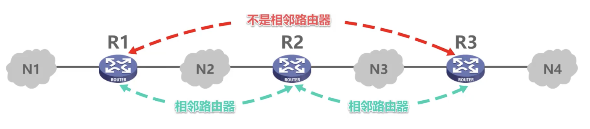

| 要点 | 内容 | 说明 |
| --- | --- | --- |
| **和谁交换** | 仅与**相邻路由器**交换 | 相邻 = 直连、中间无其他路由器 |
| **交换什么** | 自己的**完整路由表** | 邻居收到后进行改造使用 |
| **何时交换** | **周期性交换** | 默认每 **30 秒**发送一次更新报文 |


### （4）路由表更新规则

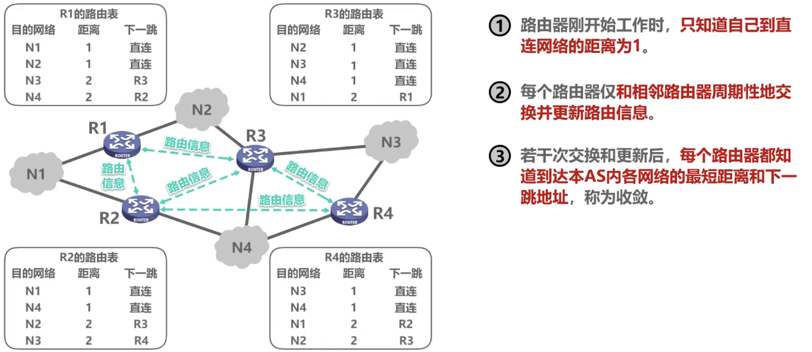

**例子：**

路由器 D 收到相邻路由器 C 的 RIP 更新报文后，按以下步骤处理：


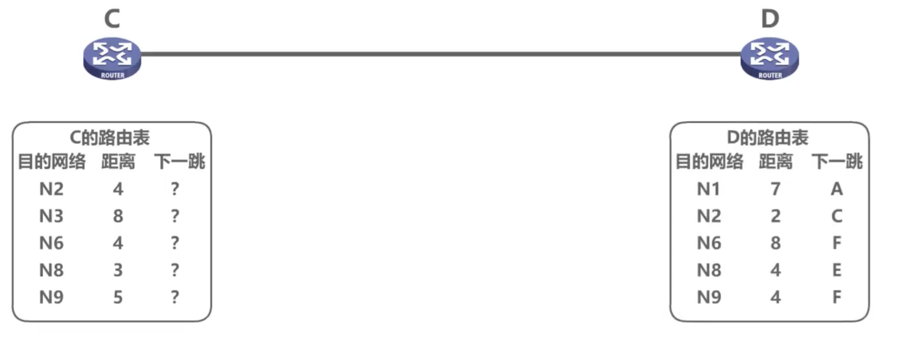

**Step 1：改造收到的路由表**

+ 将所有条目的"下一跳"改为 **C**
+ 将所有条目的"距离" **+1**


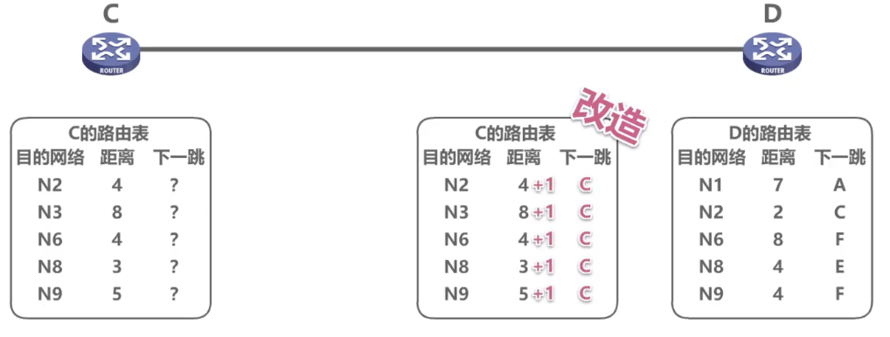

**Step 2：按规则更新自身路由表**


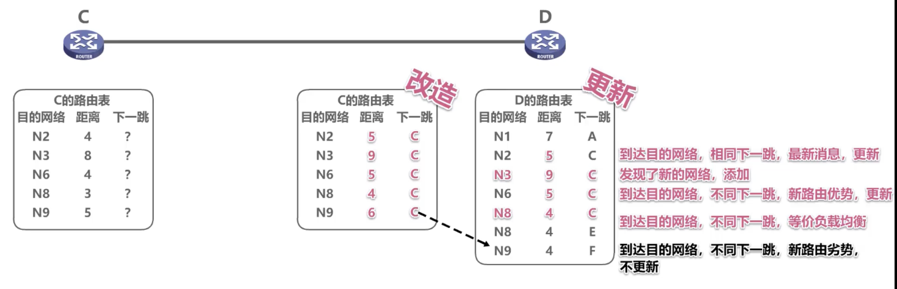

| 场景 | 处理策略 | 原则总结 |
| --- | --- | --- |
| 目的网络相同，下一跳相同 | 无论距离变大变小，**一律更新** | 下一跳相同，最新消息为准 |
| 发现新的目的网络 | **添加**到路由表 | 新网络，加入 |
| 目的网络相同，下一跳不同，新路由距离更短 | **替换**原有路由 | 新路由更有优势 |
| 目的网络相同，下一跳不同，距离相等 | **添加**为等价路由 | 等价负载均衡 |
| 目的网络相同，下一跳不同，新路由距离更长 | **忽略**，不更新 | 新路由处于劣势 |


### （5）"坏消息传得慢"问题（路由环路）
这是**距离向量算法的固有缺陷**，也称为**无穷计数（Count to Infinity）** 问题。

**问题产生过程**

假设 R1 与 R2 相邻，N1 是 R1 的直连网络：

1. R1 检测到 N1 链路故障，将到 N1 距离设为 16（不可达），等待更新周期。
2. **R2 的更新周期先到**，向 R1 通告"我到 N1 距离为 2"。


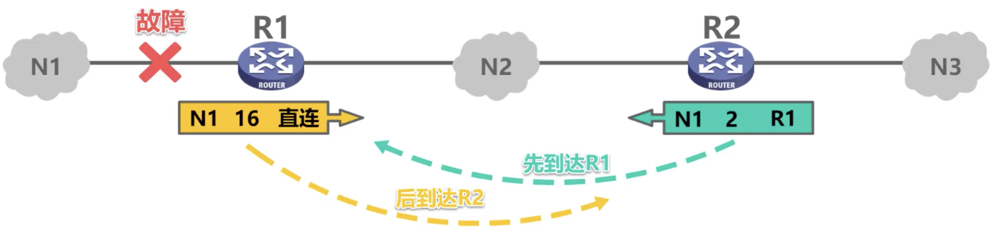

3. R1 **被误导**，认为"经 R2 到 N1 距离为 3"，并更新路由表。
4. 下一个周期 R1 告诉 R2"我到 N1 距离为 3"，R2 更新为"经 R1 到 N1 距离为 4"。
5. 如此反复，距离持续增长直至 16 才收敛。


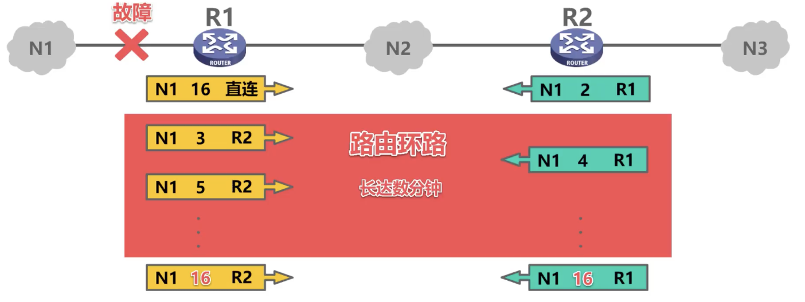

期间 R1、R2 之间形成**路由环路**，耗时可达数分钟。

**缓解措施（不能彻底解决）**

| 措施 | 说明 |
| --- | --- |
| **最大距离限制** | 跳数 ≤ 15，限制环路持续时间 |
| **触发更新（Triggered Update）** | 路由变化时**立即**发送更新，不等周期 |
| **水平分割（Split Horizon）** | 记录收到路由信息的接口，**不从该接口回传**相同路由 |


> 这些措施只能**降低概率、减小危害**，无法从本质上消除距离向量算法的环路问题。
>

### （6）RIP 协议版本
| 版本 | 特点 |
| --- | --- |
| **RIPv1** | 有类路由协议，不支持 VLSM、不携带子网掩码 |
| **RIPv2** | 无类路由协议，支持 VLSM、CIDR，使用组播 `224.0.0.9` |
| **RIPng** | 适用于 IPv6 的版本 |


---

## 4.内部网关协议 IGP —— OSPF
**OSPF（Open Shortest Path First，开放最短路径优先）** 于 1989 年为克服 RIP 缺陷而开发。

+ **Open（开放）**：非厂商私有，公开发表
+ **SPF**：基于 Dijkstra 最短路径算法
+ **基于链路状态**（区别于 RIP 的距离向量）
+ **算法保证无环路**、更新效率高、收敛速度快、不限制网络规模

### （1）链路状态与代价（Cost）
**链路状态**包括：本路由器与哪些路由器相连、相应链路的**代价（Cost）**。

**代价计算**（以 Cisco 实现为例）：

$$
\text{Cost} = \frac{100 \text{ Mbps}}{\text{链路带宽}}
$$

+ 计算结果 < 1 时记为 **1**
+ 大于 1 时**取整数部分**（舍去小数）


| 链路类型 | 带宽 | Cost |
| --- | --- | --- |
| 10 Mbps 以太网 | 10 Mbps | 10 |
| 100 Mbps 快速以太网 | 100 Mbps | 1 |
| 1 Gbps 千兆以太网 | 1000 Mbps | 1 |
| 10 Gbps 万兆以太网 | 10000 Mbps | 1 |


> **工程提示**：在高带宽网络中，默认公式会使千兆与万兆 Cost 相同，需手动调整参考带宽（`auto-cost reference-bandwidth`）。
>

### （2）邻居关系的建立与维护
+ 通过 **Hello 分组**（问候分组）建立和维护邻居关系
+ Hello 封装在 **IP 数据报**中：


- 目的 IP：组播地址 `224.0.0.5`
- 协议号：**89**

+ 发送周期：**10 秒**
+ **Dead Interval（死亡倒计时）**：**40 秒**未收到 Hello 则认为邻居不可达
+ 每个路由器维护**邻居表（Neighbor Table）**


### （3）链路状态数据库（LSDB）
每个路由器生成 **LSA（Link State Advertisement，链路状态通告）**，内容包括：

1. 直连网络的链路状态信息
2. 邻居路由器的链路状态信息


LSA 封装在 **LSU（Link State Update）** 分组中，采用**洪泛法（Flooding）** 向全网传播。最终，AS 内**所有路由器的 LSDB**（链路状态数据库，用于存储LSA） **达到一致**，形成对全网拓扑的统一视图。


### （4）最短路径树计算
每个路由器以自己为根，基于 LSDB 构造**带权有向图**，运行 **Dijkstra 算法**计算到所有目的网络的最短路径，生成路由表。


### （5）OSPF 的五种分组类型
| 类型 | 名称 | 作用 |
| --- | --- | --- |
| Type 1 | **Hello（问候）** | 发现、维护邻居关系 |
| Type 2 | **DBD（Database Description，数据库描述）** | 向邻居发送 LSDB（链路状态数据库）中所有链路状态的摘要信息 |
| Type 3 | **LSR（Link State Request，链路状态请求）** | 向邻居请求缺失的 LSA 详情 |
| Type 4 | **LSU（Link State Update，链路状态更新）** | 洪泛发送 LSA（承载路由信息） |
| Type 5 | **LSAck（链路状态确认）** | 对 LSU 进行确认，保证可靠性 |


### （6）OSPF 工作过程（邻居建立与 LSDB 同步）
1. **Hello 阶段**：周期性发送 Hello，建立邻居关系
2. **DBD 交换**：互相发送 LSDB（数据库描述分组）摘要
3. **LSR 请求**：对比摘要，发现缺失条目则请求详情
4. **LSU 回复**：邻居发送缺失 LSA（链路状态通告）的完整信息
5. **LSAck 确认**：完成 LSDB 同步
6. **持续更新**：
    - 链路状态变化 → 立即洪泛 LSU
    - 周期性刷新：每 **30 分钟**发送一次 LSU


### （7）DR 与 BDR 选举（多点接入网络优化）
在 **广播多路访问网络（如以太网）** 中，若所有路由器两两建立邻接关系：

$$
\text{邻接关系数} = \frac{N(N-1)}{2}
$$

将产生大量协议流量。OSPF 通过选举解决：

+ **DR（Designated Router，指定路由器）**
+ **BDR（Backup DR，备份指定路由器）**


**规则**：

+ 所有非 DR/BDR 路由器（DROther）**仅与 DR、BDR 建立邻接关系**
+ DROther 之间不直接交换信息，必须通过 DR/BDR 中转
+ DR 故障时，BDR 自动顶替

**选举参数**：路由器优先级、Router ID、接口 IP 地址（与交换机 STP 根桥选举类似）。

### （8）OSPF 分层次区域划分
为使 OSPF 适用于**大规模网络**，引入**区域（Area）** 概念。

**区域划分规则**

+ 每个 AS 被划分为多个区域，每个区域有 **32 位区域 ID**（点分十进制表示）
+ **主干区域（Backbone Area）**：区域 ID 必须为 `0.0.0.0`（或简写为 `0`）
+ 主干区域用于**连通其他所有区域**
+ 单个区域规模建议 ≤ **200 台路由器**


**划分区域的好处**

将**洪泛范围局限在区域内部**，大幅减少全网通信量和 LSDB 规模。

**路由器分类**


| 类型 | 英文缩写 | 说明 |
| --- | --- | --- |
| 区域内路由器 | IR | 所有接口在同一区域内 |
| 区域边界路由器 | **ABR** | 连接本区域与主干区域（Area 0） |
| 主干路由器 | BR | 位于 Area 0 内（ABR 也属于 BR） |
| 自治系统边界路由器 | **ASBR** | 与本 AS 之外的 AS 交换路由信息 |


---

## 5.外部网关协议 EGP —— BGP
**BGP（Border Gateway Protocol，边界网关协议）** 是 AS（自治系统）之间使用的路由协议，典型代表是 **BGP-4**（RFC 4271）。

### （1）为什么需要独立的 BGP？
AS 之间的路由选择**不能简单使用代价（Cost）作为度量**，原因有二：

1. **度量标准不统一**
    - AS1 可能用时延、AS2 用跳数、AS3 用带宽
    - 无统一度量，跨 AS 比较"代价"毫无意义


2. **必须考虑策略因素**
    - 政治、经济、安全策略（如国内流量不出境）
    - 商业策略（如只为付费邻居提供转接服务）


因此 BGP 的目标不是"寻找最佳路由"，而是**寻找一条到达目的网络、不兜圈子、满足策略的"较好路由"**，即**路径向量（Path Vector）** 协议。

### （2）BGP 的基本工作原理
**BGP 发言人**

+ 每个 AS（自治系统）至少选出一个 **BGP 发言人（BGP Speaker）**，通常就是 **BGP 边界路由器**
+ BGP 发言人同时运行本 AS 内的 IGP（如 OSPF、RIP）

**邻站关系建立**

+ BGP 发言人之间通过 **TCP 连接**交换信息
    - 端口号：**179**
    - 利用 TCP 的可靠性，简化协议设计
+ 建立 TCP 连接后交换 BGP 报文，形成 **BGP 会话**
+ 互为**邻站（Peer）/ 对等站**


**路由信息交换**

BGP 发言人交换的是**网络可达性信息**，即到达某目的网络需经过的 **AS 序列（AS-Path）**。

**示例**：

+ AS2 发言人通知主干网："到达 N1、N2、N3、N4 可经过 AS2"
+ 主干网再通告："到达上述网络可沿路径 AS1 → AS2"
+ 这里的 AS 序列即为**路径向量**
+ 若 AS3 收到的路径向量中已包含自身，则**拒绝采用该路径**（防环机制）


最终各 BGP 发言人根据策略构造出一棵**无环的 AS 连通树**。

### （3）BGP-4 的四种报文
| 报文类型 | 作用 |
| --- | --- |
| **OPEN（打开报文）** | 与邻站建立关系，初始化通信 |
| **UPDATE（更新报文）** | 通告新路由、列出撤销的路由（核心报文） |
| **KEEPALIVE（保活报文）** | 周期性确认邻站连通性 |
| **NOTIFICATION（通知报文）** | 发送检测到的差错，关闭会话 |


> **效率设计**：BGP 初次建立会话时交换**完整路由表**，此后仅增量更新变化部分，显著节省带宽和处理开销。这一思想在 C++ 后端的数据同步、配置分发系统中也常被借鉴。
>

---

## 6.常见路由协议对比总结
| 特性 | **RIP** | **OSPF** | **BGP** |
| --- | --- | --- | --- |
| 协议类别 | IGP | IGP | EGP |
| 算法基础 | 距离向量（Bellman-Ford） | 链路状态（Dijkstra） | 路径向量 |
| 度量标准 | 跳数 | Cost（带宽相关） | 策略 + 路径属性 |
| 最大规模 | 15 跳，小型网络 | 大型网络（分区域） | 全球因特网 |
| 收敛速度 | 慢（分钟级） | 快（秒级） | 较慢 |
| 环路防范 | 不彻底（依赖跳数限制等） | 算法保证无环 | AS-Path 防环 |
| 传输方式 | UDP 520 | 直接封装在 IP（协议号 89） | TCP 179 |
| 典型标准 | RFC 1058 / RFC 2453 | RFC 2328 | RFC 4271 |


---

## 附录：关键考研真题索引
本章节涉及的典型考题：

+ **2010 年全国统考 题 35** —— RIP 距离 16 表示不可达


+ **2013 年全国统考 题 47 (3)** —— BGP 报文封装在 TCP 中


+ **2016 年全国统考 题 37** —— RIP "坏消息传得慢"场景分析


+ **2017 年全国统考 题 37** —— 路由协议封装关系


---

> **学习建议**：
>
> 1. 重点理解 **RIP 的距离向量更新规则** 与 **"坏消息传得慢"** 的本质，这是算法题的高频考点。
> 2. 掌握 **OSPF 的五种分组类型、DR/BDR 选举、区域划分** 三大核心机制。
> 3. 理解 **BGP 使用 TCP 而非 UDP**、**路径向量防环** 的设计原因。
>

# 七、IPv4数据报的首部格式(重点)
## 1.IPv4数据报首部格式概述
IP数据报由**首部**和**数据载荷**两部分组成。其首部包含 **20字节的固定部分** 和 **最大40字节的可变部分（可选字段）**。

+ **固定部分**：所有IP数据报必须包含的基础字段。
+ **可变部分**：用于增强IP数据报功能的可选字段（实际网络中较少使用）。

IP数据报首部通常以 **32位（4字节）** 为单位进行描述和排版。每个独立的数据块称为“字段”或“域”，各字段协同工作以实现IP协议的各项功能。


---

## 2.首部固定字段详解
| 字段名称 | 长度 (比特) | 功能与说明 |
| :--- | :---: | :--- |
| **版本 (Version)** | 4 | 指示IP协议的版本号。通信双方必须使用相同的版本。目前广泛使用的版本为 IPv4，该字段值为 `4`。 |
| **首部长度 (IHL)** | 4 | 指示IP数据报首部的长度。**单位为4字节（32位）**。最小值为 `5`（即20字节固定首部），最大值为 `15`（即60字节，含40字节可变部分）。 |
| **区分服务 (DiffServ)** | 8 | 用于获取不同等级的服务质量（QoS）。旧标准中称为“服务类型（ToS）”，长期未被广泛使用，1998年IETF将其更名为“区分服务”。仅在配置了区分服务的网络中生效。 |
| **总长度 (Total Length)** | 16 | 指示IP数据报的总长度（**首部长度 + 数据载荷长度**）。**单位为字节**。最大值为 `65535` 字节。实际网络中受MTU限制，极少传输达到此极限长度的数据报。 |
| **生存时间 (TTL)** | 8 | 防止IP数据报在网络中无限循环（如路由环路）。现以**跳数（路由器跳数）** 为单位，每经过一个路由器减1。减至0时丢弃该数据报。最大值为 `255`。 |
| **协议 (Protocol)** | 8 | 指明数据载荷部分使用的上层协议类型，以便目的主机的IP层将数据正确上交。常见值：`1`=ICMP，`6`=TCP，`17`=UDP。 |
| **首部检验和 (Checksum)** | 16 | 检测IP数据报首部在传输过程中是否出现比特差错。采用互联网校验和算法。因TTL等字段每过一跳都会改变，**路由器必须重新计算此字段**。（注：IPv6中已取消此字段以提升转发效率）。 |
| **源 IP 地址** | 32 | 填写发送该IP数据报的源主机IPv4地址。 |
| **目的 IP 地址** | 32 | 填写接收该IP数据报的目的主机IPv4地址。 |


**案例说明**

**1.首部长度与总长度的区别与联系**

假设某IP数据报首部长度字段二进制值为 `0101`（十进制5），则首部长度为 $5 \times 4 = 20$ 字节。  
假设总长度字段二进制值为 `0000001111111100`（十进制1020），则总长度为 $1020$ 字节。  
**数据载荷长度** = 总长度 - 首部长度 = $1020 - 20 = 1000$ 字节。


**2.生存时间TTL字段的作用**


**3.协议字段**


---

## 3.首部可变字段（可选字段与填充）
1. **可选字段 (Options)**
    - **长度**：1至40字节不等。
    - **功能**：支持网络测试、调试、安全控制等附加功能（如记录路由、时间戳）。
    - **缺点**：增加首部长度及路由器处理开销，实际应用中极少使用。
2. **填充字段 (Padding)**
    - **功能**：当包含可选字段导致首部长度不是4字节的整数倍时，使用全 `0` 进行填充，以确保首部长度满足4字节对齐要求。

---

## 4.IP数据报的分片机制
标识标志片偏移共同用于IP数据报分片


**MTU与分片触发条件**

在数据链路层，每种协议都规定了帧的数据载荷最大长度，称为**最大传输单元（MTU）**（例如以太网MTU为1500字节）。当IP数据报的总长度超过链路MTU时，必须将其**分片（Fragmentation）** 为更小的IP数据报，再分别封装成帧传输。


**分片相关核心字段**

| 字段名称 | 长度 (比特) | 功能与机制 |
| :--- | :---: | :--- |
| **标识 (Identification)** | 16 | IP软件维护计数器，每产生一个IP数据报加1并赋给该字段。属于同一原始数据报的所有分片具有**相同的标识值**，以便目的主机重组。 |
| **标志 (Flags)** | 3 | **保留位**：必须置 `0`。   **DF (Don't Fragment)**：置 `1` 表示不允许分片（若超MTU则丢弃并报错），置 `0` 表示允许分片。   **MF (More Fragments)**：置 `1` 表示**后续还有分片**，置 `0` 表示**当前为最后一个分片**。 |
| **片偏移 (Fragment Offset)** | 13 | 指出该分片的数据载荷在原始数据报数据载荷中的相对位置（从0开始）。**单位为8字节**。**除最后一个分片外，其他所有分片的数据载荷长度必须是8字节的整数倍**。 |


**分片计算案例演示**

**初始状态**：

+ 原始IP数据报：固定首部20字节，数据载荷3800字节，总长度3820字节。
+ 字段初始值：标识 = `12345`，MF = `0`，DF = `0`，片偏移 = `0`。
+ 传输链路：以太网（MTU = 1500字节）。


**分片过程（MTU = 1500）**：  
	每个分片的最大总长度不能超过1500字节，即数据载荷最大为 $1500 - 20 = 1480$ 字节。  
为满足片偏移8字节对齐要求，我们设定每个分片的数据载荷为 **1400字节**（1400是8的整数倍，且小于1480）。

| 分片编号 | 数据载荷范围 (字节编号) | 数据载荷长度 | 总长度 | 标识 | MF | DF | 片偏移计算 (原始字节数 ÷ 8) |
| :---: | :--- | :---: | :---: | :---: | :---: | :---: | :--- |
| **分片 1** | 0 ~ 1399 | 1400 | 1420 | 12345 | 1 | 0 | $0 \div 8 = \mathbf{0}$ |
| **分片 2** | 1400 ~ 2799 | 1400 | 1420 | 12345 | 1 | 0 | $1400 \div 8 = \mathbf{175}$ |
| **分片 3** | 2800 ~ 3799 | 1000 | 1020 | 12345 | 0 | 0 | $2800 \div 8 = \mathbf{350}$ |


_若“分片2”在后续传输中遇到更小的MTU，需进行*二次分片_（例如分为800字节和600字节数据载荷）。二次分片时，各子分片继承“分片2”的标识，并根据其在原数据报中的绝对位置重新计算片偏移，同时更新MF标志位。*


---

## 5.考研真题深度解析
### （1）2018年全国统考（408）计算机网络 题47 第二问


+ **题目背景**：某销售部主机发送IP分组，总长度1500字节，首部长度20字节，数据载荷1480字节（编号0~1479）。经过路由器F1接口转发时，受网络MTU=800字节限制，需进行分片。
+ **解析与计算**：


1. 分片后每个IP数据报最大总长度为800字节，数据载荷最大为 $800 - 20 = 780$ 字节。
2. **对齐要求**：片偏移以8字节为单位，分片数据载荷长度必须是8的整数倍。
3. 寻找小于等于780且能被8整除的最大整数：$780 \div 8 = 97.5$，向下取整得97，$97 \times 8 = \mathbf{776}$
4. **分片 1**：
    * 数据载荷：776字节（编号 0~775）。
    * 总长度：$776 + 20 = \mathbf{796}$ 字节。
    * 片偏移：$0 \div 8 = \mathbf{0}$。
    * MF = 1。
5. **分片 2**：
    * 数据载荷：$1480 - 776 = \mathbf{704}$ 字节（编号 776~1479）。
    * 总长度：$704 + 20 = \mathbf{724}$ 字节。
    * 片偏移：$776 \div 8 = \mathbf{97}$。
    * MF = 0。


### （2）2011年全国统考（408）计算机网络 题47 第一、四问


+ **题目背景**：通过抓取以太网数据帧十六进制数据分析Web请求。
+ **第一问解析（提取IP与MAC地址）**：
    - 以太网帧首部固定为14字节（目的MAC 6B + 源MAC 6B + 类型 2B）。
    - IP数据报首部前16字节包含版本、长度、TTL、协议及**源IP地址**。**目的IP地址**位于IP首部第17~20字节。
    - 因此，目的IP地址位于以太网帧的第 $14 + 16 = 30$ 字节之后，即**第31~34字节**。
    - 根据题目给出的十六进制抓包数据，第31~34字节转换为点分十进制即为Web服务器的IP地址（如：`64.170.98.32`）。
    - 主机发送给默认网关（路由器），因此以太网帧首部中的**目的MAC地址**（前6个字节）即为默认网关的MAC地址（如：`00-21-27-21-51-11`）。
+ **第四问解析（路由器处理机制）**：
    - IP分组经过路由器R时，以下字段必然发生变化：
        1. **TTL字段**：值减1。
        2. **首部检验和**：因TTL改变，必须重新计算。
        3. **分片处理**：若出接口MTU小于IP分组总长度，则进行分片，需修改**总长度**、**标志（MF）** 和**片偏移**字段。


---

# 八、网际控制报文协议ICMP
## 1.ICMP 协议概述
为了更有效地转发 IP 数据报并提高交付成功的概率，网际层引入了 ICMP 协议。

+ **核心功能**：**发送差错报告报文和网络询问报文**。
+ **协议层级**：虽然 ICMP 报文在逻辑上属于网际层，但在物理传输时，**ICMP 报文被封装在 IP 数据报的数据载荷部分**（即 IP 首部之后）。
+ **报文分类**：主要分为两大类：**差错报告报文**（用于报告 IP 数据报处理过程中的错误）和 **询问报文**（用于网络诊断和状态查询）。


---

## 2.ICMP 差错报告报文 (5种核心类型)
当路由器或主机在处理 IP 数据报时遇到异常，会向**源点**（发送该数据报的源主机）发送差错报告报文。共有以下 5 种标准类型：

| 报文类型 | 触发条件与机制 | 典型案例说明 |
| :--- | :--- | :--- |
| **1. 终点不可达**   (Destination Unreachable) | 当路由器或主机无法将数据报交付给目的主机时发送。根据 ICMP 代码字段可细分为 13 种错误（如：目的网络/主机/协议/端口不可达等）。 | 主机 H1 发数据给 H2，交由路由器 R1 转发。若 R1 路由表中无目的网络 N3 的记录，且无默认路由或特定主机路由，R1 只能丢弃该数据报，并向 H1 发送“终点不可达”报文。 |


.png>)

| **2. 源点抑制**   (Source Quench) | 当路由器或主机因网络拥塞而被迫丢弃数据报时发送，通知源点放慢发送速率。 | 数据报到达路由器 R2 或目的主机 H2 时，若设备缓冲区已满（拥塞），则丢弃数据报并向源点 H1 发送“源点抑制”报文。   _(注：现代网络中，拥塞控制主要由传输层如 TCP 负责，该 ICMP 报文现已极少使用并被 RFC 1812 废弃。)_ |
| :--- | :--- | :--- |


.png>)


.png>)

| **3. 时间超过**   (Time Exceeded) | **情况A**：路由器收到 TTL 不为 0 的数据报，将其 TTL 减 1 后结果为 0，则丢弃并发送。   **情况B**：目的主机在规定时间内未收齐该数据报的所有分片，丢弃已收分片并发送。 | 某数据报初始 TTL=2。到达 R1 时 TTL 减为 1，正常转发；到达 R2 时 TTL 减为 0，R2 丢弃数据报并向源点 H1 发送“时间超过”报文。 |
| :--- | :--- | :--- |


.png>)

| **4. 参数问题**   (Parameter Problem) | 路由器或目的主机发现 IP 数据报首部字段存在无效值或传输误码，导致无法处理时发送。 | 数据报在传输中受干扰导致首部出现误码（或首部选项格式非法），路由器 R1 校验发现后丢弃数据报，并向源点 H1 发送“参数问题”报文。 |
| :--- | :--- | :--- |


.png>)

| **5. 改变路由**   (Redirect) | 路由器发现主机发送数据报的下一跳不是最优路径时发送，指导主机更新路由表。 | 主机 H1 的默认网关是 R1。当 R1 发现 H1 发往 N2 的数据报最佳路径应直接经过 R4 时，R1 向 H1 发送“改变路由”报文。H1 随后更新路由表，直接将数据报发给 R4。 |
| :--- | :--- | :--- |


.png>)

---

## 3.不发送 ICMP 差错报告报文的特殊情况
为了避免引发“广播风暴”或无意义的网络开销，RFC 规定在以下 4 种情况下，**绝不发送** ICMP 差错报告报文：

1. **对 ICMP 差错报告报文本身**，不再发送 ICMP 差错报告报文（防止无限死循环）。
2. **对分片数据报**：仅对第一个分片发送差错报告，对第一个分片之后的**所有后续分片**均不发送。
3. **对多播数据报**：目的地址为多播地址（Multicast）的数据报不发送。
4. **对特殊地址数据报**：目的地址为特殊地址（如环回地址 `127.0.0.0/8` 或默认路由 `0.0.0.0`）的数据报不发送。

---

## 4.ICMP 询问报文 (2种核心类型)
询问报文主要用于网络诊断、连通性测试和时钟同步，通常成对出现（请求与回答）。

1. **回送请求与回答 (Echo Request / Echo Reply)**
    - **机制**：主机或路由器向特定目的主机发出“回送请求”，目的主机收到后必须返回“回送回答”。
    - **用途**：测试目的站是否可达，以及了解网络连通状态（即 `ping` 命令的底层基础）。
2. **时间戳请求与回答 (Timestamp Request / Reply)**
    - **机制**：请求对方回答当前的日期和时间。回答报文中包含一个 32 位字段，记录从 1900 年 1 月 1 日 00:00:00 到当前时刻的总秒数。
    - **用途**：用于网络节点间的时钟同步和测量传输延迟。

---

## 5.ICMP 的典型应用及底层原理
**1. 分组网间探测 (PING)**

+ **功能**：测试两台主机或路由器之间的连通性。
+ **协议栈特征**：`ping` 是一个应用层程序，但它**不经过传输层（TCP/UDP）**，而是直接调用网际层的 ICMP 协议。
+ **使用报文**：ICMP 回送请求 (Echo Request) 与 回送回答 (Echo Reply)。


**2. 跟踪路由 (Traceroute / tracert)**

+ **功能**：追踪 IP 数据报从源主机到目的主机所经过的所有路由器节点。


+ **实现差异**：
    - **Windows (** `tracert` **)**：应用层直接调用 ICMP 协议，发送 **ICMP 回送请求** 报文。
    - **Unix/Linux (** `traceroute` **)**：在传输层使用 **UDP 协议**（向一个极大的、不可达的端口号发送数据），在网际层依赖 **ICMP 差错报告** 报文。
+ **核心原理 (TTL 递增探测法)**：  
假设源主机 H1 想探测到达目的主机 H2 的路径：
    1. **第一跳探测**：H1 发送 TTL=1 的探测报文。到达第一跳路由器 R1 时，TTL 减为 0。R1 丢弃报文，并向 H1 返回 **ICMP 时间超过** 报文。H1 借此获取 R1 的 IP。


2. **第二跳探测**：H1 发送 TTL=2 的探测报文。经过 R1（TTL变1）到达 R2 时，TTL 减为 0。R2 丢弃报文，并向 H1 返回 **ICMP 时间超过** 报文。H1 获取 R2 的 IP。


3. **到达终点**：H1 发送 TTL=N 的探测报文，成功到达目的主机 H2。
    * 若使用 Windows `tracert`（ICMP 请求）：H2 返回 **ICMP 回送回答** 报文。
    * 若使用 Unix `traceroute`（UDP 数据）：H2 发现端口不可达，返回 **ICMP 终点不可达（端口不可达）** 报文。  

H1 收到终点响应后，停止探测，完成路径追踪。


---

## 6.考研真题解析


+ **解析**：本题主要考察对 ICMP 差错报告报文和询问报文的区分，以及 ICMP 封装位置的理解。根据标准答案，正确选项为 **C**。_(注：具体题目选项请参考历年真题，核心在于牢记 ICMP 报文是封装在 IP 数据报的数据部分，且差错报告报文不针对分片的后续片发送。)_

---

# 九、虚拟专用网VPN与网络地址转换NAT
## 1.私有 IP 地址空间
由于 IPv4 地址紧缺，机构内部网络通常不申请昂贵的公有 IP，而是使用由因特网数字分配机构（IANA）保留的**私有地址（Private IP）**。私有地址无需申请，可由机构内部自由分配，但**严禁在公网（因特网）上路由**。

IANA 规定的三个 IPv4 私有地址块如下（补充）：

| 地址类别 | 私有网络号范围 | 可用 IP 数量 | 常见应用场景 |
| :--- | :--- | :--- | :--- |
| **A 类** | `10.0.0.0` ~ `10.255.255.255` | 约 1677 万 | 大型企业、校园网核心层 |
| **B 类** | `172.16.0.0` ~ `172.31.255.255` | 约 104 万 | 中型企业、Docker/K8s 容器网络 |
| **C 类** | `192.168.0.0` ~ `192.168.255.255` | 约 6.5 万 | 小型办公室、家庭路由器网络 |


_注：因特网中的所有路由器对目的地址为私有地址的 IP 数据报一律不予转发。因此，私有地址只能用作本地地址，不能用作全球地址。_

## 2.虚拟专用网 (VPN) 基本原理
### （1）概念与应用场景
假设某机构有两个部门，部门 A 的局域网位于北京，部门 B 的局域网位于上海。为实现两个专用网络的通信，传统方法是租用电信公司的物理专线，此方法简单可靠但成本高昂。


**虚拟专用网 (Virtual Private Network, VPN)** 提供了一种高性价比的替代方案：利用公用的因特网（Internet）作为本机构各专用网之间的通信载体。通过逻辑上的隔离与加密，使得在公用网络上传输的私有数据具备与物理专线相当的安全性和专有性。

### （2）VPN 通信机制与 IP 隧道技术
为了让使用私有地址的部门 A 和部门 B 通过因特网通信，双方网络边缘必须配备具有合法全球 IP 地址的 VPN 路由器（如 R1 和 R2）。其通信过程如下：


1. **内部封装**：部门 A 的主机向部门 B 的主机发送数据，生成**内部 IP 数据报**（源 IP：A 主机**私有地址**，目的 IP：B 主机**私有地址**）。
2. **加密与外部封装（IP 隧道）**：数据报到达 VPN 路由器 R1。R1 对内部数据报进行**加密**，并为其重新添加一个**外部 IP 首部**（源 IP：R1 的全球地址，目的 IP：R2 的全球地址）。此时，原始数据报成为了新数据报的“数据载荷”。


3. **公网传输**：外部数据报在因特网中经过多个路由器转发。从逻辑上看，R1 和 R2 之间仿佛建立了一条直通的点对点链路，这被称为 **IP 隧道技术 (IP Tunneling)**。
4. **解密与解封装**：外部数据报到达 VPN 路由器 R2。R2 剥离外部 IP 首部，对数据部分进行**解密**，恢复出原始的内部 IP 数据报。
5. **内部交付**：R2 根据内部 IP 首部的目的地址，将数据报准确交付给部门 B 的目标主机。


### （3）VPN 的主要分类
根据应用场景的不同，VPN 主要分为以下三类：

1. **内联网 VPN (Intranet VPN)**：同一机构内不同地域的分支机构（如北京部门 A 与上海部门 B）互联构成的 VPN。
2. **外联网 VPN (Extranet VPN)**：机构与其合作伙伴、供应商等外部机构共享部分资源而建立的 VPN。
3. **远程接入 VPN (Remote Access VPN)**：移动办公员工或异地人员（如寒暑假在家的学生）通过运行客户端软件，在个人 PC 与公司/校园网网关之间建立 VPN 隧道，从而安全访问内网资源。

---

## 3.网络地址转换 (NAT) 基本原理
### （1）背景与核心作用
尽管无分类编址（CIDR）减缓了 IP 地址耗尽的速度，但随着小型网络和家庭网络的激增，IPv4 地址枯竭问题依然严峻。1994 年提出的 **网络地址转换 (Network Address Translation, NAT)** 技术，允许大量**使用内部私有地址**的主机**共享少量（甚至单个）外部全球 IP 地址**来访问因特网，极大缓解了地址危机。

### （2）基本 NAT 工作机制
在专用网络连接到因特网的边界路由器上安装 NAT 软件，该路由器称为 **NAT 路由器**，它至少拥有一个有效的外部全球 IP 地址。

**通信流程示例**（假设内网主机 `192.168.0.2` 访问外网主机）：

1. **出站转换**：内网主机发送数据报（源 IP：`192.168.0.2`，目的 IP：外网全球 IP）。NAT 路由器收到后，从全球 IP 地址池中分配一个临时全球 IP（如 `172.38.1.5`），将数据报的**源 IP 替换**为该全球 IP，并在 **NAT 转换表**中记录映射关系，随后转发至因特网。


2. **入站转换**：外网主机回传数据报（源 IP：外网全球 IP，目的 IP：`172.38.1.5`）。NAT 路由器收到后，查询 NAT 转换表，找到对应的私有 IP `192.168.0.2`，将数据报的**目的 IP 替换**为该私有 IP，并转发至内网。


**基本 NAT 转换表示例**：


| 内部私有 IP | 外部全球 IP |
| :--- | :--- |
| 192.168.0.2 | 172.38.1.5 |
| 192.168.0.3 | 172.38.1.6 |


**基本 NAT 的局限性**：如果 NAT 路由器拥有 $N$ 个全球 IP 地址，则**最多只能支持** $N$ **台内网主机同时与外网通信**。这在现代网络中远远不够。

### （3）网络地址与端口转换 (NAPT)
为了突破基本 NAT 的限制，引入了 **NAPT (Network Address Port Translation)**，也称为 **PAT (Port Address Translation)**。

**NAPT 转换表示例**（补充传输层端口信息）：


.png>)

| 内部私有 IP | 内部源端口 | 外部全球 IP | 外部映射端口 | 协议 |
| :--- | :--- | :--- | :--- | :--- |
| 192.168.0.2 | 5001 | 172.38.1.5 | 2001 | TCP |
| 192.168.0.3 | 8080 | 172.38.1.5 | 2002 | TCP |
| 192.168.0.2 | 6000 | 172.38.1.5 | 2003 | UDP |


_注：当外网数据报到达 NAT 路由器时，路由器不仅检查目的 IP，还会检查*__目的端口号_，通过查表精准定位到内网的具体主机和具体应用程序进程。*

---

## 4.NAT 的特性、限制与实际影响
**1.通信方向的严格限制（核心痛点）**

**内网主机与外网主机间的通信，不能由外网主机首先发起。**


+ **原因**：NAT 转换表中的记录是由内网主机主动向外发送数据时动态创建的。如果外网主机主动向 NAT 路由器的全球 IP 发起连接，由于 NAT 表中没有对应的映射记录，路由器不知道该将数据报转发给哪台内网主机，只能将其丢弃。
+ **影响**：使用**私有地址**的内网主机**不能直接充当因特网服务器**（如 Web 服务器、游戏服务端）。若需对外提供服务，必须在 NAT 路由器上配置**端口映射（Port Forwarding / 静态 NAT）**。

**2.对 P2P 应用的影响与 NAT 穿透**

对于点对点（P2P）网络应用（如视频会议、多人联机游戏、BT 下载），双方可能都位于各自的 NAT 之后。由于双方都无法被外网主动访问，直接建立连接会失败。


+ **解决方案**：应用层需要引入 **NAT 穿透技术 (NAT Traversal)**，如 UDP 打洞 (UDP Hole Punching) 或借助具有公网 IP 的 TURN/STUN 中继服务器来协助建立连接。这是 C++ 后端开发（尤其是音视频和实时通信领域）必须掌握的进阶网络知识。

**3.安全性与网络诊断**

+ **安全隐藏**：NAT 对外网完全屏蔽了内网的拓扑结构和主机的真实私有 IP，相当于提供了一层天然的防火墙，提升了内网安全性。
+ **对网络诊断工具的影响**：在使用 `tracert` (Windows) 或 `traceroute` (Linux) 追踪路由时，有时会发现路径中出现了两个或多个相同的 IP 地址。这通常是因为路径中经过了多个使用 NAT 技术的边界路由器，或者内网中还存在使用私有 IP 的二级路由设备。此外，NAT 修改了 IP 首部，会导致 IP 首部检验和重新计算；若涉及 NAPT，还会修改 TCP/UDP 校验和。


---

---

## 5.NAT 的内网 IP 和 VPN 的私有 IP比较
从 IP 地址的**数值范围**来看 **，** NAT 的内网 IP 和 VPN 的私有 IP**没有区别**（通常都是 RFC 1918 标准定义的 `10.x.x.x`、`172.16.x.x` 或 `192.168.x.x`）。 但是，从**网络拓扑、分配者、作用域以及路由逻辑**来看，它们有着本质的区别。

| 对比维度 | NAT 的内网主机 IP (Local LAN IP) | VPN 的私有 IP (Virtual Tunnel IP) |
| :--- | :--- | :--- |
| **网络性质** | **物理局域网 (Physical LAN)** | **虚拟局域网 (Virtual LAN / Tunnel)** |
| **分配者** | 你**本地**的路由器或 DHCP 服务器（如家里的 TP-Link）。 | **远端**的 VPN 服务器 / 企业 VPN 网关。 |
| **分配时机** | 设备连上本地 Wi-Fi 或插入网线时。 | 设备与 VPN 服务器成功建立加密隧道后。 |
| **主要作用** | 在**本地**局域网内互相通信；作为源 IP 经过 NAT 转换后访问公网。 | 在**加密隧道**内与企业内网资源通信；让远程设备“伪装”成企业本地设备。 |
| **跨网通信方式** | 必须依赖本地路由器的 **SNAT（源地址转换）** 才能上公网。 | 依赖 **隧道封装 (Encapsulation)** 和 VPN 网关的**路由转发**，通常不需要 NAT。 |
| **公网可见性** | 绝对不可见，被本地路由器的公网 IP 掩盖。 | 绝对不可见，被封装在加密的公网 IP 数据包内部。 |


---

## 6.总结与后端开发视角的延伸
本文档详细解析了 VPN 的隧道加密机制与 NAT 的地址/端口转换原理。对于致力于成为 C++ 后端开发工程师的同学而言，理解这两项技术具有极强的工程实践意义：

1. **服务部署与内网穿透**：在开发阶段，本地运行的 C++ 服务端程序通常处于 NAT 之后。若需让外部客户端或第三方 Webhook 回调访问本地服务，需熟练使用 `frp`、`ngrok` 等内网穿透工具（本质上是应用层的反向代理与隧道技术）。
2. **容器与微服务网络**：现代后端架构大量使用 Docker 和 Kubernetes。K8s 的 Pod 网络、Service 的 ClusterIP 本质上都是基于私有地址空间和类似 NAT/IPtables 的转发规则实现的。
3. **高并发连接管理**：理解 NAPT 的端口复用机制，有助于在编写高并发 C++ 网络程序（如使用 epoll）时，正确处理 TIME_WAIT 状态、端口耗尽问题以及 SO_REUSEADDR/SO_REUSEPORT 套接字选项。

---

# 十、IPV6地址
## 1.IPv6 的诞生背景与核心特点
### （1）时代背景
+ **IPv4 的局限**：IPv4 协议诞生于 1981 年，采用 **32 位**地址空间，理论上仅提供约 42.9 亿个地址。随着互联网和个人设备的爆炸式增长，IPv4 地址已宣告枯竭。
+ **NAT 技术的妥协**：1994 年引入的网络地址转换（NAT）技术允许多台设备共享单一公网 IP，这极大缓解了地址危机，但破坏了端到端通信的纯粹性，且无法从根本上解决资源短缺。
+ **IPv6 的诞生**：1998 年，IETF 正式标准化 IPv6。其采用 **128 位**地址空间，地址总数高达 $2^{128}$（约 $3.4 \times 10^{38}$）。即使按全球 80 亿人口计算，每人也可分得约 $4.3 \times 10^{28}$ 个地址，足以支撑未来数百年的“万物互联”需求。

> _注：IPv5 曾作为实验性的流协议（Internet Stream Protocol）存在，但从未在全球范围内商用推广，因此版本号直接从 v4 跃升至 v6。_
>

### （2）IPv6 数据报的主要特点（补充拓展）
除了地址空间的扩充，IPv6 在数据报首部设计上进行了大量优化，以提升路由器的转发效率：

1. **首部固定长度**：IPv6 基本首部固定为 **40 字节**，去除了 IPv4 中大量不常用的字段（如选项、首部长度等），简化了路由器处理逻辑。
2. **取消首部检验和**：由于数据链路层（如以太网 CRC）和传输层（TCP/UDP 校验和）已具备差错检测能力，IPv6 取消了首部校验和，**避免了路由器每跳都要重新计算校验和的开销**。
3. **扩展首部机制**：将分片、路由选项等功能移至“扩展首部”，仅在需要时由目的主机处理，实现了首部的灵活扩展。
4. **ICMPv6 的整合**：IPv6 将地址解析（ARP）和组管理（IGMP）等功能整合进 ICMPv6 协议中，使协议栈更加精简。

---

## 2.IPv6 地址的表示法与压缩规则
128 位的二进制地址对人类极不友好，因此 IPv6 采用了**冒号十六进制记法**及相应的**压缩规则**。

**冒号十六进制记法**

将 128 位地址每 16 位（4 个十六进制字符）划分为一段，共 **8 段**，段与段之间用冒号 `:` 分隔。

+ **示例**：`2001:0DB8:85A3:0000:0000:8A2E:0370:7334`

**压缩规则（核心考点）**

为了进一步简化书写，RFC 5952 规定了以下两种压缩技法（可叠加使用）：

1. **省略前导零**：每一段内的前导 `0` 可以省略。若某段全为 `0`，则至少保留一个 `0`。
    - _示例_：`0DB8` $\rightarrow$ `DB8`；`0000` $\rightarrow$ `0`；`0370` $\rightarrow$ `370`。
    - `2001:0DB8:85A3:0000:0000:8A2E:0370:7334`$\rightarrow$`2001:DB8:85A3:0:0:8A2E:370:7334`
2. **双冒号替代连续全零段**：地址中连续出现的**一个或多个**全零段（`0000`），可用双冒号 `::` 替代。
    - **严格限制**：**双冒号** `::` **在一个 IPv6 地址中只能出现一次**。若出现多次，解析时将无法确定每个 `::` 代表多少个全零段，导致地址歧义。
    - `2001:0DB8:85A3:0000:0000:8A2E:0370:7334`$\rightarrow$`2001:DB8:85A3::8A2E:370:7334`

**典型考题解析**


---

## 3.IPv6 地址分配与子网划分
IPv6 同样支持 **CIDR（无分类编址）**，允许灵活划分定长或不定长子网。由于地址空间极其庞大，IPv6 的层级分配更加扁平且充裕。

+ **分配层级**：ICANN（全球统筹） $\rightarrow$ RIR（区域互联网注册管理机构，如 APNIC） $\rightarrow$ 一级 ISP（如中国电信） $\rightarrow$ 二级 ISP / 企业局域网 $\rightarrow$ 终端主机。
+ **地址结构**：通常划分为 **网络前缀（n 位）** 和 **接口标识符（128-n 位）**。
    - 在实际企业或校园网部署中，ISP 通常会下发一个 **/64** 的网络前缀。这意味着留给局域网内部分配的接口标识符长达 64 位，这为 IPv6 的“即插即用”特性奠定了基础。

---

## 4.IPv6 的即插即用（地址自动配置）
在 IPv4 中，主机接入网络通常需要依赖 DHCP 服务器获取 IP。而在 IPv6 中，得益于 64 位接口标识符的庞大空间，引入了**无状态地址自动配置（SLAAC, Stateless Address Autoconfiguration）**。

**SLAAC 工作机制（“身份是自己给的”）**

1. **获取前缀**：主机接入网络后，通过 ICMPv6 路由器通告（RA）报文，获取本网络的 64 位网络前缀。
2. **生成接口标识符（补充：EUI-64 规范）**：主机利用自身全球唯一的 48 位 MAC 地址，通过 **EUI-64 规范** 生成 64 位的接口标识符。
    - _转换方法_：在 MAC 地址中间插入 `FFFE`，并将第 7 位（U/L 位）取反。
3. **拼接地址**：将 64 位网络前缀与 64 位接口标识符拼接，即可生成全球唯一的 IPv6 地址，无需 DHCP 服务器介入，极大提升了网络部署效率。

**DHCPv6（“身份是别人给的”）**

尽管 SLAAC 极其高效，但在需要严格网络审计、集中管理或分配 DNS 服务器地址的企业环境中，IPv6 依然支持 **DHCPv6（有状态地址自动配置）**，由服务器统一分配和管理地址。

---

## 5.IPv6 地址分类
IPv6 地址根据用途可分为以下几类，这是网络编程和路由配置的基础：

| 地址类型 | 前缀/特征 | 示例 / 压缩形式 | 功能说明 | 对应 IPv4 概念 |
| :--- | :--- | :--- | :--- | :--- |
| **未指明地址** | 128 位全 0 | `::/128` | 主机初始化时，尚未获取 IP 地址时使用。 | `0.0.0.0` |
| **环回地址** | 前 127 位为 0，末位为 1 | `::1/128` | 用于本机内部协议栈测试（Localhost）。 | `127.0.0.1` |
| **多播地址**   (Multicast) | 前 8 位全 1 (`FF00::/8`) | `FF02::1` | 一对多通信。数据报发往该地址，所有加入该多播组的主机均会接收（如视频会议、路由协议）。 | 多播地址 (`224.0.0.0/4`) |
| **本地链路单播**   (Link-Local) | 前 10 位为 `1111 1110 10`   (`FE80::/10`) | `FE80::1` | 仅限同一物理/逻辑链路（局域网）内通信。**路由器绝不转发**目的地址为 Link-Local 的数据报。 | `169.254.0.0/16` (APIPA) |
| **全球单播地址**   (Global Unicast) | 除上述特殊地址外的常规地址 | `2408:8456:...` | 全球唯一，可路由，用于端到端的常规互联网通信。 | 常规公网/私网 IP |
| **任播地址**   (Anycast) | 与单播地址格式相同，由路由协议区分 | (由 ISP 统一分配) | 分配给一组提供相同服务的主机。数据报仅交付给**拓扑距离最近**的一台。常用于 DNS 根服务器、CDN 调度。 | IPv4 中无原生支持，需靠 BGP 模拟 |


> **任播 (Anycast) 的通俗理解**：  
假设你在餐厅大喊“服务员”，虽然餐厅有多个服务员（共享同一个“服务员”的任播标识），但**离你物理距离最近**的那个服务员会最先响应你。在计算机网络中，当客户端向任播 IP（如 Google 的公共 DNS `2001:4860:4860::8888`）发送请求时，BGP 路由协议会自动将数据包导向网络拓扑中最近的服务器节点，从而实现极低的延迟和天然的负载均衡。
>

---

## 6.考点自测与解析
**【自测题】以下关于 IPv6 地址的描述，错误的是？**  
A. `::` 可以表示 128 位全 0 的未指明地址。  
B. `FE80::1` 是一个合法的本地链路单播地址，可用于跨互联网路由。  
C. IPv6 地址中允许出现 `:::`（连续三个冒号）。  
D. 任播地址在格式上与全球单播地址没有区别，主要依靠路由表的配置来区分。

**【答案与解析】**

+ **正确答案：B、C**（若为单选则选最明显错误，此处作多选解析）
+ **解析**：
    - A 正确：`::` 即 128 位全 0，是未指明地址。
    - B 错误：`FE80::/10` 是本地链路地址，**绝对不能**被路由器转发到互联网，仅限本地局域网通信。
    - C 错误：IPv6 语法中不允许出现连续三个冒号 `:::`，双冒号 `::` 已经是连续全零段的极限压缩。
    - D 正确：任播地址从字面上看就是一个普通的单播地址，它的“任播”属性是由 ISP 在骨干网路由器上通过 BGP 宣告相同的路由前缀来实现的。

---

## 7.总结
IPv6 不仅仅是 IPv4 地址空间的简单扩容，它在首部结构、自动配置（SLAAC）、邻居发现（NDP）以及任播路由等方面进行了全面的现代化重构。对于 C++ 后端开发者而言，在编写网络通信模块（如基于 `epoll` 的高并发服务器）时，必须确保套接字（Socket）API 同时兼容 `AF_INET` (IPv4) 和 `AF_INET6` (IPv6)，并妥善处理 IPv6 地址的字符串解析（如使用 `inet_pton`）与本地链路地址的 Zone ID（如 `fe80::1%eth0`）问题，这是构建下一代互联网应用的必备素养。

---
